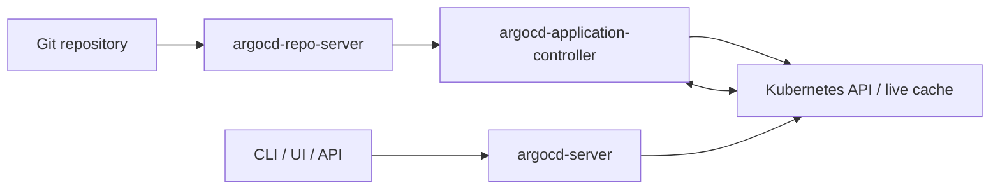

:::info Source status
The title and topic were cross-checked against the conversation history. The content below is a **detailed editorial reconstruction**, not a verbatim transcript of the entire original response.
:::

# Lesson 01: Argo CD Internal Architecture & Reconciliation Mechanism

## Learning objectives

Develop a solid understanding of **Argo CD internals, GitOps desired state, the application controller, the repo server, the live-state cache, sync, hooks, and drift**. Learn where controller responsibilities and ownership boundaries lie, and apply that knowledge in a lab on a test cluster.


## 1. What problem does GitOps solve?

In an imperative deployment workflow, an engineer runs `kubectl apply` directly. Multiple people can change the cluster state, making it unclear what the source of truth is. GitOps puts the *desired state* under version control. A controller observes the *live state*, compares it with the desired state, and makes the changes needed to move toward it.



**Argo CD does not turn Git into a database that is always immediately correct.** The system is built around reconciliation and eventual consistency. A successful sync confirms that the configuration was applied; it does not by itself prove that HTTP requests succeed or that the database accepts writes.

## 2. Internal components

| Component | Responsibility |
|---|---|
| `argocd-server` | API, UI, authentication, client interactions |
| `argocd-repo-server` | Fetch/caching source; render Kustomize, Helm, directory manifests |
| `argocd-application-controller` | Compares desired and live state, reconciles changes, orchestrates syncs, and assesses health |
| Redis | Caches data and supports Argo CD components; it is not the primary source of truth |
| Kubernetes API / etcd | Stores Application custom resources and Kubernetes resource state |
| Git / Helm / OCI source | Defines the desired application configuration |

An `Application` is a Kubernetes custom resource that contains `source`, `destination`, and `syncPolicy`. It does not embed every rendered manifest; the controller retrieves and renders the specified source. A source revision can be a commit SHA, a tag, or a branch. In production, it is important to understand the difference between mutable and immutable references.

## 3. Application CRD: declaring desired state

```yaml
apiVersion: argoproj.io/v1alpha1
kind: Application
metadata:
  name: payment
  namespace: argocd
spec:
  project: payment-team
  source:
    repoURL: https://github.com/example/payment-gitops.git
    targetRevision: main
    path: overlays/production
  destination:
    server: https://kubernetes.default.svc
    namespace: payments
  syncPolicy:
    automated:
      prune: false
      selfHeal: true
    syncOptions:
      - CreateNamespace=true
```

- `repoURL`, `path`, and `targetRevision` determine how Argo CD retrieves the desired manifests.
- `destination` selects the Kubernetes cluster and namespace.
- `project` provides governance within Argo CD; it does not replace Kubernetes RBAC.
- `prune: false` reduces the risk of accidentally deleting resources but can leave obsolete resources in place.
- `selfHeal: true` lets Argo CD correct drift automatically when live state differs from desired state.

## 4. How the reconciliation loop works

1. **Discover desired state:** The controller receives an Application event or refresh request, and the repo server fetches and renders the source.
2. **Discover live state:** The controller observes objects through Kubernetes watches, informers and caches, and resource tracking.
3. **Compare:** The diff engine distinguishes `Synced` from `OutOfSync` and accounts for differences that the configuration tells it to ignore.
4. **Plan operations:** The sync engine determines the order of operations, including hooks, waves, apply, and pruning, according to policy.
5. **Apply:** The Kubernetes API server handles admission and persistence; the controller cannot bypass RBAC or validation policies.
6. **Assess:** The health assessment logic uses resource-specific checks to identify states such as `Progressing`, `Healthy`, and `Degraded`.

```text
Git commit changes → repository refresh → render → compare → sync
                                                      ↓
                                      Kubernetes admission + controllers
                                                      ↓
                                         status/health reconciliation
```

A webhook from the Git provider can reduce the time it takes to detect a commit. Without a webhook, Argo CD supports periodic repository polling; the interval and jitter depend on the configuration. Do not hard-code a timing value as your GitOps SLO.

### Git refresh and jitter

A periodic application refresh checks the tracked source revision. The API server's webhook endpoint can also request a refresh when the Git provider reports a push. A refresh can reuse cached revision or manifest data when appropriate. The repo server resolves the source and generates desired manifests; the application controller compares the result with resources from its live-state cache. A webhook acknowledgement establishes receipt. Application status and operation results establish whether rendering and deployment succeeded. [Webhook configuration](https://argo-cd.readthedocs.io/en/stable/operator-manual/webhook/) · [High availability and caching](https://argo-cd.readthedocs.io/en/stable/operator-manual/high_availability/)

The documented periodic defaults are a 120-second base interval plus up to 60 seconds of random delay. The corresponding keys belong under `data` in `argocd-cm`:

```yaml
timeout.reconciliation: "120s"
timeout.reconciliation.jitter: "60s"
```

With 1,000 applications that become eligible simultaneously, a fixed interval can create one large refresh burst. Jitter spreads eligible refreshes across the following minute. Queue depth, worker capacity, source latency, and rendering time affect when the result appears. Backoff increases the wait after failures. Jitter spreads scheduling and can also be combined with retry backoff. Supported releases also provide separate webhook refresh jitter settings for pushes that affect many applications. [Argo CD FAQ](https://argo-cd.readthedocs.io/en/stable/faq/) · [ConfigMap settings](https://argo-cd.readthedocs.io/en/stable/operator-manual/argocd-cm-yaml/)

### From source change to rollout

Consider `payment-service`. Git initially renders three replicas of `payment:v1.0`. A new revision renders five replicas of `payment:v1.1`. A successful comparison reports `OutOfSync` while the live Deployment still has the previous spec. An eligible automatic sync or a manual sync applies the new manifest. Kubernetes then handles rollout. During that rollout Argo CD can show `Synced` and `Progressing` at the same time. A failed readiness check can keep the application progressing or lead to a degraded status even after configuration matches.

| Event | Comparison | Possible action |
| --- | --- | --- |
| New Git revision changes replicas from three to five | Desired five versus live three | Auto-sync can apply the revision |
| Someone scales the live Deployment to two at the already synced revision | Desired five versus live two | Self-heal can restore five when enabled and eligible |
| Git removes a tracked Service | Service exists only in the cluster | Automated prune can remove it when enabled |
| A referenced values file fails to render | Comparison cannot establish the new desired state | Inspect Application conditions and repo-server output |
| Spec matches but Pods fail probes | `Synced` can coexist with unhealthy rollout | Inspect Deployment conditions, Pods, and events |

Automated sync normally considers the revision and application parameters, including whether a sync already succeeded for that combination. Self-heal permits another sync for live drift, subject to policy and eligibility. The documented default self-heal timeout is five seconds. Observed repair time also includes watch delivery, queueing, apply and Kubernetes convergence. Multi-source Applications can sync because another source changes, so disabling self-heal alone does not guarantee live edits persist. [Automated sync semantics](https://argo-cd.readthedocs.io/en/stable/user-guide/auto_sync/)

### How Argo CD computes a difference

The application controller uses cluster List/Watch to populate and update its live-state cache. Resource tracking identifies which live objects belong to an Application. Depending on configuration, Argo CD uses a tracking annotation, a label, or both. On a live change, Argo CD can update its cache and enqueue an application refresh. After a restart, persisted Kubernetes objects and the source revision allow it to rebuild that view. Inspect the Application's operation state if a restart interrupted an active sync. [Resource tracking](https://argo-cd.readthedocs.io/en/stable/user-guide/resource_tracking/) · [Controller cache](https://argo-cd.readthedocs.io/en/stable/operator-manual/high_availability/)

Legacy diff uses desired state, live state and last-applied configuration where available. Server-Side Diff uses Server-Side Apply dry-run to predict the result for existing resources. The comparison strategy and the apply method describe different stages. Current stable documentation describes automatic Server-Side Diff when `ServerSideApply=true`, with an explicit opt-out. Earlier releases behave differently, so check the documentation for the installed version. Server-Side Diff can also be enabled explicitly. New objects skip its dry-run optimization, and including mutating webhook changes in comparison requires the corresponding compare option. [Diff strategies](https://argo-cd.readthedocs.io/en/stable/user-guide/diff-strategies/)

If an HPA controls replicas, remove the explicit replica count from the steady-state deployment declaration where appropriate and review field ownership during the transition. `ignoreDifferences` modifies comparison. `RespectIgnoreDifferences=true` also applies that rule during sync for existing objects. See [Lesson 02](./lesson-02-core-resources.md) and [Argo CD sync options](https://argo-cd.readthedocs.io/en/stable/user-guide/sync-options/).

## 5. Sync waves and hooks

A deployment can depend on a CRD, a database operator, and custom resources. Argo CD supports `argocd.argoproj.io/sync-wave` to order resources and hooks such as `PreSync`, `Sync`, and `PostSync` to run work in specific phases.

```yaml
apiVersion: batch/v1
kind: Job
metadata:
  name: payment-schema-check
  annotations:
    argocd.argoproj.io/hook: PreSync
    argocd.argoproj.io/hook-delete-policy: HookSucceeded
spec:
  template:
    spec:
      restartPolicy: Never
      containers:
        - name: check
          image: registry.example.com/schema-check@sha256:REPLACE_DIGEST
```

This is an example, not a migration job you can run as is. Migrations need backward compatibility, retries, locks, and a plan to roll back or fail forward. Sync waves do not guarantee that an external service is fully ready just because the YAML applied successfully.

## 6. Drift, self-healing, and field ownership

If someone edits `replicas` directly, Argo CD can detect the drift. But if the HPA is responsible for replicas, having Argo CD continually restore the value from Git can cause a reconciliation conflict. Be explicit about **which controller owns each field**; you may need `ignoreDifferences` and `RespectIgnoreDifferences`.

`Synced` describes whether configurations match, while `Healthy` reports the result of a health assessment. Neither is equivalent to end-to-end business success.

## 7. What happens if Argo CD restarts?

Application custom resources remain available through the Kubernetes API, desired manifests remain in Git, and running workloads continue operating through the Kubernetes data plane. When Argo CD comes back up, its controllers can list resources again, reestablish watches, and resume reconciliation. The impact still depends on the state of the Kubernetes API, the caches, and the external repositories. Do not treat the Redis cache as the sole store of state.

## 8. Lab

1. Create a minimal Kustomize repository with a Deployment and a Service.
2. Install Argo CD on a test cluster and create an Application.
3. Change the image tag or digest in Git and observe the output of `argocd app get payment` and `argocd app history payment`.
4. Edit a field directly that no other controller manages, and observe `OutOfSync`.
5. Toggle `selfHeal` to compare the behavior.
6. Try a manifest that an admission policy rejects. Observe the sync error rather than assuming GitOps bypasses the policy.

```bash
argocd app get payment
argocd app diff payment
kubectl get applications.argoproj.io -n argocd
kubectl describe application payment -n argocd
```

:::warning
Practice pruning and hook-based migrations in a test environment. Do not delete PVCs or databases just to observe auto-prune behavior.
:::

Continue with the [hands-on GitOps lab](../03-gitops-delivery/gitops-lab.md) or practice the comparison loop, jitter, and quiz in the [interactive exercises](../03-gitops-delivery/gitops-exercises.mdx).

## 9. Questions to consider

1. Why might Argo CD not have detected a change even though the Git commit exists?
2. Why does `Synced` not mean that HTTP requests succeed?
3. What happens if two controllers both manage `spec.replicas`?
4. Can the repo server and application controller scale independently?

**References:** [Argo CD Architecture](https://argo-cd.readthedocs.io/en/stable/operator-manual/architecture/) · [Automated Sync](https://argo-cd.readthedocs.io/en/stable/user-guide/auto_sync/) · [Sync Phases and Waves](https://argo-cd.readthedocs.io/en/stable/user-guide/sync-waves/).

## Deep dive: the boundary between GitOps and Kubernetes controllers

An `Application` is not itself a Deployment. It is a resource that declares the manifest source, destination, and sync policy. After Argo CD applies a Deployment, the Deployment controller determines the ReplicaSets and Pods, the scheduler assigns nodes, and the kubelet runs the containers. So *Does Argo CD create Pods itself?* has a two-part answer: Argo CD submits the desired Deployment to the API server, and the Kubernetes workload controllers create the Pods.

| Stage | Primary component | Status or signals to check |
|---|---|---|
| Helm/Kustomize rendering | `argocd-repo-server` | Manifest generation error, plugin timeout |
| Configuration comparison | `argocd-application-controller` | `Synced`, `OutOfSync`, comparison error |
| Apply | API server and admission | Sync operation result, RBAC or validation errors |
| Workload startup | Deployment controller / scheduler / kubelet | ReplicaSets, Pods, Events |
| Health assessment | Argo CD health assessment | `Healthy`, `Progressing`, `Degraded` |
| Business-level testing | Monitoring and synthetic tests | Error rate, latency, success rate |

In particular, `Synced` and `Healthy` do not mean the service can complete a transaction. An app can be `Synced` and its Pod `Ready` while IAM or a NetworkPolicy prevents it from connecting to the database.

### Live-state cache and eventual consistency

The application controller uses a cache so it does not have to issue `GET` requests continuously for tens of thousands of resource objects. Kubernetes watches deliver changes based on `resourceVersion`. When a watch closes or the cache fails, the controller needs to list resources again and reconcile. This is **eventual consistency**: a change in Git does not mean `Synced` status updates immediately.

A systematic debugging workflow:

```bash
argocd app get payment
argocd app diff payment
argocd app manifests payment
kubectl -n argocd get applications.argoproj.io payment -o yaml
kubectl -n argocd logs deploy/argocd-repo-server --tail=100
kubectl -n argocd get statefulsets,deployments | grep argocd
```

Argo CD workload names can vary by Helm release or HA architecture. Look up the actual resources rather than assuming every component is a Deployment.

### Reconciliation is not an ACID transaction

Suppose an application includes a Namespace, a CRD, a custom resource, and a Deployment. Argo CD can apply some objects successfully but be blocked on another. Earlier changes usually do not all roll back automatically as they would in a database transaction. Sync waves and hooks help sequence operations but do not guarantee an *atomic rollout*. A migration therefore needs backward compatibility, readiness, and a recovery plan.

**Ownership example with an HPA:** If Git specifies `spec.replicas: 3` and the HPA wants 8 replicas, Argo CD self-healing can compete for the field. Agree on ownership: the HPA manages the replica count; Argo CD manages the image, environment variables, and any other fields assigned to it. Do not use `ignoreDifferences` indiscriminately to hide real drift.

### Common failures and how to find the right layer

| Symptom | Likely layer | Action |
|---|---|---|
| `ComparisonError` | Repo server, Helm, permissions, plugin | Check the generation logs and source revision |
| Persistent `OutOfSync` | Diff, policy, field manager ownership | Run `argocd app diff` and check `managedFields` |
| `SyncFailed` | API admission, RBAC, CRD ordering | Check the operation result and Kubernetes Events |
| `Synced` but not `Ready` | Kubernetes controllers or runtime | Run `kubectl describe pod` and check probes, CSI, and image pulls |
| Commit not detected | Repository polling, webhook, credentials | Refresh the app and check repository reachability |

### Advanced lab

1. Create an application with a ConfigMap and a Deployment. Record the Git SHA and `Synced` status.
2. Edit an annotation with `kubectl annotate` to see whether Argo CD detects drift.
3. Create an admission policy that applies only to the lab namespace and deliberately causes a sync failure.
4. Correct the policy and sync again. Compare the operation history with Pod readiness.
5. Restart the application controller in the lab environment and confirm that running workloads do not disappear.

**End-of-lesson questions:** What is the source of truth for the desired image? Why might `kubectl apply` succeed while Argo CD reports `Degraded`? What is a controller tug-of-war?

Verification sources: [Argo CD architecture](https://argo-cd.readthedocs.io/en/stable/operator-manual/architecture/), [Application spec](https://argo-cd.readthedocs.io/en/stable/user-guide/application-specification/), [Diff strategies](https://argo-cd.readthedocs.io/en/stable/user-guide/diff-strategies/).

## Summary and practical implications

- Separate desired state from observed state and identify the correct owner for each field and resource.
- Do not equate a successful API operation with an external system being ready to serve traffic.
- Check IAM and RBAC, readiness, the data lifecycle, and recoverability before using this in production.

[Back to the Learning Path](../learning-path.md)
