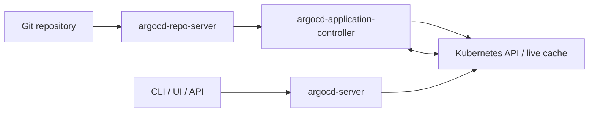
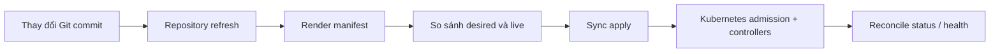

# Bài 01: Kiến trúc nội bộ & cơ chế reconciliation của Argo CD

## Mục tiêu học tập

- **Kiến trúc nội bộ Argo CD:** Phân biệt vai trò của `argocd-server`, `argocd-repo-server`, `argocd-application-controller`, Redis và Kubernetes etcd trong việc khai báo và reconcile các tài nguyên `Application`.
- **Vòng lặp reconciliation và cơ chế refresh:** Theo dõi cách Git webhook, polling định kỳ có jitter, bước render manifest và live-state cache đưa trạng thái cluster hội tụ theo mô hình nhất quán cuối cùng (eventual consistency).
- **Chiến lược diff và điều phối sync:** So sánh legacy diff với Server-Side Diff, đồng thời sắp xếp thứ tự triển khai có phụ thuộc một cách an toàn bằng sync waves và lifecycle hooks (`PreSync`, `Sync`, `PostSync`).
- **Drift, self-healing và field ownership:** Tách bạch trạng thái `Synced` với mức độ sẵn sàng `Healthy`, đồng thời tránh hiện tượng kéo co giữa các controller (như Argo CD và HPA trên `spec.replicas`) nhờ phân định quyền sở hữu rõ ràng và cấu hình `ignoreDifferences` có mục tiêu.
- **Khoanh vùng lỗi và khôi phục:** Chẩn đoán sự cố qua các lớp render, so sánh, admission và runtime, đồng thời hiểu rõ vì sao việc khởi động lại Argo CD không làm gián đoạn các workload đang chạy.

## 1. GitOps giải quyết vấn đề gì?

Trong quy trình triển khai theo kiểu mệnh lệnh (imperative), kỹ sư chạy trực tiếp `kubectl apply`. Nhiều người có thể cùng thay đổi trạng thái cluster, khiến việc xác định đâu là nguồn sự thật duy nhất (source of truth) trở nên mơ hồ. GitOps đưa *trạng thái mong muốn* (desired state) vào hệ thống quản lý phiên bản. Một controller sẽ quan sát *trạng thái thực tế* (live state), so sánh với trạng thái mong muốn và thực hiện các thay đổi cần thiết để hội tụ về trạng thái mong muốn.



**Argo CD không biến Git thành một cơ sở dữ liệu luôn đúng ngay lập tức.** Hệ thống được xây dựng xoay quanh cơ chế reconciliation và tính nhất quán cuối cùng (eventual consistency). Một lần sync thành công chỉ xác nhận rằng cấu hình đã được apply; bản thân nó không chứng minh rằng các yêu cầu HTTP đang thành công hay cơ sở dữ liệu đang chấp nhận ghi dữ liệu.

## 2. Các thành phần nội bộ

| Thành phần | Trách nhiệm |
|---|---|
| `argocd-server` | Cung cấp API, UI, xác thực và xử lý tương tác từ client |
| `argocd-repo-server` | Tải/cache mã nguồn; render các manifest từ Kustomize, Helm hoặc thư mục thuần |
| `argocd-application-controller` | So sánh desired state và live state, reconcile các thay đổi, điều phối sync và đánh giá health |
| Redis | Cache dữ liệu và hỗ trợ các thành phần của Argo CD; không phải nguồn sự thật chính |
| Kubernetes API / etcd | Lưu trữ custom resource `Application` và trạng thái tài nguyên Kubernetes |
| Nguồn Git / Helm / OCI | Định nghĩa cấu hình ứng dụng mong muốn |

Một `Application` là một Kubernetes custom resource chứa `source`, `destination` và `syncPolicy`. Nó không nhúng sẵn toàn bộ manifest đã render; controller sẽ tải về và render từ nguồn đã khai báo. Revision nguồn có thể là một commit SHA, một tag hoặc một branch. Trong môi trường production, việc hiểu rõ sự khác biệt giữa tham chiếu có thể thay đổi (mutable) và bất biến (immutable) là rất quan trọng.

## 3. Application CRD: khai báo trạng thái mong muốn

```yaml
apiVersion: argoproj.io/v1alpha1
kind: Application
metadata:
  name: payment
  namespace: argocd
spec:
  project: payment-team
  source:
    repoURL: https://github.com/example/payment-gitops.git
    targetRevision: main
    path: overlays/production
  destination:
    server: https://kubernetes.default.svc
    namespace: payments
  syncPolicy:
    automated:
      prune: false
      selfHeal: true
    syncOptions:
      - CreateNamespace=true
```

- `repoURL`, `path` và `targetRevision` xác định cách Argo CD lấy các manifest mong muốn.
- `destination` chọn cluster và namespace Kubernetes đích.
- `project` cung cấp cơ chế quản trị (governance) trong phạm vi Argo CD; nó không thay thế Kubernetes RBAC.
- `prune: false` giúp giảm nguy cơ vô tình xóa tài nguyên, nhưng có thể để lại các tài nguyên lỗi thời trong cluster.
- `selfHeal: true` cho phép Argo CD tự động khắc phục drift khi live state khác với desired state.

## 4. Vòng lặp reconciliation hoạt động như thế nào?

1. **Khám phá desired state:** Controller nhận một sự kiện của `Application` hoặc yêu cầu refresh, sau đó repo server tải về và render mã nguồn.
2. **Khám phá live state:** Controller quan sát các đối tượng thông qua Kubernetes watch, informer, cache và cơ chế resource tracking.
3. **So sánh:** Diff engine phân biệt giữa `Synced` và `OutOfSync`, đồng thời bỏ qua những khác biệt đã được cấu hình cho phép bỏ qua.
4. **Lập kế hoạch thao tác:** Sync engine xác định thứ tự thực thi bao gồm hooks, waves, apply và pruning dựa trên chính sách đã cấu hình.
5. **Apply:** Kubernetes API server xử lý admission và lưu trữ; controller không thể vượt qua RBAC hay các chính sách kiểm tra hợp lệ (validation policy).
6. **Đánh giá:** Logic đánh giá health sử dụng các kiểm tra đặc thù theo từng loại tài nguyên để xác định các trạng thái như `Progressing`, `Healthy` và `Degraded`.



Webhook từ nhà cung cấp Git có thể rút ngắn thời gian phát hiện commit mới. Nếu không có webhook, Argo CD hỗ trợ polling repository định kỳ; chu kỳ và jitter phụ thuộc vào cấu hình. Đừng gán cứng một mốc thời gian cố định làm SLO cho hệ thống GitOps của bạn.

### Git refresh và jitter

Một đợt refresh ứng dụng định kỳ sẽ kiểm tra revision nguồn đang được theo dõi. Endpoint webhook của API server cũng có thể yêu cầu refresh khi nhà cung cấp Git báo có push mới. Quá trình refresh có thể tái sử dụng dữ liệu revision hoặc manifest đã cache khi phù hợp. Repo server phân giải nguồn và sinh ra các manifest mong muốn; application controller so sánh kết quả đó với các tài nguyên trong live-state cache của mình. Phản hồi xác nhận webhook chỉ chứng tỏ đã tiếp nhận tín hiệu. Trạng thái của `Application` và kết quả thao tác (operation result) mới cho biết việc render và triển khai có thành công hay không. [Cấu hình webhook](https://argo-cd.readthedocs.io/en/stable/operator-manual/webhook/) · [High availability và caching](https://argo-cd.readthedocs.io/en/stable/operator-manual/high_availability/)

Giá trị mặc định được ghi trong tài liệu là chu kỳ cơ sở 120 giây cộng thêm độ trễ ngẫu nhiên tối đa 60 giây. Các khóa cấu hình tương ứng nằm dưới mục `data` trong `argocd-cm`:

```yaml
timeout.reconciliation: "120s"
timeout.reconciliation.jitter: "60s"
```

Với 1.000 ứng dụng cùng đến hạn refresh tại một thời điểm, chu kỳ cố định có thể tạo ra một đợt bùng nổ tải (refresh burst) rất lớn. Jitter giúp dàn trải các đợt refresh đủ điều kiện ra trong phút tiếp theo. Độ sâu hàng đợi (queue depth), năng lực worker, độ trễ từ nguồn Git và thời gian render đều ảnh hưởng đến thời điểm kết quả xuất hiện. Backoff sẽ tăng thời gian chờ sau mỗi lần thất bại. Jitter giúp phân tán lịch chạy và cũng có thể kết hợp với retry backoff. Các phiên bản được hỗ trợ còn cung cấp thiết lập jitter riêng cho webhook refresh khi một lần push ảnh hưởng đến nhiều ứng dụng. [Argo CD FAQ](https://argo-cd.readthedocs.io/en/stable/faq/) · [Cấu hình ConfigMap](https://argo-cd.readthedocs.io/en/stable/operator-manual/argocd-cm-yaml/)

### Từ thay đổi mã nguồn đến rollout

Xét dịch vụ `payment-service`. Ban đầu Git render ra ba replica của `payment:v1.0`. Một revision mới render năm replica của `payment:v1.1`. Khi so sánh thành công, hệ thống báo `OutOfSync` trong khi Deployment đang chạy vẫn giữ spec cũ. Một lần auto-sync đủ điều kiện hoặc sync thủ công sẽ apply manifest mới. Sau đó Kubernetes đảm nhiệm việc rollout. Trong quá trình rollout đó, Argo CD có thể hiển thị đồng thời `Synced` và `Progressing`. Nếu readiness check thất bại, ứng dụng có thể tiếp tục ở trạng thái progressing hoặc chuyển sang degraded ngay cả khi cấu hình đã khớp.

| Sự kiện | So sánh | Hành động có thể xảy ra |
| --- | --- | --- |
| Revision Git mới đổi số replica từ 3 lên 5 | Desired là 5 so với live là 3 | Auto-sync có thể apply revision mới |
| Ai đó scale trực tiếp Deployment xuống 2 tại revision đã sync | Desired là 5 so với live là 2 | Self-heal có thể khôi phục về 5 nếu được bật và đủ điều kiện |
| Git xóa một Service đang được theo dõi | Service chỉ còn tồn tại trong cluster | Automated prune có thể xóa nó nếu được bật |
| File values được tham chiếu bị lỗi render | Không thể so sánh để xác định desired state mới | Kiểm tra condition của Application và log của repo-server |
| Spec khớp nhưng Pod lỗi probe | `Synced` có thể tồn tại song song với rollout không khỏe mạnh | Kiểm tra condition của Deployment, Pod và các event |

Auto-sync thông thường xem xét revision và tham số ứng dụng, bao gồm việc liệu đã từng sync thành công cho tổ hợp đó chưa. Self-heal cho phép thực hiện thêm một lần sync khi phát hiện live drift, tuân theo policy và điều kiện áp dụng. Thời gian chờ self-heal mặc định theo tài liệu là năm giây. Thời gian khắc phục thực tế còn bao gồm thời gian chuyển phát watch, xếp hàng, apply và thời gian hội tụ của Kubernetes. Các Application đa nguồn (multi-source) có thể sync do một nguồn khác thay đổi, vì vậy chỉ tắt self-heal thôi không đảm bảo các chỉnh sửa trực tiếp trên cluster sẽ được giữ nguyên. [Cơ chế automated sync](https://argo-cd.readthedocs.io/en/stable/user-guide/auto_sync/)

### Cách Argo CD tính toán khác biệt (diff)

Application controller sử dụng List/Watch trên cluster để khởi tạo và cập nhật live-state cache. Cơ chế resource tracking xác định đối tượng live nào thuộc về Application nào. Tùy theo cấu hình, Argo CD dùng tracking annotation, label hoặc cả hai. Khi có thay đổi live, Argo CD có thể cập nhật cache và đưa yêu cầu refresh ứng dụng vào hàng đợi. Sau khi khởi động lại, các đối tượng Kubernetes đã được lưu trữ cùng với revision nguồn cho phép controller tái tạo lại góc nhìn đó. Hãy kiểm tra trạng thái thao tác (operation state) của Application nếu việc khởi động lại làm gián đoạn một lần sync đang chạy. [Resource tracking](https://argo-cd.readthedocs.io/en/stable/user-guide/resource_tracking/) · [Controller cache](https://argo-cd.readthedocs.io/en/stable/operator-manual/high_availability/)

Legacy diff sử dụng desired state, live state và cấu hình last-applied nếu có. Server-Side Diff sử dụng Server-Side Apply dry-run để dự đoán kết quả cho các tài nguyên đã tồn tại. Chiến lược so sánh và phương thức apply là hai giai đoạn khác nhau. Tài liệu bản ổn định hiện tại mô tả Server-Side Diff được tự động kích hoạt khi `ServerSideApply=true`, kèm tùy chọn tắt tường minh. Các phiên bản cũ hơn có thể hoạt động khác, vì vậy hãy kiểm tra tài liệu của đúng phiên bản đang cài đặt. Bạn cũng có thể bật Server-Side Diff một cách tường minh. Các đối tượng mới sẽ bỏ qua bước tối ưu dry-run này, và để tính cả thay đổi từ mutating webhook vào phép so sánh, cần bật tùy chọn compare tương ứng. [Chiến lược diff](https://argo-cd.readthedocs.io/en/stable/user-guide/diff-strategies/)

Nếu HPA quản lý số replica, hãy lược bỏ khai báo số replica tường minh khỏi Deployment ở trạng thái ổn định khi phù hợp và rà soát quyền sở hữu trường (field ownership) trong giai đoạn chuyển đổi. `ignoreDifferences` thay đổi hành vi so sánh. `RespectIgnoreDifferences=true` áp dụng quy tắc đó cả trong quá trình sync đối với các đối tượng đã tồn tại. Xem thêm [Bài 02](./lesson-02-core-resources.md) và [Tùy chọn sync của Argo CD](https://argo-cd.readthedocs.io/en/stable/user-guide/sync-options/).

## 5. Sync waves và hooks

Một đợt triển khai có thể phụ thuộc vào CRD, database operator và các custom resource. Argo CD hỗ trợ `argocd.argoproj.io/sync-wave` để sắp xếp thứ tự tài nguyên và các hook như `PreSync`, `Sync`, `PostSync` để chạy tác vụ ở từng giai đoạn cụ thể.

```yaml
apiVersion: batch/v1
kind: Job
metadata:
  name: payment-schema-check
  annotations:
    argocd.argoproj.io/hook: PreSync
    argocd.argoproj.io/hook-delete-policy: HookSucceeded
spec:
  template:
    spec:
      restartPolicy: Never
      containers:
        - name: check
          image: registry.example.com/schema-check@sha256:REPLACE_DIGEST
```

Đây chỉ là ví dụ minh họa, không phải một migration job có thể chạy ngay trên thực tế. Migration cần tính tương thích ngược, cơ chế retry, khóa (lock) và kế hoạch rollback hoặc fail-forward. Sync waves không đảm bảo một dịch vụ bên ngoài đã hoàn toàn sẵn sàng chỉ vì file YAML được apply thành công.

## 6. Drift, self-healing và field ownership

Nếu ai đó chỉnh sửa trực tiếp `replicas`, Argo CD có thể phát hiện drift. Tuy nhiên, nếu HPA chịu trách nhiệm quản lý replicas, việc để Argo CD liên tục ghi đè lại giá trị từ Git sẽ gây ra xung đột reconciliation. Hãy xác định rõ **controller nào sở hữu trường nào**; bạn có thể cần đến `ignoreDifferences` và `RespectIgnoreDifferences`.

`Synced` mô tả cấu hình có khớp hay không, trong khi `Healthy` phản ánh kết quả đánh giá tình trạng sức khỏe. Không trạng thái nào trong hai trạng thái này đồng nghĩa với việc nghiệp vụ đầu-cuối (end-to-end) đang hoạt động thành công.

## 7. Điều gì xảy ra nếu Argo CD khởi động lại?

Các custom resource `Application` vẫn khả dụng qua Kubernetes API, các manifest mong muốn vẫn nằm trong Git, và các workload đang chạy vẫn tiếp tục hoạt động bình thường trên Kubernetes data plane. Khi Argo CD khởi động lại, các controller sẽ list lại tài nguyên, thiết lập lại watch và tiếp tục quá trình reconciliation. Mức độ ảnh hưởng vẫn phụ thuộc vào trạng thái của Kubernetes API, các lớp cache và các repository bên ngoài. Đừng xem Redis cache là nơi lưu trữ trạng thái duy nhất.

## 8. Bài lab

1. Tạo một repository Kustomize tối giản gồm một Deployment và một Service.
2. Cài đặt Argo CD trên một cluster thử nghiệm và tạo một Application.
3. Thay đổi image tag hoặc digest trong Git rồi quan sát kết quả của `argocd app get payment` và `argocd app history payment`.
4. Chỉnh sửa trực tiếp một trường không do controller nào khác quản lý và quan sát trạng thái `OutOfSync`.
5. Bật/tắt `selfHeal` để so sánh hành vi.
6. Thử một manifest bị admission policy từ chối. Quan sát lỗi sync thay vì giả định rằng GitOps có thể bỏ qua policy.

```bash
argocd app get payment
argocd app diff payment
kubectl get applications.argoproj.io -n argocd
kubectl describe application payment -n argocd
```

:::warning
Chỉ thực hành pruning và migration bằng hook trong môi trường thử nghiệm. Không xóa PVC hay cơ sở dữ liệu chỉ để quan sát hành vi auto-prune.
:::

Tiếp tục với [bài lab GitOps thực hành](../03-gitops-delivery/gitops-lab.md) hoặc luyện tập vòng lặp so sánh, jitter và bài trắc nghiệm trong [bài tập tương tác](../03-gitops-delivery/gitops-exercises.mdx).

## 9. Câu hỏi suy ngẫm

1. Tại sao Argo CD có thể chưa phát hiện thay đổi dù commit trên Git đã tồn tại?
2. Tại sao `Synced` không đồng nghĩa với việc các yêu cầu HTTP thành công?
3. Điều gì xảy ra nếu hai controller cùng quản lý `spec.replicas`?
4. Repo server và application controller có thể scale độc lập với nhau không?

**Tài liệu tham khảo:** [Kiến trúc Argo CD](https://argo-cd.readthedocs.io/en/stable/operator-manual/architecture/) · [Automated Sync](https://argo-cd.readthedocs.io/en/stable/user-guide/auto_sync/) · [Sync Phases and Waves](https://argo-cd.readthedocs.io/en/stable/user-guide/sync-waves/).

## Phân tích chuyên sâu: ranh giới giữa GitOps và Kubernetes controllers

Bản thân `Application` không phải là một Deployment. Nó là tài nguyên khai báo nguồn manifest, đích triển khai và chính sách sync. Sau khi Argo CD apply một Deployment, Deployment controller sẽ quyết định ReplicaSet và Pod, scheduler gán node và kubelet chạy các container. Do đó, câu hỏi *Argo CD có tự tạo Pod không?* có câu trả lời hai vế: Argo CD gửi Deployment mong muốn lên API server, còn các workload controller của Kubernetes mới là bên tạo ra Pod.

| Giai đoạn | Thành phần chính | Trạng thái hoặc tín hiệu cần kiểm tra |
|---|---|---|
| Render Helm/Kustomize | `argocd-repo-server` | Lỗi sinh manifest, plugin timeout |
| So sánh cấu hình | `argocd-application-controller` | `Synced`, `OutOfSync`, comparison error |
| Apply | API server và admission | Kết quả thao tác sync, lỗi RBAC hoặc validation |
| Khởi chạy workload | Deployment controller / scheduler / kubelet | ReplicaSets, Pods, Events |
| Đánh giá health | Bộ đánh giá health của Argo CD | `Healthy`, `Progressing`, `Degraded` |
| Kiểm thử mức nghiệp vụ | Giám sát và synthetic test | Tỷ lệ lỗi, độ trễ, tỷ lệ thành công |

Đặc biệt, `Synced` và `Healthy` không có nghĩa là dịch vụ có thể hoàn thành một giao dịch. Một ứng dụng có thể đang `Synced` và Pod ở trạng thái `Ready`, nhưng IAM hoặc NetworkPolicy lại chặn nó kết nối tới cơ sở dữ liệu.

### Live-state cache và eventual consistency

Application controller dùng cache để không phải liên tục gửi yêu cầu `GET` cho hàng chục nghìn đối tượng tài nguyên. Kubernetes watch chuyển phát thay đổi dựa trên `resourceVersion`. Khi kết nối watch đóng hoặc cache gặp lỗi, controller cần list lại tài nguyên và reconcile. Đây là **eventual consistency**: một thay đổi trong Git không đồng nghĩa trạng thái `Synced` sẽ cập nhật ngay lập tức.

Quy trình debug có hệ thống:

```bash
argocd app get payment
argocd app diff payment
argocd app manifests payment
kubectl -n argocd get applications.argoproj.io payment -o yaml
kubectl -n argocd logs deploy/argocd-repo-server --tail=100
kubectl -n argocd get statefulsets,deployments | grep argocd
```

Tên workload của Argo CD có thể khác nhau tùy theo Helm release hoặc kiến trúc HA. Hãy tra cứu tài nguyên thực tế thay vì mặc định mọi thành phần đều là Deployment.

### Reconciliation không phải là giao dịch ACID

Giả sử một ứng dụng gồm Namespace, CRD, custom resource và Deployment. Argo CD có thể apply thành công một số đối tượng nhưng bị chặn ở đối tượng khác. Những thay đổi trước đó thường không tự động rollback toàn bộ như một giao dịch cơ sở dữ liệu. Sync waves và hooks giúp sắp xếp thứ tự thao tác nhưng không đảm bảo một *atomic rollout*. Do đó, mọi migration đều cần tính tương thích ngược, kiểm tra readiness và phương án khôi phục.

**Ví dụ về quyền sở hữu với HPA:** Nếu Git khai báo `spec.replicas: 3` còn HPA muốn 8 replica, cơ chế self-healing của Argo CD có thể tranh giành trường này. Hãy thống nhất quyền sở hữu: HPA quản lý số replica; Argo CD quản lý image, biến môi trường và các trường được giao khác. Đừng lạm dụng `ignoreDifferences` một cách bừa bãi để che giấu drift thực sự.

### Các lỗi thường gặp và cách xác định đúng lớp gây lỗi

| Triệu chứng | Lớp có khả năng gây lỗi | Hành động |
|---|---|---|
| `ComparisonError` | Repo server, Helm, quyền truy cập, plugin | Kiểm tra log sinh manifest và revision nguồn |
| `OutOfSync` kéo dài | Diff, policy, quyền sở hữu field manager | Chạy `argocd app diff` và kiểm tra `managedFields` |
| `SyncFailed` | API admission, RBAC, thứ tự CRD | Kiểm tra kết quả thao tác và Kubernetes Events |
| `Synced` nhưng chưa `Ready` | Kubernetes controllers hoặc runtime | Chạy `kubectl describe pod` và kiểm tra probe, CSI, kéo image |
| Không phát hiện commit | Repository polling, webhook, credentials | Refresh ứng dụng và kiểm tra khả năng kết nối repository |

### Bài lab nâng cao

1. Tạo một ứng dụng gồm một ConfigMap và một Deployment. Ghi lại Git SHA và trạng thái `Synced`.
2. Chỉnh sửa một annotation bằng `kubectl annotate` để xem Argo CD có phát hiện drift hay không.
3. Tạo một admission policy chỉ áp dụng cho namespace của bài lab và cố tình gây ra lỗi sync.
4. Sửa lại policy và sync lần nữa. So sánh lịch sử thao tác với trạng thái sẵn sàng của Pod.
5. Khởi động lại application controller trong môi trường lab và xác nhận rằng các workload đang chạy không bị biến mất.

**Câu hỏi cuối bài:** Đâu là nguồn sự thật cho image mong muốn? Tại sao `kubectl apply` có thể thành công nhưng Argo CD lại báo `Degraded`? Hiện tượng "kéo co giữa các controller" (controller tug-of-war) là gì?

Nguồn kiểm chứng: [Kiến trúc Argo CD](https://argo-cd.readthedocs.io/en/stable/operator-manual/architecture/), [Đặc tả Application](https://argo-cd.readthedocs.io/en/stable/user-guide/application-specification/), [Chiến lược diff](https://argo-cd.readthedocs.io/en/stable/user-guide/diff-strategies/).

## Tóm tắt và lưu ý thực tiễn

- Tách bạch desired state khỏi observed state và xác định đúng chủ sở hữu cho từng trường và tài nguyên.
- Không đánh đồng một thao tác API thành công với việc hệ thống bên ngoài đã sẵn sàng phục vụ lưu lượng.
- Kiểm tra IAM và RBAC, readiness, vòng đời dữ liệu và khả năng khôi phục trước khi áp dụng lên production.

[Quay lại Lộ trình học tập](../learning-path.md)
