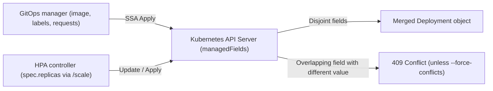

# Lesson 02: Kubernetes Server-Side Apply, Field Ownership & Conflict Resolution

## Learning objectives

- **Client-Side Apply vs. Server-Side Apply:** Contrast client-side three-way merge using `last-applied-configuration` with server-side structured merge and declarative field management.
- **Field ownership and `managedFields`:** Inspect `manager`, `operation` (`Apply` vs. `Update`), `subresource`, and `fieldsV1` entries to verify which actor owns each field without confusing ownership with RBAC.
- **Conflict detection and resolution:** Reproduce HTTP `409 Conflict` on overlapping fields, understand shared ownership on identical values, and evaluate the governance risks of `--force-conflicts`.
- **Coordinated multi-controller ownership:** Divide responsibilities across GitOps, HPA, and workload controllers, and execute safe replica-count handoffs or targeted `ignoreDifferences` with `RespectIgnoreDifferences=true`.
- **Omission, `null`, and deletion semantics:** Predict when omitting a previously owned field removes it, resets it to an API default, or preserves a co-owner's value during SSA and CSA transitions.

## 1. What problem does Server-Side Apply solve?

Multiple actors can modify a Kubernetes object: Argo CD manages the image, an HPA manages replicas, an admission webhook adds labels, and an operator manages status. If every actor submits a complete copy of the object, one actor can overwrite another's changes. **Server-Side Apply (SSA)** uses declarative field management in the Kubernetes API server to calculate changes and detect ownership conflicts.



### Declarative intent at two levels

Running `kubectl -n default scale deployment/payment-service --replicas=3` requests a one-time update to an existing Deployment's scale. The Deployment controller still reconciles the resulting replica count. A checked-in declaration records the desired Deployment so a tool such as Argo CD can render it, compare it against the cluster, and apply it again according to policy.

```yaml
apiVersion: apps/v1
kind: Deployment
metadata:
  name: payment-service
  namespace: default
spec:
  replicas: 3
  selector:
    matchLabels:
      app: payment
  template:
    metadata:
      labels:
        app: payment
    spec:
      containers:
        - name: payment
          image: nginx:1.27
```

With SSA, a manager's **intent** includes the fields it claims and their desired values. Managers can each submit a partial intent for the same existing object. For example, Team A may maintain the image of the `payment` container while Team B maintains replicas. Someone still has to maintain the selector, Pod labels, and other required fields. The API schema determines which fields or list entries can be managed independently.

## 2. Client-Side Apply versus Server-Side Apply

| | Traditional Client-Side Apply (CSA) | Server-Side Apply |
|---|---|---|
| Where the merge is calculated | kubectl/client | API server |
| Main inputs | Last-applied annotation + local manifest + live object | Apply intent + managedFields/schema |
| Ownership | Does not enforce field ownership the way SSA does | Field managers own field paths |
| Conflicts | Can overwrite changes unintentionally | Can return `409 Conflict` |

CSA's three-way merge considers the original, modified, and current configurations. SSA is built on structured-merge-diff and type information from the schema.

SSA reached stable status in Kubernetes 1.22. In CSA, **original** is the last-applied configuration in `kubectl.kubernetes.io/last-applied-configuration`, **modified** is the new local manifest, and **current** is the live object. If the old replica declaration was three and you change it to five, the client uses those inputs to build its patch. For SSA, the client submits the fields it intends to manage. The API server merges that intent with the live object using the schema, checks for ownership conflicts, and updates the object and the field sets when the request succeeds.

```bash
kubectl apply -f deployment.yaml
kubectl apply --server-side --field-manager=platform-team -f deployment.yaml
```

These are alternative apply methods to compare in a sandbox. The server can record a CSA patch in `managedFields` with `operation: Update` even though CSA calculates its patch on the client. [Declarative configuration](https://kubernetes.io/docs/tasks/manage-kubernetes-objects/declarative-config/) · [Server-Side Apply](https://kubernetes.io/docs/reference/using-api/server-side-apply/)

### Trace the same replica drift through CSA and SSA

Start with a Deployment declared at three replicas. An external writer changes the live count to eight. For the **CSA** run, the last-applied annotation still contains three. For the **SSA** run, assume the external writer now owns `spec.replicas` and the original applier no longer owns it. These are independent scenarios.

| Next declaration | Client-side apply | Server-side apply by the original manager |
| --- | --- | --- |
| Keep `replicas: 3` | Sets live to three. The local value differs from live even though it equals the last-applied value. | Returns `409 Conflict` and leaves live at eight. |
| Change to `replicas: 5` | Sets live to five. | Returns `409 Conflict` and leaves live at eight. |
| Omit `replicas` | Clears the field because it was in the last-applied annotation. The Deployment default is one. | Leaves live at eight because the other manager owns the field. |
| Declare `replicas: 8` | Leaves live at eight and records the new declaration. | Accepts the same value and shares ownership. |

In CSA, kubectl uses **modified versus live** to determine values to set and **original versus modified** to identify fields removed from the declaration. An unchanged YAML file can therefore restore a declared field that drifted in the cluster. If a field was absent from both the original and modified CSA configurations, CSA preserves a value written independently on the live object. This is how a field that was never declared can remain at eight after a CSA run. [Kubernetes declarative patch calculation](https://kubernetes.io/docs/tasks/manage-kubernetes-objects/declarative-config/#how-apply-calculates-differences-and-merges-changes)

Preview the CSA case in a sandbox using the full three-replica manifest above as `payment-service.yaml`. The server dry run returns the predicted replica count while leaving the live count at eight. Keep HPA and Argo CD out of this isolated exercise so they cannot change the count between commands.

```bash
kubectl apply --server-side=false -f payment-service.yaml
kubectl -n default scale deployment/payment-service --replicas=8
kubectl apply --server-side=false --dry-run=server -f payment-service.yaml \
  -o jsonpath='{.spec.replicas}{"\n"}'
kubectl -n default get deployment payment-service -o jsonpath='{.spec.replicas}{"\n"}'
```

Expected output for the last two commands is three and eight, respectively. Running the first apply command again for real writes three back to the live Deployment. CSA also stores the applied configuration in an annotation, so large configurations can run into metadata size limits. SSA tracks field sets without relying on that annotation for ordinary applies. [Argo CD SSA sync option](https://argo-cd.readthedocs.io/en/stable/user-guide/sync-options/#server-side-apply)

### Inspect the SSA request and conflict

A client applying to the existing Deployment can send a request of this form:

```http
PATCH /apis/apps/v1/namespaces/default/deployments/payment-service?fieldManager=team-a
Content-Type: application/apply-patch+yaml
```

The body carries Team A's apply intent. The server merges it using the schema, current object, and managed field sets. If Team A submits three replicas while another manager owns the current value of eight, expect an error such as `conflict with "team-b" using apps/v1: .spec.replicas` when that other manager is Team B. The request does not write the conflicting value. An authorized non-apply operation such as `/scale` can still change it and move ownership. [SSA serialization and field management](https://kubernetes.io/docs/reference/using-api/server-side-apply/#serialization)

Try the [CSA and SSA comparison exercise](../03-gitops-delivery/gitops-exercises.mdx#compare-csa-and-ssa-after-live-drift) to predict each outcome.

## 3. What is `managedFields`?

```yaml
metadata:
  managedFields:
    - manager: gitops-controller
      operation: Apply
      apiVersion: apps/v1
      fieldsType: FieldsV1
      fieldsV1:
        f:spec:
          f:replicas: {}
```

This is an illustrative snippet. The actual `fieldsV1` structure is more detailed and varies with the object and its subfields. The API server uses `managedFields` metadata to track which actor owns which fields; it is **not an access control mechanism**. An actor still needs Kubernetes RBAC permission for the API operation on the resource, regardless of field ownership.

The API server persists `managedFields` with the Kubernetes object. `manager` is a field-manager identifier, which clients can supply with `--field-manager`. The authenticated identity and its RBAC permissions are evaluated separately. `operation: Apply` indicates SSA, while `operation: Update` can represent a normal update or a non-apply patch, including a write from a CSA client. `apiVersion` identifies the schema version used to represent the fields, and `subresource` can identify writes through endpoints such as `scale` and `status`.

A Deployment's Pod template can have an `Apply` owner while the replica count has a separate `Update` owner from `/scale`. In `fieldsV1`, `f:` identifies a field, `k:` identifies a keyed list entry, and `v:` identifies a set value. For example, a keyed entry for a named container can appear as `k:{"name":"payment"}`. Inspect the entries instead of assuming a controller's manager name or field set:

```bash
kubectl -n production get deployment payment-service -o yaml --show-managed-fields
kubectl -n production get deployment payment-service -o json --show-managed-fields |
  jq '.metadata.managedFields[] | {manager, operation, apiVersion, subresource, fieldsV1}'
```

[Kubernetes managed fields](https://kubernetes.io/docs/reference/using-api/server-side-apply/#field-management)

## 4. Observe an ownership conflict

Create `/tmp/payment-a.yaml`:

```yaml
apiVersion: apps/v1
kind: Deployment
metadata:
  name: payment
  namespace: default
spec:
  replicas: 2
  selector:
    matchLabels: {app: payment}
  template:
    metadata:
      labels: {app: payment}
    spec:
      containers:
        - name: payment
          image: nginx:1.27
```

Apply the manifest using the first manager:

```bash
kubectl apply --server-side --field-manager=platform-gitops -f /tmp/payment-a.yaml
```

Change the file to `replicas: 4`, then apply it using a different manager:

```bash
kubectl apply --server-side --field-manager=manual-operator -f /tmp/payment-a.yaml
```

If `platform-gitops` still owns `replicas` and the new value differs, the API server can return a conflict. In some cases, two managers can share ownership of a field by applying the same value. If one later tries to set a different value, the conflict rules apply.

### Isolate the conflict to one field

The first lab applies a complete Deployment under both managers. This version isolates `spec.replicas`, so the second manager does not adopt unrelated fields from the manifest. Start with a fresh `payment` Deployment created by `platform-gitops` using the original two-replica manifest above. Save a separate `replicas.yaml`:

```yaml
apiVersion: apps/v1
kind: Deployment
metadata:
  name: payment
  namespace: default
spec:
  replicas: 5
```

```bash
kubectl apply --server-side --field-manager=replica-lab -f replicas.yaml
kubectl get deployment payment -o json --show-managed-fields |
  jq '.metadata.managedFields[] | {manager, operation, subresource, fieldsV1}'
```

Expect HTTP `409 Conflict` on `.spec.replicas` and a live count of two. The partial manifest assumes the Deployment already exists. Modern `kubectl` (1.27+) defaults to server-side field validation (`--validate=strict`), which accepts partial SSA manifests while still rejecting unknown or misspelled fields. Only older `kubectl` versions using client-side OpenAPI validation required `--validate=false`, which also disables unknown-field checks. API authorization, admission, validation of the resulting object, and SSA conflict checks still apply.

Change the partial manifest to `replicas: 2` and apply it as `replica-lab` without force. Both managers should now appear as owners of `spec.replicas`. Change it back to five and try again. Sharing the current value does not authorize either applier to unilaterally change it. Resolve the resulting conflict by negotiating a handoff, keeping the shared value, or intentionally taking ownership:

```bash
kubectl apply --server-side --field-manager=replica-lab --force-conflicts \
  -f replicas.yaml
kubectl get deployment payment -o jsonpath='{.spec.replicas}{"\n"}'
```

Expect five replicas. Verify that `platform-gitops` still owns the fields it declared in the Pod template and `replica-lab` owns the replica count. For a planned handoff without force, keep both intents at the shared value, then remove the field from the departing manager's intent and reapply it. The receiving manager can subsequently change its owned value. If the only owner omits a field, the API may remove or default that field instead.

Try the [SSA conflict simulator](../03-gitops-delivery/gitops-exercises.mdx#simulate-an-ssa-field-conflict) before running the commands. [Kubernetes SSA conflict resolution](https://kubernetes.io/docs/reference/using-api/server-side-apply/#conflicts)

## 5. What are the risks of forcing conflicts?

```bash
kubectl apply --server-side --field-manager=manual-operator \
  --force-conflicts -f /tmp/payment-a.yaml
```

`--force-conflicts` can take ownership of conflicting fields away from another manager. It is **not a fix for every apply error**. Especially when an HPA, Argo CD, or an operator is involved, forcing ownership can inadvertently set controllers against one another.

## 6. Assigning ownership of different fields

One strategy is to divide responsibilities:

```text
GitOps manager: image, labels, resource requests
HPA controller: replicas via /scale
Deployment controller: rollout status
Admission policy: validate security constraints
```

However, `managedFields` reflects actual API behavior and can include `Update` and `Apply` operations. Do not assume that only `Apply` affects ownership.

### Apply separate image and replica intents

These partial manifests target an **existing** Deployment. They assume Team A can set the image and Team B can set replicas without taking either field from another manager. If a bootstrap manager currently owns them, have each team first apply the current value to share ownership. Then reapply the bootstrap intent without those two fields, retaining its other declarations. The teams can now change their own fields. If the bootstrap manager still owns a conflicting value, use the ownership inspection and transfer steps in the lab instead of assuming these writes will succeed.

Team A saves this as `image-intent.yaml`:

```yaml
apiVersion: apps/v1
kind: Deployment
metadata:
  name: payment-service
  namespace: default
spec:
  template:
    spec:
      containers:
        - name: payment
          image: nginx:1.28
```

Team B saves this as `replica-intent.yaml`:

```yaml
apiVersion: apps/v1
kind: Deployment
metadata:
  name: payment-service
  namespace: default
spec:
  replicas: 5
```

```bash
kubectl apply --server-side --field-manager=team-a -f image-intent.yaml
kubectl apply --server-side --field-manager=team-b -f replica-intent.yaml
kubectl -n default get deployment payment-service -o yaml --show-managed-fields
```

Expect five replicas and `nginx:1.28`. The Deployment schema identifies entries in `containers` by `name`, so Team A can manage the image of the named container without claiming replicas. Reuse stable field-manager names and keep sending the full set of fields each manager means to retain. Reusing the bootstrap manager's name for a partial intent can relinquish or remove previously owned fields that the partial manifest leaves out. The next lesson explains [how the schema defines ownership boundaries](./lesson-03-cluster-architecture.md).

### What happens when Argo CD and HPA both write replicas?

Suppose Git declares `replicas: 3`. Under load, the HPA sets the Deployment's scale to 10. The `/scale` write changes the live Deployment and can update field ownership. It is an Update, so SSA field conflicts do not block it. The request still needs authorization for the scale subresource and can encounter ordinary API errors, including a stale `resourceVersion`.

| Step | Desired state and controller action | What to observe |
| --- | --- | --- |
| Initial deployment | Argo CD applies three replicas from Git | Live Deployment initially requests three Pods |
| Load increases | HPA writes ten through `/scale` | `spec.replicas` rises and the Deployment controller begins scaling |
| Argo CD refreshes | The controller compares three desired replicas with ten live replicas | The Application can report `OutOfSync` when the field participates in comparison |
| A sync applies Git's replica count | An eligible self-heal or a manual sync can write three again | Desired replica count falls even while demand is high |
| HPA evaluates metrics again | If the metrics still call for more capacity, it scales up again | Competing writes can repeat |

Here, “who wins?” depends on the API operation and reconciliation timing. Field ownership helps resolve a particular apply request. Assigning one controller responsibility for the replica count prevents the repeated disagreement. Argo CD can own the Deployment's image, resource requests, Service and HPA configuration. HPA controls the desired count, the Deployment controller manages ReplicaSets and rollouts, and the ReplicaSet controller converges the actual Pods. [Kubernetes Horizontal Pod Autoscaling](https://kubernetes.io/docs/concepts/workloads/autoscaling/horizontal-pod-autoscale/)

### Declare an autoscaled Deployment

Save these two resources in the source for the `production` namespace. The example uses Nginx as a stand-in for `payment-service` and omits the Deployment replica count. The HPA needs a working resource metrics API, normally provided by Metrics Server, and CPU requests on the workload's containers for utilization to be calculated.

```yaml
apiVersion: apps/v1
kind: Deployment
metadata:
  name: payment-service
  namespace: production
spec:
  selector:
    matchLabels:
      app: payment
  template:
    metadata:
      labels:
        app: payment
    spec:
      containers:
        - name: payment
          image: nginx:1.27
          resources:
            requests:
              cpu: 100m
---
apiVersion: autoscaling/v2
kind: HorizontalPodAutoscaler
metadata:
  name: payment-service
  namespace: production
spec:
  scaleTargetRef:
    apiVersion: apps/v1
    kind: Deployment
    name: payment-service
  minReplicas: 3
  maxReplicas: 10
  metrics:
    - type: Resource
      resource:
        name: cpu
        target:
          type: Utilization
          averageUtilization: 70
```

The 70% target represents average CPU utilization relative to requests. Check `kubectl -n production describe hpa payment-service` for the target, current metrics, conditions, and scale events. The HPA can adjust the desired count after creation, so allow for the initial Deployment default before the autoscaler reconciles. Check the HPA and Deployment together during a test rollout.

### Hand off an existing replica count

Dropping a previously declared replica count can cause a temporary reset to the Deployment default of one. Determine which manager currently owns the field and which apply method is in use. Inspect the live count and `managedFields`, then plan a controlled sync and watch the minimum available capacity.

For an SSA-managed Deployment, if the autoscaler already owns `spec.replicas`, verify ownership before removing it from Git's applied intent. If HPA has yet to write a different count, Kubernetes documents a temporary-manager handoff. Apply a minimal SSA intent with the current live count under a temporary manager to share ownership, then remove the field from the original manager's intent and apply it again. When HPA later writes a different count, that non-Apply update can take ownership from the temporary manager. If the live count moves during the handoff, re-read ownership and the value instead of forcing the stale count back. For a CSA-managed Deployment, review the last-applied annotation and the documented CSA handoff before committing the omission. Rehearse the actual Argo CD sync path in a disposable environment and verify that a subsequent image sync leaves HPA's count in place. [Kubernetes SSA ownership transfer](https://kubernetes.io/docs/reference/using-api/server-side-apply/#transferring-ownership) · [Migrating Deployments to HPA](https://kubernetes.io/docs/concepts/workloads/autoscaling/horizontal-pod-autoscale/#migrating-deployments-and-statefulsets-to-horizontal-autoscaling)

### Ignore a field when the source always renders it

If a third-party chart always generates `spec.replicas`, scope the comparison exception to the specific Deployment. This example assumes Argo CD, the namespace and the repository source are already available.

```yaml
apiVersion: argoproj.io/v1alpha1
kind: Application
metadata:
  name: payment-prod
  namespace: argocd
spec:
  project: default
  source:
    repoURL: https://github.com/example/gitops.git
    targetRevision: main
    path: apps/payment
  destination:
    server: https://kubernetes.default.svc
    namespace: production
  ignoreDifferences:
    - group: apps
      kind: Deployment
      name: payment-service
      namespace: production
      jsonPointers:
        - /spec/replicas
  syncPolicy:
    automated:
      prune: true
      selfHeal: true
    syncOptions:
      - RespectIgnoreDifferences=true
```

`ignoreDifferences` changes what Argo CD compares. Without the sync option, a sync triggered by another change can still apply the original generated replica count. `RespectIgnoreDifferences=true` also applies the rule during sync for objects that already exist. On initial creation, the rendered manifest is applied as supplied. This rule controls Argo CD's behavior and does not by itself transfer Kubernetes field ownership. A rule based on `managedFieldsManagers` can match every field attributed to a manager, so prefer a targeted JSON pointer for this case. [Argo CD diff customization](https://argo-cd.readthedocs.io/en/stable/user-guide/diffing/) · [Respect ignore differences](https://argo-cd.readthedocs.io/en/stable/user-guide/sync-options/#respect-ignore-differences-configs)

### Enable SSA in Argo CD deliberately

```yaml
spec:
  syncPolicy:
    syncOptions:
      - ServerSideApply=true
```

The current Argo CD documentation describes this sync path as equivalent to `kubectl apply --server-side --force-conflicts`. If an included field conflicts, a forced apply can overwrite its value and take ownership. The `Force=true` sync option has separate semantics. Check the documentation for your installed release before changing production behavior.

Argo CD enables client-side apply migration by default when using SSA. It can transfer fields from the prior client-side manager to Argo CD's SSA manager. Use `ClientSideApplyMigration=false` under `syncOptions` to disable migration when appropriate. A custom prior manager can be named with `argocd.argoproj.io/client-side-apply-migration-manager`. Before selecting one, verify that it is safe to take over the fields it currently owns. Migration handles prior apply ownership. The GitOps source and HPA still need a deliberate handoff for `spec.replicas`. [Argo CD SSA and migration](https://argo-cd.readthedocs.io/en/stable/user-guide/sync-options/#server-side-apply)

## 7. Omission, null, and deletion

SSA expresses the desired set of fields. When a manager stops declaring a field it owns, it can relinquish ownership. If no other actor owns the field, the API semantics can cause it to reset to its default or be removed from the object. Be careful when switching from a fully managed manifest to partial apply configurations.

| State before apply | Effect of omitting the field |
| --- | --- |
| CSA last-applied annotation includes the field | Kubectl requests removal. API defaulting may restore a default value. |
| CSA last-applied annotation does not include the field | The absent declaration preserves a value written only to the live object. |
| The SSA applier is the sole owner | The field can be deleted or reset to a default. |
| The SSA applier shares ownership | The applier relinquishes its claim and the other owner retains the value. |
| The SSA applier does not own the field | The omission leaves it alone in this scalar-field example. |

Omission, explicit `null`, an empty string, an empty collection, and zero are different inputs. For example, `replicas: 0` explicitly requests zero replicas. An explicit null can clear a field, be preserved by a nullable schema, be pruned and defaulted, or be rejected, depending on the schema and apply operation. For the CSA Deployment example, omitting `replicas` from the local file while the last-applied annotation still declares it can trigger defaulting to one. Review the [HPA handoff](#hand-off-an-existing-replica-count) before changing an existing autoscaled workload.

## 8. Verification lab

```bash
kubectl get deployment payment -o yaml --show-managed-fields
kubectl get deployment payment -o json --show-managed-fields | jq '.metadata.managedFields[] | {manager,operation,subresource}'
kubectl explain deployment.spec.replicas
```

Run these commands against a test Deployment and record the manager before and after applying the manifest. Finish by running `kubectl delete deployment payment` in the lab namespace.

## 9. Production lessons

- Field ownership addresses some conflicts; it does not replace organizational ownership.
- Review any use of `force-conflicts`.
- When moving from client-side apply to SSA, check the migration and the transfer of field ownership.
- If Argo CD and an HPA interact, consult the official documentation for both rather than assuming that dropping `replicas` is enough in every configuration.

**References:** [Server-Side Apply](https://kubernetes.io/docs/reference/using-api/server-side-apply/) · [Declarative Config Management](https://kubernetes.io/docs/tasks/manage-kubernetes-objects/declarative-config/) · [Argo CD Server-Side Apply](https://argo-cd.readthedocs.io/en/stable/user-guide/sync-options/#server-side-apply).

## Deep dive: Server-Side Apply (SSA) semantics

**Three concepts to distinguish:** `manager` names the component claiming ownership; `operation` distinguishes `Apply` from `Update`; `fieldsV1` represents the set of managed fields. `managedFields` is not an ACL: RBAC can authorize a client to update fields owned by another manager, but an *apply* that changes another manager's field returns a conflict unless the client forces it.

### Reproducing an SSA conflict without a complex application

```bash
kubectl create namespace ssa-lab
cat > /tmp/shared-config.yaml <<'EOF'
apiVersion: v1
kind: ConfigMap
metadata:
  name: shared-settings
  namespace: ssa-lab
data:
  log-level: info
EOF
kubectl apply --server-side --field-manager=platform -f /tmp/shared-config.yaml
kubectl get cm shared-settings -n ssa-lab -o yaml --show-managed-fields
```

Create a second file with the same resource identity but with `log-level: debug`, then apply it as field manager `application`:

```bash
kubectl apply --server-side --field-manager=application -f /tmp/shared-config-debug.yaml
```

Expect a conflict if `platform` still owns `data.log-level`. When the value is the same, multiple appliers can share ownership. Using `--force-conflicts` transfers ownership and writes the new value. This has governance implications and should not be applied automatically in every production case.

### Try the same conflict with generated YAML

Use the disposable `ssa-lab` namespace from the preceding example. `kubectl create --dry-run=client` generates the object locally. The command on the right of the pipe submits it as an SSA request.

```bash
kubectl -n ssa-lab create configmap ownership-demo --from-literal=MODE=production --dry-run=client -o yaml |
  kubectl -n ssa-lab apply --server-side --field-manager=team-a -f -

kubectl -n ssa-lab create configmap ownership-demo --from-literal=MODE=staging --dry-run=client -o yaml |
  kubectl -n ssa-lab apply --server-side --field-manager=team-b -f -
```

Expect the second command to fail on `.data.MODE`. Confirm the value is still `production`, then repeat the second command with explicit permission to take ownership:

```bash
kubectl -n ssa-lab create configmap ownership-demo --from-literal=MODE=staging --dry-run=client -o yaml |
  kubectl -n ssa-lab apply --server-side --field-manager=team-b --force-conflicts -f -

kubectl -n ssa-lab get configmap ownership-demo -o yaml --show-managed-fields
```

Expect `data.MODE: staging` and an `Apply` entry under `team-b` with `f:data` and `f:MODE` in its field set. The force option takes the conflicting field. Other fields can still belong to separate managers. When finished, remove the disposable ConfigMap with `kubectl -n ssa-lab delete configmap ownership-demo`.

### What happens when you omit a field from the manifest?

SSA is different from a patch that only changes a few fields. When a manager stops declaring a field it previously owned, the API server can remove the field or reset it to its default if no other manager owns it. When ownership is shared, omitting a field from one manager's manifest does not necessarily remove it from the live object.

This matters in particular for:

- `spec.replicas` when transferring ownership to an HPA;
- Lists whose merge semantics come from the schema;
- `metadata.labels` when multiple controllers add labels;
- CRD fields with defaults or nullable semantics.

### Atomic and granular ownership

SSA does not operate on YAML alone. It divides ownership according to the schema: map ownership can be granular or atomic, depending on the API specification. A map-style list uses keys to identify elements, whereas an atomic list is treated as one indivisible field. Two managers editing different elements can do so safely or run into a conflict, depending on `x-kubernetes-list-type`.

Read the schema before predicting merge behavior. Do not assume that *each line of YAML is owned independently*.

### Client-Side Apply, SSA, and Update

| Method | Where the merge is calculated | Ownership and conflict behavior |
|---|---|---|
| Traditional client-side apply | `kubectl`, using the last-applied annotation | No conflict protection equivalent to SSA |
| Server-side apply | API server, using structured field sets | Can report a conflict on a field another manager owns |
| HTTP PUT / update | Updates the object according to API semantics | Unlike apply, not rejected for SSA field conflicts; optimistic concurrency via `resourceVersion` still applies |

When migrating from client-side apply to SSA, Kubernetes provides special migration behavior for the default `kubectl` manager. Do not assume every migration will either conflict or be conflict-free.

### Production practice

1. Assign a stable `--field-manager` name to automation.
2. Do not share one manager name across controllers that have different ownership responsibilities.
3. Inspect `--show-managed-fields` output before using `--force-conflicts`.
4. Give CRDs a complete structural OpenAPI schema so ownership semantics are predictable.
5. Test the effect of removing fields from a manifest in the lab.

Verification sources: [Kubernetes Server-Side Apply](https://kubernetes.io/docs/reference/using-api/server-side-apply/), [Kubernetes API concepts](https://kubernetes.io/docs/reference/using-api/api-concepts/).

## Summary and practical implications

- Each SSA manager declares the fields and values it intends to maintain. The API schema determines how those intents can be combined.
- CSA uses the local declaration and live object to calculate values to set, and the last-applied annotation to detect removals.
- SSA checks current field ownership when an apply changes a value. Coordinated handoffs keep controllers from competing.
- Separate desired state from observed state and identify the correct owner for each field and resource.
- Do not equate a successful API operation with an external system being ready to serve traffic.
- Check IAM and RBAC, readiness, the data lifecycle, and recoverability before using this in production.

Continue with [ApplicationSet and multi-cluster GitOps](../02-controllers-platform/lesson-04-controller-foundations.md), then connect placement and configuration management with [GKE Fleet Management](../02-controllers-platform/fleet-config-sync.md).

[Back to the Learning Path](../learning-path.md)
