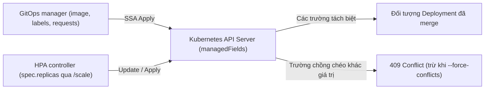

# Bài 02: Kubernetes Server-Side Apply, Field Ownership & Giải quyết xung đột

## Mục tiêu học tập

- **Client-Side Apply so với Server-Side Apply:** Đối chiếu phép three-way merge phía client dựa trên `last-applied-configuration` với cơ chế structured merge và quản lý trường khai báo ngay tại API server.
- **Quyền sở hữu trường và `managedFields`:** Kiểm tra các mục `manager`, `operation` (`Apply` so với `Update`), `subresource` và `fieldsV1` để xác minh tác nhân sở hữu từng trường mà không nhầm lẫn với RBAC.
- **Phát hiện và giải quyết xung đột:** Tái hiện mã lỗi HTTP `409 Conflict` trên các trường chồng chéo, hiểu cơ chế chia sẻ quyền sở hữu khi giá trị giống nhau và đánh giá rủi ro quản trị của `--force-conflicts`.
- **Phối hợp quyền sở hữu giữa nhiều controller:** Phân chia trách nhiệm giữa GitOps, HPA và workload controller, đồng thời thực hiện bàn giao `spec.replicas` an toàn hoặc dùng `ignoreDifferences` kèm `RespectIgnoreDifferences=true`.
- **Ngữ nghĩa lược bỏ (omission), `null` và xóa trường:** Dự đoán chính xác khi nào việc bỏ một trường từng sở hữu sẽ xóa trường đó, đặt lại về giá trị mặc định của API hay giữ nguyên giá trị của đồng sở hữu khi chuyển đổi giữa CSA và SSA.

## 1. Server-Side Apply giải quyết vấn đề gì?

Nhiều tác nhân có thể cùng chỉnh sửa một đối tượng Kubernetes: Argo CD quản lý image, HPA quản lý số replica, admission webhook thêm label, còn operator quản lý status. Nếu mỗi tác nhân gửi lên một bản sao đầy đủ của đối tượng, tác nhân này có thể ghi đè thay đổi của tác nhân khác. **Server-Side Apply (SSA)** sử dụng cơ chế quản lý trường theo kiểu khai báo (declarative field management) ngay tại Kubernetes API server để tính toán thay đổi và phát hiện xung đột quyền sở hữu.



### Ý định khai báo (declarative intent) ở hai cấp độ

Chạy `kubectl -n default scale deployment/payment-service --replicas=3` là gửi yêu cầu cập nhật một lần lên quy mô của Deployment hiện có. Deployment controller vẫn sẽ reconcile theo số replica kết quả đó. Trong khi đó, một bản khai báo được lưu trong Git ghi nhận Deployment mong muốn để công cụ như Argo CD có thể render, so sánh với cluster và apply lại theo chính sách.

```yaml
apiVersion: apps/v1
kind: Deployment
metadata:
  name: payment-service
  namespace: default
spec:
  replicas: 3
  selector:
    matchLabels:
      app: payment
  template:
    metadata:
      labels:
        app: payment
    spec:
      containers:
        - name: payment
          image: nginx:1.27
```

Với SSA, **ý định (intent)** của một manager bao gồm các trường mà nó nhận sở hữu và giá trị mong muốn tương ứng. Mỗi manager có thể gửi một ý định từng phần (partial intent) cho cùng một đối tượng đã tồn tại. Ví dụ, Team A duy trì image của container `payment` trong khi Team B duy trì số replica. Vẫn cần có bên duy trì selector, Pod labels và các trường bắt buộc khác. API schema quyết định trường nào hoặc phần tử danh sách nào có thể được quản lý độc lập.

## 2. Client-Side Apply so với Server-Side Apply

| | Client-Side Apply (CSA) truyền thống | Server-Side Apply (SSA) |
|---|---|---|
| Nơi tính toán phép merge | `kubectl`/client | API server |
| Đầu vào chính | Last-applied annotation + manifest cục bộ + đối tượng live | Ý định apply + `managedFields`/schema |
| Quyền sở hữu | Không cưỡng chế field ownership theo cách của SSA | Các field manager sở hữu các đường dẫn trường (field path) |
| Xung đột | Có thể vô tình ghi đè thay đổi | Có thể trả về `409 Conflict` |

Phép three-way merge của CSA xem xét cấu hình gốc (original), cấu hình đã sửa (modified) và cấu hình hiện tại (current). SSA được xây dựng dựa trên structured-merge-diff và thông tin kiểu dữ liệu từ schema.

SSA đạt trạng thái ổn định từ Kubernetes 1.22. Trong CSA, **original** là cấu hình apply lần cuối trong `kubectl.kubernetes.io/last-applied-configuration`, **modified** là manifest cục bộ mới, còn **current** là đối tượng đang chạy trên cluster. Nếu khai báo replica cũ là 3 và bạn đổi thành 5, client dùng các đầu vào đó để dựng bản patch. Với SSA, client gửi lên các trường mà nó dự định quản lý. API server sẽ merge ý định đó với đối tượng live dựa trên schema, kiểm tra xung đột quyền sở hữu, rồi cập nhật đối tượng cùng tập trường (field set) khi yêu cầu thành công.

```bash
kubectl apply -f deployment.yaml
kubectl apply --server-side --field-manager=platform-team -f deployment.yaml
```

Đây là hai phương thức apply khác nhau để bạn đối chiếu trong môi trường sandbox. Server vẫn có thể ghi nhận một bản patch CSA trong `managedFields` với `operation: Update` mặc dù CSA tính toán bản patch ở phía client. [Cấu hình khai báo](https://kubernetes.io/docs/tasks/manage-kubernetes-objects/declarative-config/) · [Server-Side Apply](https://kubernetes.io/docs/reference/using-api/server-side-apply/)

### Theo dõi cùng một tình huống drift replica qua CSA và SSA

Bắt đầu với một Deployment khai báo 3 replica. Một tác nhân bên ngoài đổi số replica đang chạy thành 8. Với kịch bản **CSA**, annotation last-applied vẫn lưu giá trị 3. Với kịch bản **SSA**, giả sử tác nhân bên ngoài hiện đang sở hữu `spec.replicas` và bên apply ban đầu không còn sở hữu trường này nữa. Đây là hai kịch bản độc lập.

| Bản khai báo kế tiếp | Client-Side Apply (CSA) | Server-Side Apply (SSA) bởi manager ban đầu |
| --- | --- | --- |
| Giữ nguyên `replicas: 3` | Đặt live về 3. Giá trị cục bộ khác live dù trùng với last-applied. | Trả về `409 Conflict` và giữ nguyên live ở 8. |
| Đổi sang `replicas: 5` | Đặt live thành 5. | Trả về `409 Conflict` và giữ nguyên live ở 8. |
| Bỏ `replicas` khỏi file | Xóa trường vì nó có trong last-applied annotation. Giá trị mặc định của Deployment là 1. | Giữ nguyên live ở 8 vì manager khác đang sở hữu trường này. |
| Khai báo `replicas: 8` | Giữ live ở 8 và ghi nhận bản khai báo mới. | Chấp nhận cùng giá trị và chia sẻ quyền sở hữu. |

Trong CSA, `kubectl` đối chiếu **modified với live** để xác định giá trị cần thiết lập và đối chiếu **original với modified** để nhận biết trường nào đã bị xóa khỏi bản khai báo. Do đó, một file YAML không đổi vẫn có thể khôi phục trường đã bị drift trên cluster. Nếu một trường vắng mặt ở cả cấu hình original và modified của CSA, CSA sẽ giữ nguyên giá trị được ghi độc lập trên đối tượng live. Đó là lý do một trường chưa từng được khai báo vẫn có thể giữ ở mức 8 sau một lần chạy CSA. [Cách tính toán patch khai báo của Kubernetes](https://kubernetes.io/docs/tasks/manage-kubernetes-objects/declarative-config/#how-apply-calculates-differences-and-merges-changes)

Thử xem trước kịch bản CSA trong môi trường sandbox bằng manifest 3 replica ở trên với tên file `payment-service.yaml`. Lệnh server dry-run trả về số replica dự đoán mà vẫn giữ nguyên số replica live ở mức 8. Tạm tách HPA và Argo CD khỏi bài thực hành cô lập này để chúng không thay đổi số replica giữa các lệnh.

```bash
kubectl apply --server-side=false -f payment-service.yaml
kubectl -n default scale deployment/payment-service --replicas=8
kubectl apply --server-side=false --dry-run=server -f payment-service.yaml \
  -o jsonpath='{.spec.replicas}{"\n"}'
kubectl -n default get deployment payment-service -o jsonpath='{.spec.replicas}{"\n"}'
```

Kết quả kỳ vọng của hai lệnh cuối lần lượt là 3 và 8. Nếu chạy lại lệnh apply đầu tiên ở chế độ thực, giá trị 3 sẽ được ghi đè lại lên Deployment đang chạy. Ngoài ra, CSA lưu cấu hình đã apply trong annotation nên các cấu hình lớn có thể chạm giới hạn kích thước metadata. SSA theo dõi tập trường mà không cần dựa vào annotation đó cho các thao tác apply thông thường. [Tùy chọn sync SSA của Argo CD](https://argo-cd.readthedocs.io/en/stable/user-guide/sync-options/#server-side-apply)

### Quan sát yêu cầu SSA và lỗi xung đột

Một client apply lên Deployment hiện có có thể gửi yêu cầu theo dạng:

```http
PATCH /apis/apps/v1/namespaces/default/deployments/payment-service?fieldManager=team-a
Content-Type: application/apply-patch+yaml
```

Phần thân yêu cầu mang ý định apply của Team A. Server merge ý định đó dựa trên schema, đối tượng hiện tại và các tập trường đang được quản lý. Nếu Team A gửi 3 replica trong khi một manager khác (chẳng hạn Team B) đang sở hữu giá trị hiện tại là 8, hệ thống sẽ báo lỗi dạng `conflict with "team-b" using apps/v1: .spec.replicas`. Yêu cầu sẽ không ghi giá trị xung đột. Một thao tác không phải apply nhưng được cấp quyền như `/scale` vẫn có thể thay đổi giá trị này và chuyển quyền sở hữu. [Tuần tự hóa SSA và quản lý trường](https://kubernetes.io/docs/reference/using-api/server-side-apply/#serialization)

Thử làm [bài tập so sánh CSA và SSA](../03-gitops-delivery/gitops-exercises.mdx) để tự dự đoán từng kết quả.

## 3. `managedFields` là gì?

```yaml
metadata:
  managedFields:
    - manager: gitops-controller
      operation: Apply
      apiVersion: apps/v1
      fieldsType: FieldsV1
      fieldsV1:
        f:spec:
          f:replicas: {}
```

Đây là đoạn minh họa. Cấu trúc `fieldsV1` thực tế chi tiết hơn và thay đổi tùy theo đối tượng cùng các trường con. API server dùng metadata `managedFields` để theo dõi tác nhân nào sở hữu trường nào; nó **không phải là cơ chế kiểm soát truy cập (access control)**. Một tác nhân vẫn bắt buộc phải có quyền Kubernetes RBAC cho thao tác API trên tài nguyên, bất kể quyền sở hữu trường.

API server lưu trữ `managedFields` cùng với đối tượng Kubernetes. `manager` là định danh field manager mà client có thể truyền qua `--field-manager`. Danh tính đã xác thực và quyền RBAC của nó được đánh giá tách biệt. `operation: Apply` cho biết thao tác SSA, còn `operation: Update` đại diện cho thao tác cập nhật thông thường hoặc patch không phải apply, bao gồm cả thao tác ghi từ CSA client. `apiVersion` chỉ định phiên bản schema dùng để biểu diễn các trường, còn `subresource` có thể xác định các lượt ghi qua endpoint như `scale` và `status`.

Pod template của một Deployment có thể có chủ sở hữu `Apply` trong khi số replica có chủ sở hữu `Update` riêng từ `/scale`. Trong `fieldsV1`, `f:` định danh một trường (field), `k:` định danh một phần tử danh sách theo khóa (keyed list entry), và `v:` định danh một giá trị trong tập hợp (set value). Ví dụ, một phần tử có khóa cho container có tên sẽ xuất hiện dưới dạng `k:{"name":"payment"}`. Hãy kiểm tra thực tế các mục này thay vì tự suy đoán tên manager hay tập trường của một controller:

```bash
kubectl -n production get deployment payment-service -o yaml --show-managed-fields
kubectl -n production get deployment payment-service -o json --show-managed-fields |
  jq '.metadata.managedFields[] | {manager, operation, apiVersion, subresource, fieldsV1}'
```

[Quản lý trường trong Kubernetes](https://kubernetes.io/docs/reference/using-api/server-side-apply/#field-management)

## 4. Quan sát một xung đột quyền sở hữu

Tạo file `/tmp/payment-a.yaml`:

```yaml
apiVersion: apps/v1
kind: Deployment
metadata:
  name: payment
  namespace: default
spec:
  replicas: 2
  selector:
    matchLabels: {app: payment}
  template:
    metadata:
      labels: {app: payment}
    spec:
      containers:
        - name: payment
          image: nginx:1.27
```

Apply manifest bằng manager đầu tiên:

```bash
kubectl apply --server-side --field-manager=platform-gitops -f /tmp/payment-a.yaml
```

Đổi file thành `replicas: 4`, sau đó apply bằng một manager khác:

```bash
kubectl apply --server-side --field-manager=manual-operator -f /tmp/payment-a.yaml
```

Nếu `platform-gitops` vẫn đang sở hữu `replicas` và giá trị mới khác giá trị cũ, API server sẽ trả về lỗi xung đột. Trong một số trường hợp, hai manager có thể chia sẻ quyền sở hữu cùng một trường nếu cùng apply một giá trị giống nhau. Nếu sau đó một bên cố đặt giá trị khác, quy tắc xung đột sẽ được kích hoạt.

### Cô lập xung đột vào đúng một trường

Bài thực hành đầu tiên apply toàn bộ Deployment dưới cả hai manager. Phiên bản này cô lập riêng `spec.replicas` để manager thứ hai không vô tình nhận sở hữu các trường không liên quan. Bắt đầu với một Deployment `payment` mới do `platform-gitops` tạo từ manifest 2 replica ở trên. Lưu một file riêng tên `replicas.yaml`:

```yaml
apiVersion: apps/v1
kind: Deployment
metadata:
  name: payment
  namespace: default
spec:
  replicas: 5
```

```bash
kubectl apply --server-side --field-manager=replica-lab -f replicas.yaml
kubectl get deployment payment -o json --show-managed-fields |
  jq '.metadata.managedFields[] | {manager, operation, subresource, fieldsV1}'
```

Kết quả kỳ vọng là mã HTTP `409 Conflict` trên `.spec.replicas` và số replica đang chạy vẫn là 2. Manifest từng phần (partial manifest) này giả định Deployment đã tồn tại sẵn. `kubectl` phiên bản hiện đại (1.27+) mặc định dùng kiểm tra trường phía server (`--validate=strict`), chấp nhận partial SSA manifest nhưng vẫn từ chối các trường không xác định hoặc viết sai chính tả. Chỉ các bản `kubectl` cũ dùng OpenAPI validation phía client mới cần `--validate=false`, nhưng cờ đó cũng vô hiệu hóa luôn kiểm tra trường không xác định. Các bước phân quyền API, admission, kiểm tra hợp lệ của đối tượng kết quả và kiểm tra xung đột SSA vẫn được áp dụng đầy đủ.

Đổi partial manifest thành `replicas: 2` rồi apply với tên `replica-lab` mà không dùng force. Lúc này cả hai manager đều sẽ xuất hiện với tư cách chủ sở hữu của `spec.replicas`. Đổi lại thành 5 và thử lại. Việc chia sẻ giá trị hiện tại không cho phép bất kỳ bên nào đơn phương thay đổi nó. Hãy giải quyết xung đột bằng cách thương lượng bàn giao, giữ nguyên giá trị chung hoặc chủ động tiếp quản quyền sở hữu:

```bash
kubectl apply --server-side --field-manager=replica-lab --force-conflicts \
  -f replicas.yaml
kubectl get deployment payment -o jsonpath='{.spec.replicas}{"\n"}'
```

Kết quả kỳ vọng là 5 replica. Xác nhận rằng `platform-gitops` vẫn sở hữu các trường đã khai báo trong Pod template còn `replica-lab` sở hữu số replica. Để bàn giao có kế hoạch mà không cần force, hãy giữ cả hai ý định ở cùng giá trị hiện tại, sau đó bỏ trường đó khỏi ý định của manager rời đi rồi apply lại. Manager tiếp nhận sau đó có thể tự do thay đổi giá trị mình sở hữu. Lưu ý rằng nếu chủ sở hữu duy nhất bỏ một trường khỏi manifest, API có thể xóa trường đó hoặc đưa về giá trị mặc định.

Thử [trình mô phỏng xung đột SSA](../03-gitops-delivery/gitops-exercises.mdx) trước khi chạy lệnh. [Giải quyết xung đột SSA trong Kubernetes](https://kubernetes.io/docs/reference/using-api/server-side-apply/#conflicts)

## 5. Rủi ro khi ép vượt qua xung đột (`--force-conflicts`)

```bash
kubectl apply --server-side --field-manager=manual-operator \
  --force-conflicts -f /tmp/payment-a.yaml
```

`--force-conflicts` có thể tước quyền sở hữu các trường đang xung đột từ manager khác. Nó **không phải giải pháp cho mọi lỗi apply**. Đặc biệt khi có sự tham gia của HPA, Argo CD hoặc một operator, việc ép giành quyền sở hữu có thể vô tình đẩy các controller vào thế xung đột lẫn nhau.

## 6. Phân chia quyền sở hữu cho các trường khác nhau

Một chiến lược phổ biến là tách bạch trách nhiệm:

```text
GitOps manager: image, labels, resource requests
HPA controller: replicas via /scale
Deployment controller: rollout status
Admission policy: validate security constraints
```

Tuy nhiên, `managedFields` phản ánh hành vi thực tế của API và có thể chứa cả thao tác `Update` lẫn `Apply`. Đừng mặc định rằng chỉ có `Apply` mới ảnh hưởng đến quyền sở hữu.

### Apply riêng ý định cho image và số replica

Các partial manifest dưới đây nhắm vào một Deployment **đã tồn tại**. Chúng giả định Team A có thể đặt image còn Team B có thể đặt số replica mà không tranh giành trường với manager khác. Nếu một bootstrap manager hiện đang sở hữu chúng, trước tiên mỗi team hãy apply giá trị hiện hành để chia sẻ quyền sở hữu. Sau đó apply lại ý định của bootstrap manager khi đã lược bỏ hai trường đó nhưng vẫn giữ nguyên các khai báo còn lại. Lúc này hai team có thể thay đổi trường riêng của mình. Nếu bootstrap manager vẫn đang sở hữu một giá trị khác, hãy thực hiện bước kiểm tra và chuyển giao quyền sở hữu trong bài lab thay vì mặc định lệnh ghi sẽ thành công.

Team A lưu file `image-intent.yaml`:

```yaml
apiVersion: apps/v1
kind: Deployment
metadata:
  name: payment-service
  namespace: default
spec:
  template:
    spec:
      containers:
        - name: payment
          image: nginx:1.28
```

Team B lưu file `replica-intent.yaml`:

```yaml
apiVersion: apps/v1
kind: Deployment
metadata:
  name: payment-service
  namespace: default
spec:
  replicas: 5
```

```bash
kubectl apply --server-side --field-manager=team-a -f image-intent.yaml
kubectl apply --server-side --field-manager=team-b -f replica-intent.yaml
kubectl -n default get deployment payment-service -o yaml --show-managed-fields
```

Kết quả kỳ vọng là 5 replica và image `nginx:1.28`. Schema của Deployment định danh các phần tử trong `containers` theo `name`, nên Team A có thể quản lý image của container theo tên mà không chạm vào `replicas`. Hãy dùng tên field-manager ổn định và luôn gửi đầy đủ tập trường mà mỗi manager muốn duy trì. Việc dùng lại tên của bootstrap manager cho một partial intent có thể làm từ bỏ hoặc xóa đi các trường từng sở hữu bị lược khỏi partial manifest. Bài học tiếp theo giải thích [cách schema định nghĩa ranh giới quyền sở hữu](./lesson-03-cluster-architecture.md).

### Điều gì xảy ra khi cả Argo CD và HPA cùng ghi `replicas`?

Giả sử Git khai báo `replicas: 3`. Khi tải tăng, HPA đặt quy mô Deployment lên 10. Lượt ghi qua `/scale` thay đổi Deployment đang chạy và có thể cập nhật quyền sở hữu trường. Vì đây là thao tác `Update`, kiểm tra xung đột SSA không chặn nó. Yêu cầu vẫn cần quyền truy cập subresource `scale` và có thể gặp các lỗi API thông thường như `resourceVersion` bị cũ.

| Bước | Trạng thái mong muốn và hành động của controller | Điều quan sát được |
| --- | --- | --- |
| Triển khai ban đầu | Argo CD apply 3 replica từ Git | Deployment live ban đầu yêu cầu 3 Pod |
| Tải tăng lên | HPA ghi 10 qua `/scale` | `spec.replicas` tăng lên và Deployment controller bắt đầu scale |
| Argo CD refresh | Controller so sánh 3 replica mong muốn với 10 replica đang chạy | Application có thể báo `OutOfSync` nếu trường này tham gia so sánh |
| Một lần sync apply số replica từ Git | Self-heal đủ điều kiện hoặc sync thủ công có thể ghi lại 3 | Số replica mong muốn tụt xuống ngay khi nhu cầu đang cao |
| HPA đánh giá lại metric | Nếu metric vẫn cần thêm năng lực, nó lại scale lên | Các lượt ghi cạnh tranh nhau lặp đi lặp lại |

Ở đây, "ai thắng?" phụ thuộc vào thao tác API và thời điểm reconciliation. Field ownership giúp phân xử một yêu cầu apply cụ thể. Giao trách nhiệm số replica cho duy nhất một controller sẽ chấm dứt sự bất đồng lặp đi lặp lại này. Argo CD có thể sở hữu image, resource requests, Service và cấu hình HPA của Deployment. HPA kiểm soát số lượng mong muốn, Deployment controller quản lý ReplicaSet và rollout, còn ReplicaSet controller đưa số Pod thực tế hội tụ theo. [Horizontal Pod Autoscaling trong Kubernetes](https://kubernetes.io/docs/concepts/workloads/autoscaling/horizontal-pod-autoscale/)

### Khai báo một Deployment có autoscaling

Lưu hai tài nguyên sau trong mã nguồn cho namespace `production`. Ví dụ dùng Nginx làm đại diện cho `payment-service` và lược bỏ trường số replica của Deployment. HPA cần một resource metrics API đang hoạt động (thường do Metrics Server cung cấp) và các container của workload phải khai báo CPU requests để tính được mức sử dụng (utilization).

```yaml
apiVersion: apps/v1
kind: Deployment
metadata:
  name: payment-service
  namespace: production
spec:
  selector:
    matchLabels:
      app: payment
  template:
    metadata:
      labels:
        app: payment
    spec:
      containers:
        - name: payment
          image: nginx:1.27
          resources:
            requests:
              cpu: 100m
---
apiVersion: autoscaling/v2
kind: HorizontalPodAutoscaler
metadata:
  name: payment-service
  namespace: production
spec:
  scaleTargetRef:
    apiVersion: apps/v1
    kind: Deployment
    name: payment-service
  minReplicas: 3
  maxReplicas: 10
  metrics:
    - type: Resource
      resource:
        name: cpu
        target:
          type: Utilization
          averageUtilization: 70
```

Ngưỡng 70% biểu thị mức sử dụng CPU trung bình so với CPU requests. Kiểm tra `kubectl -n production describe hpa payment-service` để xem target, metric hiện tại, conditions và các sự kiện scale. HPA có thể điều chỉnh số replica mong muốn sau khi tạo, vì vậy hãy tính đến giá trị mặc định ban đầu của Deployment trước khi autoscaler kịp reconcile. Kiểm tra cả HPA và Deployment song song trong đợt rollout thử nghiệm.

### Bàn giao số lượng replica hiện có

Bỏ một trường số replica từng được khai báo có thể gây ra tình trạng reset tạm thời về giá trị mặc định là 1 của Deployment. Hãy xác định manager nào đang sở hữu trường và phương thức apply nào đang được dùng. Kiểm tra số lượng đang chạy cùng `managedFields`, sau đó lập kế hoạch sync có kiểm soát và theo dõi năng lực khả dụng tối thiểu.

Với Deployment được quản lý bằng SSA, nếu autoscaler đã sở hữu `spec.replicas`, hãy xác minh quyền sở hữu trước khi xóa trường này khỏi ý định apply từ Git. Nếu HPA chưa từng ghi một giá trị khác, Kubernetes có hướng dẫn quy trình bàn giao qua manager tạm thời (temporary-manager handoff). Apply một ý định SSA tối giản chứa số lượng đang chạy hiện tại dưới tên một manager tạm để chia sẻ quyền sở hữu, sau đó bỏ trường này khỏi ý định của manager gốc và apply lại. Khi HPA ghi một giá trị khác sau đó, thao tác cập nhật không phải Apply đó có thể tiếp quản quyền sở hữu từ manager tạm. Nếu số lượng live thay đổi trong lúc bàn giao, hãy đọc lại quyền sở hữu và giá trị hiện tại thay vì ép ghi đè giá trị cũ. Với Deployment dùng CSA, hãy kiểm tra last-applied annotation và quy trình bàn giao CSA theo tài liệu trước khi commit việc lược bỏ trường. Diễn tập luồng sync Argo CD thực tế trên môi trường thử nghiệm dùng một lần và xác nhận rằng lần sync đổi image tiếp theo vẫn giữ nguyên số replica của HPA. [Chuyển giao quyền sở hữu SSA trong Kubernetes](https://kubernetes.io/docs/reference/using-api/server-side-apply/#transferring-ownership) · [Chuyển đổi Deployment sang HPA](https://kubernetes.io/docs/concepts/workloads/autoscaling/horizontal-pod-autoscale/#migrating-deployments-and-statefulsets-to-horizontal-autoscaling)

### Bỏ qua một trường khi nguồn luôn render ra trường đó

Nếu một chart bên thứ ba luôn sinh ra `spec.replicas`, hãy giới hạn phạm vi ngoại lệ so sánh cho đúng Deployment cụ thể đó. Ví dụ dưới đây giả định Argo CD, namespace và nguồn repository đều đã sẵn sàng.

```yaml
apiVersion: argoproj.io/v1alpha1
kind: Application
metadata:
  name: payment-prod
  namespace: argocd
spec:
  project: default
  source:
    repoURL: https://github.com/example/gitops.git
    targetRevision: main
    path: apps/payment
  destination:
    server: https://kubernetes.default.svc
    namespace: production
  ignoreDifferences:
    - group: apps
      kind: Deployment
      name: payment-service
      namespace: production
      jsonPointers:
        - /spec/replicas
  syncPolicy:
    automated:
      prune: true
      selfHeal: true
    syncOptions:
      - RespectIgnoreDifferences=true
```

`ignoreDifferences` thay đổi những gì Argo CD so sánh. Nếu thiếu sync option đi kèm, một lần sync do thay đổi khác kích hoạt vẫn có thể apply lại số replica sinh ra ban đầu. `RespectIgnoreDifferences=true` áp dụng quy tắc này cả trong quá trình sync đối với các đối tượng đã tồn tại. Ở lần tạo đầu tiên, manifest đã render vẫn được apply như cung cấp. Quy tắc này điều khiển hành vi của Argo CD chứ bản thân nó không chuyển giao Kubernetes field ownership. Quy tắc dựa trên `managedFieldsManagers` có thể khớp mọi trường gắn với một manager, vì vậy hãy ưu tiên dùng JSON pointer nhắm đích cụ thể trong trường hợp này. [Tùy biến diff trong Argo CD](https://argo-cd.readthedocs.io/en/stable/user-guide/diffing/) · [Respect ignore differences](https://argo-cd.readthedocs.io/en/stable/user-guide/sync-options/#respect-ignore-differences-configs)

### Bật SSA trong Argo CD một cách chủ đích

```yaml
spec:
  syncPolicy:
    syncOptions:
      - ServerSideApply=true
```

Tài liệu Argo CD hiện hành mô tả luồng sync này tương đương với `kubectl apply --server-side --force-conflicts`. Nếu một trường có trong manifest bị xung đột, lệnh force apply có thể ghi đè giá trị và lấy quyền sở hữu. Tùy chọn sync `Force=true` lại mang ngữ nghĩa khác. Hãy kiểm tra tài liệu của đúng phiên bản đang cài đặt trước khi thay đổi hành vi trên production.

Argo CD bật sẵn cơ chế di chuyển từ client-side apply (client-side apply migration) khi dùng SSA. Nó có thể chuyển quyền sở hữu các trường từ client-side manager trước đó sang SSA manager của Argo CD. Dùng `ClientSideApplyMigration=false` trong `syncOptions` để tắt di chuyển khi cần. Có thể chỉ định tên manager cũ tùy chỉnh qua `argocd.argoproj.io/client-side-apply-migration-manager`. Trước khi chọn một manager, hãy kiểm tra chắc chắn rằng việc tiếp quản các trường nó đang sở hữu là an toàn. Quá trình migration chỉ xử lý quyền sở hữu apply cũ. Nguồn GitOps và HPA vẫn cần quy trình bàn giao chủ đích cho `spec.replicas`. [Argo CD SSA và migration](https://argo-cd.readthedocs.io/en/stable/user-guide/sync-options/#server-side-apply)

## 7. Lược bỏ (omission), `null` và xóa trường

SSA biểu đạt tập hợp các trường mong muốn. Khi một manager ngừng khai báo một trường mà nó đang sở hữu, nó có thể từ bỏ quyền sở hữu trường đó. Nếu không có tác nhân nào khác sở hữu trường, ngữ nghĩa của API có thể khiến trường đó quay về giá trị mặc định hoặc bị xóa khỏi đối tượng. Hãy cẩn trọng khi chuyển từ manifest quản lý toàn phần sang cấu hình partial apply.

| Trạng thái trước khi apply | Tác động khi lược bỏ trường |
| --- | --- |
| CSA last-applied annotation có chứa trường | `kubectl` yêu cầu xóa trường. Cơ chế mặc định của API có thể khôi phục giá trị mặc định. |
| CSA last-applied annotation không chứa trường | Việc vắng mặt trong khai báo vẫn giữ nguyên giá trị chỉ được ghi trên đối tượng live. |
| SSA applier là chủ sở hữu duy nhất | Trường có thể bị xóa hoặc reset về giá trị mặc định. |
| SSA applier chia sẻ quyền sở hữu | Applier từ bỏ quyền sở hữu của mình và chủ sở hữu còn lại giữ nguyên giá trị. |
| SSA applier không sở hữu trường | Việc lược bỏ không đụng chạm đến trường trong ví dụ trường vô hướng này. |

Lược bỏ trường, gán `null` tường minh, chuỗi rỗng, tập hợp rỗng và giá trị 0 là những đầu vào hoàn toàn khác nhau. Ví dụ, `replicas: 0` yêu cầu rõ ràng 0 replica. Một giá trị `null` tường minh có thể xóa trường, được giữ lại bởi schema cho phép nullable, bị prune và gán mặc định, hoặc bị từ chối tùy vào schema và thao tác apply. Với ví dụ CSA Deployment, việc bỏ `replicas` khỏi file cục bộ trong khi last-applied annotation vẫn còn khai báo nó có thể kích hoạt gán mặc định về 1. Hãy xem lại phần **Bàn giao số lượng replica hiện có** ở trên trước khi thay đổi một workload đang dùng autoscaling.

## 8. Bài lab kiểm chứng

```bash
kubectl get deployment payment -o yaml --show-managed-fields
kubectl get deployment payment -o json --show-managed-fields | jq '.metadata.managedFields[] | {manager,operation,subresource}'
kubectl explain deployment.spec.replicas
```

Chạy các lệnh trên đối với một Deployment thử nghiệm và ghi lại tên manager trước và sau khi apply manifest. Kết thúc bằng lệnh `kubectl delete deployment payment` trong namespace của bài lab.

## 9. Bài học thực tế trên production

- Field ownership xử lý được một số loại xung đột, nhưng không thay thế trách nhiệm sở hữu ở cấp tổ chức.
- Luôn rà soát mọi trường hợp sử dụng `force-conflicts`.
- Khi chuyển từ client-side apply sang SSA, hãy kiểm tra quá trình migration và chuyển giao field ownership.
- Khi Argo CD và HPA tương tác với nhau, hãy tra cứu tài liệu chính thức của cả hai công cụ thay vì mặc định rằng chỉ cần bỏ `replicas` là đủ trong mọi cấu hình.

**Tài liệu tham khảo:** [Server-Side Apply](https://kubernetes.io/docs/reference/using-api/server-side-apply/) · [Quản lý cấu hình khai báo](https://kubernetes.io/docs/tasks/manage-kubernetes-objects/declarative-config/) · [Argo CD Server-Side Apply](https://argo-cd.readthedocs.io/en/stable/user-guide/sync-options/#server-side-apply).

## Phân tích chuyên sâu: ngữ nghĩa của Server-Side Apply (SSA)

**Ba khái niệm cần phân biệt:** `manager` định danh thành phần nhận quyền sở hữu; `operation` phân biệt giữa `Apply` và `Update`; `fieldsV1` biểu diễn tập hợp các trường được quản lý. `managedFields` không phải là ACL: RBAC có thể cho phép một client cập nhật các trường thuộc sở hữu của manager khác, nhưng một thao tác *apply* cố thay đổi trường của manager khác sẽ trả về xung đột trừ khi client ép ghi đè.

### Tái hiện xung đột SSA mà không cần ứng dụng phức tạp

```bash
kubectl create namespace ssa-lab
cat > /tmp/shared-config.yaml <<'EOF'
apiVersion: v1
kind: ConfigMap
metadata:
  name: shared-settings
  namespace: ssa-lab
data:
  log-level: info
EOF
kubectl apply --server-side --field-manager=platform -f /tmp/shared-config.yaml
kubectl get cm shared-settings -n ssa-lab -o yaml --show-managed-fields
```

Tạo một file thứ hai có cùng định danh tài nguyên nhưng đặt `log-level: debug`, sau đó apply dưới tên field manager `application`:

```bash
kubectl apply --server-side --field-manager=application -f /tmp/shared-config-debug.yaml
```

Hệ thống sẽ báo xung đột nếu `platform` vẫn đang sở hữu `data.log-level`. Khi giá trị giống nhau, nhiều bên apply có thể cùng chia sẻ quyền sở hữu. Dùng `--force-conflicts` sẽ chuyển giao quyền sở hữu và ghi giá trị mới. Điều này kéo theo hệ quả về mặt quản trị và không nên áp dụng tự động trong mọi tình huống production.

### Thử cùng xung đột đó bằng YAML sinh tự động

Sử dụng lại namespace `ssa-lab` dùng một lần từ ví dụ trước. `kubectl create --dry-run=client` sinh ra đối tượng ở phía client. Lệnh bên phải dấu pipe gửi nó đi dưới dạng một yêu cầu SSA.

```bash
kubectl -n ssa-lab create configmap ownership-demo --from-literal=MODE=production --dry-run=client -o yaml |
  kubectl -n ssa-lab apply --server-side --field-manager=team-a -f -

kubectl -n ssa-lab create configmap ownership-demo --from-literal=MODE=staging --dry-run=client -o yaml |
  kubectl -n ssa-lab apply --server-side --field-manager=team-b -f -
```

Lệnh thứ hai sẽ thất bại tại `.data.MODE`. Xác nhận giá trị vẫn là `production`, sau đó chạy lại lệnh thứ hai với quyền chủ động tiếp quản sở hữu:

```bash
kubectl -n ssa-lab create configmap ownership-demo --from-literal=MODE=staging --dry-run=client -o yaml |
  kubectl -n ssa-lab apply --server-side --field-manager=team-b --force-conflicts -f -

kubectl -n ssa-lab get configmap ownership-demo -o yaml --show-managed-fields
```

Kết quả kỳ vọng là `data.MODE: staging` và có một mục `Apply` dưới tên `team-b` chứa `f:data` và `f:MODE` trong tập trường. Tùy chọn force chỉ chiếm quyền trường bị xung đột. Các trường khác vẫn có thể thuộc về các manager riêng biệt. Sau khi xong, xóa ConfigMap thử nghiệm bằng lệnh `kubectl -n ssa-lab delete configmap ownership-demo`.

### Điều gì xảy ra khi bạn bỏ một trường khỏi manifest?

SSA khác với một bản patch chỉ chỉnh sửa vài trường. Khi một manager ngừng khai báo trường nó từng sở hữu, API server có thể xóa trường đó hoặc đặt lại về giá trị mặc định nếu không còn manager nào khác sở hữu. Khi quyền sở hữu được chia sẻ, việc lược bỏ trường khỏi manifest của một manager không nhất thiết làm nó biến mất khỏi đối tượng live.

Điều này đặc biệt quan trọng đối với:

- `spec.replicas` khi chuyển giao quyền sở hữu sang HPA;
- Các danh sách (list) có ngữ nghĩa merge do schema quy định;
- `metadata.labels` khi nhiều controller cùng gắn label;
- Các trường CRD có giá trị mặc định hoặc ngữ nghĩa nullable.

### Quyền sở hữu nguyên khối (atomic) và chi tiết (granular)

SSA không chỉ xử lý thuần túy trên văn bản YAML. Nó phân chia quyền sở hữu theo schema: quyền sở hữu map có thể là granular hoặc atomic tùy đặc tả API. Danh sách kiểu map (map-style list) dùng khóa để định danh phần tử, trong khi danh sách atomic được coi như một trường nguyên khối không thể tách rời. Hai manager sửa hai phần tử khác nhau có thể phối hợp an toàn hoặc đụng độ xung đột, tùy thuộc vào `x-kubernetes-list-type`.

Hãy đọc schema trước khi dự đoán hành vi merge. Đừng giả định rằng *mỗi dòng YAML được sở hữu độc lập*.

### Client-Side Apply, SSA và Update

| Phương thức | Nơi tính toán phép merge | Hành vi quyền sở hữu và xung đột |
|---|---|---|
| Client-Side Apply truyền thống | `kubectl`, sử dụng last-applied annotation | Không có cơ chế bảo vệ xung đột tương đương SSA |
| Server-Side Apply | API server, sử dụng các tập trường có cấu trúc | Có thể báo xung đột trên trường do manager khác sở hữu |
| HTTP PUT / Update | Cập nhật đối tượng theo ngữ nghĩa API | Khác với apply, không bị từ chối vì xung đột trường SSA; kiểm soát đồng thời lạc quan qua `resourceVersion` vẫn áp dụng |

Khi chuyển từ client-side apply sang SSA, Kubernetes cung cấp hành vi di chuyển đặc biệt cho manager `kubectl` mặc định. Đừng mặc định rằng mọi đợt di chuyển đều chắc chắn sẽ xung đột hoặc chắc chắn không xung đột.

### Thực hành trên production

1. Gán một tên `--field-manager` ổn định cho các công cụ tự động hóa.
2. Không dùng chung một tên manager cho các controller có trách nhiệm sở hữu khác nhau.
3. Kiểm tra đầu ra `--show-managed-fields` trước khi dùng `--force-conflicts`.
4. Cung cấp structural OpenAPI schema đầy đủ cho CRD để ngữ nghĩa quyền sở hữu có thể dự đoán được.
5. Kiểm thử tác động của việc xóa trường khỏi manifest trong môi trường lab.

Nguồn kiểm chứng: [Kubernetes Server-Side Apply](https://kubernetes.io/docs/reference/using-api/server-side-apply/), [Khái niệm Kubernetes API](https://kubernetes.io/docs/reference/using-api/api-concepts/).

## Tóm tắt và lưu ý thực tiễn

- Mỗi SSA manager khai báo các trường và giá trị mà nó dự định duy trì. API schema quyết định cách kết hợp các ý định đó.
- CSA dùng bản khai báo cục bộ và đối tượng live để tính giá trị cần đặt, đồng thời dùng last-applied annotation để phát hiện trường bị xóa.
- SSA kiểm tra quyền sở hữu trường hiện tại khi một thao tác apply thay đổi giá trị. Bàn giao có phối hợp giúp các controller không cạnh tranh lẫn nhau.
- Tách bạch desired state khỏi observed state và xác định đúng chủ sở hữu cho từng trường và tài nguyên.
- Không đánh đồng một thao tác API thành công với việc hệ thống bên ngoài đã sẵn sàng phục vụ lưu lượng.
- Kiểm tra IAM và RBAC, readiness, vòng đời dữ liệu và khả năng khôi phục trước khi áp dụng lên production.

Tiếp tục với [ApplicationSet và GitOps đa cluster](../02-controllers-platform/lesson-04-controller-foundations.md), sau đó kết nối phần điều phối vị trí triển khai và quản lý cấu hình với [Quản lý GKE Fleet](../02-controllers-platform/fleet-config-sync.md).

[Quay lại Lộ trình học tập](../learning-path.md)
