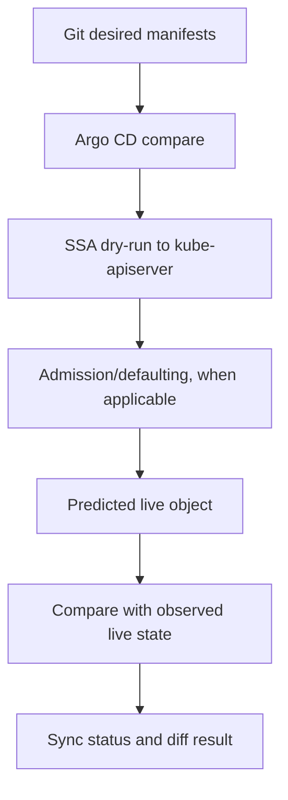

:::info Source status
The title and topic were cross-checked against the conversation history. The content below is a **detailed editorial reconstruction**, not a verbatim transcript of the entire original response.
:::

# Lesson 03: Structured Merge Diff, OpenAPI Schema & Field Ownership

## Learning objectives

Develop a solid understanding of **Structured Merge Diff, Kubernetes schemas, list semantics, and field ownership**. Learn where controller responsibilities and ownership boundaries lie, and apply that knowledge in a lab on a test cluster.


## 1. Why is merging YAML different from merging ordinary JSON?

Kubernetes APIs use *structural schemas* and field-specific list and map semantics. If you treat every list as an atomic array or every object as untyped JSON, a patch can inadvertently remove fields that another actor manages.

**Structured Merge Diff (SMD)** uses a typed schema to determine field ownership and merge behavior. It underpins SSA.

## 2. Field sets and schemas

A manager can own a path such as `spec.template.spec.containers[name=payment].image`. That path is meaningful only if the schema recognizes `containers` as a list keyed by `name`, rather than an atomic list.

In OpenAPI schemas for CRDs, declarations such as `x-kubernetes-list-type` and `x-kubernetes-list-map-keys` determine this behavior.

## 3. Atomic, set, and map lists

| Type | Meaning |
|---|---|
| `atomic` | The list is treated as a single unit of ownership |
| `set` | Elements follow set semantics |
| `map` | Elements are identified by keys and can be managed independently |

Example schema fragment for a CRD:

```yaml
spec:
  type: object
  properties:
    endpoints:
      type: array
      x-kubernetes-list-type: map
      x-kubernetes-list-map-keys:
        - name
      items:
        type: object
        required: [name, port]
        properties:
          name: {type: string}
          port: {type: integer}
```

This configuration expresses the intent that endpoints are identified by `name`. In a complete CRD, place this fragment inside a valid `openAPIV3Schema` structure.

## 4. Why does the CRD schema affect GitOps?

Suppose team A manages the `api` endpoint and team B manages the `metrics` endpoint. If the CRD defines an `atomic` list, the two actors can conflict over the entire list. If the map-style list schema is designed correctly and the API contract allows it, ownership can be more granular.

Do not change the list type of a CRD already in production without evaluating the implications for data migration and ownership.

## 5. Defaults and nullability

An OpenAPI schema can define a `default`, required properties, enum validation, nullable fields, and pruning behavior. The API server can fill in defaults that are absent from the original manifest in Git, leading to confusing diffs during rendering or comparison. A CRD schema should describe the intended API, not just do enough to pass validation.

## 6. Argo CD diff strategy

When Argo CD compares rendered manifests with live state, normalizers, defaulted fields, field managers, and the schema can all affect the diff. Supported versions of Argo CD offer Server-Side Diff, which uses the API server's dry-run semantics. **Do not equate every Argo CD diff with SMD**; the diff engine depends on the version and configuration.

## 7. Example of an ownership conflict

```text
Manager A owns: spec.replicas = 3
Manager B attempts SSA: spec.replicas = 5
Result: ownership conflict unless takeover permitted
```

```text
Manager A owns: container[name=web].image
Manager B owns: container[name=metrics].image
Possible independent ownership when schema treats containers as keyed map list
```

## 8. CRD lab

1. Create a test CRD with an `atomic` list. Try applying different elements as two different field managers.
2. Create another test CRD with `x-kubernetes-list-type: map`, keyed by `name`.
3. Compare `managedFields` and the conflicts that arise.
4. Try omitting a field and observe when it is removed or reset to its default.
5. Check for finalizers, then delete the lab resources in the correct order.

## 9. Production pitfalls

- A missing structural schema leads to unpredictable behavior, affects pruning, and limits CRD features.
- Field semantics in the schema are part of the public API contract, not a formatting choice.
- Do not let two controllers manage the same field just because their manifests live in different repositories.
- Field ownership does not replace RBAC, admission authorization, or data-level transactions.

**References:** [Server-Side Apply](https://kubernetes.io/docs/reference/using-api/server-side-apply/) · [CRD Structural Schemas](https://kubernetes.io/docs/tasks/extend-kubernetes/custom-resources/custom-resource-definitions/) · [Argo CD Diffing](https://argo-cd.readthedocs.io/en/stable/user-guide/diffing/).

## Important update: Argo CD discontinued its Structured-Merge Diff strategy

**Distinguish two concepts:** The `structured-merge-diff` library is still relevant to understanding SSA field ownership in the Kubernetes API server, but **Argo CD discontinued the Structured-Merge Diff strategy it previously used for comparisons**. The current Argo CD documentation describes the Server-Side Diff strategy, which uses a *Server-Side Apply dry run* when the SSA sync option is enabled. The claim that “enabling ServerSideApply makes Argo CD use Structured-Merge Diff” therefore applies only to certain older versions; it is not guidance for newer versions of Argo CD.

| Topic | Main role |
|---|---|
| Kubernetes structured-merge-diff implementation | Interprets data types and ownership for SSA |
| Argo CD Structured-Merge Diff (legacy) | Computes a diff using a local merge model; discontinued |
| Argo CD Server-Side Diff | Uses an SSA dry run to have the API server predict live state |
| Argo CD legacy diff | Compares desired, live, and last-applied state using the older strategy |

**Modern diff workflow**:



Note that creating new objects involves optimizations and exceptions. Server-Side Diff does not guarantee that every validating webhook is invoked when the object does not yet exist. Distinguish the **diff result** from the **sync and admission result**.

### How the OpenAPI schema changes list management

The CRD declares:

```yaml
openAPIV3Schema:
  type: object
  properties:
    spec:
      type: object
      properties:
        ports:
          type: array
          x-kubernetes-list-type: map
          x-kubernetes-list-map-keys: [name]
          items:
            type: object
            required: [name, port]
            properties:
              name:
                type: string
              port:
                type: integer
```

Here, `ports` is a map-style list keyed by `name`. Two managers can own different entries according to the schema's semantics. With `x-kubernetes-list-type: atomic`, the entire list is one unit of ownership.

If the CRD schema is missing or incorrect, reconciliation can produce unexpected conflicts or diffs, especially when defaults or arrays are involved.

### Debugging a false `OutOfSync` status

1. Record the Argo CD version with `argocd version`, for both the client and the server.
2. Check whether the Application uses `ServerSideApply=true` or any comparison annotations.
3. Inspect the rendered manifests with `argocd app manifests APP`.
4. Inspect the live object, including managed fields, with `kubectl get ... -o yaml --show-managed-fields`.
5. Check the OpenAPI schema, CRD defaults, mutating webhooks, and status written by controllers.
6. Consult the [Argo CD diff strategies](https://argo-cd.readthedocs.io/en/stable/user-guide/diff-strategies/) for the version in use.

### Questions to consider

- Why can an array produce a conflict even when two managers edit different elements?
- Why can status or defaulted fields appear as drift when you use the wrong comparison strategy?
- Why can Server-Side Diff reflect admission mutations more accurately than some client-side diff methods?

Verification sources: [Argo CD Diff Strategies](https://argo-cd.readthedocs.io/en/stable/user-guide/diff-strategies/), [Argo CD Upgrade 3.5→3.6](https://argo-cd.readthedocs.io/en/stable/operator-manual/upgrading/3.5-3.6/), [Kubernetes SSA](https://kubernetes.io/docs/reference/using-api/server-side-apply/).

## Summary and practical implications

- Separate desired state from observed state and identify the correct owner for each field and resource.
- Do not equate a successful API operation with an external system being ready to serve traffic.
- Check IAM and RBAC, readiness, the data lifecycle, and recoverability before using this in production.

[Back to the Learning Path](../learning-path.md)
