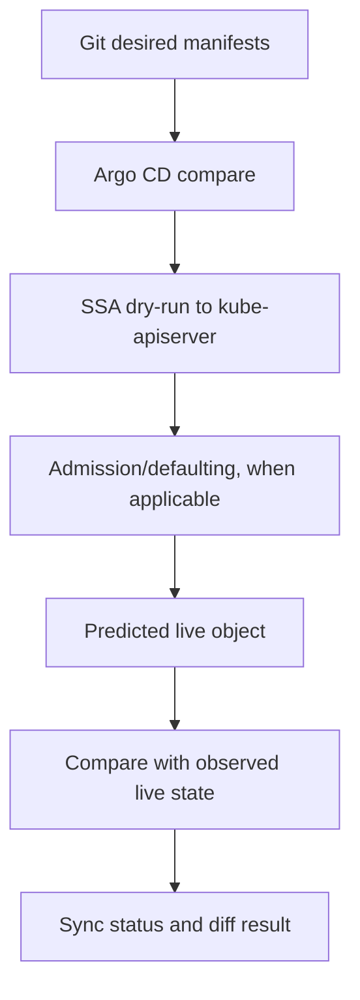

:::info Source status
The title and topic were cross-checked against the conversation history. The content below is a **detailed editorial reconstruction**, not a verbatim transcript of the entire original response.
:::

# Lesson 03: Structured Merge Diff, OpenAPI Schema & Field Ownership

## Learning objectives

Develop a solid understanding of **Structured Merge Diff, Kubernetes schemas, list semantics, and field ownership**. Learn where controller responsibilities and ownership boundaries lie, and apply that knowledge in a lab on a test cluster.


## 1. Why is merging YAML different from merging ordinary JSON?

Kubernetes APIs use *structural schemas* and field-specific list and map semantics. If you treat every list as an atomic array or every object as untyped JSON, a patch can inadvertently remove fields that another actor manages.

**Structured Merge Diff (SMD)** uses a typed schema to determine field ownership and merge behavior. It underpins SSA.

## 2. Field sets and schemas

A manager can own a path such as `spec.template.spec.containers[name=payment].image`. That path is meaningful only if the schema recognizes `containers` as a list keyed by `name`, rather than an atomic list.

In OpenAPI schemas for CRDs, declarations such as `x-kubernetes-list-type` and `x-kubernetes-list-map-keys` determine this behavior.

### What the merge engine sees

Start with two containers in one Deployment:

```yaml
spec:
  template:
    spec:
      containers:
        - name: payment
          image: payment:v1
        - name: logging
          image: fluent-bit:v2
```

The schema lets Structured Merge Diff identify entries by `name`. A field set can contain the image of `containers[name=payment]` without containing the image of `containers[name=logging]`. Two managers can then change those separate images if their intents and existing ownership allow it. If the list were atomic, changing either image would change the same list field, so a second manager applying a different list would conflict. SMD uses the schema to determine the unit of ownership, compares typed field sets and values, then combines the submitted intent with live state or rejects conflicts. [Structured Merge Diff source](https://github.com/kubernetes-sigs/structured-merge-diff) · [Kubernetes merge strategy](https://kubernetes.io/docs/reference/using-api/server-side-apply/#merge-strategy)

| OpenAPI extension | Effect on ownership |
| --- | --- |
| `x-kubernetes-list-type: atomic` | Treat the entire list as one field. |
| `x-kubernetes-list-type: map` | Identify each entry by one or more keys. Ownership can reach fields within an entry. |
| `x-kubernetes-list-map-keys` | Name scalar fields that together identify an entry. Declare the keys as required or give them defaults. |
| `x-kubernetes-list-type: set` | Identify distinct elements by value. |
| `x-kubernetes-map-type: granular` | Allow separate owners for keys or properties. |
| `x-kubernetes-map-type: atomic` | Treat the map or struct as one field. |

These extensions belong in the schema. For a CRD without topology markers, lists are atomic by default and typed object properties are generally granular. Kubernetes also recognizes legacy merge markers for compatible built-in types. For Config Connector resources, the API server uses the installed CRD schema for Kubernetes field ownership. Config Connector separately reconciles the accepted resource against Google Cloud. See [Config Connector and cloud reconciliation](../02-controllers-platform/lesson-05-platform-integration.md).

## 3. Atomic, set, and map lists

| Type | Meaning |
|---|---|
| `atomic` | The list is treated as a single unit of ownership |
| `set` | Elements follow set semantics |
| `map` | Elements are identified by keys and can be managed independently |

Example schema fragment for a CRD:

```yaml
spec:
  type: object
  properties:
    endpoints:
      type: array
      x-kubernetes-list-type: map
      x-kubernetes-list-map-keys:
        - name
      items:
        type: object
        required: [name, port]
        properties:
          name: {type: string}
          port: {type: integer}
```

This configuration expresses the intent that endpoints are identified by `name`. In a complete CRD, place this fragment inside a valid `openAPIV3Schema` structure.

### Atomic lists and sets

Suppose a custom resource declares two endpoints. If the schema makes `endpoints` atomic, an owner claims the whole value `[api.example.com, backup.example.com]`. Another manager applying `[api.example.com, metrics.example.com]` requests a replacement of that value. Even if the change looks local to one item, SSA checks ownership of the whole list. Force can replace it with the submitted list, so review which entries would disappear.

```yaml
endpoints:
  type: array
  x-kubernetes-list-type: atomic
  items:
    type: string
enabledFeatures:
  type: array
  x-kubernetes-list-type: set
  items:
    type: string
```

In the set example, one manager can declare `metrics` and another can declare `tracing`. Each distinct value has its own identity. Omitting `tracing` from the first manager's intent leaves the second manager's value alone. A set of strings is the simplest case. Kubernetes also permits set elements that are atomic objects or arrays. Set ownership follows the whole element value.

### Atomic and granular objects

```yaml
settings:
  type: object
  x-kubernetes-map-type: granular
  properties:
    logging:
      type: string
    metrics:
      type: string
```

With a granular object, Team A can maintain `settings.logging` and Team B can maintain `settings.metrics`. With `x-kubernetes-map-type: atomic`, the same object is one ownership unit. Team B changing only the metrics setting can conflict with Team A's claim to the whole object. Choose granular topology for independently managed properties and atomic topology when callers should submit a complete setting together. [Kubernetes merge strategy](https://kubernetes.io/docs/reference/using-api/server-side-apply/#merge-strategy)

Try the [structured merge simulator](../03-gitops-delivery/gitops-exercises.mdx#compare-atomic-and-keyed-list-ownership) to see how the same intent can merge or replace entries depending on the list topology.

## 4. Why does the CRD schema affect GitOps?

Suppose team A manages the `api` endpoint and team B manages the `metrics` endpoint. If the CRD defines an `atomic` list, the two actors can conflict over the entire list. If the map-style list schema is designed correctly and the API contract allows it, ownership can be more granular.

Do not change the list type of a CRD already in production without evaluating the implications for data migration and ownership.

### Review both directions of a topology migration

A topology change alters the field sets used to enforce ownership on existing objects. If `routes` was a map list and becomes atomic, the former entry owners can end up owning the whole list. A write to either route may now conflict with another owner. The API server does not choose a single owner on the teams' behalf.

The reverse transition has a different failure mode. When an atomic object becomes granular, Kubernetes may retain ownership of the top-level field without assigning existing child fields to the previous owner. An edit that used to conflict can then succeed. Existing values may also fail the new schema, for example if a candidate set contains duplicates or a proposed map key is missing. Inspect existing objects and field managers, test the current merge and the new merge on representative copies, migrate writers in a controlled order, and verify that subsequent applies preserve both values and intended ownership. Prefer a new version or field with an explicit migration when the existing contract cannot be preserved. [Kubernetes topology changes](https://kubernetes.io/docs/reference/using-api/server-side-apply/#compatibility-across-topology-changes) · [CRD validation ratcheting](https://kubernetes.io/docs/tasks/extend-kubernetes/custom-resources/custom-resource-definitions/#validation-ratcheting)

## 5. Defaults and nullability

An OpenAPI schema can define a `default`, required properties, enum validation, nullable fields, and pruning behavior. The API server can fill in defaults that are absent from the original manifest in Git, leading to confusing diffs during rendering or comparison. A CRD schema should describe the intended API, not just do enough to pass validation.

## 6. Argo CD diff strategy

When Argo CD compares rendered manifests with live state, normalizers, defaulted fields, field managers, and the schema can all affect the diff. Supported versions of Argo CD offer Server-Side Diff, which uses the API server's dry-run semantics. **Do not equate every Argo CD diff with SMD**; the diff engine depends on the version and configuration.

## 7. Example of an ownership conflict

```text
Manager A owns: spec.replicas = 3
Manager B attempts SSA: spec.replicas = 5
Result: ownership conflict unless takeover permitted
```

```text
Manager A owns: container[name=web].image
Manager B owns: container[name=metrics].image
Possible independent ownership when schema treats containers as keyed map list
```

## 8. CRD lab

1. Create a test CRD with an `atomic` list. Try applying different elements as two different field managers.
2. Create another test CRD with `x-kubernetes-list-type: map`, keyed by `name`.
3. Compare `managedFields` and the conflicts that arise.
4. Try omitting a field and observe when it is removed or reset to its default.
5. Check for finalizers, then delete the lab resources in the correct order.

### Install an APIConfig CRD with two list topologies

Use a disposable cluster and a context with permission to create CRDs. This lab uses Kubernetes alone. Save the following as `apiconfig-crd.yaml`. Both fields contain route objects with the same shape. The topology is the only relevant schema difference.

```yaml
apiVersion: apiextensions.k8s.io/v1
kind: CustomResourceDefinition
metadata:
  name: apiconfigs.platform.example.com
spec:
  group: platform.example.com
  scope: Namespaced
  names:
    plural: apiconfigs
    singular: apiconfig
    kind: APIConfig
  versions:
    - name: v1
      served: true
      storage: true
      schema:
        openAPIV3Schema:
          type: object
          properties:
            spec:
              type: object
              properties:
                routes:
                  type: array
                  x-kubernetes-list-type: map
                  x-kubernetes-list-map-keys: [name]
                  items:
                    type: object
                    required: [name, path]
                    properties:
                      name: {type: string}
                      path: {type: string}
                atomicRoutes:
                  type: array
                  x-kubernetes-list-type: atomic
                  items:
                    type: object
                    required: [name, path]
                    properties:
                      name: {type: string}
                      path: {type: string}
```

```bash
kubectl create namespace smd-lab
kubectl apply -f apiconfig-crd.yaml
kubectl wait --for=condition=Established crd/apiconfigs.platform.example.com --timeout=60s
```

### Apply two keyed entries

Save the first document below as `payment.yaml` and the second as `order.yaml`.

```yaml
apiVersion: platform.example.com/v1
kind: APIConfig
metadata:
  name: gateway
  namespace: smd-lab
spec:
  routes:
    - name: payment
      path: /payments
---
apiVersion: platform.example.com/v1
kind: APIConfig
metadata:
  name: gateway
  namespace: smd-lab
spec:
  routes:
    - name: order
      path: /orders
```

```bash
kubectl apply --server-side --field-manager=payment-team -f payment.yaml
kubectl apply --server-side --field-manager=order-team -f order.yaml
kubectl -n smd-lab get apiconfig gateway -o yaml --show-managed-fields
```

Both entries should be present. The order team's intent identifies only its own route. The payment team's route is preserved by the merge. An abbreviated `managedFields` excerpt looks like this:

```yaml
metadata:
  managedFields:
    - manager: payment-team
      operation: Apply
      fieldsV1:
        f:spec:
          f:routes:
            'k:{"name":"payment"}':
              .: {}
              f:path: {}
    - manager: order-team
      operation: Apply
      fieldsV1:
        f:spec:
          f:routes:
            'k:{"name":"order"}':
              .: {}
              f:path: {}
```

The `f:` prefixes mark named fields, `k:` identifies a keyed list entry, and `.` in an entry can mark ownership of the entry itself. The actual output can include additional field paths such as `f:name`.

Copy the order intent to `claim-payment.yaml` and replace its route with `name: payment` and `path: /checkout`. Keep the resource identity unchanged.

```bash
kubectl apply --server-side --field-manager=order-team -f claim-payment.yaml
kubectl -n smd-lab get apiconfig gateway -o yaml
```

Expect a conflict at `.spec.routes[name="payment"].path`. The rejected request leaves both routes unchanged, including the order entry omitted from that attempted intent. To observe successful omission, change the original order intent to `spec: {routes: []}` and apply it as `order-team`. The order entry is removed because that team was its sole owner. The payment entry remains.

### Repeat with an atomic field

Copy the two original one-route manifests to `payment-atomic.yaml` and `order-atomic.yaml`. In both files, change `metadata.name` to `gateway-atomic` and `spec.routes` to `spec.atomicRoutes`. Keep the route names and paths as in the original pair.

```bash
kubectl apply --server-side --field-manager=payment-team -f payment-atomic.yaml
kubectl apply --server-side --field-manager=order-team -f order-atomic.yaml
kubectl apply --server-side --field-manager=order-team --force-conflicts \
  --dry-run=server -o yaml -f order-atomic.yaml
kubectl -n smd-lab get apiconfig gateway-atomic -o yaml --show-managed-fields
```

The second apply should conflict at `.spec.atomicRoutes` even though the incoming route has a different name. The forced dry run previews a list containing only the order entry, because the incoming value replaces the entire field. The final read still shows the payment entry because dry run made no write. Compare the atomic manager's field set with the keyed field sets above.

After collecting results, remove the two disposable custom resources. Deleting the CRD also deletes instances of that API across the cluster. Remove the CRD and namespace only if they were created for this lab and have no other users or data. [CustomResourceDefinitions](https://kubernetes.io/docs/tasks/extend-kubernetes/custom-resources/custom-resource-definitions/) · [Kubernetes SSA](https://kubernetes.io/docs/reference/using-api/server-side-apply/)

## 9. Production pitfalls

- A missing structural schema leads to unpredictable behavior, affects pruning, and limits CRD features.
- Field semantics in the schema are part of the public API contract, not a formatting choice.
- Do not let two controllers manage the same field just because their manifests live in different repositories.
- Field ownership does not replace RBAC, admission authorization, or data-level transactions.

**References:** [Server-Side Apply](https://kubernetes.io/docs/reference/using-api/server-side-apply/) · [CRD Structural Schemas](https://kubernetes.io/docs/tasks/extend-kubernetes/custom-resources/custom-resource-definitions/) · [Argo CD Diffing](https://argo-cd.readthedocs.io/en/stable/user-guide/diffing/).

## Important update: Argo CD discontinued its Structured-Merge Diff strategy

**Distinguish two concepts:** The `structured-merge-diff` library is still relevant to understanding SSA field ownership in the Kubernetes API server, but **Argo CD discontinued the Structured-Merge Diff strategy it previously used for comparisons**. The current Argo CD documentation describes the Server-Side Diff strategy, which uses a *Server-Side Apply dry run* when the SSA sync option is enabled. The claim that “enabling ServerSideApply makes Argo CD use Structured-Merge Diff” therefore applies only to certain older versions; it is not guidance for newer versions of Argo CD.

| Topic | Main role |
|---|---|
| Kubernetes structured-merge-diff implementation | Interprets data types and ownership for SSA |
| Argo CD Structured-Merge Diff (legacy) | Computes a diff using a local merge model; discontinued |
| Argo CD Server-Side Diff | Uses an SSA dry run to have the API server predict live state |
| Argo CD legacy diff | Compares desired, live, and last-applied state using the older strategy |

**Modern diff workflow**:



The diff result predicts how an existing object would compare. The sync result records what happened when Argo CD sent the actual write through admission.

### Compare a field injected by admission

Suppose a mutating admission webhook adds `metadata.labels.security-level: restricted`. With Server-Side Diff enabled, Argo CD can compare the live resource with a server dry-run prediction. Mutating webhook results are excluded from the comparison by default. To include them for this Application, enable both options in its metadata:

```yaml
metadata:
  annotations:
    argocd.argoproj.io/compare-options: ServerSideDiff=true,IncludeMutationWebhook=true
```

If the webhook runs during dry run and returns that label, the prediction can account for it. Kubernetes requires matching admission webhooks to support dry run through their declared side-effect behavior. A dry run returns a prediction without persisting changes. Argo CD skips Server-Side Diff for resources that do not yet exist, so first sync still needs ordinary admission and validation checks. The comparison setting is separate from the apply option used for actual synchronization. Current Argo CD documentation describes automatic Server-Side Diff when SSA sync is enabled, with an opt-out. Check the installed-version documentation before assuming this behavior. [Argo CD Diff Strategies](https://argo-cd.readthedocs.io/en/stable/user-guide/diff-strategies/) · [Kubernetes dry run](https://kubernetes.io/docs/reference/using-api/api-concepts/#dry-run)

### How the OpenAPI schema changes list management

The CRD declares:

```yaml
openAPIV3Schema:
  type: object
  properties:
    spec:
      type: object
      properties:
        ports:
          type: array
          x-kubernetes-list-type: map
          x-kubernetes-list-map-keys: [name]
          items:
            type: object
            required: [name, port]
            properties:
              name:
                type: string
              port:
                type: integer
```

Here, `ports` is a map-style list keyed by `name`. Two managers can own different entries according to the schema's semantics. With `x-kubernetes-list-type: atomic`, the entire list is one unit of ownership.

If the CRD schema is missing or incorrect, reconciliation can produce unexpected conflicts or diffs, especially when defaults or arrays are involved.

### Debugging a false `OutOfSync` status

1. Record the Argo CD version with `argocd version`, for both the client and the server.
2. Check whether the Application uses `ServerSideApply=true` or any comparison annotations.
3. Inspect the rendered manifests with `argocd app manifests APP`.
4. Inspect the live object, including managed fields, with `kubectl get ... -o yaml --show-managed-fields`.
5. Check the OpenAPI schema, CRD defaults, mutating webhooks, and status written by controllers.
6. Consult the [Argo CD diff strategies](https://argo-cd.readthedocs.io/en/stable/user-guide/diff-strategies/) for the version in use.

### Questions to consider

- Why can an array produce a conflict even when two managers edit different elements?
- Why can status or defaulted fields appear as drift when you use the wrong comparison strategy?
- Why can Server-Side Diff reflect admission mutations more accurately than some client-side diff methods?

Verification sources: [Argo CD Diff Strategies](https://argo-cd.readthedocs.io/en/stable/user-guide/diff-strategies/), [Argo CD Upgrade 3.5→3.6](https://argo-cd.readthedocs.io/en/stable/operator-manual/upgrading/3.5-3.6/), [Kubernetes SSA](https://kubernetes.io/docs/reference/using-api/server-side-apply/).

## Summary and practical implications

- Separate desired state from observed state and identify the correct owner for each field and resource.
- Do not equate a successful API operation with an external system being ready to serve traffic.
- Check IAM and RBAC, readiness, the data lifecycle, and recoverability before using this in production.

Continue with [ApplicationSet and multi-cluster GitOps](../02-controllers-platform/lesson-04-controller-foundations.md) for Git, cluster, and matrix generators, then see [GKE Fleet Management](../02-controllers-platform/fleet-config-sync.md) for fleet-wide configuration.

[Back to the Learning Path](../learning-path.md)
