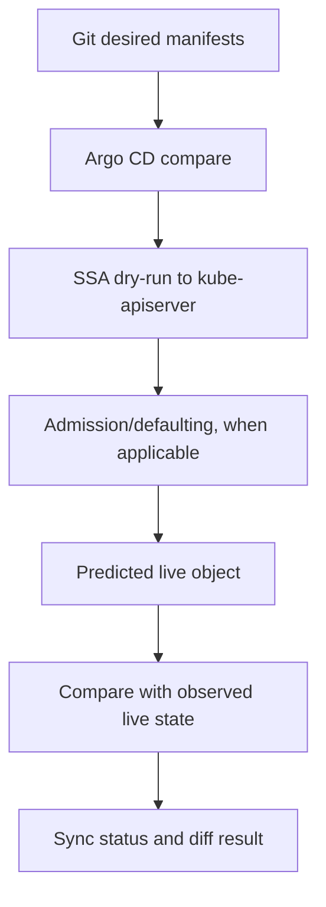

# Bài 03: Structured Merge Diff, OpenAPI Schema & Field Ownership

## Mục tiêu học tập

- **Nền tảng Structured Merge Diff (SMD):** Giải thích cách Kubernetes dùng structural schema có kiểu dữ liệu thay vì so sánh JSON/YAML thuần túy để tính toán tập trường và cưỡng chế quyền sở hữu SSA.
- **Topology cho danh sách và đối tượng:** Phân biệt danh sách `atomic`, `set` và `map` định danh theo khóa (`x-kubernetes-list-type`, `x-kubernetes-list-map-keys`) cùng đối tượng `atomic` và `granular` để thiết kế CRD tránh xung đột.
- **Tiến hóa schema và chuyển đổi topology:** Đánh giá rủi ro về quyền sở hữu và kiểm tra hợp lệ khi thay đổi topology của danh sách hoặc map theo cả hai chiều trên các CRD đang chạy ở production.
- **Giá trị mặc định, tính nullable và Server-Side Diff:** Phân biệt Kubernetes SMD với chiến lược Server-Side Diff hiện đại của Argo CD (SSA dry-run) và cấu hình `IncludeMutationWebhook=true` để loại bỏ trạng thái `OutOfSync` giả.
- **Kiểm chứng thực hành quyền sở hữu trên CRD:** Xây dựng và thử nghiệm custom resource có cả trường danh sách `map` lẫn `atomic` để kiểm tra đường dẫn trong `managedFields` và xác minh hành vi lược bỏ hay xung đột.

## 1. Tại sao merge YAML lại khác với merge JSON thông thường?

Các API của Kubernetes sử dụng *structural schema* cùng ngữ nghĩa list và map riêng cho từng trường. Nếu bạn coi mọi danh sách như một mảng nguyên khối (atomic array) hoặc coi mọi đối tượng là JSON không định kiểu, một bản patch có thể vô tình xóa mất những trường đang do tác nhân khác quản lý.

**Structured Merge Diff (SMD)** sử dụng schema có kiểu dữ liệu để xác định quyền sở hữu trường và hành vi merge. Đây chính là nền tảng của SSA.

## 2. Tập trường (field sets) và schema

Một manager có thể sở hữu đường dẫn như `spec.template.spec.containers[name=payment].image`. Đường dẫn đó chỉ có ý nghĩa khi schema nhận diện `containers` là một danh sách định danh theo khóa `name`, chứ không phải một danh sách atomic.

Trong OpenAPI schema của CRD, các khai báo như `x-kubernetes-list-type` và `x-kubernetes-list-map-keys` quy định hành vi này.

### Những gì merge engine nhìn thấy

Xét hai container trong cùng một Deployment:

```yaml
spec:
  template:
    spec:
      containers:
        - name: payment
          image: payment:v1
        - name: logging
          image: fluent-bit:v2
```

Schema cho phép Structured Merge Diff nhận diện các phần tử theo `name`. Một tập trường có thể chứa image của `containers[name=payment]` mà không chứa image của `containers[name=logging]`. Khi đó hai manager có thể thay đổi hai image riêng biệt nếu ý định và quyền sở hữu hiện tại cho phép. Nếu danh sách là atomic, thay đổi bất kỳ image nào cũng làm thay đổi cùng một trường danh sách, khiến manager thứ hai bị xung đột khi apply một danh sách khác. SMD dựa vào schema để xác định đơn vị sở hữu, so sánh các tập trường và giá trị có kiểu dữ liệu, rồi kết hợp ý định gửi lên với live state hoặc từ chối khi có xung đột. [Mã nguồn Structured Merge Diff](https://github.com/kubernetes-sigs/structured-merge-diff) · [Chiến lược merge của Kubernetes](https://kubernetes.io/docs/reference/using-api/server-side-apply/#merge-strategy)

| Phần mở rộng OpenAPI | Tác động lên quyền sở hữu |
| --- | --- |
| `x-kubernetes-list-type: atomic` | Coi toàn bộ danh sách là một trường duy nhất. |
| `x-kubernetes-list-type: map` | Định danh từng phần tử bằng một hoặc nhiều khóa. Quyền sở hữu có thể đi sâu vào từng trường bên trong phần tử. |
| `x-kubernetes-list-map-keys` | Liệt kê các trường vô hướng kết hợp lại để định danh một phần tử. Cần khai báo các khóa này là required hoặc gán giá trị mặc định. |
| `x-kubernetes-list-type: set` | Định danh các phần tử phân biệt dựa trên chính giá trị của chúng. |
| `x-kubernetes-map-type: granular` | Cho phép các chủ sở hữu riêng biệt cho từng khóa hoặc thuộc tính. |
| `x-kubernetes-map-type: atomic` | Coi toàn bộ map hoặc struct là một trường duy nhất. |

Các phần mở rộng này được khai báo trong schema. Với một CRD không có đánh dấu topology (topology marker), danh sách mặc định là atomic và các thuộc tính của đối tượng có định kiểu nhìn chung là granular. Kubernetes cũng nhận diện các merge marker cũ cho những kiểu tích hợp sẵn tương thích. Với các tài nguyên Config Connector, API server dùng CRD schema đã cài đặt để quản lý Kubernetes field ownership. Config Connector sau đó tách biệt reconcile tài nguyên đã được chấp nhận với Google Cloud. Xem thêm [Config Connector và reconciliation tài nguyên đám mây](../02-controllers-platform/lesson-05-platform-integration.md).

## 3. Danh sách kiểu `atomic`, `set` và `map`

| Kiểu | Ý nghĩa |
|---|---|
| `atomic` | Toàn bộ danh sách được coi là một đơn vị sở hữu duy nhất |
| `set` | Các phần tử tuân theo ngữ nghĩa tập hợp |
| `map` | Các phần tử được định danh bằng khóa và có thể quản lý độc lập |

Ví dụ một đoạn schema cho CRD:

```yaml
spec:
  type: object
  properties:
    endpoints:
      type: array
      x-kubernetes-list-type: map
      x-kubernetes-list-map-keys:
        - name
      items:
        type: object
        required: [name, port]
        properties:
          name: {type: string}
          port: {type: integer}
```

Cấu hình này thể hiện ý định rằng các endpoint được định danh theo `name`. Trong một CRD hoàn chỉnh, đặt đoạn này vào bên trong cấu trúc `openAPIV3Schema` hợp lệ.

### Danh sách atomic và set

Giả sử một custom resource khai báo hai endpoint. Nếu schema đặt `endpoints` là atomic, một chủ sở hữu sẽ nắm toàn bộ giá trị `[api.example.com, backup.example.com]`. Một manager khác apply `[api.example.com, metrics.example.com]` đồng nghĩa yêu cầu thay thế toàn bộ giá trị đó. Ngay cả khi thay đổi trông như chỉ tác động đến một phần tử, SSA vẫn kiểm tra quyền sở hữu trên toàn bộ danh sách. Dùng force có thể thay thế toàn bộ bằng danh sách gửi lên, vì vậy cần rà soát kỹ những phần tử nào sẽ bị biến mất.

```yaml
endpoints:
  type: array
  x-kubernetes-list-type: atomic
  items:
    type: string
enabledFeatures:
  type: array
  x-kubernetes-list-type: set
  items:
    type: string
```

Trong ví dụ kiểu `set`, một manager có thể khai báo `metrics` và manager khác khai báo `tracing`. Mỗi giá trị phân biệt có định danh riêng. Việc lược bỏ `tracing` khỏi ý định của manager đầu tiên sẽ giữ nguyên giá trị của manager thứ hai. Tập hợp chuỗi là trường hợp đơn giản nhất. Kubernetes cũng cho phép phần tử của set là đối tượng hoặc mảng atomic. Quyền sở hữu theo set áp dụng trên toàn bộ giá trị của phần tử.

### Đối tượng atomic và granular

```yaml
settings:
  type: object
  x-kubernetes-map-type: granular
  properties:
    logging:
      type: string
    metrics:
      type: string
```

Với đối tượng granular, Team A có thể duy trì `settings.logging` và Team B có thể duy trì `settings.metrics`. Với `x-kubernetes-map-type: atomic`, chính đối tượng đó trở thành một đơn vị sở hữu duy nhất. Khi Team B chỉ sửa cấu hình metrics, nó có thể xung đột với quyền sở hữu toàn bộ đối tượng của Team A. Chọn topology granular cho các thuộc tính cần quản lý độc lập, và chọn topology atomic khi bên gọi cần gửi đồng bộ toàn bộ cấu hình cùng lúc. [Chiến lược merge của Kubernetes](https://kubernetes.io/docs/reference/using-api/server-side-apply/#merge-strategy)

Thử [trình mô phỏng structured merge](../03-gitops-delivery/gitops-exercises.mdx) để thấy cùng một ý định có thể merge hay thay thế phần tử tùy theo topology của danh sách.

## 4. Tại sao CRD schema lại ảnh hưởng đến GitOps?

Giả sử Team A quản lý endpoint `api` còn Team B quản lý endpoint `metrics`. Nếu CRD định nghĩa danh sách `atomic`, hai tác nhân có thể xung đột trên toàn bộ danh sách. Nếu schema danh sách kiểu `map` được thiết kế đúng và hợp đồng API cho phép, quyền sở hữu có thể được chia chi tiết hơn.

Đừng thay đổi kiểu danh sách (list type) của một CRD đang chạy trên production khi chưa đánh giá tác động đối với việc di chuyển dữ liệu và quyền sở hữu.

### Rà soát cả hai chiều của quá trình chuyển đổi topology

Thay đổi topology làm thay đổi các tập trường dùng để cưỡng chế quyền sở hữu trên các đối tượng hiện có. Nếu `routes` vốn là danh sách `map` rồi chuyển sang `atomic`, các chủ sở hữu phần tử trước đó có thể cùng trở thành chủ sở hữu của toàn bộ danh sách. Mọi thao tác ghi vào bất kỳ route nào giờ đều có thể xung đột với chủ sở hữu khác. API server không tự chọn ra một chủ sở hữu duy nhất thay cho các đội nhóm.

Chiều chuyển đổi ngược lại mang kiểu lỗi khác. Khi một đối tượng `atomic` chuyển sang `granular`, Kubernetes có thể giữ lại quyền sở hữu trên trường cấp cao nhất mà không gán các trường con hiện có cho chủ sở hữu trước đó. Một chỉnh sửa trước đây từng bị xung đột giờ lại có thể thực hiện thành công. Dữ liệu hiện có cũng có thể không vượt qua được schema mới, ví dụ khi một trường sắp chuyển sang `set` chứa phần tử trùng lặp hoặc thiếu khóa cho danh sách `map`. Hãy kiểm tra các đối tượng và field manager hiện có, thử nghiệm phép merge cũ và mới trên các bản sao đại diện, di chuyển các bên ghi dữ liệu theo thứ tự kiểm soát, và xác nhận các lần apply sau đó vẫn bảo toàn cả giá trị lẫn quyền sở hữu mong muốn. Ưu tiên tạo phiên bản API mới hoặc trường mới kèm quy trình di chuyển tường minh nếu không thể giữ nguyên hợp đồng hiện tại. [Tính tương thích khi thay đổi topology trong Kubernetes](https://kubernetes.io/docs/reference/using-api/server-side-apply/#compatibility-across-topology-changes) · [CRD validation ratcheting](https://kubernetes.io/docs/tasks/extend-kubernetes/custom-resources/custom-resource-definitions/#validation-ratcheting)

## 5. Giá trị mặc định và tính nullable

Một OpenAPI schema có thể định nghĩa `default`, các thuộc tính bắt buộc, kiểm tra enum, trường nullable và hành vi pruning. API server có thể tự điền các giá trị mặc định vốn không có trong manifest gốc trên Git, dẫn đến những khác biệt khó hiểu khi render hoặc so sánh. Một CRD schema nên mô tả đúng API dự kiến, chứ không chỉ làm đủ để vượt qua bước validation.

## 6. Chiến lược diff của Argo CD

Khi Argo CD so sánh các manifest đã render với live state, các bộ chuẩn hóa (normalizer), trường mặc định, field manager và schema đều có thể ảnh hưởng đến kết quả diff. Các phiên bản Argo CD được hỗ trợ cung cấp Server-Side Diff, tận dụng ngữ nghĩa dry-run của API server. **Đừng đánh đồng mọi phép diff của Argo CD với SMD**; diff engine phụ thuộc vào phiên bản và cấu hình đang sử dụng.

## 7. Ví dụ về xung đột quyền sở hữu

```text
Manager A owns: spec.replicas = 3
Manager B attempts SSA: spec.replicas = 5
Result: ownership conflict unless takeover permitted
```

```text
Manager A owns: container[name=web].image
Manager B owns: container[name=metrics].image
Possible independent ownership when schema treats containers as keyed map list
```

## 8. Bài lab CRD

1. Tạo một CRD thử nghiệm có danh sách `atomic`. Thử apply các phần tử khác nhau bằng hai field manager khác nhau.
2. Tạo một CRD thử nghiệm khác với `x-kubernetes-list-type: map`, dùng khóa `name`.
3. So sánh `managedFields` và các xung đột phát sinh.
4. Thử lược bỏ một trường và quan sát khi nào nó bị xóa hoặc đặt lại về giá trị mặc định.
5. Kiểm tra finalizer, sau đó xóa các tài nguyên lab theo đúng thứ tự.

### Cài đặt CRD APIConfig với hai topology danh sách

Sử dụng một cluster dùng một lần và context có quyền tạo CRD. Bài lab này chỉ dùng thuần Kubernetes. Lưu nội dung sau thành `apiconfig-crd.yaml`. Cả hai trường đều chứa các đối tượng route có cùng cấu trúc. Topology là điểm khác biệt schema duy nhất đáng quan tâm.

```yaml
apiVersion: apiextensions.k8s.io/v1
kind: CustomResourceDefinition
metadata:
  name: apiconfigs.platform.example.com
spec:
  group: platform.example.com
  scope: Namespaced
  names:
    plural: apiconfigs
    singular: apiconfig
    kind: APIConfig
  versions:
    - name: v1
      served: true
      storage: true
      schema:
        openAPIV3Schema:
          type: object
          properties:
            spec:
              type: object
              properties:
                routes:
                  type: array
                  x-kubernetes-list-type: map
                  x-kubernetes-list-map-keys: [name]
                  items:
                    type: object
                    required: [name, path]
                    properties:
                      name: {type: string}
                      path: {type: string}
                atomicRoutes:
                  type: array
                  x-kubernetes-list-type: atomic
                  items:
                    type: object
                    required: [name, path]
                    properties:
                      name: {type: string}
                      path: {type: string}
```

```bash
kubectl create namespace smd-lab
kubectl apply -f apiconfig-crd.yaml
kubectl wait --for=condition=Established crd/apiconfigs.platform.example.com --timeout=60s
```

### Apply hai phần tử định danh theo khóa

Lưu tài liệu thứ nhất bên dưới thành `payment.yaml` và tài liệu thứ hai thành `order.yaml`.

```yaml
apiVersion: platform.example.com/v1
kind: APIConfig
metadata:
  name: gateway
  namespace: smd-lab
spec:
  routes:
    - name: payment
      path: /payments
---
apiVersion: platform.example.com/v1
kind: APIConfig
metadata:
  name: gateway
  namespace: smd-lab
spec:
  routes:
    - name: order
      path: /orders
```

```bash
kubectl apply --server-side --field-manager=payment-team -f payment.yaml
kubectl apply --server-side --field-manager=order-team -f order.yaml
kubectl -n smd-lab get apiconfig gateway -o yaml --show-managed-fields
```

Cả hai phần tử đều phải xuất hiện. Ý định của đội order chỉ khai báo route của riêng mình. Route của đội payment được bảo toàn qua phép merge. Một đoạn trích rút gọn của `managedFields` sẽ trông như sau:

```yaml
metadata:
  managedFields:
    - manager: payment-team
      operation: Apply
      fieldsV1:
        f:spec:
          f:routes:
            'k:{"name":"payment"}':
              .: {}
              f:path: {}
    - manager: order-team
      operation: Apply
      fieldsV1:
        f:spec:
          f:routes:
            'k:{"name":"order"}':
              .: {}
              f:path: {}
```

Tiền tố `f:` đánh dấu trường có tên, `k:` định danh phần tử danh sách theo khóa, và `.` bên trong một phần tử đánh dấu quyền sở hữu chính phần tử đó. Đầu ra thực tế có thể chứa thêm các đường dẫn trường khác như `f:name`.

Sao chép file ý định của đội order thành `claim-payment.yaml` và thay route của nó bằng `name: payment` và `path: /checkout`. Giữ nguyên định danh tài nguyên.

```bash
kubectl apply --server-side --field-manager=order-team -f claim-payment.yaml
kubectl -n smd-lab get apiconfig gateway -o yaml
```

Kết quả kỳ vọng là xung đột tại `.spec.routes[name="payment"].path`. Yêu cầu bị từ chối sẽ giữ nguyên cả hai route, kể cả phần tử `order` bị lược khỏi ý định vừa thử. Để quan sát việc lược bỏ thành công, hãy đổi file ý định gốc của đội order thành `spec: {routes: []}` rồi apply dưới tên `order-team`. Phần tử `order` sẽ bị xóa vì đội đó là chủ sở hữu duy nhất. Phần tử `payment` vẫn còn nguyên.

### Lặp lại với trường atomic

Sao chép hai manifest một-route ban đầu thành `payment-atomic.yaml` và `order-atomic.yaml`. Trong cả hai file, đổi `metadata.name` thành `gateway-atomic` và đổi `spec.routes` thành `spec.atomicRoutes`. Giữ nguyên tên và đường dẫn route như cặp ban đầu.

```bash
kubectl apply --server-side --field-manager=payment-team -f payment-atomic.yaml
kubectl apply --server-side --field-manager=order-team -f order-atomic.yaml
kubectl apply --server-side --field-manager=order-team --force-conflicts \
  --dry-run=server -o yaml -f order-atomic.yaml
kubectl -n smd-lab get apiconfig gateway-atomic -o yaml --show-managed-fields
```

Lần apply thứ hai sẽ xung đột tại `.spec.atomicRoutes` dù route gửi lên có tên khác. Lệnh dry-run có force cho thấy trước một danh sách chỉ còn phần tử `order`, vì giá trị gửi lên thay thế toàn bộ trường. Lần đọc cuối cùng vẫn hiển thị phần tử `payment` vì dry-run không ghi dữ liệu. Hãy so sánh tập trường của manager atomic với các tập trường có khóa ở trên.

Sau khi thu thập kết quả, xóa hai custom resource dùng một lần này. Việc xóa CRD cũng sẽ xóa toàn bộ các instance của API đó trên toàn cluster. Chỉ xóa CRD và namespace nếu chúng được tạo riêng cho bài lab này và không có người dùng hay dữ liệu nào khác. [CustomResourceDefinitions](https://kubernetes.io/docs/tasks/extend-kubernetes/custom-resources/custom-resource-definitions/) · [Kubernetes SSA](https://kubernetes.io/docs/reference/using-api/server-side-apply/)

## 9. Những cái bẫy trên production

- Thiếu structural schema dẫn đến hành vi khó lường, ảnh hưởng đến pruning và giới hạn nhiều tính năng của CRD.
- Ngữ nghĩa trường trong schema là một phần của hợp đồng API công khai, không phải lựa chọn định dạng hình thức.
- Không để hai controller cùng quản lý một trường chỉ vì manifest của chúng nằm ở hai repository khác nhau.
- Field ownership không thay thế RBAC, phân quyền admission hay giao dịch ở tầng dữ liệu.

**Tài liệu tham khảo:** [Server-Side Apply](https://kubernetes.io/docs/reference/using-api/server-side-apply/) · [CRD Structural Schemas](https://kubernetes.io/docs/tasks/extend-kubernetes/custom-resources/custom-resource-definitions/) · [Argo CD Diffing](https://argo-cd.readthedocs.io/en/stable/user-guide/diffing/).

## Cập nhật quan trọng: Argo CD đã ngừng chiến lược Structured-Merge Diff

**Phân biệt hai khái niệm:** Thư viện `structured-merge-diff` vẫn còn nguyên giá trị để hiểu cơ chế field ownership của SSA trong Kubernetes API server, nhưng **Argo CD đã ngừng chiến lược Structured-Merge Diff từng dùng trước đây cho việc so sánh**. Tài liệu Argo CD hiện hành mô tả chiến lược Server-Side Diff, vốn sử dụng *Server-Side Apply dry-run* khi tùy chọn sync SSA được bật. Vì vậy, nhận định “bật ServerSideApply khiến Argo CD dùng Structured-Merge Diff” chỉ đúng với một số phiên bản cũ; đó không phải hướng dẫn cho các phiên bản Argo CD mới hơn.

| Chủ đề | Vai trò chính |
|---|---|
| Hiện thực `structured-merge-diff` của Kubernetes | Diễn giải kiểu dữ liệu và quyền sở hữu cho SSA |
| Argo CD Structured-Merge Diff (cũ) | Tính diff bằng mô hình merge cục bộ; đã bị ngừng hỗ trợ |
| Argo CD Server-Side Diff | Dùng SSA dry-run để nhờ API server dự đoán trạng thái live |
| Argo CD legacy diff | So sánh trạng thái desired, live và last-applied theo chiến lược cũ |

**Luồng diff hiện đại**:



Kết quả diff dự đoán một đối tượng hiện có sẽ khác biệt thế nào. Kết quả sync ghi nhận điều gì thực sự xảy ra khi Argo CD gửi thao tác ghi thực tế qua admission.

### So sánh một trường được chèn bởi admission

Giả sử một mutating admission webhook tự động thêm `metadata.labels.security-level: restricted`. Khi bật Server-Side Diff, Argo CD có thể so sánh tài nguyên live với bản dự đoán dry-run từ server. Theo mặc định, kết quả của mutating webhook bị loại trừ khỏi phép so sánh. Để đưa chúng vào phép so sánh cho Application này, hãy bật cả hai tùy chọn trong phần metadata của nó:

```yaml
metadata:
  annotations:
    argocd.argoproj.io/compare-options: ServerSideDiff=true,IncludeMutationWebhook=true
```

Nếu webhook chạy trong quá trình dry-run và trả về label đó, bản dự đoán có thể tính đến nó. Kubernetes yêu cầu các admission webhook khớp điều kiện phải hỗ trợ dry-run thông qua khai báo hành vi side-effect. Dry-run trả về bản dự đoán mà không lưu trữ thay đổi. Argo CD bỏ qua Server-Side Diff cho các tài nguyên chưa tồn tại, vì vậy lần sync đầu tiên vẫn cần các bước kiểm tra admission và validation thông thường. Thiết lập so sánh tách biệt với tùy chọn apply dùng cho quá trình đồng bộ thực tế. Tài liệu Argo CD hiện hành mô tả Server-Side Diff tự động bật khi SSA sync được bật, kèm tùy chọn tắt. Hãy kiểm tra tài liệu của phiên bản đang cài đặt trước khi mặc định hành vi này. [Chiến lược diff của Argo CD](https://argo-cd.readthedocs.io/en/stable/user-guide/diff-strategies/) · [Dry-run trong Kubernetes](https://kubernetes.io/docs/reference/using-api/api-concepts/#dry-run)

### OpenAPI schema thay đổi cách quản lý danh sách như thế nào

CRD khai báo:

```yaml
openAPIV3Schema:
  type: object
  properties:
    spec:
      type: object
      properties:
        ports:
          type: array
          x-kubernetes-list-type: map
          x-kubernetes-list-map-keys: [name]
          items:
            type: object
            required: [name, port]
            properties:
              name:
                type: string
              port:
                type: integer
```

Ở đây, `ports` là một danh sách kiểu map định danh theo khóa `name`. Hai manager có thể sở hữu các phần tử khác nhau theo đúng ngữ nghĩa của schema. Với `x-kubernetes-list-type: atomic`, toàn bộ danh sách là một đơn vị sở hữu duy nhất.

Nếu CRD schema bị thiếu hoặc khai báo sai, quá trình reconciliation có thể phát sinh xung đột hoặc diff bất ngờ, đặc biệt khi có liên quan đến giá trị mặc định hoặc mảng.

### Debug trạng thái `OutOfSync` giả

1. Ghi lại phiên bản Argo CD bằng `argocd version` cho cả client và server.
2. Kiểm tra xem Application có dùng `ServerSideApply=true` hoặc annotation so sánh nào không.
3. Kiểm tra các manifest đã render bằng `argocd app manifests APP`.
4. Kiểm tra đối tượng live cùng các trường được quản lý bằng `kubectl get ... -o yaml --show-managed-fields`.
5. Kiểm tra OpenAPI schema, giá trị mặc định của CRD, mutating webhooks và status do các controller ghi vào.
6. Tham khảo tài liệu [chiến lược diff của Argo CD](https://argo-cd.readthedocs.io/en/stable/user-guide/diff-strategies/) cho phiên bản đang sử dụng.

### Câu hỏi suy ngẫm

- Tại sao một mảng có thể phát sinh xung đột ngay cả khi hai manager chỉnh sửa hai phần tử khác nhau?
- Tại sao trường status hoặc các trường có giá trị mặc định có thể bị hiển thị là drift khi dùng sai chiến lược so sánh?
- Tại sao Server-Side Diff có thể phản ánh các thay đổi từ admission chính xác hơn một số phương thức diff phía client?

Nguồn kiểm chứng: [Chiến lược diff của Argo CD](https://argo-cd.readthedocs.io/en/stable/user-guide/diff-strategies/), [Nâng cấp Argo CD 3.5→3.6](https://argo-cd.readthedocs.io/en/stable/operator-manual/upgrading/3.5-3.6/), [Kubernetes SSA](https://kubernetes.io/docs/reference/using-api/server-side-apply/).

## Tóm tắt và lưu ý thực tiễn

- Tách bạch desired state khỏi observed state và xác định đúng chủ sở hữu cho từng trường và tài nguyên.
- Không đánh đồng một thao tác API thành công với việc hệ thống bên ngoài đã sẵn sàng phục vụ lưu lượng.
- Kiểm tra IAM và RBAC, readiness, vòng đời dữ liệu và khả năng khôi phục trước khi áp dụng lên production.

Tiếp tục với [ApplicationSet và GitOps đa cluster](../02-controllers-platform/lesson-04-controller-foundations.md) về các generator Git, cluster và matrix, sau đó xem [Quản lý GKE Fleet](../02-controllers-platform/fleet-config-sync.md) cho cấu hình quy mô toàn fleet.

[Quay lại Lộ trình học tập](../learning-path.md)
