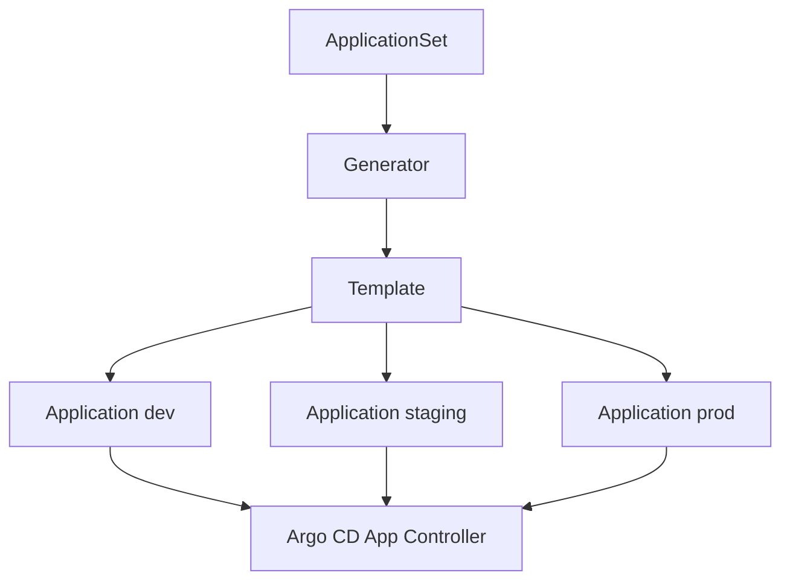

:::info Source status
The title and topic were cross-checked against information from the conversation history. The content below is an **in-depth editorial reconstruction**, not a verbatim transcript of the complete earlier response.
:::

# Lesson 04: Argo CD ApplicationSet & Multi-Cluster GitOps

## Learning objectives

Master **ApplicationSet generators, templating, multi-cluster deployment, and bootstrap**, understand controller responsibilities and ownership boundaries, and apply these concepts in a lab on a test cluster.


## 1. What does ApplicationSet add to Argo CD?

An Argo CD `Application` describes a single unit of deployment to a cluster and namespace. With many microservices, environments, or clusters, writing hundreds of Applications by hand can lead to duplication and configuration drift. An **ApplicationSet** is a Kubernetes custom resource whose controller generates Argo CD Applications from templates and generator inputs.



There are two distinct reconciliation loops: the ApplicationSet controller decides **which Application objects should exist**; the Application controller decides **which Kubernetes resources should exist** for each Application.

## 2. Common generators

| Generator | Data source | Use case |
|---|---|---|
| List | List of elements in the manifest | Fixed set of environments |
| Git Directory/File | Paths or files in Git | Application onboarding through Git |
| Cluster | Secrets for clusters registered with Argo CD | Multi-cluster deployment |
| Matrix | Cartesian product of generators | Apps × environments |
| Merge | Parameters combined by merge keys | Defaults + overrides |
| SCM/PR | Git provider metadata | Preview environments governed by an appropriate policy |

## 3. List generator with a Go template

```yaml
apiVersion: argoproj.io/v1alpha1
kind: ApplicationSet
metadata:
  name: payment-environments
  namespace: argocd
spec:
  goTemplate: true
  goTemplateOptions: [missingkey=error]
  generators:
    - list:
        elements:
          - env: dev
            namespace: payment-dev
          - env: staging
            namespace: payment-staging
  template:
    metadata:
      name: 'payment-{{.env}}'
    spec:
      project: payment-team
      source:
        repoURL: https://github.com/example/payment-gitops.git
        targetRevision: main
        path: 'overlays/{{.env}}'
      destination:
        server: https://kubernetes.default.svc
        namespace: '{{.namespace}}'
```

In production, verify that the AppProject allows the destinations. The template cannot bypass project restrictions.

## 4. Multi-cluster deployment

Suppose `gke-dev`, `gke-staging`, and `gke-prod` are registered. The ApplicationSet Cluster generator can select cluster records by label and generate Applications with the corresponding destinations. This orchestrates deployments; it does not automatically guarantee that networking, IAM, or database migrations will work across clusters.

```text
Git repository
  ├── base/
  └── overlays/
      ├── dev/
      ├── staging/
      └── prod/
```

Use immutable image digests in production and require review before promotion, so a single commit to `main` does not unexpectedly change many clusters at once.

## 5. Matrix generator and scaling risks

`Matrix` can generate `services × environments`. With 100 services and 4 environments, it can generate 400 Applications. This increases activity on the Kubernetes API, rendering load on the repo-server, and controller load. Plan for scale from the start: account for Application ownership, reconciliation frequency, caching, limits, and user access.

## 6. ApplicationSet security

If a team can modify the inputs or templates of a highly privileged ApplicationSet, it can influence what source is deployed and where. Do not let untrusted teams change `project: default` or destinations managed by the platform team if the configuration grants cluster-wide privileges. Use AppProjects, Git branch protection, RBAC, and repository ownership controls.

## 7. Cleanup, pruning, and accidental deletion

When generator inputs change, the ApplicationSet controller may determine that an Application is no longer needed. Understand the chain of ownership and policies such as `applicationsSync` and resource preservation to avoid accidental deletion. Review retention policies and finalizers, especially for PVCs, Secrets, and cloud infrastructure.

## 8. Lab

1. Create two Kustomize overlays, `dev` and `staging`.
2. Apply the ApplicationSet with the List generator and inspect the generated Applications with `kubectl get applications -n argocd`.
3. Add an environment and observe the new generated Application.
4. Remove an environment and identify the resource and lifecycle policies before actually testing deletion.
5. Verify that the `AppProject` rejects a namespace outside its allowed scope.

**Documentation:** [ApplicationSet](https://argo-cd.readthedocs.io/en/stable/operator-manual/applicationset/) · [Generators](https://argo-cd.readthedocs.io/en/stable/operator-manual/applicationset/Generators/) · [Security](https://argo-cd.readthedocs.io/en/stable/operator-manual/applicationset/Security/).

## Deep dive: ApplicationSet controllers, generators, and blast radius

ApplicationSet generates **Application CRs** from templates and generator data; the Application controller then reconciles each Application. ApplicationSet does not replace the Argo CD application-controller. Keep the two loops separate:

```text
Generator state → ApplicationSet reconciliation → Generated Applications
Generated Application → Argo CD Application reconciliation → Kubernetes resources
```

### Choosing the right generator

| Generator | When to use it | Risk |
|---|---|---|
| List | Small, explicit list | Manual updates |
| Git directory/file | Each directory or file represents an environment | Branch and repository permissions determine deployment scope |
| Cluster | Deploy to clusters selected by labels | Tampering with cluster Secret labels can expand the target set |
| Matrix | Combine multiple sets of inputs | The Cartesian product can generate too many Applications |
| Merge | Combine configuration by key | Overlapping configuration requires a clear understanding of precedence |
| Pull Request | Preview environments | Pull requests from untrusted sources can increase risk |

### Example: consistent Application names

```yaml
apiVersion: argoproj.io/v1alpha1
kind: ApplicationSet
metadata:
  name: tenant-apps
  namespace: argocd
spec:
  goTemplate: true
  goTemplateOptions: ["missingkey=error"]
  generators:
    - list:
        elements:
          - {name: payment, namespace: payments}
          - {name: order, namespace: orders}
  template:
    metadata:
      name: '{{.name}}-app'
    spec:
      project: platform-tenant
      source:
        repoURL: https://github.com/example/cluster-gitops.git
        targetRevision: main
        path: 'apps/{{.name}}'
      destination:
        server: https://kubernetes.default.svc
        namespace: '{{.namespace}}'
```

Before applying this manifest, verify that the `platform-tenant` AppProject exists, the repository is accessible, the namespaces and permissions are appropriate, and the ApplicationSet controller is installed. This is a template example; the URL is illustrative only.

### Risks when changing generator inputs

Suppose a Git directory is deleted. The generator stops producing an Application, so the ApplicationSet controller handles that Application, which is no longer in the desired set, according to the configured deletion policy and owner-reference settings. If the Application has the `resources-finalizer.argocd.argoproj.io` finalizer, deletion may cascade to in-cluster resources, depending on how the Application is deleted. Design this behavior carefully when PVCs or external cloud resources are involved.

### Multi-cluster credentials and least privilege

The cluster Secret and credentials in Argo CD determine which API operations are permitted. The cluster name in an Application is not a security boundary; Kubernetes RBAC and the AppProject destination allowlist are the relevant controls. Protect any identity that can edit ApplicationSet templates or generators for a highly privileged project as a privileged identity.

### Lab and failure injection

1. Use a List generator with two namespaces on a test cluster to create two Applications.
2. Verify the generated names, AppProject, and destinations.
3. Add a third element and observe the ApplicationSet controller create a new Application.
4. Disable auto-prune or use a protective policy, remove an element, and observe ownership and deletion behavior in an environment without persistent data.
5. Change cluster labels in the lab to check the scope of the Cluster generator. Verify that ordinary teams cannot edit labels that change deployment destinations.

Verification sources: [ApplicationSet introduction](https://argo-cd.readthedocs.io/en/stable/operator-manual/applicationset/), [ApplicationSet generators](https://argo-cd.readthedocs.io/en/stable/operator-manual/applicationset/Generators/), [Argo CD Projects](https://argo-cd.readthedocs.io/en/stable/user-guide/projects/).

## Summary and related concepts

- Separate desired state from observed state and identify the owner of each field or resource.
- Do not assume a successful API operation means the external system is ready to serve requests.
- Verify IAM and RBAC, readiness, the data lifecycle, and recovery procedures before using this setup in production.

[Back to the Learning Path](../learning-path.md)
