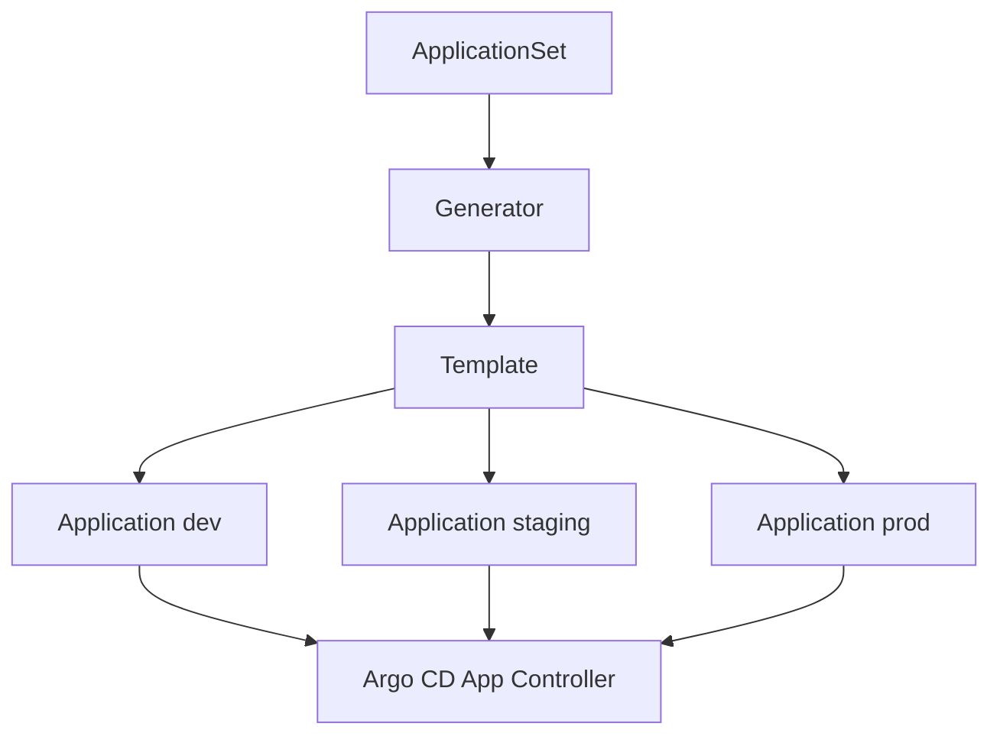
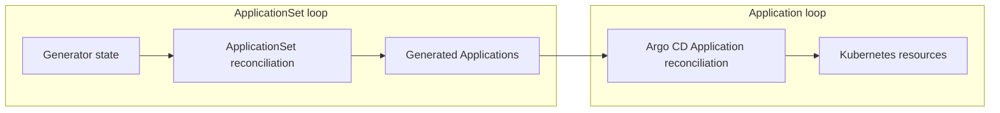

# Lesson 04: Argo CD ApplicationSet & Multi-Cluster GitOps

## Learning objectives

- **Two-loop reconciliation architecture:** Separate the ApplicationSet controller's management of `Application` CRs from the Application controller's reconciliation of workload manifests in destination clusters.
- **Generator selection and templating:** Configure List, Git directory/file, Cluster, Matrix, and Merge generators with Go templates to automate multi-environment and multi-cluster onboarding.
- **Multi-cluster placement and Helm parameterization:** Use cluster registration Secret labels to select target clusters and environment-specific Helm values files while understanding how ApplicationSet complements GKE Fleet.
- **Scaling risks and security boundaries:** Control Cartesian-product blast radius in Matrix generators and enforce least privilege through `AppProject` allowlists, Kubernetes RBAC, and repository protections.
- **Lifecycle, deletion, and retention policies:** Trace deletion paths across `ownerReferences`, Argo CD finalizers, `applicationsSync`, `preserveResourcesOnDeletion`, and `ignoreApplicationDifferences` to prevent accidental workload removal.

## 1. What does ApplicationSet add to Argo CD?

An Argo CD `Application` describes a single unit of deployment to a cluster and namespace. With many microservices, environments, or clusters, writing hundreds of Applications by hand can lead to duplication and configuration drift. An **ApplicationSet** is a Kubernetes custom resource whose controller generates Argo CD Applications from templates and generator inputs.



There are two distinct reconciliation loops: the ApplicationSet controller decides **which Application objects should exist**; the Application controller decides **which Kubernetes resources should exist** for each Application.

### Follow an ApplicationSet through reconciliation

With twenty microservices and two clusters per environment across dev, staging, and production, deploying every service to every cluster yields **120 Application CRs**. One ApplicationSet can generate those CRs from the approved inputs and a common template.

| Responsibility | ApplicationSet controller | Application controller |
| --- | --- | --- |
| Desired state | Applications rendered from generator parameters and a template | Workload manifests rendered from each Application source |
| Observed state | Existing generated Application objects | Managed resources in each destination cluster |
| Writes | Create, patch, or remove Application CRs according to policy | Apply workload resources and prune when the sync operation allows it |
| Signals | ApplicationSet conditions and generated Application specifications | Application revision, sync status, health, and operation state |

The API server persists the ApplicationSet and generated Applications as Kubernetes resources. The controller observes the parent and its generator sources, builds parameter sets, renders the template once for each set, and reconciles those outputs against existing Applications. It can rebuild this view after restart by reading the persisted objects and generator data. An ApplicationSet can generate Applications successfully while their workloads remain `OutOfSync`, `Progressing`, or unhealthy. ApplicationSet has shipped with Argo CD since version 2.3. [ApplicationSet overview](https://argo-cd.readthedocs.io/en/stable/operator-manual/applicationset/)

## 2. Common generators

| Generator | Data source | Use case |
|---|---|---|
| List | List of elements in the manifest | Fixed set of environments |
| Git Directory/File | Paths or files in Git | Application onboarding through Git |
| Cluster | Secrets for clusters registered with Argo CD | Multi-cluster deployment |
| Matrix | Cartesian product of generators | Apps × environments |
| Merge | Parameters combined by merge keys | Defaults + overrides |
| SCM/PR | Git provider metadata | Preview environments governed by an appropriate policy |

### Discover Applications from Git directories and files

The directory generator turns matching paths into parameters. With Go templating enabled, `.path.basename` is the final directory segment and `.path.path` is the full matched path. Here, `apps/payment`, `apps/order`, and `apps/inventory` generate three distinct Applications. Use this and the later examples independently unless the destination resources have separate ownership.

```yaml
apiVersion: argoproj.io/v1alpha1
kind: ApplicationSet
metadata:
  name: microservices
  namespace: argocd
spec:
  goTemplate: true
  goTemplateOptions: [missingkey=error]
  generators:
    - git:
        repoURL: https://github.com/example/gitops.git
        revision: main
        requeueAfterSeconds: 180
        directories:
          - path: apps/*
  template:
    metadata:
      name: '{{.path.basenameNormalized}}'
    spec:
      project: microservices
      source:
        repoURL: https://github.com/example/gitops.git
        targetRevision: main
        path: '{{.path.path}}'
      destination:
        server: https://kubernetes.default.svc
        namespace: '{{.path.basenameNormalized}}'
      syncPolicy:
        syncOptions:
          - CreateNamespace=true
```

Adding `apps/shipping` can create a new Application after the generator sees the commit. With this manifest, workload sync is manual. If you enable automated sync, a directory addition can also lead to deployment. The Git file generator instead reads matching JSON or YAML files and supplies their attributes as parameters. Use files when onboarding requires explicit metadata such as a service name, environment, or approved destination.

The documented default Git generator poll interval is three minutes and can be overridden per generator with `requeueAfterSeconds`. Repo server revision caching can delay discovery beyond the polling interval. An `argocd.argoproj.io/application-set-refresh` annotation can request a refresh that bypasses that cache. ApplicationSet also has a dedicated Git webhook endpoint. Application refresh and manifest sync run on their own schedule. [Git generator polling, caching, and webhooks](https://argo-cd.readthedocs.io/en/stable/operator-manual/applicationset/Generators-Git/#git-polling-interval)

## 3. List generator with a Go template

```yaml
apiVersion: argoproj.io/v1alpha1
kind: ApplicationSet
metadata:
  name: payment-environments
  namespace: argocd
spec:
  goTemplate: true
  goTemplateOptions: [missingkey=error]
  generators:
    - list:
        elements:
          - env: dev
            namespace: payment-dev
          - env: staging
            namespace: payment-staging
  template:
    metadata:
      name: 'payment-{{.env}}'
    spec:
      project: payment-team
      source:
        repoURL: https://github.com/example/payment-gitops.git
        targetRevision: main
        path: 'overlays/{{.env}}'
      destination:
        server: https://kubernetes.default.svc
        namespace: '{{.namespace}}'
```

In production, verify that the AppProject allows the destinations. The template cannot bypass project restrictions.

### List explicit cluster destinations

The previous example chooses namespaces on one cluster. To choose between clusters instead, supply a `server` parameter for each registered destination and use it in the template. Save this as an alternative ApplicationSet. The repository and endpoints are placeholders, and the `payment-team` AppProject must allow them.

```yaml
apiVersion: argoproj.io/v1alpha1
kind: ApplicationSet
metadata:
  name: payment-clusters
  namespace: argocd
spec:
  goTemplate: true
  goTemplateOptions: [missingkey=error]
  generators:
    - list:
        elements:
          - {cluster: dev, server: "https://dev.example.com"}
          - {cluster: prod, server: "https://prod.example.com"}
  template:
    metadata:
      name: 'payment-{{.cluster}}'
    spec:
      project: payment-team
      source:
        repoURL: https://github.com/example/payment-gitops.git
        targetRevision: main
        path: apps/payment
      destination:
        server: '{{.server}}'
        namespace: payment
```

This renders `payment-dev` and `payment-prod`. Adding a staging element makes `payment-staging` part of the desired set. Registering the cluster and granting access are still separate steps. [List generator](https://argo-cd.readthedocs.io/en/stable/operator-manual/applicationset/Generators-List/)

## 4. Multi-cluster deployment

Suppose `gke-dev`, `gke-staging`, and `gke-prod` are registered. The ApplicationSet Cluster generator can select cluster records by label and generate Applications with the corresponding destinations. This orchestrates deployments; it does not automatically guarantee that networking, IAM, or database migrations will work across clusters.

```text
Git repository
  ├── base/
  └── overlays/
      ├── dev/
      ├── staging/
      └── prod/
```

Use immutable image digests in production and require review before promotion, so a single commit to `main` does not unexpectedly change many clusters at once.

### Select Helm values with cluster registration labels

A cluster registration Secret in the `argocd` namespace can carry `gitops-managed=true`, `environment=prod`, and a region label such as `region=asia-southeast1`. The Cluster generator exposes parameters including `name`, `nameNormalized`, `server`, and `metadata.labels`. Those are properties of Argo CD's registration, independent of node labels and fleet membership. The implicit local cluster generally has no registration Secret, so a selector requiring Secret labels excludes it unless you explicitly represent and label it. [Cluster generator](https://argo-cd.readthedocs.io/en/stable/operator-manual/applicationset/Generators-Cluster/)

Inspect registrations without dumping credentials:

```bash
argocd cluster list
kubectl -n argocd get secrets -l argocd.argoproj.io/secret-type=cluster --show-labels
```

Register the lab destinations first. Apply the two example labels to each intended Secret, choosing the appropriate `environment` for that registration. A new matching production registration can add an Application immediately after reconciliation.

| Registration | Environment label | Replicas | Image tag |
| --- | --- | --- | --- |
| `gke-dev` | `dev` | 1 | `v1.3.0` |
| `gke-staging` | `staging` | 2 | `v1.3.0` |
| `gke-prod` | `prod` | 5 | `v1.2.0` |

Use a shared chart and select one values file for each generated Application:

```text
gitops/
├── charts/payment-service/
│   ├── Chart.yaml
│   ├── values.yaml
│   └── templates/
│       ├── deployment.yaml
│       └── service.yaml
├── values/payment-service/
│   ├── dev.yaml
│   ├── staging.yaml
│   └── prod.yaml
└── applicationsets/payment-service.yaml
```

For example, `values/payment-service/prod.yaml` contains:

```yaml
replicaCount: 5
image:
  repository: registry.example.com/payment
  tag: v1.2.0
```

Create dev and staging equivalents using the table. The registry and tags are illustrative. Use an accessible image and a chart that reads these keys. If you use the handbook's example chart as a starting point, retain its required default values. Preview the production chart locally with `helm template payment ./charts/payment-service -f ./values/payment-service/prod.yaml`. See the [Helm walkthrough](../03-gitops-delivery/helm-kustomize.md) for the complete chart example.

```yaml
apiVersion: argoproj.io/v1alpha1
kind: ApplicationSet
metadata:
  name: payment-multicluster
  namespace: argocd
spec:
  goTemplate: true
  goTemplateOptions: [missingkey=error]
  generators:
    - clusters:
        selector:
          matchLabels:
            gitops-managed: "true"
          matchExpressions:
            - key: environment
              operator: In
              values: [dev, staging, prod]
  template:
    metadata:
      name: 'payment-{{.nameNormalized}}'
    spec:
      project: payment-team
      source:
        repoURL: https://github.com/example/gitops.git
        targetRevision: main
        path: charts/payment-service
        helm:
          valueFiles:
            - '../../values/payment-service/{{index .metadata.labels "environment"}}.yaml'
      destination:
        server: '{{.server}}'
        namespace: payment
      syncPolicy:
        automated:
          prune: false
          selfHeal: true
        syncOptions:
          - CreateNamespace=true
```

The selector guarantees the environment label is one of the three supported values. The path is relative to the chart directory in the same Git repository. For `gke-prod`, the controller creates `payment-gke-prod` with `../../values/payment-service/prod.yaml`, the registered production API endpoint, and namespace `payment`. The Application controller requests a Helm render, which yields a Deployment with five replicas and image tag `v1.2.0`. It then applies the rendered manifests according to the generated Application's sync policy. The `payment-team` AppProject must allow the repository and destinations, and the target credentials must allow the writes. [Argo CD Helm values](https://argo-cd.readthedocs.io/en/stable/user-guide/helm/#values-files)

### Diagnose which reconciliation loop should act

| Change | Controller and expected result |
| --- | --- |
| Change `replicaCount` to eight in `prod.yaml` | The Application controller detects a new source revision and rendered Deployment. The Application spec can stay the same. |
| Register and label `gke-prod-2` | ApplicationSet adds a desired Application. The Application controller handles the new destination. |
| Manually change a generated Application's namespace | ApplicationSet can restore the template value if updates are allowed and the field participates in comparison. The Application controller can observe the temporary destination, so avoid this test on production. |
| Scale a destination Deployment directly | The Application controller can detect drift and self-heal if configured. |
| Remove a cluster from generator output | ApplicationSet handles the stale Application according to its effective policy. Inspect finalizers before removing matching labels. |

Inspect ApplicationSet conditions first when a cluster is missing from the desired set. If the Application exists with the correct source and destination, check its status, render errors, and operation state. [Hands-on GitOps lab](../03-gitops-delivery/gitops-lab.md)

```bash
kubectl -n argocd get applicationset payment-multicluster -o yaml
kubectl -n argocd get application payment-gke-prod \
  -o jsonpath='{.spec.destination.server}{"\n"}{.spec.source.helm.valueFiles[0]}{"\n"}'
argocd app get payment-gke-prod
argocd app manifests payment-gke-prod
```

The generated spec should point at the production endpoint and `prod.yaml`. A successful spec check confirms ApplicationSet placement. Verify the rendered replicas and image, then read the destination Deployment and rollout status to confirm delivery.

## 5. Matrix generator and scaling risks

`Matrix` can generate `services × environments`. With 100 services and 4 environments, it can generate 400 Applications. This increases activity on the Kubernetes API, rendering load on the repo-server, and controller load. Plan for scale from the start: account for Application ownership, reconciliation frequency, caching, limits, and user access.

### Combine services with eligible cluster registrations

A Matrix generator combines parameters from two child generators. For two app directories and three selected clusters, expect:

| Cluster | Generated Applications |
| --- | --- |
| gke-dev | `payment-gke-dev`, `order-gke-dev` |
| gke-staging | `payment-gke-staging`, `order-gke-staging` |
| gke-prod | `payment-gke-prod`, `order-gke-prod` |

Here is a complete example for directories containing renderable manifests. Assume the `multi-cluster-apps` AppProject permits the source and all selected destinations.

```yaml
apiVersion: argoproj.io/v1alpha1
kind: ApplicationSet
metadata:
  name: services-by-cluster
  namespace: argocd
spec:
  goTemplate: true
  goTemplateOptions: [missingkey=error]
  generators:
    - matrix:
        generators:
          - git:
              repoURL: https://github.com/example/gitops.git
              revision: main
              directories:
                - path: matrix-apps/*
          - clusters:
              selector:
                matchLabels:
                  gitops-managed: "true"
  template:
    metadata:
      name: '{{.path.basenameNormalized}}-{{.nameNormalized}}'
    spec:
      project: multi-cluster-apps
      source:
        repoURL: https://github.com/example/gitops.git
        targetRevision: main
        path: '{{.path.path}}'
      destination:
        server: '{{.server}}'
        namespace: '{{.path.basenameNormalized}}'
      syncPolicy:
        syncOptions:
          - CreateNamespace=true
```

Check normalized names for collisions. Matrix expands the combinations the two children supply. A cluster label determines membership in this example, so every matched directory targets every selected cluster. When eligibility depends on the application, define separate sets or use a parameter from the first child to constrain the second child's cluster selector. For example, a Git file's approved environment can drive the cluster label filter. This requires the parameter-producing child to run first. If both children are Git generators and emit different path parameters, use `pathParamPrefix` to give their outputs distinct names. [Matrix generator](https://argo-cd.readthedocs.io/en/stable/operator-manual/applicationset/Generators-Matrix/)

Use the [Matrix generator simulator](../03-gitops-delivery/gitops-exercises.mdx#simulate-an-applicationset-matrix) to inspect the desired Application names and count before moving to the lab.

## 6. ApplicationSet security

If a team can modify the inputs or templates of a highly privileged ApplicationSet, it can influence what source is deployed and where. Do not let untrusted teams change `project: default` or destinations managed by the platform team if the configuration grants cluster-wide privileges. Use AppProjects, Git branch protection, RBAC, and repository ownership controls.

## 7. Cleanup, pruning, and accidental deletion

When generator inputs change, the ApplicationSet controller may determine that an Application is no longer needed. Understand the chain of ownership and policies such as `applicationsSync` and resource preservation to avoid accidental deletion. Review retention policies and finalizers, especially for PVCs, Secrets, and cloud infrastructure.

### Distinguish generated-spec ownership from workload tracking

Generated Applications have an `ownerReferences` entry pointing to the ApplicationSet. Kubernetes garbage collection can use that relationship on parent deletion. Application workload tracking and Application deletion finalizers are Argo CD mechanisms, including when the workload lives on another cluster. Kubernetes SSA `managedFields` separately tracks which API manager owns fields on each object.

Make persistent spec changes in the template or generator input. For an intentional exception, scope `ignoreApplicationDifferences` to a named generated Application. This example allows a temporary change to the automated sync configuration for production:

```yaml
spec:
  ignoreApplicationDifferences:
    - name: payment-gke-prod
      jsonPointers:
        - /spec/syncPolicy/automated
```

An ApplicationSet ignore rule compares generated Application CRs. An Application's `ignoreDifferences` rule compares workload resources. ApplicationSet uses JSON Merge Patch to update Applications. If, for example, an exception targets one entry in `spec.sources`, a change to a sibling source can cause the whole list to be replaced and the ignored edit to be lost. [ApplicationSet modification and ignore rules](https://argo-cd.readthedocs.io/en/stable/operator-manual/applicationset/Controlling-Resource-Modification/#ignore-certain-changes-to-applications)

### Track three separate deletion paths

| Event | Actor | What can disappear |
| --- | --- | --- |
| A cluster or directory stops matching the generator | ApplicationSet controller | Stale generated Applications if deletion is permitted. An Application with an Argo CD resources finalizer can then delete its workloads. |
| The parent ApplicationSet is deleted with cascading deletion | Kubernetes garbage collector, then Argo CD for any Application finalizers | Generated Applications via owner references and potentially their workloads. |
| A manifest disappears from an existing Application's source | Argo CD Application controller during prune | The tracked resource, when the sync operation permits pruning. The Application itself can remain. |

```yaml
spec:
  syncPolicy:
    applicationsSync: create-update
    preserveResourcesOnDeletion: true
```

These options belong to the parent ApplicationSet's sync policy. The generated Application's automated sync and prune settings belong under `spec.template.spec.syncPolicy`. The parent policy governs reconciliation writes:

| Effective policy | Create | Update | Delete stale Applications |
| --- | --- | --- | --- |
| `sync` | Yes | Yes | Yes |
| `create-only` | Yes | No | No |
| `create-update` | Yes | Yes | No |
| `create-delete` | Yes | No | Yes |

A controller-level policy can take precedence. Per-ApplicationSet policy overrides are disabled by default in the documented configuration and must be enabled by the platform operator. The effective creation policy does not by itself stop Kubernetes garbage collection of owned Applications when the parent is deleted.

`preserveResourcesOnDeletion: true` prevents ApplicationSet from adding the workload deletion finalizer. It does not retain the Application CR or prevent a sync from pruning its workloads. Inspect existing Applications for finalizers before relying on preservation. When retiring an ApplicationSet while retaining its generated Applications, a non-cascading parent deletion with `--cascade=orphan` preserves the child CRs. An orphan can still have its Argo CD deletion finalizer, so check it before a subsequent deletion. Turning off automated prune alone does not protect the workload from Application deletion. [Resource modification policies](https://argo-cd.readthedocs.io/en/stable/operator-manual/applicationset/Controlling-Resource-Modification/) · [Application pruning and resource deletion](https://argo-cd.readthedocs.io/en/stable/operator-manual/applicationset/Application-Deletion/)

### Connect placement to GKE Fleet

| Concern | GKE Fleet | Argo CD ApplicationSet |
| --- | --- | --- |
| Group membership | Registered fleet memberships | Generator inputs, including Argo CD cluster registrations |
| Shared cluster configuration | Can use Config Sync and other fleet-enabled features | Generates workload Applications from a common template |
| Deployment access | Fleet integrations have their own identity and access model | The Application controller needs target API credentials and AppProject permission |

Fleet registration does not enroll a cluster in Argo CD. A platform can use Fleet for grouping and visibility, Config Sync for shared configuration, and ApplicationSet for workload placement. Agree on ownership for Namespaces, RBAC, and policies so separate reconcilers do not compete. See [Argo CD, Config Sync, and GKE Fleet Management](./fleet-config-sync.md).

## 8. Lab

1. Create two Kustomize overlays, `dev` and `staging`.
2. Apply the ApplicationSet with the List generator and inspect the generated Applications with `kubectl get applications -n argocd`.
3. Add an environment and observe the new generated Application.
4. Remove an environment and identify the resource and lifecycle policies before actually testing deletion.
5. Verify that the `AppProject` rejects a namespace outside its allowed scope.

**Documentation:** [ApplicationSet](https://argo-cd.readthedocs.io/en/stable/operator-manual/applicationset/) · [Generators](https://argo-cd.readthedocs.io/en/stable/operator-manual/applicationset/Generators/) · [Security](https://argo-cd.readthedocs.io/en/stable/operator-manual/applicationset/Security/).

## Deep dive: ApplicationSet controllers, generators, and blast radius

ApplicationSet generates **Application CRs** from templates and generator data; the Application controller then reconciles each Application. ApplicationSet does not replace the Argo CD application-controller. Keep the two loops separate:



### Choosing the right generator

| Generator | When to use it | Risk |
|---|---|---|
| List | Small, explicit list | Manual updates |
| Git directory/file | Each directory or file represents an environment | Branch and repository permissions determine deployment scope |
| Cluster | Deploy to clusters selected by labels | Tampering with cluster Secret labels can expand the target set |
| Matrix | Combine multiple sets of inputs | The Cartesian product can generate too many Applications |
| Merge | Combine configuration by key | Overlapping configuration requires a clear understanding of precedence |
| Pull Request | Preview environments | Pull requests from untrusted sources can increase risk |

### Example: consistent Application names

```yaml
apiVersion: argoproj.io/v1alpha1
kind: ApplicationSet
metadata:
  name: tenant-apps
  namespace: argocd
spec:
  goTemplate: true
  goTemplateOptions: ["missingkey=error"]
  generators:
    - list:
        elements:
          - {name: payment, namespace: payments}
          - {name: order, namespace: orders}
  template:
    metadata:
      name: '{{.name}}-app'
    spec:
      project: platform-tenant
      source:
        repoURL: https://github.com/example/cluster-gitops.git
        targetRevision: main
        path: 'apps/{{.name}}'
      destination:
        server: https://kubernetes.default.svc
        namespace: '{{.namespace}}'
```

Before applying this manifest, verify that the `platform-tenant` AppProject exists, the repository is accessible, the namespaces and permissions are appropriate, and the ApplicationSet controller is installed. This is a template example; the URL is illustrative only.

### Risks when changing generator inputs

Suppose a Git directory is deleted. The generator stops producing an Application, so the ApplicationSet controller handles that Application, which is no longer in the desired set, according to the configured deletion policy and owner-reference settings. If the Application has the `resources-finalizer.argocd.argoproj.io` finalizer, deletion may cascade to in-cluster resources, depending on how the Application is deleted. Design this behavior carefully when PVCs or external cloud resources are involved.

### Multi-cluster credentials and least privilege

The cluster Secret and credentials in Argo CD determine which API operations are permitted. The cluster name in an Application is not a security boundary; Kubernetes RBAC and the AppProject destination allowlist are the relevant controls. Protect any identity that can edit ApplicationSet templates or generators for a highly privileged project as a privileged identity.

### Lab and failure injection

1. Use a List generator with two namespaces on a test cluster to create two Applications.
2. Verify the generated names, AppProject, and destinations.
3. Add a third element and observe the ApplicationSet controller create a new Application.
4. Before removing an element, confirm the effective ApplicationSet modification policy and inspect the generated Application's finalizers. Test retention or deletion in a disposable environment without persistent data.
5. Change cluster labels in the lab to check the scope of the Cluster generator. Verify that ordinary teams cannot edit labels that change deployment destinations.

Verification sources: [ApplicationSet introduction](https://argo-cd.readthedocs.io/en/stable/operator-manual/applicationset/), [ApplicationSet generators](https://argo-cd.readthedocs.io/en/stable/operator-manual/applicationset/Generators/), [Argo CD Projects](https://argo-cd.readthedocs.io/en/stable/user-guide/projects/).

## Summary and related concepts

- Separate desired state from observed state and identify the owner of each field or resource.
- Do not assume a successful API operation means the external system is ready to serve requests.
- Verify IAM and RBAC, readiness, the data lifecycle, and recovery procedures before using this setup in production.

Test your understanding with the [ApplicationSet quiz](../03-gitops-delivery/gitops-exercises.mdx#check-your-applicationset-understanding). Then follow an image digest through CI, dev, staging, and an approved production sync in [GitOps Repository Design and Environment Promotion](../03-gitops-delivery/gitops-promotion.md). When production tracks a shared mutable `main`, any approved commit that changes its rendered manifests can be picked up by automatic sync. Use separately reviewed production inputs, pin the approved artifact, and choose a revision strategy that matches how production changes are approved.

[Back to the Learning Path](../learning-path.md)
