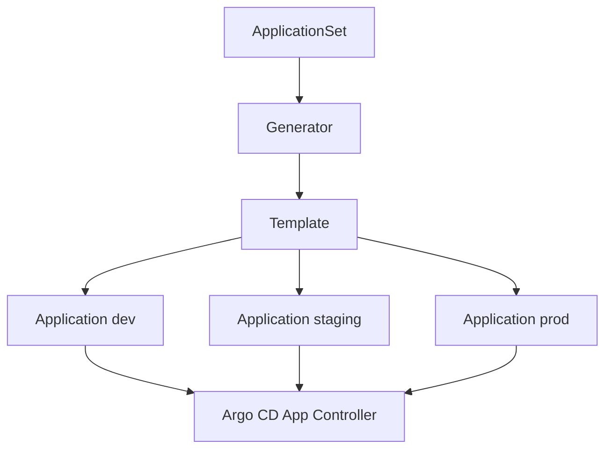
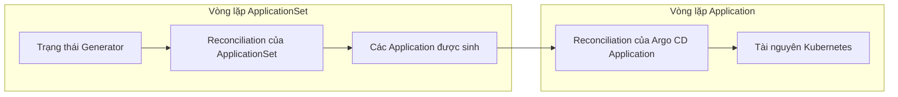

# Bài 04: Argo CD ApplicationSet & GitOps đa cluster

## Mục tiêu học tập

- **Kiến trúc hai vòng lặp reconciliation:** Tách bạch việc ApplicationSet controller quản lý các `Application` CR khỏi việc Application controller reconcile manifest workload trên các cluster đích.
- **Lựa chọn generator và templating:** Cấu hình các generator List, Git directory/file, Cluster, Matrix và Merge cùng Go template để tự động hóa onboarding đa môi trường và đa cluster.
- **Phân bổ đa cluster và tham số hóa Helm:** Sử dụng label trên Secret đăng ký cluster để chọn cluster đích và file Helm values theo môi trường, đồng thời nắm cách ApplicationSet bổ trợ cho GKE Fleet.
- **Rủi ro mở rộng quy mô và ranh giới bảo mật:** Kiểm soát phạm vi ảnh hưởng (blast radius) do tích Đề-các trong Matrix generator và thực thi nguyên tắc đặc quyền tối thiểu qua danh sách cho phép của `AppProject`, Kubernetes RBAC và bảo vệ repository.
- **Chính sách vòng đời, xóa và bảo toàn tài nguyên:** Theo dõi các luồng xóa qua `ownerReferences`, finalizer của Argo CD, `applicationsSync`, `preserveResourcesOnDeletion` và `ignoreApplicationDifferences` để tránh xóa nhầm workload.

## 1. ApplicationSet bổ sung điều gì cho Argo CD?

Một `Application` của Argo CD mô tả một đơn vị triển khai duy nhất lên một cluster và namespace. Khi có nhiều microservice, môi trường hoặc cluster, việc viết tay hàng trăm Application dễ gây trùng lặp và sai lệch cấu hình. **ApplicationSet** là một Kubernetes custom resource có controller chuyên sinh ra các Argo CD Application từ template và dữ liệu đầu vào của generator.



Có hai vòng lặp reconciliation tách biệt: ApplicationSet controller quyết định **những đối tượng Application nào cần tồn tại**; còn Application controller quyết định **những tài nguyên Kubernetes nào cần tồn tại** cho từng Application.

### Theo dõi một ApplicationSet qua quá trình reconciliation

Với 20 microservice và 2 cluster cho mỗi môi trường qua ba môi trường dev, staging và production, việc triển khai mọi dịch vụ lên mọi cluster sẽ tạo ra **120 Application CR**. Một ApplicationSet duy nhất có thể sinh toàn bộ số CR đó từ các đầu vào đã phê duyệt và một template dùng chung.

| Trách nhiệm | ApplicationSet controller | Application controller |
| --- | --- | --- |
| Desired state | Các Application được render từ tham số generator và template | Các manifest workload được render từ nguồn của từng Application |
| Observed state | Các đối tượng Application đã được sinh ra | Các tài nguyên được quản lý trên từng cluster đích |
| Thao tác ghi | Tạo, patch hoặc xóa Application CR theo chính sách | Apply tài nguyên workload và prune khi thao tác sync cho phép |
| Tín hiệu | Condition của ApplicationSet và spec của các Application được sinh | Revision của Application, trạng thái sync, health và operation state |

API server lưu trữ ApplicationSet và các Application được sinh dưới dạng tài nguyên Kubernetes. Controller quan sát tài nguyên cha cùng các nguồn generator của nó, tạo ra các bộ tham số, render template một lần cho mỗi bộ tham số và reconcile kết quả đó với các Application hiện có. Nó có thể tái dựng lại trạng thái này sau khi khởi động lại bằng cách đọc các đối tượng đã lưu và dữ liệu generator. Một ApplicationSet có thể sinh Application thành công trong khi workload của chúng vẫn ở trạng thái `OutOfSync`, `Progressing` hoặc không khỏe mạnh. ApplicationSet được tích hợp sẵn cùng Argo CD từ phiên bản 2.3. [Tổng quan ApplicationSet](https://argo-cd.readthedocs.io/en/stable/operator-manual/applicationset/)

## 2. Các generator phổ biến

| Generator | Nguồn dữ liệu | Trường hợp sử dụng |
|---|---|---|
| List | Danh sách phần tử khai báo ngay trong manifest | Tập môi trường cố định |
| Git Directory/File | Các đường dẫn hoặc file trong Git | Onboarding ứng dụng qua Git |
| Cluster | Các Secret của những cluster đã đăng ký với Argo CD | Triển khai đa cluster |
| Matrix | Tích Đề-các (Cartesian product) của các generator | Ứng dụng × môi trường |
| Merge | Gộp tham số theo khóa merge | Giá trị mặc định + ghi đè |
| SCM/PR | Metadata từ nhà cung cấp Git | Môi trường preview được kiểm soát bằng chính sách phù hợp |

### Tự động phát hiện Application từ thư mục và file Git

Directory generator biến các đường dẫn khớp mẫu thành tham số. Khi bật Go templating, `.path.basename` là đoạn tên thư mục cuối cùng còn `.path.path` là đường dẫn đầy đủ khớp mẫu. Ở ví dụ này, `apps/payment`, `apps/order` và `apps/inventory` sẽ sinh ra ba Application riêng biệt. Hãy sử dụng độc lập ví dụ này và các ví dụ sau trừ khi các tài nguyên đích có quyền sở hữu tách biệt.

```yaml
apiVersion: argoproj.io/v1alpha1
kind: ApplicationSet
metadata:
  name: microservices
  namespace: argocd
spec:
  goTemplate: true
  goTemplateOptions: [missingkey=error]
  generators:
    - git:
        repoURL: https://github.com/example/gitops.git
        revision: main
        requeueAfterSeconds: 180
        directories:
          - path: apps/*
  template:
    metadata:
      name: '{{.path.basenameNormalized}}'
    spec:
      project: microservices
      source:
        repoURL: https://github.com/example/gitops.git
        targetRevision: main
        path: '{{.path.path}}'
      destination:
        server: https://kubernetes.default.svc
        namespace: '{{.path.basenameNormalized}}'
      syncPolicy:
        syncOptions:
          - CreateNamespace=true
```

Thêm thư mục `apps/shipping` có thể tạo ra một Application mới sau khi generator nhìn thấy commit. Với manifest này, việc sync workload vẫn là thủ công. Nếu bạn bật automated sync, việc thêm thư mục cũng có thể dẫn đến triển khai tự động. Thay vào đó, Git file generator đọc các file JSON hoặc YAML khớp mẫu và cung cấp các thuộc tính của chúng làm tham số. Dùng file generator khi quá trình onboarding đòi hỏi metadata tường minh như tên dịch vụ, môi trường hoặc đích triển khai được phê duyệt.

Chu kỳ poll mặc định của Git generator theo tài liệu là 3 phút và có thể ghi đè theo từng generator bằng `requeueAfterSeconds`. Cơ chế cache revision của repo-server có thể khiến thời gian phát hiện kéo dài hơn chu kỳ poll. Annotation `argocd.argoproj.io/application-set-refresh` có thể yêu cầu refresh bỏ qua lớp cache đó. ApplicationSet cũng có endpoint Git webhook riêng. Quá trình refresh Application và sync manifest chạy theo lịch riêng của chúng. [Git generator polling, caching và webhooks](https://argo-cd.readthedocs.io/en/stable/operator-manual/applicationset/Generators-Git/#git-polling-interval)

## 3. List generator kết hợp Go template

```yaml
apiVersion: argoproj.io/v1alpha1
kind: ApplicationSet
metadata:
  name: payment-environments
  namespace: argocd
spec:
  goTemplate: true
  goTemplateOptions: [missingkey=error]
  generators:
    - list:
        elements:
          - env: dev
            namespace: payment-dev
          - env: staging
            namespace: payment-staging
  template:
    metadata:
      name: 'payment-{{.env}}'
    spec:
      project: payment-team
      source:
        repoURL: https://github.com/example/payment-gitops.git
        targetRevision: main
        path: 'overlays/{{.env}}'
      destination:
        server: https://kubernetes.default.svc
        namespace: '{{.namespace}}'
```

Trên production, hãy kiểm tra chắc chắn `AppProject` cho phép các đích triển khai này. Template không thể vượt qua các giới hạn của project.

### Liệt kê đích triển khai đa cluster tường minh

Ví dụ trước chọn các namespace trên cùng một cluster. Để chọn giữa nhiều cluster, hãy truyền tham số `server` cho từng đích đã đăng ký rồi đưa vào template. Lưu nội dung này thành một ApplicationSet khác. Repository và các endpoint chỉ là giá trị giữ chỗ, và `AppProject` `payment-team` phải cho phép chúng.

```yaml
apiVersion: argoproj.io/v1alpha1
kind: ApplicationSet
metadata:
  name: payment-clusters
  namespace: argocd
spec:
  goTemplate: true
  goTemplateOptions: [missingkey=error]
  generators:
    - list:
        elements:
          - {cluster: dev, server: "https://dev.example.com"}
          - {cluster: prod, server: "https://prod.example.com"}
  template:
    metadata:
      name: 'payment-{{.cluster}}'
    spec:
      project: payment-team
      source:
        repoURL: https://github.com/example/payment-gitops.git
        targetRevision: main
        path: apps/payment
      destination:
        server: '{{.server}}'
        namespace: payment
```

Cấu hình này render ra `payment-dev` và `payment-prod`. Thêm phần tử staging sẽ đưa `payment-staging` vào tập mong muốn. Việc đăng ký cluster và cấp quyền truy cập vẫn là các bước tách biệt. [List generator](https://argo-cd.readthedocs.io/en/stable/operator-manual/applicationset/Generators-List/)

## 4. Triển khai đa cluster

Giả sử `gke-dev`, `gke-staging` và `gke-prod` đã được đăng ký. Cluster generator của ApplicationSet có thể chọn các bản ghi cluster theo label và sinh ra các Application với đích tương ứng. Cách này điều phối quá trình triển khai, nhưng không tự động đảm bảo mạng (networking), IAM hay database migration sẽ vận hành trơn tru trên nhiều cluster.

```text
Git repository
  ├── base/
  └── overlays/
      ├── dev/
      ├── staging/
      └── prod/
```

Hãy dùng image digest bất biến trên production và yêu cầu review trước khi promote, để một commit duy nhất vào `main` không vô tình thay đổi hàng loạt cluster cùng lúc.

### Chọn Helm values bằng label đăng ký cluster

Một Secret đăng ký cluster trong namespace `argocd` có thể mang các label như `gitops-managed=true`, `environment=prod` và label vùng như `region=asia-southeast1`. Cluster generator cung cấp các tham số gồm `name`, `nameNormalized`, `server` và `metadata.labels`. Đó là thuộc tính của bản đăng ký trong Argo CD, độc lập với label của node hay tư cách thành viên fleet. Cluster cục bộ ngầm định (implicit local cluster) thường không có registration Secret, nên selector yêu cầu label trên Secret sẽ loại trừ nó trừ khi bạn khai báo và gắn label cho nó một cách tường minh. [Cluster generator](https://argo-cd.readthedocs.io/en/stable/operator-manual/applicationset/Generators-Cluster/)

Kiểm tra các bản đăng ký mà không làm lộ thông tin xác thực:

```bash
argocd cluster list
kubectl -n argocd get secrets -l argocd.argoproj.io/secret-type=cluster --show-labels
```

Đăng ký các cluster đích trong lab trước. Gắn hai label mẫu lên từng Secret dự định chọn, đặt giá trị `environment` phù hợp cho từng bản đăng ký. Một bản đăng ký production mới khớp điều kiện có thể lập tức thêm một Application ngay sau khi reconcile.

| Bản đăng ký | Label môi trường | Số replica | Image tag |
| --- | --- | --- | --- |
| `gke-dev` | `dev` | 1 | `v1.3.0` |
| `gke-staging` | `staging` | 2 | `v1.3.0` |
| `gke-prod` | `prod` | 5 | `v1.2.0` |

Dùng một chart chung và chọn đúng một file values cho mỗi Application được sinh:

```text
gitops/
├── charts/payment-service/
│   ├── Chart.yaml
│   ├── values.yaml
│   └── templates/
│       ├── deployment.yaml
│       └── service.yaml
├── values/payment-service/
│   ├── dev.yaml
│   ├── staging.yaml
│   └── prod.yaml
└── applicationsets/payment-service.yaml
```

Ví dụ, file `values/payment-service/prod.yaml` có nội dung:

```yaml
replicaCount: 5
image:
  repository: registry.example.com/payment
  tag: v1.2.0
```

Tạo các file tương đương cho dev và staging dựa theo bảng trên. Registry và tag chỉ mang tính minh họa. Hãy dùng một image có thể truy cập được và một chart đọc các khóa này. Nếu bạn dùng chart mẫu của cẩm nang làm điểm khởi đầu, hãy giữ lại các giá trị mặc định bắt buộc của nó. Xem trước bản render production ở máy cục bộ bằng `helm template payment ./charts/payment-service -f ./values/payment-service/prod.yaml`. Xem [hướng dẫn Helm](../03-gitops-delivery/helm-kustomize.md) để tham khảo ví dụ chart đầy đủ.

```yaml
apiVersion: argoproj.io/v1alpha1
kind: ApplicationSet
metadata:
  name: payment-multicluster
  namespace: argocd
spec:
  goTemplate: true
  goTemplateOptions: [missingkey=error]
  generators:
    - clusters:
        selector:
          matchLabels:
            gitops-managed: "true"
          matchExpressions:
            - key: environment
              operator: In
              values: [dev, staging, prod]
  template:
    metadata:
      name: 'payment-{{.nameNormalized}}'
    spec:
      project: payment-team
      source:
        repoURL: https://github.com/example/gitops.git
        targetRevision: main
        path: charts/payment-service
        helm:
          valueFiles:
            - '../../values/payment-service/{{index .metadata.labels "environment"}}.yaml'
      destination:
        server: '{{.server}}'
        namespace: payment
      syncPolicy:
        automated:
          prune: false
          selfHeal: true
        syncOptions:
          - CreateNamespace=true
```

Selector đảm bảo label môi trường nằm trong ba giá trị được hỗ trợ. Đường dẫn được tính tương đối so với thư mục chart trong cùng Git repository. Với `gke-prod`, controller tạo `payment-gke-prod` sử dụng `../../values/payment-service/prod.yaml`, endpoint API production đã đăng ký và namespace `payment`. Application controller yêu cầu render Helm, tạo ra một Deployment có 5 replica và image tag `v1.2.0`. Sau đó nó apply các manifest đã render theo sync policy của Application được sinh. `AppProject` `payment-team` phải cho phép repository cùng các đích triển khai, và thông tin xác thực đích phải có đủ quyền ghi. [Argo CD Helm values](https://argo-cd.readthedocs.io/en/stable/user-guide/helm/#values-files)

### Chẩn đoán vòng lặp reconciliation nào sẽ hành động

| Thay đổi | Controller và kết quả kỳ vọng |
| --- | --- |
| Đổi `replicaCount` thành 8 trong `prod.yaml` | Application controller phát hiện revision nguồn mới và Deployment đã render mới. Spec của Application vẫn có thể giữ nguyên. |
| Đăng ký và gắn label cho `gke-prod-2` | ApplicationSet thêm một Application mong muốn. Application controller xử lý đích mới. |
| Sửa thủ công namespace của một Application đã sinh | ApplicationSet có thể khôi phục giá trị template nếu được phép cập nhật và trường đó tham gia so sánh. Application controller có thể quan sát đích tạm thời đó, nên tránh thử nghiệm này trên production. |
| Scale trực tiếp Deployment ở cluster đích | Application controller có thể phát hiện drift và tự phục hồi (self-heal) nếu được cấu hình. |
| Loại một cluster khỏi đầu ra generator | ApplicationSet xử lý Application lỗi thời theo chính sách hiệu lực. Kiểm tra finalizer trước khi gỡ các label khớp điều kiện. |

Kiểm tra condition của ApplicationSet trước tiên khi thiếu một cluster trong tập mong muốn. Nếu Application đã tồn tại với đúng nguồn và đích, hãy kiểm tra status, lỗi render và operation state của nó. [Bài lab GitOps thực hành](../03-gitops-delivery/gitops-lab.md)

```bash
kubectl -n argocd get applicationset payment-multicluster -o yaml
kubectl -n argocd get application payment-gke-prod \
  -o jsonpath='{.spec.destination.server}{"\n"}{.spec.source.helm.valueFiles[0]}{"\n"}'
argocd app get payment-gke-prod
argocd app manifests payment-gke-prod
```

Spec được sinh phải trỏ đúng tới endpoint production và file `prod.yaml`. Kiểm tra spec thành công xác nhận ApplicationSet đã phân bổ vị trí đúng. Xác minh số replica và image sau khi render, rồi đọc trạng thái Deployment và rollout trên cluster đích để xác nhận bàn giao hoàn tất.

## 5. Matrix generator và rủi ro mở rộng quy mô

`Matrix` có thể sinh ra `services × environments`. Với 100 dịch vụ và 4 môi trường, nó tạo ra 400 Application. Điều này làm tăng lưu lượng lên Kubernetes API, tải render trên repo-server và tải xử lý của controller. Hãy lập kế hoạch mở rộng ngay từ đầu: tính đến quyền sở hữu Application, tần suất reconciliation, caching, giới hạn tài nguyên và phân quyền người dùng.

### Kết hợp dịch vụ với các bản đăng ký cluster đủ điều kiện

Matrix generator kết hợp tham số từ hai generator con. Với 2 thư mục ứng dụng và 3 cluster được chọn, kết quả kỳ vọng là:

| Cluster | Các Application được sinh |
| --- | --- |
| gke-dev | `payment-gke-dev`, `order-gke-dev` |
| gke-staging | `payment-gke-staging`, `order-gke-staging` |
| gke-prod | `payment-gke-prod`, `order-gke-prod` |

Dưới đây là ví dụ hoàn chỉnh cho các thư mục chứa manifest có thể render được. Giả định `AppProject` `multi-cluster-apps` cho phép nguồn và tất cả các đích được chọn.

```yaml
apiVersion: argoproj.io/v1alpha1
kind: ApplicationSet
metadata:
  name: services-by-cluster
  namespace: argocd
spec:
  goTemplate: true
  goTemplateOptions: [missingkey=error]
  generators:
    - matrix:
        generators:
          - git:
              repoURL: https://github.com/example/gitops.git
              revision: main
              directories:
                - path: matrix-apps/*
          - clusters:
              selector:
                matchLabels:
                  gitops-managed: "true"
  template:
    metadata:
      name: '{{.path.basenameNormalized}}-{{.nameNormalized}}'
    spec:
      project: multi-cluster-apps
      source:
        repoURL: https://github.com/example/gitops.git
        targetRevision: main
        path: '{{.path.path}}'
      destination:
        server: '{{.server}}'
        namespace: '{{.path.basenameNormalized}}'
      syncPolicy:
        syncOptions:
          - CreateNamespace=true
```

Kiểm tra các tên đã chuẩn hóa (normalized names) để tránh trùng lặp. Matrix mở rộng mọi tổ hợp do hai generator con cung cấp. Trong ví dụ này, label của cluster quyết định tư cách tham gia, nên mọi thư mục khớp mẫu đều nhắm vào mọi cluster được chọn. Khi điều kiện tham gia phụ thuộc vào từng ứng dụng, hãy tách thành các ApplicationSet riêng hoặc dùng tham số từ generator con thứ nhất để ràng buộc cluster selector của generator con thứ hai. Ví dụ, môi trường được phê duyệt trong một file Git có thể điều khiển bộ lọc label cluster. Cách này yêu cầu generator con sinh tham số phải chạy trước. Nếu cả hai generator con đều là Git generator và phát ra các tham số đường dẫn khác nhau, hãy dùng `pathParamPrefix` để đặt tên phân biệt cho đầu ra của chúng. [Matrix generator](https://argo-cd.readthedocs.io/en/stable/operator-manual/applicationset/Generators-Matrix/)

Sử dụng [trình mô phỏng Matrix generator](../03-gitops-delivery/gitops-exercises.mdx) để kiểm tra tên và số lượng Application mong muốn trước khi bước vào bài lab.

## 6. Bảo mật cho ApplicationSet

Nếu một nhóm có thể sửa đổi đầu vào hoặc template của một ApplicationSet có đặc quyền cao, họ có thể chi phối nguồn nào được triển khai và triển khai đi đâu. Không cho phép các nhóm không tin cậy chỉnh sửa `project: default` hoặc các đích do đội nền tảng quản lý nếu cấu hình cấp quyền phạm vi toàn cluster. Hãy sử dụng `AppProject`, bảo vệ nhánh Git (branch protection), RBAC và kiểm soát quyền sở hữu repository.

## 7. Dọn dẹp, pruning và nguy cơ xóa nhầm

Khi đầu vào generator thay đổi, ApplicationSet controller có thể xác định một Application không còn cần thiết nữa. Hãy nắm vững chuỗi quyền sở hữu và các chính sách như `applicationsSync` cùng cơ chế bảo toàn tài nguyên để tránh xóa nhầm. Rà soát chính sách lưu giữ và finalizer, đặc biệt với PVC, Secret và hạ tầng đám mây.

### Phân biệt quyền sở hữu spec được sinh và theo dõi workload

Các Application được sinh có mục `ownerReferences` trỏ tới ApplicationSet. Bộ thu gom rác (garbage collection) của Kubernetes có thể dựa vào mối quan hệ đó khi tài nguyên cha bị xóa. Cơ chế theo dõi workload của Application và finalizer xóa Application thuộc về Argo CD, kể cả khi workload nằm trên cluster khác. `managedFields` của Kubernetes SSA lại theo dõi riêng API manager nào sở hữu các trường trên từng đối tượng.

Mọi thay đổi spec lâu dài cần thực hiện trong template hoặc đầu vào generator. Đối với ngoại lệ có chủ đích, hãy giới hạn `ignoreApplicationDifferences` cho đúng một Application được sinh cụ thể. Ví dụ sau cho phép tạm thời thay đổi cấu hình automated sync trên production:

```yaml
spec:
  ignoreApplicationDifferences:
    - name: payment-gke-prod
      jsonPointers:
        - /spec/syncPolicy/automated
```

Quy tắc bỏ qua của ApplicationSet so sánh các Application CR được sinh. Quy tắc `ignoreDifferences` của Application so sánh các tài nguyên workload. ApplicationSet sử dụng JSON Merge Patch để cập nhật Application. Nếu một ngoại lệ nhắm vào một phần tử trong `spec.sources`, thay đổi ở một nguồn cùng cấp có thể khiến toàn bộ danh sách bị thay thế và chỉnh sửa được bỏ qua sẽ bị mất. [Chính sách chỉnh sửa và quy tắc bỏ qua của ApplicationSet](https://argo-cd.readthedocs.io/en/stable/operator-manual/applicationset/Controlling-Resource-Modification/#ignore-certain-changes-to-applications)

### Theo dõi ba luồng xóa riêng biệt

| Sự kiện | Tác nhân | Điều gì có thể biến mất |
| --- | --- | --- |
| Một cluster hoặc thư mục không còn khớp generator | ApplicationSet controller | Các Application lỗi thời nếu chính sách cho phép xóa. Một Application có Argo CD resources finalizer sau đó có thể xóa luôn workload của nó. |
| ApplicationSet cha bị xóa theo kiểu cascading deletion | Kubernetes garbage collector, sau đó là Argo CD với các Application finalizer | Các Application được sinh qua ownerReferences và có khả năng cả workload của chúng. |
| Một manifest biến mất khỏi nguồn của Application hiện có | Argo CD Application controller trong lúc prune | Tài nguyên đang được theo dõi, khi thao tác sync cho phép prune. Bản thân Application vẫn có thể tồn tại. |

```yaml
spec:
  syncPolicy:
    applicationsSync: create-update
    preserveResourcesOnDeletion: true
```

Các tùy chọn này thuộc sync policy của ApplicationSet cha. Các thiết lập automated sync và prune của Application được sinh nằm dưới `spec.template.spec.syncPolicy`. Chính sách của tài nguyên cha chi phối các thao tác ghi khi reconcile:

| Chính sách hiệu lực | Tạo (Create) | Cập nhật (Update) | Xóa Application lỗi thời |
| --- | --- | --- | --- |
| `sync` | Có | Có | Có |
| `create-only` | Có | Không | Không |
| `create-update` | Có | Có | Không |
| `create-delete` | Có | Không | Có |

Chính sách ở cấp controller có thể được ưu tiên hơn. Quyền ghi đè chính sách theo từng ApplicationSet mặc định bị tắt trong cấu hình tài liệu và phải do quản trị viên nền tảng bật lên. Bản thân chính sách tạo/cập nhật hiệu lực không tự ngăn Kubernetes garbage collection xóa các Application thuộc sở hữu khi tài nguyên cha bị xóa.

`preserveResourcesOnDeletion: true` ngăn ApplicationSet gắn finalizer xóa workload. Nó không giữ lại Application CR và cũng không ngăn một lần sync thực hiện prune workload. Hãy kiểm tra finalizer trên các Application hiện có trước khi tin cậy vào cơ chế bảo toàn. Khi ngừng sử dụng một ApplicationSet nhưng muốn giữ lại các Application đã sinh, thao tác xóa tài nguyên cha không lan truyền (non-cascading) bằng `--cascade=orphan` sẽ giữ lại các CR con. Một CR mồ côi vẫn có thể còn mang Argo CD deletion finalizer, nên hãy kiểm tra nó trước khi xóa về sau. Chỉ tắt automated prune thôi không bảo vệ được workload khi Application bị xóa. [Chính sách chỉnh sửa tài nguyên](https://argo-cd.readthedocs.io/en/stable/operator-manual/applicationset/Controlling-Resource-Modification/) · [Pruning và xóa tài nguyên Application](https://argo-cd.readthedocs.io/en/stable/operator-manual/applicationset/Application-Deletion/)

### Kết nối việc phân bổ triển khai với GKE Fleet

| Khía cạnh | GKE Fleet | Argo CD ApplicationSet |
| --- | --- | --- |
| Tư cách thành viên nhóm | Các đăng ký fleet membership | Đầu vào generator, bao gồm các bản đăng ký cluster trong Argo CD |
| Cấu hình dùng chung cho cluster | Có thể dùng Config Sync và các tính năng bật theo fleet khác | Sinh ra các Application workload từ template chung |
| Quyền truy cập triển khai | Các tích hợp Fleet có mô hình danh tính và truy cập riêng | Application controller cần thông tin xác thực API đích và quyền từ AppProject |

Đăng ký vào Fleet không tự động đưa cluster vào Argo CD. Một nền tảng có thể dùng Fleet để phân nhóm và quan sát, dùng Config Sync cho cấu hình dùng chung và dùng ApplicationSet để phân bổ workload. Hãy thống nhất quyền sở hữu cho Namespace, RBAC và các policy để các bộ reconcile riêng biệt không cạnh tranh lẫn nhau. Xem thêm [Argo CD, Config Sync và Quản lý GKE Fleet](./fleet-config-sync.md).

## 8. Bài lab

1. Tạo hai Kustomize overlay: `dev` và `staging`.
2. Apply ApplicationSet dùng List generator và kiểm tra các Application được sinh bằng `kubectl get applications -n argocd`.
3. Thêm một môi trường mới và quan sát Application mới được sinh ra.
4. Gỡ bỏ một môi trường và xác định rõ chính sách tài nguyên cùng vòng đời trước khi thực sự thử nghiệm xóa.
5. Xác minh rằng `AppProject` từ chối một namespace nằm ngoài phạm vi cho phép.

**Tài liệu:** [ApplicationSet](https://argo-cd.readthedocs.io/en/stable/operator-manual/applicationset/) · [Generators](https://argo-cd.readthedocs.io/en/stable/operator-manual/applicationset/Generators/) · [Bảo mật](https://argo-cd.readthedocs.io/en/stable/operator-manual/applicationset/Security/).

## Phân tích chuyên sâu: ApplicationSet controller, generators và phạm vi ảnh hưởng (blast radius)

ApplicationSet sinh ra **các Application CR** từ template và dữ liệu generator; sau đó Application controller sẽ reconcile từng Application. ApplicationSet không thay thế `argocd-application-controller`. Hãy tách bạch hai vòng lặp này:



### Chọn đúng loại generator

| Generator | Khi nào nên dùng | Rủi ro |
|---|---|---|
| List | Danh sách nhỏ, tường minh | Phải cập nhật thủ công |
| Git directory/file | Mỗi thư mục hoặc file đại diện cho một môi trường | Quyền trên nhánh và repository quyết định phạm vi triển khai |
| Cluster | Triển khai tới các cluster được chọn theo label | Sửa trái phép label của cluster Secret có thể mở rộng tập đích |
| Matrix | Kết hợp nhiều tập đầu vào | Tích Đề-các có thể sinh ra quá nhiều Application |
| Merge | Kết hợp cấu hình theo khóa | Cấu hình chồng chéo đòi hỏi nắm rõ thứ tự ưu tiên |
| Pull Request | Môi trường preview | Pull request từ nguồn không tin cậy có thể làm tăng rủi ro |

### Ví dụ: đặt tên Application nhất quán

```yaml
apiVersion: argoproj.io/v1alpha1
kind: ApplicationSet
metadata:
  name: tenant-apps
  namespace: argocd
spec:
  goTemplate: true
  goTemplateOptions: ["missingkey=error"]
  generators:
    - list:
        elements:
          - {name: payment, namespace: payments}
          - {name: order, namespace: orders}
  template:
    metadata:
      name: '{{.name}}-app'
    spec:
      project: platform-tenant
      source:
        repoURL: https://github.com/example/cluster-gitops.git
        targetRevision: main
        path: 'apps/{{.name}}'
      destination:
        server: https://kubernetes.default.svc
        namespace: '{{.namespace}}'
```

Trước khi apply manifest này, hãy kiểm tra rằng `AppProject` `platform-tenant` đã tồn tại, repository truy cập được, namespace cùng phân quyền đều phù hợp, và ApplicationSet controller đã được cài đặt. Đây là template ví dụ; URL chỉ mang tính minh họa.

### Rủi ro khi thay đổi đầu vào generator

Giả sử một thư mục Git bị xóa. Generator ngừng sinh Application tương ứng, nên ApplicationSet controller sẽ xử lý Application không còn trong tập mong muốn đó theo chính sách xóa và thiết lập owner-reference đã cấu hình. Nếu Application có finalizer `resources-finalizer.argocd.argoproj.io`, việc xóa có thể lan truyền xuống các tài nguyên trong cluster tùy theo cách Application bị xóa. Hãy thiết kế hành vi này thật cẩn thận khi có liên quan đến PVC hoặc tài nguyên đám mây bên ngoài.

### Thông tin xác thực đa cluster và nguyên tắc đặc quyền tối thiểu

Cluster Secret và thông tin xác thực trong Argo CD quyết định thao tác API nào được phép thực hiện. Tên cluster trong một Application không phải là ranh giới bảo mật; Kubernetes RBAC và danh sách đích cho phép (destination allowlist) của `AppProject` mới là các lớp kiểm soát thực sự. Hãy bảo vệ mọi danh tính có quyền chỉnh sửa template hoặc generator của ApplicationSet thuộc project đặc quyền cao như một danh tính đặc quyền.

### Bài lab và thử nghiệm tiêm lỗi (failure injection)

1. Dùng List generator với hai namespace trên một cluster thử nghiệm để tạo hai Application.
2. Xác minh tên được sinh, `AppProject` và các đích triển khai.
3. Thêm phần tử thứ ba và quan sát ApplicationSet controller tạo Application mới.
4. Trước khi gỡ bỏ một phần tử, xác nhận chính sách chỉnh sửa hiệu lực của ApplicationSet và kiểm tra finalizer trên Application được sinh. Thử nghiệm bảo toàn hoặc xóa trên môi trường dùng một lần không có dữ liệu bền vững.
5. Thay đổi label cluster trong lab để kiểm tra phạm vi tác động của Cluster generator. Xác minh các nhóm thông thường không thể sửa những label làm thay đổi đích triển khai.

Nguồn kiểm chứng: [Giới thiệu ApplicationSet](https://argo-cd.readthedocs.io/en/stable/operator-manual/applicationset/), [ApplicationSet generators](https://argo-cd.readthedocs.io/en/stable/operator-manual/applicationset/Generators/), [Argo CD Projects](https://argo-cd.readthedocs.io/en/stable/user-guide/projects/).

## Tóm tắt và các khái niệm liên quan

- Tách bạch desired state khỏi observed state và xác định rõ chủ sở hữu của từng trường hoặc tài nguyên.
- Không giả định rằng một thao tác API thành công đồng nghĩa hệ thống bên ngoài đã sẵn sàng phục vụ yêu cầu.
- Kiểm tra IAM và RBAC, readiness, vòng đời dữ liệu và quy trình khôi phục trước khi đưa thiết lập này lên production.

Kiểm tra mức độ hiểu bài với [bài trắc nghiệm ApplicationSet](../03-gitops-delivery/gitops-exercises.mdx). Sau đó, theo dõi hành trình của một image digest qua CI, dev, staging và lần sync production được phê duyệt trong [Thiết kế GitOps Repository và Promote giữa các môi trường](../03-gitops-delivery/gitops-promotion.md). Khi production theo dõi một nhánh `main` chung có thể thay đổi, bất kỳ commit được duyệt nào làm thay đổi manifest đã render đều có thể bị auto-sync áp dụng. Hãy dùng đầu vào production được review riêng, cố định (pin) artifact đã duyệt và chọn chiến lược revision phù hợp với quy trình phê duyệt thay đổi trên production.

[Quay lại Lộ trình học tập](../learning-path.md)
