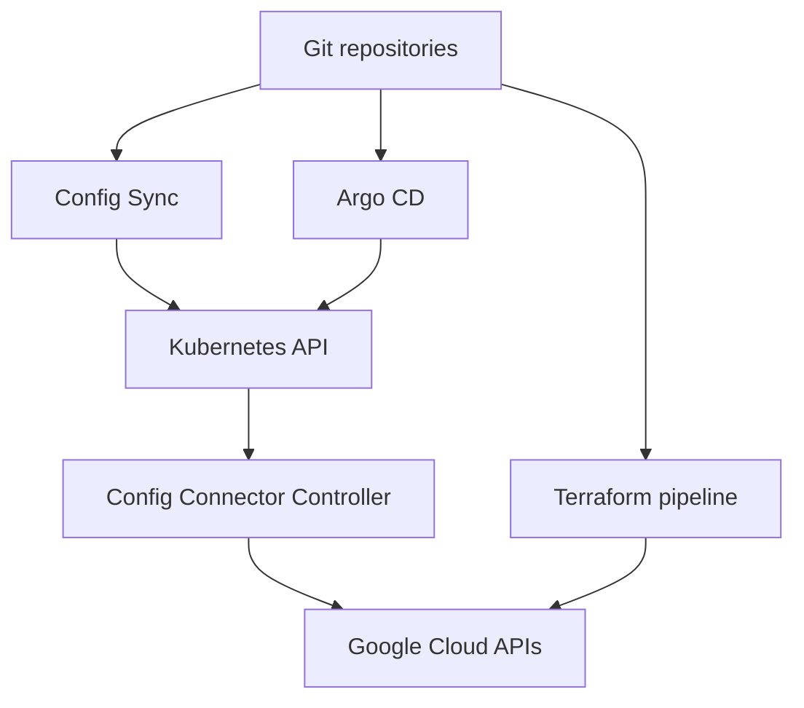
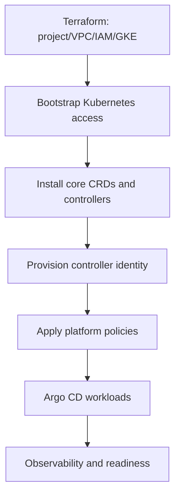

:::info Source status
The content was **reconstructed from the sequence of topics and the source material that could still be retrieved**. The exact original title and full text have not been verified, so this is not presented as a verbatim quotation.
:::

# Lesson 05: Config Connector, Config Sync & Cloud Resource Reconciliation

## Learning objectives

Master **Google Cloud infrastructure CRDs, Config Sync, and controller ownership**, understand controller responsibilities and ownership boundaries, and apply these concepts in a lab on a test cluster.


## 1. The platform's distinct control planes

A production GKE platform may use **Terraform**, **Config Connector**, **Config Sync**, and **Argo CD**. They are not interchangeable: each tool controls a different kind of desired state and has its own lifecycle. The summary from the conversation history confirms that the series discussed Config Connector (CNRM) and Config Sync; the exact title of this lesson has not been verified against the full original text.



### Dividing ownership

| Resource | Preferred owner |
|---|---|
| VPC/GKE baseline | Terraform or another designated infrastructure owner |
| Shared Kubernetes guardrails | Config Sync or Argo CD; **do not have both** manage the same fields |
| Application manifests | Argo CD |
| Cloud resource represented by a CRD | Config Connector, if designated as the owner |

## 2. What is Config Connector?

Config Connector (CNRM) runs controllers that manage Google Cloud resources through Kubernetes custom resources. For example, a `StorageBucket` CR can create a Cloud Storage bucket:

```yaml
apiVersion: storage.cnrm.cloud.google.com/v1beta1
kind: StorageBucket
metadata:
  name: unique-bucket-name-replace-me
  namespace: config-control
  annotations:
    cnrm.cloud.google.com/project-id: PROJECT_ID
spec:
  location: ASIA-SOUTHEAST1
  storageClass: STANDARD
  uniformBucketLevelAccess: true
```

Check this example against your Config Connector version and schema and your actual namespace mode configuration. The bucket name must be globally unique, and the controller's IAM permissions must allow it to create the bucket.

## 3. Reconciliation and external consistency

```text
Kubernetes StorageBucket spec
  ↓
CNRM controller
  ↓
Google Cloud Storage API
  ↓
External bucket state
  ↓
CR status and conditions
```

If the cloud API quota is exhausted or IAM permissions are missing, Kubernetes can still successfully store the object while the controller repeatedly reports reconciliation errors. Distinguish **API acceptance** from **external resource readiness**.

## 4. Config Sync vs. Argo CD

Config Sync applies configuration from Git to Kubernetes clusters. Argo CD typically provides an application delivery model and application-level health and sync semantics. The two tools can coexist, but ownership must be clear for CRDs, namespaces, NetworkPolicies, policies, and workloads.

For example, a Config Sync Git repository can hold namespace-wide security policies while Argo CD manages only application Deployments. If both apply the same `NetworkPolicy`, their reconciliation loops can fight each other and cause drift.

## 5. Resource deletion and ownership boundaries

Deleting a cloud resource CR is not always harmless. Depending on the deletion policy, the controller may delete the backing resource in Google Cloud. Conversely, if Terraform manages that resource too, drift correction can cause the two systems to conflict. Before transferring ownership, prepare a migration plan, understand the import and abandon semantics, and check the audit logs.

## 6. GitOps bootstrap dependency chain

1. Use Terraform to create the IAM configuration, network, and cluster.
2. Bootstrap the required operators and controllers.
3. Provision workload identities for the controllers.
4. Apply platform policies in dependency order.
5. Deploy applications with Argo CD or Config Sync according to the ownership split.
6. Check both the `Ready` conditions and the external cloud resources.

## 7. Lab

Create a test StorageBucket in a sandbox project. Observe the CR conditions, simulate missing permissions with a separate service identity without changing production permissions, and then clean up according to the deletion policy you verified. In an isolated environment, try having Config Sync and Argo CD manage the same namespace label and observe the resulting warnings or diffs.

**Documentation:** [Config Connector](https://cloud.google.com/config-connector/docs/overview) · [Config Sync](https://cloud.google.com/kubernetes-engine/enterprise/config-sync/docs/overview) · [Argo CD](https://argo-cd.readthedocs.io/).

## Deep dive: the ownership contract between Terraform, Config Connector, and GitOps

**Editorial status:** Config Connector and Config Sync are relevant to the learning path, but *the full original text is not available to confirm that this was the original Lesson 05*. This section was written as a new deep dive and may move once it can be checked against the transcript.

### What happens when two systems declare the same resource?

Suppose Terraform manages the Cloud Storage bucket `payment-audit` while Config Connector manages the same bucket through a `StorageBucket` CR. If Terraform expects `uniform_bucket_level_access=true` but the CR declares a different state, both control loops will try to write their own desired state. Kubernetes has no built-in way to discover Terraform state. This can cause persistent drift, unintended policy changes, or one controller deleting a resource still in use by the other system.

Identify the **system of record** for each resource, not just for each repository:

```text
Cloud VPC / Shared VPC / IAM baseline     → Terraform owner
Argo CD Application, workloads            → Argo CD owner
Kubernetes platform policies              → Config Sync or Argo CD; choose one
CNRM-managed StorageBucket resource       → Config Connector owner
Application-produced status, endpoints    → Kubernetes controllers owner
```

### How Config Connector works: desired vs. actual state

A `StorageBucket` custom resource is stored in Kubernetes etcd, but the backing bucket lives in Google Cloud. A successful Kubernetes API write only confirms that the API accepted the spec. The controller still has to call the Google Cloud API, where it can encounter permission denials, quota limits, eventual consistency, or external validation errors. It then reports the outcome through conditions and events.

Typical troubleshooting commands:

```bash
kubectl api-resources | grep -i storagebucket
kubectl get storagebuckets.storage.cnrm.cloud.google.com -A
kubectl describe storagebucket BUCKET_CR -n NAMESPACE
kubectl get events -n NAMESPACE --sort-by=.lastTimestamp
```

Check the controller logs according to the deployment mode and Config Connector version. Before deleting the CR, check the **deletion policy**, whether the backing bucket contains data, and who ultimately owns the resource.

### Config Sync and Argo CD are separate reconciliation engines

Both can update the Kubernetes API, but their interfaces and governance models often differ. One way to divide responsibilities is:

- Config Sync: `Namespace`, `NetworkPolicy`, admission policy, quota, baseline RBAC.
- Argo CD: application `Deployment`, `Service`, `HPA`, `Rollout`.
- Config Connector: cloud resources declared by the platform team, with appropriate IAM permissions.

If you use both Config Sync and Argo CD, avoid managing the same resources and make sure two sources do not control **the same field**. Conflicts are particularly risky for namespace labels used as policy selectors and ServiceAccount annotations used for Workload Identity.

### A bootstrap workflow without circular dependencies



If another resource must bootstrap `ConfigConnectorContext` or `ConfigConnector`, document that prerequisite explicitly so a controller does not depend on itself for installation.

### Safe lab

1. Use a Google Cloud sandbox project with a low budget and quota, and choose a globally unique bucket name.
2. Create a StorageBucket CR or equivalent by following the documentation for your version.
3. Observe the `Ready` and `Reconciling` conditions and check the backing bucket in Google Cloud.
4. Revoke one IAM permission from the **lab identity** to observe the reconciliation error, then restore it.
5. Clean up only after checking the deletion policy and the data in the bucket.

Sources: [Config Connector Overview](https://cloud.google.com/config-connector/docs/overview), [Config Sync overview](https://cloud.google.com/kubernetes-engine/enterprise/config-sync/docs/overview), [Argo CD projects](https://argo-cd.readthedocs.io/en/stable/user-guide/projects/).

## Summary and related concepts

- Separate desired state from observed state and identify the owner of each field or resource.
- Do not assume a successful API operation means the external system is ready to serve requests.
- Verify IAM and RBAC, readiness, the data lifecycle, and recovery procedures before using this setup in production.

[Back to the Learning Path](../learning-path.md)
