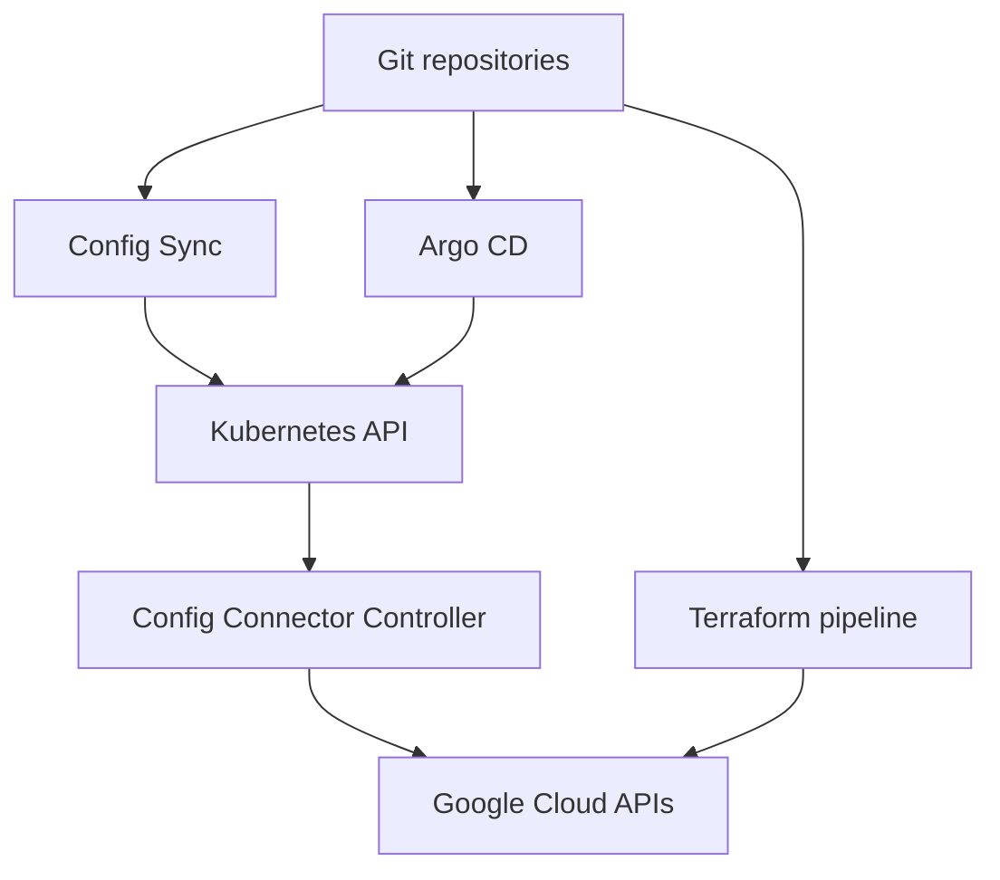
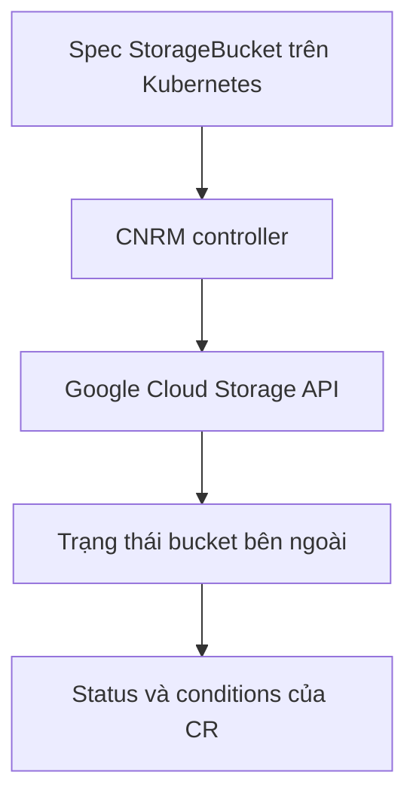
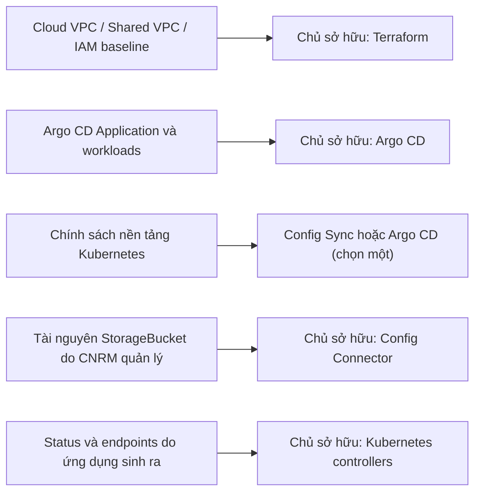
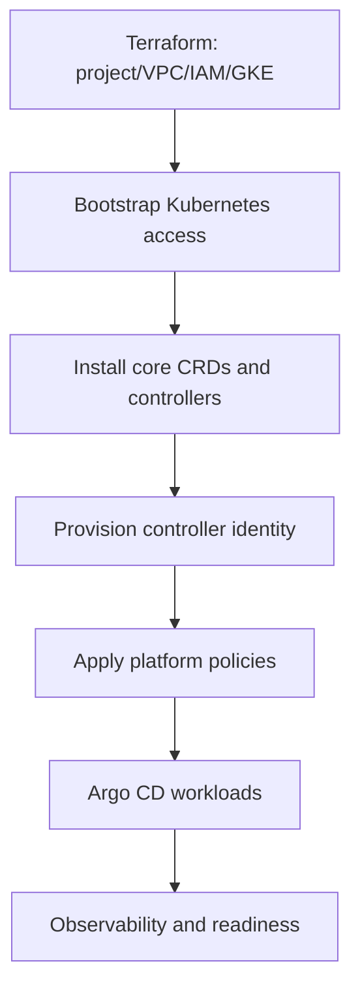

# Bài 05: Config Connector, Config Sync & Reconciliation tài nguyên đám mây

## Mục tiêu học tập

- **Quyền sở hữu giữa các control plane nền tảng:** Phân định rõ ranh giới hệ thống nguồn chuẩn (system of record) giữa Terraform, Config Connector (CNRM), Config Sync và Argo CD để các bộ reconcile không tranh giành cùng một tài nguyên hoặc trường.
- **Vòng đời reconciliation tài nguyên đám mây:** Theo dõi một CR `StorageBucket` từ bước Kubernetes API admission và lưu trữ trong etcd qua CNRM controller cho đến khi hội tụ trên Google Cloud Storage API.
- **Sửa drift định kỳ và kiểm chứng trạng thái:** Giải thích cách delayed requeue có jitter phát hiện chỉnh sửa ngoài luồng trên Cloud Console, đồng thời đọc kết hợp `metadata.generation` với `status.observedGeneration` và condition `Ready` một cách chính xác.
- **Chính sách xóa và xử lý sự cố an toàn:** Chẩn đoán các lỗi IAM, quota, trường bất biến và cấu hình chỉ ghi (write-only), đồng thời kiểm tra `deletion-policy: abandon` trước khi gỡ bỏ CR tài nguyên đám mây.
- **Bootstrap không có phụ thuộc vòng:** Sắp xếp thứ tự cấp phát hạ tầng Terraform, cài đặt controller, gán workload identity, áp dụng chính sách nền tảng và triển khai ứng dụng mà không tạo phụ thuộc vòng.

## 1. Các control plane riêng biệt của nền tảng

Một nền tảng GKE trên production có thể đồng thời dùng **Terraform**, **Config Connector**, **Config Sync** và **Argo CD**. Chúng không thể thay thế lẫn nhau: mỗi công cụ kiểm soát một loại trạng thái mong muốn khác nhau và có vòng đời riêng. Phần tóm tắt từ lịch sử hội thoại xác nhận chuỗi bài có thảo luận về Config Connector (CNRM) và Config Sync; tiêu đề chính xác của bài này chưa được đối chiếu với toàn văn gốc.



### Phân chia quyền sở hữu

| Tài nguyên | Chủ sở hữu khuyến nghị |
|---|---|
| Hạ tầng nền VPC/GKE | Terraform hoặc một chủ sở hữu hạ tầng được chỉ định khác |
| Các hàng rào bảo vệ Kubernetes dùng chung | Config Sync hoặc Argo CD; **không để cả hai** cùng quản lý một trường |
| Manifest ứng dụng | Argo CD |
| Tài nguyên đám mây được biểu diễn bằng CRD | Config Connector, nếu được chỉ định làm chủ sở hữu |

## 2. Config Connector là gì?

Config Connector (CNRM) chạy các controller quản lý tài nguyên Google Cloud thông qua Kubernetes custom resource. Ví dụ, một CR `StorageBucket` có thể tạo một Cloud Storage bucket:

```yaml
apiVersion: storage.cnrm.cloud.google.com/v1beta1
kind: StorageBucket
metadata:
  name: unique-bucket-name-replace-me
  namespace: config-control
  annotations:
    cnrm.cloud.google.com/project-id: PROJECT_ID
spec:
  location: ASIA-SOUTHEAST1
  storageClass: STANDARD
  uniformBucketLevelAccess: true
```

Hãy đối chiếu ví dụ này với phiên bản Config Connector, schema và cấu hình namespace mode thực tế của bạn. Tên bucket phải là duy nhất trên toàn cầu, và quyền IAM của controller phải cho phép nó tạo bucket.

## 3. Reconciliation và tính nhất quán bên ngoài



Nếu quota của cloud API bị cạn hoặc thiếu quyền IAM, Kubernetes vẫn có thể lưu đối tượng thành công trong khi controller liên tục báo lỗi reconcile. Hãy phân biệt rõ giữa **chấp nhận ở mức API (API acceptance)** và **mức độ sẵn sàng của tài nguyên bên ngoài (external resource readiness)**.

### Theo dõi một StorageBucket từ API admission đến khi sẵn sàng trên cloud

CRD cung cấp một API `StorageBucket` theo phạm vi namespace dưới nhóm `storage.cnrm.cloud.google.com`. Một yêu cầu tạo CR đi qua bước xác thực, phân quyền, admission và kiểm tra hợp lệ theo schema. Kubernetes lưu đối tượng được chấp nhận vào etcd. Tại thời điểm này, `spec.storageClass: STANDARD` là trạng thái mong muốn đã lưu. Bản thân bucket vẫn có thể chưa tồn tại trên Google Cloud.

Một controller điển hình sẽ list các đối tượng hiện có, rồi watch các thay đổi dựa trên `resourceVersion` trả về. Luồng watch gửi các sự kiện `ADDED`, `MODIFIED` và `DELETED`. Client nhận mã `410 Gone` do vị trí watch đã cũ có thể list lại và mở luồng watch mới. Một Go controller thông thường duy trì informer cache và đưa các khóa tài nguyên như `config-control/unique-bucket-name-replace-me` vào hàng đợi. Worker đọc đối tượng hiện hành khi xử lý khóa đó, nhờ vậy nó có thể hội tụ về spec mới nhất ngay cả khi nhiều cập nhật được gộp lại. Đây là mô hình controller tiêu chuẩn. Parent controller được ghi trong tài liệu của Config Connector điều phối yêu cầu đến các bộ hiện thực riêng cho từng loại tài nguyên, bao gồm direct controller và controller dựa trên Terraform. Nó dùng Kubernetes API để đọc/cập nhật CR và gọi cloud API để quản lý tài nguyên thực tế. [Khái niệm Kubernetes API](https://kubernetes.io/docs/reference/using-api/api-concepts/) · [Các loại controller của Config Connector](https://docs.cloud.google.com/config-connector/docs/concepts/controller-types)

### Tại sao chỉnh sửa trực tiếp trên cloud vẫn có thể được khắc phục mà không cần sự kiện Kubernetes

| Bước | Kubernetes CR | Bucket trên Google Cloud |
| --- | --- | --- |
| Reconcile thành công ban đầu | `STANDARD` | `STANDARD` |
| Quản trị viên đổi storage class trên Cloud Console | `STANDARD` | `NEARLINE` |
| Đợt reconcile định kỳ đọc trạng thái cloud | `STANDARD` | Phát hiện `NEARLINE` |
| Controller apply cập nhật được hỗ trợ | `STANDARD` | `STANDARD` |

Chỉnh sửa trên Console làm thay đổi tài nguyên cloud độc lập với CR. Một đợt reconcile định kỳ vẫn đọc trạng thái thực tế và so sánh các trường đã khai báo trong CR. Cơ chế đưa lại vào hàng đợi có độ trễ (delayed requeue) minh họa cách một controller có thể tự lên lịch chạy lại mà không cần sự kiện watch mới. Khi khởi động lại, controller có thể tái lập công việc từ các CR đã lưu. Lỗi tạm thời từ cloud API có thể làm chậm quá trình hội tụ và phát sinh retry, thay đổi condition cùng các event.

Google Cloud tài liệu hóa một chu kỳ trung bình theo từng loại tài nguyên kèm jitter. Tài liệu tham chiếu của StorageBucket ghi mức trung bình mặc định là 600 giây. Khi phù hợp, đặt `cnrm.cloud.google.com/reconcile-interval-in-seconds: "60"` trong annotations của CR để yêu cầu chu kỳ ngắn hơn. Chu kỳ ngắn sẽ làm tăng số lượt gọi cloud API. Đặt giá trị `"0"` sẽ dừng reconcile định kỳ sau khi đối tượng đã khớp trạng thái. Google lưu ý rằng chỉ sửa lại giá trị khác 0 thôi không tự khôi phục lịch chạy. Hãy làm theo quy trình khôi phục trong tài liệu nếu cần. Hành vi này độc lập với cơ chế polling và self-heal của Argo CD. [Chiến lược reconciliation](https://docs.cloud.google.com/config-connector/docs/concepts/reconciliation) · [Tài liệu tham chiếu StorageBucket](https://docs.cloud.google.com/config-connector/docs/reference/resource-docs/storage/storagebucket)

### Xử lý sự cố tài nguyên đã được chấp nhận nhưng vẫn đang chờ

```bash
kubectl get crd storagebuckets.storage.cnrm.cloud.google.com
kubectl -n config-control get storagebucket unique-bucket-name-replace-me -o yaml
kubectl -n config-control describe storagebucket unique-bucket-name-replace-me
kubectl -n cnrm-system get pods
kubectl -n config-control wait --for=condition=Ready \
  storagebucket/unique-bucket-name-replace-me --timeout=300s
```

Hãy dùng một project riêng và tên bucket duy nhất toàn cầu cho bài lab cấp phát tài nguyên. Kiểm tra chắc chắn danh tính của Config Connector có quyền truy cập project đó. Khi một CR báo `Ready=True`, hãy so sánh `status.observedGeneration` với `metadata.generation` để đảm bảo status phản ánh đúng bản cập nhật bạn đang kiểm tra. Chỉ chờ `Ready` đơn thuần có thể đọc nhầm một condition thành công cũ hơn. Theo dõi status của CR bằng `kubectl get storagebuckets -n config-control -w` và đối chiếu với trạng thái trên cloud. Lỗi phân quyền, thiếu tham chiếu, trường bất biến (immutable) và cấu hình chỉ ghi (write-only) đều cần cách xử lý khác nhau. Một giá trị chỉ ghi như mật khẩu không thể so sánh bằng cách đọc trạng thái cloud, trong khi trường `location` bất biến đòi hỏi một kế hoạch di chuyển riêng cho tài nguyên. [Xử lý sự cố Config Connector](https://docs.cloud.google.com/config-connector/docs/troubleshooting)

Để rollback trong bài lab, hoàn nguyên giá trị có thể thay đổi trong nguồn chuẩn (authoritative source), rồi kiểm tra cả status lẫn tài nguyên thực tế. Rà soát hành vi xóa trước khi gỡ một CR khỏi nguồn có bật pruning. Annotation `cnrm.cloud.google.com/deletion-policy: abandon` có thể giữ lại tài nguyên thực trên cloud khi CR bị xóa. Xác nhận annotation đã có mặt trên CR đang chạy trước khi cho phép xóa. [Các annotation của Config Connector](https://docs.cloud.google.com/config-connector/docs/reference/annotations)

### Đọc kết hợp generation và readiness

Giả sử bucket được cấp phát ở generation 1. Sau đó bạn đổi storage class mong muốn sang `NEARLINE`. Đọc ngay sau khi apply có thể trả về đoạn trích sau:

```yaml
metadata:
  name: unique-bucket-name-replace-me
  namespace: config-control
  generation: 2
spec:
  storageClass: NEARLINE
status:
  observedGeneration: 1
  conditions:
    - type: Ready
      status: "True"
      reason: UpToDate
```

API server đã chấp nhận generation 2. Status của controller vẫn đang mô tả generation 1, nên `Ready=True` lúc này chưa xác nhận storage class mới. Trong một cập nhật thành công, cần thấy đồng thời `status.observedGeneration: 2` và `Ready=True`, sau đó xác nhận lại bucket thực tế qua Cloud Storage. Nếu generation đã khớp nhưng `Ready` là false, hãy đọc `reason`, `message` và các event gần đây. Một condition cũng có thể trở nên lỗi thời sau một thay đổi bên ngoài cho đến đợt kiểm tra phía cloud tiếp theo.

```bash
kubectl -n config-control get storagebucket unique-bucket-name-replace-me -o jsonpath='{.metadata.generation}{" desired / "}{.status.observedGeneration}{" observed\n"}{range .status.conditions[?(@.type=="Ready")]}{.status}{" "}{.reason}{": "}{.message}{"\n"}{end}'
```

### Mô hình hóa delayed requeue

Đoạn mã giả sau minh họa cách một worker có thể tự lên lịch kiểm tra tiếp theo ngay cả khi Kubernetes không gửi sự kiện mới. Hiện thực và hành vi retry của Config Connector thay đổi theo từng controller và tài nguyên.

```text
reconcile(key):
    object = read current Kubernetes object by key
    if object no longer exists:
        finish

    actual = read the corresponding Cloud Storage bucket
    if the cloud read fails with a retryable error:
        record the failure when possible
        retry using backoff

    if bucket is absent:
        request creation using object.spec
    else if a managed, mutable field differs:
        request an update using object.spec

    record observed generation and reconciliation result
    schedule this key again after the configured delay with jitter
```

Sau một chỉnh sửa trên Console vào bucket, CR của nó vẫn có thể giữ nguyên `generation` và `resourceVersion` như trước đó. Đợt kiểm tra trễ đọc trực tiếp trường trên cloud, phát hiện sai lệch và tìm cách sửa lại. Trong sandbox, hãy ghi lại giá trị khai báo, giá trị chỉnh ngoài luồng, kết quả reconcile tiếp theo và giá trị cuối cùng trên cloud. Nếu trường thực tế vẫn khác biệt, kiểm tra quyền IAM, kiểm tra xem trường có được khai báo và cho phép ghi hay không, cũng như liệu reconcile định kỳ có đang bật hay không. [Chiến lược reconciliation](https://docs.cloud.google.com/config-connector/docs/concepts/reconciliation) · [Trạng thái StorageBucket](https://docs.cloud.google.com/config-connector/docs/reference/resource-docs/storage/storagebucket)

## 4. Config Sync so với Argo CD

Config Sync áp dụng cấu hình từ Git lên các cluster Kubernetes. Argo CD thường cung cấp mô hình bàn giao ứng dụng kèm ngữ nghĩa health và sync ở cấp ứng dụng. Hai công cụ có thể cùng tồn tại, nhưng quyền sở hữu phải rõ ràng đối với CRD, namespace, NetworkPolicy, các policy và workload.

Ví dụ, một Git repository của Config Sync có thể chứa các chính sách bảo mật cấp namespace trong khi Argo CD chỉ quản lý Deployment của ứng dụng. Nếu cả hai cùng apply một `NetworkPolicy`, vòng lặp reconciliation của chúng sẽ xung đột lẫn nhau và gây ra drift.

Về fleet membership, phân quyền namespace và lựa chọn controller, xem thêm [Argo CD, Config Sync và Quản lý GKE Fleet](./fleet-config-sync.md).

## 5. Xóa tài nguyên và ranh giới quyền sở hữu

Xóa một CR tài nguyên đám mây không phải lúc nào cũng vô hại. Tùy vào deletion policy, controller có thể xóa luôn tài nguyên gốc trên Google Cloud. Ngược lại, nếu Terraform cũng đang quản lý tài nguyên đó, cơ chế sửa drift có thể khiến hai hệ thống xung đột. Trước khi chuyển giao quyền sở hữu, hãy chuẩn bị kế hoạch di chuyển, hiểu rõ ngữ nghĩa import và abandon, đồng thời kiểm tra audit log.

## 6. Chuỗi phụ thuộc bootstrap GitOps

1. Dùng Terraform để tạo cấu hình IAM, mạng và cluster.
2. Bootstrap các operator và controller cần thiết.
3. Cấp phát workload identity cho các controller.
4. Áp dụng các chính sách nền tảng theo thứ tự phụ thuộc.
5. Triển khai ứng dụng bằng Argo CD hoặc Config Sync theo phân chia quyền sở hữu.
6. Kiểm tra cả các condition `Ready` lẫn tài nguyên đám mây bên ngoài.

## 7. Bài lab

Tạo một StorageBucket thử nghiệm trong một sandbox project. Quan sát các condition của CR, mô phỏng tình huống thiếu quyền bằng một service identity riêng mà không thay đổi quyền production, sau đó dọn dẹp theo deletion policy đã kiểm chứng. Trong một môi trường cô lập, thử để cả Config Sync và Argo CD cùng quản lý một label trên namespace và quan sát các cảnh báo hoặc diff phát sinh.

**Tài liệu:** [Config Connector](https://cloud.google.com/config-connector/docs/overview) · [Config Sync](https://cloud.google.com/kubernetes-engine/enterprise/config-sync/docs/overview) · [Argo CD](https://argo-cd.readthedocs.io/).

## Phân tích chuyên sâu: hợp đồng quyền sở hữu giữa Terraform, Config Connector và GitOps

**Trạng thái biên tập:** Config Connector và Config Sync phù hợp với lộ trình học tập, nhưng *chưa có toàn văn gốc để xác nhận đây đúng là Bài 05 ban đầu*. Phần này được viết mới như một bài phân tích chuyên sâu và có thể được di chuyển khi có điều kiện đối chiếu với bản ghi gốc.

### Điều gì xảy ra khi hai hệ thống cùng khai báo một tài nguyên?

Giả sử Terraform quản lý Cloud Storage bucket `payment-audit` trong khi Config Connector cũng quản lý đúng bucket đó thông qua một CR `StorageBucket`. Nếu Terraform kỳ vọng `uniform_bucket_level_access=true` nhưng CR khai báo trạng thái khác, cả hai vòng lặp điều khiển sẽ cố ghi trạng thái mong muốn của riêng mình. Kubernetes không có cơ chế tích hợp sẵn để phát hiện Terraform state. Điều này có thể gây drift kéo dài, thay đổi policy ngoài ý muốn hoặc một controller xóa tài nguyên mà hệ thống kia vẫn đang sử dụng.

Hãy xác định **hệ thống nguồn chuẩn (system of record)** cho từng tài nguyên, chứ không chỉ cho từng repository:



### Cách Config Connector hoạt động: desired state so với actual state

Một custom resource `StorageBucket` được lưu trong etcd của Kubernetes, nhưng bucket thực tế nằm trên Google Cloud. Lệnh ghi Kubernetes API thành công chỉ xác nhận API đã chấp nhận spec. Controller vẫn phải gọi Google Cloud API, nơi có thể gặp từ chối quyền, giới hạn quota, eventual consistency hoặc lỗi kiểm tra từ bên ngoài. Sau đó nó phản hồi kết quả qua conditions và events.

Các lệnh xử lý sự cố tiêu biểu:

```bash
kubectl api-resources | grep -i storagebucket
kubectl get storagebuckets.storage.cnrm.cloud.google.com -A
kubectl describe storagebucket BUCKET_CR -n NAMESPACE
kubectl get events -n NAMESPACE --sort-by=.lastTimestamp
```

Kiểm tra log của controller tùy theo chế độ triển khai và phiên bản Config Connector. Trước khi xóa CR, hãy kiểm tra **deletion policy**, liệu bucket thực tế có chứa dữ liệu hay không và ai mới là chủ sở hữu cuối cùng của tài nguyên.

### Config Sync và Argo CD là hai reconciliation engine tách biệt

Cả hai đều có thể cập nhật Kubernetes API, nhưng giao diện và mô hình quản trị của chúng thường khác nhau. Một cách phân chia trách nhiệm phổ biến là:

- Config Sync: `Namespace`, `NetworkPolicy`, admission policy, quota, baseline RBAC.
- Argo CD: `Deployment`, `Service`, `HPA`, `Rollout` của ứng dụng.
- Config Connector: các tài nguyên đám mây do đội nền tảng khai báo, đi kèm quyền IAM phù hợp.

Nếu dùng đồng thời cả Config Sync và Argo CD, tránh quản lý trùng tài nguyên và đảm bảo hai nguồn không cùng kiểm soát **cùng một trường**. Xung đột đặc biệt rủi ro đối với các label trên namespace được dùng làm policy selector và các annotation trên ServiceAccount dùng cho Workload Identity.

### Quy trình bootstrap không có phụ thuộc vòng



Nếu cần một tài nguyên khác để bootstrap `ConfigConnectorContext` hoặc `ConfigConnector`, hãy ghi nhận rõ điều kiện tiên quyết đó để tránh tình trạng một controller phụ thuộc vào chính nó khi cài đặt.

### Bài lab an toàn

1. Dùng một Google Cloud sandbox project có ngân sách và quota thấp, đồng thời chọn tên bucket duy nhất trên toàn cầu.
2. Tạo một CR `StorageBucket` hoặc tài nguyên tương đương theo tài liệu của đúng phiên bản bạn đang dùng.
3. Quan sát các condition `Ready` và `Reconciling`, đồng thời kiểm tra bucket thực tế trên Google Cloud.
4. Thu hồi một quyền IAM khỏi **danh tính của bài lab** để quan sát lỗi reconcile, sau đó cấp lại.
5. Chỉ dọn dẹp sau khi đã kiểm tra deletion policy và dữ liệu bên trong bucket.

Nguồn tham khảo: [Tổng quan Config Connector](https://cloud.google.com/config-connector/docs/overview), [Tổng quan Config Sync](https://cloud.google.com/kubernetes-engine/enterprise/config-sync/docs/overview), [Argo CD projects](https://argo-cd.readthedocs.io/en/stable/user-guide/projects/).

## Tóm tắt và các khái niệm liên quan

- Tách bạch desired state khỏi observed state và xác định rõ chủ sở hữu của từng trường hoặc tài nguyên.
- Không giả định rằng một thao tác API thành công đồng nghĩa hệ thống bên ngoài đã sẵn sàng phục vụ yêu cầu.
- Kiểm tra IAM và RBAC, readiness, vòng đời dữ liệu và quy trình khôi phục trước khi đưa thiết lập này lên production.

[Quay lại Lộ trình học tập](../learning-path.md)
