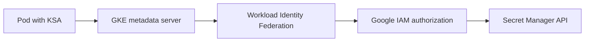

:::info Source status
The content was **reconstructed from the sequence of topics and the source material that could still be retrieved**. The exact original title and full text have not been verified, so this is not presented as a verbatim quotation.
:::

# Lesson 06: GKE Workload Identity Federation & External Secrets

## Learning objectives

Master **Workload Identity Federation, IAM, External Secrets Operator (ESO), and Secret Manager**, understand controller responsibilities and ownership boundaries, and apply these concepts in a lab on a test cluster.


## 1. Three types of identity to distinguish

- **Kubernetes ServiceAccount (KSA):** The identity used to call the Kubernetes API.
- **Google Cloud IAM principal:** The identity that Google Cloud APIs authorize.
- **Istio SPIFFE identity:** The identity used for workload-to-workload mTLS.

All three can be associated with the same KSA, but they do not use the same token or authorization plane.

## 2. The problem with long-lived service account keys

If a container holds a Google service account JSON key, the key can be exposed through Git history, image layers, logs, or a compromised Pod. Workload Identity Federation for GKE replaces long-lived keys in many scenarios with a platform-provided credential flow and workload principals scoped by IAM.



## 3. ServiceAccounts and IAM permissions

```yaml
apiVersion: v1
kind: ServiceAccount
metadata:
  name: external-secrets
  namespace: external-secrets
```

A Google Cloud IAM allow policy can grant `roles/secretmanager.secretAccessor` on **a specific secret** to the appropriate workload principal. Use the workload principal URI, annotation requirements, and deployment steps that match your current GKE Standard or Autopilot setup. Avoid granting project-wide permissions when they are not needed.

## 4. External Secrets Operator (ESO)

ESO watches `ExternalSecret` objects, calls external providers such as Secret Manager, and reconciles the target Kubernetes `Secret`. Here is an example using the ESO API:

```yaml
apiVersion: external-secrets.io/v1
kind: ExternalSecret
metadata:
  name: payment-db
  namespace: payments
spec:
  refreshInterval: 1h
  secretStoreRef:
    name: google-secret-store
    kind: SecretStore
  target:
    name: payment-db
    creationPolicy: Owner
  data:
    - secretKey: password
      remoteRef:
        key: payment-db-password
```

The `apiVersion` must be compatible with the installed version of ESO. The `SecretStore` must be configured with the correct provider and identity; the manifest above does not work without the store.

## 5. Secret lifecycle and ownership

- `SecretStore` is namespace-scoped; `ClusterSecretStore` has a broader scope.
- The `ExternalSecret` status helps distinguish provider authentication failures, missing keys, network timeouts, and conflicts with the target.
- Deleting an `ExternalSecret` can affect the target `Secret` depending on the `creationPolicy` and owner references.
- ESO does not remove the target Kubernetes `Secret` from the API. Protect Kubernetes Secrets with RBAC, encryption, auditing, and admission policies.

## 6. Troubleshooting by layer

```bash
kubectl describe externalsecret payment-db -n payments
kubectl get secretstore -n payments
kubectl get secret payment-db -n payments
kubectl get serviceaccount -n external-secrets
```

Use Cloud Audit Logs to check for IAM denials and check DNS and connectivity to distinguish network failures from `403` responses. Do not print secret values to the terminal or send them to logs unless absolutely necessary.

## 7. Production design

Create a dedicated KSA for the ESO controller or provider identity, depending on the ESO configuration. Scope IAM to individual secrets, configure rotation, avoid letting application teams modify privileged SecretStores, and test revocation and rotation in staging. `automountServiceAccountToken: false` controls whether the KSA token is mounted; it is not a cloud IAM policy.

## 8. Lab

1. Create a test secret in Google Secret Manager.
2. Configure workload identity and the `SecretStore`.
3. Create an `ExternalSecret` and observe its status and refresh behavior.
4. Use an incorrect remote secret name and observe the error.
5. Change the secret version and verify how ESO refreshes it. Do this only in a sandbox.

**Documentation:** [Workload Identity Federation for GKE](https://cloud.google.com/kubernetes-engine/docs/concepts/workload-identity) · [External Secrets Operator](https://external-secrets.io/latest/).

## Deep dive: three commonly confused workload identities

**Editorial status:** This is a newly written supplement on Workload Identity and ESO. The full text and exact order of the original Lesson 06 have not been verified.

| Identity | What is it used for? | Where is it authenticated? |
|---|---|---|
| Kubernetes ServiceAccount | Allows a Pod or controller to call the Kubernetes API | kube-apiserver |
| Workload Identity Federation for GKE | Allows a Pod or controller to access Google Cloud APIs | IAM and GKE metadata infrastructure |
| SPIFFE workload identity (Istio) | Authenticates workloads to one another using mTLS | Istio mesh data plane |

These identities can be associated with the same Kubernetes ServiceAccount, but **they do not share a token, trust domain, or authorization policy**. Granting access through Kubernetes RBAC does not grant Secret Manager IAM permissions.

### GKE Workload Identity: conceptual flow

```text
Pod KSA: payments/payment-app
   ↓
GKE metadata server
   ↓
Federated identity / token exchange
   ↓
Google Cloud IAM
   ↓
Secret Manager API
```

If you grant access directly to an IAM principal, the workload identifier takes this general form:

```text
principal://iam.googleapis.com/projects/PROJECT_NUMBER/locations/global/
workloadIdentityPools/PROJECT_ID.svc.id.goog/subject/ns/payments/sa/payment-app
```

Replace `PROJECT_NUMBER` (the numeric project number) and `PROJECT_ID` with the correct values. IAM member syntax and binding steps vary by integration type. Some designs let the KSA impersonate a Google service account (IAM service account impersonation), which is different from granting permissions directly to the federated principal.

### ESO: SecretStore, ExternalSecret, and Kubernetes Secret

ESO does not replace Secret Manager. It watches `ExternalSecret` objects and syncs remote secrets into Kubernetes `Secret` objects according to the desired state. Example configuration:

```yaml
apiVersion: external-secrets.io/v1
kind: ExternalSecret
metadata:
  name: payment-db
  namespace: payments
spec:
  refreshInterval: 1h
  secretStoreRef:
    name: payment-secrets
    kind: SecretStore
  target:
    name: payment-db
    creationPolicy: Owner
  data:
    - secretKey: password
      remoteRef:
        key: payment-db-password
```

**Version note:** `external-secrets.io/v1` requires a version of ESO that supports it; older clusters may use `v1beta1`. This manifest requires a preconfigured `SecretStore` or `ClusterSecretStore`, controller, and IAM permissions. Do not put actual secret values in Git.

### Permissions to keep separate

- The ESO controller identity can read remote secrets within its configured scope.
- The payment application needs only a mounted Kubernetes Secret or access to Google Secret Manager, depending on the architecture.
- The people deploying the application do not necessarily need permission to read plaintext secrets through the Kubernetes API.
- Permission to create Pods can allow indirect use of a Secret or ServiceAccount in the namespace. Withholding the RBAC `get` permission on `secrets` does not prevent that on its own.

### Security & reliability trade-offs

If Secret Manager is temporarily unreachable, a previously synced Secret may remain in Kubernetes, but rotation is delayed. If the Kubernetes Secret is deleted or credentials are rotated, the workload may need to reload. Match your approach to how the workload consumes secrets: environment variables usually require a Pod restart to pick up changes; mounted Secret volumes update differently, and the application still needs to reload.

**Debug matrix:**

| Symptom | What to check |
|---|---|
| `ExternalSecret` is not `Ready` | `kubectl describe externalsecret` and ESO logs |
| Google Cloud returns `PermissionDenied` | IAM principal, Workload Identity, project- and secret-level IAM |
| Kubernetes Secret is not created | `SecretStore`, ESO status, target `creationPolicy` |
| Secret is updated but the application has not picked up the change | Environment variables vs. volumes, reload logic, restart policy |

Sources: [Workload Identity Federation for GKE](https://cloud.google.com/kubernetes-engine/docs/concepts/workload-identity), [External Secrets Operator](https://external-secrets.io/latest/), [Kubernetes Secrets](https://kubernetes.io/docs/concepts/configuration/secret/).

## Summary and related concepts

- Separate desired state from observed state and identify the owner of each field or resource.
- Do not assume a successful API operation means the external system is ready to serve requests.
- Verify IAM and RBAC, readiness, the data lifecycle, and recovery procedures before using this setup in production.

[Back to the Learning Path](../learning-path.md)
