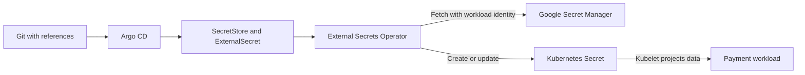
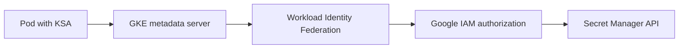

:::info Source status
The content was **reconstructed from the sequence of topics and the source material that could still be retrieved**. The exact original title and full text have not been verified, so this is not presented as a verbatim quotation.
:::

# Lesson 06: GKE Workload Identity Federation & External Secrets

## Learning objectives

Master **Workload Identity Federation, IAM, External Secrets Operator (ESO), and Secret Manager**, understand controller responsibilities and ownership boundaries, and apply these concepts in a lab on a test cluster.


## Choose what belongs in Git

A payment workload may need `DATABASE_HOST=postgres.internal`, a database username, a password, and an external payment API key. Store ordinary configuration such as a non-sensitive host separately. Keep the password and API key in the credential system, with distinct identities or access scopes where their lifecycles differ.

A Kubernetes `Secret` can hold passwords, tokens, and TLS keys. This example uses a dummy value:

```yaml
apiVersion: v1
kind: Secret
metadata:
  name: payment-db-example
  namespace: payments
type: Opaque
data:
  password: c2VjcmV0MTIz
```

`printf '%s' c2VjcmV0MTIz | base64 --decode` returns `secret123`. Base64 is reversible encoding. Likewise, `stringData` accepts readable input and does not encrypt it. Encryption at rest depends on cluster configuration and protects a different path from Kubernetes API access. Confirm the managed platform's configuration, limit Secret API access, and keep credential values out of logs, build output, and Git history. [Kubernetes Secret good practices](https://kubernetes.io/docs/concepts/security/secrets-good-practices/) · [Encrypting Kubernetes data at rest](https://kubernetes.io/docs/tasks/administer-cluster/encrypt-data/)

| Approach | What Git stores | Where plaintext becomes available |
| --- | --- | --- |
| Raw Secret YAML | Plaintext or reversible Base64 if the manifest includes values | Kubernetes API and consumers, plus anyone who can read that Git data |
| SOPS | Encrypted fields and encryption metadata | The authorized decryption step and eventual Secret |
| Sealed Secrets | A `SealedSecret` CR with encrypted values | The in-cluster controller and the Secret it creates |
| External Secrets Operator | Provider references, target names, and refresh policy | The provider, ESO reconciliation, and the resulting Kubernetes Secret |
| Direct provider access or GKE Secret Manager CSI mount | References or application configuration | The application or mounted files, without a Kubernetes Secret in the basic direct or mount-only configuration |

SOPS encrypts structured formats such as YAML and JSON and can protect data keys with age or a KMS. Argo CD needs a compatible generation or delivery workflow to consume it. Decrypting in a config management plugin puts plaintext in the manifest generation path, so review access to generated manifests, caches, and logs. Sealed Secrets uses the cluster controller's public key to seal the data and its private key to unseal it. Plan backup and recovery of that private key and respect the namespace/name sealing scope. With ESO, the provider remains authoritative for values and versions while the Git declaration controls their mapping into Kubernetes. [SOPS](https://github.com/getsops/sops) · [Sealed Secrets](https://github.com/bitnami-labs/sealed-secrets) · [GKE Secret Manager CSI add-on](https://docs.cloud.google.com/secret-manager/docs/secret-manager-managed-csi-component) · [Argo CD secret management](https://argo-cd.readthedocs.io/en/stable/operator-manual/secret-management/)



Argo CD reconciles the reference and workload manifests. ESO reconciles the target Secret from the external provider. The workload controllers and kubelet run Pods and make the resulting Secret available. Compare this with [Config Connector](./lesson-05-platform-integration.md), where the controller reconciles a declared cloud resource through Google Cloud APIs.

## 1. Three types of identity to distinguish

- **Kubernetes ServiceAccount (KSA):** The identity used to call the Kubernetes API.
- **Google Cloud IAM principal:** The identity that Google Cloud APIs authorize.
- **Istio SPIFFE identity:** The identity used for workload-to-workload mTLS.

All three can be associated with the same KSA, but they do not use the same token or authorization plane.

## 2. The problem with long-lived service account keys

If a container holds a Google service account JSON key, the key can be exposed through Git history, image layers, logs, or a compromised Pod. Workload Identity Federation for GKE replaces long-lived keys in many scenarios with a platform-provided credential flow and workload principals scoped by IAM.



## 3. ServiceAccounts and IAM permissions

```yaml
apiVersion: v1
kind: ServiceAccount
metadata:
  name: external-secrets
  namespace: external-secrets
```

A Google Cloud IAM allow policy can grant `roles/secretmanager.secretAccessor` on **a specific secret** to the appropriate workload principal. Use the workload principal URI, annotation requirements, and deployment steps that match your current GKE Standard or Autopilot setup. Avoid granting project-wide permissions when they are not needed.

## 4. External Secrets Operator (ESO)

ESO watches `ExternalSecret` objects, calls external providers such as Secret Manager, and reconciles the target Kubernetes `Secret`. Here is an example using the ESO API:

```yaml
apiVersion: external-secrets.io/v1
kind: ExternalSecret
metadata:
  name: payment-db
  namespace: payments
spec:
  refreshInterval: 1h
  secretStoreRef:
    name: google-secret-store
    kind: SecretStore
  target:
    name: payment-db
    creationPolicy: Owner
  data:
    - secretKey: password
      remoteRef:
        key: payment-db-password
```

The `apiVersion` must be compatible with the installed version of ESO. The `SecretStore` must be configured with the correct provider and identity; the manifest above does not work without the store.

### Configure a namespaced Google Secret Manager store

Use a sandbox GKE cluster with Workload Identity Federation enabled and ESO installed with the `external-secrets.io/v1` APIs. Create the `payments` namespace and a test secret named `payment-db-password` with an enabled version in Secret Manager. The example binds access directly to a federated Kubernetes principal. It does not require a Google service account key or impersonation annotation.

```yaml
apiVersion: v1
kind: ServiceAccount
metadata:
  name: payment-secret-reader
  namespace: payments
---
apiVersion: external-secrets.io/v1
kind: SecretStore
metadata:
  name: google-secret-store
  namespace: payments
spec:
  provider:
    gcpsm:
      projectID: SECRET_PROJECT_ID
      auth:
        workloadIdentity:
          clusterProjectID: CLUSTER_PROJECT_ID
          serviceAccountRef:
            name: payment-secret-reader
---
apiVersion: external-secrets.io/v1
kind: ExternalSecret
metadata:
  name: payment-db
  namespace: payments
spec:
  refreshPolicy: Periodic
  refreshInterval: 1h
  secretStoreRef:
    name: google-secret-store
    kind: SecretStore
  target:
    name: payment-db
    creationPolicy: Owner
  data:
    - secretKey: password
      remoteRef:
        key: payment-db-password
        version: latest
```

Replace the project placeholders. For the IAM principal, the numeric project number and project ID refer to the **cluster project** that owns the GKE workload identity pool. The gcloud `--project` argument identifies the **secret project**. They can be the same project.

```bash
gcloud secrets add-iam-policy-binding payment-db-password \
  --project="$SECRET_PROJECT_ID" \
  --role=roles/secretmanager.secretAccessor \
  --member="principal://iam.googleapis.com/projects/${CLUSTER_PROJECT_NUMBER}/locations/global/workloadIdentityPools/${CLUSTER_PROJECT_ID}.svc.id.goog/subject/ns/payments/sa/payment-secret-reader"
```

ESO reads the store and mapping, obtains short-lived credentials for the selected identity, calls Google Secret Manager for the configured version, and updates the target Secret. Kubernetes permissions still govern the controller's access to objects and ServiceAccount tokens. Google Cloud IAM governs access to the remote payload. KSA-to-Google-service-account impersonation is a separate configuration. When clusters share a workload identity pool, the same namespace and KSA name can identify the same principal across clusters. Account for that when isolating tenants. [ESO Google provider](https://external-secrets.io/latest/provider/google-secrets-manager/) · [GKE Workload Identity Federation](https://docs.cloud.google.com/kubernetes-engine/docs/concepts/workload-identity)

The store selects the provider and identity. The ExternalSecret maps `payment-db-password/latest` to the `password` key of `Secret/payment-db`. Its spec contains the reference instead of the payload. `Periodic` refreshes according to the interval. `OnChange` refreshes when the ExternalSecret changes. `CreatedOnce` is intended for initial creation and can restore a target that is changed or deleted. `creationPolicy: Owner` gives the target an owner reference to the ExternalSecret. What happens to the target Kubernetes Secret if the remote secret is deleted in the provider is configured separately through `target.deletionPolicy`. [ESO refresh policies](https://external-secrets.io/latest/api/externalsecret/) · [ESO lifecycle policies](https://external-secrets.io/latest/guides/ownership-deletion-policy/)

## 5. Secret lifecycle and ownership

- `SecretStore` is namespace-scoped; `ClusterSecretStore` has a broader scope.
- The `ExternalSecret` status helps distinguish provider authentication failures, missing keys, network timeouts, and conflicts with the target.
- Deleting an `ExternalSecret` can affect the target `Secret` depending on the `creationPolicy` and owner references.
- The generated `Secret` remains a Kubernetes API object, with a lifecycle determined by the configured policies. Protect it with RBAC, encryption, auditing, and admission policies.

### Follow a rotation from provider to process

At T0, the remote secret and Kubernetes Secret represent version A. At T1, an operator creates and enables version B. A Kubernetes watch on the ExternalSecret does not report that remote write. At T2, periodic ESO reconciliation fetches the selected remote version and updates the target Secret. At T3, the application reloads or new Pods start. At T4, verify database connections, payment API authentication where applicable, and service error rates before retiring the old credential.

| Consumption path | How the change reaches the workload |
| --- | --- |
| `env.valueFrom.secretKeyRef` | The running process keeps its startup environment. Replace Pods via a controlled rollout or a reload controller that triggers a rollout. |
| Regular Secret volume | Kubelet eventually updates mounted data. The application must reread the file or reload its configuration and connections. |
| Secret volume using `subPath` | The mounted file does not receive the normal automatic projection updates. |
| Direct Secret Manager access | The application controls how often it fetches and how long it caches values. |

For example, the Deployment container can use `DATABASE_PASSWORD` from `secretKeyRef: {name: payment-db, key: password}`. Fetching the new provider version and successfully authenticating with it are separate checks. Coordinate a grace period, dual credentials where supported, and connection-pool replacement. A rollout that restarts all consumers after the old credential is already invalid can cause avoidable downtime. Verify the version and target update using provider metadata and ESO status, then confirm the workload actually authenticated. [Kubernetes Secrets](https://kubernetes.io/docs/concepts/configuration/secret/#using-secrets)

With ordinary Argo CD resource tracking, a Secret owned by ESO changes independently of the manifests tracked by Argo CD. Git still declares the mapping and refresh policy. Keep the generated Secret outside Git's managed resources so Argo CD and ESO do not write the same target.

## 6. Troubleshooting by layer

```bash
kubectl describe externalsecret payment-db -n payments
kubectl get secretstore -n payments
kubectl get secret payment-db -n payments
kubectl get serviceaccount -n external-secrets
```

Use Cloud Audit Logs to check for IAM denials and check DNS and connectivity to distinguish network failures from `403` responses. Do not print secret values to the terminal or send them to logs unless absolutely necessary.

## 7. Production design

Create a dedicated KSA for the ESO controller or provider identity, depending on the ESO configuration. Scope IAM to individual secrets, configure rotation, avoid letting application teams modify privileged SecretStores, and test revocation and rotation in staging. `automountServiceAccountToken: false` controls whether the KSA token is mounted; it is not a cloud IAM policy.

### Scope the reader and the deployment authority separately

The application can consume a Secret through a Pod reference without using its own Kubernetes API credentials to get the Secret. The next example is for a separate reader that genuinely calls the API. It grants `get` for one named object and no broad list or write permissions.

```yaml
apiVersion: v1
kind: ServiceAccount
metadata:
  name: payment-reader
  namespace: payments
---
apiVersion: rbac.authorization.k8s.io/v1
kind: Role
metadata:
  name: payment-secret-reader
  namespace: payments
rules:
  - apiGroups: [""]
    resources: ["secrets"]
    resourceNames: ["payment-db"]
    verbs: ["get"]
---
apiVersion: rbac.authorization.k8s.io/v1
kind: RoleBinding
metadata:
  name: payment-secret-reader
  namespace: payments
subjects:
  - kind: ServiceAccount
    name: payment-reader
    namespace: payments
roleRef:
  kind: Role
  name: payment-secret-reader
  apiGroup: rbac.authorization.k8s.io
```

After applying the example in a lab, use an administrator with impersonation permission to check all three cases. With only the displayed grant, expect `yes`, `no`, and `no`.

```bash
kubectl auth can-i get secret/payment-db -n payments --as=system:serviceaccount:payments:payment-reader
kubectl auth can-i get secret/other-secret -n payments --as=system:serviceaccount:payments:payment-reader
kubectl auth can-i list secrets -n payments --as=system:serviceaccount:payments:payment-reader
```

Kubernetes RBAC grants are additive. Check all RoleBindings and ClusterRoleBindings if a denied case returns `yes`. Pod creation can also grant indirect use of mounted Secrets or other ServiceAccounts in the namespace. Permission to exec into a consumer can expose its files or environment. Use separate trust boundaries for namespace ownership, and restrict Pod settings, privileged operation, and ServiceAccount selection. [Kubernetes RBAC](https://kubernetes.io/docs/reference/access-authn-authz/rbac/) · [Secret good practices](https://kubernetes.io/docs/concepts/security/secrets-good-practices/)

A team Application can use an AppProject with an explicit scope. In this example the platform creates the namespace and owns ESO, SecretStores, and IAM. The team maintains only the allowed namespaced kinds in its trusted repository.

```yaml
apiVersion: argoproj.io/v1alpha1
kind: AppProject
metadata:
  name: payments
  namespace: argocd
spec:
  sourceRepos:
    - https://github.com/example/payment-gitops.git
  destinations:
    - server: https://kubernetes.default.svc
      namespace: payments
  clusterResourceWhitelist: []
  namespaceResourceWhitelist:
    - group: apps
      kind: Deployment
    - group: ""
      kind: Service
    - group: external-secrets.io
      kind: ExternalSecret
```

The AppProject restricts what that Application can deploy, including cluster-scoped kinds such as `ClusterRoleBinding`. Argo CD RBAC separately controls who can change Applications and Projects. Kubernetes RBAC applies to the actual destination API identity, and admission can still reject an authorized write. Restrict who can change project rules, platform stores, and each store's credential scope. [Argo CD Projects](https://argo-cd.readthedocs.io/en/stable/user-guide/projects/)

A broad `ClusterSecretStore` can grant access through ESO to anyone allowed to create an ExternalSecret that uses it. Restrict which namespaces can use the store, which remote references they can request, and which secrets the store's provider identity can access. For the payment example, separate platform-owned ESO and policy manifests from team-owned Deployments and ExternalSecrets. Keep generated Secrets in ESO's ownership and use Kubernetes RBAC and admission where multiple teams share a cluster.

```text
platform-gitops/
├── platform/
│   ├── external-secrets/     # ESO installation and platform-controlled stores
│   ├── admission-policies/
│   └── namespaces/
├── applications/payment/
│   ├── deployment.yaml
│   ├── service.yaml
│   ├── external-secret.yaml
│   └── kustomization.yaml
└── argocd/
    ├── appprojects/
    └── applicationsets/
```

The team Application declares `ExternalSecret/payment-db`. ESO owns the resulting `Secret/payment-db`. Google IAM grants the remote access and the destination Kubernetes API enforces RBAC and admission for both controllers. Continue with [Infrastructure GitOps and Platform Bootstrap](../03-gitops-delivery/lesson-09-gitops-bootstrap.md) for the order in which these dependencies must be installed.

## 8. Lab

1. Create a test secret in Google Secret Manager.
2. Configure workload identity and the `SecretStore`.
3. Create an `ExternalSecret` and observe its status and refresh behavior.
4. Use an incorrect remote secret name and observe the error.
5. Change the secret version and verify how ESO refreshes it. Do this only in a sandbox.

### Local practice with ESO's Fake provider

Install an ESO version that serves `external-secrets.io/v1` on a disposable kind or minikube cluster. Ensure the ESO deployments are available and create the `payments` namespace. Use the following lab-only static fixture, which contains a dummy value and requires no cloud credentials.

```yaml
apiVersion: external-secrets.io/v1
kind: SecretStore
metadata:
  name: payment-fake
  namespace: payments
spec:
  provider:
    fake:
      data:
        - key: payment-db-password
          value: dummy-v1
---
apiVersion: external-secrets.io/v1
kind: ExternalSecret
metadata:
  name: payment-db
  namespace: payments
spec:
  refreshPolicy: Periodic
  refreshInterval: 30s
  secretStoreRef:
    name: payment-fake
    kind: SecretStore
  target:
    name: payment-db
    creationPolicy: Owner
  data:
    - secretKey: password
      remoteRef:
        key: payment-db-password
```

Before changing the fixture to `dummy-v2`, record `status.refreshTime` and the target Secret's `metadata.resourceVersion`. Apply the updated store. Look for a subsequent successful refresh and a changed target resource version without dumping the Secret. The Fake provider stores static test data in the store. For the GKE lab, apply the namespaced Google store and add an enabled sandbox version in Secret Manager without changing the ExternalSecret. Verify refresh and consumption independently.

```bash
kubectl -n payments get externalsecret payment-db \
  -o jsonpath='{.status.refreshTime}{"\n"}'
kubectl -n payments describe externalsecret payment-db
kubectl -n payments get secret payment-db \
  -o jsonpath='{.metadata.resourceVersion}{"\n"}'
```

Use the earlier RBAC checks to confirm the reader's scope, then run the [admission binding lab](./lesson-07-admission.md#apply-one-policy-with-different-enforcement). For a GKE deployment, also verify Argo CD can reconcile the team's manifests without taking ownership of the generated Secret and confirm that the process can authenticate after rotation. [ESO Fake provider](https://external-secrets.io/latest/provider/fake/) · [Installing ESO](https://external-secrets.io/latest/introduction/getting-started/)

**Documentation:** [Workload Identity Federation for GKE](https://cloud.google.com/kubernetes-engine/docs/concepts/workload-identity) · [External Secrets Operator](https://external-secrets.io/latest/).

## Deep dive: three commonly confused workload identities

**Editorial status:** This is a newly written supplement on Workload Identity and ESO. The full text and exact order of the original Lesson 06 have not been verified.

| Identity | What is it used for? | Where is it authenticated? |
|---|---|---|
| Kubernetes ServiceAccount | Allows a Pod or controller to call the Kubernetes API | kube-apiserver |
| Workload Identity Federation for GKE | Allows a Pod or controller to access Google Cloud APIs | IAM and GKE metadata infrastructure |
| SPIFFE workload identity (Istio) | Authenticates workloads to one another using mTLS | Istio mesh data plane |

These identities can be associated with the same Kubernetes ServiceAccount, but **they do not share a token, trust domain, or authorization policy**. Granting access through Kubernetes RBAC does not grant Secret Manager IAM permissions.

### GKE Workload Identity: conceptual flow

```text
Pod KSA: payments/payment-app
   ↓
GKE metadata server
   ↓
Federated identity / token exchange
   ↓
Google Cloud IAM
   ↓
Secret Manager API
```

If you grant access directly to an IAM principal, the workload identifier takes this general form:

```text
principal://iam.googleapis.com/projects/PROJECT_NUMBER/locations/global/
workloadIdentityPools/PROJECT_ID.svc.id.goog/subject/ns/payments/sa/payment-app
```

Replace `PROJECT_NUMBER` (the numeric project number) and `PROJECT_ID` with the correct values. IAM member syntax and binding steps vary by integration type. Some designs let the KSA impersonate a Google service account (IAM service account impersonation), which is different from granting permissions directly to the federated principal.

### ESO: SecretStore, ExternalSecret, and Kubernetes Secret

ESO does not replace Secret Manager. It watches `ExternalSecret` objects and syncs remote secrets into Kubernetes `Secret` objects according to the desired state. Example configuration:

```yaml
apiVersion: external-secrets.io/v1
kind: ExternalSecret
metadata:
  name: payment-db
  namespace: payments
spec:
  refreshInterval: 1h
  secretStoreRef:
    name: payment-secrets
    kind: SecretStore
  target:
    name: payment-db
    creationPolicy: Owner
  data:
    - secretKey: password
      remoteRef:
        key: payment-db-password
```

**Version note:** `external-secrets.io/v1` requires a version of ESO that supports it; older clusters may use `v1beta1`. This manifest requires a preconfigured `SecretStore` or `ClusterSecretStore`, controller, and IAM permissions. Do not put actual secret values in Git.

### Permissions to keep separate

- The ESO controller identity can read remote secrets within its configured scope.
- The payment application needs only a mounted Kubernetes Secret or access to Google Secret Manager, depending on the architecture.
- The people deploying the application do not necessarily need permission to read plaintext secrets through the Kubernetes API.
- Permission to create Pods can allow indirect use of a Secret or ServiceAccount in the namespace. Withholding the RBAC `get` permission on `secrets` does not prevent that on its own.

### Security & reliability trade-offs

If Secret Manager is temporarily unreachable, a previously synced Secret may remain in Kubernetes, but rotation is delayed. If the Kubernetes Secret is deleted or credentials are rotated, the workload may need to reload. Match your approach to how the workload consumes secrets: environment variables usually require a Pod restart to pick up changes; mounted Secret volumes update differently, and the application still needs to reload.

**Debug matrix:**

| Symptom | What to check |
|---|---|
| `ExternalSecret` is not `Ready` | `kubectl describe externalsecret` and ESO logs |
| Google Cloud returns `PermissionDenied` | IAM principal, Workload Identity, project- and secret-level IAM |
| Kubernetes Secret is not created | `SecretStore`, ESO status, target `creationPolicy` |
| Secret is updated but the application has not picked up the change | Environment variables vs. volumes, reload logic, restart policy |

Sources: [Workload Identity Federation for GKE](https://cloud.google.com/kubernetes-engine/docs/concepts/workload-identity), [External Secrets Operator](https://external-secrets.io/latest/), [Kubernetes Secrets](https://kubernetes.io/docs/concepts/configuration/secret/).

Try the [GitOps security quiz](../03-gitops-delivery/gitops-exercises.mdx#check-your-gitops-security-understanding).

## Summary and related concepts

- Separate desired state from observed state and identify the owner of each field or resource.
- Do not assume a successful API operation means the external system is ready to serve requests.
- Verify IAM and RBAC, readiness, the data lifecycle, and recovery procedures before using this setup in production.

[Back to the Learning Path](../learning-path.md)
