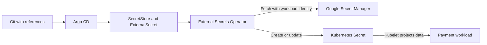
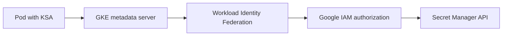
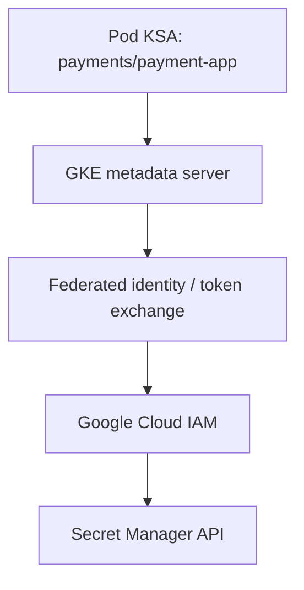

# Bài 06: GKE Workload Identity Federation & External Secrets

## Mục tiêu học tập

- **Tách biệt cấu hình thông thường khỏi thông tin nhạy cảm trong Git:** So sánh Kubernetes `Secret` thô, SOPS, Sealed Secrets, External Secrets Operator (ESO) và mount trực tiếp qua CSI để không lưu secret dạng plaintext trong kho mã nguồn.
- **Phân biệt ba lớp danh tính workload:** Làm rõ sự khác nhau giữa Kubernetes ServiceAccount (KSA), Google Cloud IAM principal qua GKE Workload Identity Federation và danh tính SPIFFE của Istio để tránh nhầm lẫn giữa RBAC và cloud IAM.
- **Cấu hình ESO với GKE Workload Identity:** Gắn trực tiếp một `ServiceAccount` theo namespace vào chính sách IAM của Google Secret Manager và đồng bộ secret theo hướng khai báo bằng `SecretStore` và `ExternalSecret`.
- **Quản lý vòng đời xoay vòng (rotation) và tiêu thụ secret:** Theo dõi luồng cập nhật thông tin xác thực từ phiên bản trên provider qua quá trình reconcile của ESO tới các Pod đang chạy, tính đến khác biệt giữa biến môi trường, volume mount, `subPath` và rollout an toàn.
- **Áp dụng ranh giới đặc quyền tối thiểu và xử lý sự cố theo từng lớp:** Cô lập các store do nền tảng quản lý và phạm vi `AppProject` của Argo CD khỏi workload của nhóm ứng dụng, đồng thời gỡ lỗi IAM, RBAC và đồng bộ mà không làm lộ giá trị secret.

## Chọn những gì nên lưu trong Git

Một payment workload có thể cần `DATABASE_HOST=postgres.internal`, tên người dùng cơ sở dữ liệu, mật khẩu và khóa API thanh toán bên ngoài. Hãy lưu cấu hình thông thường như tên máy chủ không nhạy cảm ở nơi riêng biệt. Giữ mật khẩu và khóa API trong hệ thống quản lý thông tin xác thực, với các danh tính hoặc phạm vi truy cập tách biệt khi vòng đời của chúng khác nhau.

Một Kubernetes `Secret` có thể chứa mật khẩu, token và khóa TLS. Ví dụ dưới đây sử dụng một giá trị giả lập:

```yaml
apiVersion: v1
kind: Secret
metadata:
  name: payment-db-example
  namespace: payments
type: Opaque
data:
  password: c2VjcmV0MTIz
```

Lệnh `printf '%s' c2VjcmV0MTIz | base64 --decode` trả về `secret123`. Base64 chỉ là phép mã hóa có thể đảo ngược. Tương tự, `stringData` chấp nhận dữ liệu dạng văn bản đọc được và không mã hóa nó. Mã hóa khi lưu trữ (encryption at rest) phụ thuộc vào cấu hình cluster và bảo vệ một lớp khác với quyền truy cập Kubernetes API. Hãy kiểm tra cấu hình của nền tảng được quản lý, giới hạn quyền truy cập Secret API và giữ các giá trị thông tin xác thực nằm ngoài log, kết quả build và lịch sử Git. [Thực hành tốt với Kubernetes Secret](https://kubernetes.io/docs/concepts/security/secrets-good-practices/) · [Mã hóa dữ liệu Kubernetes khi lưu trữ](https://kubernetes.io/docs/tasks/administer-cluster/encrypt-data/)

| Cách tiếp cận | Những gì Git lưu trữ | Nơi plaintext xuất hiện |
| --- | --- | --- |
| Raw Secret YAML | Plaintext hoặc Base64 có thể đảo ngược nếu manifest chứa giá trị | Kubernetes API và các consumer, cộng thêm bất kỳ ai có thể đọc dữ liệu Git đó |
| SOPS | Các trường đã mã hóa và metadata mã hóa | Bước giải mã được ủy quyền và Secret kết quả |
| Sealed Secrets | Một `SealedSecret` CR chứa các giá trị đã mã hóa | Controller trong cluster và Secret mà nó tạo ra |
| External Secrets Operator | Tham chiếu tới provider, tên đích và chính sách làm mới | Provider, quá trình reconcile của ESO và Kubernetes Secret kết quả |
| Truy cập provider trực tiếp hoặc mount qua GKE Secret Manager CSI | Tham chiếu hoặc cấu hình ứng dụng | Ứng dụng hoặc các tệp được mount, không tạo Kubernetes Secret trong cấu hình truy cập trực tiếp hoặc chỉ mount cơ bản |

SOPS mã hóa các định dạng có cấu trúc như YAML và JSON, đồng thời có thể bảo vệ khóa dữ liệu bằng age hoặc KMS. Argo CD cần một quy trình sinh manifest hoặc phân phối tương thích để sử dụng nó. Việc giải mã trong một config management plugin sẽ đưa plaintext vào luồng sinh manifest, vì vậy hãy rà soát quyền truy cập vào manifest đã sinh, bộ nhớ đệm và log. Sealed Secrets sử dụng khóa công khai của controller trong cluster để niêm phong dữ liệu và khóa riêng tư của nó để mở niêm phong. Hãy lập kế hoạch sao lưu, khôi phục khóa riêng tư đó và tuân thủ phạm vi niêm phong theo namespace/tên. Với ESO, provider vẫn là nguồn thẩm quyền cho giá trị và phiên bản trong khi khai báo trong Git kiểm soát cách ánh xạ chúng vào Kubernetes. [SOPS](https://github.com/getsops/sops) · [Sealed Secrets](https://github.com/bitnami-labs/sealed-secrets) · [GKE Secret Manager CSI add-on](https://docs.cloud.google.com/secret-manager/docs/secret-manager-managed-csi-component) · [Quản lý secret trong Argo CD](https://argo-cd.readthedocs.io/en/stable/operator-manual/secret-management/)



Argo CD reconcile các manifest tham chiếu và manifest workload. ESO reconcile Secret đích từ provider bên ngoài. Các workload controller và kubelet chạy Pod và cung cấp Secret kết quả cho Pod. Hãy so sánh điều này với [Config Connector](./lesson-05-platform-integration.md), nơi controller reconcile một tài nguyên cloud đã khai báo thông qua Google Cloud API.

## 1. Ba loại danh tính cần phân biệt

- **Kubernetes ServiceAccount (KSA):** Danh tính dùng để gọi Kubernetes API.
- **Google Cloud IAM principal:** Danh tính được Google Cloud API cấp quyền.
- **Istio SPIFFE identity:** Danh tính dùng cho mTLS giữa các workload với nhau.

Cả ba có thể cùng gắn với một KSA, nhưng chúng không dùng chung token hay mặt phẳng phân quyền (authorization plane).

## 2. Vấn đề của các khóa service account sống lâu

Nếu một container giữ tệp khóa JSON của Google service account, khóa đó có thể bị lộ qua lịch sử Git, các lớp image, log hoặc một Pod bị xâm nhập. Workload Identity Federation for GKE thay thế các khóa sống lâu trong nhiều kịch bản bằng luồng cấp thông tin xác thực do nền tảng cung cấp và các workload principal được giới hạn phạm vi bởi IAM.



## 3. ServiceAccount và quyền IAM

```yaml
apiVersion: v1
kind: ServiceAccount
metadata:
  name: external-secrets
  namespace: external-secrets
```

Một chính sách cho phép (allow policy) của Google Cloud IAM có thể cấp `roles/secretmanager.secretAccessor` trên **một secret cụ thể** cho workload principal phù hợp. Hãy sử dụng URI của workload principal, các yêu cầu annotation và các bước triển khai tương ứng với thiết lập GKE Standard hoặc Autopilot hiện tại của bạn. Tránh cấp quyền trên toàn bộ project khi không cần thiết.

## 4. External Secrets Operator (ESO)

ESO theo dõi các đối tượng `ExternalSecret`, gọi tới các provider bên ngoài như Secret Manager và reconcile Kubernetes `Secret` đích. Dưới đây là một ví dụ sử dụng API của ESO:

```yaml
apiVersion: external-secrets.io/v1
kind: ExternalSecret
metadata:
  name: payment-db
  namespace: payments
spec:
  refreshInterval: 1h
  secretStoreRef:
    name: google-secret-store
    kind: SecretStore
  target:
    name: payment-db
    creationPolicy: Owner
  data:
    - secretKey: password
      remoteRef:
        key: payment-db-password
```

`apiVersion` phải tương thích với phiên bản ESO đã cài đặt. `SecretStore` phải được cấu hình đúng provider và danh tính; manifest trên sẽ không hoạt động nếu thiếu store.

### Cấu hình một Google Secret Manager store theo namespace

Sử dụng một cluster GKE sandbox đã bật Workload Identity Federation và cài đặt ESO hỗ trợ các API `external-secrets.io/v1`. Tạo namespace `payments` và một secret thử nghiệm tên `payment-db-password` có một phiên bản đang bật trong Secret Manager. Ví dụ này gắn quyền truy cập trực tiếp vào một Kubernetes principal liên kết (federated). Nó không yêu cầu khóa Google service account hay annotation mạo danh (impersonation).

```yaml
apiVersion: v1
kind: ServiceAccount
metadata:
  name: payment-secret-reader
  namespace: payments
---
apiVersion: external-secrets.io/v1
kind: SecretStore
metadata:
  name: google-secret-store
  namespace: payments
spec:
  provider:
    gcpsm:
      projectID: SECRET_PROJECT_ID
      auth:
        workloadIdentity:
          clusterProjectID: CLUSTER_PROJECT_ID
          serviceAccountRef:
            name: payment-secret-reader
---
apiVersion: external-secrets.io/v1
kind: ExternalSecret
metadata:
  name: payment-db
  namespace: payments
spec:
  refreshPolicy: Periodic
  refreshInterval: 1h
  secretStoreRef:
    name: google-secret-store
    kind: SecretStore
  target:
    name: payment-db
    creationPolicy: Owner
  data:
    - secretKey: password
      remoteRef:
        key: payment-db-password
        version: latest
```

Thay thế các giá trị giữ chỗ cho project. Đối với IAM principal, số project (numeric project number) và project ID chỉ tới **cluster project** sở hữu GKE workload identity pool. Tham số `--project` của gcloud xác định **secret project**. Hai project này có thể là cùng một project.

```bash
gcloud secrets add-iam-policy-binding payment-db-password \
  --project="$SECRET_PROJECT_ID" \
  --role=roles/secretmanager.secretAccessor \
  --member="principal://iam.googleapis.com/projects/${CLUSTER_PROJECT_NUMBER}/locations/global/workloadIdentityPools/${CLUSTER_PROJECT_ID}.svc.id.goog/subject/ns/payments/sa/payment-secret-reader"
```

ESO đọc store và ánh xạ, lấy thông tin xác thực ngắn hạn cho danh tính đã chọn, gọi Google Secret Manager để lấy phiên bản được cấu hình và cập nhật Secret đích. Quyền Kubernetes vẫn chi phối quyền truy cập của controller tới các đối tượng và token ServiceAccount. Google Cloud IAM chi phối quyền truy cập vào payload từ xa. Việc KSA mạo danh một Google service account là một cấu hình riêng biệt. Khi nhiều cluster dùng chung một workload identity pool, cùng một tên namespace và KSA có thể đại diện cho cùng một principal trên nhiều cluster. Hãy tính đến điều đó khi cô lập các tenant. [ESO Google provider](https://external-secrets.io/latest/provider/google-secrets-manager/) · [GKE Workload Identity Federation](https://docs.cloud.google.com/kubernetes-engine/docs/concepts/workload-identity)

Store chọn provider và danh tính. `ExternalSecret` ánh xạ `payment-db-password/latest` vào khóa `password` của `Secret/payment-db`. Phần `spec` của nó chứa tham chiếu thay vì payload. `Periodic` làm mới theo chu kỳ thời gian. `OnChange` làm mới khi `ExternalSecret` thay đổi. `CreatedOnce` dùng cho lần tạo ban đầu và có thể khôi phục đích nếu nó bị thay đổi hoặc xóa. `creationPolicy: Owner` gắn một `OwnerReference` từ Secret đích trỏ tới `ExternalSecret`. Điều gì xảy ra với Kubernetes Secret đích nếu secret từ xa bị xóa trên provider được cấu hình riêng qua `target.deletionPolicy`. [Chính sách làm mới ESO](https://external-secrets.io/latest/api/externalsecret/) · [Chính sách vòng đời ESO](https://external-secrets.io/latest/guides/ownership-deletion-policy/)

## 5. Vòng đời và quyền sở hữu Secret

- `SecretStore` có phạm vi theo namespace; `ClusterSecretStore` có phạm vi rộng hơn (toàn cluster).
- Trạng thái (status) của `ExternalSecret` giúp phân biệt lỗi xác thực provider, thiếu khóa, timeout mạng và xung đột với đích.
- Xóa một `ExternalSecret` có thể ảnh hưởng đến `Secret` đích tùy thuộc vào `creationPolicy` và các `OwnerReference`.
- `Secret` được sinh ra vẫn là một đối tượng Kubernetes API, với vòng đời do các chính sách đã cấu hình quyết định. Hãy bảo vệ nó bằng RBAC, mã hóa, audit và các chính sách admission.

### Theo dõi quá trình xoay vòng (rotation) từ provider tới tiến trình

Tại T0, secret từ xa và Kubernetes Secret đều biểu diễn phiên bản A. Tại T1, người vận hành tạo và bật phiên bản B. Một watch của Kubernetes trên `ExternalSecret` không báo cáo thao tác ghi từ xa đó. Tại T2, vòng reconcile định kỳ của ESO lấy phiên bản từ xa đã chọn và cập nhật Secret đích. Tại T3, ứng dụng tải lại cấu hình hoặc các Pod mới khởi chạy. Tại T4, hãy kiểm tra kết nối cơ sở dữ liệu, xác thực API thanh toán (nếu có) và tỷ lệ lỗi dịch vụ trước khi thu hồi thông tin xác thực cũ.

| Đường dẫn tiêu thụ | Cách thay đổi đi tới workload |
| --- | --- |
| `env.valueFrom.secretKeyRef` | Tiến trình đang chạy giữ nguyên biến môi trường lúc khởi động. Cần thay thế Pod qua rollout có kiểm soát hoặc dùng một reload controller để kích hoạt rollout. |
| Secret volume thông thường | Kubelet sẽ cập nhật dữ liệu được mount sau một khoảng thời gian. Ứng dụng phải đọc lại tệp hoặc tải lại cấu hình và kết nối. |
| Secret volume dùng `subPath` | Tệp được mount không nhận các bản cập nhật projection tự động thông thường. |
| Truy cập trực tiếp Secret Manager | Ứng dụng tự kiểm soát tần suất lấy dữ liệu và thời gian lưu cache. |

Ví dụ, container trong `Deployment` có thể dùng `DATABASE_PASSWORD` từ `secretKeyRef: {name: payment-db, key: password}`. Việc lấy được phiên bản mới từ provider và việc xác thực thành công với nó là hai bước kiểm tra khác nhau. Hãy phối hợp thời gian ân hạn (grace period), thông tin xác thực kép (dual credentials) khi được hỗ trợ và thay thế connection pool. Một đợt rollout khởi động lại toàn bộ consumer sau khi thông tin xác thực cũ đã mất hiệu lực có thể gây downtime không đáng có. Hãy xác minh phiên bản và bản cập nhật đích bằng metadata của provider và status của ESO, sau đó xác nhận workload thực sự đã xác thực thành công. [Kubernetes Secrets](https://kubernetes.io/docs/concepts/configuration/secret/#using-secrets)

Với cơ chế theo dõi tài nguyên thông thường của Argo CD, một Secret thuộc sở hữu của ESO sẽ thay đổi độc lập với các manifest mà Argo CD theo dõi. Git vẫn khai báo ánh xạ và chính sách làm mới. Hãy giữ Secret được sinh ra nằm ngoài các tài nguyên do Git quản lý để Argo CD và ESO không cùng ghi vào một đích.

## 6. Xử lý sự cố theo từng lớp

```bash
kubectl describe externalsecret payment-db -n payments
kubectl get secretstore -n payments
kubectl get secret payment-db -n payments
kubectl get serviceaccount -n external-secrets
```

Dùng Cloud Audit Logs để kiểm tra các lỗi từ chối IAM, đồng thời kiểm tra DNS và kết nối mạng để phân biệt lỗi mạng với phản hồi `403`. Không in giá trị secret ra terminal hoặc gửi vào log trừ khi thực sự cần thiết.

## 7. Thiết kế cho môi trường production

Tạo một KSA riêng cho ESO controller hoặc danh tính provider tùy theo cấu hình ESO. Giới hạn phạm vi IAM xuống từng secret riêng lẻ, cấu hình rotation, tránh để các nhóm ứng dụng chỉnh sửa các `SecretStore` đặc quyền, và kiểm thử quy trình thu hồi cũng như rotation trên staging. `automountServiceAccountToken: false` kiểm soát việc có mount token KSA hay không; nó không phải là chính sách cloud IAM.

### Phân tách phạm vi giữa reader và thẩm quyền triển khai

Ứng dụng có thể dùng một Secret thông qua tham chiếu trên Pod mà không cần dùng thông tin xác thực Kubernetes API của chính nó để gọi `get` Secret. Ví dụ tiếp theo dành cho một reader riêng thực sự gọi API. Nó chỉ cấp quyền `get` cho một đối tượng có tên cụ thể và không cấp quyền `list` hay ghi rộng rãi.

```yaml
apiVersion: v1
kind: ServiceAccount
metadata:
  name: payment-reader
  namespace: payments
---
apiVersion: rbac.authorization.k8s.io/v1
kind: Role
metadata:
  name: payment-secret-reader
  namespace: payments
rules:
  - apiGroups: [""]
    resources: ["secrets"]
    resourceNames: ["payment-db"]
    verbs: ["get"]
---
apiVersion: rbac.authorization.k8s.io/v1
kind: RoleBinding
metadata:
  name: payment-secret-reader
  namespace: payments
subjects:
  - kind: ServiceAccount
    name: payment-reader
    namespace: payments
roleRef:
  kind: Role
  name: payment-secret-reader
  apiGroup: rbac.authorization.k8s.io
```

Sau khi áp dụng ví dụ trong lab, dùng một tài khoản quản trị có quyền impersonate để kiểm tra cả ba trường hợp. Nếu chỉ có quyền được hiển thị ở trên, kết quả kỳ vọng lần lượt là `yes`, `no` và `no`.

```bash
kubectl auth can-i get secret/payment-db -n payments --as=system:serviceaccount:payments:payment-reader
kubectl auth can-i get secret/other-secret -n payments --as=system:serviceaccount:payments:payment-reader
kubectl auth can-i list secrets -n payments --as=system:serviceaccount:payments:payment-reader
```

Các quyền RBAC trong Kubernetes có tính cộng dồn. Hãy kiểm tra toàn bộ `RoleBinding` và `ClusterRoleBinding` nếu một trường hợp lẽ ra bị từ chối lại trả về `yes`. Quyền tạo Pod cũng có thể cho phép sử dụng gián tiếp các Secret được mount hoặc các `ServiceAccount` khác trong namespace. Quyền `exec` vào một consumer có thể làm lộ tệp hoặc biến môi trường của nó. Hãy dùng các ranh giới tin cậy riêng biệt cho quyền sở hữu namespace, đồng thời giới hạn cấu hình Pod, chế độ privileged và việc chọn `ServiceAccount`. [Kubernetes RBAC](https://kubernetes.io/docs/reference/access-authn-authz/rbac/) · [Thực hành tốt với Secret](https://kubernetes.io/docs/concepts/security/secrets-good-practices/)

Một `Application` của nhóm ứng dụng có thể dùng `AppProject` với phạm vi rõ ràng. Trong ví dụ này, đội platform tạo namespace và sở hữu ESO, `SecretStore` và IAM. Nhóm ứng dụng chỉ duy trì các loại tài nguyên theo namespace được phép trong repository tin cậy của họ.

```yaml
apiVersion: argoproj.io/v1alpha1
kind: AppProject
metadata:
  name: payments
  namespace: argocd
spec:
  sourceRepos:
    - https://github.com/example/payment-gitops.git
  destinations:
    - server: https://kubernetes.default.svc
      namespace: payments
  clusterResourceWhitelist: []
  namespaceResourceWhitelist:
    - group: apps
      kind: Deployment
    - group: ""
      kind: Service
    - group: external-secrets.io
      kind: ExternalSecret
```

`AppProject` giới hạn những gì `Application` đó có thể triển khai, bao gồm cả việc chặn các tài nguyên cấp cluster như `ClusterRoleBinding`. Argo CD RBAC kiểm soát riêng ai được phép thay đổi `Application` và `Project`. Kubernetes RBAC áp dụng cho danh tính API thực tế ở cluster đích, và admission vẫn có thể từ chối một thao tác ghi đã được cấp quyền. Hãy giới hạn ai có thể thay đổi quy tắc project, các store của nền tảng và phạm vi thông tin xác thực của từng store. [Argo CD Projects](https://argo-cd.readthedocs.io/en/stable/user-guide/projects/)

Một `ClusterSecretStore` có phạm vi rộng có thể cấp quyền truy cập thông qua ESO cho bất kỳ ai được phép tạo `ExternalSecret` tham chiếu tới nó. Hãy giới hạn những namespace nào được phép dùng store, những tham chiếu từ xa nào họ được yêu cầu và những secret nào danh tính provider của store được phép truy cập. Đối với ví dụ thanh toán, hãy tách các manifest ESO và chính sách do nền tảng sở hữu khỏi các `Deployment` và `ExternalSecret` do nhóm ứng dụng sở hữu. Giữ các Secret được sinh ra thuộc quyền sở hữu của ESO và dùng Kubernetes RBAC cùng admission khi nhiều nhóm dùng chung một cluster.

```text
platform-gitops/
├── platform/
│   ├── external-secrets/     # ESO installation and platform-controlled stores
│   ├── admission-policies/
│   └── namespaces/
├── applications/payment/
│   ├── deployment.yaml
│   ├── service.yaml
│   ├── external-secret.yaml
│   └── kustomization.yaml
└── argocd/
    ├── appprojects/
    └── applicationsets/
```

`Application` của nhóm ứng dụng khai báo `ExternalSecret/payment-db`. ESO sở hữu `Secret/payment-db` được tạo ra. Google IAM cấp quyền truy cập từ xa và Kubernetes API ở cluster đích thực thi RBAC cùng admission cho cả hai controller. Tiếp tục với [GitOps hạ tầng và Khởi tạo Nền tảng](../03-gitops-delivery/lesson-09-gitops-bootstrap.md) để xem thứ tự cài đặt các thành phần phụ thuộc này.

## 8. Lab

1. Tạo một secret thử nghiệm trong Google Secret Manager.
2. Cấu hình workload identity và `SecretStore`.
3. Tạo một `ExternalSecret` và quan sát trạng thái cũng như hành vi làm mới của nó.
4. Thử dùng sai tên secret từ xa và quan sát lỗi.
5. Thay đổi phiên bản secret và kiểm tra cách ESO làm mới nó. Chỉ thực hiện trong môi trường sandbox.

### Thực hành cục bộ với Fake provider của ESO

Cài đặt một phiên bản ESO hỗ trợ `external-secrets.io/v1` trên cluster `kind` hoặc `minikube` dùng một lần. Đảm bảo các Deployment của ESO đã sẵn sàng và tạo namespace `payments`. Sử dụng dữ liệu mẫu tĩnh chỉ dành cho lab dưới đây, vốn chỉ chứa giá trị giả lập và không cần thông tin xác thực cloud.

```yaml
apiVersion: external-secrets.io/v1
kind: SecretStore
metadata:
  name: payment-fake
  namespace: payments
spec:
  provider:
    fake:
      data:
        - key: payment-db-password
          value: dummy-v1
---
apiVersion: external-secrets.io/v1
kind: ExternalSecret
metadata:
  name: payment-db
  namespace: payments
spec:
  refreshPolicy: Periodic
  refreshInterval: 30s
  secretStoreRef:
    name: payment-fake
    kind: SecretStore
  target:
    name: payment-db
    creationPolicy: Owner
  data:
    - secretKey: password
      remoteRef:
        key: payment-db-password
```

Trước khi đổi dữ liệu mẫu sang `dummy-v2`, hãy ghi lại `status.refreshTime` và `metadata.resourceVersion` của Secret đích. Áp dụng store đã cập nhật. Kiểm tra lần làm mới thành công tiếp theo và sự thay đổi của `resourceVersion` đích mà không cần in nội dung Secret ra ngoài. Fake provider lưu dữ liệu thử nghiệm tĩnh ngay trong store. Với bài lab trên GKE, hãy áp dụng Google store theo namespace và thêm một phiên bản sandbox đang bật trong Secret Manager mà không sửa `ExternalSecret`. Xác minh việc làm mới và việc ứng dụng tiêu thụ secret một cách độc lập.

```bash
kubectl -n payments get externalsecret payment-db \
  -o jsonpath='{.status.refreshTime}{"\n"}'
kubectl -n payments describe externalsecret payment-db
kubectl -n payments get secret payment-db \
  -o jsonpath='{.metadata.resourceVersion}{"\n"}'
```

Dùng các kiểm tra RBAC ở phần trước để xác nhận phạm vi của reader, sau đó chạy [bài lab admission binding](./lesson-07-admission.md#apply-one-policy-with-different-enforcement). Đối với triển khai trên GKE, hãy xác minh thêm rằng Argo CD có thể reconcile manifest của nhóm mà không chiếm quyền sở hữu Secret được sinh ra, và xác nhận tiến trình ứng dụng có thể xác thực sau khi xoay vòng secret. [ESO Fake provider](https://external-secrets.io/latest/provider/fake/) · [Cài đặt ESO](https://external-secrets.io/latest/introduction/getting-started/)

**Tài liệu tham khảo:** [Workload Identity Federation for GKE](https://cloud.google.com/kubernetes-engine/docs/concepts/workload-identity) · [External Secrets Operator](https://external-secrets.io/latest/).

## Chuyên sâu: ba danh tính workload thường bị nhầm lẫn

**Trạng thái biên tập:** Đây là phần bổ sung mới viết về Workload Identity và ESO. Toàn văn và thứ tự chính xác của Bài 06 gốc chưa được xác minh.

| Danh tính | Dùng để làm gì? | Được xác thực ở đâu? |
|---|---|---|
| Kubernetes ServiceAccount | Cho phép Pod hoặc controller gọi Kubernetes API | kube-apiserver |
| Workload Identity Federation for GKE | Cho phép Pod hoặc controller truy cập Google Cloud API | IAM và hạ tầng metadata của GKE |
| Danh tính workload SPIFFE (Istio) | Xác thực các workload với nhau bằng mTLS | Data plane của Istio mesh |

Các danh tính này có thể cùng liên kết với một Kubernetes `ServiceAccount`, nhưng **chúng không dùng chung token, miền tin cậy (trust domain) hay chính sách phân quyền**. Cấp quyền qua Kubernetes RBAC không đồng nghĩa với việc cấp quyền IAM trên Secret Manager.

### GKE Workload Identity: luồng khái niệm



Nếu bạn cấp quyền trực tiếp cho một IAM principal, định danh workload có dạng tổng quát sau:

```text
principal://iam.googleapis.com/projects/PROJECT_NUMBER/locations/global/
workloadIdentityPools/PROJECT_ID.svc.id.goog/subject/ns/payments/sa/payment-app
```

Thay `PROJECT_NUMBER` (số project) và `PROJECT_ID` bằng giá trị chính xác. Cú pháp IAM member và các bước gán quyền có thể khác nhau tùy loại tích hợp. Một số thiết kế cho phép KSA mạo danh một Google service account (IAM service account impersonation), khác với việc cấp quyền trực tiếp cho federated principal.

### ESO: SecretStore, ExternalSecret và Kubernetes Secret

ESO không thay thế Secret Manager. Nó theo dõi các đối tượng `ExternalSecret` và đồng bộ secret từ xa vào các đối tượng Kubernetes `Secret` theo trạng thái mong muốn. Ví dụ cấu hình:

```yaml
apiVersion: external-secrets.io/v1
kind: ExternalSecret
metadata:
  name: payment-db
  namespace: payments
spec:
  refreshInterval: 1h
  secretStoreRef:
    name: payment-secrets
    kind: SecretStore
  target:
    name: payment-db
    creationPolicy: Owner
  data:
    - secretKey: password
      remoteRef:
        key: payment-db-password
```

**Lưu ý phiên bản:** `external-secrets.io/v1` yêu cầu phiên bản ESO có hỗ trợ; các cluster cũ hơn có thể dùng `v1beta1`. Manifest này cần một `SecretStore` hoặc `ClusterSecretStore` đã cấu hình trước, controller đang chạy và quyền IAM phù hợp. Không đưa giá trị secret thực vào Git.

### Các quyền cần giữ tách biệt

- Danh tính của ESO controller có thể đọc secret từ xa trong phạm vi đã cấu hình.
- Ứng dụng thanh toán chỉ cần Kubernetes Secret được mount hoặc quyền truy cập Google Secret Manager, tùy theo kiến trúc.
- Người triển khai ứng dụng không nhất thiết phải có quyền đọc secret dạng plaintext qua Kubernetes API.
- Quyền tạo Pod có thể cho phép sử dụng gián tiếp Secret hoặc `ServiceAccount` trong namespace. Chỉ tước quyền RBAC `get` trên `secrets` là chưa đủ để ngăn chặn điều đó.

### Đánh đổi giữa bảo mật và độ tin cậy

Nếu Secret Manager tạm thời không thể kết nối, Secret đã đồng bộ trước đó vẫn có thể tồn tại trong Kubernetes, nhưng quá trình rotation sẽ bị trì hoãn. Nếu Kubernetes Secret bị xóa hoặc thông tin xác thực được xoay vòng, workload có thể cần tải lại. Hãy chọn cách tiếp cận phù hợp với cách workload tiêu thụ secret: biến môi trường thường yêu cầu khởi động lại Pod để nhận thay đổi; Secret volume được mount cập nhật theo cơ chế khác và ứng dụng vẫn cần chủ động tải lại.

**Ma trận gỡ lỗi:**

| Triệu chứng | Cần kiểm tra gì |
|---|---|
| `ExternalSecret` không ở trạng thái `Ready` | `kubectl describe externalsecret` và log của ESO |
| Google Cloud trả về `PermissionDenied` | IAM principal, Workload Identity, quyền IAM cấp project và cấp secret |
| Kubernetes Secret không được tạo | `SecretStore`, status của ESO, `creationPolicy` của đích |
| Secret đã cập nhật nhưng ứng dụng chưa nhận thay đổi | Biến môi trường so với volume, logic reload, chính sách khởi động lại |

Nguồn: [Workload Identity Federation for GKE](https://cloud.google.com/kubernetes-engine/docs/concepts/workload-identity), [External Secrets Operator](https://external-secrets.io/latest/), [Kubernetes Secrets](https://kubernetes.io/docs/concepts/configuration/secret/).

Hãy thử [bài trắc nghiệm bảo mật GitOps](../03-gitops-delivery/gitops-exercises.mdx#check-your-gitops-security-understanding).

## Tóm tắt và các khái niệm liên quan

- Tách biệt trạng thái mong muốn (desired state) với trạng thái quan sát được (observed state) và xác định rõ chủ sở hữu của từng trường hoặc tài nguyên.
- Không mặc định rằng một thao tác API thành công nghĩa là hệ thống bên ngoài đã sẵn sàng phục vụ yêu cầu.
- Kiểm tra IAM và RBAC, trạng thái sẵn sàng (readiness), vòng đời dữ liệu và quy trình khôi phục trước khi đưa thiết lập này vào production.

[Quay lại Lộ trình học tập](../learning-path.md)
