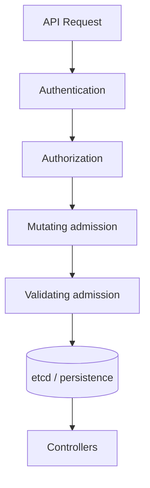
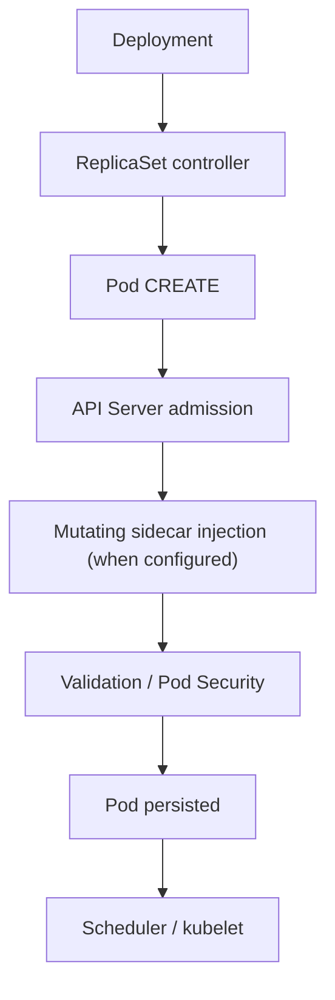

# Lesson 07: Kubernetes Admission Controllers & Policy

## Learning objectives

- **Locate admission in the Kubernetes API request pipeline:** Trace how write requests move through authentication, authorization, mutating admission, validating admission, and etcd persistence, and understand why admission complements rather than replaces RBAC.
- **Compare mutating webhooks, validating webhooks, and CEL policies:** Understand how `AdmissionReview` payloads and JSON Patches work, and decide when to use in-process `ValidatingAdmissionPolicy` (CEL) versus external HTTPS webhooks.
- **Author and scope `ValidatingAdmissionPolicy` rules:** Write CEL expressions with `ValidatingAdmissionPolicyBinding`, `namespaceSelector`, `paramKind`, and staged `Warn`, `Audit`, and `Deny` enforcement actions.
- **Design resilient webhooks for production:** Evaluate `failurePolicy` (`Fail` vs. `Ignore`), timeouts, TLS certificates, `reinvocationPolicy`, and `sideEffects` to prevent webhook outages from blocking cluster operations.
- **Reason about admission interactions with GitOps:** Handle server-side dry runs, mutation-induced diffs in Argo CD (`ServerSideDiff` and `IncludeMutationWebhook`), and downstream Pod admission rejections during controller rollouts.

## 1. Where does admission happen?

The Kubernetes API server processes requests through authentication, authorization, and admission before persistence, with validation as part of the flow. Admission does not replace Kubernetes RBAC. Mutating admission can add to or change an object; validating admission can reject an object that doesn't meet requirements.



The diagram simplifies API-specific validation, conversion, and internal ordering. Do not use it as an exact request trace.

An ordinary `GET` or `LIST` is authenticated and authorized without going through write admission. Admission controllers can handle creates, updates, deletes, and certain connection operations when configured to match them. A request denied by authorization does not reach admission. For a write that is allowed to proceed, mutating admission can change the candidate object, validating admission checks the result, and the accepted write can then be persisted. Decoding, conversion, defaulting, schema validation, and storage preparation also happen along the request path. Their exact placement depends on the operation and resource. [Kubernetes admission controllers](https://kubernetes.io/docs/reference/access-authn-authz/admission-controllers/)

### Compare authorization bindings with admission bindings

| Resource | Scope | Role in the API request |
| --- | --- | --- |
| `Role` | Namespaced | Defines allowed API verbs and resources within a namespace. |
| `RoleBinding` | Namespaced | Grants the referenced Role or ClusterRole to Users, Groups, or ServiceAccounts within the binding's namespace. |
| `ClusterRole` | Cluster-scoped | Defines cluster-scoped permissions or reusable rules for namespaced resources. |
| `ClusterRoleBinding` | Cluster-scoped | Grants a ClusterRole across the cluster. |
| `ValidatingAdmissionPolicy` | Cluster-scoped | Defines candidate requests, CEL validations, and handling of evaluation errors. |
| `ValidatingAdmissionPolicyBinding` | Cluster-scoped | Activates the policy for matching requests and sets enforcement actions. It can select specific namespaces. |

A definition can be reused by several bindings. For example, the following Role can be granted to a service, a developer, or a monitoring group through separate bindings. This example grants it to the `payments/payment-app` ServiceAccount.

```yaml
apiVersion: v1
kind: ServiceAccount
metadata:
  name: payment-app
  namespace: payments
---
apiVersion: rbac.authorization.k8s.io/v1
kind: Role
metadata:
  name: pod-reader
  namespace: payments
rules:
  - apiGroups: [""]
    resources: ["pods"]
    verbs: ["get", "list"]
---
apiVersion: rbac.authorization.k8s.io/v1
kind: RoleBinding
metadata:
  name: payment-pod-reader
  namespace: payments
subjects:
  - kind: ServiceAccount
    name: payment-app
    namespace: payments
roleRef:
  kind: Role
  name: pod-reader
  apiGroup: rbac.authorization.k8s.io
```

A Role alone grants nothing to a subject. A RoleBinding referencing a ClusterRole still grants only namespaced access in the namespace of that binding. A ValidatingAdmissionPolicy similarly requires a binding, but its subject is a set of requests instead of a list of authorized identities. For a write, authentication identifies the caller, authorization checks its permissions, and admission evaluates the request before persistence. A caller already allowed to create Deployments can still be denied for an unsafe spec. [Kubernetes RBAC](https://kubernetes.io/docs/reference/access-authn-authz/rbac/) · [Validating Admission Policy](https://kubernetes.io/docs/reference/access-authn-authz/validating-admission-policy/)

## 2. Mutating vs Validating Webhook

| Type | Can modify the object? | Can reject the request? |
|---|---|---|
| Mutating Admission Webhook | Yes | Yes |
| Validating Admission Webhook | No | Yes |
| ValidatingAdmissionPolicy (CEL) | No | Yes; can also warn or audit, as configured by the binding |

For example, Istio sidecar injection uses mutation at admission time; Pod Security Admission and CEL policies apply the relevant checks.

### Follow a matching request to the webhook Service

A `MutatingWebhookConfiguration` or `ValidatingWebhookConfiguration` registers matching rules and a destination. The webhook logic runs in an HTTPS service, such as a Deployment behind a Service in `policy-system`. For a match, the API server sends an `AdmissionReview` and waits for a response. The webhook's answer applies to that request. Kubernetes controllers can observe and reconcile the persisted result afterward.

A mutator can add `metadata.labels.managed-by: platform-team` to a Deployment while preserving its existing labels. Mutators can also default annotations or inject sidecars. A validator sees the final candidate after mutation and can reject it, for example if a container image is outside `registry.company.com/`. A validating webhook cannot change that image. A mutating webhook can also explicitly deny a request. Use validating admission for invariants that must hold after all mutations. [Dynamic admission control](https://kubernetes.io/docs/reference/access-authn-authz/extensible-admission-controllers/)

This abbreviated request shows how a Pod create is represented:

```json
{
  "apiVersion": "admission.k8s.io/v1",
  "kind": "AdmissionReview",
  "request": {
    "uid": "request-123",
    "operation": "CREATE",
    "namespace": "payments",
    "kind": {"group": "", "version": "v1", "kind": "Pod"},
    "resource": {"group": "", "version": "v1", "resource": "pods"},
    "userInfo": {"username": "example-user"},
    "dryRun": false,
    "object": {
      "apiVersion": "v1",
      "kind": "Pod",
      "metadata": {"name": "payment", "labels": {"app": "payment"}},
      "spec": {"containers": [{"name": "app", "image": "nginx:1.27"}]}
    }
  }
}
```

The envelope can also carry `oldObject` on updates and deletes, request options, and a subresource. On equivalent matches with conversion, the original requested kind or resource can differ from the converted object sent to the webhook. Respond with the same AdmissionReview version and copy `request.uid` to `response.uid`. A successful HTTP exchange can carry an explicit denial. Return that decision inside the envelope:

```json
{
  "apiVersion": "admission.k8s.io/v1",
  "kind": "AdmissionReview",
  "response": {"uid": "request-123", "allowed": true}
}
```

```json
{
  "apiVersion": "admission.k8s.io/v1",
  "kind": "AdmissionReview",
  "response": {
    "uid": "request-123",
    "allowed": false,
    "status": {"code": 403, "message": "Image registry is not allowed"}
  }
}
```

### Return a JSON Patch from a mutating webhook

For the request above, the labels map already exists. The patch below adds one key and preserves the existing `app` label:

```json
[
  {"op": "add", "path": "/metadata/labels/managed-by", "value": "platform-team"}
]
```

When the labels map is absent, add it at `/metadata/labels` with `{"managed-by":"platform-team"}` instead. If the intended key is already set correctly, return no patch. Add or replace an existing different value only if the policy explicitly owns that key. The wire response uses `patchType: JSONPatch` and Base64-encodes the patch bytes:

```json
{
  "apiVersion": "admission.k8s.io/v1",
  "kind": "AdmissionReview",
  "response": {
    "uid": "request-123",
    "allowed": true,
    "patchType": "JSONPatch",
    "patch": "W3sib3AiOiJhZGQiLCJwYXRoIjoiL21ldGFkYXRhL2xhYmVscy9tYW5hZ2VkLWJ5IiwidmFsdWUiOiJwbGF0Zm9ybS10ZWFtIn1d"
  }
}
```

The API server applies the patch to the candidate object in the current request. The mutating webhook does not need to call the Kubernetes API to write that object. If a later admission check rejects it, the candidate is discarded. [AdmissionReview request and response](https://kubernetes.io/docs/reference/access-authn-authz/extensible-admission-controllers/#request)

## 3. A simple ValidatingAdmissionPolicy

```yaml
apiVersion: admissionregistration.k8s.io/v1
kind: ValidatingAdmissionPolicy
metadata:
  name: require-team-label
spec:
  failurePolicy: Fail
  matchConstraints:
    resourceRules:
      - apiGroups: ["apps"]
        apiVersions: ["v1"]
        operations: ["CREATE", "UPDATE"]
        resources: ["deployments"]
  validations:
    - expression: "has(object.metadata.labels) && 'team' in object.metadata.labels"
      message: "Deployment must have a team label"
---
apiVersion: admissionregistration.k8s.io/v1
kind: ValidatingAdmissionPolicyBinding
metadata:
  name: require-team-label-binding
spec:
  policyName: require-team-label
  validationActions: [Deny]
```

This policy has a broad scope. In production, configure a namespace selector and exclusions as needed, review the policy, and test `Warn` and `Audit` before enabling `Deny`.

### Apply one policy with different enforcement

ValidatingAdmissionPolicy has been stable since Kubernetes 1.30. In a disposable cluster, label two dedicated namespaces so one binding warns and audits while the other enforces. If you also installed the earlier team-label policy, use a separate lab or provide its required label so it does not mask this result.

```yaml
apiVersion: admissionregistration.k8s.io/v1
kind: ValidatingAdmissionPolicy
metadata:
  name: limit-deployment-replicas
spec:
  failurePolicy: Fail
  matchConstraints:
    resourceRules:
      - apiGroups: ["apps"]
        apiVersions: ["v1"]
        operations: ["CREATE", "UPDATE"]
        resources: ["deployments"]
  validations:
    - expression: "!has(object.spec.replicas) || object.spec.replicas <= 10"
      message: "Deployment cannot exceed 10 replicas"
---
apiVersion: admissionregistration.k8s.io/v1
kind: ValidatingAdmissionPolicyBinding
metadata:
  name: limit-deployment-replicas-prod
spec:
  policyName: limit-deployment-replicas
  validationActions: [Deny]
  matchResources:
    namespaceSelector:
      matchLabels:
        environment: production
---
apiVersion: admissionregistration.k8s.io/v1
kind: ValidatingAdmissionPolicyBinding
metadata:
  name: limit-deployment-replicas-dev
spec:
  policyName: limit-deployment-replicas
  validationActions: [Warn, Audit]
  matchResources:
    namespaceSelector:
      matchLabels:
        environment: development
```

```bash
kubectl create namespace policy-lab-dev
kubectl create namespace policy-lab-prod
kubectl label namespace policy-lab-dev environment=development
kubectl label namespace policy-lab-prod environment=production
kubectl apply -f limit-deployment-replicas.yaml
kubectl -n policy-lab-dev create deployment oversized --image=nginx:1.27 --replicas=20 --dry-run=server
kubectl -n policy-lab-prod create deployment oversized --image=nginx:1.27 --replicas=20 --dry-run=server
kubectl -n policy-lab-prod create deployment within-limit --image=nginx:1.27 --replicas=5 --dry-run=server
```

Expect a warning for the dev request, a denial for the production request with twenty replicas, and acceptance for five replicas. Dry runs do not create Deployments. The `Audit` action adds information to the request audit event when auditing records the event. A false expression is handled by `validationActions`. `failurePolicy` determines what happens when policy setup or evaluation fails. `Deny` and `Warn` cannot appear together in one binding.

The rule matches writes to `deployments`. It neither changes existing replicas automatically nor matches writes to `deployments/scale`. A separate rule for the Scale subresource would need to account for the Scale schema and HPA behavior. Restrict who can change namespace labels or policy bindings. [Kubernetes Validating Admission Policy](https://kubernetes.io/docs/reference/access-authn-authz/validating-admission-policy/)

### Reuse a parameterized rule

A policy can declare `spec.paramKind` for a typed parameter resource, for example a `ReplicaLimit` CRD exposing a required integer at `spec.maxReplicas`. The CEL check could then read `!has(object.spec.replicas) || object.spec.replicas <= params.spec.maxReplicas`. Use separate bindings with `spec.paramRef` resources containing limits of five, ten, and thirty for dev, staging, and production. Match each binding to its intended namespaces. Configure `parameterNotFoundAction` deliberately, check authorization to read the parameter resources, and control who can modify them. A missing parameter or an overlapping binding can change enforcement even if the CEL expression stays the same. [Kubernetes policy parameters](https://kubernetes.io/docs/reference/access-authn-authz/validating-admission-policy/#parameter-resources)

### Choose a policy mechanism

| Mechanism | Typical use |
| --- | --- |
| Pod Security Admission | Apply built-in Pod Security Standards, such as blocking privileged containers with an appropriate enforcement profile. |
| ValidatingAdmissionPolicy | Validate typed API writes with CEL, for example a required label or approved image registry. |
| OPA Gatekeeper | Operate reusable constraint templates and enforcement with OPA. |
| Kyverno | Use Kubernetes-native policies for validation and other supported actions, including mutation. |
| GKE Policy Controller | Migrate existing policies to Kubernetes-native admission or a supported self-managed engine. |

Other useful checks include resource requests, mandatory labels, and restrictions on `hostPath`. An authorized request containing a container with `securityContext.privileged: true` can still fail admission. Choose the mechanism and rollout scope according to the rule and watch for controller-created resources as well as direct user writes.

Google Cloud deprecated Policy Controller on **November 12, 2026**, and lists **December 31, 2027** as end of support. GKE 1.39 and later do not support it. Inventory existing constraints and test the replacement before removing enforcement. Google documents migration to Kubernetes ValidatingAdmissionPolicy and self-managed Gatekeeper. [GKE Policy Controller migration](https://docs.cloud.google.com/kubernetes-engine/docs/deprecations/policy-controller)

## 4. Admission webhook failure modes

- The webhook Service is unreachable, or its TLS certificate is invalid.
- Timeouts slow down API requests.
- `failurePolicy: Fail` enforces the policy but can make API operations unavailable if the webhook fails.
- `failurePolicy: Ignore` improves availability but can let requests through unchecked if the webhook is unavailable.
- Webhook reinvocation and object mutation can interact in unpredictable ways.

A production webhook needs a sensible timeout, highly available replicas, valid certificates, and connectivity from the control plane.

## 5. CEL policies: versions and schemas

CEL policies can check object data and parameters made available through `paramKind`. CEL does not replace an external image signature verification service when the check requires access to external attestation metadata. Pay attention to `matchConditions`, `matchConstraints`, the binding's `validationActions`, and errors reported in status.

## 6. How admission interacts with GitOps

A source manifest can be reported as `Synced` even though the API server rejects a Pod because of Pod Security. Read Argo CD status alongside admission events. A mutating webhook can change the live object and produce a diff; understand who owns the changed fields rather than ignoring every difference.

### Compare an existing Deployment that admission changes

Suppose Git declares a `payment-service` Deployment and a webhook adds `metadata.labels.security-level: restricted` to its top-level metadata during admission. The field is absent from the source and present on the live object. Whether Argo CD reports drift depends on the comparison strategy and ownership. With Server-Side Diff, Argo CD compares live state with the API server's SSA dry-run prediction. Argo CD excludes mutation webhook results from that comparison by default. Use the [comparison annotation example in Lesson 03](../01-foundations/lesson-03-cluster-architecture.md#compare-a-field-injected-by-admission) to enable both `ServerSideDiff=true` and `IncludeMutationWebhook=true`.

For an existing Deployment, a policy can also reject a proposed update during the prediction step. For example, Git changing the replica count to twenty can surface a ten-replica admission limit during comparison. Argo CD skips Server-Side Diff for resources that do not yet exist. Their first admission failure can therefore appear during sync. This is a limitation of when Argo CD runs the comparison. A manual server dry run can still test a create request before syncing.

A Deployment itself can also match Git while a separately submitted Pod is rejected. The Deployment controller and ReplicaSet controller cause a later Pod create, which has its own identity and admission evaluation. For a stalled rollout, inspect ReplicaSet events as well as Application comparison and sync errors. Admission evaluates matching requests. Finding existing noncompliant objects requires audit, background scanning, or another controller. [Argo CD Diff Strategies](https://argo-cd.readthedocs.io/en/stable/user-guide/diff-strategies/) · [Webhook good practices](https://kubernetes.io/docs/concepts/cluster-administration/admission-webhooks-good-practices/)

## 7. Lab

1. Create a ValidatingAdmissionPolicy that requires a `team` label in a test namespace.
2. Submit a Deployment without the label and observe the API rejection.
3. Add the label, apply the Deployment again, and confirm that the request succeeds.
4. Check that the policy binding uses the intended selector.
5. Test what happens when a webhook is unavailable in a separate lab cluster, not in production.

### Exercise the API pipeline with SSA and server dry run

Use a disposable Kubernetes cluster with ValidatingAdmissionPolicy support and permission to install the policy and binding. Run this separately from the earlier team-label lab or add its required label so it does not mask the result. This exercise uses CEL and does not require an HTTPS webhook.

```bash
kubectl create namespace admission-lab
kubectl label namespace admission-lab security-enforcement=enabled
```

Save this as `policy.yaml`:

```yaml
apiVersion: admissionregistration.k8s.io/v1
kind: ValidatingAdmissionPolicy
metadata:
  name: limit-replicas-lab
spec:
  failurePolicy: Fail
  matchConstraints:
    resourceRules:
      - apiGroups: ["apps"]
        apiVersions: ["v1"]
        operations: ["CREATE", "UPDATE"]
        resources: ["deployments"]
  validations:
    - expression: "!has(object.spec.replicas) || object.spec.replicas <= 5"
      message: "Maximum allowed replicas is 5"
---
apiVersion: admissionregistration.k8s.io/v1
kind: ValidatingAdmissionPolicyBinding
metadata:
  name: limit-replicas-lab
spec:
  policyName: limit-replicas-lab
  validationActions: [Deny]
  matchResources:
    namespaceSelector:
      matchLabels:
        security-enforcement: enabled
```

Save this as `deployment.yaml`:

```yaml
apiVersion: apps/v1
kind: Deployment
metadata:
  name: payment-test
  namespace: admission-lab
  labels:
    team: payments
spec:
  replicas: 10
  selector:
    matchLabels:
      app: payment-test
  template:
    metadata:
      labels:
        app: payment-test
    spec:
      containers:
        - name: nginx
          image: nginx:1.27
```

```bash
kubectl apply -f policy.yaml
kubectl apply --server-side --dry-run=server -f deployment.yaml
kubectl -n admission-lab get deployment payment-test
```

Expect a denial containing `Maximum allowed replicas is 5`, followed by `NotFound` for the first create attempt. If the request is accepted, verify the binding and namespace label, then allow the configuration to propagate and retry. Change `replicas` to three and repeat the two checks. The dry run should now be accepted and the Deployment should still be absent. Run the actual apply, then verify persistence:

```bash
kubectl apply --server-side -f deployment.yaml
kubectl -n admission-lab get deployment payment-test -o jsonpath='{.spec.replicas}{"\n"}'
```

Finally, test an update by restoring `replicas: 10` and running the server dry run again. It should be rejected and the persisted count should remain three. A rejected request and an accepted dry run both leave persisted state untouched for different reasons. Clean up only the policy, binding, and namespace created for this disposable lab:

```bash
kubectl delete validatingadmissionpolicybinding limit-replicas-lab
kubectl delete validatingadmissionpolicy limit-replicas-lab
kubectl delete namespace admission-lab
```

**References:** [Dynamic Admission Control](https://kubernetes.io/docs/reference/access-authn-authz/extensible-admission-controllers/) · [Validating Admission Policy](https://kubernetes.io/docs/reference/access-authn-authz/validating-admission-policy/) · [Pod Security Admission](https://kubernetes.io/docs/concepts/security/pod-security-admission/).

## Deep dive: admission enforces policy at request time

**Editorial status:** This section was added during editing; the original Lesson 07 title and full text have not been verified.

In simplified terms, a Kubernetes API request goes through authentication, authorization, admission, and then persistence. Admission can mutate or validate the object **before it is written to etcd**. Workload controllers reconcile afterward.

### How does an admission webhook differ from a controller?

- A webhook is a **synchronous** hook in a Kubernetes API request. A slow webhook can increase API latency or block resource creation.
- A controller runs an **asynchronous** reconciliation loop after the object exists. It reads the desired state and updates the system.
- A mutating webhook can add a sidecar or set default values. A validating webhook can reject a request. A controller has no inherent right to bypass validating admission.

Example flow for creating a Pod with an Istio sidecar:



This is a conceptual flow. Do not rely on a particular ordering among multiple mutating webhooks. Review reinvocation, `namespaceSelector`, `objectSelector`, timeouts, and side effects.

### FailurePolicy: Fail vs Ignore

```yaml
apiVersion: admissionregistration.k8s.io/v1
kind: ValidatingWebhookConfiguration
metadata:
  name: example-policy
webhooks:
  - name: policy.example.test
    clientConfig:
      service:
        name: policy-webhook
        namespace: policy-system
        path: /validate
    admissionReviewVersions: ["v1"]
    sideEffects: None
    timeoutSeconds: 3
    failurePolicy: Fail
    rules:
      - operations: ["CREATE", "UPDATE"]
        apiGroups: ["apps"]
        apiVersions: ["v1"]
        resources: ["deployments"]
```

This manifest is illustrative. Before installing it, configure the correct TLS CA bundle, webhook Service, and rules. `failurePolicy: Fail` can block workload creation if the webhook is unreachable; `Ignore` improves availability but allows requests to skip the check if the webhook fails. `Ignore` does not mean the policy explicitly allows the object, and `Fail` does not guarantee comprehensive security.

### Read the registration as a request filter and a network dependency

The example registers an HTTPS call to `policy-webhook.policy-system.svc` on the Service's default port 443. The Service and serving certificate must be provisioned separately. In production, supply the CA in `clientConfig.caBundle` when it is not in the API server's trust roots. The field contains Base64-encoded PEM CA data and the certificate must identify the Service DNS name.

| Field | What it controls |
| --- | --- |
| `rules` | Selects operations, API groups, versions, resources or subresources, and optional scope. |
| `namespaceSelector` | Selects namespaces by label for namespaced resources. Label changes can alter enforcement scope. |
| `objectSelector` | Filters matching objects by label. A caller who can set object labels can influence this selector, so reserve opt-in selectors for appropriate use cases. |
| `matchConditions` | CEL predicates filter already matching requests before making the network call. |
| `clientConfig.service` and `caBundle` | Select the destination and provide TLS trust. |
| `admissionReviewVersions` | Lists supported envelope versions. |
| `timeoutSeconds`, `failurePolicy`, and `sideEffects` | Determine waiting time, call-error handling, and dry-run compatibility. |

For a staged rollout, add the following fields within the example's `webhooks[0]` entry. Use the namespace label as the enforcement boundary and keep authority to modify it with the platform team. The CEL condition selects the top-level resource request.

```yaml
namespaceSelector:
  matchLabels:
    security-enforcement: enabled
matchConditions:
  - name: top-level-resource
    expression: "request.subResource == ''"
```

[Webhook configuration and matching](https://kubernetes.io/docs/reference/access-authn-authz/extensible-admission-controllers/#webhook-configuration)

### Distinguish an explicit denial from a failed call

| Webhook outcome | `failurePolicy: Fail` | `failurePolicy: Ignore` |
| --- | --- | --- |
| Valid AdmissionReview with `allowed: false` | Reject the request | Reject the request |
| Timeout, connection or TLS error, or malformed response | Reject the request | Continue through the remaining API checks |
| Valid AdmissionReview with `allowed: true` | Continue | Continue |

Webhook timeouts range from one to thirty seconds and default to ten. They bound the wait for an individual webhook call and add to the latency seen by API clients. Use short timeouts appropriate to measured latency, ready endpoints across failure domains, and an independently recoverable webhook deployment. Scope rules so a webhook outage does not block creation or repair of its own dependencies. A fail-open choice trades enforcement during outages for availability of matching writes. [Webhook failure policy and timeouts](https://kubernetes.io/docs/reference/access-authn-authz/extensible-admission-controllers/#failure-policy) · [Webhook good practices](https://kubernetes.io/docs/concepts/cluster-administration/admission-webhooks-good-practices/)

### Design for reinvocation and dry run

`reinvocationPolicy` applies to mutating webhooks and defaults to `Never`. With `IfNeeded`, the API server can call a mutator again after another admission plugin changes the object. For example, one mutator may add defaults to a container injected by a later mutator. Kubernetes can reorder webhooks and gives no fixed number of additional calls. Ensure applying the mutation twice yields the same result. An injector can check whether the named sidecar is already present before adding another. Put final assertions in a validator.

`sideEffects: None` declares no out-of-band effects. `NoneOnDryRun` means the webhook suppresses any effects when `request.dryRun` is true. New v1 webhook configurations support these two declarations. Matching a webhook that cannot honor dry run can cause the server to reject the dry-run request. A dry run exercises the server path without persisting the resource, and an unsafe external write by a webhook would violate that contract. For external provisioning or notifications that must follow a successful write, use a reconciler that watches persisted state. [Webhook side effects and reinvocation](https://kubernetes.io/docs/reference/access-authn-authz/extensible-admission-controllers/#side-effects) · [API dry run](https://kubernetes.io/docs/reference/using-api/api-concepts/#dry-run)

### ValidatingAdmissionPolicy (CEL)

Kubernetes provides a native `ValidatingAdmissionPolicy` that can enforce many rules without a separate HTTP webhook. For example, CEL can check replica counts or image reference formats. It does not, by itself, verify remote OCI signatures. Use Kyverno, Binary Authorization, or another appropriate mechanism when a policy requires artifact attestations.

### Choose CEL or a webhook based on the information the rule needs

| Question | ValidatingAdmissionPolicy | Validating webhook |
| --- | --- | --- |
| Where is the logic executed? | CEL evaluates inside the API server. | Custom code runs in a separate HTTPS service. |
| What inputs can it use? | Typed fields, request information, and configured parameters or other variables provided by Kubernetes. | The AdmissionReview plus inputs the service can legitimately retrieve. |
| What do you operate? | Policy and binding definitions, plus any parameter resources. | Code, Service, certificates, network reachability, timeouts, and availability. |
| Example | Restrict Deployment replicas or check an image registry prefix. | Verify external attestations when the necessary evidence is outside the API server. |

Use CEL for constraints expressible over admission inputs. External calls in a webhook add latency and a dependency to the API write path. For declaration-based mutation, Kubernetes also has `MutatingAdmissionPolicy` with CEL and apply-configuration or JSON Patch mutations. It reached stable status in Kubernetes 1.36. Check the API and feature availability for your cluster version, especially on older releases. [Validating Admission Policy](https://kubernetes.io/docs/reference/access-authn-authz/validating-admission-policy/) · [Mutating Admission Policy](https://kubernetes.io/docs/reference/access-authn-authz/mutating-admission-policy/)

### Governance and operability

1. Use `Warn` and `Audit` before enforcing new policies with a large blast radius.
2. Avoid applying unnecessary policies to critical system namespaces.
3. Limit webhook timeouts, expose metrics, and monitor error rates and API latency.
4. Simulate a webhook outage in staging and measure its impact on deployments and autoscaling.
5. The platform team must manage labels used by policy selectors. Tenants should not be able to change them to bypass policy.
6. With policy as code, keep policies in source control and test both positive and negative cases.

### Lab

- Create a `ValidatingAdmissionPolicy` that blocks Deployments with `replicas > 10` in namespaces labeled `governance=standard`.
- Create a Deployment with 11 replicas and record the validation message.
- Change the binding from `Deny` to `Warn` in the lab and observe the difference.
- Check the HPA Scale subresource: a policy that only matches `deployments` may not cover `deployments/scale`.
- Remove the test policies after the exercise.

Sources: [Admission controllers](https://kubernetes.io/docs/reference/access-authn-authz/admission-controllers/), [ValidatingAdmissionPolicy](https://kubernetes.io/docs/reference/access-authn-authz/validating-admission-policy/).

Check your reasoning with the [admission control quiz](../03-gitops-delivery/gitops-exercises.mdx#check-your-admission-control-understanding).

## Summary and connections

- Distinguish desired state from observed state and identify who owns each field or resource.
- A successful API operation does not mean the external system is ready to serve traffic.
- Verify IAM and RBAC, readiness, the data lifecycle, and recovery procedures before using these patterns in production.

Continue with [Kubernetes Operators and the Controller Pattern](./lesson-08-operators.md) to follow persisted objects through watches, work queues, retries, finalizers, and status updates.

[Back to the Learning Path](../learning-path.md)
