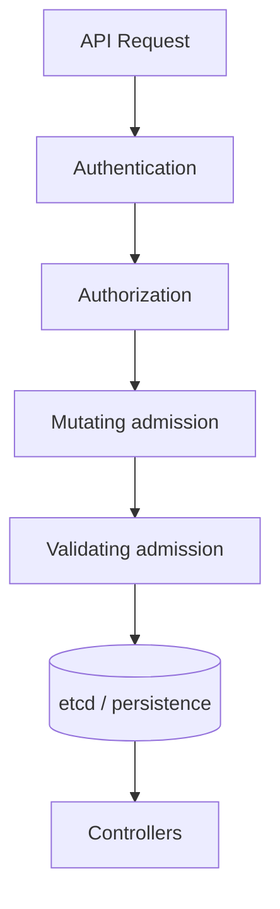

:::info Source status
This material was **reconstructed from the sequence of topics and the source material still available**. The exact original title and full text have not been verified, so this lesson is not presented as a verbatim quotation.
:::

# Lesson 07: Kubernetes Admission Controllers & Policy

## Learning objectives

Master **mutating and validating admission, webhooks, and CEL policies**, understand controller and ownership boundaries, and apply these concepts in a test cluster lab.


## 1. Where does admission happen?

The Kubernetes API server processes requests through authentication, authorization, and admission before persistence, with validation as part of the flow. Admission does not replace Kubernetes RBAC. Mutating admission can add to or change an object; validating admission can reject an object that doesn't meet requirements.



The diagram simplifies API-specific validation, conversion, and internal ordering. Do not use it as an exact request trace.

## 2. Mutating vs Validating Webhook

| Type | Can modify the object? | Can reject the request? |
|---|---|---|
| Mutating Admission Webhook | Yes | Yes |
| Validating Admission Webhook | No | Yes |
| ValidatingAdmissionPolicy (CEL) | No | Yes; can also warn or audit, as configured by the binding |

For example, Istio sidecar injection uses mutation at admission time; Pod Security Admission and CEL policies apply the relevant checks.

## 3. A simple ValidatingAdmissionPolicy

```yaml
apiVersion: admissionregistration.k8s.io/v1
kind: ValidatingAdmissionPolicy
metadata:
  name: require-team-label
spec:
  failurePolicy: Fail
  matchConstraints:
    resourceRules:
      - apiGroups: ["apps"]
        apiVersions: ["v1"]
        operations: ["CREATE", "UPDATE"]
        resources: ["deployments"]
  validations:
    - expression: "has(object.metadata.labels) && 'team' in object.metadata.labels"
      message: "Deployment must have a team label"
---
apiVersion: admissionregistration.k8s.io/v1
kind: ValidatingAdmissionPolicyBinding
metadata:
  name: require-team-label-binding
spec:
  policyName: require-team-label
  validationActions: [Deny]
```

This policy has a broad scope. In production, configure a namespace selector and exclusions as needed, review the policy, and test `Warn` and `Audit` before enabling `Deny`.

## 4. Admission webhook failure modes

- The webhook Service is unreachable, or its TLS certificate is invalid.
- Timeouts slow down API requests.
- `failurePolicy: Fail` enforces the policy but can make API operations unavailable if the webhook fails.
- `failurePolicy: Ignore` improves availability but can let requests through unchecked if the webhook is unavailable.
- Webhook reinvocation and object mutation can interact in unpredictable ways.

A production webhook needs a sensible timeout, highly available replicas, valid certificates, and connectivity from the control plane.

## 5. CEL policies: versions and schemas

CEL policies can check object data and parameters made available through `paramKind`. CEL does not replace an external image signature verification service when the check requires access to external attestation metadata. Pay attention to `matchConditions`, `matchConstraints`, the binding's `validationActions`, and errors reported in status.

## 6. How admission interacts with GitOps

A source manifest can be reported as `Synced` even though the API server rejects a Pod because of Pod Security. Read Argo CD status alongside admission events. A mutating webhook can change the live object and produce a diff; understand who owns the changed fields rather than ignoring every difference.

## 7. Lab

1. Create a ValidatingAdmissionPolicy that requires a `team` label in a test namespace.
2. Submit a Deployment without the label and observe the API rejection.
3. Add the label, apply the Deployment again, and confirm that the request succeeds.
4. Check that the policy binding uses the intended selector.
5. Test what happens when a webhook is unavailable in a separate lab cluster, not in production.

**References:** [Dynamic Admission Control](https://kubernetes.io/docs/reference/access-authn-authz/extensible-admission-controllers/) · [Validating Admission Policy](https://kubernetes.io/docs/reference/access-authn-authz/validating-admission-policy/) · [Pod Security Admission](https://kubernetes.io/docs/concepts/security/pod-security-admission/).

## Deep dive: admission enforces policy at request time

**Editorial status:** This section was added during editing; the original Lesson 07 title and full text have not been verified.

In simplified terms, a Kubernetes API request goes through authentication, authorization, admission, and then persistence. Admission can mutate or validate the object **before it is written to etcd**. Workload controllers reconcile afterward.

### How does an admission webhook differ from a controller?

- A webhook is a **synchronous** hook in a Kubernetes API request. A slow webhook can increase API latency or block resource creation.
- A controller runs an **asynchronous** reconciliation loop after the object exists. It reads the desired state and updates the system.
- A mutating webhook can add a sidecar or set default values. A validating webhook can reject a request. A controller has no inherent right to bypass validating admission.

Example flow for creating a Pod with an Istio sidecar:

```text
Deployment → ReplicaSet controller → Pod CREATE
     → API Server admission
     → mutating sidecar injection (when configured)
     → validation / Pod Security
     → Pod persisted
     → scheduler / kubelet
```

This is a conceptual flow. Do not rely on a particular ordering among multiple mutating webhooks. Review reinvocation, `namespaceSelector`, `objectSelector`, timeouts, and side effects.

### FailurePolicy: Fail vs Ignore

```yaml
apiVersion: admissionregistration.k8s.io/v1
kind: ValidatingWebhookConfiguration
metadata:
  name: example-policy
webhooks:
  - name: policy.example.test
    clientConfig:
      service:
        name: policy-webhook
        namespace: policy-system
        path: /validate
    admissionReviewVersions: ["v1"]
    sideEffects: None
    timeoutSeconds: 3
    failurePolicy: Fail
    rules:
      - operations: ["CREATE", "UPDATE"]
        apiGroups: ["apps"]
        apiVersions: ["v1"]
        resources: ["deployments"]
```

This manifest is illustrative. Before installing it, configure the correct TLS CA bundle, webhook Service, and rules. `failurePolicy: Fail` can block workload creation if the webhook is unreachable; `Ignore` improves availability but allows requests to skip the check if the webhook fails. `Ignore` does not mean the policy explicitly allows the object, and `Fail` does not guarantee comprehensive security.

### ValidatingAdmissionPolicy (CEL)

Kubernetes provides a native `ValidatingAdmissionPolicy` that can enforce many rules without a separate HTTP webhook. For example, CEL can check replica counts or image reference formats. It does not, by itself, verify remote OCI signatures. Use Kyverno, Binary Authorization, or another appropriate mechanism when a policy requires artifact attestations.

### Governance and operability

1. Use `Warn` and `Audit` before enforcing new policies with a large blast radius.
2. Avoid applying unnecessary policies to critical system namespaces.
3. Limit webhook timeouts, expose metrics, and monitor error rates and API latency.
4. Simulate a webhook outage in staging and measure its impact on deployments and autoscaling.
5. The platform team must manage labels used by policy selectors. Tenants should not be able to change them to bypass policy.
6. With policy as code, keep policies in source control and test both positive and negative cases.

### Lab

- Create a `ValidatingAdmissionPolicy` that blocks Deployments with `replicas > 10` in namespaces labeled `governance=standard`.
- Create a Deployment with 11 replicas and record the validation message.
- Change the binding from `Deny` to `Warn` in the lab and observe the difference.
- Check the HPA Scale subresource: a policy that only matches `deployments` may not cover `deployments/scale`.
- Remove the test policies after the exercise.

Sources: [Admission controllers](https://kubernetes.io/docs/reference/access-authn-authz/admission-controllers/), [ValidatingAdmissionPolicy](https://kubernetes.io/docs/reference/access-authn-authz/validating-admission-policy/).

## Summary and connections

- Distinguish desired state from observed state and identify who owns each field or resource.
- A successful API operation does not mean the external system is ready to serve traffic.
- Verify IAM and RBAC, readiness, the data lifecycle, and recovery procedures before using these patterns in production.

[Back to the Learning Path](../learning-path.md)
