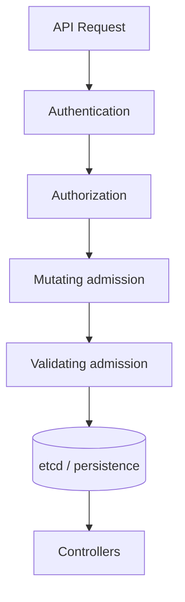
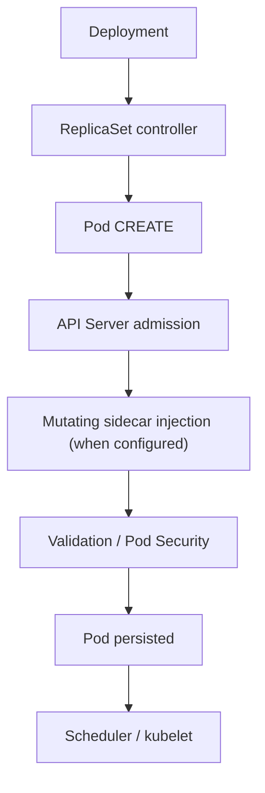

# Bài 07: Kubernetes Admission Controllers & Chính sách

## Mục tiêu học tập

- **Xác định vị trí của admission trong đường ống yêu cầu Kubernetes API:** Theo dõi cách thao tác ghi đi qua xác thực, phân quyền, mutating admission, validating admission và lưu trữ etcd, đồng thời hiểu vì sao admission bổ trợ chứ không thay thế RBAC.
- **So sánh mutating webhook, validating webhook và chính sách CEL:** Hiểu cách hoạt động của gói tin `AdmissionReview` và JSON Patch, từ đó chọn đúng giữa `ValidatingAdmissionPolicy` (CEL) chạy nội bộ và HTTPS webhook bên ngoài.
- **Viết và giới hạn phạm vi cho `ValidatingAdmissionPolicy`:** Xây dựng biểu thức CEL kết hợp với `ValidatingAdmissionPolicyBinding`, `namespaceSelector`, `paramKind` cùng lộ trình thực thi theo từng mức `Warn`, `Audit` và `Deny`.
- **Thiết kế webhook bền bỉ cho production:** Đánh giá `failurePolicy` (`Fail` so với `Ignore`), timeout, chứng chỉ TLS, `reinvocationPolicy` và `sideEffects` để sự cố webhook không làm tê liệt hoạt động của cluster.
- **Xử lý tương tác giữa admission và GitOps:** Làm chủ server-side dry run, sự khác biệt (diff) do mutation tạo ra trong Argo CD (`ServerSideDiff` và `IncludeMutationWebhook`) và tình huống Pod bị từ chối ở bước admission trong quá trình rollout.

## 1. Admission diễn ra ở đâu?

Kubernetes API server xử lý các yêu cầu qua các bước xác thực (authentication), phân quyền (authorization) và admission trước khi lưu trữ, cùng với bước kiểm tra hợp lệ (validation) trong luồng xử lý. Admission không thay thế Kubernetes RBAC. Mutating admission có thể bổ sung hoặc chỉnh sửa đối tượng; validating admission có thể từ chối đối tượng không đáp ứng yêu cầu.



Sơ đồ trên đã đơn giản hóa phần kiểm tra đặc thù theo API, chuyển đổi phiên bản và thứ tự nội bộ. Không dùng nó như một dấu vết yêu cầu (request trace) chính xác tuyệt đối.

Một lệnh `GET` hoặc `LIST` thông thường chỉ đi qua xác thực và phân quyền mà không đi qua admission dành cho thao tác ghi. Admission controller có thể xử lý các thao tác tạo, cập nhật, xóa và một số thao tác kết nối khi được cấu hình khớp với chúng. Một yêu cầu bị từ chối ở bước phân quyền sẽ không đến được admission. Đối với thao tác ghi được phép đi tiếp, mutating admission có thể sửa đối tượng ứng viên, validating admission kiểm tra kết quả và thao tác ghi được chấp nhận sẽ được lưu xuống bộ lưu trữ. Các bước giải mã, chuyển đổi, gán giá trị mặc định, kiểm tra schema và chuẩn bị lưu trữ cũng diễn ra dọc theo đường đi của yêu cầu. Vị trí chính xác của chúng phụ thuộc vào loại thao tác và tài nguyên. [Kubernetes admission controllers](https://kubernetes.io/docs/reference/access-authn-authz/admission-controllers/)

### So sánh authorization binding với admission binding

| Tài nguyên | Phạm vi | Vai trò trong yêu cầu API |
| --- | --- | --- |
| `Role` | Theo namespace | Định nghĩa các API verb và tài nguyên được phép trong một namespace. |
| `RoleBinding` | Theo namespace | Gán `Role` hoặc `ClusterRole` được tham chiếu cho User, Group hoặc `ServiceAccount` trong namespace của binding đó. |
| `ClusterRole` | Toàn cluster | Định nghĩa quyền cấp cluster hoặc các quy tắc tái sử dụng cho tài nguyên theo namespace. |
| `ClusterRoleBinding` | Toàn cluster | Gán một `ClusterRole` trên toàn bộ cluster. |
| `ValidatingAdmissionPolicy` | Toàn cluster | Định nghĩa các yêu cầu ứng viên, biểu thức kiểm tra CEL và cách xử lý lỗi đánh giá. |
| `ValidatingAdmissionPolicyBinding` | Toàn cluster | Kích hoạt chính sách cho các yêu cầu khớp và thiết lập hành động thực thi. Có thể chọn các namespace cụ thể. |

Một định nghĩa có thể được tái sử dụng bởi nhiều binding. Ví dụ, `Role` dưới đây có thể được cấp cho một service, một lập trình viên hoặc một nhóm giám sát thông qua các binding riêng biệt. Ví dụ này cấp nó cho `ServiceAccount` `payments/payment-app`.

```yaml
apiVersion: v1
kind: ServiceAccount
metadata:
  name: payment-app
  namespace: payments
---
apiVersion: rbac.authorization.k8s.io/v1
kind: Role
metadata:
  name: pod-reader
  namespace: payments
rules:
  - apiGroups: [""]
    resources: ["pods"]
    verbs: ["get", "list"]
---
apiVersion: rbac.authorization.k8s.io/v1
kind: RoleBinding
metadata:
  name: payment-pod-reader
  namespace: payments
subjects:
  - kind: ServiceAccount
    name: payment-app
    namespace: payments
roleRef:
  kind: Role
  name: pod-reader
  apiGroup: rbac.authorization.k8s.io
```

Một `Role` đứng một mình không cấp quyền gì cho chủ thể nào. Một `RoleBinding` tham chiếu tới `ClusterRole` vẫn chỉ cấp quyền theo namespace trong phạm vi namespace của binding đó. `ValidatingAdmissionPolicy` cũng tương tự cần một binding, nhưng đối tượng của nó là một tập các yêu cầu thay vì danh sách các danh tính được cấp quyền. Đối với thao tác ghi, xác thực nhận diện người gọi, phân quyền kiểm tra quyền hạn của họ và admission đánh giá yêu cầu trước khi lưu trữ. Một người gọi đã được phép tạo `Deployment` vẫn có thể bị từ chối nếu spec không an toàn. [Kubernetes RBAC](https://kubernetes.io/docs/reference/access-authn-authz/rbac/) · [Validating Admission Policy](https://kubernetes.io/docs/reference/access-authn-authz/validating-admission-policy/)

## 2. Mutating Webhook so với Validating Webhook

| Loại | Có thể sửa đối tượng không? | Có thể từ chối yêu cầu không? |
|---|---|---|
| Mutating Admission Webhook | Có | Có |
| Validating Admission Webhook | Không | Có |
| ValidatingAdmissionPolicy (CEL) | Không | Có; cũng có thể cảnh báo (`Warn`) hoặc ghi nhận kiểm toán (`Audit`) theo cấu hình binding |

Ví dụ, cơ chế tiêm sidecar của Istio sử dụng mutation tại thời điểm admission; Pod Security Admission và các chính sách CEL áp dụng các bước kiểm tra tương ứng.

### Theo dõi một yêu cầu khớp đi tới webhook Service

Một `MutatingWebhookConfiguration` hoặc `ValidatingWebhookConfiguration` đăng ký các quy tắc khớp và đích đến. Logic của webhook chạy trong một HTTPS service, chẳng hạn một `Deployment` đứng sau một `Service` trong `policy-system`. Khi có yêu cầu khớp, API server gửi một `AdmissionReview` và chờ phản hồi. Câu trả lời của webhook áp dụng cho yêu cầu đó. Các Kubernetes controller có thể quan sát và reconcile kết quả đã lưu sau đó.

Một mutator có thể thêm `metadata.labels.managed-by: platform-team` vào `Deployment` mà vẫn giữ nguyên các label hiện có. Mutator cũng có thể gán giá trị mặc định cho annotation hoặc tiêm sidecar. Một validator nhìn thấy đối tượng ứng viên cuối cùng sau bước mutation và có thể từ chối nó, ví dụ nếu container image nằm ngoài `registry.company.com/`. Một validating webhook không thể tự sửa image đó. Mutating webhook cũng có thể từ chối yêu cầu một cách tường minh. Hãy dùng validating admission cho các bất biến (invariant) bắt buộc phải đúng sau tất cả các bước mutation. [Dynamic admission control](https://kubernetes.io/docs/reference/access-authn-authz/extensible-admission-controllers/)

Yêu cầu rút gọn dưới đây minh họa cách một thao tác tạo Pod được biểu diễn:

```json
{
  "apiVersion": "admission.k8s.io/v1",
  "kind": "AdmissionReview",
  "request": {
    "uid": "request-123",
    "operation": "CREATE",
    "namespace": "payments",
    "kind": {"group": "", "version": "v1", "kind": "Pod"},
    "resource": {"group": "", "version": "v1", "resource": "pods"},
    "userInfo": {"username": "example-user"},
    "dryRun": false,
    "object": {
      "apiVersion": "v1",
      "kind": "Pod",
      "metadata": {"name": "payment", "labels": {"app": "payment"}},
      "spec": {"containers": [{"name": "app", "image": "nginx:1.27"}]}
    }
  }
}
```

Gói tin (envelope) cũng có thể mang `oldObject` khi cập nhật và xóa, các tùy chọn yêu cầu và subresource. Với các phép khớp tương đương có chuyển đổi phiên bản, kind hoặc resource được yêu cầu ban đầu có thể khác với đối tượng đã chuyển đổi gửi tới webhook. Hãy phản hồi bằng cùng phiên bản `AdmissionReview` và sao chép `request.uid` sang `response.uid`. Một trao đổi HTTP thành công vẫn có thể mang quyết định từ chối tường minh. Hãy trả về quyết định đó bên trong gói tin:

```json
{
  "apiVersion": "admission.k8s.io/v1",
  "kind": "AdmissionReview",
  "response": {"uid": "request-123", "allowed": true}
}
```

```json
{
  "apiVersion": "admission.k8s.io/v1",
  "kind": "AdmissionReview",
  "response": {
    "uid": "request-123",
    "allowed": false,
    "status": {"code": 403, "message": "Image registry is not allowed"}
  }
}
```

### Trả về JSON Patch từ một mutating webhook

Với yêu cầu ở trên, map `labels` đã tồn tại. Bản vá (patch) dưới đây thêm một khóa và giữ nguyên label `app` hiện có:

```json
[
  {"op": "add", "path": "/metadata/labels/managed-by", "value": "platform-team"}
]
```

Khi map `labels` chưa có, hãy thêm nó tại `/metadata/labels` với `{"managed-by":"platform-team"}`. Nếu khóa mong muốn đã được đặt đúng giá trị, không cần trả về patch. Chỉ thêm hoặc thay thế một giá trị khác đang tồn tại nếu chính sách sở hữu tường minh khóa đó. Phản hồi trên đường truyền sử dụng `patchType: JSONPatch` và mã hóa Base64 các byte của patch:

```json
{
  "apiVersion": "admission.k8s.io/v1",
  "kind": "AdmissionReview",
  "response": {
    "uid": "request-123",
    "allowed": true,
    "patchType": "JSONPatch",
    "patch": "W3sib3AiOiJhZGQiLCJwYXRoIjoiL21ldGFkYXRhL2xhYmVscy9tYW5hZ2VkLWJ5IiwidmFsdWUiOiJwbGF0Zm9ybS10ZWFtIn1d"
  }
}
```

API server áp dụng patch lên đối tượng ứng viên trong yêu cầu hiện tại. Mutating webhook không cần gọi Kubernetes API để ghi đối tượng đó. Nếu một bước kiểm tra admission phía sau từ chối nó, đối tượng ứng viên sẽ bị hủy bỏ. [Yêu cầu và phản hồi AdmissionReview](https://kubernetes.io/docs/reference/access-authn-authz/extensible-admission-controllers/#request)

## 3. Một ValidatingAdmissionPolicy đơn giản

```yaml
apiVersion: admissionregistration.k8s.io/v1
kind: ValidatingAdmissionPolicy
metadata:
  name: require-team-label
spec:
  failurePolicy: Fail
  matchConstraints:
    resourceRules:
      - apiGroups: ["apps"]
        apiVersions: ["v1"]
        operations: ["CREATE", "UPDATE"]
        resources: ["deployments"]
  validations:
    - expression: "has(object.metadata.labels) && 'team' in object.metadata.labels"
      message: "Deployment must have a team label"
---
apiVersion: admissionregistration.k8s.io/v1
kind: ValidatingAdmissionPolicyBinding
metadata:
  name: require-team-label-binding
spec:
  policyName: require-team-label
  validationActions: [Deny]
```

Chính sách này có phạm vi rộng. Trong môi trường production, hãy cấu hình namespace selector và các loại trừ cần thiết, rà soát chính sách và thử nghiệm với `Warn` và `Audit` trước khi bật `Deny`.

### Áp dụng một chính sách với các mức thực thi khác nhau

`ValidatingAdmissionPolicy` đã ổn định từ Kubernetes 1.30. Trên một cluster dùng một lần, hãy gắn nhãn hai namespace riêng để một binding cảnh báo và ghi audit trong khi binding còn lại thực thi chặn. Nếu bạn cũng đã cài chính sách bắt buộc nhãn `team` trước đó, hãy dùng lab riêng hoặc cung cấp nhãn bắt buộc để tránh che khuất kết quả này.

```yaml
apiVersion: admissionregistration.k8s.io/v1
kind: ValidatingAdmissionPolicy
metadata:
  name: limit-deployment-replicas
spec:
  failurePolicy: Fail
  matchConstraints:
    resourceRules:
      - apiGroups: ["apps"]
        apiVersions: ["v1"]
        operations: ["CREATE", "UPDATE"]
        resources: ["deployments"]
  validations:
    - expression: "!has(object.spec.replicas) || object.spec.replicas <= 10"
      message: "Deployment cannot exceed 10 replicas"
---
apiVersion: admissionregistration.k8s.io/v1
kind: ValidatingAdmissionPolicyBinding
metadata:
  name: limit-deployment-replicas-prod
spec:
  policyName: limit-deployment-replicas
  validationActions: [Deny]
  matchResources:
    namespaceSelector:
      matchLabels:
        environment: production
---
apiVersion: admissionregistration.k8s.io/v1
kind: ValidatingAdmissionPolicyBinding
metadata:
  name: limit-deployment-replicas-dev
spec:
  policyName: limit-deployment-replicas
  validationActions: [Warn, Audit]
  matchResources:
    namespaceSelector:
      matchLabels:
        environment: development
```

```bash
kubectl create namespace policy-lab-dev
kubectl create namespace policy-lab-prod
kubectl label namespace policy-lab-dev environment=development
kubectl label namespace policy-lab-prod environment=production
kubectl apply -f limit-deployment-replicas.yaml
kubectl -n policy-lab-dev create deployment oversized --image=nginx:1.27 --replicas=20 --dry-run=server
kubectl -n policy-lab-prod create deployment oversized --image=nginx:1.27 --replicas=20 --dry-run=server
kubectl -n policy-lab-prod create deployment within-limit --image=nginx:1.27 --replicas=5 --dry-run=server
```

Kết quả kỳ vọng là một cảnh báo cho yêu cầu ở dev, một lệnh từ chối cho yêu cầu 20 replica ở production, và chấp nhận cho 5 replica. Dry run không thực sự tạo `Deployment`. Hành động `Audit` bổ sung thông tin vào sự kiện audit của yêu cầu khi hệ thống audit có ghi lại sự kiện đó. Biểu thức trả về `false` được xử lý bởi `validationActions`. `failurePolicy` quyết định điều gì xảy ra khi thiết lập hoặc đánh giá chính sách gặp lỗi. `Deny` và `Warn` không thể xuất hiện cùng nhau trong một binding.

Quy tắc trên khớp với các thao tác ghi lên `deployments`. Nó không tự động thay đổi số replica đang chạy cũng không khớp với các thao tác ghi lên `deployments/scale`. Một quy tắc riêng cho subresource `Scale` cần tính đến schema của `Scale` và hành vi của HPA. Hãy giới hạn ai có thể chỉnh sửa nhãn namespace hoặc các policy binding. [Kubernetes Validating Admission Policy](https://kubernetes.io/docs/reference/access-authn-authz/validating-admission-policy/)

### Tái sử dụng một quy tắc có tham số

Một chính sách có thể khai báo `spec.paramKind` cho một tài nguyên tham số có kiểu, ví dụ một CRD `ReplicaLimit` cung cấp số nguyên bắt buộc tại `spec.maxReplicas`. Khi đó biểu thức CEL có thể đọc `!has(object.spec.replicas) || object.spec.replicas <= params.spec.maxReplicas`. Dùng các binding riêng với tài nguyên `spec.paramRef` chứa giới hạn 5, 10 và 30 cho dev, staging và production. Khớp từng binding với các namespace dự định. Cấu hình `parameterNotFoundAction` một cách có chủ đích, kiểm tra quyền đọc tài nguyên tham số và kiểm soát ai được phép chỉnh sửa chúng. Việc thiếu tham số hoặc có các binding chồng chéo có thể làm thay đổi hành vi thực thi dù biểu thức CEL không đổi. [Tham số chính sách Kubernetes](https://kubernetes.io/docs/reference/access-authn-authz/validating-admission-policy/#parameter-resources)

### Chọn cơ chế thực thi chính sách

| Cơ chế | Trường hợp sử dụng điển hình |
| --- | --- |
| Pod Security Admission | Áp dụng các Pod Security Standards tích hợp sẵn, chẳng hạn chặn container privileged với profile thực thi phù hợp. |
| ValidatingAdmissionPolicy | Kiểm tra các thao tác ghi API có kiểu bằng CEL, ví dụ yêu cầu nhãn bắt buộc hoặc image registry được phê duyệt. |
| OPA Gatekeeper | Vận hành các constraint template tái sử dụng và thực thi bằng OPA. |
| Kyverno | Dùng các chính sách thuần Kubernetes cho kiểm tra và các hành động được hỗ trợ khác, bao gồm cả mutation. |
| GKE Policy Controller | Di chuyển các chính sách hiện có sang admission thuần Kubernetes hoặc một engine tự quản lý được hỗ trợ. |

Các kiểm tra hữu ích khác bao gồm resource request, nhãn bắt buộc và giới hạn `hostPath`. Một yêu cầu đã được phân quyền nhưng chứa container với `securityContext.privileged: true` vẫn có thể thất bại ở bước admission. Hãy chọn cơ chế và phạm vi triển khai theo từng quy tắc, đồng thời chú ý đến các tài nguyên do controller tạo ra cũng như các thao tác ghi trực tiếp của người dùng.

Google Cloud đã ngừng khuyến nghị (deprecated) Policy Controller vào **ngày 12 tháng 11 năm 2026** và đặt mốc kết thúc hỗ trợ vào **ngày 31 tháng 12 năm 2027**. GKE 1.39 trở đi không hỗ trợ nó. Hãy kiểm kê các constraint hiện có và kiểm thử giải pháp thay thế trước khi gỡ bỏ thực thi. Google có tài liệu hướng dẫn di chuyển sang Kubernetes `ValidatingAdmissionPolicy` và Gatekeeper tự quản lý. [Di chuyển GKE Policy Controller](https://docs.cloud.google.com/kubernetes-engine/docs/deprecations/policy-controller)

## 4. Các chế độ lỗi của admission webhook

- Webhook Service không thể kết nối, hoặc chứng chỉ TLS của nó không hợp lệ.
- Timeout làm chậm các yêu cầu API.
- `failurePolicy: Fail` đảm bảo thực thi chính sách nhưng có thể làm các thao tác API mất khả dụng nếu webhook gặp sự cố.
- `failurePolicy: Ignore` cải thiện độ sẵn sàng nhưng có thể cho phép yêu cầu đi qua mà không được kiểm tra khi webhook không khả dụng.
- Việc gọi lại webhook (reinvocation) và sửa đổi đối tượng có thể tương tác theo những cách khó lường.

Một webhook trong môi trường production cần timeout hợp lý, nhiều replica có tính sẵn sàng cao, chứng chỉ hợp lệ và kết nối ổn định từ control plane.

## 5. Chính sách CEL: phiên bản và schema

Chính sách CEL có thể kiểm tra dữ liệu đối tượng và các tham số được cung cấp qua `paramKind`. CEL không thay thế dịch vụ xác minh chữ ký image bên ngoài khi bước kiểm tra cần truy cập metadata chứng thực (attestation) từ bên ngoài. Hãy chú ý tới `matchConditions`, `matchConstraints`, `validationActions` của binding và các lỗi được báo cáo trong status.

## 6. Cách admission tương tác với GitOps

Một manifest nguồn có thể được báo là `Synced` ngay cả khi API server từ chối tạo Pod vì Pod Security. Hãy đọc trạng thái của Argo CD cùng với các sự kiện admission. Một mutating webhook có thể chỉnh sửa đối tượng đang chạy (live object) và tạo ra diff; hãy hiểu rõ ai sở hữu các trường bị thay đổi thay vì bỏ qua mọi khác biệt.

### So sánh một Deployment hiện có bị admission chỉnh sửa

Giả sử Git khai báo một `Deployment` `payment-service` và một webhook thêm `metadata.labels.security-level: restricted` vào metadata cấp cao nhất của nó trong quá trình admission. Trường này không có trong nguồn nhưng có mặt trên đối tượng đang chạy. Việc Argo CD có báo drift hay không phụ thuộc vào chiến lược so sánh và quyền sở hữu. Với Server-Side Diff, Argo CD so sánh trạng thái thực tế với dự đoán SSA dry-run của API server. Mặc định, Argo CD loại trừ kết quả của mutation webhook khỏi phép so sánh đó. Hãy dùng [ví dụ annotation so sánh trong Bài 03](../01-foundations/lesson-03-cluster-architecture.md#compare-a-field-injected-by-admission) để bật cả `ServerSideDiff=true` và `IncludeMutationWebhook=true`.

Với một `Deployment` đã tồn tại, một chính sách cũng có thể từ chối bản cập nhật đề xuất ngay trong bước dự đoán. Ví dụ, Git thay đổi số replica lên 20 có thể làm lộ ra giới hạn admission 10 replica ngay khi so sánh. Argo CD bỏ qua Server-Side Diff cho các tài nguyên chưa tồn tại. Do đó, lỗi admission đầu tiên của chúng có thể chỉ xuất hiện khi sync. Đây là một giới hạn về thời điểm Argo CD chạy phép so sánh. Một lệnh server dry run thủ công vẫn có thể kiểm tra yêu cầu tạo trước khi sync.

Bản thân `Deployment` cũng có thể khớp với Git trong khi một `Pod` được gửi tạo riêng lẻ sau đó lại bị từ chối. Deployment controller và ReplicaSet controller kích hoạt thao tác tạo Pod về sau, với danh tính và bước đánh giá admission riêng. Khi rollout bị đình trệ, hãy kiểm tra sự kiện của ReplicaSet bên cạnh lỗi so sánh và sync của Application. Admission chỉ đánh giá các yêu cầu khớp khi đi qua API. Việc tìm các đối tượng không tuân thủ đã tồn tại từ trước đòi hỏi audit, quét nền hoặc một controller khác. [Chiến lược Diff trong Argo CD](https://argo-cd.readthedocs.io/en/stable/user-guide/diff-strategies/) · [Thực hành tốt với Webhook](https://kubernetes.io/docs/concepts/cluster-administration/admission-webhooks-good-practices/)

## 7. Lab

1. Tạo một `ValidatingAdmissionPolicy` yêu cầu nhãn `team` trong một namespace thử nghiệm.
2. Gửi một `Deployment` không có nhãn đó và quan sát API từ chối.
3. Thêm nhãn, áp dụng lại `Deployment` và xác nhận yêu cầu thành công.
4. Kiểm tra xem policy binding có dùng đúng selector mong muốn không.
5. Kiểm thử điều gì xảy ra khi một webhook không khả dụng trên một cluster lab riêng biệt, không thực hiện trên production.

### Thực hành đường ống API với SSA và server dry run

Sử dụng một cluster Kubernetes dùng một lần có hỗ trợ `ValidatingAdmissionPolicy` và có quyền cài đặt policy cùng binding. Chạy bài này tách biệt với lab nhãn `team` trước đó hoặc thêm nhãn bắt buộc của nó để không che khuất kết quả. Bài tập này dùng CEL và không cần HTTPS webhook.

```bash
kubectl create namespace admission-lab
kubectl label namespace admission-lab security-enforcement=enabled
```

Lưu nội dung sau thành `policy.yaml`:

```yaml
apiVersion: admissionregistration.k8s.io/v1
kind: ValidatingAdmissionPolicy
metadata:
  name: limit-replicas-lab
spec:
  failurePolicy: Fail
  matchConstraints:
    resourceRules:
      - apiGroups: ["apps"]
        apiVersions: ["v1"]
        operations: ["CREATE", "UPDATE"]
        resources: ["deployments"]
  validations:
    - expression: "!has(object.spec.replicas) || object.spec.replicas <= 5"
      message: "Maximum allowed replicas is 5"
---
apiVersion: admissionregistration.k8s.io/v1
kind: ValidatingAdmissionPolicyBinding
metadata:
  name: limit-replicas-lab
spec:
  policyName: limit-replicas-lab
  validationActions: [Deny]
  matchResources:
    namespaceSelector:
      matchLabels:
        security-enforcement: enabled
```

Lưu nội dung sau thành `deployment.yaml`:

```yaml
apiVersion: apps/v1
kind: Deployment
metadata:
  name: payment-test
  namespace: admission-lab
  labels:
    team: payments
spec:
  replicas: 10
  selector:
    matchLabels:
      app: payment-test
  template:
    metadata:
      labels:
        app: payment-test
    spec:
      containers:
        - name: nginx
          image: nginx:1.27
```

```bash
kubectl apply -f policy.yaml
kubectl apply --server-side --dry-run=server -f deployment.yaml
kubectl -n admission-lab get deployment payment-test
```

Kết quả kỳ vọng là một thông báo từ chối có chứa `Maximum allowed replicas is 5`, theo sau là `NotFound` cho lần thử tạo đầu tiên. Nếu yêu cầu lại được chấp nhận, hãy kiểm tra binding và nhãn namespace, đợi cấu hình lan truyền rồi thử lại. Đổi `replicas` thành 3 và lặp lại hai lệnh kiểm tra. Lúc này dry run sẽ được chấp nhận và `Deployment` vẫn chưa tồn tại. Chạy lệnh apply thực tế, sau đó xác minh việc lưu trữ:

```bash
kubectl apply --server-side -f deployment.yaml
kubectl -n admission-lab get deployment payment-test -o jsonpath='{.spec.replicas}{"\n"}'
```

Cuối cùng, kiểm thử thao tác cập nhật bằng cách đặt lại `replicas: 10` và chạy lại server dry run. Nó phải bị từ chối và số lượng đang lưu trữ vẫn là 3. Một yêu cầu bị từ chối và một lệnh dry run được chấp nhận đều giữ nguyên trạng thái đã lưu vì những lý do khác nhau. Chỉ dọn dẹp policy, binding và namespace đã tạo cho bài lab dùng một lần này:

```bash
kubectl delete validatingadmissionpolicybinding limit-replicas-lab
kubectl delete validatingadmissionpolicy limit-replicas-lab
kubectl delete namespace admission-lab
```

**Tài liệu tham khảo:** [Dynamic Admission Control](https://kubernetes.io/docs/reference/access-authn-authz/extensible-admission-controllers/) · [Validating Admission Policy](https://kubernetes.io/docs/reference/access-authn-authz/validating-admission-policy/) · [Pod Security Admission](https://kubernetes.io/docs/concepts/security/pod-security-admission/).

## Chuyên sâu: admission thực thi chính sách tại thời điểm yêu cầu

**Trạng thái biên tập:** Phần này được bổ sung trong quá trình biên tập; tiêu đề và toàn văn Bài 07 gốc chưa được xác minh.

Nói một cách đơn giản hóa, một yêu cầu Kubernetes API đi qua xác thực, phân quyền, admission rồi mới đến lưu trữ. Admission có thể sửa đổi hoặc kiểm tra hợp lệ đối tượng **trước khi nó được ghi vào etcd**. Các workload controller sẽ reconcile sau đó.

### Admission webhook khác controller như thế nào?

- Webhook là một điểm móc **đồng bộ** (synchronous) nằm ngay trong yêu cầu Kubernetes API. Một webhook chậm có thể làm tăng độ trễ API hoặc chặn việc tạo tài nguyên.
- Controller chạy một vòng lặp reconcile **bất đồng bộ** (asynchronous) sau khi đối tượng đã tồn tại. Nó đọc trạng thái mong muốn và cập nhật hệ thống.
- Mutating webhook có thể thêm sidecar hoặc đặt giá trị mặc định. Validating webhook có thể từ chối yêu cầu. Controller không có quyền mặc nhiên để vượt qua validating admission.

Luồng ví dụ khi tạo một Pod có Istio sidecar:



Đây là luồng mang tính khái niệm. Không nên phụ thuộc vào một thứ tự cố định giữa nhiều mutating webhook. Hãy rà soát reinvocation, `namespaceSelector`, `objectSelector`, timeout và `sideEffects`.

### FailurePolicy: Fail so với Ignore

```yaml
apiVersion: admissionregistration.k8s.io/v1
kind: ValidatingWebhookConfiguration
metadata:
  name: example-policy
webhooks:
  - name: policy.example.test
    clientConfig:
      service:
        name: policy-webhook
        namespace: policy-system
        path: /validate
    admissionReviewVersions: ["v1"]
    sideEffects: None
    timeoutSeconds: 3
    failurePolicy: Fail
    rules:
      - operations: ["CREATE", "UPDATE"]
        apiGroups: ["apps"]
        apiVersions: ["v1"]
        resources: ["deployments"]
```

Manifest này mang tính minh họa. Trước khi cài đặt, hãy cấu hình đúng TLS CA bundle, webhook Service và các quy tắc. `failurePolicy: Fail` có thể chặn việc tạo workload nếu webhook không thể kết nối; `Ignore` cải thiện độ sẵn sàng nhưng cho phép yêu cầu bỏ qua kiểm tra khi webhook lỗi. `Ignore` không có nghĩa là chính sách chủ động cho phép đối tượng, và `Fail` cũng không đảm bảo bảo mật toàn diện.

### Đọc cấu hình đăng ký như một bộ lọc yêu cầu và một phụ thuộc mạng

Ví dụ trên đăng ký một lời gọi HTTPS tới `policy-webhook.policy-system.svc` trên cổng mặc định 443 của Service. Service và chứng chỉ phục vụ phải được cấp phát riêng. Trong production, hãy cung cấp CA trong `clientConfig.caBundle` khi nó không nằm trong danh sách root CA tin cậy của API server. Trường này chứa dữ liệu PEM CA mã hóa Base64 và chứng chỉ phải định danh đúng tên DNS của Service.

| Trường | Kiểm soát điều gì |
| --- | --- |
| `rules` | Chọn các thao tác, API group, phiên bản, tài nguyên hoặc subresource và phạm vi tùy chọn. |
| `namespaceSelector` | Chọn namespace theo nhãn đối với các tài nguyên theo namespace. Thay đổi nhãn có thể làm thay đổi phạm vi thực thi. |
| `objectSelector` | Lọc các đối tượng khớp theo nhãn. Người gọi có quyền đặt nhãn đối tượng có thể tác động đến bộ chọn này, nên chỉ dùng selector dạng tự chọn (opt-in) cho các trường hợp phù hợp. |
| `matchConditions` | Các điều kiện CEL lọc các yêu cầu đã khớp trước khi thực hiện lời gọi mạng. |
| `clientConfig.service` và `caBundle` | Chọn đích đến và cung cấp chuỗi tin cậy TLS. |
| `admissionReviewVersions` | Liệt kê các phiên bản gói tin được hỗ trợ. |
| `timeoutSeconds`, `failurePolicy` và `sideEffects` | Xác định thời gian chờ, cách xử lý lỗi gọi và khả năng tương thích dry-run. |

Để triển khai theo từng giai đoạn, hãy thêm các trường sau vào mục `webhooks[0]` của ví dụ. Dùng nhãn namespace làm ranh giới thực thi và giữ quyền chỉnh sửa nhãn đó trong tay đội platform. Điều kiện CEL chọn yêu cầu đối với tài nguyên cấp cao nhất (không phải subresource).

```yaml
namespaceSelector:
  matchLabels:
    security-enforcement: enabled
matchConditions:
  - name: top-level-resource
    expression: "request.subResource == ''"
```

[Cấu hình và khớp Webhook](https://kubernetes.io/docs/reference/access-authn-authz/extensible-admission-controllers/#webhook-configuration)

### Phân biệt từ chối tường minh với lời gọi thất bại

| Kết quả Webhook | `failurePolicy: Fail` | `failurePolicy: Ignore` |
| --- | --- | --- |
| `AdmissionReview` hợp lệ với `allowed: false` | Từ chối yêu cầu | Từ chối yêu cầu |
| Timeout, lỗi kết nối hoặc TLS, hoặc phản hồi sai định dạng | Từ chối yêu cầu | Tiếp tục đi qua các bước kiểm tra API còn lại |
| `AdmissionReview` hợp lệ với `allowed: true` | Tiếp tục | Tiếp tục |

Timeout của webhook nằm trong khoảng từ 1 đến 30 giây và mặc định là 10 giây. Nó giới hạn thời gian chờ cho từng lời gọi webhook và cộng thêm vào độ trễ mà API client nhìn thấy. Hãy dùng timeout ngắn phù hợp với độ trễ đo được, có các endpoint sẵn sàng trải đều trên các miền lỗi (failure domain) và một deployment webhook có thể tự khôi phục độc lập. Giới hạn phạm vi quy tắc để sự cố webhook không chặn việc tạo hoặc sửa chữa chính các thành phần phụ thuộc của nó. Lựa chọn fail-open đánh đổi việc thực thi chính sách trong lúc sự cố để lấy độ sẵn sàng cho các thao tác ghi khớp quy tắc. [Chính sách lỗi và timeout của Webhook](https://kubernetes.io/docs/reference/access-authn-authz/extensible-admission-controllers/#failure-policy) · [Thực hành tốt với Webhook](https://kubernetes.io/docs/concepts/cluster-administration/admission-webhooks-good-practices/)

### Thiết kế cho reinvocation và dry run

`reinvocationPolicy` áp dụng cho mutating webhook và mặc định là `Never`. Với `IfNeeded`, API server có thể gọi lại một mutator sau khi một admission plugin khác thay đổi đối tượng. Ví dụ, một mutator có thể thêm giá trị mặc định cho một container được tiêm bởi mutator chạy sau. Kubernetes có thể sắp xếp lại thứ tự các webhook và không cố định số lần gọi bổ sung. Hãy đảm bảo việc áp dụng mutation hai lần cho ra cùng một kết quả (tính lũy đẳng). Một bộ tiêm sidecar có thể kiểm tra xem sidecar mang tên đó đã tồn tại chưa trước khi thêm cái mới. Hãy đặt các kiểm tra khẳng định cuối cùng ở validator.

`sideEffects: None` khai báo không có tác dụng phụ ngoài luồng. `NoneOnDryRun` nghĩa là webhook sẽ triệt tiêu mọi tác dụng phụ khi `request.dryRun` là `true`. Các cấu hình webhook v1 mới hỗ trợ hai khai báo này. Nếu yêu cầu khớp với một webhook không thể tuân thủ dry run, server có thể từ chối yêu cầu dry-run đó. Dry run đi qua đường xử lý của server mà không lưu tài nguyên, và một thao tác ghi ra ngoài không an toàn của webhook sẽ phá vỡ giao ước đó. Đối với việc cấp phát tài nguyên bên ngoài hoặc gửi thông báo cần diễn ra sau khi ghi thành công, hãy dùng một reconciler theo dõi trạng thái đã lưu. [Tác dụng phụ và reinvocation của Webhook](https://kubernetes.io/docs/reference/access-authn-authz/extensible-admission-controllers/#side-effects) · [API dry run](https://kubernetes.io/docs/reference/using-api/api-concepts/#dry-run)

### ValidatingAdmissionPolicy (CEL)

Kubernetes cung cấp `ValidatingAdmissionPolicy` tích hợp sẵn có thể thực thi nhiều quy tắc mà không cần một HTTP webhook riêng. Ví dụ, CEL có thể kiểm tra số lượng replica hoặc định dạng tham chiếu image. Bản thân nó không tự xác minh chữ ký OCI từ xa. Hãy dùng Kyverno, Binary Authorization hoặc cơ chế phù hợp khác khi chính sách đòi hỏi chứng thực artifact (attestation).

### Chọn CEL hay webhook dựa trên thông tin quy tắc cần

| Câu hỏi | ValidatingAdmissionPolicy | Validating webhook |
| --- | --- | --- |
| Logic được thực thi ở đâu? | CEL được đánh giá ngay bên trong API server. | Mã tùy chỉnh chạy trong một HTTPS service riêng. |
| Có thể dùng những đầu vào nào? | Các trường có kiểu, thông tin yêu cầu và các tham số đã cấu hình hoặc biến khác do Kubernetes cung cấp. | `AdmissionReview` cộng với các đầu vào mà service có thể truy xuất hợp lệ. |
| Bạn cần vận hành những gì? | Định nghĩa policy, binding và các tài nguyên tham số (nếu có). | Mã nguồn, Service, chứng chỉ, khả năng kết nối mạng, timeout và độ sẵn sàng. |
| Ví dụ | Giới hạn số replica của Deployment hoặc kiểm tra tiền tố image registry. | Xác minh chứng thực bên ngoài khi bằng chứng cần thiết nằm ngoài API server. |

Dùng CEL cho các ràng buộc có thể diễn đạt trên các đầu vào admission. Các lời gọi ra bên ngoài trong webhook làm tăng độ trễ và thêm một điểm phụ thuộc vào đường ghi API. Đối với mutation dạng khai báo, Kubernetes cũng có `MutatingAdmissionPolicy` với CEL và apply-configuration hoặc JSON Patch. Nó đã đạt trạng thái ổn định từ Kubernetes 1.36. Hãy kiểm tra tính sẵn có của API và tính năng trên phiên bản cluster của bạn, đặc biệt với các bản phát hành cũ hơn. [Validating Admission Policy](https://kubernetes.io/docs/reference/access-authn-authz/validating-admission-policy/) · [Mutating Admission Policy](https://kubernetes.io/docs/reference/access-authn-authz/mutating-admission-policy/)

### Quản trị và khả năng vận hành

1. Dùng `Warn` và `Audit` trước khi thực thi các chính sách mới có phạm vi ảnh hưởng lớn.
2. Tránh áp dụng các chính sách không cần thiết lên các namespace hệ thống quan trọng.
3. Giới hạn timeout của webhook, xuất metric và giám sát tỷ lệ lỗi cũng như độ trễ API.
4. Mô phỏng sự cố webhook trên staging và đo tác động lên việc triển khai và autoscaling.
5. Đội platform phải quản lý các nhãn dùng cho policy selector. Tenant không được phép thay đổi chúng để vượt qua chính sách.
6. Với policy as code, hãy lưu chính sách trong quản lý mã nguồn và kiểm thử cả trường hợp hợp lệ lẫn không hợp lệ.

### Lab

- Tạo một `ValidatingAdmissionPolicy` chặn các `Deployment` có `replicas > 10` trong các namespace mang nhãn `governance=standard`.
- Tạo một `Deployment` với 11 replica và ghi lại thông báo kiểm tra.
- Đổi binding từ `Deny` sang `Warn` trong lab và quan sát sự khác biệt.
- Kiểm tra subresource `Scale` của HPA: một chính sách chỉ khớp với `deployments` có thể không bao phủ `deployments/scale`.
- Gỡ bỏ các chính sách thử nghiệm sau bài tập.

Nguồn: [Admission controllers](https://kubernetes.io/docs/reference/access-authn-authz/admission-controllers/), [ValidatingAdmissionPolicy](https://kubernetes.io/docs/reference/access-authn-authz/validating-admission-policy/).

Kiểm tra lập luận của bạn với [bài trắc nghiệm kiểm soát admission](../03-gitops-delivery/gitops-exercises.mdx#check-your-admission-control-understanding).

## Tóm tắt và kết nối

- Phân biệt trạng thái mong muốn với trạng thái quan sát được và xác định ai sở hữu từng trường hoặc tài nguyên.
- Một thao tác API thành công không có nghĩa là hệ thống bên ngoài đã sẵn sàng phục vụ lưu lượng.
- Xác minh IAM và RBAC, trạng thái sẵn sàng, vòng đời dữ liệu và quy trình khôi phục trước khi dùng các mẫu thiết kế này trên production.

Tiếp tục với [Kubernetes Operators và Mẫu thiết kế Controller](./lesson-08-operators.md) để theo dõi các đối tượng đã lưu đi qua watch, workqueue, retry, finalizer và cập nhật status.

[Quay lại Lộ trình học tập](../learning-path.md)
