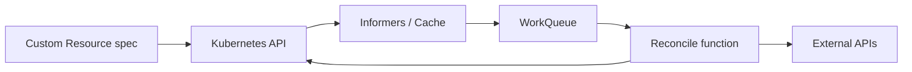

:::info Source status
The topic has been confirmed as part of the course. This lesson is an **editorial reconstruction**, not a verbatim transcript.
:::

# Lesson 08: Kubernetes Operator Internals & Controller Runtime

## Learning objectives

Master **CRDs, reconciliation, controller-runtime, finalizers, and conditions**, understand controller and ownership boundaries, and apply these concepts in a test cluster lab.


## 1. What is an operator?

An **operator** combines a Custom Resource Definition (CRD) with controller logic to automate domain-specific management workflows using the Kubernetes reconciliation model. For example, a `PostgresCluster` custom resource can describe replica counts, backups, and the database version. The operator manages the related Deployments, StatefulSets, Services, Secrets, and workflows.



## 2. CRD and CR: schema vs. instance

A CRD describes the API surface, validation, and semantics. A custom resource (CR) is an instance that expresses the desired state. For example, a `Tenant` CR is only useful if the platform has installed the corresponding CRD and a controller handles it.

```yaml
apiVersion: platform.example.com/v1alpha1
kind: Tenant
metadata:
  name: payment
spec:
  namespace: payments
  cpuQuota: "8"
  securityProfile: restricted
```

This is a **hypothetical API** for educational purposes, not a built-in resource.

## 3. Reconciliation is not a one-time procedural job

A reconcile function typically fetches the object from the API or cache, compares desired and observed state, and then creates, updates, or deletes child resources as needed. It must be **idempotent**: running it again with the same state must not cause new side effects.

```python
# Pseudocode, not production controller-runtime code
async def reconcile(tenant):
    ensure_namespace(tenant.spec.namespace)
    ensure_resource_quota(tenant)
    ensure_network_policy(tenant)
    update_status(tenant, "Ready")
```

In practice, you must handle errors, rate limits, retries, optimistic concurrency, API conflicts, owner references, and partial failures.

## 4. Watch / workqueue / rate limiting

A controller should not poll continuously. Kubernetes watches and informers push changes into the workqueue, and reconciling by key allows events to be coalesced. Retry with backoff when an external API fails. Reconciliation must converge under eventual consistency rather than assuming every API operation takes effect immediately.

## 5. Finalizers and safe cleanup

If a CR provisions an external cloud bucket, deleting the CR may require cleanup. A finalizer prevents the object from being fully deleted until the controller completes cleanup or decides to retain the resource. Do not rely on finalizers as an inviolable data protection mechanism. Administrators can still edit them, so use cloud deletion protection and backups as well.

```yaml
metadata:
  finalizers:
    - platform.example.com/cleanup
```

## 6. Status conditions and observedGeneration

```yaml
status:
  observedGeneration: 5
  conditions:
    - type: Ready
      status: "False"
      reason: WaitingForIAM
      message: "Cloud permissions not yet available"
```

`metadata.generation` changes when the spec changes. `observedGeneration` helps confirm whether the controller has processed the current generation. `Ready=True` is only meaningful if the reconciler checks the dependencies that must be ready.

## 7. Ownership & garbage collection

Use `ownerReferences` to associate Kubernetes child resources with their owners, but deleting external cloud resources requires separate logic. If two operators manage the same field on a child resource, Server-Side Apply (SSA) ownership conflicts or update loops can occur. Controllers need clear ownership boundaries.

## 8. Production quality checklist

- Structural CRD schemas and validation.
- API versioning and a migration strategy.
- Idempotent reconciliation and deterministic naming.
- Awareness of managed fields and SSA.
- Backoff, rate limiting, retries, and observability.
- Accurate status conditions and events.
- Finalizers, retention policies, disaster recovery.
- RBAC least privilege, admission restrictions.
- Unit/integration/envtest/e2e tests.

## 9. Lab

Design a `Tenant` CRD and write reconciliation logic that creates a Namespace, ResourceQuota, and NetworkPolicy in a `kind` cluster. Test what happens when a user manually edits the quota, when the API fails temporarily, and when the Tenant is deleted. Do not deploy a deletion finalizer to production until you have a backup and restore procedure.

**References:** [Operator Pattern](https://kubernetes.io/docs/concepts/extend-kubernetes/operator/) · [Kubebuilder Book](https://book.kubebuilder.io/) · [API Conventions](https://github.com/kubernetes/community/blob/master/contributors/devel/sig-architecture/api-conventions.md).

## Deep dive: reconciliation must be idempotent and safe to retry

Suppose you write a `Database` CRD:

```yaml
apiVersion: platform.example.com/v1alpha1
kind: Database
metadata:
  name: payment-db
  namespace: payments
spec:
  engine: postgres
  storageGiB: 100
```

A controller should not assume that `Reconcile()` runs only once. Informer events, cache resyncs, errors, and controller restarts can all cause the same key to be processed repeatedly. A good controller needs:

- **Idempotency:** The same desired state produces the same result without creating duplicate resources.
- **Convergence:** If the observed state differs from the desired state, the controller moves it toward the desired state.
- **Eventual consistency:** An external API may not reflect changes immediately. The controller needs to poll or requeue.
- **Retry-safe cleanup:** Cleanup triggered by a finalizer remains safe when run repeatedly.
- **Status transparency:** Conditions and `observedGeneration` tell users whether the controller has seen the latest spec.

### Reconciliation pseudocode

```python
async def reconcile(request):
    cr = await api.get_database(request.namespace, request.name)
    if cr is None:
        return

    if cr.metadata.deletion_timestamp:
        await ensure_external_db_deleted_or_retained(cr)
        await remove_finalizer_if_safe(cr)
        return

    await ensure_finalizer(cr)
    actual = await cloud.lookup_database(stable_external_id(cr))
    if actual is None:
        await cloud.create_database(stable_external_id(cr), cr.spec)
        return requeue_after(seconds=10)

    await cloud.update_if_drift(actual, cr.spec)
    await patch_status_ready_and_observed_generation(cr)
```

This is educational pseudocode. A production controller must handle concurrency control (`resourceVersion`), IAM, API retries with jitter, timeouts, and deletion races, and include test coverage.

### Finalizers and the risk of getting stuck

If the controller adds a finalizer before creating a cloud resource and then encounters a permanent IAM error during cleanup, the CR may remain in `Terminating` indefinitely. Operators need a runbook to determine whether the external resource has been deleted or transferred to another owner. Do not remove the finalizer simply to make the object disappear.

When using `ownerReferences`, remember that Kubernetes garbage collection manages Kubernetes objects. It does not know about an external Cloud SQL database; the controller must explicitly manage that resource's lifecycle.

### `status.conditions` and `observedGeneration`

```yaml
status:
  observedGeneration: 7
  conditions:
    - type: Ready
      status: "False"
      reason: ExternalPermissionDenied
      message: "Controller cannot create database in target project"
      observedGeneration: 7
```

If `metadata.generation=8` but `status.observedGeneration=7`, the controller may not have processed the new desired spec yet or may not have updated status. This is an important operational signal.

### API design is a product contract

A CRD is more than a YAML schema. Decide:

- Which fields are immutable, and which can be updated safely?
- Are defaults and validation rules compatible with older versions?
- Does deleting the CR delete the underlying database or leave it in a retained state?
- Does the API support `dryRun`, rollback, and importing existing resources?
- Who can create CRDs and cluster-scoped resources, and who can only create namespaced CRs?

### Three levels of operator testing

1. **Pure reconcile tests:** Given an input state, check the expected operations with a fake cloud client.
2. **API-level tests:** Use envtest or kind to test the CRD schema, validation, defaults, status updates, and finalizers.
3. **End-to-end tests:** Provision real resources in a sandbox and test network failures, IAM denials, deletion, and drift.

Sources: [Kubernetes Operator pattern](https://kubernetes.io/docs/concepts/extend-kubernetes/operator/), [Kubebuilder book](https://book.kubebuilder.io/), [Kubernetes finalizers](https://kubernetes.io/docs/concepts/overview/working-with-objects/finalizers/).

## Summary and connections

- Distinguish desired state from observed state and identify who owns each field or resource.
- A successful API operation does not mean the external system is ready to serve traffic.
- Verify IAM and RBAC, readiness, the data lifecycle, and recovery procedures before using these patterns in production.

[Back to the Learning Path](../learning-path.md)
