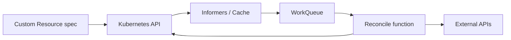

:::info Source status
The topic has been confirmed as part of the course. This lesson is an **editorial reconstruction**, not a verbatim transcript.
:::

# Lesson 08: Kubernetes Operator Internals & Controller Runtime

## Learning objectives

Master **CRDs, reconciliation, controller-runtime, finalizers, and conditions**, understand controller and ownership boundaries, and apply these concepts in a test cluster lab.


## 1. What is an operator?

An **operator** combines a Custom Resource Definition (CRD) with controller logic to automate domain-specific management workflows using the Kubernetes reconciliation model. For example, a `PostgresCluster` custom resource can describe replica counts, backups, and the database version. The operator manages the related Deployments, StatefulSets, Services, Secrets, and workflows.



## 2. CRD and CR: schema vs. instance

A CRD describes the API surface, validation, and semantics. A custom resource (CR) is an instance that expresses the desired state. For example, a `Tenant` CR is only useful if the platform has installed the corresponding CRD and a controller handles it.

```yaml
apiVersion: platform.example.com/v1alpha1
kind: Tenant
metadata:
  name: payment
spec:
  namespace: payments
  cpuQuota: "8"
  securityProfile: restricted
```

This is a **hypothetical API** for educational purposes, not a built-in resource.

### Follow a WebApp custom resource

| Component | Role in this example |
| --- | --- |
| CustomResourceDefinition | Registers `WebApp` and its schema with the API server. |
| Custom resource | A namespaced instance such as `payments/payment` containing the requested image, replicas, and port. |
| Custom controller | Reads the persisted WebApp, manages its Deployment and Service, and reports status. |
| Operator pattern | Combines the API and controller with lifecycle rules for operating the workload. |

```yaml
apiVersion: platform.example.com/v1alpha1
kind: WebApp
metadata:
  name: payment
  namespace: payments
spec:
  image: nginx:1.27
  replicas: 3
  port: 80
```

The API server can store this resource once the CRD is installed. Without a controller, no business logic turns it into a Deployment or Service. If the operator observes one requested Deployment replica while the WebApp declares three, it can update the Deployment. The Deployment controller then handles the rollout. Specifying an invalid image value or a negative replica count can be rejected by the CRD schema before storage. An admission webhook is useful for rules that require more context. Provisioning children belongs in reconciliation after the object is persisted. [Kubernetes Operator pattern](https://kubernetes.io/docs/concepts/extend-kubernetes/operator/) · [Admission control internals](./lesson-07-admission.md)

## 3. Reconciliation is not a one-time procedural job

A reconcile function typically fetches the object from the API or cache, compares desired and observed state, and then creates, updates, or deletes child resources as needed. It must be **idempotent**: running it again with the same state must not cause new side effects.

```python
# Pseudocode, not production controller-runtime code
async def reconcile(tenant):
    ensure_namespace(tenant.spec.namespace)
    ensure_resource_quota(tenant)
    ensure_network_policy(tenant)
    update_status(tenant, "Ready")
```

In practice, you must handle errors, rate limits, retries, optimistic concurrency, API conflicts, owner references, and partial failures.

## 4. Watch / workqueue / rate limiting

A controller should not poll continuously. Kubernetes watches and informers push changes into the workqueue, and reconciling by key allows events to be coalesced. Retry with backoff when an external API fails. Reconciliation must converge under eventual consistency rather than assuming every API operation takes effect immediately.

### Trace a watch event to a worker

An informer starts by populating its local view of WebApps through the Kubernetes API and then keeps it current through a watch. Suppose the watch delivers a modification to `payments/payment` with `spec.replicas: 5`. The cache records the new object, and a handler enqueues the namespaced key. A typical `reconcile.Request` carries `NamespacedName`, so the worker reads the current object when it processes the key.

Several updates to the same key can be coalesced. A change arriving while that key is being processed can queue another reconciliation. Separate keys can run concurrently when the controller is configured for it. The reconciler reads levels of state and does not depend on receiving every intermediate event. The default manager client generally reads its cached types through the cache and sends writes to the API server. A read immediately after a write can therefore be stale. Handle conflicts and `AlreadyExists` by reconciling again. Use a direct API reader when a decision specifically needs a fresh authoritative read. [controller-runtime cache](https://pkg.go.dev/sigs.k8s.io/controller-runtime/pkg/cache) · [Reconcile requests](https://pkg.go.dev/sigs.k8s.io/controller-runtime/pkg/reconcile)

### Separate retries from scheduled checks

| Return | Result |
| --- | --- |
| `ctrl.Result{}, nil` | Finishes this attempt. A subsequent watch event can still enqueue the same key. |
| `ctrl.Result{}, err` | An ordinary error requeues through the controller's rate limiter. The framework ignores the result when it receives an error. A terminal error is handled separately. |
| `ctrl.Result{RequeueAfter: 30 * time.Second}, nil` | Schedules another check after roughly thirty seconds, for example to wait for an external operation or observe cloud-side drift. |

Backoff on failures can spread retries, for example one, two, four, then eight seconds with a cap. Those are illustrative delays. The queue's configured rate limiter determines actual timing. An external resource can require a periodic check after successful reconciliation because its provider does not emit a Kubernetes watch event. Repeated execution should converge without issuing a write when the observed object already satisfies the intended fields. Use deterministic child names and preserve defaulted and unrelated fields. [Reconciler return semantics](https://pkg.go.dev/sigs.k8s.io/controller-runtime/pkg/reconcile#TypedReconciler)

## 5. Finalizers and safe cleanup

If a CR provisions an external cloud bucket, deleting the CR may require cleanup. A finalizer prevents the object from being fully deleted until the controller completes cleanup or decides to retain the resource. Do not rely on finalizers as an inviolable data protection mechanism. Administrators can still edit them, so use cloud deletion protection and backups as well.

```yaml
metadata:
  finalizers:
    - platform.example.com/cleanup
```

## 6. Status conditions and observedGeneration

```yaml
status:
  observedGeneration: 5
  conditions:
    - type: Ready
      status: "False"
      reason: WaitingForIAM
      message: "Cloud permissions not yet available"
```

`metadata.generation` changes when the spec changes. `observedGeneration` helps confirm whether the controller has processed the current generation. `Ready=True` is only meaningful if the reconciler checks the dependencies that must be ready.

### Read current generation and readiness separately

```yaml
metadata:
  generation: 3
status:
  observedGeneration: 3
  readyReplicas: 1
  conditions:
    - type: Ready
      status: "False"
      reason: ReplicasNotReady
      message: "Only 1 of 3 replicas is ready"
      observedGeneration: 3
      lastTransitionTime: "2026-11-22T08:00:00Z"
```

The controller has processed spec generation three and reports that the rollout is still progressing. If the spec reaches generation four first, the generation-three status is still useful history but does not describe the latest intent. Use the status subresource and update conditions only when the reported state changes. Choose conditions such as `Ready`, `Progressing`, or `Degraded` according to the API contract, with stable machine-readable reasons and explanatory messages. Argo CD custom health checks can interpret the conditions if configured. [Argo CD resource health](https://argo-cd.readthedocs.io/en/stable/operator-manual/health/)

## 7. Ownership & garbage collection

Use `ownerReferences` to associate Kubernetes child resources with their owners, but deleting external cloud resources requires separate logic. If two operators manage the same field on a child resource, Server-Side Apply (SSA) ownership conflicts or update loops can occur. Controllers need clear ownership boundaries.

### Associate dependents with the correct owner

```yaml
metadata:
  name: payment
  namespace: payments
  ownerReferences:
    - apiVersion: platform.example.com/v1alpha1
      kind: WebApp
      name: payment
      uid: 12345678-1234-1234-1234-123456789012
      controller: true
      blockOwnerDeletion: true
```

This is a Deployment metadata excerpt. The UID must come from the actual owner. A name reused after deletion produces a different UID. Namespaced dependents cannot point to a namespaced owner in a different namespace. The garbage collector follows owner references and the requested propagation mode. Background deletion can delete owned objects later, foreground deletion coordinates blocking dependents, and orphaning deliberately leaves dependents behind. This relationship is independent of SSA field ownership. [Kubernetes garbage collection](https://kubernetes.io/docs/concepts/architecture/garbage-collection/)

### Keep external cleanup retryable

If this operator also provisions a cloud bucket, define the retention or delete policy up front. A cloud bucket is outside Kubernetes garbage collection. Add a finalizer before provisioning if deletion must await cleanup.

```text
if the WebApp has no deletionTimestamp:
    persist the cleanup finalizer before provisioning external state
    reconcile resources normally
else if the cleanup finalizer is present:
    delete or retain the external resource according to policy
    treat "already absent" as success for idempotent deletion
    retry transient failures without clearing the finalizer
    remove the finalizer only after the policy is satisfied
```

The API server sets `deletionTimestamp` and retains an object while finalizers remain. During this phase, do not return to the normal provisioning branch. Use a stable external resource identifier so retries after process crashes can find what was created. Inspect provider state and retention before removing a stuck finalizer. The WebApp lab below relies on owner references for in-cluster children and has no external cleanup finalizer. [Kubernetes finalizers](https://kubernetes.io/docs/concepts/overview/working-with-objects/finalizers/)

## 8. Production quality checklist

- Structural CRD schemas and validation.
- API versioning and a migration strategy.
- Idempotent reconciliation and deterministic naming.
- Awareness of managed fields and SSA.
- Backoff, rate limiting, retries, and observability.
- Accurate status conditions and events.
- Finalizers, retention policies, disaster recovery.
- RBAC least privilege, admission restrictions.
- Unit/integration/envtest/e2e tests.

## 9. Lab

Design a `Tenant` CRD and write reconciliation logic that creates a Namespace, ResourceQuota, and NetworkPolicy in a `kind` cluster. Test what happens when a user manually edits the quota, when the API fails temporarily, and when the Tenant is deleted. Do not deploy a deletion finalizer to production until you have a backup and restore procedure.

### Scaffold and implement the WebApp operator

Use a disposable cluster, Go and a compatible Kubebuilder release. In a fresh directory run:

```bash
mkdir webapp-operator
cd webapp-operator
kubebuilder init --domain example.com --repo example.com/webapp-operator
kubebuilder create api --group platform --version v1alpha1 --kind WebApp --resource --controller
```

In the generated API package, replace the empty spec and status types with the types below and add the `metav1` import if needed. Keep the generated `WebApp`, `WebAppList`, scheme registration and the `+kubebuilder:subresource:status` marker on the root type. Restore that marker if your scaffold did not include it.

```go
type WebAppSpec struct {
	// +kubebuilder:validation:MinLength=1
	Image string `json:"image"`

	// +kubebuilder:validation:Minimum=0
	Replicas int32 `json:"replicas"`

	// +kubebuilder:validation:Minimum=1
	// +kubebuilder:validation:Maximum=65535
	Port int32 `json:"port"`
}

type WebAppStatus struct {
	ReadyReplicas      int32 `json:"readyReplicas,omitempty"`
	ObservedGeneration int64 `json:"observedGeneration,omitempty"`

	// +listType=map
	// +listMapKey=type
	Conditions []metav1.Condition `json:"conditions,omitempty"`
}
```

Replace the generated controller implementation in `internal/controller/webapp_controller.go` with the following. The operator manages a specific container's image, the Deployment replica count, and the Service selector and port. It keeps API-assigned fields such as Service `clusterIP` and leaves unrelated containers and labels in place. It does not adopt an existing same-name object without the expected controller owner reference. The lab assumes an application name suitable for a Service and a container that listens on the specified port.

```go
package controller

import (
	"context"
	"fmt"
	"reflect"

	platformv1alpha1 "example.com/webapp-operator/api/v1alpha1"
	appsv1 "k8s.io/api/apps/v1"
	corev1 "k8s.io/api/core/v1"
	"k8s.io/apimachinery/pkg/api/meta"
	metav1 "k8s.io/apimachinery/pkg/apis/meta/v1"
	"k8s.io/apimachinery/pkg/runtime"
	"k8s.io/apimachinery/pkg/util/intstr"
	ctrl "sigs.k8s.io/controller-runtime"
	"sigs.k8s.io/controller-runtime/pkg/client"
	"sigs.k8s.io/controller-runtime/pkg/controller/controllerutil"
)

const webAppUIDLabel = "platform.example.com/webapp-uid"

type WebAppReconciler struct {
	client.Client
	Scheme *runtime.Scheme
}

// +kubebuilder:rbac:groups=platform.example.com,resources=webapps,verbs=get;list;watch
// +kubebuilder:rbac:groups=platform.example.com,resources=webapps/status,verbs=get;update;patch
// +kubebuilder:rbac:groups=platform.example.com,resources=webapps/finalizers,verbs=update
// +kubebuilder:rbac:groups=apps,resources=deployments,verbs=get;list;watch;create;update
// +kubebuilder:rbac:groups="",resources=services,verbs=get;list;watch;create;update

func (r *WebAppReconciler) Reconcile(ctx context.Context, req ctrl.Request) (ctrl.Result, error) {
	var app platformv1alpha1.WebApp
	if err := r.Get(ctx, req.NamespacedName, &app); err != nil {
		return ctrl.Result{}, client.IgnoreNotFound(err)
	}
	if !app.DeletionTimestamp.IsZero() {
		return ctrl.Result{}, nil
	}

	selector := map[string]string{webAppUIDLabel: string(app.UID)}
	deployment := &appsv1.Deployment{ObjectMeta: metav1.ObjectMeta{
		Name: app.Name, Namespace: app.Namespace,
	}}
	if _, err := controllerutil.CreateOrUpdate(ctx, r.Client, deployment, func() error {
		if err := r.setOwner(&app, deployment); err != nil {
			return err
		}
		if deployment.ResourceVersion == "" {
			deployment.Spec.Selector = &metav1.LabelSelector{MatchLabels: selector}
		}
		replicas := app.Spec.Replicas
		deployment.Spec.Replicas = &replicas
		template := &deployment.Spec.Template
		if template.Labels == nil {
			template.Labels = make(map[string]string)
		}
		template.Labels[webAppUIDLabel] = string(app.UID)
		for index := range template.Spec.Containers {
			if template.Spec.Containers[index].Name == "app" {
				template.Spec.Containers[index].Image = app.Spec.Image
				return nil
			}
		}
		template.Spec.Containers = append(template.Spec.Containers, corev1.Container{
			Name: "app", Image: app.Spec.Image,
		})
		return nil
	}); err != nil {
		return ctrl.Result{}, err
	}

	service := &corev1.Service{ObjectMeta: metav1.ObjectMeta{
		Name: app.Name, Namespace: app.Namespace,
	}}
	if _, err := controllerutil.CreateOrUpdate(ctx, r.Client, service, func() error {
		if err := r.setOwner(&app, service); err != nil {
			return err
		}
		service.Spec.Selector = selector
		service.Spec.Ports = []corev1.ServicePort{{
			Name: "http", Protocol: corev1.ProtocolTCP, Port: app.Spec.Port,
			TargetPort: intstr.FromInt32(app.Spec.Port),
		}}
		return nil
	}); err != nil {
		return ctrl.Result{}, err
	}

	return ctrl.Result{}, r.reportStatus(ctx, &app, deployment)
}

func (r *WebAppReconciler) setOwner(app *platformv1alpha1.WebApp, child client.Object) error {
	if child.GetResourceVersion() != "" && !metav1.IsControlledBy(child, app) {
		return fmt.Errorf("refuse to adopt %T %s/%s", child, child.GetNamespace(), child.GetName())
	}
	return controllerutil.SetControllerReference(app, child, r.Scheme)
}

func (r *WebAppReconciler) reportStatus(
	ctx context.Context, app *platformv1alpha1.WebApp, deployment *appsv1.Deployment,
) error {
	before := app.DeepCopy()
	app.Status.ObservedGeneration = app.Generation
	app.Status.ReadyReplicas = deployment.Status.ReadyReplicas
	condition := metav1.Condition{
		Type: "Ready", Status: metav1.ConditionFalse,
		ObservedGeneration: app.Generation,
		Reason: "RolloutPending", Message: "Waiting for the Deployment rollout",
	}
	if deployment.Status.ObservedGeneration >= deployment.Generation &&
		deployment.Status.UpdatedReplicas == app.Spec.Replicas &&
		deployment.Status.Replicas == app.Spec.Replicas &&
		deployment.Status.AvailableReplicas == app.Spec.Replicas {
		condition.Status = metav1.ConditionTrue
		condition.Reason = "RolloutComplete"
		condition.Message = "The Deployment has the requested available replicas"
	}
	meta.SetStatusCondition(&app.Status.Conditions, condition)
	if reflect.DeepEqual(before.Status, app.Status) {
		return nil
	}
	patch := client.MergeFromWithOptions(before, client.MergeFromWithOptimisticLock{})
	return r.Status().Patch(ctx, app, patch)
}

func (r *WebAppReconciler) SetupWithManager(mgr ctrl.Manager) error {
	return ctrl.NewControllerManagedBy(mgr).
		For(&platformv1alpha1.WebApp{}).
		Owns(&appsv1.Deployment{}).
		Owns(&corev1.Service{}).
		Complete(r)
}
```

`CreateOrUpdate` fetches the child, runs the mutation function, and creates or updates only when needed. Preserve defaulted fields to avoid a repeated update caused by the API server restoring those defaults. The Deployment selector is immutable after creation, so the example sets it only on create. The status patch uses optimistic locking so an older observation cannot overwrite a newer concurrent write silently. The `webapps/finalizers` RBAC marker supports setting owner references with `blockOwnerDeletion`. The controller does not add a cleanup finalizer of its own.

`.For()` watches the primary resource. Each `.Owns()` watches a child type and maps events back to the controller owner. `SetControllerReference()` records that owner when the child is written. A Deployment scale change can therefore enqueue the WebApp without requiring a change to the WebApp spec. Deployment status changes also trigger another check. If you later add filters, ensure they still admit child status events needed to report readiness. [Kubebuilder getting started](https://book.kubebuilder.io/getting-started) · [controller-runtime controller utilities](https://pkg.go.dev/sigs.k8s.io/controller-runtime/pkg/controller/controllerutil)

### Run the controller and exercise drift

```bash
make generate
make manifests
make install
make run
```

The last command runs the manager locally against the active context. In a second terminal, create the `payments` namespace if needed, save the WebApp manifest from this lesson as `webapp.yaml`, and apply it.

```bash
kubectl apply -f webapp.yaml
kubectl -n payments get webapp payment -o yaml
kubectl -n payments get deployment,service
kubectl -n payments rollout status deployment/payment
kubectl -n payments scale deployment payment --replicas=10
kubectl -n payments get deployment payment -w
```

The Deployment and Service should appear, and a direct scale to ten should be corrected to the WebApp's three replicas. Edit the WebApp to request five replicas and verify the Deployment spec, generation, and Ready condition independently. Remove only the disposable WebApp when finished and inspect its children to verify garbage collection. The local manager uses kubeconfig credentials. A deployed manager needs the generated scoped RBAC and access to the selected namespaces.

Use `envtest` for API interactions, status subresources, idempotency, drift, and failed writes. Its API server and etcd do not run the Deployment controller or garbage collector. Supply realistic status in integration tests, and use a full cluster for rollout and garbage-collection checks. Try the [interactive WebApp reconciliation exercise](../03-gitops-delivery/gitops-exercises.mdx#reconcile-a-webapp) first. [Kubebuilder envtest](https://book.kubebuilder.io/reference/envtest)

**References:** [Operator Pattern](https://kubernetes.io/docs/concepts/extend-kubernetes/operator/) · [Kubebuilder Book](https://book.kubebuilder.io/) · [API Conventions](https://github.com/kubernetes/community/blob/master/contributors/devel/sig-architecture/api-conventions.md).

## Deep dive: reconciliation must be idempotent and safe to retry

Suppose you write a `Database` CRD:

```yaml
apiVersion: platform.example.com/v1alpha1
kind: Database
metadata:
  name: payment-db
  namespace: payments
spec:
  engine: postgres
  storageGiB: 100
```

A controller should not assume that `Reconcile()` runs only once. Informer events, cache resyncs, errors, and controller restarts can all cause the same key to be processed repeatedly. A good controller needs:

- **Idempotency:** The same desired state produces the same result without creating duplicate resources.
- **Convergence:** If the observed state differs from the desired state, the controller moves it toward the desired state.
- **Eventual consistency:** An external API may not reflect changes immediately. The controller needs to poll or requeue.
- **Retry-safe cleanup:** Cleanup triggered by a finalizer remains safe when run repeatedly.
- **Status transparency:** Conditions and `observedGeneration` tell users whether the controller has seen the latest spec.

### Reconciliation pseudocode

```python
async def reconcile(request):
    cr = await api.get_database(request.namespace, request.name)
    if cr is None:
        return

    if cr.metadata.deletion_timestamp:
        await ensure_external_db_deleted_or_retained(cr)
        await remove_finalizer_if_safe(cr)
        return

    await ensure_finalizer(cr)
    actual = await cloud.lookup_database(stable_external_id(cr))
    if actual is None:
        await cloud.create_database(stable_external_id(cr), cr.spec)
        return requeue_after(seconds=10)

    await cloud.update_if_drift(actual, cr.spec)
    await patch_status_ready_and_observed_generation(cr)
```

This is educational pseudocode. A production controller must handle concurrency control (`resourceVersion`), IAM, API retries with jitter, timeouts, and deletion races, and include test coverage.

### Finalizers and the risk of getting stuck

If the controller adds a finalizer before creating a cloud resource and then encounters a permanent IAM error during cleanup, the CR may remain in `Terminating` indefinitely. Operators need a runbook to determine whether the external resource has been deleted or transferred to another owner. Do not remove the finalizer simply to make the object disappear.

When using `ownerReferences`, remember that Kubernetes garbage collection manages Kubernetes objects. It does not know about an external Cloud SQL database; the controller must explicitly manage that resource's lifecycle.

### `status.conditions` and `observedGeneration`

```yaml
status:
  observedGeneration: 7
  conditions:
    - type: Ready
      status: "False"
      reason: ExternalPermissionDenied
      message: "Controller cannot create database in target project"
      observedGeneration: 7
```

If `metadata.generation=8` but `status.observedGeneration=7`, the controller may not have processed the new desired spec yet or may not have updated status. This is an important operational signal.

### API design is a product contract

A CRD is more than a YAML schema. Decide:

- Which fields are immutable, and which can be updated safely?
- Are defaults and validation rules compatible with older versions?
- Does deleting the CR delete the underlying database or leave it in a retained state?
- Does the API support `dryRun`, rollback, and importing existing resources?
- Who can create CRDs and cluster-scoped resources, and who can only create namespaced CRs?

### Three levels of operator testing

1. **Pure reconcile tests:** Given an input state, check the expected operations with a fake cloud client.
2. **API-level tests:** Use envtest or kind to test the CRD schema, validation, defaults, status updates, and finalizers.
3. **End-to-end tests:** Provision real resources in a sandbox and test network failures, IAM denials, deletion, and drift.

Sources: [Kubernetes Operator pattern](https://kubernetes.io/docs/concepts/extend-kubernetes/operator/), [Kubebuilder book](https://book.kubebuilder.io/), [Kubernetes finalizers](https://kubernetes.io/docs/concepts/overview/working-with-objects/finalizers/).

### Compare the controllers by their declared inputs and managed targets

| Controller | Primary declaration | Reconciled target |
| --- | --- | --- |
| Argo CD Application controller | `Application` | Kubernetes manifests and live resources |
| ApplicationSet controller | `ApplicationSet` | Generated Application CRs |
| Config Connector | A cloud resource CR such as `StorageBucket` | A Google Cloud resource |
| External Secrets Operator | `ExternalSecret` | A Kubernetes Secret populated from a provider |
| WebApp reconciler | `WebApp` | A Deployment and Service |

These tools use similar observe, compare, act, and report loops. Their code, controller frameworks, retry schedules, and readiness contracts can differ.

## Summary and connections

- Distinguish desired state from observed state and identify who owns each field or resource.
- A successful API operation does not mean the external system is ready to serve traffic.
- Verify IAM and RBAC, readiness, the data lifecycle, and recovery procedures before using these patterns in production.

Use the [operator quiz](../03-gitops-delivery/gitops-exercises.mdx#check-your-operator-understanding) to check controller and lifecycle behavior. Continue with [Infrastructure GitOps and Platform Bootstrap](../03-gitops-delivery/lesson-09-gitops-bootstrap.md) for controller installation order, ownership, and teardown.

[Back to the Learning Path](../learning-path.md)
