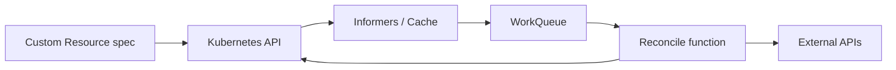

# Bài 08: Cấu trúc bên trong Kubernetes Operator & Controller Runtime

## Mục tiêu học tập

- **Thiết kế CRD và custom resource như một giao ước API:** Tách biệt định nghĩa schema (`CustomResourceDefinition`) với thực thể trạng thái mong muốn (CR), xác định rõ quy tắc kiểm tra hợp lệ, trường bất biến, phiên bản hóa và status subresource.
- **Hiểu đường ống sự kiện của controller-runtime:** Lần theo cách informer, cache cục bộ, workqueue và rate limiter gộp các sự kiện watch để vận hành vòng lặp reconciliation hướng trạng thái (level-triggered) và lũy đẳng.
- **Triển khai dọn dẹp an toàn với `ownerReferences` và finalizer:** Sử dụng Kubernetes garbage collection cho tài nguyên con trong cluster và finalizer an toàn khi thử lại cho tài nguyên cloud bên ngoài mà không gây kẹt ở trạng thái `Terminating`.
- **Báo cáo tiến trình chính xác qua `status.conditions` và `observedGeneration`:** Phản ánh minh bạch mức độ hội tụ, trạng thái sẵn sàng và lỗi của controller bằng khóa lạc quan (optimistic locking) và chuẩn ngữ nghĩa condition.
- **Xây dựng và kiểm thử một Operator hoàn chỉnh:** Khởi tạo khung `WebApp` controller bằng Kubebuilder, đối soát `Deployment` và `Service` con trước drift, đồng thời kiểm thử qua ba cấp độ unit, `envtest` và cluster thực tế.

## 1. Operator là gì?

Một **Operator** kết hợp Custom Resource Definition (CRD) với logic của controller để tự động hóa các quy trình quản trị đặc thù theo nghiệp vụ dựa trên mô hình reconciliation của Kubernetes. Ví dụ, một custom resource `PostgresCluster` có thể mô tả số lượng replica, bản sao lưu và phiên bản cơ sở dữ liệu. Operator sẽ quản lý các `Deployment`, `StatefulSet`, `Service`, `Secret` và các quy trình liên quan.



## 2. CRD và CR: schema so với thực thể (instance)

CRD mô tả bề mặt API, quy tắc kiểm tra hợp lệ và ngữ nghĩa. Custom resource (CR) là một thực thể diễn đạt trạng thái mong muốn. Ví dụ, một CR `Tenant` chỉ có ích nếu nền tảng đã cài đặt CRD tương ứng và có một controller xử lý nó.

```yaml
apiVersion: platform.example.com/v1alpha1
kind: Tenant
metadata:
  name: payment
spec:
  namespace: payments
  cpuQuota: "8"
  securityProfile: restricted
```

Đây là một **API giả định** phục vụ mục đích học tập, không phải tài nguyên tích hợp sẵn.

### Theo dõi một custom resource WebApp

| Thành phần | Vai trò trong ví dụ này |
| --- | --- |
| CustomResourceDefinition | Đăng ký `WebApp` và schema của nó với API server. |
| Custom resource | Một thực thể theo namespace như `payments/payment` chứa image, số replica và cổng được yêu cầu. |
| Custom controller | Đọc `WebApp` đã lưu, quản lý `Deployment` và `Service` của nó, đồng thời báo cáo status. |
| Mẫu thiết kế Operator | Kết hợp API và controller với các quy tắc vòng đời để vận hành workload. |

```yaml
apiVersion: platform.example.com/v1alpha1
kind: WebApp
metadata:
  name: payment
  namespace: payments
spec:
  image: nginx:1.27
  replicas: 3
  port: 80
```

API server có thể lưu trữ tài nguyên này ngay khi CRD được cài đặt. Nếu không có controller, sẽ không có logic nghiệp vụ nào biến nó thành `Deployment` hay `Service`. Nếu Operator quan sát thấy `Deployment` đang yêu cầu 1 replica trong khi `WebApp` khai báo 3, nó có thể cập nhật `Deployment`. Sau đó Deployment controller sẽ lo quá trình rollout. Việc khai báo giá trị image không hợp lệ hoặc số replica âm có thể bị schema của CRD từ chối trước khi lưu. Admission webhook hữu ích cho các quy tắc cần thêm ngữ cảnh. Việc cấp phát các tài nguyên con thuộc về quá trình reconciliation sau khi đối tượng đã được lưu. [Mẫu thiết kế Kubernetes Operator](https://kubernetes.io/docs/concepts/extend-kubernetes/operator/) · [Cấu trúc bên trong kiểm soát admission](./lesson-07-admission.md)

## 3. Reconciliation không phải là một tác vụ thủ tục chạy một lần

Một hàm reconcile thường lấy đối tượng từ API hoặc cache, so sánh trạng thái mong muốn với trạng thái quan sát được, rồi tạo, cập nhật hoặc xóa các tài nguyên con khi cần. Nó phải có tính **lũy đẳng (idempotent)**: chạy lại với cùng một trạng thái không được gây ra tác dụng phụ mới.

```python
# Pseudocode, not production controller-runtime code
async def reconcile(tenant):
    ensure_namespace(tenant.spec.namespace)
    ensure_resource_quota(tenant)
    ensure_network_policy(tenant)
    update_status(tenant, "Ready")
```

Trong thực tế, bạn phải xử lý lỗi, giới hạn tốc độ (rate limit), thử lại (retry), điều khiển đồng thời lạc quan (optimistic concurrency), xung đột API, `OwnerReference` và các lỗi cục bộ.

## 4. Watch / workqueue / rate limiting

Một controller không nên thăm dò (poll) liên tục. Cơ chế watch và informer của Kubernetes đẩy các thay đổi vào workqueue, và việc reconcile theo khóa (key) cho phép gộp nhiều sự kiện trùng lặp. Hãy thử lại có backoff khi API bên ngoài gặp lỗi. Quá trình reconciliation phải hội tụ theo tính nhất quán sau cùng (eventual consistency) thay vì giả định mọi thao tác API đều có hiệu lực ngay lập tức.

### Lần theo một sự kiện watch tới worker

Một informer bắt đầu bằng cách nạp góc nhìn cục bộ về các `WebApp` qua Kubernetes API rồi duy trì cập nhật thông qua watch. Giả sử watch gửi đến một thay đổi cho `payments/payment` với `spec.replicas: 5`. Cache ghi nhận đối tượng mới và một handler đưa khóa theo namespace vào hàng đợi. Một `reconcile.Request` điển hình mang `NamespacedName`, nên worker sẽ đọc đối tượng hiện tại khi xử lý khóa đó.

Nhiều cập nhật trên cùng một khóa có thể được gộp lại (coalesced). Một thay đổi đến trong lúc khóa đó đang được xử lý có thể xếp thêm một lần reconcile nữa vào hàng đợi. Các khóa khác nhau có thể chạy đồng thời khi controller được cấu hình cho phép. Reconciler đọc trạng thái hiện tại (level-triggered) và không phụ thuộc vào việc nhận đủ mọi sự kiện trung gian. Client mặc định của manager thường đọc các kiểu có cache thông qua cache và gửi thao tác ghi tới API server. Vì vậy, một lần đọc ngay sau lần ghi có thể bị cũ (stale). Hãy xử lý xung đột và lỗi `AlreadyExists` bằng cách reconcile lại. Dùng API reader trực tiếp khi một quyết định đặc biệt cần dữ liệu mới nhất có thẩm quyền. [Cache trong controller-runtime](https://pkg.go.dev/sigs.k8s.io/controller-runtime/pkg/cache) · [Reconcile requests](https://pkg.go.dev/sigs.k8s.io/controller-runtime/pkg/reconcile)

### Tách biệt retry với kiểm tra định kỳ

| Giá trị trả về | Kết quả |
| --- | --- |
| `ctrl.Result{}, nil` | Kết thúc lần chạy này. Một sự kiện watch tiếp theo vẫn có thể đưa cùng khóa đó vào hàng đợi. |
| `ctrl.Result{}, err` | Một lỗi thông thường sẽ đưa khóa trở lại hàng đợi qua rate limiter của controller. Framework bỏ qua `Result` khi nhận được lỗi. Lỗi kết thúc (terminal error) được xử lý riêng. |
| `ctrl.Result{RequeueAfter: 30 * time.Second}, nil` | Lên lịch kiểm tra lại sau khoảng 30 giây, ví dụ để chờ một thao tác bên ngoài hoặc quan sát drift phía cloud. |

Backoff khi gặp lỗi có thể giãn cách các lần thử lại, ví dụ 1, 2, 4 rồi 8 giây với một mức trần. Đó là các khoảng trễ minh họa. Rate limiter cấu hình cho hàng đợi mới quyết định thời gian thực tế. Một tài nguyên bên ngoài có thể cần kiểm tra định kỳ sau khi reconcile thành công vì provider của nó không phát ra sự kiện watch của Kubernetes. Việc thực thi lặp lại cần hội tụ mà không phát sinh thao tác ghi khi đối tượng quan sát được đã thỏa mãn các trường mong muốn. Hãy dùng tên tài nguyên con mang tính xác định và giữ nguyên các trường mặc định cũng như các trường không liên quan. [Ngữ nghĩa trả về của Reconciler](https://pkg.go.dev/sigs.k8s.io/controller-runtime/pkg/reconcile#TypedReconciler)

## 5. Finalizer và dọn dẹp an toàn

Nếu một CR cấp phát một cloud bucket bên ngoài, việc xóa CR có thể đòi hỏi bước dọn dẹp. Một `Finalizer` ngăn đối tượng bị xóa hoàn toàn cho đến khi controller hoàn tất dọn dẹp hoặc quyết định giữ lại tài nguyên. Không nên coi `Finalizer` là cơ chế bảo vệ dữ liệu bất khả xâm phạm. Quản trị viên vẫn có thể chỉnh sửa chúng, vì vậy hãy kết hợp thêm cơ chế chống xóa trên cloud và sao lưu.

```yaml
metadata:
  finalizers:
    - platform.example.com/cleanup
```

## 6. Status condition và observedGeneration

```yaml
status:
  observedGeneration: 5
  conditions:
    - type: Ready
      status: "False"
      reason: WaitingForIAM
      message: "Cloud permissions not yet available"
```

`metadata.generation` thay đổi khi `spec` thay đổi. `observedGeneration` giúp xác nhận controller đã xử lý thế hệ (generation) hiện tại hay chưa. `Ready=True` chỉ có ý nghĩa nếu reconciler thực sự kiểm tra các thành phần phụ thuộc cần phải sẵn sàng.

### Đọc generation hiện tại và trạng thái sẵn sàng tách biệt

```yaml
metadata:
  generation: 3
status:
  observedGeneration: 3
  readyReplicas: 1
  conditions:
    - type: Ready
      status: "False"
      reason: ReplicasNotReady
      message: "Only 1 of 3 replicas is ready"
      observedGeneration: 3
      lastTransitionTime: "2026-11-22T08:00:00Z"
```

Controller đã xử lý `spec` thế hệ 3 và báo cáo rằng quá trình rollout vẫn đang diễn ra. Nếu `spec` tăng lên thế hệ 4 trước, trạng thái của thế hệ 3 vẫn là lịch sử hữu ích nhưng không mô tả ý định mới nhất. Hãy dùng status subresource và chỉ cập nhật condition khi trạng thái báo cáo thực sự thay đổi. Chọn các condition như `Ready`, `Progressing` hoặc `Degraded` theo giao ước API, với `reason` ổn định cho máy đọc và `message` giải thích rõ ràng. Custom health check của Argo CD có thể diễn giải các condition này nếu được cấu hình. [Sức khỏe tài nguyên trong Argo CD](https://argo-cd.readthedocs.io/en/stable/operator-manual/health/)

## 7. Quyền sở hữu & garbage collection

Dùng `ownerReferences` để gắn kết các tài nguyên con trong Kubernetes với chủ sở hữu của chúng, nhưng việc xóa tài nguyên cloud bên ngoài cần logic riêng. Nếu hai Operator cùng quản lý một trường trên cùng một tài nguyên con, xung đột quyền sở hữu Server-Side Apply (SSA) hoặc vòng lặp cập nhật có thể xảy ra. Các controller cần ranh giới sở hữu rõ ràng.

### Gắn các đối tượng phụ thuộc với đúng chủ sở hữu

```yaml
metadata:
  name: payment
  namespace: payments
  ownerReferences:
    - apiVersion: platform.example.com/v1alpha1
      kind: WebApp
      name: payment
      uid: 12345678-1234-1234-1234-123456789012
      controller: true
      blockOwnerDeletion: true
```

Đây là trích đoạn metadata của một `Deployment`. `uid` phải đến từ chủ sở hữu thực tế. Một tên được dùng lại sau khi xóa sẽ có `uid` khác. Các đối tượng phụ thuộc theo namespace không thể trỏ tới chủ sở hữu theo namespace ở một namespace khác. Bộ thu gom rác (garbage collector) đi theo `ownerReferences` và chế độ lan truyền (propagation mode) được yêu cầu. Xóa nền (background deletion) có thể xóa các đối tượng con sau, xóa tiền cảnh (foreground deletion) điều phối các đối tượng phụ thuộc đang chặn, còn orphan cố ý giữ lại các đối tượng phụ thuộc. Quan hệ này độc lập với quyền sở hữu trường (field ownership) của SSA. [Kubernetes garbage collection](https://kubernetes.io/docs/concepts/architecture/garbage-collection/)

### Giữ cho bước dọn dẹp bên ngoài có thể thử lại được

Nếu Operator này cũng cấp phát một cloud bucket, hãy xác định trước chính sách giữ lại (retention) hay xóa (delete). Cloud bucket nằm ngoài phạm vi garbage collection của Kubernetes. Hãy thêm `Finalizer` trước khi cấp phát nếu thao tác xóa phải chờ dọn dẹp.

```text
if the WebApp has no deletionTimestamp:
    persist the cleanup finalizer before provisioning external state
    reconcile resources normally
else if the cleanup finalizer is present:
    delete or retain the external resource according to policy
    treat "already absent" as success for idempotent deletion
    retry transient failures without clearing the finalizer
    remove the finalizer only after the policy is satisfied
```

API server đặt `deletionTimestamp` và giữ lại đối tượng chừng nào vẫn còn `Finalizer`. Trong giai đoạn này, không quay lại nhánh cấp phát thông thường. Hãy dùng một định danh tài nguyên bên ngoài ổn định để các lần thử lại sau khi tiến trình bị sập vẫn tìm thấy thứ đã tạo. Kiểm tra trạng thái trên provider và chính sách lưu giữ trước khi gỡ một `Finalizer` bị kẹt. Bài lab `WebApp` dưới đây dựa vào `OwnerReference` cho các tài nguyên con trong cluster và không có `Finalizer` dọn dẹp bên ngoài. [Kubernetes finalizers](https://kubernetes.io/docs/concepts/overview/working-with-objects/finalizers/)

## 8. Danh sách kiểm tra chất lượng production

- Schema CRD có cấu trúc và quy tắc kiểm tra hợp lệ.
- Chiến lược đánh phiên bản API và di chuyển (migration).
- Reconciliation lũy đẳng và đặt tên mang tính xác định.
- Hiểu rõ managed fields và SSA.
- Backoff, rate limiting, retry và khả năng quan sát (observability).
- Status condition và sự kiện chính xác.
- Finalizer, chính sách lưu giữ, khôi phục sau thảm họa.
- RBAC tối thiểu quyền hạn (least privilege), giới hạn admission.
- Kiểm thử unit / integration / envtest / e2e.

## 9. Lab

Thiết kế một CRD `Tenant` và viết logic reconciliation tạo `Namespace`, `ResourceQuota` và `NetworkPolicy` trên một cluster `kind`. Kiểm thử điều gì xảy ra khi người dùng chỉnh sửa quota thủ công, khi API tạm thời lỗi và khi `Tenant` bị xóa. Không triển khai deletion finalizer lên production cho đến khi bạn có quy trình sao lưu và khôi phục.

### Khởi tạo khung và triển khai WebApp operator

Dùng một cluster dùng một lần, Go và phiên bản Kubebuilder tương thích. Trong một thư mục mới, chạy:

```bash
mkdir webapp-operator
cd webapp-operator
kubebuilder init --domain example.com --repo example.com/webapp-operator
kubebuilder create api --group platform --version v1alpha1 --kind WebApp --resource --controller
```

Trong package API được sinh ra, thay thế các kiểu spec và status rỗng bằng các kiểu dưới đây và thêm import `metav1` nếu cần. Giữ nguyên `WebApp`, `WebAppList`, phần đăng ký scheme và marker `+kubebuilder:subresource:status` trên kiểu gốc. Khôi phục marker đó nếu khung sinh ra chưa có.

```go
type WebAppSpec struct {
	// +kubebuilder:validation:MinLength=1
	Image string `json:"image"`

	// +kubebuilder:validation:Minimum=0
	Replicas int32 `json:"replicas"`

	// +kubebuilder:validation:Minimum=1
	// +kubebuilder:validation:Maximum=65535
	Port int32 `json:"port"`
}

type WebAppStatus struct {
	ReadyReplicas      int32 `json:"readyReplicas,omitempty"`
	ObservedGeneration int64 `json:"observedGeneration,omitempty"`

	// +listType=map
	// +listMapKey=type
	Conditions []metav1.Condition `json:"conditions,omitempty"`
}
```

Thay thế phần cài đặt controller được sinh ra trong `internal/controller/webapp_controller.go` bằng đoạn mã sau. Operator quản lý image của một container cụ thể, số lượng replica của `Deployment`, cùng selector và cổng của `Service`. Nó giữ nguyên các trường do API cấp như `clusterIP` của `Service` và để yên các container cũng như nhãn không liên quan. Nó không nhận nuôi (adopt) một đối tượng cùng tên đã tồn tại nếu không có controller `OwnerReference` mong đợi. Bài lab giả định tên ứng dụng phù hợp để đặt cho `Service` và container lắng nghe trên cổng được chỉ định.

```go
package controller

import (
	"context"
	"fmt"
	"reflect"

	platformv1alpha1 "example.com/webapp-operator/api/v1alpha1"
	appsv1 "k8s.io/api/apps/v1"
	corev1 "k8s.io/api/core/v1"
	"k8s.io/apimachinery/pkg/api/meta"
	metav1 "k8s.io/apimachinery/pkg/apis/meta/v1"
	"k8s.io/apimachinery/pkg/runtime"
	"k8s.io/apimachinery/pkg/util/intstr"
	ctrl "sigs.k8s.io/controller-runtime"
	"sigs.k8s.io/controller-runtime/pkg/client"
	"sigs.k8s.io/controller-runtime/pkg/controller/controllerutil"
)

const webAppUIDLabel = "platform.example.com/webapp-uid"

type WebAppReconciler struct {
	client.Client
	Scheme *runtime.Scheme
}

// +kubebuilder:rbac:groups=platform.example.com,resources=webapps,verbs=get;list;watch
// +kubebuilder:rbac:groups=platform.example.com,resources=webapps/status,verbs=get;update;patch
// +kubebuilder:rbac:groups=platform.example.com,resources=webapps/finalizers,verbs=update
// +kubebuilder:rbac:groups=apps,resources=deployments,verbs=get;list;watch;create;update
// +kubebuilder:rbac:groups="",resources=services,verbs=get;list;watch;create;update

func (r *WebAppReconciler) Reconcile(ctx context.Context, req ctrl.Request) (ctrl.Result, error) {
	var app platformv1alpha1.WebApp
	if err := r.Get(ctx, req.NamespacedName, &app); err != nil {
		return ctrl.Result{}, client.IgnoreNotFound(err)
	}
	if !app.DeletionTimestamp.IsZero() {
		return ctrl.Result{}, nil
	}

	selector := map[string]string{webAppUIDLabel: string(app.UID)}
	deployment := &appsv1.Deployment{ObjectMeta: metav1.ObjectMeta{
		Name: app.Name, Namespace: app.Namespace,
	}}
	if _, err := controllerutil.CreateOrUpdate(ctx, r.Client, deployment, func() error {
		if err := r.setOwner(&app, deployment); err != nil {
			return err
		}
		if deployment.ResourceVersion == "" {
			deployment.Spec.Selector = &metav1.LabelSelector{MatchLabels: selector}
		}
		replicas := app.Spec.Replicas
		deployment.Spec.Replicas = &replicas
		template := &deployment.Spec.Template
		if template.Labels == nil {
			template.Labels = make(map[string]string)
		}
		template.Labels[webAppUIDLabel] = string(app.UID)
		for index := range template.Spec.Containers {
			if template.Spec.Containers[index].Name == "app" {
				template.Spec.Containers[index].Image = app.Spec.Image
				return nil
			}
		}
		template.Spec.Containers = append(template.Spec.Containers, corev1.Container{
			Name: "app", Image: app.Spec.Image,
		})
		return nil
	}); err != nil {
		return ctrl.Result{}, err
	}

	service := &corev1.Service{ObjectMeta: metav1.ObjectMeta{
		Name: app.Name, Namespace: app.Namespace,
	}}
	if _, err := controllerutil.CreateOrUpdate(ctx, r.Client, service, func() error {
		if err := r.setOwner(&app, service); err != nil {
			return err
		}
		service.Spec.Selector = selector
		service.Spec.Ports = []corev1.ServicePort{{
			Name: "http", Protocol: corev1.ProtocolTCP, Port: app.Spec.Port,
			TargetPort: intstr.FromInt32(app.Spec.Port),
		}}
		return nil
	}); err != nil {
		return ctrl.Result{}, err
	}

	return ctrl.Result{}, r.reportStatus(ctx, &app, deployment)
}

func (r *WebAppReconciler) setOwner(app *platformv1alpha1.WebApp, child client.Object) error {
	if child.GetResourceVersion() != "" && !metav1.IsControlledBy(child, app) {
		return fmt.Errorf("refuse to adopt %T %s/%s", child, child.GetNamespace(), child.GetName())
	}
	return controllerutil.SetControllerReference(app, child, r.Scheme)
}

func (r *WebAppReconciler) reportStatus(
	ctx context.Context, app *platformv1alpha1.WebApp, deployment *appsv1.Deployment,
) error {
	before := app.DeepCopy()
	app.Status.ObservedGeneration = app.Generation
	app.Status.ReadyReplicas = deployment.Status.ReadyReplicas
	condition := metav1.Condition{
		Type: "Ready", Status: metav1.ConditionFalse,
		ObservedGeneration: app.Generation,
		Reason: "RolloutPending", Message: "Waiting for the Deployment rollout",
	}
	if deployment.Status.ObservedGeneration >= deployment.Generation &&
		deployment.Status.UpdatedReplicas == app.Spec.Replicas &&
		deployment.Status.Replicas == app.Spec.Replicas &&
		deployment.Status.AvailableReplicas == app.Spec.Replicas {
		condition.Status = metav1.ConditionTrue
		condition.Reason = "RolloutComplete"
		condition.Message = "The Deployment has the requested available replicas"
	}
	meta.SetStatusCondition(&app.Status.Conditions, condition)
	if reflect.DeepEqual(before.Status, app.Status) {
		return nil
	}
	patch := client.MergeFromWithOptions(before, client.MergeFromWithOptimisticLock{})
	return r.Status().Patch(ctx, app, patch)
}

func (r *WebAppReconciler) SetupWithManager(mgr ctrl.Manager) error {
	return ctrl.NewControllerManagedBy(mgr).
		For(&platformv1alpha1.WebApp{}).
		Owns(&appsv1.Deployment{}).
		Owns(&corev1.Service{}).
		Complete(r)
}
```

`CreateOrUpdate` lấy đối tượng con, chạy hàm biến đổi và chỉ tạo hoặc cập nhật khi cần. Hãy giữ nguyên các trường mặc định để tránh vòng lặp cập nhật liên tục do API server khôi phục lại các giá trị mặc định đó. Selector của `Deployment` là bất biến sau khi tạo, nên ví dụ chỉ đặt nó lúc tạo mới. Bản vá status dùng khóa lạc quan (optimistic locking) để một quan sát cũ hơn không thể âm thầm ghi đè một thao tác ghi đồng thời mới hơn. Marker RBAC `webapps/finalizers` hỗ trợ thiết lập `OwnerReference` với `blockOwnerDeletion`. Bản thân controller không thêm `Finalizer` dọn dẹp nào.

`.For()` theo dõi tài nguyên chính. Mỗi `.Owns()` theo dõi một loại tài nguyên con và ánh xạ các sự kiện ngược về chủ sở hữu controller. `SetControllerReference()` ghi lại chủ sở hữu đó khi tài nguyên con được ghi. Do đó, một thay đổi scale trên `Deployment` có thể đưa `WebApp` vào hàng đợi mà không cần sửa `spec` của `WebApp`. Thay đổi status của `Deployment` cũng kích hoạt một lần kiểm tra mới. Nếu sau này bạn thêm bộ lọc (predicate), hãy đảm bảo chúng vẫn cho phép các sự kiện status của tài nguyên con đi qua để báo cáo trạng thái sẵn sàng. [Bắt đầu với Kubebuilder](https://book.kubebuilder.io/getting-started) · [Tiện ích controller trong controller-runtime](https://pkg.go.dev/sigs.k8s.io/controller-runtime/pkg/controller/controllerutil)

### Chạy controller và kiểm thử drift

```bash
make generate
make manifests
make install
make run
```

Lệnh cuối chạy manager cục bộ với context đang kích hoạt. Trong một cửa sổ terminal thứ hai, tạo namespace `payments` nếu chưa có, lưu manifest `WebApp` từ bài học này thành `webapp.yaml` rồi áp dụng nó.

```bash
kubectl apply -f webapp.yaml
kubectl -n payments get webapp payment -o yaml
kubectl -n payments get deployment,service
kubectl -n payments rollout status deployment/payment
kubectl -n payments scale deployment payment --replicas=10
kubectl -n payments get deployment payment -w
```

`Deployment` và `Service` sẽ xuất hiện, và thao tác scale trực tiếp lên 10 sẽ được đưa trở lại 3 replica như `WebApp` khai báo. Chỉnh sửa `WebApp` để yêu cầu 5 replica rồi kiểm tra độc lập `spec` của `Deployment`, `generation` và condition `Ready`. Khi hoàn tất, chỉ xóa `WebApp` dùng một lần và kiểm tra các tài nguyên con của nó để xác minh garbage collection. Manager chạy cục bộ dùng thông tin xác thực trong kubeconfig. Một manager được triển khai trong cluster cần các quy tắc RBAC phạm vi hẹp đã được sinh ra và quyền truy cập vào các namespace được chọn.

Dùng `envtest` cho các tương tác API, status subresource, tính lũy đẳng, drift và lỗi ghi. API server và etcd của nó không chạy Deployment controller hay garbage collector. Hãy cung cấp status thực tế trong các bài kiểm thử tích hợp và dùng một cluster đầy đủ để kiểm tra rollout cùng garbage collection. Thử [bài tập tương tác reconcile WebApp](../03-gitops-delivery/gitops-exercises.mdx#reconcile-a-webapp) trước. [Kubebuilder envtest](https://book.kubebuilder.io/reference/envtest)

**Tài liệu tham khảo:** [Operator Pattern](https://kubernetes.io/docs/concepts/extend-kubernetes/operator/) · [Kubebuilder Book](https://book.kubebuilder.io/) · [API Conventions](https://github.com/kubernetes/community/blob/master/contributors/devel/sig-architecture/api-conventions.md).

## Chuyên sâu: reconciliation phải lũy đẳng và an toàn khi thử lại

Giả sử bạn viết một CRD `Database`:

```yaml
apiVersion: platform.example.com/v1alpha1
kind: Database
metadata:
  name: payment-db
  namespace: payments
spec:
  engine: postgres
  storageGiB: 100
```

Một controller không được giả định rằng `Reconcile()` chỉ chạy một lần. Các sự kiện informer, resync bộ nhớ đệm, lỗi và việc khởi động lại controller đều có thể khiến cùng một khóa được xử lý lặp đi lặp lại. Một controller tốt cần:

- **Tính lũy đẳng (Idempotency):** Cùng một trạng thái mong muốn tạo ra cùng một kết quả mà không sinh thêm tài nguyên trùng lặp.
- **Tính hội tụ (Convergence):** Nếu trạng thái quan sát khác với trạng thái mong muốn, controller đưa nó tiến về trạng thái mong muốn.
- **Tính nhất quán sau cùng (Eventual consistency):** Một API bên ngoài có thể chưa phản ánh thay đổi ngay lập tức. Controller cần thăm dò hoặc đưa lại vào hàng đợi (requeue).
- **Dọn dẹp an toàn khi thử lại (Retry-safe cleanup):** Bước dọn dẹp do `Finalizer` kích hoạt vẫn an toàn khi chạy nhiều lần.
- **Minh bạch trạng thái (Status transparency):** Các condition và `observedGeneration` cho người dùng biết controller đã nhìn thấy `spec` mới nhất hay chưa.

### Mã giả reconciliation

```python
async def reconcile(request):
    cr = await api.get_database(request.namespace, request.name)
    if cr is None:
        return

    if cr.metadata.deletion_timestamp:
        await ensure_external_db_deleted_or_retained(cr)
        await remove_finalizer_if_safe(cr)
        return

    await ensure_finalizer(cr)
    actual = await cloud.lookup_database(stable_external_id(cr))
    if actual is None:
        await cloud.create_database(stable_external_id(cr), cr.spec)
        return requeue_after(seconds=10)

    await cloud.update_if_drift(actual, cr.spec)
    await patch_status_ready_and_observed_generation(cr)
```

Đây là mã giả phục vụ học tập. Một controller chạy production phải xử lý điều khiển đồng thời (`resourceVersion`), IAM, thử lại API có jitter, timeout, tranh chấp khi xóa (deletion race) và có đầy đủ bộ kiểm thử.

### Finalizer và rủi ro bị kẹt

Nếu controller thêm một `Finalizer` trước khi tạo tài nguyên cloud rồi gặp lỗi IAM vĩnh viễn trong lúc dọn dẹp, CR có thể bị kẹt mãi ở trạng thái `Terminating`. Đội vận hành cần có runbook để xác định tài nguyên bên ngoài đã bị xóa hay đã chuyển sang chủ sở hữu khác. Không gỡ bỏ `Finalizer` chỉ để làm đối tượng biến mất.

Khi dùng `ownerReferences`, hãy nhớ rằng Kubernetes garbage collection chỉ quản lý các đối tượng Kubernetes. Nó không biết gì về một cơ sở dữ liệu Cloud SQL bên ngoài; controller phải quản lý tường minh vòng đời của tài nguyên đó.

### `status.conditions` và `observedGeneration`

```yaml
status:
  observedGeneration: 7
  conditions:
    - type: Ready
      status: "False"
      reason: ExternalPermissionDenied
      message: "Controller cannot create database in target project"
      observedGeneration: 7
```

Nếu `metadata.generation=8` nhưng `status.observedGeneration=7`, có thể controller chưa xử lý `spec` mong muốn mới hoặc chưa cập nhật status. Đây là một tín hiệu vận hành quan trọng.

### Thiết kế API là một giao ước sản phẩm

Một CRD không chỉ là một schema YAML. Hãy quyết định rõ:

- Trường nào là bất biến và trường nào có thể cập nhật an toàn?
- Các giá trị mặc định và quy tắc kiểm tra hợp lệ có tương thích với các phiên bản cũ hơn không?
- Xóa CR sẽ xóa luôn cơ sở dữ liệu bên dưới hay giữ nó ở trạng thái lưu giữ (retained)?
- API có hỗ trợ `dryRun`, rollback và nhập (import) các tài nguyên hiện có không?
- Ai được tạo CRD và tài nguyên cấp cluster, còn ai chỉ được tạo CR theo namespace?

### Ba cấp độ kiểm thử Operator

1. **Kiểm thử reconcile thuần (Pure reconcile tests):** Với một trạng thái đầu vào cho trước, kiểm tra các thao tác kỳ vọng bằng một fake cloud client.
2. **Kiểm thử cấp API (API-level tests):** Dùng `envtest` hoặc `kind` để kiểm thử schema CRD, kiểm tra hợp lệ, giá trị mặc định, cập nhật status và `Finalizer`.
3. **Kiểm thử đầu cuối (End-to-end tests):** Cấp phát tài nguyên thực trong môi trường sandbox và kiểm thử lỗi mạng, từ chối IAM, xóa tài nguyên và drift.

Nguồn: [Kubernetes Operator pattern](https://kubernetes.io/docs/concepts/extend-kubernetes/operator/), [Kubebuilder book](https://book.kubebuilder.io/), [Kubernetes finalizers](https://kubernetes.io/docs/concepts/overview/working-with-objects/finalizers/).

### So sánh các controller theo đầu vào khai báo và đích được quản lý

| Controller | Khai báo chính | Đích được reconcile |
| --- | --- | --- |
| Argo CD Application controller | `Application` | Các manifest Kubernetes và tài nguyên đang chạy |
| ApplicationSet controller | `ApplicationSet` | Các Application CR được sinh ra |
| Config Connector | Một CR tài nguyên cloud như `StorageBucket` | Một tài nguyên Google Cloud |
| External Secrets Operator | `ExternalSecret` | Một Kubernetes Secret được điền dữ liệu từ provider |
| WebApp reconciler | `WebApp` | Một `Deployment` và `Service` |

Các công cụ này đều sử dụng vòng lặp quan sát, so sánh, hành động và báo cáo tương tự nhau. Mã nguồn, framework controller, lịch thử lại và giao ước trạng thái sẵn sàng của chúng có thể khác nhau.

## Tóm tắt và kết nối

- Phân biệt trạng thái mong muốn với trạng thái quan sát được và xác định ai sở hữu từng trường hoặc tài nguyên.
- Một thao tác API thành công không đồng nghĩa với việc hệ thống bên ngoài đã sẵn sàng phục vụ lưu lượng.
- Kiểm tra IAM và RBAC, trạng thái sẵn sàng, vòng đời dữ liệu và quy trình khôi phục trước khi áp dụng các mẫu này vào production.

Dùng [bài trắc nghiệm Operator](../03-gitops-delivery/gitops-exercises.mdx#check-your-operator-understanding) để kiểm tra hiểu biết về controller và vòng đời tài nguyên. Tiếp tục với [GitOps hạ tầng và Khởi tạo Nền tảng](../03-gitops-delivery/lesson-09-gitops-bootstrap.md) để tìm hiểu thứ tự cài đặt controller, quyền sở hữu và tháo dỡ.

[Quay lại Lộ trình học tập](../learning-path.md)
