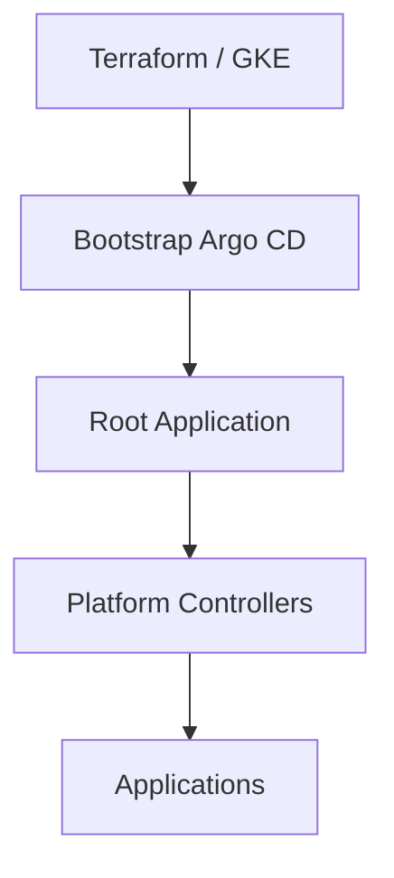
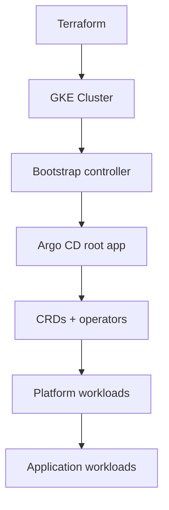
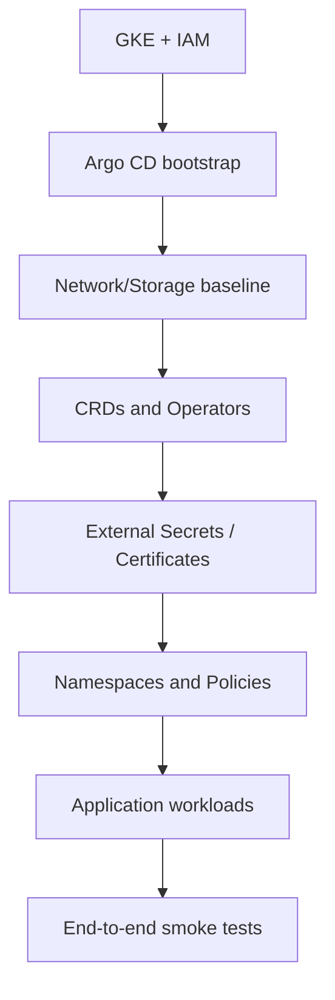

:::info Sources and editorial scope
This lesson expands on the topic and discussion material that could be verified, but **it is not a complete verbatim transcript**. The additional sections were written for this website and may require testing against the specific versions you plan to run in production.
:::

## Learning objectives

Terraform, Argo CD App-of-Apps, ApplicationSet, controller ownership.

## Day 0, Day 1, and Day 2

**Day 0:** Terraform provisions the VPC, subnets, GKE cluster, IAM, and other infrastructure dependencies. **Day 1:** Bootstrap Argo CD, controllers, and CRDs before deploying workloads. **Day 2:** Handle upgrades, drift reconciliation, incident response, backups, and teardown.



## The chicken-and-egg problem

Argo CD cannot sync itself before it exists in the cluster. Use Helm or a pipeline for the initial installation, then hand ownership over to GitOps. Do not remove bootstrap dependencies until you confirm that Argo CD manages itself reliably.

## Reconciliation ownership

Each field should have **one authoritative owner**. Terraform owns the cloud resources it provisions. Argo CD owns the Kubernetes desired state. Controllers such as Config Connector manage cloud resources declared through custom resources (CRs). Avoid having Terraform and Config Connector modify the same resource.

## Sync waves

`argocd.argoproj.io/sync-wave` determines the sync order for resources **within a single Application**. It does not guarantee readiness across separate Applications.

## Production checklist

- Pin Helm chart versions, images, and controller versions.
- Keep repositories with elevated privileges separate from application repositories.
- Define rollback procedures and break-glass access.
- Test disaster recovery from a fresh cluster.
- During teardown, account for finalizers, PVCs, and data outside the cluster.

**Official:** [Argo CD](https://argo-cd.readthedocs.io/) · [Config Connector](https://docs.cloud.google.com/config-connector/docs/overview).


## Deep dive: bootstrapping a cluster without circular dependencies

Requiring Argo CD to install itself before anything has bootstrapped it is an anti-pattern. Separate the process into three phases:

1. **Provision:** Terraform creates the VPC, subnets, IAM, GKE, and baseline DNS and KMS configuration.
2. **Bootstrap:** A pipeline or controlled procedure installs Argo CD and provisions the minimum credentials and repository access.
3. **Reconcile:** Argo CD installs controllers, monitoring, secrets integrations, and workloads from Git.



### Dependency management

If you apply an `ExternalSecret` before its CRD exists, the Kubernetes API returns a NoMatch or UnknownKind error. If the External Secrets Operator (ESO) CRD exists but its controller is not ready, the API may accept the object without the controller reconciling it. Distinguish **API registration** from **controller readiness**. Sync waves can order operations, but they do not replace readiness checks or retry logic.

### Example ownership matrix

| Resource | Authoritative owner | Avoid sharing ownership with |
|---|---|---|
| GKE control plane/VPC | Terraform | Config Connector on the same fields |
| Platform namespace/policies | Platform GitOps | Application repo |
| Application image and rollout spec | Application Argo CD | Manual kubectl patch |
| Replicas | HPA (when used) | Static replica count in Git |
| ExternalSecret target Secret | ESO | Manually authored Secret |

### Bootstrap recovery runbook

First check the Terraform state and GKE credentials. Install or restore the pinned version of Argo CD, then verify repository connectivity and destination credentials. Sync CRDs and operators in dependency order, and verify workload health. Do not use restored GitOps configuration to delete production storage before the disaster recovery process has established who owns the stateful data.

**Practice:** Create a `kind` cluster, install Argo CD with a pinned Helm chart version, and create a root Application that manages only one lab namespace. Pause Argo CD, edit a live ConfigMap, restart Argo CD, and watch it reconcile the drift.

## Deep dive: GitOps on Day 0, Day 1, and Day 2

A platform's GitOps model often has multiple **control planes**. Terraform manages cloud infrastructure; Argo CD or Config Sync applies Kubernetes desired state; and Config Connector can manage Google Cloud resources through CRDs. The question is not which tool is best, but which tool owns each resource and in what order to bootstrap them.

### Breaking the chicken-and-egg cycle

Before Argo CD can install platform controllers, you need a Kubernetes cluster, Argo CD instances, and credentials. You cannot put all of Day 0 under Argo CD's control before Argo CD exists. One possible sequence:

```text
Day-0 Terraform → VPC/subnets/IAM → GKE cluster → bootstrap access
Day-1 Bootstrap Helm/Kustomize → Argo CD + core policies + CRDs
Day-2 Argo CD reconciles platform components and applications
```

Use Terraform or a controlled bootstrap script to install Argo CD initially. When handing off to GitOps, avoid letting Terraform continue to control Kubernetes resources that Argo CD also owns. If Terraform must keep managing the Helm release, document that ownership and do not let Argo CD manage the same release state.

### Model dependencies as a clear directed acyclic graph



Sync waves order operations by phase and wave, but **they do not make external dependencies ready**. For example, creating an `ExternalSecret` before the ESO controller has Secret Manager permissions can cause the workload's Secret mount to fail.

### Resources that need deletion safeguards

Argo CD's automated pruning can delete resources that are no longer in Git. For StatefulSets and PVCs, Google Cloud resources managed by Config Connector, and CRDs shared by multiple Applications, deletion policy directly affects the data lifecycle. Set `prune: false` for components critical to bootstrap or use a separate decommissioning process where appropriate. Neither is an absolute safeguard. In particular, account for cascading deletion and finalizers.

### Disaster recovery for the GitOps control plane

1. Restore the GKE infrastructure with Terraform.
2. Create bootstrap identities and repository credentials through a secure recovery channel.
3. Install the approved version of Argo CD Core and any required components.
4. Sync platform prerequisites first: CRDs, admission controls, CSI, and ESO.
5. Restore persistent data from backups; Git cannot supply it.
6. Bring applications online and verify APIs, metrics, and transactions from outside the cluster.

A repository containing every desired YAML manifest **is not a database backup**. Account for secret encryption, Git history, and external resources.

### Production GitOps ownership table

| Resource | Owner | Failure if duplicated |
|---|---|---|
| Google Cloud VPC/IAM | Terraform | Drift tug-of-war / permission changes |
| Kubernetes CRDs | Platform GitOps | Upgrade compatibility issues |
| Application Deployment image | App GitOps | Unexpected rollback/image churn |
| Deployment replicas | HPA if enabled | Scaling conflict |
| Database records | Database system + backups | Irrecoverable state if deleted |
| Kubernetes Pod status | Kubelet/controllers | Do not set by Git |

### Lab

In a `kind` or GKE test cluster, bootstrap Argo CD from manifests or Helm. Use App-of-Apps or ApplicationSet to manage `namespaces`, `operators`, and `apps`. Try syncing a CR before its CRD exists, observe the error, and fix the dependency chain. Simulate drift on a ConfigMap and record its owner and the rollback procedure. Do not test pruning on a production database.

Sources: [Argo CD cluster bootstrapping](https://argo-cd.readthedocs.io/en/stable/operator-manual/cluster-bootstrapping/), [Sync waves](https://argo-cd.readthedocs.io/en/stable/user-guide/sync-waves/), [Terraform state](https://developer.hashicorp.com/terraform/language/state).

## Self-check questions

1. Which controller owns the desired state, and which owns the actual state in this lesson?
2. What failure modes can occur even if a Kubernetes resource reports `Ready`?
3. What would you verify before deploying to production?
