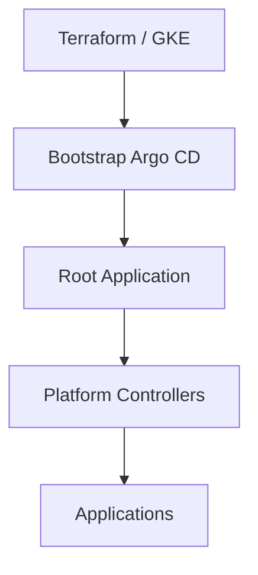
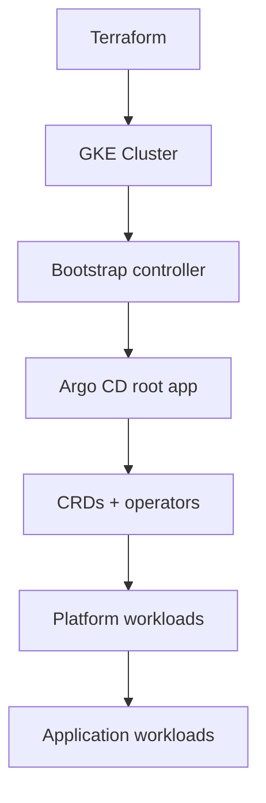
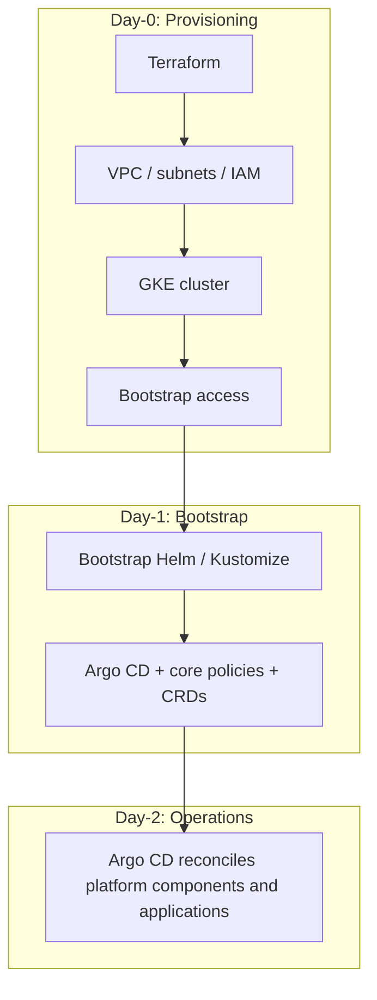
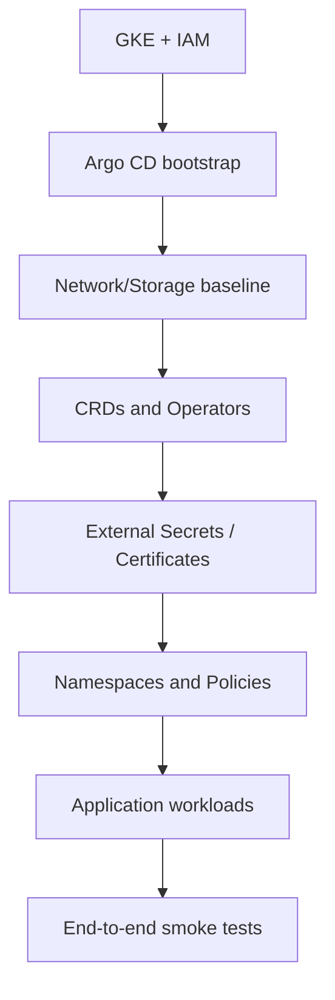
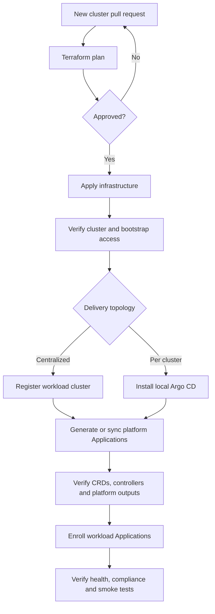

## Learning objectives

- **Separate Day-0, Day-1, and Day-2 platform responsibilities:** Break the bootstrap chicken-and-egg cycle by provisioning GKE and IAM with Terraform, seeding Argo CD safely, and handing ongoing reconciliation to GitOps.
- **Enforce single authoritative ownership across control planes:** Define clear boundaries between Terraform, Argo CD, Config Sync, Config Connector, and ESO to prevent drift tug-of-war and field-management conflicts.
- **Structure multi-component delivery with App-of-Apps and ApplicationSet:** Compare bootstrapping patterns and centralized versus per-cluster topologies, protecting root inputs and repository credentials.
- **Sequence dependencies with sync waves and readiness gates:** Distinguish CRD registration from controller readiness, ordering namespaces, CRDs, operators, and workloads without mistaking sync waves for external health checks.
- **Plan disaster recovery and safe cluster decommissioning:** Protect stateful data and shared CRDs from unintended pruning, maintain break-glass bootstrap procedures, and tear down external resources before destroying cluster infrastructure.

## Day 0, Day 1, and Day 2

**Day 0:** Terraform provisions the VPC, subnets, GKE cluster, IAM, and other infrastructure dependencies. **Day 1:** Bootstrap Argo CD, controllers, and CRDs before deploying workloads. **Day 2:** Handle upgrades, drift reconciliation, incident response, backups, and teardown.



## The chicken-and-egg problem

Argo CD cannot sync itself before it exists in the cluster. Use Helm or a pipeline for the initial installation, then hand ownership over to GitOps. Do not remove bootstrap dependencies until you confirm that Argo CD manages itself reliably.

See [Helm, Kustomize, and Argo CD](./helm-kustomize.md) for manifest generation, Helm release history, and the delivery handoff to Argo CD.

For environment layout, image digest promotion, and production rollback by Git revert, see [GitOps Repository Design and Environment Promotion](./gitops-promotion.md).

## Reconciliation ownership

Each field should have **one authoritative owner**. Terraform owns the cloud resources it provisions. Argo CD owns the Kubernetes desired state. Controllers such as Config Connector manage cloud resources declared through custom resources (CRs). Avoid having Terraform and Config Connector modify the same resource.

## Sync waves

`argocd.argoproj.io/sync-wave` determines the sync order for resources **within a single Application**. It does not guarantee readiness across separate Applications.

## Production checklist

- Pin Helm chart versions, images, and controller versions.
- Keep repositories with elevated privileges separate from application repositories.
- Define rollback procedures and break-glass access.
- Test disaster recovery from a fresh cluster.
- During teardown, account for finalizers, PVCs, and data outside the cluster.

**Official:** [Argo CD](https://argo-cd.readthedocs.io/) · [Config Connector](https://docs.cloud.google.com/config-connector/docs/overview).

## Deep dive: bootstrapping a cluster without circular dependencies

Requiring Argo CD to install itself before anything has bootstrapped it is an anti-pattern. Separate the process into three phases:

1. **Provision:** Terraform creates the VPC, subnets, IAM, GKE, and baseline DNS and KMS configuration.
2. **Bootstrap:** A pipeline or controlled procedure installs Argo CD and provisions the minimum credentials and repository access.
3. **Reconcile:** Argo CD installs controllers, monitoring, secrets integrations, and workloads from Git.



### Dependency management

If you apply an `ExternalSecret` before its CRD exists, the Kubernetes API returns a NoMatch or UnknownKind error. If the External Secrets Operator (ESO) CRD exists but its controller is not ready, the API may accept the object without the controller reconciling it. Distinguish **API registration** from **controller readiness**. Sync waves can order operations, but they do not replace readiness checks or retry logic.

### Example ownership matrix

| Resource | Authoritative owner | Avoid sharing ownership with |
|---|---|---|
| GKE control plane/VPC | Terraform | Config Connector on the same fields |
| Platform namespace/policies | Platform GitOps | Application repo |
| Application image and rollout spec | Application Argo CD | Manual kubectl patch |
| Replicas | HPA (when used) | Static replica count in Git |
| ExternalSecret target Secret | ESO | Manually authored Secret |

### Bootstrap recovery runbook

First check the Terraform state and GKE credentials. Install or restore the pinned version of Argo CD, then verify repository connectivity and destination credentials. Sync CRDs and operators in dependency order, and verify workload health. Do not use restored GitOps configuration to delete production storage before the disaster recovery process has established who owns the stateful data.

**Practice:** Create a `kind` cluster, install Argo CD with a pinned Helm chart version, and create a root Application that manages only one lab namespace. Pause Argo CD, edit a live ConfigMap, restart Argo CD, and watch it reconcile the drift.

## Deep dive: GitOps on Day 0, Day 1, and Day 2

A platform's GitOps model often has multiple **control planes**. Terraform manages cloud infrastructure; Argo CD or Config Sync applies Kubernetes desired state; and Config Connector can manage Google Cloud resources through CRDs. The question is not which tool is best, but which tool owns each resource and in what order to bootstrap them.

### Breaking the chicken-and-egg cycle

Before Argo CD can install platform controllers, you need a Kubernetes cluster, Argo CD instances, and credentials. You cannot put all of Day 0 under Argo CD's control before Argo CD exists. One possible sequence:



Use Terraform or a controlled bootstrap script to install Argo CD initially. When handing off to GitOps, avoid letting Terraform continue to control Kubernetes resources that Argo CD also owns. If Terraform must keep managing the Helm release, document that ownership and do not let Argo CD manage the same release state.

### Model dependencies as a clear directed acyclic graph



Sync waves order operations by phase and wave, but **they do not make external dependencies ready**. For example, creating an `ExternalSecret` before the ESO controller has Secret Manager permissions can cause the workload's Secret mount to fail.

### Resources that need deletion safeguards

Argo CD's automated pruning can delete resources that are no longer in Git. For StatefulSets and PVCs, Google Cloud resources managed by Config Connector, and CRDs shared by multiple Applications, deletion policy directly affects the data lifecycle. Set `prune: false` for components critical to bootstrap or use a separate decommissioning process where appropriate. Neither is an absolute safeguard. In particular, account for cascading deletion and finalizers.

### Disaster recovery for the GitOps control plane

1. Restore the GKE infrastructure with Terraform.
2. Create bootstrap identities and repository credentials through a secure recovery channel.
3. Install the approved version of Argo CD Core and any required components.
4. Sync platform prerequisites first: CRDs, admission controls, CSI, and ESO.
5. Restore persistent data from backups; Git cannot supply it.
6. Bring applications online and verify APIs, metrics, and transactions from outside the cluster.

A repository containing every desired YAML manifest **is not a database backup**. Account for secret encryption, Git history, and external resources.

### Production GitOps ownership table

| Resource | Owner | Failure if duplicated |
|---|---|---|
| Google Cloud VPC/IAM | Terraform | Drift tug-of-war / permission changes |
| Kubernetes CRDs | Platform GitOps | Upgrade compatibility issues |
| Application Deployment image | App GitOps | Unexpected rollback/image churn |
| Deployment replicas | HPA if enabled | Scaling conflict |
| Database records | Database system + backups | Irrecoverable state if deleted |
| Kubernetes Pod status | Kubelet/controllers | Do not set by Git |

### Lab

In a `kind` or GKE test cluster, bootstrap Argo CD from manifests or Helm. Use App-of-Apps or ApplicationSet to manage `namespaces`, `operators`, and `apps`. Try syncing a CR before its CRD exists, observe the error, and fix the dependency chain. Simulate drift on a ConfigMap and record its owner and the rollback procedure. Do not test pruning on a production database.

Sources: [Argo CD cluster bootstrapping](https://argo-cd.readthedocs.io/en/stable/operator-manual/cluster-bootstrapping/), [Sync waves](https://argo-cd.readthedocs.io/en/stable/user-guide/sync-waves/), [Terraform state](https://developer.hashicorp.com/terraform/language/state).

## Production walkthrough for a new GKE cluster

A Git pull request can initiate the entire process. An authenticated runner still needs to apply the initial infrastructure plan and install or connect the first reconciler. For a new production cluster, record an observable outcome for each stage before moving on.

| Stage | Work | Evidence |
|---|---|---|
| Day 0 — provision | Apply the approved Terraform plan for the GCP project, VPC, IAM, and GKE. Keep the state backend available independently of the workload cluster. | State is readable by the recovery runner, the Kubernetes API is reachable, and the bootstrap identity can perform its intended operations. |
| Day 1 — seed GitOps | Install Argo CD or register the workload cluster with an existing management instance. Configure repository credentials, destination access, and an AppProject. | Argo CD can fetch the pinned source and authenticate to the intended destination. |
| Day 1 — establish the platform | Sync namespaces, policies, monitoring, CRDs, operators, and their required identities in dependency order. | Discovery, controller readiness, and a representative reconciliation all succeed. |
| Day 1 — enroll workloads | Enable the ApplicationSet generator inputs or directory of child Applications after prerequisites pass. | Generated Applications target the expected cluster and workloads pass smoke and compliance checks. |
| Day 2 — operate | Upgrade GKE and add-ons, rotate credentials, handle drift and incidents, restore data, and decommission clusters. | Release, rollback, and recovery procedures have been exercised with the identities and versions they will use. |

Terraform continues to own infrastructure changes such as GKE upgrades during Day 2. Argo CD and operators often participate in both bootstrapping and ongoing operations. [Provision GKE resources with Terraform](https://docs.cloud.google.com/kubernetes-engine/docs/terraform)



### Provisioning and reconciliation boundaries

| Concern | Terraform | Config Connector |
|---|---|---|
| Desired configuration | HCL, modules, and provider configuration | Kubernetes CR specs, usually delivered from Git |
| Tracked state | Backend state maps Terraform addresses to provider resources | Kubernetes CRs and status plus the live Google Cloud API |
| Execution | Plan, review, and apply through a workflow | Controller reconciliation with resource-specific behavior |
| Dependencies | Terraform graph and provider operations | References, reconciliation, and readiness gates |
| Drift | Observed when the workflow refreshes state and plans or applies | Detected during reconciliation for supported resources |
| Initial platform | Project, shared network, IAM foundation, GKE, and independently bootstrapped state storage | Application-scoped cloud resources after Kubernetes, the controller, and Google Cloud access are established |

For example, keep a shared Cloud SQL instance under Terraform while an application-specific Storage bucket is managed by Config Connector. Argo CD or Config Sync can deliver the `StorageBucket` CR while Config Connector reconciles the cloud bucket. Record both ownership layers. If Terraform and Config Connector target the same bucket settings, each can interpret the other's writes as drift. Moving ownership requires an explicit handoff with the cloud resource identity, retention policy, and adoption behavior verified first. [Terraform state](https://developer.hashicorp.com/terraform/language/state) · [Config Connector reconciliation](https://docs.cloud.google.com/config-connector/docs/concepts/reconciliation)

### Repository layout and access

```text
platform/
├── infrastructure/terraform/
│   ├── modules/{network,gke,iam}/
│   └── environments/{dev,staging,prod}/
├── bootstrap/
│   ├── argocd-values.yaml
│   ├── install-argocd.sh
│   └── root-application.yaml
└── gitops/
    ├── bootstrap/children/
    ├── clusters/{dev,staging,prod}/
    ├── platform/{argocd,external-secrets,monitoring,policies,config-connector}/
    ├── applicationsets/microservices.yaml
    └── workloads/{payment,order,inventory}/
```

These paths show review boundaries. Separate repositories are also appropriate when infrastructure operators, platform administrators, and application teams have distinct access. Restrict changes to bootstrap roots, projects, and cluster selectors to platform administrators. Supply repository credentials through a recovery-accessible secure channel.

For the first install, point the bootstrap runner at the intended cluster, configure the Argo Helm repository, and set `ARGOCD_CHART_VERSION` to the exact chart version approved for that cluster. Run these examples from the directory containing the values and root manifests.

```bash
helm repo add argo https://argoproj.github.io/argo-helm
helm repo update argo
helm upgrade --install argocd argo/argo-cd \
  --namespace argocd --create-namespace \
  --version "${ARGOCD_CHART_VERSION:?Set the approved chart version}" \
  --values argocd-values.yaml --wait --timeout 10m

kubectl wait --for=condition=Established --timeout=120s \
  crd/applications.argoproj.io crd/applicationsets.argoproj.io
```

Verify repository and destination access, and create the authorized AppProject before seeding the root with `kubectl apply -f root-application.yaml`. The chart version and Argo CD application version are separate release identifiers. Retain the chart, values, and corresponding controller version for audit and recovery. [Argo CD declarative setup](https://argo-cd.readthedocs.io/en/stable/operator-manual/declarative-setup/)

### App of Apps and ApplicationSet

In App of Apps, a root Application sync creates child Application objects. Argo CD then reconciles each child's own source and destination. For this example, assume `platform-admin` permits the example repository, the in-cluster destinations and the required resource kinds. Replace the example URL with your protected repository. Commit the child manifest under `gitops/bootstrap/children`.

```yaml
apiVersion: argoproj.io/v1alpha1
kind: Application
metadata:
  name: platform-bootstrap
  namespace: argocd
spec:
  project: platform-admin
  source:
    repoURL: https://github.com/example/platform.git
    targetRevision: main
    path: gitops/bootstrap/children
  destination:
    server: https://kubernetes.default.svc
    namespace: argocd
  syncPolicy:
    automated:
      prune: false
      selfHeal: true
---
apiVersion: argoproj.io/v1alpha1
kind: Application
metadata:
  name: external-secrets
  namespace: argocd
spec:
  project: platform-admin
  source:
    repoURL: https://github.com/example/platform.git
    targetRevision: main
    path: gitops/platform/external-secrets
  destination:
    server: https://kubernetes.default.svc
    namespace: external-secrets
  syncPolicy:
    syncOptions:
      - CreateNamespace=true
```

Save the two documents as separate files and apply only the root during seeding. This child requires a manual sync or a separate automation decision. If a baseline controller owns the namespace, provision it through that controller and omit `CreateNamespace=true` here. An administrator who can change the root's inputs can influence child sources, destinations, and project selection. Protect those inputs accordingly. Root pruning and deletion of a child Application are separate operations. A child's resource finalizer determines whether deleting that child also deletes its deployed resources. [Argo CD cluster bootstrapping](https://argo-cd.readthedocs.io/en/stable/operator-manual/cluster-bootstrapping/)

| Pattern | How Applications appear | Typical use |
|---|---|---|
| App of Apps | Application Controller applies explicitly listed child Application manifests | A curated set of platform components with independently configured child Applications |
| ApplicationSet | ApplicationSet Controller renders Applications from a template and generator parameters | Label-based fleet enrollment and repeated cluster or environment deployments |

Argo CD recommends ApplicationSet and cluster labels for multi-cluster bootstrapping. In a centralized deployment, keep cluster registrations in the management instance and enroll targets only after their connectivity and permissions are verified. A GKE Fleet membership does not create an Argo CD cluster registration. [Fleet and Config Sync](../02-controllers-platform/fleet-config-sync.md) · [Argo CD cluster bootstrapping](https://argo-cd.readthedocs.io/en/stable/operator-manual/cluster-bootstrapping/)

| Topology | Failure domain | Operational trade-off |
|---|---|---|
| Centralized | Management-plane outage can interrupt reconciliation across many clusters while existing workloads may continue running | Fewer installations, concentrated destination access, and a requirement for network reachability to remote APIs |
| Per cluster | Local GitOps outages are largely isolated to one target | More instances and upgrades, with local deployment credentials and stronger separation between environments |

### Gate each dependency at the appropriate layer

| Checkpoint | Example evidence | What it establishes |
|---|---|---|
| CRD submitted | `kubectl get crd externalsecrets.external-secrets.io` | The definition object exists |
| CRD established | `kubectl wait --for=condition=Established --timeout=120s crd/externalsecrets.external-secrets.io` | The CRD is established. Confirm the desired group/version is listed in API discovery. |
| Controller and webhooks ready | ESO Deployment rollout succeeds and a representative API write passes admission | The software can run and the required admission endpoint works |
| Custom resource ready | `kubectl -n payments wait --for=condition=Ready --timeout=120s externalsecret/payment-db` | ESO reports successful reconciliation. Verify the expected Secret exists without printing its contents. |
| Workload ready | Deployment rollout and API smoke test pass | The consumer can run with the resulting configuration |

Within one Application, a namespace can use wave `-2`, CRDs and operators wave `-1`, custom resources wave `0`, and workloads wave `1`. Apply the wave through the annotation below. Argo CD uses sync phase and wave ordering and evaluates health before progressing. During pruning, higher waves are processed first.

```yaml
metadata:
  annotations:
    argocd.argoproj.io/sync-wave: "-1"
```

Across independently syncing Applications, a parent wave orders its child **objects**. To use parent waves as readiness gates, configure and verify an Application health assessment that reflects child readiness and ensure the relevant children actually sync. Alternatively, use staged enrollment or an external pipeline gate with direct API checks. An established ESO CRD can accept `ExternalSecret` objects before the operator can process them. Provider IAM, a ready SecretStore, and a successful target Secret reconciliation are separate prerequisites. [Sync phases and waves](https://argo-cd.readthedocs.io/en/stable/user-guide/sync-waves/) · [Argo CD resource health](https://argo-cd.readthedocs.io/en/stable/operator-manual/health/)

### Self-managed Argo CD and recovery

A self-management Application can point to `gitops/platform/argocd` using `platform-admin` and the local `argocd` namespace. Start with manifests matching the live installation and a protected, reviewable revision. Argo CD's documented self-management setup requires Server-Side Apply.

```yaml
syncPolicy:
  syncOptions:
    - ServerSideApply=true
```

Begin with a reviewed manual sync by omitting `syncPolicy.automated`. (Explicit `automated.enabled: false` requires Argo CD 3.1+; on older versions, the API server prunes the unknown `enabled` field and leaves any remaining `automated` block active.) Compare rendered resources with the installed version, especially the CRDs, repository access, RBAC, and immutable fields. Pause any former recurring Helm or Terraform writer during the handoff. Keep Helm release records and account for what the old system could still remove. Running `helm uninstall` on the original release can delete resources the new Application depends on. Once the handoff is verified, enable automated sync if appropriate to the recovery plan. [Argo CD self-management](https://argo-cd.readthedocs.io/en/stable/operator-manual/declarative-setup/#manage-argo-cd-using-argo-cd)

During an upgrade, Kubernetes retains Application CRs while controllers restart. A broken repo-server image, revoked credentials, incompatible CRD, or RBAC regression can prevent the controller from reading or applying the repair. Keep a tested bootstrap runner and break-glass identity outside Argo CD. In a recovery drill, freeze the bad revision, restore approved manifests and credentials with that runner, verify source and destination access, and resume reconciliation from a known-good commit. Restore persistent data from its own backup and verify workload behavior before declaring recovery complete. [Argo CD disaster recovery](https://argo-cd.readthedocs.io/en/stable/operator-manual/disaster_recovery/)

### Coexistence with Config Sync and ESO

One ownership split gives Config Sync namespaces, quotas, shared NetworkPolicies, RBAC, and baseline policy. Argo CD manages application Deployments, Services, Ingress, HPAs, and application CRs. Config Connector reconciles selected Google Cloud resources from their CRs. ESO writes the target Secrets referenced by workloads. A single namespace can contain resources delivered by multiple reconcilers.

For example, define `Namespace/payments` and its `environment=production` label in one baseline source. A second source declaring `environment=staging` creates competing intent. Depending on field management and write method, the overlap can cause conflicts or repeated updates. Inspect Git sources, controller logs and `managedFields`, then remove the duplicate declaration through a tested handoff. Account for tracking and prune behavior before moving a live object between tools. Config Sync supports Git, OCI, and Helm sources. Its sync-object deletion propagation also warrants review during a handoff. [Config Sync overview](https://docs.cloud.google.com/kubernetes-engine/config-sync/docs/overview) · [Managing Config Sync objects](https://docs.cloud.google.com/kubernetes-engine/config-sync/docs/how-to/managing-objects)

### Decommission while the reconcilers still work

For a cluster such as `gke-staging-02`, review the Kubernetes and Google Cloud inventories before approving infrastructure removal.

1. **Inventory** Applications, ApplicationSets, sync objects, operators, CRs, finalizers, PVs and PVCs, backing disks, shared DNS, and cloud resources. Identify each resource's full cloud identity and current lifecycle owner.
2. **Freeze new deployment** to the destination. Inspect what removing a generator match would do before changing registration labels. Generated Applications can be deleted depending on policy, and their finalizers can trigger workload deletion.
3. **Classify and back up** data. Record delete, migrate, or retain for each stateful resource and verify restore procedures. Check storage reclaim policies and any provider-level deletion protection.
4. **Detach or remove workloads** under the chosen Application deletion and prune policies. Keep the destination reachable while Argo CD needs it for cleanup. Verify the results in the target cluster.
5. **Resolve external resources** while Config Connector and other operators still have credentials and network access. For a retained Config Connector resource, apply and verify `cnrm.cloud.google.com/deletion-policy: abandon` on its CR before removing that CR. Verify the cloud resource still exists and record its next owner. For approved deletion, confirm both the CR's finalizer completion and the intended outcome in the cloud API.
6. **Remove platform components in dependency order** after dependent CRs and finalizers are resolved. Deleting a CRD also deletes its instances, so review all namespaces and any shared ownership before removing one. Remove cluster registration after remote cleanup finishes.
7. **Review the Terraform destroy plan** and apply only within the approved scope. Check that shared networks, IAM bindings, state storage, and retained data survive, and record the resulting inventory.

Deleting GKE first can strand a Config Connector-managed Cloud SQL instance by removing the controller and its CR state before either deletion or handoff completes. A successful Terraform destroy only verifies operations in its own managed scope. [Managing and deleting Config Connector resources](https://docs.cloud.google.com/config-connector/docs/how-to/managing-deleting-resources) · [ApplicationSet resource modification policies](https://argo-cd.readthedocs.io/en/stable/operator-manual/applicationset/Controlling-Resource-Modification/)

## Self-check questions

1. Why does an Application fail to start delivery in a fresh cluster? **Answer.** The Application CRD enables API admission for that type, and the Argo CD controller turns an accepted Application into reconciliation work. Bootstrap must provide both.
2. Can Config Sync and Argo CD safely maintain different values for the same namespace label? **Answer.** Give that field one authoritative desired value and owner. SSA conflict detection and force behavior vary by writer and cannot reconcile opposing intent.
3. What can happen when GKE is destroyed before Config Connector cleanup? **Answer.** External resources may remain unmanaged. Resolve retention, transfer, or deletion while the controller and CR still exist.
4. Does a healthy root Application prove a dependent workload can use its database credentials? **Answer.** Verify child health, the ExternalSecret Ready condition, and an application-level connection check.
5. Which controller owns the desired state, and which owns the actual state in your bootstrap topology?
6. What failure modes can occur even if a Kubernetes resource reports `Ready`, and what would you verify before deploying to production?

Continue with [Lesson 10 — Production Reliability and Progressive Delivery](./lesson-10-progressive-delivery.md) for rolling update capacity, readiness, disruption budgets, and canary or blue-green delivery with metric-driven analysis.
