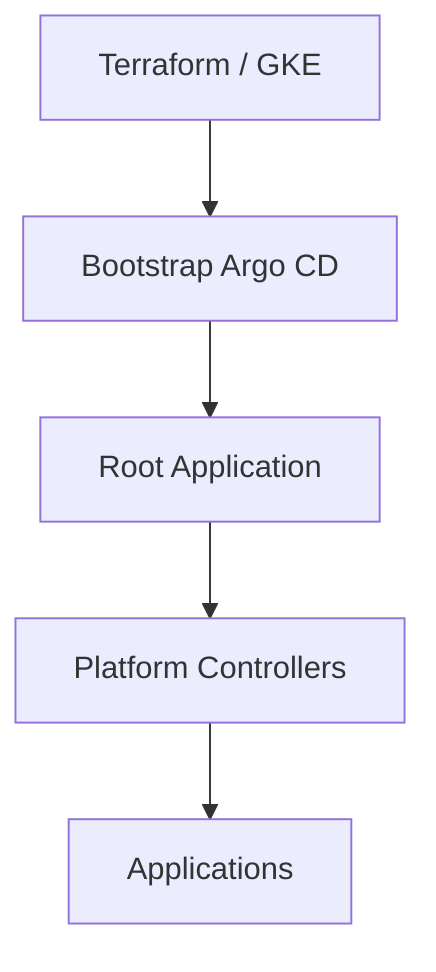
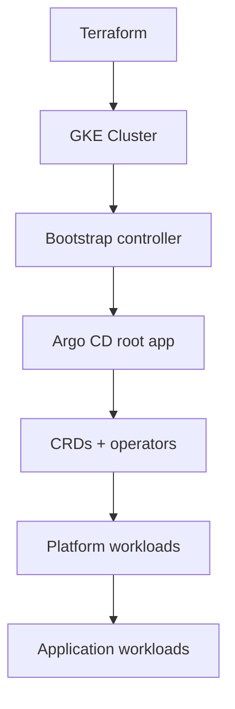
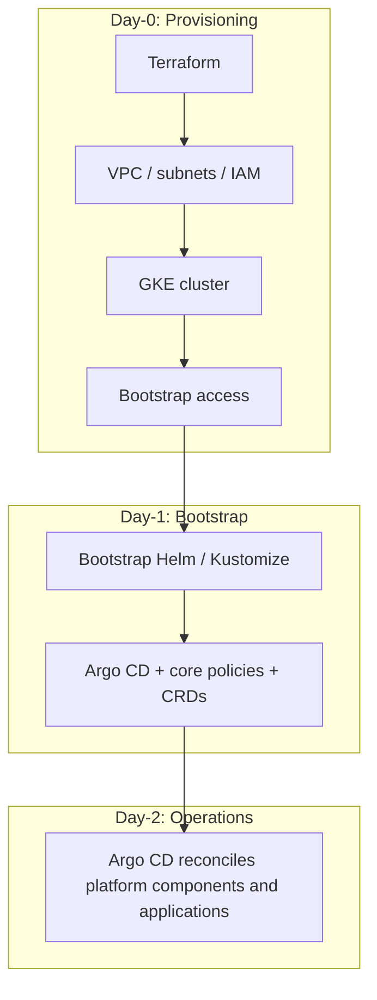
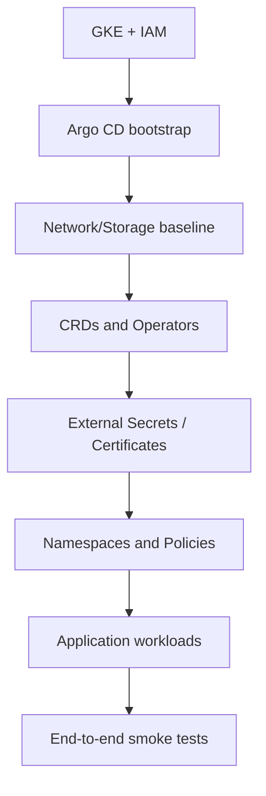
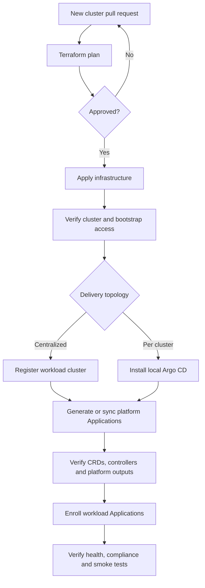

## Mục tiêu học tập

- **Phân tách rõ trách nhiệm nền tảng theo Day 0, Day 1 và Day 2:** Phá vỡ vòng lặp con gà và quả trứng khi bootstrap bằng cách khởi tạo GKE và IAM với Terraform, cài đặt mầm Argo CD an toàn rồi bàn giao quá trình đối soát liên tục cho GitOps.
- **Thiết lập chủ sở hữu có thẩm quyền duy nhất giữa các control plane:** Phân định ranh giới giữa Terraform, Argo CD, Config Sync, Config Connector và ESO để tránh giằng co drift và xung đột quản lý trường dữ liệu.
- **Tổ chức phân phối đa thành phần bằng App-of-Apps và ApplicationSet:** So sánh các mô hình bootstrap cùng kiến trúc tập trung (centralized) so với theo từng cluster (per-cluster), đồng thời bảo vệ đầu vào root và thông tin xác thực repository.
- **Sắp xếp phụ thuộc bằng sync waves và cổng kiểm tra sẵn sàng:** Phân biệt giữa đăng ký CRD và mức độ sẵn sàng của controller, sắp xếp thứ tự namespace, CRD, operator và workload mà không nhầm lẫn sync wave với kiểm tra sức khỏe từ bên ngoài.
- **Lập kế hoạch khôi phục sau thảm họa và ngừng vận hành cluster an toàn:** Bảo vệ dữ liệu stateful và CRD dùng chung khỏi việc prune ngoài ý muốn, duy trì quy trình bootstrap khẩn cấp (break-glass) và dọn dẹp tài nguyên bên ngoài trước khi hủy hạ tầng cluster.

## Day 0, Day 1 và Day 2

**Day 0:** Terraform khởi tạo VPC, subnet, GKE cluster, IAM và các thành phần hạ tầng phụ thuộc khác. **Day 1:** Bootstrap Argo CD, các controller và CRD trước khi triển khai workload. **Day 2:** Xử lý nâng cấp, đối soát drift (drift reconciliation), ứng phó sự cố, sao lưu và gỡ bỏ hạ tầng (teardown).



## Bài toán con gà và quả trứng

Argo CD không thể tự sync chính nó trước khi nó tồn tại trong cluster. Hãy sử dụng Helm hoặc một pipeline cho lần cài đặt ban đầu, sau đó bàn giao quyền quản lý cho GitOps. Không xóa các thành phần phụ thuộc của quá trình bootstrap cho đến khi bạn xác nhận rằng Argo CD đã tự quản lý chính nó một cách ổn định.

Xem [Helm, Kustomize và Argo CD](./helm-kustomize.md) để tìm hiểu về cách sinh manifest, lịch sử Helm release và quy trình chuyển giao triển khai cho Argo CD.

Về cấu trúc môi trường, promote image digest và rollback production bằng Git revert, xem [Thiết kế kho lưu trữ GitOps và Promote môi trường](./gitops-promotion.md).

## Quyền sở hữu đối soát (Reconciliation ownership)

Mỗi trường cấu hình nên có **một chủ sở hữu có thẩm quyền duy nhất (authoritative owner)**. Terraform sở hữu các tài nguyên cloud mà nó khởi tạo. Argo CD sở hữu trạng thái mong muốn (desired state) của Kubernetes. Các controller như Config Connector quản lý tài nguyên cloud được khai báo thông qua custom resource (CR). Tránh để cả Terraform và Config Connector cùng chỉnh sửa một tài nguyên.

## Sync waves

`argocd.argoproj.io/sync-wave` quyết định thứ tự sync tài nguyên **trong phạm vi một Application duy nhất**. Nó không đảm bảo trạng thái sẵn sàng (readiness) giữa các Application tách biệt nhau.

## Danh sách kiểm tra cho production

- Cố định (pin) phiên bản Helm chart, image và phiên bản controller.
- Tách biệt các repository có đặc quyền cao khỏi repository ứng dụng.
- Xác định rõ quy trình rollback và quyền truy cập khẩn cấp (break-glass access).
- Kiểm thử quy trình khôi phục sau thảm họa (disaster recovery) từ một cluster mới hoàn toàn.
- Khi gỡ bỏ hạ tầng (teardown), cần tính đến các finalizer, PVC và dữ liệu nằm ngoài cluster.

**Tài liệu chính thức:** [Argo CD](https://argo-cd.readthedocs.io/) · [Config Connector](https://docs.cloud.google.com/config-connector/docs/overview).

## Phân tích sâu: bootstrap cluster không tạo phụ thuộc vòng tròn

Yêu cầu Argo CD tự cài đặt chính nó trước khi có bất kỳ thứ gì bootstrap nó là một anti-pattern. Hãy tách quy trình thành ba giai đoạn:

1. **Provision:** Terraform tạo VPC, subnet, IAM, GKE cùng cấu hình DNS và KMS nền tảng.
2. **Bootstrap:** Một pipeline hoặc quy trình được kiểm soát sẽ cài đặt Argo CD và cấp các thông tin xác thực tối thiểu cũng như quyền truy cập repository.
3. **Reconcile:** Argo CD cài đặt các controller, hệ thống giám sát, tích hợp secrets và các workload từ Git.



### Quản lý phụ thuộc

Nếu bạn áp dụng một `ExternalSecret` trước khi CRD của nó tồn tại, Kubernetes API sẽ trả về lỗi `NoMatch` hoặc `UnknownKind`. Nếu CRD của External Secrets Operator (ESO) đã tồn tại nhưng controller của nó chưa sẵn sàng, API có thể chấp nhận đối tượng đó nhưng controller sẽ chưa thực hiện đối soát. Hãy phân biệt giữa **đăng ký API (API registration)** và **mức độ sẵn sàng của controller (controller readiness)**. Sync waves có thể sắp xếp thứ tự thao tác, nhưng không thay thế cho các bước kiểm tra sẵn sàng hay logic thử lại (retry).

### Ví dụ ma trận quyền sở hữu

| Tài nguyên | Chủ sở hữu có thẩm quyền | Tránh chia sẻ quyền sở hữu với |
|---|---|---|
| GKE control plane/VPC | Terraform | Config Connector trên cùng các trường dữ liệu |
| Platform namespace/policies | Platform GitOps | Application repo |
| Application image và rollout spec | Application Argo CD | Chỉnh sửa thủ công bằng `kubectl patch` |
| Replicas | HPA (khi được sử dụng) | Số lượng replica tĩnh trong Git |
| Target Secret của ExternalSecret | ESO | Secret được tạo thủ công |

### Sổ tay khôi phục bootstrap

Trước tiên hãy kiểm tra Terraform state và thông tin xác thực GKE. Cài đặt hoặc khôi phục phiên bản Argo CD đã được pin, sau đó xác minh kết nối repository và thông tin xác thực tới cluster đích. Sync các CRD và operator theo thứ tự phụ thuộc, rồi xác minh tình trạng sức khỏe của workload. Không sử dụng cấu hình GitOps vừa khôi phục để xóa bộ lưu trữ production trước khi quy trình khôi phục sau thảm họa xác định rõ ai đang sở hữu dữ liệu stateful.

**Thực hành:** Tạo một cluster `kind`, cài đặt Argo CD bằng một phiên bản Helm chart đã được pin, và tạo một root Application chỉ quản lý duy nhất một namespace lab. Tạm dừng Argo CD, chỉnh sửa trực tiếp một ConfigMap đang chạy, khởi động lại Argo CD và quan sát cách nó đối soát drift.

## Phân tích sâu: GitOps trên Day 0, Day 1 và Day 2

Mô hình GitOps của một nền tảng thường có nhiều **control plane**. Terraform quản lý hạ tầng cloud; Argo CD hoặc Config Sync áp dụng trạng thái mong muốn của Kubernetes; và Config Connector có thể quản lý tài nguyên Google Cloud thông qua các CRD. Câu hỏi không phải là công cụ nào tốt nhất, mà là công cụ nào sở hữu tài nguyên nào và thứ tự bootstrap chúng ra sao.

### Phá vỡ vòng lặp con gà và quả trứng

Trước khi Argo CD có thể cài đặt các platform controller, bạn cần một Kubernetes cluster, các instance Argo CD và thông tin xác thực. Bạn không thể đặt toàn bộ Day 0 dưới sự kiểm soát của Argo CD trước khi Argo CD tồn tại. Một trình tự khả thi như sau:



Hãy dùng Terraform hoặc một script bootstrap được kiểm soát để cài đặt Argo CD ban đầu. Khi chuyển giao cho GitOps, tránh để Terraform tiếp tục kiểm soát các tài nguyên Kubernetes mà Argo CD cũng sở hữu. Nếu Terraform bắt buộc phải tiếp tục quản lý Helm release, hãy ghi nhận rõ quyền sở hữu đó trong tài liệu và không để Argo CD quản lý cùng trạng thái release đó.

### Mô hình hóa phụ thuộc thành đồ thị có hướng không chu trình (DAG) rõ ràng



Sync waves sắp xếp các thao tác theo phase và wave, nhưng **không làm cho các phụ thuộc bên ngoài tự trở nên sẵn sàng**. Ví dụ, tạo một `ExternalSecret` trước khi ESO controller có quyền truy cập Secret Manager có thể khiến bước mount Secret của workload bị lỗi.

### Các tài nguyên cần cơ chế bảo vệ chống xóa

Tính năng tự động dọn dẹp (automated pruning) của Argo CD có thể xóa các tài nguyên không còn tồn tại trong Git. Đối với StatefulSet và PVC, các tài nguyên Google Cloud do Config Connector quản lý và các CRD dùng chung bởi nhiều Application, chính sách xóa ảnh hưởng trực tiếp đến vòng đời dữ liệu. Hãy đặt `prune: false` cho các thành phần trọng yếu đối với bootstrap hoặc sử dụng quy trình ngừng vận hành (decommissioning) riêng khi phù hợp. Không biện pháp nào là lá chắn tuyệt đối. Đặc biệt, cần tính đến cơ chế xóa theo tầng (cascading deletion) và finalizer.

### Khôi phục sau thảm họa cho GitOps control plane

1. Khôi phục hạ tầng GKE bằng Terraform.
2. Tạo các danh tính bootstrap (bootstrap identities) và thông tin xác thực repository thông qua kênh khôi phục an toàn.
3. Cài đặt phiên bản Argo CD Core đã được phê duyệt cùng các thành phần bắt buộc.
4. Sync các điều kiện tiên quyết của nền tảng trước: CRD, admission control, CSI và ESO.
5. Khôi phục dữ liệu bền vững (persistent data) từ bản sao lưu; Git không thể cung cấp dữ liệu này.
6. Đưa các ứng dụng hoạt động trở lại và xác minh API, metric và các giao dịch từ bên ngoài cluster.

Một repository chứa đầy đủ mọi file YAML manifest mong muốn **không phải là bản sao lưu cơ sở dữ liệu**. Cần tính đến việc mã hóa secret, lịch sử Git và các tài nguyên bên ngoài.

### Bảng quyền sở hữu GitOps trên production

| Tài nguyên | Chủ sở hữu | Sự cố nếu bị trùng lặp |
|---|---|---|
| Google Cloud VPC/IAM | Terraform | Giằng co drift (drift tug-of-war) / thay đổi phân quyền ngoài ý muốn |
| Kubernetes CRDs | Platform GitOps | Lỗi tương thích khi nâng cấp |
| Application Deployment image | App GitOps | Rollback ngoài ý muốn / thay đổi image liên tục |
| Deployment replicas | HPA (nếu được bật) | Xung đột cơ chế scaling |
| Bản ghi cơ sở dữ liệu | Hệ thống cơ sở dữ liệu + sao lưu | Mất trạng thái không thể khôi phục nếu bị xóa |
| Trạng thái Kubernetes Pod | Kubelet/controllers | Không được thiết lập qua Git |

### Bài thực hành (Lab)

Trên một cluster thử nghiệm `kind` hoặc GKE, hãy bootstrap Argo CD từ manifest hoặc Helm. Sử dụng App-of-Apps hoặc ApplicationSet để quản lý `namespaces`, `operators` và `apps`. Thử sync một CR trước khi CRD của nó tồn tại, quan sát lỗi và sửa lại chuỗi phụ thuộc. Mô phỏng drift trên một ConfigMap, ghi nhận chủ sở hữu của nó và quy trình rollback. Không thử nghiệm tính năng pruning trên cơ sở dữ liệu production.

Nguồn: [Argo CD cluster bootstrapping](https://argo-cd.readthedocs.io/en/stable/operator-manual/cluster-bootstrapping/), [Sync waves](https://argo-cd.readthedocs.io/en/stable/user-guide/sync-waves/), [Terraform state](https://developer.hashicorp.com/terraform/language/state).

## Quy trình thực tế cho một GKE cluster mới trên production

Một Git pull request có thể khởi phát toàn bộ quy trình. Tuy nhiên, một runner đã được xác thực vẫn cần áp dụng kế hoạch hạ tầng ban đầu và cài đặt hoặc kết nối reconciler đầu tiên. Đối với một production cluster mới, hãy ghi nhận một kết quả quan sát được (observable outcome) cho mỗi giai đoạn trước khi chuyển sang bước tiếp theo.

| Giai đoạn | Công việc | Bằng chứng xác nhận |
|---|---|---|
| Day 0 — khởi tạo (provision) | Áp dụng Terraform plan đã được phê duyệt cho GCP project, VPC, IAM và GKE. Giữ state backend luôn sẵn sàng độc lập với workload cluster. | Recovery runner có thể đọc được state, Kubernetes API kết nối được và bootstrap identity thực hiện được các thao tác dự kiến. |
| Day 1 — gieo mầm GitOps (seed GitOps) | Cài đặt Argo CD hoặc đăng ký workload cluster vào một management instance hiện có. Cấu hình thông tin xác thực repository, quyền truy cập cluster đích và một AppProject. | Argo CD có thể tải nguồn (source) đã pin và xác thực thành công tới cluster đích dự kiến. |
| Day 1 — thiết lập nền tảng | Sync namespace, policy, monitoring, CRD, operator và các danh tính cần thiết theo thứ tự phụ thuộc. | Cơ chế API discovery, mức độ sẵn sàng của controller và một phép đối soát đại diện đều thành công. |
| Day 1 — đưa workload vào quản lý | Bật các đầu vào generator của ApplicationSet hoặc thư mục chứa các child Application sau khi các điều kiện tiên quyết đạt yêu cầu. | Các Application được sinh ra trỏ đúng cluster mục tiêu và workload vượt qua các bài kiểm tra smoke test cũng như tuân thủ (compliance). |
| Day 2 — vận hành | Nâng cấp GKE và add-on, xoay vòng thông tin xác thực (rotate credentials), xử lý drift và sự cố, khôi phục dữ liệu và ngừng vận hành cluster. | Các quy trình phát hành, rollback và khôi phục đã được diễn tập thực tế với đúng danh tính và phiên bản sẽ sử dụng. |

Terraform tiếp tục sở hữu các thay đổi hạ tầng như nâng cấp GKE trong suốt Day 2. Argo CD và các operator thường tham gia vào cả giai đoạn bootstrap lẫn vận hành liên tục. [Provision GKE resources with Terraform](https://docs.cloud.google.com/kubernetes-engine/docs/terraform)



### Ranh giới giữa khởi tạo (provisioning) và đối soát (reconciliation)

| Khía cạnh | Terraform | Config Connector |
|---|---|---|
| Cấu hình mong muốn | HCL, các module và cấu hình provider | Spec của Kubernetes CR, thường được phân phối từ Git |
| Trạng thái được theo dõi | Backend state ánh xạ địa chỉ Terraform tới tài nguyên provider | Các Kubernetes CR cùng status và Google Cloud API trực tiếp |
| Thực thi | Plan, review và apply thông qua một workflow | Controller đối soát với hành vi đặc thù cho từng tài nguyên |
| Phụ thuộc | Đồ thị Terraform và các thao tác của provider | Tham chiếu (references), quá trình đối soát và cổng kiểm tra sẵn sàng (readiness gates) |
| Drift | Được phát hiện khi workflow làm mới state và chạy plan hoặc apply | Được phát hiện trong quá trình đối soát đối với các tài nguyên được hỗ trợ |
| Nền tảng ban đầu | Project, mạng dùng chung, nền tảng IAM, GKE và kho lưu trữ state được bootstrap độc lập | Tài nguyên cloud theo phạm vi ứng dụng sau khi Kubernetes, controller và quyền truy cập Google Cloud đã sẵn sàng |

Ví dụ, hãy giữ một Cloud SQL instance dùng chung dưới sự quản lý của Terraform, trong khi một Storage bucket riêng cho ứng dụng do Config Connector quản lý. Argo CD hoặc Config Sync có thể phân phối `StorageBucket` CR trong khi Config Connector đối soát bucket thực tế trên cloud. Hãy ghi nhận cả hai lớp quyền sở hữu. Nếu Terraform và Config Connector cùng nhắm tới một cấu hình bucket giống nhau, mỗi bên sẽ coi ghi chép của bên kia là drift. Việc chuyển đổi quyền sở hữu đòi hỏi một quy trình bàn giao rõ ràng, trong đó danh tính tài nguyên cloud, chính sách lưu giữ (retention policy) và hành vi tiếp quản (adoption behavior) phải được xác minh trước. [Terraform state](https://developer.hashicorp.com/terraform/language/state) · [Config Connector reconciliation](https://docs.cloud.google.com/config-connector/docs/concepts/reconciliation)

### Cấu trúc repository và phân quyền truy cập

```text
platform/
├── infrastructure/terraform/
│   ├── modules/{network,gke,iam}/
│   └── environments/{dev,staging,prod}/
├── bootstrap/
│   ├── argocd-values.yaml
│   ├── install-argocd.sh
│   └── root-application.yaml
└── gitops/
    ├── bootstrap/children/
    ├── clusters/{dev,staging,prod}/
    ├── platform/{argocd,external-secrets,monitoring,policies,config-connector}/
    ├── applicationsets/microservices.yaml
    └── workloads/{payment,order,inventory}/
```

Các đường dẫn này thể hiện ranh giới review. Việc tách thành nhiều repository riêng cũng rất phù hợp khi đội vận hành hạ tầng, quản trị viên nền tảng và các nhóm ứng dụng có quyền truy cập khác nhau. Hãy giới hạn quyền thay đổi các bootstrap root, project và cluster selector chỉ cho quản trị viên nền tảng. Cung cấp thông tin xác thực repository thông qua một kênh bảo mật có thể truy cập được khi khôi phục sự cố.

Cho lần cài đặt đầu tiên, hãy trỏ bootstrap runner tới đúng cluster mục tiêu, cấu hình Argo Helm repository và đặt `ARGOCD_CHART_VERSION` bằng đúng phiên bản chart đã được phê duyệt cho cluster đó. Chạy các lệnh ví dụ sau từ thư mục chứa file values và root manifest.

```bash
helm repo add argo https://argoproj.github.io/argo-helm
helm repo update argo
helm upgrade --install argocd argo/argo-cd \
  --namespace argocd --create-namespace \
  --version "${ARGOCD_CHART_VERSION:?Set the approved chart version}" \
  --values argocd-values.yaml --wait --timeout 10m

kubectl wait --for=condition=Established --timeout=120s \
  crd/applications.argoproj.io crd/applicationsets.argoproj.io
```

Xác minh quyền truy cập repository và cluster đích, đồng thời tạo AppProject được cấp phép trước khi gieo mầm root bằng lệnh `kubectl apply -f root-application.yaml`. Phiên bản chart và phiên bản ứng dụng Argo CD là hai định danh phát hành khác nhau. Hãy lưu giữ chart, file values và phiên bản controller tương ứng để phục vụ kiểm toán (audit) và khôi phục. [Argo CD declarative setup](https://argo-cd.readthedocs.io/en/stable/operator-manual/declarative-setup/)

### App of Apps và ApplicationSet

Trong mô hình App of Apps, quá trình sync của một root Application sẽ tạo ra các đối tượng child Application. Sau đó, Argo CD đối soát nguồn (source) và đích (destination) riêng của từng child. Trong ví dụ này, giả sử `platform-admin` cho phép repository ví dụ, các cluster đích nội bộ (in-cluster) và các loại tài nguyên cần thiết. Hãy thay URL ví dụ bằng repository được bảo vệ của bạn và commit child manifest vào `gitops/bootstrap/children`.

```yaml
apiVersion: argoproj.io/v1alpha1
kind: Application
metadata:
  name: platform-bootstrap
  namespace: argocd
spec:
  project: platform-admin
  source:
    repoURL: https://github.com/example/platform.git
    targetRevision: main
    path: gitops/bootstrap/children
  destination:
    server: https://kubernetes.default.svc
    namespace: argocd
  syncPolicy:
    automated:
      prune: false
      selfHeal: true
---
apiVersion: argoproj.io/v1alpha1
kind: Application
metadata:
  name: external-secrets
  namespace: argocd
spec:
  project: platform-admin
  source:
    repoURL: https://github.com/example/platform.git
    targetRevision: main
    path: gitops/platform/external-secrets
  destination:
    server: https://kubernetes.default.svc
    namespace: external-secrets
  syncPolicy:
    syncOptions:
      - CreateNamespace=true
```

Lưu hai tài liệu trên thành hai file riêng biệt và chỉ apply root Application trong bước gieo mầm. Child Application này yêu cầu sync thủ công hoặc một quyết định tự động hóa riêng. Nếu một baseline controller sở hữu namespace, hãy khởi tạo namespace qua controller đó và bỏ `CreateNamespace=true` ở đây. Bất kỳ quản trị viên nào có quyền thay đổi đầu vào của root đều có thể tác động tới source, destination và việc chọn project của child — hãy bảo vệ các đầu vào đó tương ứng. Việc prune ở root và xóa một child Application là hai thao tác tách biệt. Resource finalizer của child quyết định việc xóa child đó có kéo theo xóa các tài nguyên nó đã triển khai hay không. [Argo CD cluster bootstrapping](https://argo-cd.readthedocs.io/en/stable/operator-manual/cluster-bootstrapping/)

| Mô hình | Cách Application được tạo ra | Trường hợp sử dụng điển hình |
|---|---|---|
| App of Apps | Application Controller apply các manifest child Application được liệt kê tường minh | Tập hợp các thành phần nền tảng được tuyển chọn với các child Application cấu hình độc lập |
| ApplicationSet | ApplicationSet Controller render các Application từ một template và tham số generator | Đưa fleet vào quản lý dựa trên label và triển khai lặp lại trên nhiều cluster hoặc môi trường |

Argo CD khuyến nghị sử dụng ApplicationSet và cluster label cho multi-cluster bootstrapping. Trong mô hình triển khai tập trung (centralized), hãy lưu đăng ký cluster trong management instance và chỉ đưa cluster đích vào quản lý sau khi đã xác minh kết nối và phân quyền. Một tư cách thành viên GKE Fleet không tự động tạo ra đăng ký cluster trong Argo CD. [Fleet và Config Sync](../02-controllers-platform/fleet-config-sync.md) · [Argo CD cluster bootstrapping](https://argo-cd.readthedocs.io/en/stable/operator-manual/cluster-bootstrapping/)

| Kiến trúc triển khai (Topology) | Miền lỗi (Failure domain) | Đánh đổi vận hành |
|---|---|---|
| Tập trung (Centralized) | Sự cố ở management-plane có thể làm gián đoạn quá trình đối soát trên nhiều cluster trong khi các workload hiện có vẫn có thể tiếp tục chạy | Ít instance phải cài đặt hơn, tập trung quyền truy cập tới cluster đích và yêu cầu kết nối mạng tới các API từ xa |
| Theo từng cluster (Per cluster) | Sự cố GitOps cục bộ phần lớn bị cô lập trong một cluster mục tiêu duy nhất | Nhiều instance và lần nâng cấp hơn, đi kèm thông tin xác thực triển khai cục bộ và mức độ tách biệt giữa các môi trường cao hơn |

### Kiểm soát từng phụ thuộc ở đúng tầng

| Mốc kiểm tra (Checkpoint) | Bằng chứng ví dụ | Điều được xác lập |
|---|---|---|
| CRD đã được gửi lên (submitted) | `kubectl get crd externalsecrets.external-secrets.io` | Đối tượng định nghĩa đã tồn tại |
| CRD đã được thiết lập (established) | `kubectl wait --for=condition=Established --timeout=120s crd/externalsecrets.external-secrets.io` | CRD đã sẵn sàng. Xác nhận group/version mong muốn xuất hiện trong API discovery. |
| Controller và webhook sẵn sàng | Rollout của ESO Deployment thành công và một thao tác ghi API đại diện vượt qua bước admission | Phần mềm có thể chạy và admission endpoint bắt buộc hoạt động bình thường |
| Custom resource sẵn sàng | `kubectl -n payments wait --for=condition=Ready --timeout=120s externalsecret/payment-db` | ESO báo cáo đối soát thành công. Xác minh Secret mong muốn đã tồn tại mà không in ra nội dung của nó. |
| Workload sẵn sàng | Rollout của Deployment và bài kiểm tra API smoke test đều đạt | Ứng dụng tiêu thụ có thể vận hành với cấu hình kết quả |

Trong phạm vi một Application, namespace có thể dùng wave `-2`, các CRD và operator dùng wave `-1`, custom resource dùng wave `0` và workload dùng wave `1`. Áp dụng wave thông qua annotation bên dưới. Argo CD sử dụng thứ tự sync phase và wave, đồng thời đánh giá health trước khi tiến sang bước kế tiếp. Trong quá trình pruning, các wave có giá trị cao hơn sẽ được xử lý trước.

```yaml
metadata:
  annotations:
    argocd.argoproj.io/sync-wave: "-1"
```

Giữa các Application được sync độc lập, wave trên parent chỉ sắp xếp thứ tự của các **đối tượng** child. Để sử dụng parent wave làm cổng kiểm tra sẵn sàng (readiness gate), hãy cấu hình và xác minh một cơ chế đánh giá Application health phản ánh đúng độ sẵn sàng của child, đồng thời đảm bảo các child liên quan thực sự được sync. Cách khác là sử dụng cơ chế đưa vào quản lý theo từng giai đoạn (staged enrollment) hoặc một cổng pipeline bên ngoài với các lệnh kiểm tra API trực tiếp. Một ESO CRD ở trạng thái established có thể chấp nhận các đối tượng `ExternalSecret` trước khi operator có khả năng xử lý chúng. Provider IAM, một SecretStore sẵn sàng và quá trình đối soát target Secret thành công là những điều kiện tiên quyết riêng biệt. [Sync phases and waves](https://argo-cd.readthedocs.io/en/stable/user-guide/sync-waves/) · [Argo CD resource health](https://argo-cd.readthedocs.io/en/stable/operator-manual/health/)

### Argo CD tự quản lý (Self-managed) và khôi phục

Một Application tự quản lý có thể trỏ tới `gitops/platform/argocd` sử dụng project `platform-admin` và namespace `argocd` cục bộ. Hãy bắt đầu bằng các manifest khớp với bản cài đặt đang chạy cùng một revision được bảo vệ và có thể review. Tài liệu thiết lập tự quản lý của Argo CD yêu cầu sử dụng Server-Side Apply.

```yaml
syncPolicy:
  syncOptions:
    - ServerSideApply=true
```

Bắt đầu với chế độ sync thủ công có review bằng cách bỏ qua `syncPolicy.automated`. (Việc khai báo tường minh `automated.enabled: false` yêu cầu Argo CD 3.1+; trên các phiên bản cũ hơn, API server sẽ cắt bỏ trường `enabled` không nhận diện được và giữ nguyên phần còn lại của khối `automated` ở trạng thái hoạt động.) So sánh các tài nguyên được render với phiên bản đang cài đặt, đặc biệt là CRD, quyền truy cập repository, RBAC và các trường bất biến (immutable fields). Tạm dừng mọi tác nhân ghi định kỳ bằng Helm hoặc Terraform cũ trong quá trình bàn giao. Giữ lại các bản ghi Helm release và cân nhắc những gì hệ thống cũ vẫn có thể xóa. Chạy `helm uninstall` trên bản phát hành gốc có thể xóa các tài nguyên mà Application mới đang phụ thuộc vào. Sau khi xác minh bàn giao thành công, hãy bật automated sync nếu phù hợp với kế hoạch khôi phục. [Argo CD self-management](https://argo-cd.readthedocs.io/en/stable/operator-manual/declarative-setup/#manage-argo-cd-using-argo-cd)

Trong quá trình nâng cấp, Kubernetes vẫn giữ lại các Application CR trong khi các controller khởi động lại. Một repo-server image bị lỗi, thông tin xác thực bị thu hồi, CRD không tương thích hoặc lỗi cấu hình RBAC có thể ngăn controller đọc hoặc áp dụng bản sửa lỗi. Hãy luôn duy trì một bootstrap runner đã được kiểm thử và một break-glass identity bên ngoài Argo CD. Trong diễn tập khôi phục, hãy đóng băng revision lỗi, khôi phục các manifest và thông tin xác thực đã được phê duyệt bằng runner đó, xác minh quyền truy cập source và destination, rồi tiếp tục đối soát từ một commit đã biết là hoạt động tốt. Khôi phục dữ liệu bền vững từ bản sao lưu riêng và xác minh hành vi workload trước khi tuyên bố hoàn tất khôi phục. [Argo CD disaster recovery](https://argo-cd.readthedocs.io/en/stable/operator-manual/disaster_recovery/)

### Đồng tồn tại với Config Sync và ESO

Một cách phân chia quyền sở hữu phổ biến là giao cho Config Sync quản lý namespace, quota, các NetworkPolicy dùng chung, RBAC và các policy nền tảng. Argo CD quản lý Deployment, Service, Ingress, HPA và các CR của ứng dụng. Config Connector đối soát các tài nguyên Google Cloud được chọn từ CR của chúng. ESO ghi các target Secret mà workload tham chiếu tới. Một namespace duy nhất có thể chứa các tài nguyên được phân phối bởi nhiều reconciler khác nhau.

Ví dụ, hãy định nghĩa `Namespace/payments` và label `environment=production` của nó trong một nguồn nền tảng (baseline source) duy nhất. Một nguồn thứ hai khai báo `environment=staging` sẽ tạo ra ý định xung đột. Tùy vào cơ chế field management và phương thức ghi, sự chồng lấn này có thể gây xung đột hoặc các lượt cập nhật lặp đi lặp lại. Hãy kiểm tra các nguồn Git, log của controller và `managedFields`, sau đó gỡ bỏ khai báo trùng lặp thông qua một quy trình bàn giao đã kiểm thử. Tính toán kỹ hành vi tracking và prune trước khi di chuyển một đối tượng đang chạy giữa các công cụ. Config Sync hỗ trợ các nguồn Git, OCI và Helm; cơ chế lan truyền lệnh xóa (deletion propagation) trên sync-object của nó cũng cần được xem xét kỹ khi bàn giao. [Config Sync overview](https://docs.cloud.google.com/kubernetes-engine/config-sync/docs/overview) · [Managing Config Sync objects](https://docs.cloud.google.com/kubernetes-engine/config-sync/docs/how-to/managing-objects)

### Ngừng vận hành (Decommission) khi các reconciler vẫn đang hoạt động

Đối với một cluster như `gke-staging-02`, hãy rà soát danh mục tài nguyên trên cả Kubernetes và Google Cloud trước khi phê duyệt xóa hạ tầng.

1. **Kiểm kê (Inventory)** toàn bộ Application, ApplicationSet, sync object, operator, CR, finalizer, PV và PVC, ổ đĩa nền (backing disks), DNS dùng chung và tài nguyên cloud. Xác định đầy đủ danh tính cloud và chủ sở hữu vòng đời hiện tại của từng tài nguyên.
2. **Đóng băng triển khai mới** tới cluster đích. Kiểm tra trước tác động của việc gỡ bỏ một điều kiện khớp generator trước khi thay đổi các label đăng ký. Các Application được sinh tự động có thể bị xóa tùy theo policy, và finalizer của chúng có thể kích hoạt việc xóa workload.
3. **Phân loại và sao lưu** dữ liệu. Ghi rõ hành động xóa (delete), di chuyển (migrate) hay giữ lại (retain) cho từng tài nguyên stateful và xác minh quy trình khôi phục. Kiểm tra storage reclaim policy và mọi cơ chế bảo vệ chống xóa ở cấp độ provider.
4. **Tách hoặc gỡ bỏ workload** theo các chính sách xóa và prune của Application đã chọn. Giữ kết nối tới cluster đích trong lúc Argo CD vẫn cần dọn dẹp. Xác minh kết quả trực tiếp trên cluster đích.
5. **Xử lý các tài nguyên bên ngoài** khi Config Connector và các operator khác vẫn còn thông tin xác thực và kết nối mạng. Với tài nguyên Config Connector cần giữ lại, hãy áp dụng và xác minh annotation `cnrm.cloud.google.com/deletion-policy: abandon` trên CR của nó trước khi xóa CR đó. Xác minh tài nguyên cloud vẫn tồn tại và ghi nhận chủ sở hữu tiếp theo. Với tài nguyên được phê duyệt xóa, xác nhận cả việc hoàn tất finalizer trên CR lẫn kết quả thực tế trên cloud API.
6. **Gỡ bỏ các thành phần nền tảng theo thứ tự phụ thuộc** sau khi mọi CR phụ thuộc và finalizer đã được xử lý xong. Xóa một CRD cũng sẽ xóa tất cả các instance của nó, vì vậy hãy rà soát mọi namespace và các quyền sở hữu chung trước khi xóa. Gỡ đăng ký cluster sau khi dọn dẹp từ xa hoàn tất.
7. **Rà soát kế hoạch `terraform destroy`** và chỉ áp dụng trong phạm vi được phê duyệt. Kiểm tra chắc chắn rằng mạng dùng chung, IAM binding, kho lưu trữ state và dữ liệu giữ lại vẫn an toàn, đồng thời ghi nhận danh mục tài nguyên còn lại.

Xóa GKE trước có thể làm một Cloud SQL instance do Config Connector quản lý bị bỏ rơi (stranded) vì đã xóa mất controller và trạng thái CR trước khi việc xóa hoặc bàn giao hoàn tất. Một lệnh `terraform destroy` thành công chỉ xác minh các thao tác trong phạm vi quản lý của riêng Terraform. [Managing and deleting Config Connector resources](https://docs.cloud.google.com/config-connector/docs/how-to/managing-deleting-resources) · [ApplicationSet resource modification policies](https://argo-cd.readthedocs.io/en/stable/operator-manual/applicationset/Controlling-Resource-Modification/)

## Câu hỏi tự kiểm tra

1. Tại sao một Application không thể bắt đầu phân phối tài nguyên trong một cluster mới tinh? **Trả lời.** Application CRD cho phép API tiếp nhận (admission) loại đối tượng đó, còn Argo CD controller biến một Application đã được chấp nhận thành công việc đối soát. Quá trình bootstrap phải cung cấp cả hai.
2. Config Sync và Argo CD có thể cùng duy trì an toàn hai giá trị khác nhau cho cùng một label của namespace không? **Trả lời.** Hãy giao cho trường đó một giá trị mong muốn và một chủ sở hữu có thẩm quyền duy nhất. Cơ chế phát hiện xung đột SSA và hành vi force khác nhau tùy theo bên ghi và không thể hòa giải hai ý định trái ngược nhau.
3. Điều gì có thể xảy ra khi GKE bị phá hủy trước khi Config Connector dọn dẹp xong? **Trả lời.** Các tài nguyên bên ngoài có thể bị bỏ lại ở trạng thái không có người quản lý. Hãy xử lý việc giữ lại, chuyển giao hoặc xóa khi controller và CR vẫn còn tồn tại.
4. Một root Application ở trạng thái khỏe mạnh (healthy) có chứng minh được rằng workload phụ thuộc có thể sử dụng thông tin đăng nhập cơ sở dữ liệu của nó không? **Trả lời.** Không — cần xác minh thêm trạng thái khỏe mạnh của child Application, điều kiện `Ready` của ExternalSecret và kiểm tra kết nối ở tầng ứng dụng.
5. Trong kiến trúc bootstrap của bạn, controller nào sở hữu trạng thái mong muốn (desired state) và controller nào sở hữu trạng thái thực tế (actual state)?
6. Những kiểu lỗi nào có thể xảy ra ngay cả khi một tài nguyên Kubernetes báo cáo `Ready`, và bạn sẽ xác minh những gì trước khi triển khai lên production?

Tiếp tục với [Bài 10 — Độ tin cậy trên Production và Progressive Delivery](./lesson-10-progressive-delivery.md) để tìm hiểu về năng lực của rolling update, readiness, disruption budget và triển khai canary hoặc blue-green kết hợp phân tích dựa trên metric.
