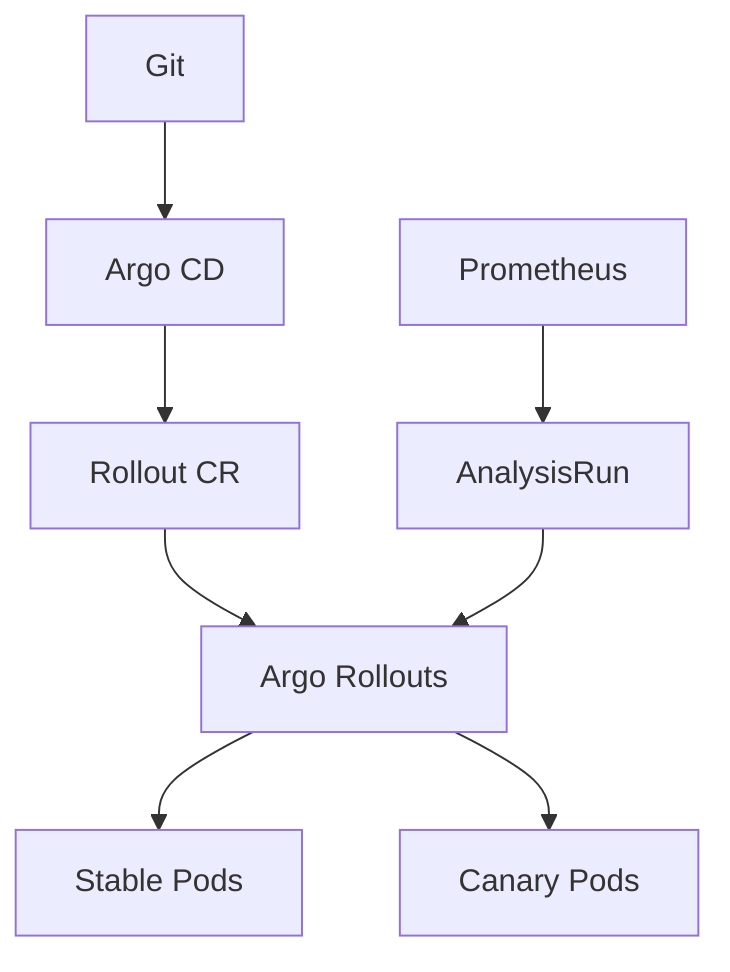
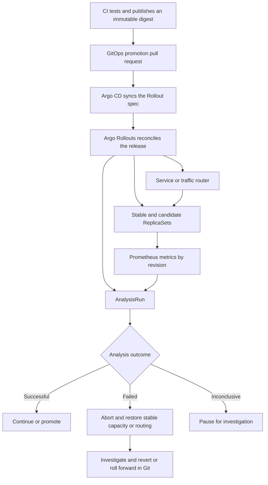

## Learning objectives

- **Configure reliable Kubernetes `RollingUpdate` foundations:** Coordinate `maxSurge`, `maxUnavailable`, `minReadySeconds`, startup/readiness/liveness probes, graceful shutdown, and `PodDisruptionBudget` to avoid user-facing downtime.
- **Separate GitOps delivery from progressive rollout orchestration:** Understand how Argo CD syncs desired `Rollout` specs while Argo Rollouts manages ReplicaSets, traffic routers, pauses, promotions, and aborts.
- **Design canary and blue-green release strategies:** Compare replica-based versus traffic-weighted canaries and active/preview blue-green switches, scoping Argo CD `ignoreDifferences` cleanly at the controller boundary.
- **Gate releases with metric-driven `AnalysisTemplate` checks:** Query per-revision Prometheus SLIs with minimum sample floors, handle `Failed` and `Inconclusive` outcomes safely, and account for retry amplification.
- **Reconcile aborts and schema changes safely in GitOps:** Diagnose why an aborted rollout leaves Git out of sync with serving traffic, and pair Git reverts or roll-forwards with expand–migrate–contract database migrations.

## RollingUpdate is the foundation

```yaml
strategy:
  type: RollingUpdate
  rollingUpdate:
    maxSurge: 1
    maxUnavailable: 0
```

`maxSurge` limits how many Pods can run above the desired replica count. `maxUnavailable` limits how many Pods can be unavailable relative to that count during a rollout. `maxUnavailable: 0` **does not guarantee zero downtime by itself**: the application still needs accurate readiness checks, graceful shutdown, and enough capacity.

## Argo CD and Argo Rollouts have different roles

- **Argo CD:** Syncs `Rollout.spec` from Git.
- **Argo Rollouts:** Coordinates ReplicaSets, traffic routing, analysis, and aborts.
- **Prometheus:** Provides metrics for evaluating the release.



## Canary example

```yaml
apiVersion: argoproj.io/v1alpha1
kind: Rollout
metadata:
  name: payment
spec:
  replicas: 10
  selector:
    matchLabels: {app: payment}
  template:
    metadata:
      labels: {app: payment}
    spec:
      containers:
        - name: payment
          image: nginx:1.27
  strategy:
    canary:
      steps:
        - setWeight: 10
        - pause: {duration: 2m}
        - setWeight: 30
        - pause: {}
```

Without a traffic router, Argo Rollouts approximates `setWeight` using replica counts. This **does not guarantee an exact share of HTTP requests**.

## Automated analysis

Use an `AnalysisTemplate` with Prometheus to check metrics such as a success rate of at least 99%. Set minimum sample sizes and define how to handle missing data. Aborting returns serving traffic to the stable version, but **does not automatically revert the Git commit**. `Synced` and `Healthy` are not equivalent.

## Lab

1. Install Argo Rollouts on a test cluster.
2. Deploy a stable v1, then update the image to v2.
3. Observe the rollout with `kubectl argo rollouts get rollout payment --watch`.
4. Try pausing, promoting, and aborting, and compare what you observe with Argo CD status.

**Official:** [Argo Rollouts Canary](https://argo-rollouts.readthedocs.io/en/stable/features/canary/) · [Kubernetes Deployments](https://kubernetes.io/docs/concepts/workloads/controllers/deployment/).

## Failure-mode walkthrough: zero downtime takes more than replicas

Suppose a Deployment has `replicas: 4`, `maxSurge: 1`, and `maxUnavailable: 0`. During an update, the controller can create one extra Pod. If the Pod fails to become Ready because the database schema is incompatible, the rollout can stall in `Progressing`. This is **protective behavior**, not necessarily a controller bug.

### Deciding when a Pod is ready

```yaml
strategy:
  type: RollingUpdate
  rollingUpdate:
    maxSurge: 1
    maxUnavailable: 0
minReadySeconds: 10
progressDeadlineSeconds: 600
```

Readiness should reflect whether the application can actually serve traffic, not just whether the process has opened a TCP port. Avoid tying liveness to an external database in a way that causes restart storms when the database fails. For slow initialization, a `startupProbe` can keep liveness checks from restarting the container too early.

### Canary releases with Argo Rollouts

```yaml
strategy:
  canary:
    steps:
      - setWeight: 5
      - pause: {duration: 5m}
      - setWeight: 20
      - pause: {duration: 10m}
      - setWeight: 50
      - pause: {}
```

This is a strategy fragment. To control actual traffic percentages independently of replica counts, integrate a supported traffic router such as Istio or a supported Gateway provider. Do not assume `setWeight: 5` means exactly 5% of HTTP requests in every configuration.

### AnalysisTemplate and rollback

Choose metrics that reflect user impact: error rate, latency, payment success, and availability. Define how an `AnalysisTemplate` handles missing metrics, including `Inconclusive` and error outcomes. Do not automatically promote a release during a monitoring outage. Use the expand–contract pattern for database migrations, because rolling back an image does not undo schema or data changes.

### Deployment vs PodDisruptionBudget

A PodDisruptionBudget (PDB) primarily applies to voluntary disruptions through the Eviction API. It does not prevent node crashes or govern every case of a rolling update. Test failure modes alongside topology constraints and spare cluster capacity.

**Lab:** Create a service with a `/ready` endpoint. Roll out an image that always returns 503 from `/ready`, observe `kubectl rollout status`, then restore a working image. Next, measure the request error rate in a progressive delivery simulation.

## Deep dive: what it takes to roll out without downtime

`RollingUpdate` does not guarantee zero downtime on its own. Avoiding user-visible errors requires **capacity, readiness, networking, dependencies, and rollout orchestration** to work together.

### Deployment RollingUpdate

```yaml
apiVersion: apps/v1
kind: Deployment
metadata:
  name: payment
  namespace: payments
spec:
  replicas: 8
  strategy:
    type: RollingUpdate
    rollingUpdate:
      maxSurge: 25%
      maxUnavailable: 0
  selector:
    matchLabels: {app: payment}
  template:
    metadata:
      labels: {app: payment}
    spec:
      terminationGracePeriodSeconds: 40
      containers:
        - name: payment
          image: registry.example.com/payment:v2
          ports: [{containerPort: 8080}]
          readinessProbe:
            httpGet: {path: /ready, port: 8080}
            periodSeconds: 5
          resources:
            requests: {cpu: 250m, memory: 256Mi}
```

With `replicas=8` and `maxSurge=25%`, a rollout can need two extra Pods. If the cluster has no spare node capacity, those Pods may remain Pending and slow or stall the rollout. With `maxUnavailable=0`, the Deployment must maintain the available replica count required by the strategy, but the application can still return errors if its readiness check does not reflect its ability to serve traffic.

### Canary releases and Argo Rollouts

Argo CD manages the desired manifest. The Argo Rollouts controller carries out progressive delivery through steps, traffic routing, and optional analysis. A Rollout can shift traffic in steps of 10% → 30% → 50% → 100% using Istio VirtualService or Gateway resources, or another supported traffic router. **The share of traffic** and **the share of Pod replicas** do not always match, especially with external traffic routing.

```yaml
strategy:
  canary:
    steps:
      - setWeight: 10
      - pause: {duration: 2m}
      - setWeight: 30
      - pause: {duration: 5m}
      - setWeight: 100
```

This fragment belongs in `Rollout.spec`. You need the complete resource and its CRD before applying it.

### Metric-based analysis

A canary succeeds only if its metrics reflect *business correctness* and runtime quality. CPU alone is not enough. For payments, combine success rate, HTTP 5xx rates, P99 latency, and transaction-specific failure rates. An AnalysisTemplate typically needs a Prometheus endpoint, queries, and conditions that have been verified.

Example PromQL query for the proportion of 5xx responses:

```promql
sum(rate(http_requests_total{service="payment",status=~"5.."}[5m]))
/
clamp_min(sum(rate(http_requests_total{service="payment"}[5m])), 0.001)
```

This query illustrates one possible metric convention. Actual labels and histograms depend on the instrumentation. Distinguish missing data from a zero error rate.

### Retry amplification and rollback

A canary can increase latency and cause clients to retry. Retries add traffic, which can trigger circuit breaking or HPA scale-up, masking or exaggerating the new version's impact. Build load testing and idempotency into the release design. Rolling back a binary may not roll back the database schema. Use expand–migrate–contract or another backward-compatible approach.

### How a PDB differs from a Deployment update strategy

A PDB limits voluntary disruptions through the Eviction API. It does not directly replace `maxSurge` or `maxUnavailable` in a Deployment rolling update. Treat them as mechanisms for different events. Check the termination grace period, `preStop` if needed, connection draining, and when Pods stop being marked ready.

### Runbook for a failed rollout

```bash
kubectl rollout status deployment/payment -n payments
kubectl describe deployment payment -n payments
kubectl get pods -n payments -o wide
kubectl get events -n payments --sort-by=.lastTimestamp
kubectl argo rollouts get rollout payment -n payments
```

The `kubectl argo rollouts` command is only available if you install the CLI plugin. When using Istio, verify ownership of VirtualService and DestinationRule resources so Argo CD does not overwrite traffic weights managed by the Rollouts controller.

Sources: [Deployment rolling update](https://kubernetes.io/docs/concepts/workloads/controllers/deployment/), [Argo Rollouts](https://argo-rollouts.readthedocs.io/en/stable/), [Analysis](https://argo-rollouts.readthedocs.io/en/stable/features/analysis/).

## From deployment to controlled production exposure

Continuous delivery makes a tested artifact deployable through a repeatable release process. Progressive delivery controls how much production traffic reaches that artifact and makes further exposure conditional on evidence. A release might move from 5% to 20%, 50%, then 100%, with a pause, analysis, or approval between steps.



GitOps controls desired manifests. Rollout reconciliation manages runtime exposure and ReplicaSets. Analysis evaluates measured release quality. A traffic router is optional for a basic canary and is needed to configure request weighting independently of replica counts.

### Trace a four-replica Deployment update

Starting with four available v1 Pods and `maxSurge: 1`, `maxUnavailable: 0`, the Deployment can create one v2 Pod while all v1 replicas remain available. Once v2 is Ready for `minReadySeconds`, the controller can scale the old ReplicaSet down. The cycle repeats. One illustrative sequence is:

| Stage | v1 available | v2 available | v2 starting |
|---|---:|---:|---:|
| Stable v1 | 4 | 0 | 0 |
| First surge | 4 | 0 | 1 |
| First v2 becomes available | 4 | 1 | 0 |
| Old replica removed and next v2 started | 3 | 1 | 1 |
| Later replacement | 1 | 3 | 1 |
| Stable v2 | 0 | 4 | 0 |

The nominal surge ceiling is five in this example. Terminating Pods can continue consuming resources and temporarily put the total Pod count above that ceiling. Percentage surge rounds up, and percentage unavailability rounds down. At five replicas, 25% gives a surge of two and unavailability of one. At four replicas, both round to one. An unschedulable surge Pod can stall a rollout when unavailability is zero. `ProgressDeadlineExceeded` reports lack of progress through the Deployment's `Progressing=False` condition. Kubernetes keeps reconciling and does not automatically revert the image on this condition. [Kubernetes Deployment strategy and status](https://kubernetes.io/docs/concepts/workloads/controllers/deployment/)

### Design probes, shutdown, and disruption budgets together

| Probe | What it measures | What follows repeated failures |
|---|---|---|
| Startup | Initialization completed | Kubelet restarts the container subject to restart policy. Readiness and liveness wait for startup to succeed. |
| Readiness | The container can serve requests now | The Pod is marked unready and ordinarily stops receiving new traffic through Service endpoints. |
| Liveness | The process is stuck or requires a restart | Kubelet restarts the container subject to restart policy. |

For an application implementing these endpoints, the following fragment belongs in a Pod template:

```yaml
containers:
  - name: payment
    image: registry.example.com/payment:v2
    ports:
      - containerPort: 8080
    startupProbe:
      httpGet: {path: /startup, port: 8080}
      periodSeconds: 5
      failureThreshold: 30
    readinessProbe:
      httpGet: {path: /ready, port: 8080}
      periodSeconds: 5
      failureThreshold: 2
    livenessProbe:
      httpGet: {path: /health, port: 8080}
      periodSeconds: 10
      failureThreshold: 3
```

A shared database outage may legitimately affect readiness. Restarting all Pods in response can amplify that outage, so keep liveness focused on conditions a restart can repair. Account for routing propagation, persistent connections, and in-flight requests during termination. Size the grace period and any `preStop` hook together with application shutdown.

```yaml
apiVersion: policy/v1
kind: PodDisruptionBudget
metadata:
  name: payment-pdb
  namespace: payments
spec:
  minAvailable: 3
  selector:
    matchLabels:
      app: payment
```

With four healthy Pods, this budget normally allows one voluntary eviction at a time through the Eviction API, as during a node drain. Deployment rollouts use their own availability strategy. Existing unavailable Pods still affect the eviction budget. Node failure and direct deletion can interrupt workloads independently of that budget. [Kubernetes probes](https://kubernetes.io/docs/concepts/workloads/pods/probes/) · [Kubernetes disruptions](https://kubernetes.io/docs/concepts/workloads/pods/disruptions/)

When all Pods are Ready, compare observability and business signals by revision. An example release can go from 0.1% to 8% HTTP 5xx, from 120 ms to 900 ms P95 latency, and from 99.8% to 91% payment success while every readiness probe still passes.

## Canary steps and Prometheus analysis

In a basic canary with ten replicas, a 20% weight can be approximated with two candidate Pods and eight stable Pods. Keep-alive connections, unequal load balancing, and client behavior affect actual exposure. Traffic-managed canaries configure a supported ingress, gateway, or mesh integration. Verify weights at the data plane, including router convergence and stable capacity on abort. Traffic percentage and replica percentage can be configured separately in supported setups. Initial creation establishes the first stable revision. Update the Pod template afterward to exercise the configured steps. [Argo Rollouts canary](https://argoproj.github.io/argo-rollouts/features/canary/) · [Argo Rollouts FAQ](https://argoproj.github.io/argo-rollouts/FAQ/)

### Scope each measurement to the candidate

An `AnalysisTemplate` describes measurements. The Rollouts controller instantiates an `AnalysisRun` with resolved arguments. Inline analysis gates a step. Background analysis can monitor multiple steps while the rollout progresses. Runs can succeed, fail, pause the rollout as inconclusive, or encounter provider or evaluation errors. An `Experiment` can run controlled baseline and candidate comparisons.

The following template assumes Prometheus has an application request counter with `service`, `revision`, and `status` labels. The scraping or instrumentation configuration must set `revision` to the candidate Pod template hash. Replace the Prometheus address with your endpoint. The query evaluates the fraction of requests that avoid a 5xx response across a five-minute window and requires at least 100 estimated requests in that window.

```yaml
apiVersion: argoproj.io/v1alpha1
kind: AnalysisTemplate
metadata:
  name: payment-success-rate
  namespace: payments
spec:
  args:
    - name: revision
  metrics:
    - name: non-5xx-rate
      interval: 1m
      count: 5
      failureLimit: 0
      inconclusiveLimit: 0
      consecutiveErrorLimit: 1
      successCondition: 'len(result) == 1 && !isNaN(result[0]) && result[0] >= 0.99'
      failureCondition: 'len(result) == 1 && !isNaN(result[0]) && result[0] < 0.99'
      provider:
        prometheus:
          address: http://prometheus.monitoring.svc:9090
          query: |
            (
              (
                sum(increase(http_requests_total{service="payment",revision="{{args.revision}}",status!~"5.."}[5m]))
                or vector(0)
              )
              /
              sum(increase(http_requests_total{service="payment",revision="{{args.revision}}"}[5m]))
            )
            and
            (sum(increase(http_requests_total{service="payment",revision="{{args.revision}}"}[5m])) >= 100)
```

The comparison filters out a low-volume sample. If the query succeeds but returns no sample or returns NaN, neither condition passes and the measurement is inconclusive. A Prometheus timeout is a measurement error and follows the error limit. With `failureLimit: 0`, the first failing measurement exceeds the limit. `count: 5` sets the planned number of measurements, with earlier termination possible. The five-minute windows overlap when sampled every minute, so these samples are correlated. During rollout qualification, explicitly test healthy data, a failing candidate, low traffic, and backend errors.

Wire the template into the canary strategy as follows. Keep the full Rollout resource and Pod template from the example above. Set its namespace to `payments`, and ensure Prometheus is observing the same candidate hash passed by the controller.

```yaml
strategy:
  canary:
    steps:
      - setWeight: 10
      - pause: {duration: 2m}
      - setWeight: 30
      - pause: {duration: 5m}
      - analysis:
          templates:
            - templateName: payment-success-rate
          args:
            - name: revision
              valueFrom:
                podTemplateHashValue: Latest
      - setWeight: 60
      - pause: {}
```

Five minutes at 30% allows the query window to fill at that exposure after routing converges. Successful inline analysis advances the rollout. Failure aborts it. The final pause requires explicit promotion. Add per-revision latency and business correctness checks in production. A 4xx or a declined transaction can fall inside the non-5xx numerator, so the HTTP result alone cannot tell whether a payment succeeded. [Argo Rollouts analysis and metrics](https://argoproj.github.io/argo-rollouts/features/analysis/) · [Prometheus provider](https://argoproj.github.io/argo-rollouts/analysis/prometheus/)

## Blue-green with active and preview Services

Blue-green runs a candidate alongside the active revision and changes the active Service selector at promotion. Preview traffic provides a place for synthetic tests or review. Run this example separately from the canary with the same name. The namespace must already exist, and the image must serve traffic on port 8080 and expose `/ready`.

```yaml
apiVersion: v1
kind: Service
metadata:
  name: payment-active
  namespace: payments
spec:
  selector: {app: payment}
  ports:
    - port: 80
      targetPort: 8080
---
apiVersion: v1
kind: Service
metadata:
  name: payment-preview
  namespace: payments
spec:
  selector: {app: payment}
  ports:
    - port: 80
      targetPort: 8080
---
apiVersion: argoproj.io/v1alpha1
kind: Rollout
metadata:
  name: payment
  namespace: payments
spec:
  replicas: 4
  selector:
    matchLabels: {app: payment}
  template:
    metadata:
      labels: {app: payment}
    spec:
      containers:
        - name: payment
          image: registry.example.com/payment:v2
          ports: [{containerPort: 8080}]
          readinessProbe:
            httpGet: {path: /ready, port: 8080}
  strategy:
    blueGreen:
      activeService: payment-active
      previewService: payment-preview
      autoPromotionEnabled: false
      scaleDownDelaySeconds: 60
```

On an update, Rollouts adds a revision hash to Service selectors and points preview at the candidate. Pre-promotion analysis can gate the switch. Post-promotion analysis checks live traffic after the switch and can trigger a return to the previous stable revision on failure. The scale-down delay helps cover routing propagation, and the previous ReplicaSet's capacity and routing still need verification before promising a fast recovery. Plan capacity for both revisions. Canary gradually exposes real production traffic. Blue-green provides a preview endpoint and switches the active Service in one promotion step, subject to data-plane propagation. [Argo Rollouts blue-green](https://argoproj.github.io/argo-rollouts/features/bluegreen/)

### Field ownership at the Argo CD boundary

Argo CD manages the Rollout Pod template and analysis definitions. Argo Rollouts manages child ReplicaSets, AnalysisRuns, Rollout status, and its configured Service and router fields. An HPA can manage replicas if those fields are delegated intentionally. For active and preview Services delivered through Argo CD, scope any ignore to the exact runtime-owned revision selector. For example, this Application spec fragment protects the active Service hash while preserving diff visibility for the base selector:

```yaml
ignoreDifferences:
  - group: ""
    kind: Service
    name: payment-active
    namespace: payments
    jsonPointers:
      - /spec/selector/rollouts-pod-template-hash
syncPolicy:
  syncOptions:
    - RespectIgnoreDifferences=true
```

Follow the same pattern for the preview Service when applicable. Router rules are integration-specific. Review which weights the controller manages, and verify a normal Argo CD sync while a release is paused. [Argo CD diff customization](https://argo-cd.readthedocs.io/en/stable/user-guide/diffing/) · [Argo CD sync options](https://argo-cd.readthedocs.io/en/stable/user-guide/sync-options/)

## Exercise the failure path and reconcile Git

Install a pinned Argo Rollouts controller and matching CLI plugin in a test cluster. Start with a stable revision and verify steady traffic before changing the candidate image. First run the replica-based example and observe the manual pause. Then add analysis with revision-specific metrics and generate enough requests to pass the sample floor. Try a healthy candidate, a candidate that produces 5xx, and a quiet candidate with too few samples. For blue-green, run a separate scenario and verify both Service selectors before and after promotion.

```bash
kubectl argo rollouts get rollout payment -n payments --watch
kubectl get analysisruns,replicasets -n payments
kubectl get service payment-active payment-preview -n payments
```

At a manual pause, `kubectl argo rollouts promote payment -n payments` proceeds through the normal promotion path. Use `kubectl argo rollouts abort payment -n payments` to exercise an explicit abort on a subsequent update. Check stable capacity and routing or Service endpoints, plus request errors and latency. Check the Git revision, the live Rollout template, and the image actually serving requests independently.

After an abort, Git may still declare v2 while v1 serves production. Argo CD may report `Synced` because the Rollout's desired spec matches Git even though release health is degraded. The abort adjusts runtime resources and status without writing to Git. Revert to the known-good digest in Git or roll forward with a corrected artifact after diagnosis. Before either action, verify compatibility of database changes, message formats, APIs, and payment side effects. Expand the schema first, migrate while both versions can operate, and contract only after the older version is outside the rollback window. [Argo Rollouts rollback behavior](https://argoproj.github.io/argo-rollouts/FAQ/) · [GitOps promotion and rollback](./gitops-promotion.md)

Try the [progressive delivery simulators and quiz](./gitops-exercises.mdx#model-a-deployment-rolling-update), then continue with [Lesson 11 — Kubernetes Observability](../04-observability/lesson-11-observability.md) for metrics, logs, traces, percentiles, and reliability objectives.

## Self-check questions
1. Which controller owns the desired state, and which owns the actual state in this lesson?
2. What failure modes can occur even if a Kubernetes resource reports `Ready`?
3. What would you verify before deploying to production?
