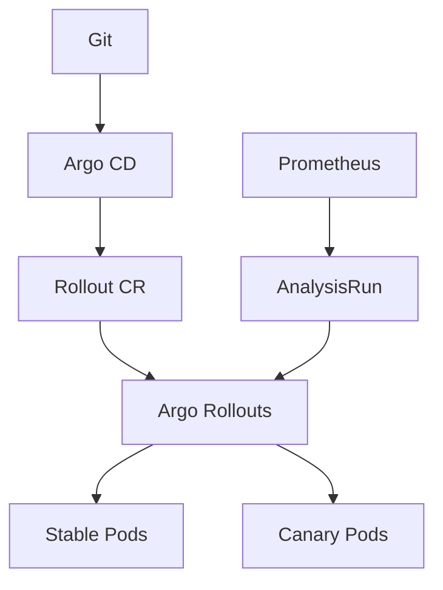

:::info Sources and editorial scope
This lesson expands on the topic and discussion material that could be verified, but **it is not a complete verbatim transcript**. The additional sections were written for this website and may require testing against the specific versions you plan to run in production.
:::

## Learning objectives

RollingUpdate, canary, blue-green, Argo Rollouts, AnalysisTemplate.

## RollingUpdate is the foundation

```yaml
strategy:
  type: RollingUpdate
  rollingUpdate:
    maxSurge: 1
    maxUnavailable: 0
```

`maxSurge` limits how many Pods can run above the desired replica count. `maxUnavailable` limits how many Pods can be unavailable relative to that count during a rollout. `maxUnavailable: 0` **does not guarantee zero downtime by itself**: the application still needs accurate readiness checks, graceful shutdown, and enough capacity.

## Argo CD and Argo Rollouts have different roles

- **Argo CD:** Syncs `Rollout.spec` from Git.
- **Argo Rollouts:** Coordinates ReplicaSets, traffic routing, analysis, and aborts.
- **Prometheus:** Provides metrics for evaluating the release.



## Canary example

```yaml
apiVersion: argoproj.io/v1alpha1
kind: Rollout
metadata:
  name: payment
spec:
  replicas: 10
  selector:
    matchLabels: {app: payment}
  template:
    metadata:
      labels: {app: payment}
    spec:
      containers:
        - name: payment
          image: nginx:1.27
  strategy:
    canary:
      steps:
        - setWeight: 10
        - pause: {duration: 2m}
        - setWeight: 30
        - pause: {}
```

Without a traffic router, Argo Rollouts approximates `setWeight` using replica counts. This **does not guarantee an exact share of HTTP requests**.

## Automated analysis

Use an `AnalysisTemplate` with Prometheus to check metrics such as a success rate of at least 99%. Set minimum sample sizes and define how to handle missing data. Aborting returns serving traffic to the stable version, but **does not automatically revert the Git commit**. `Synced` and `Healthy` are not equivalent.

## Lab

1. Install Argo Rollouts on a test cluster.
2. Deploy a stable v1, then update the image to v2.
3. Observe the rollout with `kubectl argo rollouts get rollout payment --watch`.
4. Try pausing, promoting, and aborting, and compare what you observe with Argo CD status.

**Official:** [Argo Rollouts Canary](https://argo-rollouts.readthedocs.io/en/stable/features/canary/) · [Kubernetes Deployments](https://kubernetes.io/docs/concepts/workloads/controllers/deployment/).


## Failure-mode walkthrough: zero downtime takes more than replicas

Suppose a Deployment has `replicas: 4`, `maxSurge: 1`, and `maxUnavailable: 0`. During an update, the controller can create one extra Pod. If the Pod fails to become Ready because the database schema is incompatible, the rollout can stall in `Progressing`. This is **protective behavior**, not necessarily a controller bug.

### Deciding when a Pod is ready

```yaml
strategy:
  type: RollingUpdate
  rollingUpdate:
    maxSurge: 1
    maxUnavailable: 0
minReadySeconds: 10
progressDeadlineSeconds: 600
```

Readiness should reflect whether the application can actually serve traffic, not just whether the process has opened a TCP port. Avoid tying liveness to an external database in a way that causes restart storms when the database fails. For slow initialization, a `startupProbe` can keep liveness checks from restarting the container too early.

### Canary releases with Argo Rollouts

```yaml
strategy:
  canary:
    steps:
      - setWeight: 5
      - pause: {duration: 5m}
      - setWeight: 20
      - pause: {duration: 10m}
      - setWeight: 50
      - pause: {}
```

This is a strategy fragment. To control actual traffic percentages independently of replica counts, integrate a supported traffic router such as Istio or a supported Gateway provider. Do not assume `setWeight: 5` means exactly 5% of HTTP requests in every configuration.

### AnalysisTemplate and rollback

Choose metrics that reflect user impact: error rate, latency, payment success, and availability. Define how an `AnalysisTemplate` handles missing metrics, including `Inconclusive` and error outcomes. Do not automatically promote a release during a monitoring outage. Use the expand–contract pattern for database migrations, because rolling back an image does not undo schema or data changes.

### Deployment vs PodDisruptionBudget

A PodDisruptionBudget (PDB) primarily applies to voluntary disruptions through the Eviction API. It does not prevent node crashes or govern every case of a rolling update. Test failure modes alongside topology constraints and spare cluster capacity.

**Lab:** Create a service with a `/ready` endpoint. Roll out an image that always returns 503 from `/ready`, observe `kubectl rollout status`, then restore a working image. Next, measure the request error rate in a progressive delivery simulation.

## Deep dive: what it takes to roll out without downtime

`RollingUpdate` does not guarantee zero downtime on its own. Avoiding user-visible errors requires **capacity, readiness, networking, dependencies, and rollout orchestration** to work together.

### Deployment RollingUpdate

```yaml
apiVersion: apps/v1
kind: Deployment
metadata:
  name: payment
  namespace: payments
spec:
  replicas: 8
  strategy:
    type: RollingUpdate
    rollingUpdate:
      maxSurge: 25%
      maxUnavailable: 0
  selector:
    matchLabels: {app: payment}
  template:
    metadata:
      labels: {app: payment}
    spec:
      terminationGracePeriodSeconds: 40
      containers:
        - name: payment
          image: registry.example.com/payment:v2
          ports: [{containerPort: 8080}]
          readinessProbe:
            httpGet: {path: /ready, port: 8080}
            periodSeconds: 5
          resources:
            requests: {cpu: 250m, memory: 256Mi}
```

With `replicas=8` and `maxSurge=25%`, a rollout can need two extra Pods. If the cluster has no spare node capacity, those Pods may remain Pending and slow or stall the rollout. With `maxUnavailable=0`, the Deployment must maintain the available replica count required by the strategy, but the application can still return errors if its readiness check does not reflect its ability to serve traffic.

### Canary releases and Argo Rollouts

Argo CD manages the desired manifest. The Argo Rollouts controller carries out progressive delivery through steps, traffic routing, and optional analysis. A Rollout can shift traffic in steps of 10% → 30% → 50% → 100% using Istio VirtualService or Gateway resources, or another supported traffic router. **The share of traffic** and **the share of Pod replicas** do not always match, especially with external traffic routing.

```yaml
strategy:
  canary:
    steps:
      - setWeight: 10
      - pause: {duration: 2m}
      - setWeight: 30
      - pause: {duration: 5m}
      - setWeight: 100
```

This fragment belongs in `Rollout.spec`. You need the complete resource and its CRD before applying it.

### Metric-based analysis

A canary succeeds only if its metrics reflect *business correctness* and runtime quality. CPU alone is not enough. For payments, combine success rate, HTTP 5xx rates, P99 latency, and transaction-specific failure rates. An AnalysisTemplate typically needs a Prometheus endpoint, queries, and conditions that have been verified.

Example PromQL query for the proportion of 5xx responses:

```promql
sum(rate(http_requests_total{service="payment",status=~"5.."}[5m]))
/
clamp_min(sum(rate(http_requests_total{service="payment"}[5m])), 0.001)
```

This query illustrates one possible metric convention. Actual labels and histograms depend on the instrumentation. Distinguish missing data from a zero error rate.

### Retry amplification and rollback

A canary can increase latency and cause clients to retry. Retries add traffic, which can trigger circuit breaking or HPA scale-up, masking or exaggerating the new version's impact. Build load testing and idempotency into the release design. Rolling back a binary may not roll back the database schema. Use expand–migrate–contract or another backward-compatible approach.

### How a PDB differs from a Deployment update strategy

A PDB limits voluntary disruptions through the Eviction API. It does not directly replace `maxSurge` or `maxUnavailable` in a Deployment rolling update. Treat them as mechanisms for different events. Check the termination grace period, `preStop` if needed, connection draining, and when Pods stop being marked ready.

### Runbook for a failed rollout

```bash
kubectl rollout status deployment/payment -n payments
kubectl describe deployment payment -n payments
kubectl get pods -n payments -o wide
kubectl get events -n payments --sort-by=.lastTimestamp
kubectl argo rollouts get rollout payment -n payments
```

The `kubectl argo rollouts` command is only available if you install the CLI plugin. When using Istio, verify ownership of VirtualService and DestinationRule resources so Argo CD does not overwrite traffic weights managed by the Rollouts controller.

Sources: [Deployment rolling update](https://kubernetes.io/docs/concepts/workloads/controllers/deployment/), [Argo Rollouts](https://argo-rollouts.readthedocs.io/en/stable/), [Analysis](https://argo-rollouts.readthedocs.io/en/stable/features/analysis/).

## Self-check questions

1. Which controller owns the desired state, and which owns the actual state in this lesson?
2. What failure modes can occur even if a Kubernetes resource reports `Ready`?
3. What would you verify before deploying to production?
