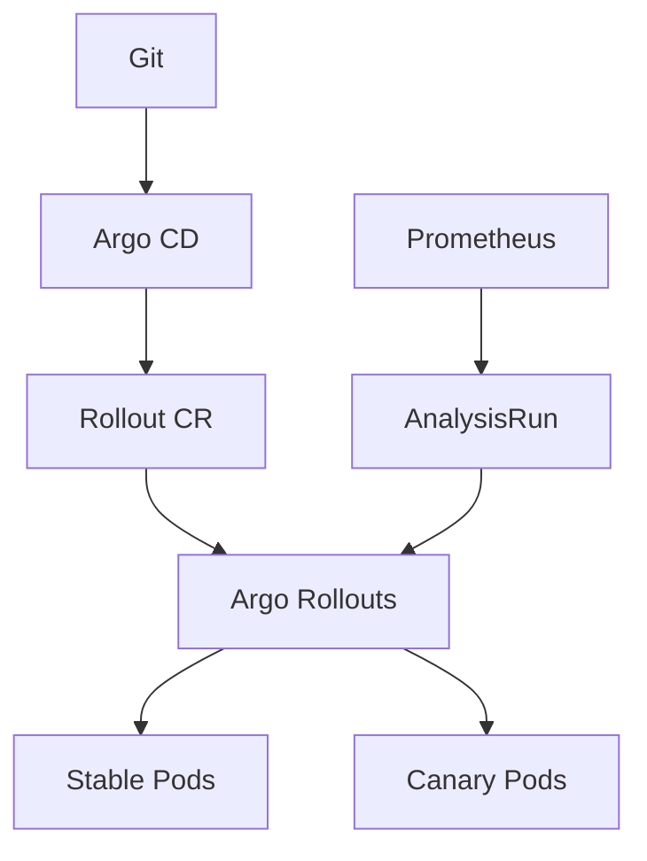
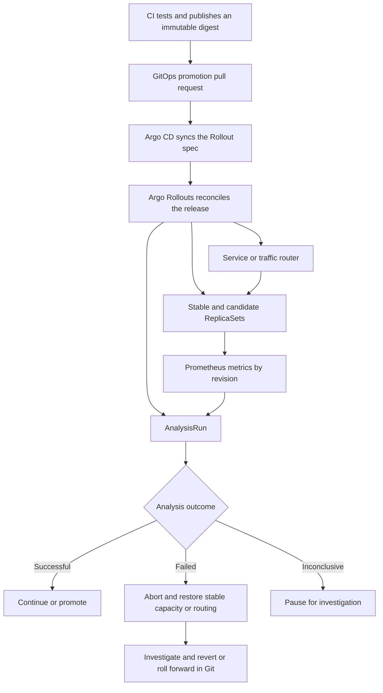

## Mục tiêu học tập

- **Xây dựng nền tảng `RollingUpdate` tin cậy trong Kubernetes:** Phối hợp đồng bộ `maxSurge`, `maxUnavailable`, `minReadySeconds`, các probe startup/readiness/liveness, quy trình tắt mềm và `PodDisruptionBudget` để tránh downtime cho người dùng.
- **Tách biệt phân phối GitOps với điều phối progressive rollout:** Hiểu cách Argo CD đồng bộ `Rollout` spec mong muốn trong khi Argo Rollouts quản lý ReplicaSet, traffic router, điểm dừng, thao tác promote và abort.
- **Thiết kế chiến lược phát hành canary và blue-green:** So sánh canary dựa trên replica với canary định tuyến lưu lượng và mô hình chuyển đổi active/preview của blue-green, đồng thời giới hạn `ignoreDifferences` trong Argo CD đúng tại ranh giới sở hữu.
- **Kiểm soát phát hành bằng `AnalysisTemplate` dựa trên metric:** Truy vấn các chỉ số SLI theo từng revision trên Prometheus kèm ngưỡng cỡ mẫu tối thiểu, xử lý an toàn kết quả `Failed` và `Inconclusive`, và tính đến hiệu ứng khuếch đại thử lại (retry amplification).
- **Đối soát lại Git và thay đổi schema an toàn sau khi abort:** Hiểu vì sao một lần abort khiến Git lệch với phiên bản đang phục vụ lưu lượng, và kết hợp Git revert hoặc roll-forward cùng quy trình migration cơ sở dữ liệu expand–migrate–contract.

## RollingUpdate là nền tảng

```yaml
strategy:
  type: RollingUpdate
  rollingUpdate:
    maxSurge: 1
    maxUnavailable: 0
```

`maxSurge` giới hạn số lượng Pod có thể chạy vượt quá số replica mong muốn. `maxUnavailable` giới hạn số lượng Pod có thể ở trạng thái không sẵn sàng so với số replica mong muốn trong quá trình rollout. Riêng `maxUnavailable: 0` **không tự nó đảm bảo zero downtime**: ứng dụng vẫn cần các bài kiểm tra readiness chính xác, quy trình tắt mềm (graceful shutdown) và đủ năng lực tài nguyên (capacity).

## Argo CD và Argo Rollouts đảm nhận vai trò khác nhau

- **Argo CD:** Sync `Rollout.spec` từ Git.
- **Argo Rollouts:** Điều phối ReplicaSet, định tuyến lưu lượng (traffic routing), phân tích (analysis) và hủy bỏ (abort).
- **Prometheus:** Cung cấp các metric để đánh giá bản phát hành.



## Ví dụ về Canary

```yaml
apiVersion: argoproj.io/v1alpha1
kind: Rollout
metadata:
  name: payment
spec:
  replicas: 10
  selector:
    matchLabels: {app: payment}
  template:
    metadata:
      labels: {app: payment}
    spec:
      containers:
        - name: payment
          image: nginx:1.27
  strategy:
    canary:
      steps:
        - setWeight: 10
        - pause: {duration: 2m}
        - setWeight: 30
        - pause: {}
```

Khi không có bộ định tuyến lưu lượng (traffic router), Argo Rollouts xấp xỉ `setWeight` bằng số lượng replica. Cách này **không đảm bảo tỷ lệ chính xác các request HTTP**.

## Phân tích tự động (Automated analysis)

Sử dụng `AnalysisTemplate` cùng Prometheus để kiểm tra các metric như tỷ lệ thành công tối thiểu 99%. Hãy thiết lập cỡ mẫu tối thiểu và xác định cách xử lý khi thiếu dữ liệu. Thao tác abort sẽ đưa lưu lượng phục vụ quay lại phiên bản ổn định (stable), nhưng **không tự động revert Git commit**. `Synced` và `Healthy` không tương đương nhau.

## Bài thực hành (Lab)

1. Cài đặt Argo Rollouts trên một cluster thử nghiệm.
2. Triển khai bản v1 ổn định, sau đó cập nhật image lên v2.
3. Quan sát quá trình rollout bằng lệnh `kubectl argo rollouts get rollout payment --watch`.
4. Thử tạm dừng (pause), promote và hủy bỏ (abort), sau đó so sánh những gì bạn quan sát được với trạng thái trên Argo CD.

**Tài liệu chính thức:** [Argo Rollouts Canary](https://argo-rollouts.readthedocs.io/en/stable/features/canary/) · [Kubernetes Deployments](https://kubernetes.io/docs/concepts/workloads/controllers/deployment/).

## Phân tích kịch bản lỗi: zero downtime cần nhiều hơn số lượng replica

Giả sử một Deployment có `replicas: 4`, `maxSurge: 1` và `maxUnavailable: 0`. Trong quá trình cập nhật, controller có thể tạo thêm một Pod dự phòng. Nếu Pod đó không thể chuyển sang trạng thái Ready vì schema cơ sở dữ liệu không tương thích, quá trình rollout có thể bị dừng lại ở trạng thái `Progressing`. Đây là **hành vi bảo vệ**, không nhất thiết là lỗi của controller.

### Quyết định thời điểm một Pod sẵn sàng

```yaml
strategy:
  type: RollingUpdate
  rollingUpdate:
    maxSurge: 1
    maxUnavailable: 0
minReadySeconds: 10
progressDeadlineSeconds: 600
```

Readiness nên phản ánh xem ứng dụng có thực sự phục vụ được lưu lượng hay không, chứ không chỉ dừng ở việc tiến trình đã mở cổng TCP. Tránh gắn liveness với một cơ sở dữ liệu bên ngoài theo cách dễ gây ra bão khởi động lại (restart storm) khi cơ sở dữ liệu gặp sự cố. Với các ứng dụng khởi tạo chậm, `startupProbe` có thể ngăn liveness check khởi động lại container quá sớm.

### Phát hành Canary với Argo Rollouts

```yaml
strategy:
  canary:
    steps:
      - setWeight: 5
      - pause: {duration: 5m}
      - setWeight: 20
      - pause: {duration: 10m}
      - setWeight: 50
      - pause: {}
```

Đây là một đoạn cấu hình chiến lược (strategy fragment). Để kiểm soát tỷ lệ phần trăm lưu lượng thực tế độc lập với số lượng replica, hãy tích hợp một traffic router được hỗ trợ như Istio hoặc một Gateway provider tương thích. Đừng mặc định `setWeight: 5` luôn đồng nghĩa với đúng 5% request HTTP trong mọi cấu hình.

### AnalysisTemplate và rollback

Chọn các metric phản ánh tác động đến người dùng: tỷ lệ lỗi (error rate), độ trễ (latency), tỷ lệ thanh toán thành công và tính khả dụng (availability). Xác định rõ cách `AnalysisTemplate` xử lý tình huống thiếu metric, bao gồm kết quả `Inconclusive` và các trường hợp lỗi. Không tự động promote một bản phát hành trong khi hệ thống giám sát đang gặp sự cố. Hãy dùng mô hình expand–contract cho các đợt migration cơ sở dữ liệu, vì việc rollback image không thể hoàn tác các thay đổi về schema hoặc dữ liệu.

### Deployment và PodDisruptionBudget

PodDisruptionBudget (PDB) chủ yếu áp dụng cho các gián đoạn chủ động (voluntary disruptions) thông qua Eviction API. Nó không ngăn chặn sự cố sập node và cũng không chi phối mọi tình huống của rolling update. Hãy kiểm thử các kịch bản lỗi cùng với topology constraint và năng lực dự phòng của cluster.

**Thực hành:** Tạo một service có endpoint `/ready`. Roll out một image luôn trả về mã 503 tại `/ready`, quan sát `kubectl rollout status`, sau đó khôi phục lại một image hoạt động tốt. Tiếp theo, đo tỷ lệ lỗi request trong một bài mô phỏng progressive delivery.

## Phân tích sâu: điều kiện để rollout không downtime

Bản thân `RollingUpdate` không đảm bảo zero downtime. Để tránh phát sinh lỗi mà người dùng nhìn thấy, cần sự phối hợp đồng bộ giữa **năng lực tài nguyên (capacity), readiness, mạng (networking), các phụ thuộc và điều phối rollout**.

### Deployment RollingUpdate

```yaml
apiVersion: apps/v1
kind: Deployment
metadata:
  name: payment
  namespace: payments
spec:
  replicas: 8
  strategy:
    type: RollingUpdate
    rollingUpdate:
      maxSurge: 25%
      maxUnavailable: 0
  selector:
    matchLabels: {app: payment}
  template:
    metadata:
      labels: {app: payment}
    spec:
      terminationGracePeriodSeconds: 40
      containers:
        - name: payment
          image: registry.example.com/payment:v2
          ports: [{containerPort: 8080}]
          readinessProbe:
            httpGet: {path: /ready, port: 8080}
            periodSeconds: 5
          resources:
            requests: {cpu: 250m, memory: 256Mi}
```

Với `replicas=8` và `maxSurge=25%`, một đợt rollout có thể cần thêm hai Pod dự phòng. Nếu cluster không còn tài nguyên node dư thừa, các Pod đó có thể bị kẹt ở trạng thái `Pending` và làm chậm hoặc đình trệ quá trình rollout. Với `maxUnavailable=0`, Deployment bắt buộc phải duy trì số replica khả dụng theo đúng chiến lược, nhưng ứng dụng vẫn có thể trả lỗi nếu readiness check không phản ánh đúng khả năng phục vụ lưu lượng.

### Phát hành Canary và Argo Rollouts

Argo CD quản lý manifest mong muốn. Argo Rollouts controller thực thi progressive delivery thông qua các bước (steps), định tuyến lưu lượng và phân tích tùy chọn. Một Rollout có thể chuyển dịch lưu lượng theo từng nấc 10% → 30% → 50% → 100% bằng Istio VirtualService, tài nguyên Gateway hoặc một traffic router được hỗ trợ khác. **Tỷ trọng lưu lượng** và **tỷ trọng số Pod replica** không phải lúc nào cũng khớp nhau, đặc biệt khi dùng bộ định tuyến lưu lượng bên ngoài.

```yaml
strategy:
  canary:
    steps:
      - setWeight: 10
      - pause: {duration: 2m}
      - setWeight: 30
      - pause: {duration: 5m}
      - setWeight: 100
```

Đoạn cấu hình này thuộc về `Rollout.spec`. Bạn cần đầy đủ khai báo tài nguyên và CRD của nó trước khi apply.

### Phân tích dựa trên metric

Một đợt canary chỉ thực sự thành công khi các metric của nó phản ánh *tính đúng đắn nghiệp vụ* và chất lượng vận hành. Chỉ nhìn vào CPU là chưa đủ. Với hệ thống thanh toán, hãy kết hợp tỷ lệ thành công, tỷ lệ HTTP 5xx, độ trễ P99 và tỷ lệ lỗi đặc thù của giao dịch. Một `AnalysisTemplate` thường cần một Prometheus endpoint, các câu truy vấn và các điều kiện đánh giá đã được kiểm chứng.

Ví dụ truy vấn PromQL tính tỷ lệ phản hồi 5xx:

```promql
sum(rate(http_requests_total{service="payment",status=~"5.."}[5m]))
/
clamp_min(sum(rate(http_requests_total{service="payment"}[5m])), 0.001)
```

Truy vấn này minh họa một quy ước đặt tên metric khả thi. Các label và histogram thực tế phụ thuộc vào cách gắn mã đo lường (instrumentation). Hãy phân biệt rõ giữa tình trạng thiếu dữ liệu và tỷ lệ lỗi bằng 0.

### Khuếch đại thử lại (Retry amplification) và rollback

Một bản canary có thể làm tăng độ trễ và khiến client thực hiện retry. Các lệnh retry tạo thêm lưu lượng, có thể kích hoạt circuit breaking hoặc làm HPA scale-up, từ đó che khuất hoặc phóng đại tác động của phiên bản mới. Hãy đưa kiểm thử tải (load testing) và tính lũy đẳng (idempotency) vào thiết kế phát hành. Việc rollback một bản build nhị phân có thể không rollback được schema cơ sở dữ liệu. Hãy dùng mô hình expand–migrate–contract hoặc một phương pháp tương thích ngược khác.

### Sự khác biệt giữa PDB và chiến lược cập nhật Deployment

PDB giới hạn các gián đoạn chủ động thông qua Eviction API. Nó không trực tiếp thay thế `maxSurge` hay `maxUnavailable` trong rolling update của Deployment. Hãy xem chúng là hai cơ chế phục vụ các sự kiện khác nhau. Kiểm tra kỹ `terminationGracePeriodSeconds`, hook `preStop` nếu cần, cơ chế xả kết nối (connection draining) và thời điểm Pod ngừng được đánh dấu là ready.

### Sổ tay xử lý khi rollout thất bại

```bash
kubectl rollout status deployment/payment -n payments
kubectl describe deployment payment -n payments
kubectl get pods -n payments -o wide
kubectl get events -n payments --sort-by=.lastTimestamp
kubectl argo rollouts get rollout payment -n payments
```

Lệnh `kubectl argo rollouts` chỉ khả dụng nếu bạn đã cài đặt CLI plugin tương ứng. Khi dùng Istio, hãy xác minh quyền sở hữu các tài nguyên `VirtualService` và `DestinationRule` để Argo CD không ghi đè trọng số lưu lượng do Rollouts controller quản lý.

Nguồn: [Deployment rolling update](https://kubernetes.io/docs/concepts/workloads/controllers/deployment/), [Argo Rollouts](https://argo-rollouts.readthedocs.io/en/stable/), [Analysis](https://argo-rollouts.readthedocs.io/en/stable/features/analysis/).

## Từ triển khai liên tục đến phơi bày có kiểm soát trên production

Continuous delivery biến một artifact đã qua kiểm thử thành phiên bản sẵn sàng triển khai thông qua một quy trình phát hành lặp lại được. Progressive delivery kiểm soát bao nhiêu phần trăm lưu lượng production đi vào artifact đó và gắn điều kiện mở rộng phạm vi tiếp xúc với các bằng chứng thực tế. Một bản phát hành có thể dịch chuyển từ 5% lên 20%, 50%, rồi 100%, xen kẽ giữa các bước là khoảng dừng (pause), bước phân tích (analysis) hoặc phê duyệt (approval).



GitOps kiểm soát các manifest mong muốn. Quá trình đối soát Rollout quản lý phạm vi tiếp xúc lúc chạy (runtime exposure) và các ReplicaSet. Bước phân tích đánh giá chất lượng bản phát hành dựa trên số liệu đo đạc. Traffic router là thành phần tùy chọn với canary cơ bản, nhưng là bắt buộc nếu cần cấu hình tỷ trọng request độc lập với số lượng replica.

### Theo dõi quá trình cập nhật một Deployment bốn replica

Bắt đầu với bốn Pod v1 khả dụng cùng `maxSurge: 1`, `maxUnavailable: 0`, Deployment có thể tạo một Pod v2 trong khi cả bốn replica v1 vẫn đang phục vụ. Ngay khi Pod v2 duy trì trạng thái Ready đủ `minReadySeconds`, controller có thể giảm quy mô ReplicaSet cũ. Chu kỳ này lặp lại. Một trình tự minh họa như sau:

| Giai đoạn | Số v1 khả dụng | Số v2 khả dụng | Số v2 đang khởi động |
|---|---:|---:|---:|
| Ổn định v1 | 4 | 0 | 0 |
| Đợt surge đầu tiên | 4 | 0 | 1 |
| Pod v2 đầu tiên khả dụng | 4 | 1 | 0 |
| Gỡ replica cũ và khởi tạo v2 tiếp theo | 3 | 1 | 1 |
| Giai đoạn thay thế tiếp theo | 1 | 3 | 1 |
| Ổn định v2 | 0 | 4 | 0 |

Trần surge danh nghĩa trong ví dụ này là năm. Các Pod đang trong trạng thái `Terminating` vẫn có thể tiếp tục tiêu thụ tài nguyên và tạm thời đẩy tổng số Pod vượt quá mức trần đó. Giá trị `maxSurge` theo phần trăm được làm tròn lên, còn `maxUnavailable` theo phần trăm được làm tròn xuống. Với năm replica, 25% cho ra surge bằng hai và unavailable bằng một. Với bốn replica, cả hai đều làm tròn thành một. Một surge Pod không thể lập lịch (unschedulable) có thể làm đình trệ rollout khi `maxUnavailable` bằng 0. Điều kiện `ProgressDeadlineExceeded` báo hiệu rollout không có tiến triển thông qua trạng thái `Progressing=False` của Deployment. Kubernetes vẫn tiếp tục đối soát và không tự động revert image khi gặp điều kiện này. [Kubernetes Deployment strategy and status](https://kubernetes.io/docs/concepts/workloads/controllers/deployment/)

### Thiết kế đồng bộ các probe, quy trình tắt và disruption budget

| Probe | Đo lường điều gì | Hệ quả khi thất bại liên tiếp |
|---|---|---|
| Startup | Quá trình khởi tạo đã hoàn tất chưa | Kubelet khởi động lại container theo restart policy. Readiness và liveness sẽ chờ startup thành công. |
| Readiness | Container hiện có thể phục vụ request không | Pod bị đánh dấu unready và thông thường sẽ ngừng nhận lưu lượng mới qua các Service endpoint. |
| Liveness | Tiến trình có bị treo hoặc cần khởi động lại không | Kubelet khởi động lại container theo restart policy. |

Đối với ứng dụng triển khai các endpoint này, đoạn cấu hình sau thuộc về Pod template:

```yaml
containers:
  - name: payment
    image: registry.example.com/payment:v2
    ports:
      - containerPort: 8080
    startupProbe:
      httpGet: {path: /startup, port: 8080}
      periodSeconds: 5
      failureThreshold: 30
    readinessProbe:
      httpGet: {path: /ready, port: 8080}
      periodSeconds: 5
      failureThreshold: 2
    livenessProbe:
      httpGet: {path: /health, port: 8080}
      periodSeconds: 10
      failureThreshold: 3
```

Sự cố từ một cơ sở dữ liệu dùng chung có thể ảnh hưởng hợp lý đến readiness. Tuy nhiên, việc khởi động lại toàn bộ Pod để phản ứng lại có thể làm sự cố trầm trọng thêm, vì vậy hãy giữ liveness tập trung vào những tình trạng mà việc khởi động lại thực sự khắc phục được. Cần tính đến độ trễ lan truyền định tuyến (routing propagation), các kết nối bền vững (persistent connections) và các request đang xử lý dở (in-flight requests) trong lúc tắt Pod. Hãy tính toán `terminationGracePeriodSeconds` cùng hook `preStop` (nếu có) đồng bộ với quy trình tắt của ứng dụng.

```yaml
apiVersion: policy/v1
kind: PodDisruptionBudget
metadata:
  name: payment-pdb
  namespace: payments
spec:
  minAvailable: 3
  selector:
    matchLabels:
      app: payment
```

Với bốn Pod khỏe mạnh, ngân sách này thông thường cho phép tối đa một lượt thu hồi chủ động (voluntary eviction) tại một thời điểm thông qua Eviction API, chẳng hạn như khi drain node. Quá trình rollout của Deployment sử dụng chiến lược khả dụng riêng của nó. Các Pod vốn đang ở trạng thái không khả dụng vẫn ảnh hưởng tới ngân sách eviction. Lỗi sập node và thao tác xóa trực tiếp có thể làm gián đoạn workload độc lập với ngân sách này. [Kubernetes probes](https://kubernetes.io/docs/concepts/workloads/pods/probes/) · [Kubernetes disruptions](https://kubernetes.io/docs/concepts/workloads/pods/disruptions/)

Ngay cả khi mọi Pod đều ở trạng thái Ready, hãy so sánh các tín hiệu observability và chỉ số nghiệp vụ theo từng revision. Một bản phát hành mẫu có thể tăng HTTP 5xx từ 0,1% lên 8%, độ trễ P95 từ 120 ms lên 900 ms và giảm tỷ lệ thanh toán thành công từ 99,8% xuống 91% trong khi mọi readiness probe vẫn vượt qua bình thường.

## Các bước Canary và phân tích bằng Prometheus

Trong một canary cơ bản với mười replica, trọng số 20% có thể được xấp xỉ bằng hai Pod ứng viên (candidate) và tám Pod ổn định (stable). Các kết nối keep-alive, cân bằng tải không đồng đều và hành vi của client đều ảnh hưởng tới mức độ tiếp xúc thực tế. Các canary quản lý theo lưu lượng (traffic-managed) sẽ cấu hình tích hợp với ingress, gateway hoặc service mesh được hỗ trợ. Hãy xác minh trọng số thực tế ở tầng data plane, bao gồm thời gian hội tụ của router và năng lực của bản stable khi xảy ra abort. Tỷ lệ phần trăm lưu lượng và tỷ lệ phần trăm replica có thể được cấu hình riêng trong các thiết lập được hỗ trợ. Lần khởi tạo đầu tiên sẽ thiết lập revision ổn định ban đầu; sau đó cập nhật Pod template để kích hoạt các bước đã cấu hình. [Argo Rollouts canary](https://argoproj.github.io/argo-rollouts/features/canary/) · [Argo Rollouts FAQ](https://argoproj.github.io/argo-rollouts/FAQ/)

### Giới hạn phạm vi đo lường cho đúng phiên bản ứng viên

Một `AnalysisTemplate` mô tả các phép đo. Rollouts controller sẽ khởi tạo một `AnalysisRun` với các tham số đã được phân giải. Phân tích nội tuyến (inline analysis) đóng vai trò cổng chặn cho một bước cụ thể. Phân tích nền (background analysis) có thể giám sát xuyên suốt nhiều bước trong khi rollout tiếp diễn. Một lần chạy có thể kết thúc với trạng thái thành công (successful), thất bại (failed), tạm dừng rollout do chưa đủ cơ sở kết luận (inconclusive), hoặc gặp lỗi từ provider hay lỗi đánh giá. Một `Experiment` có thể chạy các phép so sánh có kiểm soát giữa bản baseline và bản candidate.

Template sau giả định Prometheus có một bộ đếm request ứng dụng với các label `service`, `revision` và `status`. Cấu hình scrape hoặc instrumentation phải gắn `revision` bằng Pod template hash của bản candidate. Thay địa chỉ Prometheus bằng endpoint thực tế của bạn. Câu truy vấn đánh giá tỷ lệ request không trả về mã 5xx trong cửa sổ 5 phút và yêu cầu tối thiểu 100 request ước tính trong cửa sổ đó.

```yaml
apiVersion: argoproj.io/v1alpha1
kind: AnalysisTemplate
metadata:
  name: payment-success-rate
  namespace: payments
spec:
  args:
    - name: revision
  metrics:
    - name: non-5xx-rate
      interval: 1m
      count: 5
      failureLimit: 0
      inconclusiveLimit: 0
      consecutiveErrorLimit: 1
      successCondition: 'len(result) == 1 && !isNaN(result[0]) && result[0] >= 0.99'
      failureCondition: 'len(result) == 1 && !isNaN(result[0]) && result[0] < 0.99'
      provider:
        prometheus:
          address: http://prometheus.monitoring.svc:9090
          query: |
            (
              (
                sum(increase(http_requests_total{service="payment",revision="{{args.revision}}",status!~"5.."}[5m]))
                or vector(0)
              )
              /
              sum(increase(http_requests_total{service="payment",revision="{{args.revision}}"}[5m]))
            )
            and
            (sum(increase(http_requests_total{service="payment",revision="{{args.revision}}"}[5m])) >= 100)
```

Phép so sánh này giúp loại bỏ các mẫu có lưu lượng quá thấp. Nếu câu truy vấn chạy thành công nhưng không trả về mẫu nào hoặc trả về `NaN`, cả hai điều kiện đều không thỏa mãn và phép đo nhận kết quả `inconclusive`. Lỗi timeout từ Prometheus được tính là lỗi đo lường (measurement error) và tuân theo giới hạn lỗi (`consecutiveErrorLimit`). Với `failureLimit: 0`, phép đo thất bại đầu tiên sẽ lập tức vượt ngưỡng. `count: 5` đặt số lần đo dự kiến, nhưng quá trình có thể kết thúc sớm hơn. Các cửa sổ 5 phút lấy mẫu mỗi 1 phút sẽ chồng lấn nhau nên các mẫu này có tương quan. Trong quá trình kiểm định rollout, hãy kiểm thử tường minh cả bốn trường hợp: dữ liệu khỏe mạnh, bản ứng viên lỗi, lưu lượng thấp và lỗi từ backend giám sát.

Gắn template này vào chiến lược canary như sau. Giữ nguyên tài nguyên Rollout đầy đủ và Pod template từ ví dụ trên, đặt namespace là `payments` và đảm bảo Prometheus đang quan sát đúng candidate hash mà controller truyền vào.

```yaml
strategy:
  canary:
    steps:
      - setWeight: 10
      - pause: {duration: 2m}
      - setWeight: 30
      - pause: {duration: 5m}
      - analysis:
          templates:
            - templateName: payment-success-rate
          args:
            - name: revision
              valueFrom:
                podTemplateHashValue: Latest
      - setWeight: 60
      - pause: {}
```

Năm phút ở mức 30% giúp cửa sổ truy vấn có đủ dữ liệu ở mức tiếp xúc đó sau khi định tuyến đã hội tụ. Phân tích nội tuyến thành công sẽ đưa rollout tiến tiếp; thất bại sẽ kích hoạt abort. Bước `pause` cuối cùng yêu cầu thao tác promote tường minh. Trên production, hãy bổ sung thêm kiểm tra độ trễ theo từng revision và tính đúng đắn nghiệp vụ. Một lỗi 4xx hoặc một giao dịch bị từ chối vẫn có thể rơi vào tử số non-5xx, nên riêng mã HTTP không đủ để khẳng định giao dịch thanh toán có thành công hay không. [Argo Rollouts analysis and metrics](https://argoproj.github.io/argo-rollouts/features/analysis/) · [Prometheus provider](https://argoproj.github.io/argo-rollouts/analysis/prometheus/)

## Blue-Green với active Service và preview Service

Chiến lược Blue-Green chạy bản ứng viên song song với revision đang hoạt động (active) và chuyển selector của active Service tại thời điểm promote. Lưu lượng preview cung cấp một điểm truy cập riêng cho các bài kiểm thử tổng hợp (synthetic tests) hoặc bước rà soát. Hãy chạy ví dụ này tách biệt với ví dụ canary cùng tên. Namespace phải tồn tại sẵn, và image phải phục vụ lưu lượng trên cổng 8080 cũng như cung cấp endpoint `/ready`.

```yaml
apiVersion: v1
kind: Service
metadata:
  name: payment-active
  namespace: payments
spec:
  selector: {app: payment}
  ports:
    - port: 80
      targetPort: 8080
---
apiVersion: v1
kind: Service
metadata:
  name: payment-preview
  namespace: payments
spec:
  selector: {app: payment}
  ports:
    - port: 80
      targetPort: 8080
---
apiVersion: argoproj.io/v1alpha1
kind: Rollout
metadata:
  name: payment
  namespace: payments
spec:
  replicas: 4
  selector:
    matchLabels: {app: payment}
  template:
    metadata:
      labels: {app: payment}
    spec:
      containers:
        - name: payment
          image: registry.example.com/payment:v2
          ports: [{containerPort: 8080}]
          readinessProbe:
            httpGet: {path: /ready, port: 8080}
  strategy:
    blueGreen:
      activeService: payment-active
      previewService: payment-preview
      autoPromotionEnabled: false
      scaleDownDelaySeconds: 60
```

Khi cập nhật, Rollouts thêm một revision hash vào selector của Service và trỏ preview Service tới bản ứng viên. Phân tích trước khi promote (pre-promotion analysis) có thể làm cổng chặn cho thao tác chuyển đổi. Phân tích sau khi promote (post-promotion analysis) kiểm tra lưu lượng thực tế sau khi chuyển và có thể kích hoạt quay về revision ổn định trước đó nếu phát sinh lỗi. Thời gian trì hoãn thu hẹp (`scaleDownDelaySeconds`) giúp bù đắp độ trễ lan truyền định tuyến, nhưng năng lực và định tuyến của ReplicaSet cũ vẫn cần được xác minh trước khi cam kết khả năng khôi phục nhanh. Hãy chuẩn bị đủ tài nguyên cho cả hai revision chạy song song. Canary mở rộng dần lưu lượng production thực tế; còn Blue-Green cung cấp một preview endpoint và chuyển active Service trong một bước promote duy nhất, tùy thuộc vào độ trễ lan truyền của data plane. [Argo Rollouts blue-green](https://argoproj.github.io/argo-rollouts/features/bluegreen/)

### Quyền sở hữu trường dữ liệu tại ranh giới Argo CD

Argo CD quản lý Pod template của Rollout và các định nghĩa phân tích. Argo Rollouts quản lý các ReplicaSet con, các `AnalysisRun`, trạng thái Rollout và các trường trên Service cũng như router đã cấu hình. Một HPA có thể quản lý số replica nếu các trường đó được ủy quyền có chủ đích. Đối với active Service và preview Service được phân phối qua Argo CD, hãy giới hạn quy tắc ignore đúng vào revision selector do runtime sở hữu. Ví dụ, đoạn cấu hình Application spec dưới đây bảo vệ hash trên active Service trong khi vẫn giữ khả năng nhìn thấy diff của selector gốc:

```yaml
ignoreDifferences:
  - group: ""
    kind: Service
    name: payment-active
    namespace: payments
    jsonPointers:
      - /spec/selector/rollouts-pod-template-hash
syncPolicy:
  syncOptions:
    - RespectIgnoreDifferences=true
```

Áp dụng mô hình tương tự cho preview Service khi cần. Các quy tắc của router phụ thuộc vào từng giải pháp tích hợp. Hãy rà soát trọng số nào do controller quản lý, và kiểm thử một lượt sync bình thường của Argo CD trong lúc một bản phát hành đang ở trạng thái tạm dừng (paused). [Argo CD diff customization](https://argo-cd.readthedocs.io/en/stable/user-guide/diffing/) · [Argo CD sync options](https://argo-cd.readthedocs.io/en/stable/user-guide/sync-options/)

## Diễn tập kịch bản lỗi và đối soát lại Git

Cài đặt một phiên bản Argo Rollouts controller đã pin cùng CLI plugin tương ứng trên một cluster thử nghiệm. Bắt đầu với một revision ổn định và xác minh lưu lượng bình thường trước khi thay đổi candidate image. Trước tiên hãy chạy ví dụ dựa trên replica và quan sát điểm dừng thủ công. Sau đó thêm bước phân tích với các metric theo từng revision và tạo đủ số lượng request để vượt ngưỡng cỡ mẫu tối thiểu. Hãy thử cả ba tình huống: bản ứng viên khỏe mạnh, bản ứng viên sinh mã 5xx và bản ứng viên ít lưu lượng có quá ít mẫu. Với Blue-Green, hãy chạy một kịch bản riêng và xác minh selector của cả hai Service trước và sau khi promote.

```bash
kubectl argo rollouts get rollout payment -n payments --watch
kubectl get analysisruns,replicasets -n payments
kubectl get service payment-active payment-preview -n payments
```

Tại điểm dừng thủ công, lệnh `kubectl argo rollouts promote payment -n payments` sẽ đi tiếp theo luồng promote thông thường. Sử dụng `kubectl argo rollouts abort payment -n payments` để diễn tập thao tác hủy bỏ tường minh ở một lần cập nhật kế tiếp. Kiểm tra năng lực của bản stable, định tuyến hoặc các Service endpoint, cùng với lỗi request và độ trễ. Kiểm tra độc lập giữa Git revision, Rollout template đang chạy và image thực sự đang phục vụ request.

Sau một lệnh abort, Git có thể vẫn khai báo v2 trong khi v1 đang phục vụ production. Argo CD có thể báo cáo `Synced` vì desired spec của Rollout khớp với Git, ngay cả khi sức khỏe bản phát hành đang ở trạng thái suy giảm (`Degraded`). Thao tác abort điều chỉnh tài nguyên và trạng thái lúc chạy mà không ghi ngược về Git. Hãy revert về digest đã biết là tốt trong Git hoặc roll forward với một artifact đã được sửa lỗi sau khi chẩn đoán xong. Trước khi thực hiện bất kỳ hành động nào trong hai phương án đó, hãy xác minh tính tương thích của các thay đổi cơ sở dữ liệu, định dạng thông điệp, API và các tác dụng phụ trong giao dịch thanh toán. Hãy mở rộng schema trước (expand), di chuyển dữ liệu khi cả hai phiên bản đều hoạt động được (migrate), và chỉ thu gọn (contract) sau khi phiên bản cũ đã ra khỏi cửa sổ rollback. [Argo Rollouts rollback behavior](https://argoproj.github.io/argo-rollouts/FAQ/) · [GitOps promotion và rollback](./gitops-promotion.md)

Thử trải nghiệm [trình mô phỏng progressive delivery và câu hỏi trắc nghiệm](./gitops-exercises.mdx#model-a-deployment-rolling-update), sau đó tiếp tục với [Bài 11 — Kubernetes Observability](../04-observability/lesson-11-observability.md) để tìm hiểu về metric, log, trace, phân vị (percentiles) và các mục tiêu độ tin cậy.

## Câu hỏi tự kiểm tra
1. Trong bài học này, controller nào sở hữu trạng thái mong muốn (desired state) và controller nào sở hữu trạng thái thực tế (actual state)?
2. Những kiểu lỗi nào có thể xảy ra ngay cả khi một tài nguyên Kubernetes báo cáo `Ready`?
3. Bạn sẽ xác minh những yếu tố nào trước khi triển khai lên production?
