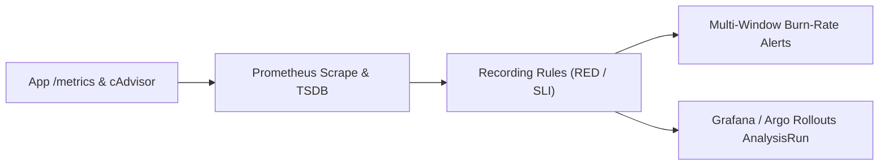
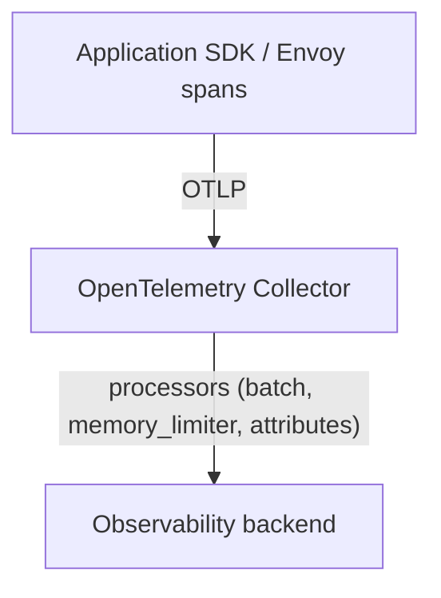

## Learning objectives

- **Correlate metrics, logs, and distributed traces:** Use RED and USE frameworks alongside OpenTelemetry context propagation to investigate latency spikes and isolate bottlenecks across services.
- **Instrument and query Prometheus metrics:** Scrape Pod endpoints without cardinality explosions and write PromQL queries for request rates, error ratios, and classic or native latency histograms.
- **Operate OpenTelemetry Collector pipelines:** Configure OTLP receivers, memory limiters, batch processors, and exporters while managing sampling and backpressure in production.
- **Design user-centric SLIs, SLOs, and error budgets:** Translate business availability targets into multi-window, multi-burn-rate Prometheus recording and alerting rules backed by actionable runbooks.
- **Gate progressive releases with shared telemetry:** Scope Prometheus queries by revision inside Argo Rollouts `AnalysisTemplate` checks while maintaining separate service-wide SLO alerts.

## Metrics, logs, traces

- **Metrics:** How many requests are there, what fraction fail, and what is their latency?
- **Logs:** What specific events occurred?
- **Traces:** Which services and databases did the request pass through, and how long did it take?

## Prometheus

Prometheus scrapes metrics over time. Each combination of metric name and labels is a time series. Avoid labels such as `user_id` or `request_id` because they have high cardinality.



```promql
sum(rate(http_requests_total{service="payment"}[5m]))
```

HTTP 5xx rate:

```promql
sum(rate(http_requests_total{service="payment",status=~"5.."}[5m]))
/
sum(rate(http_requests_total{service="payment"}[5m]))
```

Classic histogram P95 latency:

```promql
histogram_quantile(0.95,
  sum by (le) (rate(http_request_duration_seconds_bucket{service="payment"}[5m])))
```

## SLIs, SLOs, and Error Budgets

If the availability SLO is 99.9%, the allowed failure fraction is 0.001. For one million eligible requests, the error budget is 1,000 failed requests. The **burn rate** is the observed error rate divided by the allowed error rate. Alerts should combine long and short windows rather than react only to brief spikes.

## OpenTelemetry

Instrument the application with the OpenTelemetry SDK. The Collector receives, processes, and exports signals to backends. Prometheus does not need a Collector to scrape metrics.

**Official:** [Prometheus](https://prometheus.io/docs/introduction/overview/) · [OpenTelemetry](https://opentelemetry.io/docs/collector/architecture/) · [SRE Workbook](https://sre.google/workbook/alerting-on-slos/).

## Building an SLO from the user's perspective

An example SLO for the Payment API is 99.9% successful payment requests over a rolling 30-day window. Define the SLI numerator, denominator, and filters explicitly: Do client-caused 4xx responses count as failures? Distinguish total traffic from eligible requests. Define the metric before setting the threshold.

### Error budget

For 99.9% availability over a 30-day window, the theoretical downtime budget is `30 × 24 × 60 × (1 - 0.999) = 43.2 minutes`. This time-based example assumes every minute counts equally; a request-based SLO can give a different result.

### RED/USE

- **RED:** Rate, Errors, and Duration for request-driven systems.
- **USE:** Utilization, Saturation, and Errors for resources such as CPU, memory, disks, and networks.
- **Four Golden Signals:** Latency, Traffic, Errors, Saturation.

```promql
sum(rate(http_requests_total{service="payment",status=~"5.."}[5m]))
/
sum(rate(http_requests_total{service="payment"}[5m]))
```

This PromQL example is illustrative; the labels and counters must exist in your actual instrumentation. Handle a zero denominator in alerting rules to avoid NaN or missing results.

### Prometheus vs OpenTelemetry

Prometheus typically collects and queries metrics; OpenTelemetry defines APIs, SDKs, and a Collector for traces, metrics, and logs. Distributed tracing helps pinpoint where latency accumulates along Payment → Order → Inventory; correlation IDs link a request across services. Exemplars can link metric spikes to traces when the pipeline supports them.

### Alert design

Alert on error-budget burn rate instead of relying only on `CPU > 80%`. Use multi-window, multi-burn-rate alerts to detect both rapid and sustained burn. Then write a runbook with links to dashboards, logs, and traces and steps for verifying user impact.

**Lab:** Instrument a demo HTTP service with OpenTelemetry, expose metrics and traces, simulate 5xx responses and elevated latency, and compare `kubectl top` with the request SLI.

## Deep dive: From metrics to useful SLOs

### Three basic signals

- **Metrics:** Quantitative measurements over time, such as RPS, error rate, CPU utilization, and queue lag.
- **Logs:** Detailed events that help investigate specific causes. Take care not to expose PII or secrets.
- **Traces:** Correlate multiple spans in a distributed request. The `trace_id` links spans from ingress → payment → order → database.

Do not rely on logs alone to calculate a latency SLO at scale, and do not assume that every request is traced when sampling is enabled.

### RED and USE

| Method | Components | Examples |
|---|---|---|
| RED for services | Rate, Errors, Duration | RPS, 5xx rate, P99 latency |
| USE for resources | Utilization, Saturation, Errors | CPU usage, CPU throttling, disk I/O errors |

### Designing an SLI and SLO for Payment

Choose an availability SLI: the fraction of eligible requests that complete successfully, using the business definition of success. Example SLO: **99.9% of eligible requests succeed over 30 days**. The error budget is 0.1% of the requests in scope. That is not necessarily equivalent to 0.1% of the minutes, because traffic patterns vary.

With 1,000,000 eligible requests in the measurement window, a 0.1% budget allows 1,000 unsuccessful requests. If traffic is evenly distributed, 99.9% time-based availability corresponds to about 43.2 minutes of downtime in a 30-day month. This is still a time-based SLI and cannot always replace a request-based SLI.

### PromQL and histograms

A histogram-based P95 query might look like this:

```promql
histogram_quantile(
  0.95,
  sum by (le) (
    rate(http_server_request_duration_seconds_bucket{service="payment"}[5m])
  )
)
```

This query assumes a classic histogram with the `_bucket` suffix, the `le` label, and the metric name shown. The query is different for native histograms. Check the buckets and sample counts: `histogram_quantile` does not average the P95 values of individual Pods.

### OpenTelemetry Collector

Instrumentation with the OpenTelemetry SDK generates telemetry. The OpenTelemetry Collector ingests it through receivers, processes it through processors, and sends it through exporters. The Collector does not generate business metrics on its own if the application is not instrumented or no metrics source is available.



In production, review cardinality, resource attributes, sampling decisions, trace propagation, and retention. Using `user_id` or `order_id` as Prometheus labels can cause a cardinality explosion. Sensitive data also creates privacy risks.

### Alerting and error budgets

Alert on *symptoms*: SLO burn rate, elevated 5xx rates, and sustained high latency. Do not page someone just because one Pod restarts if the service is still meeting its SLO; file a ticket or send a warning instead. Tune multi-window, multi-burn-rate alerts for low traffic and missing data.

### Lab

1. Instrument Payment with a request duration histogram and an HTTP status counter.
2. Build a Grafana dashboard with RED metrics for Payment and USE metrics for Kubernetes node CPUs.
3. Generate synthetic failing requests in staging and correlate logs, traces, and metrics.
4. Calculate the 30-day SLO and error budget from actual metrics, not made-up numbers.
5. Configure alerts so notifications include a runbook link, the service owner, and the affected environment.

Sources: [Prometheus best practices](https://prometheus.io/docs/practices/), [OTel concepts](https://opentelemetry.io/docs/concepts/), [SRE workbook](https://sre.google/workbook/).

## Investigate a slow payment request

Monitoring checks conditions you have anticipated, such as a sustained 5xx rate or a drop in ready replicas. Observability gives you the evidence to investigate new questions. Consider a customer whose `POST /payments` takes 4.8 seconds instead of 200 ms. CPU and Pod readiness look normal, so start with the request path.

| Signal | Example evidence | How to use it |
|---|---|---|
| Metrics | Payment P95 rises to 4.8 seconds while the 5xx rate stays near 0.5% | Identify the affected time window, route, and revision. A percentile describes a population of requests. |
| Structured logs | Payment emits a database timeout warning with a timestamp and `trace_id` | Find the corresponding operation and its application context. |
| Distributed trace | Gateway takes 4,800 ms, Payment takes 4,600 ms, Fraud Check takes 350 ms, and the database span takes 3,950 ms | Inspect the long database span and use its evidence to check queries, connection pools, and contention. |

A trace represents one request or related operation. Each span has a trace ID, a span ID, timestamps, and optional attributes, events, and status. A child span records its parent where applicable. Child spans can overlap or be nested, so calculate end-to-end latency from the root span or request timer. Follow the critical path when looking for the largest contributor. Propagate trace context across services, such as with W3C Trace Context for HTTP, and correlate structured logs with trace IDs. Sampling means a slow request may have no retained trace. [OpenTelemetry signals](https://opentelemetry.io/docs/concepts/signals/) · [OpenTelemetry context propagation](https://opentelemetry.io/docs/concepts/context-propagation/)

## Follow a sample from the application into Prometheus

An instrumented application or exporter exposes samples at an HTTP endpoint, commonly `/metrics`. Prometheus uses static targets or service discovery to locate endpoints and scrape them on a schedule. It adds target labels, stores timestamped samples in its local time-series database, and evaluates PromQL queries and rules over them. A recording rule stores a derived time series. An alerting rule evaluates a condition and sends firing alerts to Alertmanager when configured. Alertmanager handles grouping, routing, deduplication, and silences.

```text
http_requests_total{service="payment",status="200"} 120000
http_requests_total{service="payment",status="500"} 250
```

For a single-target lab, configure a static scrape job. In a replicated Kubernetes deployment, discover individual Pod endpoints so consecutive scrapes for one series represent the same target. Scraping a load-balanced Service can alternate between Pods with independent counters.

```yaml
scrape_configs:
  - job_name: payment
    scrape_interval: 15s
    static_configs:
      - targets: ["payment.metrics.svc:9090"]
```

The example assumes the target endpoint is reachable from Prometheus. Scraping observes application state. Argo Rollouts can query those observations and take a release action through its own reconciliation loop. A time series is identified by its metric name and complete label set. For example, 10 targets × 20 routes × 6 status codes can produce 1,200 request-counter series before adding other labels. Each classic histogram bucket introduces additional series. Keep labels bounded, use route templates such as `/payments/{id}`, and record request IDs in logs and traces. Where supported, exemplars can link a measurement to a trace without putting a unique trace ID on every metric series. [Prometheus overview](https://prometheus.io/docs/introduction/overview/) · [Data model](https://prometheus.io/docs/concepts/data_model/) · [Storage](https://prometheus.io/docs/prometheus/latest/storage/)

### Choose a metric type for the measurement

| Type | What it records | Example and query behavior |
|---|---|---|
| Counter | A cumulative value that can reset | Requests served. Apply `rate()` to each series before summing so resets are handled per target. `increase()` estimates the count over a window using extrapolation. |
| Gauge | A value that can rise or fall | Active connections or queue depth. Query the current level or use a time aggregation such as `max_over_time()`. |
| Histogram | Counts observations across a distribution | Request duration. Classic histograms expose cumulative buckets, a sum, and a count. The `le="0.3"` bucket counts observations up to 300 ms. |
| Summary | Observed count and sum, with optional client-calculated quantiles | Client-side latency quantiles describe one stream. Aggregate compatible histogram distributions to obtain a service-wide quantile. |

For example, 95 requests at 100 ms and five at 3,000 ms average 245 ms. P95 sits at or near the boundary of the slow group depending on the estimator, while P99 captures the tail. Query P95 and P99 by changing the quantile argument in the classic histogram query above. Keep `le` when aggregating classic buckets. For native histograms, aggregate histogram samples directly:

```promql
histogram_quantile(
  0.95,
  sum(rate(http_request_duration_seconds{service="payment"}[5m]))
)
```

For a latency SLI that asks whether requests complete within 300 ms, use the cumulative classic bucket at `le="0.3"` divided by the corresponding count. Choose bucket boundaries that support your objectives. Validate the sample volume before interpreting either a percentile or a ratio. A missing series can leave the result empty, while an existing zero denominator can yield NaN. Monitor telemetry coverage separately. [Prometheus metric types](https://prometheus.io/docs/concepts/metric_types/) · [PromQL functions](https://prometheus.io/docs/prometheus/latest/querying/functions/)

Use RED on Payment to measure request rate, 5xx fraction, and duration. When duration rises, use USE to investigate resource utilization, saturation, and errors. For example, compare database pool occupancy with queued requests and connection failures. A pool can saturate even when node CPU is low.

## Send traces through an OpenTelemetry Collector

The SDK creates spans and propagates context. The Collector receives, processes, and exports telemetry. The following trace pipeline receives OTLP over gRPC, applies memory limiting before batching, and forwards spans to a lab backend.

```yaml
receivers:
  otlp:
    protocols:
      grpc:
        endpoint: 0.0.0.0:4317
processors:
  memory_limiter:
    check_interval: 1s
    limit_mib: 512
  batch: {}
exporters:
  otlp:
    endpoint: tracing-backend:4317
    tls:
      insecure: true
service:
  pipelines:
    traces:
      receivers: [otlp]
      processors: [memory_limiter, batch]
      exporters: [otlp]
```

Expose this lab receiver only on the intended network. For production, configure TLS and access controls, size the memory limiter against the container limit, and test exporter queues and backpressure. With tail sampling, keep spans for a given trace on the same sampling instance so it can evaluate the trace together. Prometheus can scrape applications directly while spans flow through the Collector. Logs and metrics can use independent Collector pipelines where needed. [OpenTelemetry Collector architecture](https://opentelemetry.io/docs/collector/architecture/) · [Scaling the Collector](https://opentelemetry.io/docs/collector/scaling/)

## Turn a Payment SLI into an operating decision

| Concept | Payment example |
|---|---|
| SLI | Good requests divided by eligible requests. Of 1,000,000 eligible requests, 999,500 good requests yield 99.95%. |
| SLO | At least 99.9% of eligible requests are good over a rolling 30-day window. |
| SLA | An agreement with a customer that defines a service level and any consequences for missing it. The contractual definition and window may differ from the engineering SLO. |

Write down where you measure requests, how you treat retries and duplicate attempts, and which outcomes count as good. Classify client-caused 4xx responses deliberately. A payment decline and a payment processing failure can both produce non-5xx responses but represent different business outcomes. Use a purpose-built good or bad counter when an HTTP-status proxy is insufficient.

For 99.9%, the allowed bad fraction is `1 - 0.999 = 0.001`. One million eligible requests give a 1,000-request budget. Five hundred bad requests consume 50%, leaving 500. The burn rate is observed bad fraction divided by allowed bad fraction. An observed 1% consumes budget at 10× the allowed rate. A 5% error rate gives 50×. A time-based SLI measures a separate quantity and should be calculated from its own definition.

Record what the team does as the budget shrinks. For example, the team can defer high-risk changes, prioritize incident follow-up, and restore the normal release cadence after the budget recovers. [Google SRE Workbook on implementing SLOs](https://sre.google/workbook/implementing-slos/)

### Use paired windows to detect fast and sustained burn

| Action | Long window | Short window | Threshold | Bad fraction at a 99.9% SLO |
|---|---:|---:|---:|---:|
| Page quickly | 1 hour | 5 minutes | 14.4× | 1.44% |
| Page for sustained burn | 6 hours | 30 minutes | 6× | 0.6% |
| Open a ticket | 3 days | 6 hours | 1× | 0.1% |

Both windows in a pair must exceed the threshold. The long window reflects accumulated impact. The short window confirms the service is still burning budget rapidly and lets the alert clear sooner after recovery. Use OR between the two paging branches. The Google SRE reference also describes slower ticket variants. At steady request volume, 14.4× over one hour consumes approximately 2% of a 30-day budget. A request-based budget can burn faster or slower when traffic varies. [Google SRE Workbook on alerting on SLOs](https://sre.google/workbook/alerting-on-slos/)

The rule file below uses `payment_slo_requests_total{outcome="good|bad"}` for events already classified as eligible. Initialize both outcome series on each instrumented instance. The example assumes a single environment and a backend with sufficient history for the longest window. Write the recording rules and alert expressions into a Prometheus rule file, then include it from `rule_files` or put the rule groups in a Prometheus Operator `PrometheusRule` resource.

```yaml
groups:
  - name: payment-slo
    rules:
      - record: payment:slo_error_ratio:rate5m
        expr: |
          sum(rate(payment_slo_requests_total{outcome="bad"}[5m]))
          /
          sum(rate(payment_slo_requests_total{outcome=~"good|bad"}[5m]))
      - record: payment:slo_error_ratio:rate30m
        expr: |
          sum(rate(payment_slo_requests_total{outcome="bad"}[30m]))
          /
          sum(rate(payment_slo_requests_total{outcome=~"good|bad"}[30m]))
      - record: payment:slo_error_ratio:rate1h
        expr: |
          sum(rate(payment_slo_requests_total{outcome="bad"}[1h]))
          /
          sum(rate(payment_slo_requests_total{outcome=~"good|bad"}[1h]))
      - record: payment:slo_error_ratio:rate6h
        expr: |
          sum(rate(payment_slo_requests_total{outcome="bad"}[6h]))
          /
          sum(rate(payment_slo_requests_total{outcome=~"good|bad"}[6h]))
      - record: payment:slo_error_ratio:rate3d
        expr: |
          sum(rate(payment_slo_requests_total{outcome="bad"}[3d]))
          /
          sum(rate(payment_slo_requests_total{outcome=~"good|bad"}[3d]))
      - alert: PaymentSLOBurnPage
        expr: |
          (payment:slo_error_ratio:rate1h > 14.4 * 0.001
           and payment:slo_error_ratio:rate5m > 14.4 * 0.001)
          or
          (payment:slo_error_ratio:rate6h > 6 * 0.001
           and payment:slo_error_ratio:rate30m > 6 * 0.001)
        labels:
          severity: page
        annotations:
          summary: Payment availability budget is burning rapidly
      - alert: PaymentSLOBurnTicket
        expr: |
          payment:slo_error_ratio:rate3d > 0.001
          and payment:slo_error_ratio:rate6h > 0.001
        labels:
          severity: ticket
        annotations:
          summary: Payment availability budget is burning slowly
```

A zero denominator or missing measurements do not fire these ratio-based rules. Add telemetry coverage alerts and use synthetic probes where low traffic makes user-request rates unreliable. Route page and ticket severities in Alertmanager and link an incident runbook. During a page, verify affected users and the current burn rate, inspect recent deployments and traces, then record mitigation and recovery evidence. Test rules with `promtool check rules payment-slo.yaml` and cases for healthy traffic, fast and slow burn, recovery, and missing telemetry. [Prometheus recording rules](https://prometheus.io/docs/prometheus/latest/configuration/recording_rules/) · [Alertmanager](https://prometheus.io/docs/alerting/latest/alertmanager/)

## Use the same telemetry for canary analysis

A canary gate evaluates exposure to one candidate revision at specific rollout steps. SLO alerts monitor service reliability even when no release is underway. A healthy stable revision can dilute a failing canary in the service-wide SLI. Query the candidate by revision. As a separate check, compare a qualified candidate with the stable baseline under comparable traffic.

Reuse the [Lesson 10 candidate AnalysisTemplate](../03-gitops-delivery/lesson-10-progressive-delivery.md#scope-each-measurement-to-the-candidate). For a 1% candidate 5xx limit, use `status=~"5.."` in its numerator, keeping the fallback for an absent 5xx series and sample-count filter. Set these measurement conditions:

```yaml
successCondition: >
  len(result) == 1 && !isNaN(result[0]) &&
  !isInf(result[0]) && result[0] <= 0.01
failureCondition: >
  len(result) == 1 && !isNaN(result[0]) &&
  !isInf(result[0]) && result[0] > 0.01
```

With both conditions present, empty or non-finite data is inconclusive. Provider failures follow the metric error policy. Set `failureLimit: 1` to tolerate one failing measurement and fail on the second. Keep the inconclusive and error limits intentional. Allow a full five-minute query window to fill at the intended exposure before measuring, and confirm sufficient candidate traffic. Use the gate to promote, pause, or abort an update. Maintain separate SLO alerts to page or create tickets for service-wide impact. [Argo Rollouts analysis](https://argoproj.github.io/argo-rollouts/features/analysis/) · [Argo Rollouts Prometheus provider](https://argoproj.github.io/argo-rollouts/analysis/prometheus/)

## Lab from instrumentation to release verification

1. Install Prometheus and Grafana in a test cluster. Instrument Payment with the request counter, a compatible classic latency histogram, and an eligible outcome counter.
2. Configure endpoint discovery and verify target health. In Prometheus, run the RED queries above and confirm the expected labels and sample volume.
3. Configure OTLP tracing and send a slow request through two instrumented services. Find a trace and correlate it with a structured log entry.
4. Generate HTTP 500 responses, increase latency, and make a lab Pod unready in separate runs. Compare how RED signals, traces, and workload status respond to each event.
5. Define eligible requests and good outcomes. Load the rule file and verify the recording series, paging branches, ticket threshold, and recovery behavior.
6. Send candidate traffic to Argo Rollouts and verify successful, failed, and inconclusive outcomes. Compare them against the service-wide SLI and confirm the release action independently.

```bash
kubectl get pods,services -n monitoring
kubectl port-forward -n monitoring svc/prometheus-operated 9090:9090
```

Use the actual Prometheus Service name from your installation and query the local endpoint at `http://localhost:9090`.

Try the [error budget calculator and knowledge check](./observability-exercises.mdx), then continue with [Lesson 12 — Kubernetes Networking Internals](../05-networking/lesson-12-kubernetes-networking.md) to follow traffic through Pod and Node networking, Services, EndpointSlices, DNS, and Kubernetes policy.

## Self-check questions
1. Which controller owns the desired state and the actual state in this context?
2. What failure modes can occur even when the Kubernetes resource reports `Ready`?
3. What would you verify before deploying to production?
