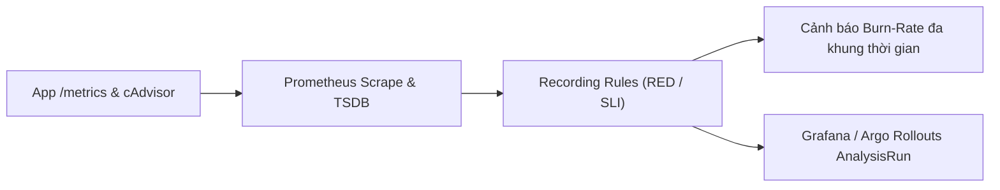
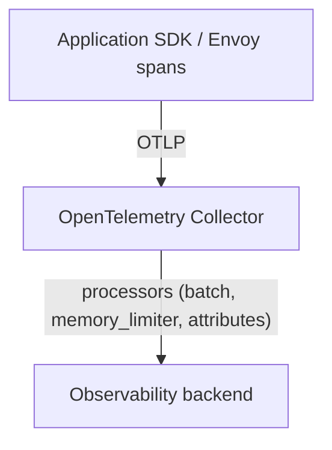

## Mục tiêu học tập

- **Đối chiếu metrics, logs và distributed traces:** Vận dụng khung RED/USE cùng cơ chế lan truyền ngữ cảnh OpenTelemetry để điều tra độ trễ tăng cao và khoanh vùng nút cổ chai giữa các service.
- **Gắn instrumentation và truy vấn metrics với Prometheus:** Scrape từng Pod endpoint tránh bùng nổ cardinality và viết truy vấn PromQL cho tốc độ request, tỷ lệ lỗi và classic/native latency histogram.
- **Vận hành pipeline OpenTelemetry Collector:** Cấu hình OTLP receiver, `memory_limiter`, batch processor và exporter đồng thời kiểm soát sampling và backpressure trong production.
- **Thiết kế SLI, SLO và Error Budget theo góc nhìn người dùng:** Chuyển hóa mục tiêu độ sẵn sàng nghiệp vụ thành các recording rule và cảnh báo multi-window, multi-burn-rate kèm runbook thực thi rõ ràng.
- **Kiểm soát phát hành canary bằng cùng nguồn telemetry:** Khoanh vùng truy vấn Prometheus theo revision trong `AnalysisTemplate` của Argo Rollouts song song với cảnh báo SLO toàn service.

## Metrics, logs, traces

- **Metrics:** Có bao nhiêu request, tỷ lệ lỗi là bao nhiêu và độ trễ như thế nào?
- **Logs:** Những sự kiện cụ thể nào đã xảy ra?
- **Traces:** Request đã đi qua những service và database nào, và mất bao lâu ở mỗi bước?

## Prometheus

Prometheus thực hiện scrape metrics theo thời gian. Mỗi tổ hợp tên metric và tập label tạo thành một time series. Tránh sử dụng các label như `user_id` hoặc `request_id` vì chúng có độ phân giải (cardinality) rất cao.



```promql
sum(rate(http_requests_total{service="payment"}[5m]))
```

Tỷ lệ HTTP 5xx:

```promql
sum(rate(http_requests_total{service="payment",status=~"5.."}[5m]))
/
sum(rate(http_requests_total{service="payment"}[5m]))
```

Độ trễ P95 với classic histogram:

```promql
histogram_quantile(0.95,
  sum by (le) (rate(http_request_duration_seconds_bucket{service="payment"}[5m])))
```

## SLI, SLO và Error Budget

Nếu SLO về độ sẵn sàng (availability) là 99,9%, tỷ lệ lỗi cho phép là 0,001. Với một triệu request hợp lệ (eligible requests), Error Budget là 1.000 request lỗi. **Burn Rate** là tỷ lệ lỗi quan sát được chia cho tỷ lệ lỗi cho phép. Cảnh báo nên kết hợp khung thời gian dài và ngắn thay vì chỉ phản ứng với các đợt tăng đột biến ngắn hạn.

## OpenTelemetry

Tích hợp instrumentation vào ứng dụng bằng OpenTelemetry SDK. Collector nhận, xử lý và xuất (export) các tín hiệu telemetry sang backend. Prometheus không cần Collector để scrape metrics.

**Tài liệu chính thức:** [Prometheus](https://prometheus.io/docs/introduction/overview/) · [OpenTelemetry](https://opentelemetry.io/docs/collector/architecture/) · [SRE Workbook](https://sre.google/workbook/alerting-on-slos/).

## Xây dựng SLO từ góc nhìn người dùng

Một ví dụ SLO cho Payment API là 99,9% request thanh toán thành công trong khung thời gian trượt 30 ngày (rolling 30-day window). Hãy định nghĩa rõ tử số, mẫu số và các bộ lọc của SLI: Các phản hồi 4xx do client gây ra có bị tính là lỗi không? Cần phân biệt tổng lưu lượng với các request hợp lệ. Hãy định nghĩa metric trước khi đặt ngưỡng.

### Error Budget

Với độ sẵn sàng 99,9% trong khung 30 ngày, quỹ thời gian downtime lý thuyết là `30 × 24 × 60 × (1 - 0.999) = 43,2 phút`. Ví dụ theo thời gian (time-based) này giả định mọi phút có trọng số như nhau; một SLO theo request (request-based) có thể cho kết quả khác.

### RED/USE

- **RED:** Rate (tốc độ request), Errors (lỗi) và Duration (thời lượng) cho các hệ thống hướng request.
- **USE:** Utilization (mức sử dụng), Saturation (mức bão hòa) và Errors (lỗi) cho tài nguyên như CPU, bộ nhớ, ổ đĩa và mạng.
- **Four Golden Signals:** Latency (độ trễ), Traffic (lưu lượng), Errors (lỗi), Saturation (mức bão hòa).

```promql
sum(rate(http_requests_total{service="payment",status=~"5.."}[5m]))
/
sum(rate(http_requests_total{service="payment"}[5m]))
```

Ví dụ PromQL này mang tính minh họa; các label và counter phải thực sự tồn tại trong phần instrumentation của bạn. Cần xử lý trường hợp mẫu số bằng 0 trong các quy tắc cảnh báo để tránh kết quả `NaN` hoặc rỗng.

### Prometheus vs OpenTelemetry

Prometheus thường thu thập và truy vấn metrics; OpenTelemetry định nghĩa API, SDK và Collector cho traces, metrics và logs. Distributed tracing giúp xác định chính xác nơi độ trễ tích tụ dọc theo chuỗi Payment → Order → Inventory; correlation ID liên kết một request xuyên suốt các service. Exemplars có thể liên kết các đỉnh metric với trace tương ứng khi pipeline hỗ trợ.

### Thiết kế cảnh báo (Alert)

Hãy cảnh báo dựa trên Burn Rate của Error Budget thay vì chỉ dựa vào `CPU > 80%`. Sử dụng cảnh báo đa khung thời gian, đa tốc độ đốt (multi-window, multi-burn-rate) để phát hiện cả tình trạng tiêu hao nhanh lẫn tiêu hao kéo dài. Sau đó, viết runbook kèm liên kết đến dashboard, logs, traces và các bước kiểm chứng tác động tới người dùng.

**Thực hành:** Gắn OpenTelemetry vào một HTTP service mẫu, expose metrics và traces, mô phỏng lỗi 5xx cùng độ trễ cao, và so sánh `kubectl top` với request SLI.

## Phân tích sâu: Từ metrics đến SLO hữu ích

### Ba tín hiệu cơ bản

- **Metrics:** Các phép đo định lượng theo thời gian, như RPS, tỷ lệ lỗi, mức sử dụng CPU và độ trễ hàng đợi (queue lag).
- **Logs:** Các sự kiện chi tiết giúp điều tra nguyên nhân cụ thể. Lưu ý không làm lộ dữ liệu cá nhân (PII) hoặc secret.
- **Traces:** Liên kết nhiều span trong một request phân tán. `trace_id` kết nối các span từ ingress → payment → order → database.

Không nên chỉ dựa vào logs để tính toán latency SLO ở quy mô lớn, và cũng không giả định mọi request đều có trace khi cơ chế sampling được bật.

### RED và USE

| Phương pháp | Thành phần | Ví dụ |
|---|---|---|
| RED cho service | Rate, Errors, Duration | RPS, tỷ lệ 5xx, độ trễ P99 |
| USE cho tài nguyên | Utilization, Saturation, Errors | Mức dùng CPU, CPU throttling, lỗi disk I/O |

### Thiết kế SLI và SLO cho Payment

Chọn một availability SLI: tỷ lệ các request hợp lệ hoàn tất thành công theo định nghĩa nghiệp vụ. Ví dụ SLO: **99,9% request hợp lệ thành công trong 30 ngày**. Error Budget là 0,1% số request trong phạm vi đo. Con số này không nhất thiết tương đương 0,1% số phút, vì lưu lượng thay đổi theo thời gian.

Với 1.000.000 request hợp lệ trong khung đo, ngân sách 0,1% cho phép 1.000 request không thành công. Nếu lưu lượng phân bổ đều, độ sẵn sàng 99,9% theo thời gian tương ứng khoảng 43,2 phút downtime trong một tháng 30 ngày. Đây vẫn là SLI theo thời gian và không phải lúc nào cũng thay thế được SLI theo request.

### PromQL và histogram

Một truy vấn P95 dựa trên histogram có thể viết như sau:

```promql
histogram_quantile(
  0.95,
  sum by (le) (
    rate(http_server_request_duration_seconds_bucket{service="payment"}[5m])
  )
)
```

Truy vấn này giả định sử dụng classic histogram với hậu tố `_bucket`, label `le` và tên metric như trên. Với native histogram, cách truy vấn sẽ khác. Hãy kiểm tra các bucket và số lượng mẫu: `histogram_quantile` không lấy trung bình các giá trị P95 của từng Pod riêng lẻ.

### OpenTelemetry Collector

Instrumentation bằng OpenTelemetry SDK tạo ra telemetry. OpenTelemetry Collector tiếp nhận dữ liệu qua receivers, xử lý qua processors và gửi đi qua exporters. Collector không tự sinh ra business metrics nếu ứng dụng chưa được gắn instrumentation hoặc không có nguồn metrics nào.



Trong môi trường production, hãy rà soát cardinality, resource attributes, chiến lược sampling, trace propagation và thời gian lưu trữ (retention). Dùng `user_id` hoặc `order_id` làm label trong Prometheus có thể gây bùng nổ cardinality. Dữ liệu nhạy cảm cũng tiềm ẩn rủi ro về quyền riêng tư.

### Cảnh báo và Error Budget

Hãy cảnh báo theo *triệu chứng (symptoms)*: SLO Burn Rate, tỷ lệ 5xx tăng cao và độ trễ cao kéo dài. Đừng gửi page đánh thức người trực chỉ vì một Pod khởi động lại nếu service vẫn đạt SLO; thay vào đó hãy tạo ticket hoặc gửi cảnh báo mức nhẹ. Tinh chỉnh cảnh báo multi-window, multi-burn-rate cho trường hợp lưu lượng thấp và thiếu dữ liệu.

### Thực hành

1. Gắn instrumentation cho Payment với request duration histogram và HTTP status counter.
2. Xây dựng dashboard Grafana gồm RED metrics cho Payment và USE metrics cho CPU của các node Kubernetes.
3. Tạo các request lỗi giả lập trên staging và đối chiếu logs, traces cùng metrics.
4. Tính toán SLO 30 ngày và Error Budget từ metrics thực tế, không dùng số liệu ước lượng tùy ý.
5. Cấu hình cảnh báo sao cho thông báo đi kèm liên kết runbook, chủ sở hữu service và môi trường bị ảnh hưởng.

Nguồn tham khảo: [Prometheus best practices](https://prometheus.io/docs/practices/), [OTel concepts](https://opentelemetry.io/docs/concepts/), [SRE workbook](https://sre.google/workbook/).

## Điều tra một request thanh toán bị chậm

Monitoring kiểm tra các điều kiện bạn đã lường trước, như tỷ lệ 5xx kéo dài hoặc số replica sẵn sàng bị sụt giảm. Observability cung cấp bằng chứng để điều tra những câu hỏi mới phát sinh. Xét trường hợp khách hàng gặp `POST /payments` mất 4,8 giây thay vì 200 ms. CPU và trạng thái readiness của Pod đều bình thường, vì vậy hãy bắt đầu từ đường đi của request.

| Tín hiệu | Bằng chứng ví dụ | Cách sử dụng |
|---|---|---|
| Metrics | P95 của Payment tăng lên 4,8 giây trong khi tỷ lệ 5xx vẫn ở mức ~0,5% | Xác định khung thời gian, route và revision bị ảnh hưởng. Percentile mô tả một tập hợp request. |
| Structured logs | Payment ghi nhận cảnh báo database timeout kèm timestamp và `trace_id` | Tìm thao tác tương ứng và ngữ cảnh ứng dụng của nó. |
| Distributed trace | Gateway mất 4.800 ms, Payment mất 4.600 ms, Fraud Check mất 350 ms, và database span mất 3.950 ms | Kiểm tra database span kéo dài và dùng bằng chứng đó để kiểm tra câu truy vấn, connection pool và tranh chấp tài nguyên (contention). |

Một trace đại diện cho một request hoặc thao tác liên quan. Mỗi span có trace ID, span ID, timestamp và các thuộc tính, sự kiện, trạng thái tùy chọn. Span con ghi nhận span cha khi phù hợp. Các span con có thể chạy song song hoặc lồng nhau, nên hãy tính độ trễ đầu-cuối (end-to-end) từ root span hoặc bộ đếm thời gian của request. Đi theo đường găng (critical path) để tìm thành phần chiếm nhiều thời gian nhất. Truyền ngữ cảnh trace (trace context) xuyên suốt các service, ví dụ với chuẩn W3C Trace Context cho HTTP, và liên kết structured logs bằng trace ID. Do có sampling, một request chậm có thể không có trace nào được lưu lại. [OpenTelemetry signals](https://opentelemetry.io/docs/concepts/signals/) · [OpenTelemetry context propagation](https://opentelemetry.io/docs/concepts/context-propagation/)

## Theo dõi một mẫu dữ liệu từ ứng dụng vào Prometheus

Ứng dụng đã gắn instrumentation hoặc exporter sẽ mở một HTTP endpoint, thường là `/metrics`, để expose các mẫu (sample). Prometheus dùng static targets hoặc service discovery để tìm các endpoint và scrape theo lịch. Nó gắn thêm target labels, lưu các mẫu kèm timestamp vào time-series database cục bộ và thực thi truy vấn PromQL cùng các rule trên đó. Recording rule lưu một time series phái sinh. Alerting rule đánh giá điều kiện và gửi cảnh báo đang kích hoạt tới Alertmanager khi được cấu hình. Alertmanager đảm nhiệm việc gom nhóm (grouping), định tuyến (routing), chống trùng lặp (deduplication) và tắt tiếng tạm thời (silences).

```text
http_requests_total{service="payment",status="200"} 120000
http_requests_total{service="payment",status="500"} 250
```

Với môi trường lab chỉ có một target, có thể cấu hình static scrape job. Trong Deployment có nhiều bản sao trên Kubernetes, cần discover từng Pod endpoint riêng lẻ để các lần scrape liên tiếp của một series đại diện cho cùng một target. Scrape qua một Service có cân bằng tải có thể nhảy qua lại giữa các Pod vốn có counter độc lập.

```yaml
scrape_configs:
  - job_name: payment
    scrape_interval: 15s
    static_configs:
      - targets: ["payment.metrics.svc:9090"]
```

Ví dụ trên giả định target endpoint có thể truy cập được từ Prometheus. Scrape chỉ quan sát trạng thái ứng dụng. Argo Rollouts có thể truy vấn các quan sát này và thực hiện hành động phát hành thông qua vòng lặp đối soát (reconciliation loop) riêng. Một time series được định danh bằng tên metric và toàn bộ tập label. Ví dụ: 10 targets × 20 routes × 6 status codes có thể tạo ra 1.200 request-counter series trước khi thêm các label khác. Mỗi bucket của classic histogram lại sinh thêm series mới. Hãy giữ tập label có giới hạn, dùng route template như `/payments/{id}`, và ghi request ID vào logs/traces. Khi hệ thống hỗ trợ, exemplars có thể liên kết một phép đo với trace mà không cần gắn trace ID duy nhất lên từng metric series. [Prometheus overview](https://prometheus.io/docs/introduction/overview/) · [Data model](https://prometheus.io/docs/concepts/data_model/) · [Storage](https://prometheus.io/docs/prometheus/latest/storage/)

### Chọn loại metric phù hợp cho phép đo

| Loại | Ghi nhận điều gì | Ví dụ và hành vi truy vấn |
|---|---|---|
| Counter | Giá trị tích lũy có thể bị reset | Số request đã phục vụ. Áp dụng `rate()` cho từng series trước khi cộng tổng để xử lý reset theo từng target. `increase()` ước lượng số lượng trong một khung thời gian bằng phép ngoại suy. |
| Gauge | Giá trị có thể tăng hoặc giảm | Số kết nối đang mở hoặc độ sâu hàng đợi. Truy vấn giá trị hiện tại hoặc dùng hàm tổng hợp theo thời gian như `max_over_time()`. |
| Histogram | Đếm số quan sát theo phân phối | Thời lượng request. Classic histogram cung cấp các bucket tích lũy, tổng (`sum`) và số lượng (`count`). Bucket `le="0.3"` đếm các quan sát từ 300 ms trở xuống. |
| Summary | Số lượng và tổng quan sát, tùy chọn tính quantile phía client | Latency quantile phía client chỉ mô tả một luồng đơn lẻ. Cần tổng hợp các phân phối histogram tương thích để có quantile toàn service. |

Ví dụ, 95 request mất 100 ms và 5 request mất 3.000 ms sẽ có trung bình 245 ms. P95 nằm tại hoặc gần ranh giới của nhóm chậm tùy thuật toán ước lượng, còn P99 phản ánh phần đuôi (tail latency). Có thể truy vấn P95 và P99 bằng cách đổi tham số quantile trong câu truy vấn classic histogram ở trên. Giữ lại label `le` khi tổng hợp các classic bucket. Với native histogram, tổng hợp trực tiếp các mẫu histogram:

```promql
histogram_quantile(
  0.95,
  sum(rate(http_request_duration_seconds{service="payment"}[5m]))
)
```

Đối với latency SLI kiểm tra xem request có hoàn tất trong vòng 300 ms hay không, hãy lấy classic bucket tích lũy tại `le="0.3"` chia cho tổng số lượng tương ứng. Chọn các mốc bucket phù hợp với mục tiêu SLO. Kiểm tra lưu lượng mẫu trước khi diễn giải percentile hoặc tỷ lệ. Series bị thiếu có thể trả về kết quả rỗng, còn mẫu số tồn tại nhưng bằng 0 có thể trả về `NaN`. Hãy giám sát độ phủ telemetry (telemetry coverage) một cách độc lập. [Prometheus metric types](https://prometheus.io/docs/concepts/metric_types/) · [PromQL functions](https://prometheus.io/docs/prometheus/latest/querying/functions/)

Dùng RED trên Payment để đo tốc độ request, tỷ lệ 5xx và thời lượng. Khi thời lượng tăng, dùng USE để điều tra mức sử dụng tài nguyên, độ bão hòa và lỗi. Ví dụ, so sánh tỷ lệ chiếm dụng database connection pool với số request đang xếp hàng và lỗi kết nối. Một pool có thể đã bão hòa ngay cả khi CPU của node vẫn thấp.

## Gửi traces qua OpenTelemetry Collector

SDK tạo spans và lan truyền ngữ cảnh (context). Collector nhận, xử lý và xuất telemetry. Trace pipeline dưới đây nhận OTLP qua gRPC, áp dụng giới hạn bộ nhớ trước khi gom lô (batching), rồi chuyển tiếp spans tới một backend trong lab.

```yaml
receivers:
  otlp:
    protocols:
      grpc:
        endpoint: 0.0.0.0:4317
processors:
  memory_limiter:
    check_interval: 1s
    limit_mib: 512
  batch: {}
exporters:
  otlp:
    endpoint: tracing-backend:4317
    tls:
      insecure: true
service:
  pipelines:
    traces:
      receivers: [otlp]
      processors: [memory_limiter, batch]
      exporters: [otlp]
```

Chỉ expose receiver trong lab này trên mạng dự kiến. Trong production, cần cấu hình TLS và kiểm soát truy cập, tính toán kích thước `memory_limiter` phù hợp với giới hạn bộ nhớ của container, đồng thời kiểm thử hàng đợi exporter và cơ chế backpressure. Với tail sampling, cần giữ tất cả spans của cùng một trace đi về cùng một instance sampling để đánh giá trọn vẹn trace đó. Prometheus vẫn có thể scrape trực tiếp từ ứng dụng trong khi spans đi qua Collector. Logs và metrics có thể dùng các Collector pipeline độc lập khi cần. [OpenTelemetry Collector architecture](https://opentelemetry.io/docs/collector/architecture/) · [Scaling the Collector](https://opentelemetry.io/docs/collector/scaling/)

## Biến Payment SLI thành quyết định vận hành

| Khái niệm | Ví dụ với Payment |
|---|---|
| SLI | Số request tốt chia cho số request hợp lệ. Trong 1.000.000 request hợp lệ, 999.500 request tốt cho ra 99,95%. |
| SLO | Ít nhất 99,9% request hợp lệ đạt kết quả tốt trong khung thời gian trượt 30 ngày. |
| SLA | Thỏa thuận với khách hàng xác định mức dịch vụ và chế tài nếu không đạt. Định nghĩa và khung thời gian trong hợp đồng có thể khác với SLO kỹ thuật. |

Ghi rõ vị trí đo request, cách xử lý retry và request trùng lặp, cũng như kết quả nào được coi là tốt. Phân loại các phản hồi 4xx do client một cách có chủ đích. Việc từ chối thanh toán (payment decline) và lỗi xử lý thanh toán (payment processing failure) đều có thể trả về mã không phải 5xx nhưng mang ý nghĩa nghiệp vụ khác hẳn nhau. Hãy dùng một counter riêng cho kết quả good/bad khi mã trạng thái HTTP không đủ phản ánh chính xác.

Với mức 99,9%, tỷ lệ lỗi cho phép là `1 - 0.999 = 0.001`. Một triệu request hợp lệ tương ứng Error Budget là 1.000 request. 500 request lỗi tiêu tốn 50% ngân sách, còn lại 500. Burn Rate bằng tỷ lệ lỗi quan sát được chia cho tỷ lệ lỗi cho phép. Tỷ lệ lỗi thực tế 1% tiêu hao ngân sách nhanh gấp 10 lần mức cho phép. Tỷ lệ lỗi 5% tương ứng Burn Rate 50×. Time-based SLI đo một đại lượng khác và phải được tính theo định nghĩa riêng của nó.

Quy định rõ đội ngũ sẽ hành động thế nào khi ngân sách cạn dần. Ví dụ: tạm hoãn các thay đổi rủi ro cao, ưu tiên xử lý hậu sự cố và khôi phục nhịp phát hành bình thường sau khi ngân sách hồi phục. [Google SRE Workbook on implementing SLOs](https://sre.google/workbook/implementing-slos/)

### Dùng cặp khung thời gian để phát hiện đốt ngân sách nhanh và kéo dài

| Hành động | Khung dài | Khung ngắn | Ngưỡng | Tỷ lệ lỗi tại SLO 99,9% |
|---|---:|---:|---:|---:|
| Page khẩn cấp | 1 giờ | 5 phút | 14,4× | 1,44% |
| Page khi đốt kéo dài | 6 giờ | 30 phút | 6× | 0,6% |
| Mở ticket | 3 ngày | 6 giờ | 1× | 0,1% |

Cả hai khung trong một cặp đều phải vượt ngưỡng. Khung dài phản ánh tác động tích lũy. Khung ngắn xác nhận service vẫn đang đốt ngân sách nhanh và giúp cảnh báo tự tắt sớm hơn sau khi phục hồi. Dùng toán tử OR giữa hai nhánh paging. Tài liệu Google SRE cũng mô tả các biến thể ticket chậm hơn. Với lưu lượng request ổn định, Burn Rate 14,4× trong 1 giờ tiêu tốn xấp xỉ 2% ngân sách 30 ngày. Ngân sách theo request có thể cạn nhanh hơn hoặc chậm hơn khi lưu lượng biến động. [Google SRE Workbook on alerting on SLOs](https://sre.google/workbook/alerting-on-slos/)

Tệp rule dưới đây sử dụng `payment_slo_requests_total{outcome="good|bad"}` cho các sự kiện đã được phân loại là hợp lệ. Cần khởi tạo sẵn cả hai series outcome trên từng instance có gắn instrumentation. Ví dụ giả định một môi trường đơn lẻ và backend có đủ lịch sử lưu trữ cho khung thời gian dài nhất. Ghi các recording rule và biểu thức cảnh báo vào tệp Prometheus rule, sau đó khai báo trong `rule_files` hoặc đưa các rule group vào resource `PrometheusRule` của Prometheus Operator.

```yaml
groups:
  - name: payment-slo
    rules:
      - record: payment:slo_error_ratio:rate5m
        expr: |
          sum(rate(payment_slo_requests_total{outcome="bad"}[5m]))
          /
          sum(rate(payment_slo_requests_total{outcome=~"good|bad"}[5m]))
      - record: payment:slo_error_ratio:rate30m
        expr: |
          sum(rate(payment_slo_requests_total{outcome="bad"}[30m]))
          /
          sum(rate(payment_slo_requests_total{outcome=~"good|bad"}[30m]))
      - record: payment:slo_error_ratio:rate1h
        expr: |
          sum(rate(payment_slo_requests_total{outcome="bad"}[1h]))
          /
          sum(rate(payment_slo_requests_total{outcome=~"good|bad"}[1h]))
      - record: payment:slo_error_ratio:rate6h
        expr: |
          sum(rate(payment_slo_requests_total{outcome="bad"}[6h]))
          /
          sum(rate(payment_slo_requests_total{outcome=~"good|bad"}[6h]))
      - record: payment:slo_error_ratio:rate3d
        expr: |
          sum(rate(payment_slo_requests_total{outcome="bad"}[3d]))
          /
          sum(rate(payment_slo_requests_total{outcome=~"good|bad"}[3d]))
      - alert: PaymentSLOBurnPage
        expr: |
          (payment:slo_error_ratio:rate1h > 14.4 * 0.001
           and payment:slo_error_ratio:rate5m > 14.4 * 0.001)
          or
          (payment:slo_error_ratio:rate6h > 6 * 0.001
           and payment:slo_error_ratio:rate30m > 6 * 0.001)
        labels:
          severity: page
        annotations:
          summary: Payment availability budget is burning rapidly
      - alert: PaymentSLOBurnTicket
        expr: |
          payment:slo_error_ratio:rate3d > 0.001
          and payment:slo_error_ratio:rate6h > 0.001
        labels:
          severity: ticket
        annotations:
          summary: Payment availability budget is burning slowly
```

Mẫu số bằng 0 hoặc thiếu dữ liệu đo sẽ không kích hoạt các rule dạng tỷ lệ này. Hãy bổ sung cảnh báo về độ phủ telemetry và dùng synthetic probes ở những nơi lưu lượng người dùng quá thấp khiến tỷ lệ request thiếu tin cậy. Định tuyến mức độ `page` và `ticket` trong Alertmanager kèm liên kết runbook xử lý sự cố. Khi nhận page, xác minh nhóm người dùng bị ảnh hưởng và Burn Rate hiện tại, kiểm tra các đợt triển khai gần đây cùng traces, rồi ghi nhận bằng chứng khắc phục và phục hồi. Kiểm thử các rule bằng `promtool check rules payment-slo.yaml` cùng các kịch bản lưu lượng bình thường, đốt nhanh/chậm, phục hồi và mất telemetry. [Prometheus recording rules](https://prometheus.io/docs/prometheus/latest/configuration/recording_rules/) · [Alertmanager](https://prometheus.io/docs/alerting/latest/alertmanager/)

## Dùng cùng nguồn telemetry cho phân tích canary

Canary gate đánh giá mức độ phơi nhiễm của một revision ứng viên tại các bước rollout cụ thể. Trong khi đó, SLO alert giám sát độ tin cậy của service ngay cả khi không có đợt phát hành nào diễn ra. Một phiên bản stable đang khỏe mạnh có thể làm loãng tín hiệu lỗi của canary trong SLI toàn service. Do đó cần truy vấn riêng phiên bản ứng viên theo revision. Ngoài ra, có thể thực hiện một kiểm tra độc lập để so sánh ứng viên đạt chuẩn với baseline stable dưới mức lưu lượng tương đương.

Tái sử dụng [AnalysisTemplate cho ứng viên ở Bài 10](../03-gitops-delivery/lesson-10-progressive-delivery.md#scope-each-measurement-to-the-candidate). Với ngưỡng 5xx tối đa 1% cho ứng viên, dùng `status=~"5.."` ở tử số, giữ nguyên cơ chế fallback khi thiếu series 5xx và bộ lọc số lượng mẫu. Thiết lập các điều kiện đo như sau:

```yaml
successCondition: >
  len(result) == 1 && !isNaN(result[0]) &&
  !isInf(result[0]) && result[0] <= 0.01
failureCondition: >
  len(result) == 1 && !isNaN(result[0]) &&
  !isInf(result[0]) && result[0] > 0.01
```

Khi khai báo cả hai điều kiện, dữ liệu rỗng hoặc không hữu hạn sẽ được đánh dấu là inconclusive (chưa đủ kết luận). Lỗi từ provider tuân theo chính sách lỗi metric. Đặt `failureLimit: 1` để chấp nhận một lần đo lỗi và đánh trượt ở lần thứ hai. Thiết lập giới hạn inconclusive và error một cách có chủ đích. Chờ đủ khung truy vấn 5 phút tích lũy ở mức lưu lượng mục tiêu trước khi đánh giá và xác nhận ứng viên nhận đủ traffic. Dùng gate để promote, pause hoặc abort bản cập nhật, đồng thời duy trì SLO alert riêng để gửi page hoặc mở ticket cho tác động toàn service. [Argo Rollouts analysis](https://argoproj.github.io/argo-rollouts/features/analysis/) · [Argo Rollouts Prometheus provider](https://argoproj.github.io/argo-rollouts/analysis/prometheus/)

## Thực hành từ instrumentation đến xác minh phát hành

1. Cài đặt Prometheus và Grafana trên cluster thử nghiệm. Gắn instrumentation cho Payment gồm request counter, classic latency histogram tương thích và eligible outcome counter.
2. Cấu hình endpoint discovery và kiểm tra trạng thái target. Chạy các truy vấn RED ở trên trong Prometheus và xác nhận đúng label cũng như lượng mẫu.
3. Cấu hình OTLP tracing và gửi một request chậm qua hai service đã gắn instrumentation. Tìm trace tương ứng và đối chiếu với một dòng structured log.
4. Lần lượt tạo phản hồi HTTP 500, tăng độ trễ và làm một Pod trong lab chuyển sang trạng thái unready trong các lượt chạy riêng biệt. So sánh cách RED signals, traces và trạng thái workload phản ứng với từng sự kiện.
5. Định nghĩa request hợp lệ và kết quả tốt. Nạp tệp rule và kiểm tra các recording series, hai nhánh paging, ngưỡng ticket và hành vi phục hồi.
6. Gửi lưu lượng ứng viên tới Argo Rollouts và kiểm chứng các kết quả thành công, thất bại và inconclusive. So sánh với SLI toàn service và tự xác nhận hành động phát hành.

```bash
kubectl get pods,services -n monitoring
kubectl port-forward -n monitoring svc/prometheus-operated 9090:9090
```

Dùng đúng tên Service Prometheus trong bản cài đặt của bạn và truy vấn endpoint cục bộ tại `http://localhost:9090`.

Thử sức với [bộ tính Error Budget và bài kiểm tra kiến thức](./observability-exercises.mdx), sau đó tiếp tục với [Bài 12 — Kiến trúc Mạng nội bộ trong Kubernetes](../05-networking/lesson-12-kubernetes-networking.md) để theo dõi lưu lượng qua mạng Pod và Node, Service, EndpointSlice, DNS và chính sách mạng Kubernetes.

## Câu hỏi tự kiểm tra
1. Controller nào sở hữu trạng thái mong muốn (desired state) và trạng thái thực tế (actual state) trong ngữ cảnh này?
2. Những dạng lỗi nào vẫn có thể xảy ra ngay cả khi resource Kubernetes báo `Ready`?
3. Bạn sẽ cần xác minh những gì trước khi triển khai lên production?
