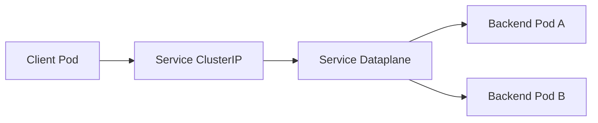
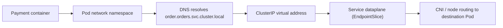
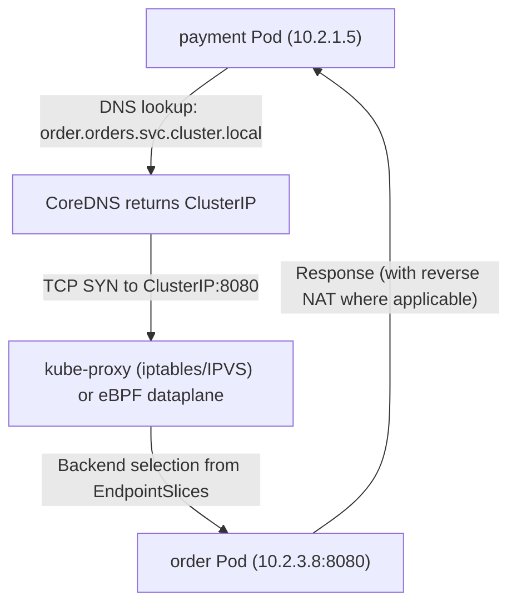
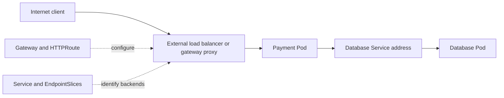

## Learning objectives

- **Trace Pod-to-Service packet flows:** Follow traffic across Pod network namespaces, CNI routing, ClusterIP virtual addresses, and EndpointSlice readiness, serving, and terminating states.
- **Compare Service dataplane implementations:** Contrast traditional `kube-proxy` iptables/IPVS forwarding with eBPF-based dataplanes such as GKE Dataplane V2 (`anetd`).
- **Resolve cluster DNS and external routing:** Distinguish normal ClusterIP vs. headless Service DNS behavior and separate platform `Gateway` listeners from application `HTTPRoute` rules.
- **Enforce least-privilege NetworkPolicies:** Combine additive ingress and egress rules, default-deny baselines, and explicit DNS allowances without breaking workload connectivity.
- **Diagnose connectivity failures systematically:** Isolate DNS `NXDOMAIN`, `Connection refused`, timeouts, and HTTP 502/503 errors by testing FQDN, ClusterIP, and backend Pod IPs independently.

## Pod IP, Service, and EndpointSlice

A Pod IP belongs to a specific Pod instance, whereas a ClusterIP is a Service's virtual address. The controller creates EndpointSlices containing backend IPs, ports, and readiness and serving conditions. The data plane routes Service traffic.



## kube-proxy and eBPF

In iptables mode, kube-proxy programs rules that let the kernel translate packet destinations from Service IPs to backend Pod IPs. GKE Dataplane V2 uses Cilium/eBPF and `anetd`; it does not use kube-proxy for Service load balancing.

## DNS and NetworkPolicy

CoreDNS resolves `payment.payments.svc.cluster.local` to the ClusterIP; it does not select a backend for each TCP connection. NetworkPolicy allow rules are additive, and both ingress and egress must be considered. A default-deny egress policy can also block DNS.

## Troubleshooting

```bash
kubectl get pods -n payments -o wide
kubectl describe svc payment -n payments
kubectl get endpointslices -n payments -l kubernetes.io/service-name=payment
kubectl get networkpolicy -n payments
```

**Official:** [Kubernetes Services](https://kubernetes.io/docs/concepts/services-networking/service/) · [NetworkPolicy](https://kubernetes.io/docs/concepts/services-networking/network-policies/).

## End-to-end packet path: Pod → ClusterIP Service → Pod



A Service ClusterIP is not a process listening in a Pod. Depending on the data plane, kube-proxy in iptables/IPVS mode or an eBPF Service implementation handles virtual IP and port mapping. GKE Dataplane V2 differs from traditional kube-proxy implementations, so check the mode before debugging.

### Inspecting each layer

```bash
kubectl get pods -A -o wide
kubectl get service order -n orders -o yaml
kubectl get endpointslices -n orders -l kubernetes.io/service-name=order
kubectl get networkpolicy -A
kubectl get pods -n kube-system
```

**Layered diagnosis:** A DNS `NXDOMAIN` response is different from `Connection refused` (the IP was reached but the TCP connection was not accepted), a timeout (routing, firewall rules, NetworkPolicy, or an unresponsive application), or HTTP 503 (the request was handled at L7). Do not attribute every timeout to the CNI.

### NetworkPolicy semantics

NetworkPolicies are additive: when several policies apply, their permissions are combined. Egress from the source and ingress at the destination must be allowed when each respective side is isolated. A policy with `podSelector: {}`, both `Ingress` and `Egress` policy types, and no rules is a default-deny policy. Match the DNS policies to your DNS architecture, and verify the traffic paths for external DNS, metadata, and the GKE data plane.

### Headless Services and EndpointSlices

A headless Service (`clusterIP: None`) can return DNS records for its endpoints instead of a single virtual ClusterIP. This is useful for StatefulSet service discovery. EndpointSlice readiness, serving, and terminating conditions affect backend selection and graceful termination.

**Lab:** Create two namespaces with HTTP echo services. Deny traffic by default, then allow it one direction at a time. Compare access via ClusterIP, Pod IP, and FQDN, and observe the EndpointSlices as readiness changes.

## Deep dive: How does a packet traverse Kubernetes networking?

The Kubernetes networking model gives Pods IP addresses they can use to communicate over the cluster network, but **the CNI or data plane implementation determines how packets are actually routed**. A Service is a virtual frontend. Endpoints and EndpointSlices represent backend addresses, and the data plane selects endpoints and performs NAT or load balancing.

### Pod-to-Service request path



`kube-proxy` is not a userspace HTTP proxy that handles each request. In iptables or IPVS mode, its main role is to configure the kernel data plane. GKE Dataplane V2 uses eBPF for networking functions; do not assume every GKE cluster uses the kube-proxy iptables path.

### Service and EndpointSlice ownership

- A `Service` defines a stable DNS name and ClusterIP, along with port mappings.
- The EndpointSlice controller watches Pods and selectors to update EndpointSlices.
- Readiness normally determines backend availability; the terminating and serving conditions matter when draining traffic.
- A headless Service has `clusterIP: None`; DNS can return backend addresses instead of an intermediate ClusterIP.

### DNS troubleshooting

```bash
kubectl -n kube-system get deploy -l k8s-app=kube-dns
kubectl -n orders get svc order -o wide
kubectl -n orders get endpointslices -l kubernetes.io/service-name=order
kubectl exec -n payments POD -- cat /etc/resolv.conf
kubectl exec -n payments POD -- nslookup order.orders.svc.cluster.local
```

Not every application image includes `nslookup`. Use a debug Pod with the appropriate tools rather than installing them in a production container.

### NetworkPolicy semantics

A policy has no effect unless the networking implementation enforces it. Ingress and egress are independent directions. If the source Pod is egress-isolated and the destination Pod is ingress-isolated, you generally need allow rules **on both sides**. Putting `namespaceSelector` and `podSelector` in the same `from` or `to` item matches their intersection; putting them in separate items matches either group.

Example default-deny policy (requires network policy support):

```yaml
apiVersion: networking.k8s.io/v1
kind: NetworkPolicy
metadata:
  name: default-deny
  namespace: payments
spec:
  podSelector: {}
  policyTypes: [Ingress, Egress]
```

If you apply this policy without allowing DNS egress, Service names cannot be resolved. A `connection timeout` in a network test does not mean CoreDNS is broken. Check the policy, Service, backend readiness, and routing path separately.

### Debugging from the outside in

1. Does the DNS lookup return the correct ClusterIP?
2. Does the Service selector match the intended Pods, and do the EndpointSlices reflect those Pods?
3. Is the backend Pod Ready and listening on the expected port?
4. Do NetworkPolicies allow traffic in both directions?
5. Are there any errors in CNI or node routing or in connection tracking?
6. If you use a mesh or Gateway, passing L3/L4 tests does not prove that the L7 routing policy is correct.

Sources: [Kubernetes Services](https://kubernetes.io/docs/concepts/services-networking/service/), [EndpointSlices](https://kubernetes.io/docs/concepts/services-networking/endpoint-slices/), [NetworkPolicy](https://kubernetes.io/docs/concepts/services-networking/network-policies/).

## Follow a request from the internet to a Pod

A customer sees HTTP 502 at `https://api.example.com/payments`. Three Payment Pods are Ready and Argo CD is Synced. Start by identifying which component returned the response and which upstream it tried to reach. Public DNS, TLS, the load balancer, the route, backend health, and the application listener each provide independent evidence.



The diagram shows logical roles. A managed Gateway controller can configure a cloud load balancer that sends traffic directly to Pod endpoints. Other implementations may use a proxy, a node port, or the Service dataplane. The Service reference in an HTTPRoute selects a logical backend. The actual path depends on the controller and data plane. Inspect the provider's backend configuration before assuming traffic crosses a ClusterIP or that a separate in-cluster gateway proxy exists.

## Understand Pod addressing and network setup

| Address | Scope and lifetime |
|---|---|
| Pod IP | Identifies a Pod instance on the Pod network. A replacement can receive a different IP and land on another node. |
| Node IP | Identifies a worker node on its network. Nodes can have internal and external addresses. |
| ClusterIP | Virtual address allocated to a Service, usually stable for that Service's lifetime. |
| External frontend IP | Address used by clients outside the cluster, for example a public or private load balancer frontend. |

Containers in a Pod share its network namespace, IP addresses, and port space. A Payment container and its sidecar can communicate through `localhost:8080`. Two processes cannot both bind the same ordinary wildcard TCP listener on that port. Separate normally networked Pods can each listen on 8080 because they have distinct network namespaces. A Pod with `hostNetwork: true` shares the node network namespace and has different port collision behavior.

The scheduler assigns the Pod to a node. Kubelet asks the container runtime through CRI to start the Pod sandbox. In a typical CNI setup, the runtime calls plugins that configure the sandbox network. Depending on implementation, that includes interfaces, addresses, routes, and IP address management. Networking agents can also program cross-node routing, policy, and Service load balancing. Kubernetes defines the connectivity model. The implementation determines whether traffic crosses a routed, overlay, or cloud-native network. CNI integration and Service backend selection are distinct responsibilities even when one product implements both. [Kubernetes networking model](https://kubernetes.io/docs/concepts/services-networking/) · [CNI specification](https://www.cni.dev/docs/spec/)

## Inspect a Service and its EndpointSlices

Assume `payments` exists, Payment Pods carry `app: payment`, and the application listens on port 8080 on the Pod interface.

```yaml
apiVersion: v1
kind: Service
metadata:
  name: payment
  namespace: payments
spec:
  type: ClusterIP
  selector:
    app: payment
  ports:
    - name: http
      protocol: TCP
      port: 80
      targetPort: 8080
```

Clients use Service port 80. The dataplane sends traffic to the selected backend port 8080. A numeric `targetPort` specifies the port even if the container manifest has no `containerPort` entry. A named target port resolves against the corresponding named container port. Confirm both metadata and the actual listener.

The EndpointSlice controller publishes backend addresses for selector-based Services. The following snapshot is for inspection. Kubernetes generates it from matching Pods and manages its lifecycle.

```yaml
apiVersion: discovery.k8s.io/v1
kind: EndpointSlice
metadata:
  name: payment-example
  namespace: payments
  labels:
    kubernetes.io/service-name: payment
addressType: IPv4
ports:
  - name: http
    protocol: TCP
    port: 8080
endpoints:
  - addresses: ["10.20.1.5"]
    conditions: {ready: true, serving: true, terminating: false}
  - addresses: ["10.20.1.6"]
    conditions: {ready: true, serving: true, terminating: false}
  - addresses: ["10.20.2.7"]
    conditions: {ready: false, serving: true, terminating: true}
```

A backend can be serving while terminating, which matters for draining and for implementations that fall back to serving terminating endpoints. Read all slices for a Service. EndpointSlice partitions large backend sets and can carry node, zone, and topology metadata. IPv4 and IPv6 endpoints use separate address types. The legacy Endpoints API was deprecated in Kubernetes 1.33. [Services and legacy Endpoints](https://kubernetes.io/docs/concepts/services-networking/service/) · [EndpointSlice conditions and distribution](https://kubernetes.io/docs/concepts/services-networking/endpoint-slices/)

## Trace the Service dataplane

For a TCP connection to a Service at `10.96.10.20:80`, an iptables kube-proxy implementation watches Services and EndpointSlices, then programs rules on the nodes. The kernel can use DNAT to change the destination to `10.20.1.5:8080`. Connection tracking keeps the mapping for the flow and enables the corresponding translation of reply traffic. Existing connections and new connections can behave differently while backend state changes. kube-proxy programs the forwarding path. The kernel processes the packets.

| Layer | kube-proxy in iptables mode | eBPF Service implementation |
|---|---|---|
| Programs backend state | kube-proxy watches Services and EndpointSlices | Networking agent watches Kubernetes state |
| Implements forwarding | Linux netfilter rules and conntrack | Kernel hooks, eBPF programs and maps, with behavior depending on the implementation |
| Enforces NetworkPolicy | Typically another networking component | Can be integrated into the dataplane |
| Starting point for diagnostics | Service and EndpointSlices, followed by node rules and flow evidence | Service and EndpointSlices, followed by the networking agent and supported flow observability |

GKE Dataplane V2 uses Cilium and eBPF. The `anetd` node agent programs the dataplane and NetworkPolicy enforcement is integrated. GKE Autopilot uses Dataplane V2. For a Standard cluster, check the actual dataplane configuration before choosing diagnostic commands. Look for `anetd` by name or inspect the installed DaemonSets and their labels. A missing upstream Cilium label does not establish a dataplane failure. Performance depends on workload characteristics, configuration, and kernel behavior. [Kubernetes virtual IPs](https://kubernetes.io/docs/reference/networking/virtual-ips/) · [GKE Dataplane V2 architecture](https://docs.cloud.google.com/kubernetes-engine/docs/concepts/dataplane-v2)

## Resolve names before testing backend routing

| Name | Example use |
|---|---|
| `payment` | A caller in the `payments` namespace, using its DNS search list |
| `payment.payments` | A caller in another namespace, using its DNS search list |
| `payment.payments.svc.cluster.local` | A cluster using `cluster.local` as its DNS domain |

CoreDNS or the configured cluster DNS provider returns the ClusterIP for a normal Service. Connection-level backend selection happens in the dataplane. For a headless Service with `clusterIP: None`, a DNS answer can contain endpoint addresses. This lets clients discover individual instances, as with StatefulSets. The client must handle selection, retries, and connections according to the application's requirements. Inspect the source Pod's `/etc/resolv.conf` to confirm the actual nameserver and search domains. [DNS for Services and Pods](https://kubernetes.io/docs/concepts/services-networking/dns-pod-service/)

## Attach HTTP routes to an external entry point

An Ingress controller watches an Ingress resource and programs HTTP or HTTPS routing for the matching IngressClass. For example:

```yaml
apiVersion: networking.k8s.io/v1
kind: Ingress
metadata:
  name: payment
  namespace: payments
spec:
  ingressClassName: example
  rules:
    - host: api.example.com
      http:
        paths:
          - path: /payments
            pathType: Prefix
            backend:
              service:
                name: payment
                port:
                  number: 80
```

The class is a placeholder for an installed controller. The example defines host and path routing. Configure certificates and listener TLS as required by the chosen implementation.

Gateway API separates infrastructure roles through GatewayClass, Gateway, and Route objects. A platform team can control the public listener, TLS, and which namespaces attach routes. The application team can own its HTTPRoute and workloads. Gateway implementations may also support weighted targets and header matching. Check the version and implementation's supported features. The following route refers to an existing Gateway in a platform namespace:

```yaml
apiVersion: gateway.networking.k8s.io/v1
kind: HTTPRoute
metadata:
  name: payment
  namespace: payments
spec:
  parentRefs:
    - name: public-gateway
      namespace: gateway-system
  hostnames:
    - api.example.com
  rules:
    - matches:
        - path:
            type: PathPrefix
            value: /payments
      backendRefs:
        - name: payment
          port: 80
```

The listener must permit attachment from `payments` through `allowedRoutes`, and its hostname must intersect the route's hostname. This route targets a Service in the route's own namespace. A backend reference into another namespace normally needs a ReferenceGrant in the backend namespace. During diagnosis, inspect Gateway `Programmed` and the relevant HTTPRoute parent `Accepted` and `ResolvedRefs` conditions. Then verify cloud or proxy backend health, application path behavior, DNS, and TLS separately. [Kubernetes Ingress](https://kubernetes.io/docs/concepts/services-networking/ingress/) · [Gateway API cross-namespace routing](https://gateway-api.sigs.k8s.io/guides/user-guides/multiple-ns/)

## Allow only the selected Payment Pods to reach PostgreSQL

In a test environment with a NetworkPolicy-enforcing dataplane, assume the `payments` namespace has label `team: payments`, and PostgreSQL Pods in `databases` have label `app: postgres`. These policies isolate ingress for the database namespace and add one allowed path.

```yaml
apiVersion: networking.k8s.io/v1
kind: NetworkPolicy
metadata:
  name: default-deny-ingress
  namespace: databases
spec:
  podSelector: {}
  policyTypes: [Ingress]
---
apiVersion: networking.k8s.io/v1
kind: NetworkPolicy
metadata:
  name: allow-payment-to-postgres
  namespace: databases
spec:
  podSelector:
    matchLabels:
      app: postgres
  policyTypes: [Ingress]
  ingress:
    - from:
        - namespaceSelector:
            matchLabels:
              team: payments
          podSelector:
            matchLabels:
              app: payment
      ports:
        - protocol: TCP
          port: 5432
```

Both selectors in one peer item must match. Splitting them into two list items creates alternatives. The namespace-only peer would then match all Pods in the selected namespaces. The pod-only peer would match Pods in the policy's own namespace. Multiple policies add their allowed traffic together. For an isolated source, configure its egress separately. The following egress policy selects Payment Pods and permits their connection to PostgreSQL. Applying it also isolates those Pods for egress, so add DNS and any other required dependency allowances for the cluster before using it.

```yaml
apiVersion: networking.k8s.io/v1
kind: NetworkPolicy
metadata:
  name: payment-to-postgres
  namespace: payments
spec:
  podSelector:
    matchLabels:
      app: payment
  policyTypes: [Egress]
  egress:
    - to:
        - namespaceSelector:
            matchLabels:
              kubernetes.io/metadata.name: databases
          podSelector:
            matchLabels:
              app: postgres
      ports:
        - protocol: TCP
          port: 5432
```

DNS typically needs UDP and TCP port 53 to the configured resolver. A CoreDNS Pod selector can be suitable for a cluster using Pod-backed DNS, while NodeLocal DNSCache or a cloud DNS setup may require a different rule. Inspect the actual resolver and test from the workload network context. Traffic transformation and policy matching around Service NAT can vary by implementation. [Kubernetes NetworkPolicy](https://kubernetes.io/docs/concepts/services-networking/network-policies/)

## Troubleshoot the 502 with controlled comparisons

1. **Public request.** Reproduce with the production hostname and path, then correlate the timestamp and request ID with the gateway's access and upstream logs. Check listener and route status and inspect backend health.
2. **Workload and listener.** Record Pod IPs, node placement, readiness, and restarts. Check the declared port against the application's actual bind address and port. A loopback-only listener can pass an in-container test while remaining unreachable through the Pod IP.
3. **Service and EndpointSlices.** Confirm Service port, targetPort, selector, and ready or serving endpoints. A Deployment with label `app: payments` does not match the example Service's `app: payment` selector. A wrong targetPort can leave endpoint records present but direct connections to the wrong listener.
4. **DNS and dataplane.** From an existing authorized diagnostic Pod or the application Pod if tools are available, compare the Service DNS name, ClusterIP and one known backend Pod IP. Use the same path, hostname, and source network context. A generic diagnostic Pod may have different policy labels.
5. **Policies and node paths.** Check both directions of policy. For intermittent failures, group observations by backend and compare same-node with cross-node traffic. Check node agent health, routes, cloud firewall rules and supported flow or policy logs after identifying the dataplane.

```bash
kubectl get gateway public-gateway -n gateway-system -o yaml
kubectl get httproute payment -n payments -o yaml
kubectl get pods -n payments -l app=payment -o wide
kubectl logs deployment/payment -n payments
kubectl describe service payment -n payments
kubectl get endpointslices -n payments -l kubernetes.io/service-name=payment -o yaml
kubectl get networkpolicy -n payments
kubectl get networkpolicy -n databases
kubectl get daemonsets,pods -n kube-system -o wide
```

Run the following from that diagnostic context. Replace the illustrative addresses and cluster domain with values from discovery. The Pod IP needs the backend port, while the ClusterIP uses the Service port. Preserve the Host header when the application routes by hostname.

```bash
cat /etc/resolv.conf
nslookup payment.payments.svc.cluster.local
curl -v --connect-timeout 3 --max-time 10 -H 'Host: api.example.com' http://payment.payments.svc.cluster.local/payments
curl -v --connect-timeout 3 --max-time 10 -H 'Host: api.example.com' http://10.96.10.20/payments
curl -v --connect-timeout 3 --max-time 10 -H 'Host: api.example.com' http://10.20.1.5:8080/payments
```

| Observation | Where to investigate next |
|---|---|
| DNS returns NXDOMAIN and direct IP works | Check Service spelling, namespace, cluster domain, and DNS records. |
| DNS query times out | Check resolver reachability, DNS egress, and resolver health. |
| ClusterIP fails but the backend Pod IP works | Check Service ports, all EndpointSlices, policy evaluation and Service programming. |
| Both Service and Pod IP return connection refused | Check the listener, bind address, ports, and whether an intermediate component actively rejected the connection. |
| Both IP tests time out | Check policy drops, routing, firewalls, dataplane health, or an unresponsive destination. |
| Internal path works but external requests return 502 or 503 | Check gateway logs, backend health, TLS and protocol expectations, and path routing. Specific status meanings depend on the implementation. |
| Only some requests fail or latency rises | Compare endpoints, nodes, revisions, retries, and packet or application latency. |

In a disposable lab, exercise one change at a time. First confirm a working baseline. Compare a matching and mismatched selector, a serving and misconfigured target port, and traffic before and after a destination ingress policy. Add a source egress allow and verify DNS and backend connectivity as separate checks. Record which API object changes, what controllers must reconcile, and the evidence that confirms packets reach their destination.

The control plane distributes desired configuration through API objects, controllers, and agents. The data plane applies rules and handles live traffic. Those updates converge over time. Argo CD Synced confirms its comparison of desired and live objects. Verify the actual HTTP response or TCP connection to establish end-to-end connectivity.

Try the [networking troubleshooting exercise and quiz](./networking-exercises.mdx), then continue with [Lesson 13 — GKE Networking and Cloud Load Balancing](./lesson-13-gke-networking.md) for VPC-native addressing, NEGs, Cloud NAT, firewall rules, and cloud backend health.

## Self-check questions
1. Which controller owns the desired state and the actual state in this context?
2. What failure modes can occur even when the Kubernetes resource reports `Ready`?
3. What would you verify before deploying to production?
