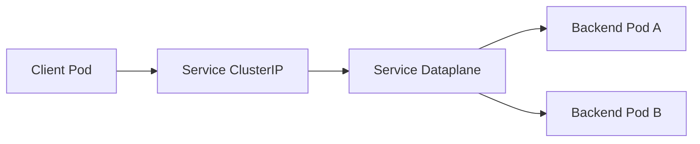

:::info Sources and editorial scope
This lesson expands on the topic and verifiable content of the conversation, but it is **not a complete verbatim transcript**. Additional material was written for this website and may require version-specific testing before use in production.
:::

## Learning objectives

CNI, Service, EndpointSlice, kube-proxy/eBPF, DNS, NetworkPolicy.

## Pod IP, Service, and EndpointSlice

A Pod IP belongs to a specific Pod instance, whereas a ClusterIP is a Service's virtual address. The controller creates EndpointSlices containing backend IPs, ports, and readiness and serving conditions. The data plane routes Service traffic.



## kube-proxy and eBPF

In iptables mode, kube-proxy programs rules that let the kernel translate packet destinations from Service IPs to backend Pod IPs. GKE Dataplane V2 uses Cilium/eBPF and `anetd`; it does not use kube-proxy for Service load balancing.

## DNS and NetworkPolicy

CoreDNS resolves `payment.payments.svc.cluster.local` to the ClusterIP; it does not select a backend for each TCP connection. NetworkPolicy allow rules are additive, and both ingress and egress must be considered. A default-deny egress policy can also block DNS.

## Troubleshooting

```bash
kubectl get pods -n payments -o wide
kubectl describe svc payment -n payments
kubectl get endpointslices -n payments -l kubernetes.io/service-name=payment
kubectl get networkpolicy -n payments
```

**Official:** [Kubernetes Services](https://kubernetes.io/docs/concepts/services-networking/service/) · [NetworkPolicy](https://kubernetes.io/docs/concepts/services-networking/network-policies/).


## End-to-end packet path: Pod → ClusterIP Service → Pod

```text
Payment container
  → Pod network namespace
  → DNS resolves order.orders.svc.cluster.local
  → ClusterIP virtual service address
  → Service dataplane selects EndpointSlice backend
  → CNI / node routing delivers to destination Pod
```

A Service ClusterIP is not a process listening in a Pod. Depending on the data plane, kube-proxy in iptables/IPVS mode or an eBPF Service implementation handles virtual IP and port mapping. GKE Dataplane V2 differs from traditional kube-proxy implementations, so check the mode before debugging.

### Inspecting each layer

```bash
kubectl get pods -A -o wide
kubectl get service order -n orders -o yaml
kubectl get endpointslices -n orders -l kubernetes.io/service-name=order
kubectl get networkpolicy -A
kubectl get pods -n kube-system
```

**Layered diagnosis:** A DNS `NXDOMAIN` response is different from `Connection refused` (the IP was reached but the TCP connection was not accepted), a timeout (routing, firewall rules, NetworkPolicy, or an unresponsive application), or HTTP 503 (the request was handled at L7). Do not attribute every timeout to the CNI.

### NetworkPolicy semantics

NetworkPolicies are additive: when several policies apply, their permissions are combined. Egress from the source and ingress at the destination must be allowed when each respective side is isolated. A policy with `podSelector: {}`, both `Ingress` and `Egress` policy types, and no rules is a default-deny policy. Match the DNS policies to your DNS architecture, and verify the traffic paths for external DNS, metadata, and the GKE data plane.

### Headless Services and EndpointSlices

A headless Service (`clusterIP: None`) can return DNS records for its endpoints instead of a single virtual ClusterIP. This is useful for StatefulSet service discovery. EndpointSlice readiness, serving, and terminating conditions affect backend selection and graceful termination.

**Lab:** Create two namespaces with HTTP echo services. Deny traffic by default, then allow it one direction at a time. Compare access via ClusterIP, Pod IP, and FQDN, and observe the EndpointSlices as readiness changes.

## Deep dive: How does a packet traverse Kubernetes networking?

The Kubernetes networking model gives Pods IP addresses they can use to communicate over the cluster network, but **the CNI or data plane implementation determines how packets are actually routed**. A Service is a virtual frontend. Endpoints and EndpointSlices represent backend addresses, and the data plane selects endpoints and performs NAT or load balancing.

### Pod-to-Service request path

```text
payment Pod: 10.2.1.5
    ↓ DNS lookup order.orders.svc.cluster.local
CoreDNS returns ClusterIP
    ↓ TCP SYN → ClusterIP:8080
kube-proxy iptables/IPVS OR eBPF dataplane (implementation dependent)
    ↓ backend selection from EndpointSlices
order Pod: 10.2.3.8:8080
    ↓ response (with reverse NAT where applicable)
payment Pod
```

`kube-proxy` is not a userspace HTTP proxy that handles each request. In iptables or IPVS mode, its main role is to configure the kernel data plane. GKE Dataplane V2 uses eBPF for networking functions; do not assume every GKE cluster uses the kube-proxy iptables path.

### Service and EndpointSlice ownership

- A `Service` defines a stable DNS name and ClusterIP, along with port mappings.
- The EndpointSlice controller watches Pods and selectors to update EndpointSlices.
- Readiness normally determines backend availability; the terminating and serving conditions matter when draining traffic.
- A headless Service has `clusterIP: None`; DNS can return backend addresses instead of an intermediate ClusterIP.

### DNS troubleshooting

```bash
kubectl -n kube-system get deploy -l k8s-app=kube-dns
kubectl -n orders get svc order -o wide
kubectl -n orders get endpointslices -l kubernetes.io/service-name=order
kubectl exec -n payments POD -- cat /etc/resolv.conf
kubectl exec -n payments POD -- nslookup order.orders.svc.cluster.local
```

Not every application image includes `nslookup`. Use a debug Pod with the appropriate tools rather than installing them in a production container.

### NetworkPolicy semantics

A policy has no effect unless the networking implementation enforces it. Ingress and egress are independent directions. If the source Pod is egress-isolated and the destination Pod is ingress-isolated, you generally need allow rules **on both sides**. Putting `namespaceSelector` and `podSelector` in the same `from` or `to` item matches their intersection; putting them in separate items matches either group.

Example default-deny policy (requires network policy support):

```yaml
apiVersion: networking.k8s.io/v1
kind: NetworkPolicy
metadata:
  name: default-deny
  namespace: payments
spec:
  podSelector: {}
  policyTypes: [Ingress, Egress]
```

If you apply this policy without allowing DNS egress, Service names cannot be resolved. A `connection timeout` in a network test does not mean CoreDNS is broken. Check the policy, Service, backend readiness, and routing path separately.

### Debugging from the outside in

1. Does the DNS lookup return the correct ClusterIP?
2. Does the Service selector match the intended Pods, and do the EndpointSlices reflect those Pods?
3. Is the backend Pod Ready and listening on the expected port?
4. Do NetworkPolicies allow traffic in both directions?
5. Are there any errors in CNI or node routing or in connection tracking?
6. If you use a mesh or Gateway, passing L3/L4 tests does not prove that the L7 routing policy is correct.

Sources: [Kubernetes Services](https://kubernetes.io/docs/concepts/services-networking/service/), [EndpointSlices](https://kubernetes.io/docs/concepts/services-networking/endpoint-slices/), [NetworkPolicy](https://kubernetes.io/docs/concepts/services-networking/network-policies/).

## Self-check questions

1. Which controller owns the desired state and the actual state in this context?
2. What failure modes can occur even when the Kubernetes resource reports `Ready`?
3. What would you verify before deploying to production?
