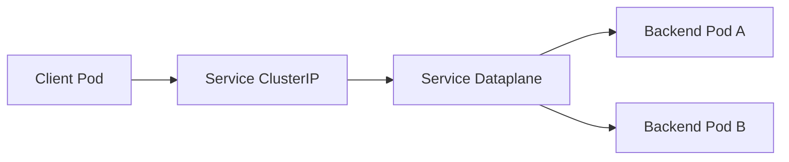
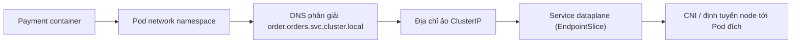
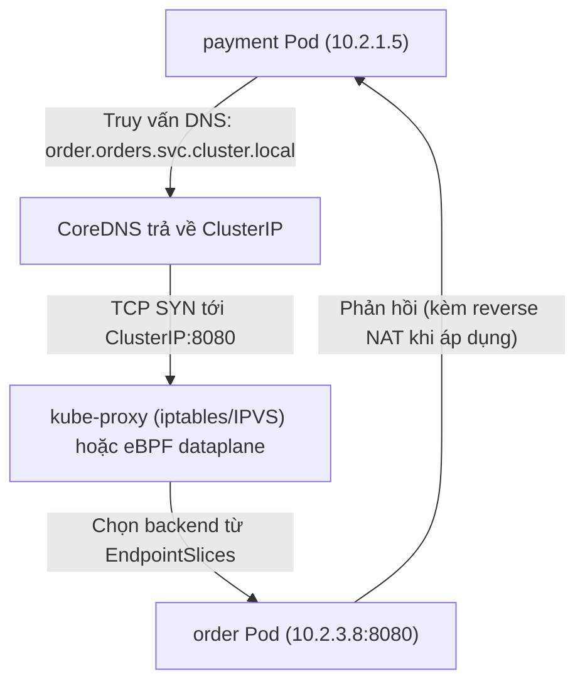
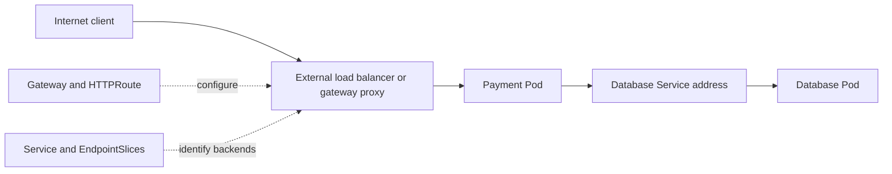

## Mục tiêu học tập

- **Truy vết đường đi gói tin từ Pod tới Service:** Theo dõi lưu lượng xuyên qua Pod network namespace, định tuyến CNI, địa chỉ ảo ClusterIP và các trạng thái readiness, serving và terminating của EndpointSlice.
- **So sánh các bản triển khai Service dataplane:** Phân biệt cơ chế chuyển tiếp bằng `kube-proxy` (iptables/IPVS) với dataplane dùng eBPF như GKE Dataplane V2 (`anetd`).
- **Phân giải DNS nội bộ và định tuyến bên ngoài:** Phân biệt hành vi DNS của ClusterIP Service với Headless Service, đồng thời tách bạch quyền sở hữu giữa `Gateway` và `HTTPRoute`.
- **Áp dụng NetworkPolicy theo nguyên tắc đặc quyền tối thiểu:** Kết hợp các rule ingress/egress có tính cộng dồn, chính sách default-deny và rule mở DNS mà không làm gián đoạn kết nối workload.
- **Chẩn đoán sự cố mạng theo từng lớp:** Tách biệt lỗi DNS `NXDOMAIN`, `Connection refused`, timeout và HTTP 502/503 thông qua kiểm thử độc lập bằng FQDN, ClusterIP và backend Pod IP.

## Pod IP, Service và EndpointSlice

Pod IP thuộc về một phiên bản Pod cụ thể, trong khi ClusterIP là địa chỉ ảo của một Service. Controller tạo ra các EndpointSlice chứa danh sách IP backend, cổng (port) cùng các trạng thái readiness và serving. Data plane chịu trách nhiệm định tuyến lưu lượng của Service.



## kube-proxy và eBPF

Ở chế độ iptables, kube-proxy lập trình các rule để kernel dịch địa chỉ đích của gói tin từ Service IP sang backend Pod IP. GKE Dataplane V2 sử dụng Cilium/eBPF và `anetd`; nó không dùng kube-proxy để cân bằng tải cho Service.

## DNS và NetworkPolicy

CoreDNS phân giải `payment.payments.svc.cluster.local` thành ClusterIP; nó không chọn từng backend cho mỗi kết nối TCP. Các rule cho phép (allow) trong NetworkPolicy có tính cộng dồn (additive), và cần xem xét cả hai chiều ingress và egress. Một chính sách default-deny egress cũng có thể chặn luôn DNS.

## Xử lý sự cố

```bash
kubectl get pods -n payments -o wide
kubectl describe svc payment -n payments
kubectl get endpointslices -n payments -l kubernetes.io/service-name=payment
kubectl get networkpolicy -n payments
```

**Tài liệu chính thức:** [Kubernetes Services](https://kubernetes.io/docs/concepts/services-networking/service/) · [NetworkPolicy](https://kubernetes.io/docs/concepts/services-networking/network-policies/).

## Đường đi gói tin đầu-cuối: Pod → ClusterIP Service → Pod



Service ClusterIP không phải là một tiến trình đang lắng nghe bên trong Pod. Tùy thuộc vào data plane, kube-proxy ở chế độ iptables/IPVS hoặc cơ chế triển khai Service bằng eBPF sẽ xử lý việc ánh xạ IP ảo và cổng. GKE Dataplane V2 khác với các bản triển khai kube-proxy truyền thống, vì vậy hãy kiểm tra chế độ hoạt động trước khi debug.

### Kiểm tra từng lớp

```bash
kubectl get pods -A -o wide
kubectl get service order -n orders -o yaml
kubectl get endpointslices -n orders -l kubernetes.io/service-name=order
kubectl get networkpolicy -A
kubectl get pods -n kube-system
```

**Chẩn đoán theo lớp:** Phản hồi DNS `NXDOMAIN` khác với `Connection refused` (đã tới được IP nhưng kết nối TCP bị từ chối), timeout (do định tuyến, firewall rule, NetworkPolicy hoặc ứng dụng không phản hồi), hay HTTP 503 (request đã được xử lý ở lớp L7). Không nên quy kết mọi lỗi timeout cho CNI.

### Ngữ nghĩa của NetworkPolicy

NetworkPolicy có tính cộng dồn: khi nhiều policy cùng áp dụng, quyền cho phép của chúng được gộp lại. Cả egress từ nguồn lẫn ingress tại đích đều phải được cho phép khi từng phía bị cô lập. Một policy có `podSelector: {}`, khai báo cả hai `policyTypes` là `Ingress` và `Egress`, và không có rule nào là một chính sách default-deny. Hãy khớp các rule DNS với kiến trúc DNS thực tế của cluster, đồng thời kiểm tra đường đi cho DNS bên ngoài, metadata server và GKE data plane.

### Headless Service và EndpointSlice

Headless Service (`clusterIP: None`) có thể trả về các bản ghi DNS trỏ trực tiếp tới endpoint thay vì một ClusterIP ảo duy nhất. Điều này rất hữu ích cho service discovery của StatefulSet. Các điều kiện readiness, serving và terminating trong EndpointSlice ảnh hưởng tới việc chọn backend và quá trình dừng Pod êm ái (graceful termination).

**Thực hành:** Tạo hai namespace với HTTP echo service. Chặn toàn bộ lưu lượng theo mặc định, sau đó mở từng chiều một. So sánh khả năng truy cập qua ClusterIP, Pod IP và FQDN, đồng thời quan sát EndpointSlice thay đổi khi trạng thái readiness thay đổi.

## Phân tích sâu: Gói tin đi qua mạng Kubernetes như thế nào?

Mô hình mạng của Kubernetes cấp cho các Pod địa chỉ IP để giao tiếp trên mạng cluster, nhưng **bản triển khai CNI hoặc data plane mới quyết định cách gói tin thực sự được định tuyến**. Service là một frontend ảo. Endpoints và EndpointSlices đại diện cho các địa chỉ backend, còn data plane chọn endpoint và thực hiện NAT hoặc cân bằng tải.

### Đường đi request từ Pod tới Service



`kube-proxy` không phải là một userspace HTTP proxy trực tiếp xử lý từng request. Ở chế độ iptables hoặc IPVS, vai trò chính của nó là cấu hình kernel data plane. GKE Dataplane V2 dùng eBPF cho các chức năng mạng; đừng mặc định mọi GKE cluster đều đi qua đường kube-proxy iptables.

### Quyền sở hữu giữa Service và EndpointSlice

- `Service` định nghĩa tên DNS ổn định, ClusterIP và ánh xạ cổng.
- EndpointSlice controller theo dõi các Pod và selector để cập nhật EndpointSlice.
- Readiness thường quyết định tính sẵn sàng của backend; các điều kiện terminating và serving rất quan trọng trong quá trình drain lưu lượng.
- Headless Service có `clusterIP: None`; DNS có thể trả về trực tiếp địa chỉ backend thay vì một ClusterIP trung gian.

### Xử lý sự cố DNS

```bash
kubectl -n kube-system get deploy -l k8s-app=kube-dns
kubectl -n orders get svc order -o wide
kubectl -n orders get endpointslices -l kubernetes.io/service-name=order
kubectl exec -n payments POD -- cat /etc/resolv.conf
kubectl exec -n payments POD -- nslookup order.orders.svc.cluster.local
```

Không phải image ứng dụng nào cũng cài sẵn `nslookup`. Hãy dùng một debug Pod có đủ công cụ thay vì cài thêm công cụ vào container production.

### Ngữ nghĩa của NetworkPolicy

Một policy không có tác dụng nếu thành phần mạng không thực thi nó. Ingress và egress là hai chiều độc lập. Nếu Pod nguồn bị cô lập egress và Pod đích bị cô lập ingress, bạn thường cần rule cho phép **ở cả hai phía**. Đặt `namespaceSelector` và `podSelector` trong cùng một mục `from` hoặc `to` sẽ khớp phần giao (AND); đặt chúng ở hai mục riêng biệt sẽ khớp một trong hai nhóm (OR).

Ví dụ chính sách default-deny (yêu cầu cluster hỗ trợ thực thi NetworkPolicy):

```yaml
apiVersion: networking.k8s.io/v1
kind: NetworkPolicy
metadata:
  name: default-deny
  namespace: payments
spec:
  podSelector: {}
  policyTypes: [Ingress, Egress]
```

Nếu áp dụng chính sách này mà không mở egress cho DNS, các tên Service sẽ không thể phân giải được. Lỗi `connection timeout` khi kiểm thử mạng không có nghĩa là CoreDNS bị hỏng. Hãy kiểm tra riêng lẻ policy, Service, readiness của backend và đường định tuyến.

### Gỡ lỗi từ ngoài vào trong

1. Truy vấn DNS có trả về đúng ClusterIP không?
2. Selector của Service có khớp với các Pod mong muốn không, và EndpointSlices có phản ánh đúng các Pod đó không?
3. Backend Pod có đang `Ready` và lắng nghe đúng cổng không?
4. Các NetworkPolicy có cho phép lưu lượng ở cả hai chiều không?
5. Có lỗi nào ở CNI, định tuyến node hoặc connection tracking không?
6. Nếu dùng service mesh hoặc Gateway, việc vượt qua kiểm tra L3/L4 không chứng minh chính sách định tuyến L7 đã đúng.

Nguồn tham khảo: [Kubernetes Services](https://kubernetes.io/docs/concepts/services-networking/service/), [EndpointSlices](https://kubernetes.io/docs/concepts/services-networking/endpoint-slices/), [NetworkPolicy](https://kubernetes.io/docs/concepts/services-networking/network-policies/).

## Theo dõi một request từ internet vào tới Pod

Một khách hàng gặp lỗi HTTP 502 tại `https://api.example.com/payments`. Cả ba Payment Pod đều `Ready` và Argo CD báo `Synced`. Hãy bắt đầu bằng việc xác định thành phần nào trả về phản hồi đó và nó đã cố kết nối tới upstream nào. Public DNS, TLS, load balancer, route, trạng thái sức khỏe backend và listener của ứng dụng đều cung cấp các bằng chứng độc lập.



Sơ đồ trên minh họa các vai trò logic. Một Gateway controller được quản lý (managed) có thể cấu hình cloud load balancer gửi lưu lượng thẳng tới Pod endpoints. Các bản triển khai khác có thể dùng proxy, NodePort hoặc Service dataplane. Tham chiếu Service trong HTTPRoute chỉ định một backend logic; đường đi thực tế phụ thuộc vào controller và data plane. Hãy kiểm tra cấu hình backend của nhà cung cấp trước khi giả định lưu lượng đi qua ClusterIP hay có một gateway proxy riêng trong cluster.

## Hiểu về đánh địa chỉ và thiết lập mạng cho Pod

| Loại địa chỉ | Phạm vi và vòng đời |
|---|---|
| Pod IP | Định danh một phiên bản Pod trên mạng Pod. Pod thay thế có thể nhận IP khác và chạy trên node khác. |
| Node IP | Định danh một worker node trên mạng của nó. Node có thể có địa chỉ nội bộ và địa chỉ bên ngoài. |
| ClusterIP | Địa chỉ ảo cấp cho Service, thường ổn định suốt vòng đời của Service đó. |
| External frontend IP | Địa chỉ mà client bên ngoài cluster kết nối tới, ví dụ frontend của load balancer công khai hoặc riêng tư. |

Các container trong cùng một Pod dùng chung network namespace, địa chỉ IP và không gian cổng. Container Payment và sidecar của nó có thể giao tiếp qua `localhost:8080`. Hai tiến trình không thể cùng bind một TCP wildcard listener thông thường trên cùng cổng đó. Các Pod tách biệt dùng mạng thông thường đều có thể cùng lắng nghe cổng 8080 vì chúng có network namespace riêng. Một Pod đặt `hostNetwork: true` sẽ dùng chung network namespace với node và có hành vi xung đột cổng khác biệt.

Scheduler gán Pod vào một node. Kubelet yêu cầu container runtime thông qua CRI khởi tạo Pod sandbox. Trong thiết lập CNI điển hình, runtime gọi các plugin để cấu hình mạng cho sandbox. Tùy vào bản triển khai, bước này bao gồm tạo giao diện mạng, cấp địa chỉ, định tuyến và quản lý IP (IPAM). Các networking agent cũng có thể lập trình định tuyến liên node, policy và cân bằng tải Service. Kubernetes định nghĩa mô hình kết nối, còn bản triển khai quyết định lưu lượng đi qua mạng định tuyến trực tiếp, overlay hay cloud-native. Tích hợp CNI và chọn backend cho Service là hai trách nhiệm tách biệt ngay cả khi cùng một sản phẩm thực hiện cả hai. [Kubernetes networking model](https://kubernetes.io/docs/concepts/services-networking/) · [CNI specification](https://www.cni.dev/docs/spec/)

## Kiểm tra Service và các EndpointSlice của nó

Giả sử namespace `payments` đã tồn tại, các Payment Pod mang label `app: payment`, và ứng dụng lắng nghe trên cổng 8080 tại giao diện mạng của Pod.

```yaml
apiVersion: v1
kind: Service
metadata:
  name: payment
  namespace: payments
spec:
  type: ClusterIP
  selector:
    app: payment
  ports:
    - name: http
      protocol: TCP
      port: 80
      targetPort: 8080
```

Client gọi vào Service port 80. Dataplane chuyển lưu lượng tới cổng backend 8080 đã chọn. Giá trị `targetPort` dạng số chỉ định rõ cổng đích ngay cả khi manifest container không khai báo `containerPort`. Giá trị `targetPort` dạng tên sẽ được phân giải theo tên cổng tương ứng trong container. Hãy xác nhận cả phần khai báo metadata lẫn tiến trình đang thực sự lắng nghe.

EndpointSlice controller công bố danh sách địa chỉ backend cho các Service dùng selector. Bản chụp dưới đây dùng để tham khảo kiểm tra; Kubernetes tự động tạo nó từ các Pod khớp selector và quản lý vòng đời của nó.

```yaml
apiVersion: discovery.k8s.io/v1
kind: EndpointSlice
metadata:
  name: payment-example
  namespace: payments
  labels:
    kubernetes.io/service-name: payment
addressType: IPv4
ports:
  - name: http
    protocol: TCP
    port: 8080
endpoints:
  - addresses: ["10.20.1.5"]
    conditions: {ready: true, serving: true, terminating: false}
  - addresses: ["10.20.1.6"]
    conditions: {ready: true, serving: true, terminating: false}
  - addresses: ["10.20.2.7"]
    conditions: {ready: false, serving: true, terminating: true}
```

Một backend vẫn có thể ở trạng thái `serving` trong khi đang `terminating`, điều này quan trọng khi drain kết nối và đối với các bản triển khai có cơ chế dự phòng sang endpoint đang terminating. Hãy đọc tất cả các slice của một Service. EndpointSlice chia nhỏ các tập backend lớn và có thể mang thêm thông tin node, zone và topology. Endpoint IPv4 và IPv6 dùng `addressType` riêng biệt. API Endpoints cũ đã bị đánh dấu deprecated từ Kubernetes 1.33. [Services and legacy Endpoints](https://kubernetes.io/docs/concepts/services-networking/service/) · [EndpointSlice conditions and distribution](https://kubernetes.io/docs/concepts/services-networking/endpoint-slices/)

## Truy vết Service dataplane

Với một kết nối TCP tới Service tại `10.96.10.20:80`, bản triển khai kube-proxy dùng iptables theo dõi các Service và EndpointSlice, sau đó lập trình rule trên các node. Kernel có thể dùng DNAT để đổi địa chỉ đích thành `10.20.1.5:8080`. Connection tracking lưu giữ ánh xạ của luồng kết nối và cho phép dịch ngược gói tin phản hồi tương ứng. Kết nối hiện có và kết nối mới có thể hành xử khác nhau khi trạng thái backend thay đổi. kube-proxy chỉ lập trình đường chuyển tiếp; kernel mới là bên xử lý gói tin.

| Lớp | kube-proxy ở chế độ iptables | Triển khai Service bằng eBPF |
|---|---|---|
| Lập trình trạng thái backend | kube-proxy theo dõi Service và EndpointSlice | Networking agent theo dõi trạng thái Kubernetes |
| Thực thi chuyển tiếp | Các rule Linux netfilter và conntrack | Kernel hook, chương trình eBPF và eBPF map, hành vi tùy bản triển khai |
| Thực thi NetworkPolicy | Thường do một thành phần mạng khác đảm nhiệm | Có thể tích hợp trực tiếp vào dataplane |
| Điểm bắt đầu chẩn đoán | Service và EndpointSlice, sau đó đến rule trên node và bằng chứng luồng | Service và EndpointSlice, sau đó đến networking agent và công cụ quan sát luồng được hỗ trợ |

GKE Dataplane V2 sử dụng Cilium và eBPF. Node agent `anetd` lập trình dataplane và tích hợp sẵn việc thực thi NetworkPolicy. GKE Autopilot mặc định dùng Dataplane V2. Với cluster Standard, hãy kiểm tra cấu hình dataplane thực tế trước khi chọn lệnh chẩn đoán. Tìm `anetd` theo tên hoặc kiểm tra các DaemonSet đang cài đặt cùng label của chúng. Việc không thấy label chuẩn của Cilium upstream không đồng nghĩa với lỗi dataplane. Hiệu năng phụ thuộc vào đặc thù workload, cấu hình và hành vi của kernel. [Kubernetes virtual IPs](https://kubernetes.io/docs/reference/networking/virtual-ips/) · [GKE Dataplane V2 architecture](https://docs.cloud.google.com/kubernetes-engine/docs/concepts/dataplane-v2)

## Phân giải tên miền trước khi kiểm thử định tuyến backend

| Tên | Ví dụ sử dụng |
|---|---|
| `payment` | Client trong cùng namespace `payments`, dùng DNS search list của nó |
| `payment.payments` | Client ở namespace khác, dùng DNS search list của nó |
| `payment.payments.svc.cluster.local` | Cluster sử dụng `cluster.local` làm DNS domain |

CoreDNS hoặc cluster DNS provider được cấu hình sẽ trả về ClusterIP cho một Service thông thường. Việc chọn backend ở mức kết nối diễn ra trong dataplane. Với Headless Service (`clusterIP: None`), kết quả DNS có thể chứa trực tiếp địa chỉ các endpoint, giúp client tự khám phá từng instance riêng lẻ như trong StatefulSet. Khi đó, client phải tự xử lý việc chọn đích, retry và quản lý kết nối theo yêu cầu ứng dụng. Hãy kiểm tra `/etc/resolv.conf` trong Pod nguồn để xác nhận nameserver và các search domain thực tế. [DNS for Services and Pods](https://kubernetes.io/docs/concepts/services-networking/dns-pod-service/)

## Gắn các HTTP route vào điểm vào từ bên ngoài

Ingress controller theo dõi resource Ingress và lập trình định tuyến HTTP hoặc HTTPS cho `IngressClass` tương ứng. Ví dụ:

```yaml
apiVersion: networking.k8s.io/v1
kind: Ingress
metadata:
  name: payment
  namespace: payments
spec:
  ingressClassName: example
  rules:
    - host: api.example.com
      http:
        paths:
          - path: /payments
            pathType: Prefix
            backend:
              service:
                name: payment
                port:
                  number: 80
```

Tên class trong ví dụ là giá trị giữ chỗ cho một controller đã cài đặt. Ví dụ này định nghĩa định tuyến theo host và path. Cần cấu hình chứng chỉ và listener TLS theo yêu cầu của bản triển khai được chọn.

Gateway API tách bạch vai trò hạ tầng thông qua các đối tượng `GatewayClass`, `Gateway` và Route. Đội platform có thể kiểm soát public listener, TLS và danh sách namespace được phép gắn route. Đội ứng dụng sở hữu `HTTPRoute` và workload của mình. Các bản triển khai Gateway cũng có thể hỗ trợ phân chia trọng số (weighted targets) và khớp header. Hãy kiểm tra phiên bản và tính năng được hỗ trợ của từng bản triển khai. Route sau tham chiếu đến một Gateway có sẵn trong namespace của đội platform:

```yaml
apiVersion: gateway.networking.k8s.io/v1
kind: HTTPRoute
metadata:
  name: payment
  namespace: payments
spec:
  parentRefs:
    - name: public-gateway
      namespace: gateway-system
  hostnames:
    - api.example.com
  rules:
    - matches:
        - path:
            type: PathPrefix
            value: /payments
      backendRefs:
        - name: payment
          port: 80
```

Listener phải cho phép gắn route từ namespace `payments` thông qua `allowedRoutes`, và hostname của nó phải giao với hostname của route. Route này trỏ tới Service trong cùng namespace với nó. Tham chiếu backend sang một namespace khác thường yêu cầu `ReferenceGrant` trong namespace chứa backend. Khi chẩn đoán, kiểm tra điều kiện `Programmed` của Gateway cùng các điều kiện `Accepted` và `ResolvedRefs` trên parent của HTTPRoute. Sau đó kiểm tra riêng sức khỏe backend trên cloud/proxy, hành vi đường dẫn ứng dụng, DNS và TLS. [Kubernetes Ingress](https://kubernetes.io/docs/concepts/services-networking/ingress/) · [Gateway API cross-namespace routing](https://gateway-api.sigs.k8s.io/guides/user-guides/multiple-ns/)

## Chỉ cho phép các Payment Pod được chọn truy cập PostgreSQL

Trong môi trường thử nghiệm có dataplane thực thi NetworkPolicy, giả sử namespace `payments` có label `team: payments`, còn các Pod PostgreSQL trong `databases` có label `app: postgres`. Hai policy dưới đây cô lập chiều ingress của namespace database và mở duy nhất một luồng được phép.

```yaml
apiVersion: networking.k8s.io/v1
kind: NetworkPolicy
metadata:
  name: default-deny-ingress
  namespace: databases
spec:
  podSelector: {}
  policyTypes: [Ingress]
---
apiVersion: networking.k8s.io/v1
kind: NetworkPolicy
metadata:
  name: allow-payment-to-postgres
  namespace: databases
spec:
  podSelector:
    matchLabels:
      app: postgres
  policyTypes: [Ingress]
  ingress:
    - from:
        - namespaceSelector:
            matchLabels:
              team: payments
          podSelector:
            matchLabels:
              app: payment
      ports:
        - protocol: TCP
          port: 5432
```

Cả hai selector trong cùng một mục peer đều phải khớp. Tách chúng thành hai mục danh sách riêng sẽ tạo điều kiện HOẶC (OR): mục chỉ có namespace sẽ khớp toàn bộ Pod trong namespace đó, còn mục chỉ có pod sẽ khớp các Pod nằm trong chính namespace của policy. Nhiều policy sẽ cộng dồn các lưu lượng được phép. Với nguồn bị cô lập, cần cấu hình chiều egress riêng. Chính sách egress sau chọn các Payment Pod và cho phép chúng kết nối tới PostgreSQL. Việc áp dụng nó cũng đồng thời cô lập chiều egress của các Pod đó, vì vậy hãy bổ sung rule cho phép DNS và mọi dịch vụ phụ thuộc cần thiết khác của cluster trước khi dùng.

```yaml
apiVersion: networking.k8s.io/v1
kind: NetworkPolicy
metadata:
  name: payment-to-postgres
  namespace: payments
spec:
  podSelector:
    matchLabels:
      app: payment
  policyTypes: [Egress]
  egress:
    - to:
        - namespaceSelector:
            matchLabels:
              kubernetes.io/metadata.name: databases
          podSelector:
            matchLabels:
              app: postgres
      ports:
        - protocol: TCP
          port: 5432
```

DNS thường cần cả UDP và TCP trên cổng 53 tới resolver đã cấu hình. Dùng CoreDNS Pod selector có thể phù hợp cho cluster dùng DNS chạy bằng Pod, còn NodeLocal DNSCache hoặc cloud DNS có thể đòi hỏi rule khác. Hãy kiểm tra resolver thực tế và thử nghiệm từ đúng ngữ cảnh mạng của workload. Cách biến đổi lưu lượng và so khớp policy quanh Service NAT có thể khác nhau tùy bản triển khai. [Kubernetes NetworkPolicy](https://kubernetes.io/docs/concepts/services-networking/network-policies/)

## Xử lý lỗi 502 bằng các phép so sánh có kiểm soát

1. **Request công khai.** Tái hiện lỗi với đúng hostname và đường dẫn production, sau đó đối chiếu timestamp và request ID với access log cùng upstream log của gateway. Kiểm tra trạng thái listener, route và sức khỏe backend.
2. **Workload và listener.** Ghi lại Pod IP, node đang chạy, trạng thái readiness và số lần restart. Đối chiếu cổng khai báo với địa chỉ bind và cổng thực tế của ứng dụng. Một listener chỉ bind vào loopback (`127.0.0.1`) có thể qua được kiểm tra bên trong container nhưng không thể truy cập qua Pod IP.
3. **Service và EndpointSlice.** Xác nhận port, targetPort, selector của Service và các endpoint ở trạng thái ready hoặc serving. Một Deployment mang label `app: payments` sẽ không khớp với selector `app: payment` của Service ví dụ. Cấu hình sai `targetPort` vẫn tạo ra bản ghi endpoint nhưng lại đẩy kết nối sang sai cổng lắng nghe.
4. **DNS và dataplane.** Từ một diagnostic Pod đã được cấp quyền hoặc chính application Pod nếu có sẵn công cụ, so sánh truy cập qua tên DNS Service, ClusterIP và một backend Pod IP cụ thể. Giữ nguyên path, hostname và ngữ cảnh mạng nguồn. Một diagnostic Pod chung chung có thể mang bộ label khác nên chịu policy khác.
5. **Policy và đường đi qua node.** Kiểm tra policy ở cả hai chiều. Với lỗi chập chờn, gom nhóm quan sát theo backend và so sánh lưu lượng cùng node với lưu lượng khác node. Kiểm tra sức khỏe node agent, bảng định tuyến, cloud firewall rules và flow/policy logs được hỗ trợ sau khi đã xác định đúng dataplane.

```bash
kubectl get gateway public-gateway -n gateway-system -o yaml
kubectl get httproute payment -n payments -o yaml
kubectl get pods -n payments -l app=payment -o wide
kubectl logs deployment/payment -n payments
kubectl describe service payment -n payments
kubectl get endpointslices -n payments -l kubernetes.io/service-name=payment -o yaml
kubectl get networkpolicy -n payments
kubectl get networkpolicy -n databases
kubectl get daemonsets,pods -n kube-system -o wide
```

Chạy các lệnh sau từ ngữ cảnh chẩn đoán đó. Thay các địa chỉ và cluster domain minh họa bằng giá trị thực tế thu thập được. Gọi qua Pod IP cần dùng cổng backend, còn ClusterIP dùng cổng Service. Giữ nguyên header `Host` khi ứng dụng định tuyến theo hostname.

```bash
cat /etc/resolv.conf
nslookup payment.payments.svc.cluster.local
curl -v --connect-timeout 3 --max-time 10 -H 'Host: api.example.com' http://payment.payments.svc.cluster.local/payments
curl -v --connect-timeout 3 --max-time 10 -H 'Host: api.example.com' http://10.96.10.20/payments
curl -v --connect-timeout 3 --max-time 10 -H 'Host: api.example.com' http://10.20.1.5:8080/payments
```

| Quan sát | Hướng điều tra tiếp theo |
|---|---|
| DNS trả về NXDOMAIN nhưng gọi IP trực tiếp thành công | Kiểm tra chính tả tên Service, namespace, cluster domain và bản ghi DNS. |
| Truy vấn DNS bị timeout | Kiểm tra khả năng kết nối tới resolver, rule egress cho DNS và sức khỏe resolver. |
| Gọi ClusterIP lỗi nhưng gọi backend Pod IP thành công | Kiểm tra các cổng của Service, toàn bộ EndpointSlices, đánh giá policy và lập trình Service. |
| Cả Service và Pod IP đều trả về connection refused | Kiểm tra listener, địa chỉ bind, cổng và xem có thành phần trung gian nào chủ động từ chối kết nối không. |
| Cả hai bài kiểm tra IP đều timeout | Kiểm tra gói tin bị chặn bởi policy, định tuyến, firewall, sức khỏe dataplane hoặc đích không phản hồi. |
| Đường nội bộ hoạt động nhưng request bên ngoài trả về 502 hoặc 503 | Kiểm tra gateway logs, sức khỏe backend, kỳ vọng về TLS/giao thức và định tuyến path. Ý nghĩa cụ thể của mã lỗi tùy thuộc bản triển khai. |
| Chỉ một số request lỗi hoặc độ trễ tăng cao | So sánh theo từng endpoint, node, revision, cơ chế retry và độ trễ mạng/ứng dụng. |

Trong môi trường lab có thể xóa bỏ, hãy thử từng thay đổi một. Đầu tiên xác nhận cấu hình nền hoạt động ổn định. So sánh selector khớp và không khớp, targetPort đúng và sai, cũng như lưu lượng trước và sau khi bật ingress policy ở đích. Bổ sung rule egress allow ở nguồn rồi kiểm chứng kết nối DNS và backend thành hai bước tách biệt. Ghi lại API object nào thay đổi, controller nào phải đối soát và bằng chứng xác nhận gói tin đã tới đích.

Control plane phân phối cấu hình mong muốn thông qua các API object, controller và agent. Data plane áp dụng các rule và xử lý lưu lượng thực tế. Những cập nhật này hội tụ dần theo thời gian. Trạng thái `Synced` của Argo CD chỉ xác nhận phép so sánh giữa object mong muốn và object đang chạy. Hãy luôn xác minh phản hồi HTTP hoặc kết nối TCP thực tế để khẳng định thông suốt đầu-cuối.

Thử sức với [bài tập xử lý sự cố mạng và câu hỏi trắc nghiệm](./networking-exercises.mdx), sau đó tiếp tục với [Bài 13 — Mạng GKE và Cloud Load Balancing](./lesson-13-gke-networking.md) để tìm hiểu về đánh địa chỉ VPC-native, NEG, Cloud NAT, firewall rules và kiểm tra sức khỏe backend trên cloud.

## Câu hỏi tự kiểm tra
1. Controller nào sở hữu trạng thái mong muốn (desired state) và trạng thái thực tế (actual state) trong ngữ cảnh này?
2. Những dạng lỗi nào vẫn có thể xảy ra ngay cả khi resource Kubernetes báo `Ready`?
3. Bạn sẽ cần xác minh những gì trước khi triển khai lên production?
