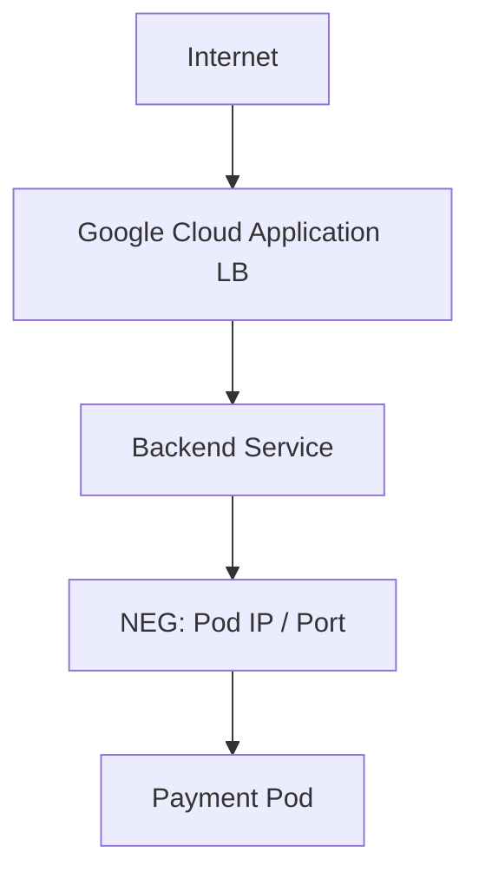
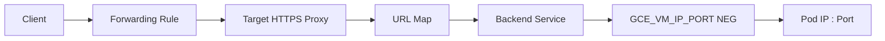

:::info Sources and editorial scope
This lesson expands on the topic and verifiable content of the conversation, but it is **not a complete verbatim transcript**. Additional material was written for this website and may require version-specific testing before use in production.
:::

## Learning objectives

Alias IP, NEG, GKE Gateway, Cloud NAT, private clusters.

## VPC-native GKE

In IPv4 VPC-native GKE, nodes use IP addresses from the primary subnet range. Pods use secondary ranges and participate in VPC routing through alias IPs. A Service ClusterIP is not the same as a Pod IP that can be routed outside the cluster.

## Container-native Load Balancing



A zonal `GCE_VM_IP_PORT` NEG contains Pod IP and port endpoints so the Cloud Load Balancer can select a backend directly instead of sending traffic to a NodePort. A NEG **is not a reverse proxy**.

## Gateway API & Controller Ownership

The GKE Gateway Controller translates Gateway and HTTPRoute configuration into Google Cloud load balancing resources. Terraform should not also manage URL maps or backend services that the Gateway Controller owns.

## Private GKE & Cloud NAT

Private nodes can still serve public HTTPS through an external load balancer. Cloud NAT provides outbound connectivity and handles return traffic; it does not provide a public inbound frontend. Private Google Access and Workload Identity/IAM address separate concerns.

## Debugging

1. DNS/TLS/frontend.
2. Gateway/HTTPRoute conditions.
3. Backend service health.
4. NEG membership.
5. VPC firewall, NetworkPolicy.
6. Application listener and response.

**Official:** [GKE VPC-native](https://docs.cloud.google.com/kubernetes-engine/docs/concepts/alias-ips) · [GKE Gateway](https://docs.cloud.google.com/kubernetes-engine/docs/concepts/gateway-api).


## From the global load balancer to the Pod through a NEG



The diagram shows logical relationships. A NEG is a set of endpoints, not a physical proxy hop. With container-native load balancing, the GKE controller updates NEG membership based on Pods and Services. Backend health checks can differ from Kubernetes readiness probes.

### IP ranges and capacity

The primary subnet range provides node IPs, the secondary Pod range provides Pod alias IPs, and the Service range provides ClusterIPs. GKE reserves Pod CIDR blocks per node, so calculate capacity in terms of blocks allocated per node, not just the number of running Pods. IP exhaustion can prevent the Cluster Autoscaler from creating nodes even when CPU quota is still available.

### Gateway reconciliation

`GatewayClass` selects the type of Google Cloud load balancer. A `Gateway` declares listeners, and an `HTTPRoute` declares hosts, paths, and backends. The GKE Gateway Controller creates and manages the cloud resources; Terraform should not modify backend services or URL maps that the controller owns.

### Private Nodes vs Private Service

Workloads on private nodes can still serve traffic through a public Application Load Balancer. Public NAT handles outbound internet flows; it does not open inbound connections. Private Google Access enables access to Google APIs but does not replace internet NAT for third-party endpoints. IAM authorization is independent of network reachability.

### Triage 502/503

Check DNS and TLS, the `Accepted`, `Programmed`, and `ResolvedRefs` conditions on Gateway API resources, Backend Service health, NEG endpoints, firewall and proxy IP ranges, NetworkPolicy, and the `/ready` HTTP response. Whether the load balancer is global or regional determines firewall and backend behavior.

**Lab:** Deploy a Deployment, ClusterIP Service, Gateway, and HTTPRoute in a GKE sandbox with Gateway enabled. Check the Google Cloud NEG and Backend Service health, then make `/ready` return a simulated 404 and apply a HealthCheckPolicy appropriate to the Gateway implementation.

## Deep dive: The GKE data plane, Pod IPs, and cloud load balancing

### VPC-native GKE and alias IP ranges

In a VPC-native cluster, nodes receive IP addresses from the primary subnet range, while Pods use a secondary range. Service ClusterIPs use the corresponding Service address range. A large supply of available node IPs does not guarantee enough Pod IP capacity; Pod addresses are allocated according to the cluster and node pool configuration. If the secondary range runs out of addresses, the autoscaler may be unable to add nodes even when Compute Engine quota remains.

### Request path from the internet to a Pod

```text
Client DNS
  ↓
Google Cloud external Application Load Balancer
  ↓ URL map / routing rules
Backend service
  ↓ NEG (Pod endpoints when container-native load balancing is enabled)
Pod IP:targetPort
  ↓
Application
```

The GKE Gateway and Ingress controllers reconcile Kubernetes Gateway, HTTPRoute, and Ingress resources into Google Cloud load balancing infrastructure. A `Gateway` reporting `Accepted` does not guarantee healthy backends. IAM, quotas, firewall rules, NEG endpoints, or health checks can still cause problems.

### Ingress vs Gateway API

Ingress is a simple L7 API that depends on an Ingress controller. Gateway API separates responsibilities across resources such as `GatewayClass`, `Gateway`, and `HTTPRoute`. This fits a model in which the platform team owns the Gateway and application teams attach Routes subject to `allowedRoutes` and reference rules. Cross-namespace references have additional constraints and require a `ReferenceGrant` where applicable.

```yaml
apiVersion: gateway.networking.k8s.io/v1
kind: HTTPRoute
metadata:
  name: payment-route
  namespace: payments
spec:
  parentRefs:
    - name: public-gateway
      namespace: gateway-system
  hostnames:
    - payments.example.com
  rules:
    - backendRefs:
        - name: payment
          port: 8080
```

This example manifest requires a Gateway, a listener, a policy that allows the route to attach, DNS, and a supported Gateway controller. The hostname shown is not a real project endpoint.

### Private GKE clusters, NAT, and API access

Running nodes without external IP addresses does not automatically create private API endpoints for every service. Cloud NAT provides internet egress for eligible private resources when routing, firewall rules, and configuration allow it; it does not provide public ingress. Design API server endpoint access and authorized networks separately. For Google APIs, use Private Google Access or Private Service Connect as requirements dictate.

### Triage 502/503

1. Does DNS point to the correct load balancer?
2. Does the Gateway or Ingress status show that the configuration was accepted and programmed?
3. Are the Backend Service health checks passing?
4. Do the NEG endpoints list the correct Pod IPs and ports?
5. Do firewall rules and network policies allow health-check traffic?
6. Is the application in the Pod listening on `0.0.0.0` and returning HTTP 200 on the health-check path?
7. If the request passes through Istio, check the VirtualService, Gateway, and AuthorizationPolicy.

Do not confuse Google Cloud Load Balancer health checks in GKE with Kubernetes readiness probes: they may check different paths or ports.

Sources: [GKE VPC-native clusters](https://cloud.google.com/kubernetes-engine/docs/concepts/alias-ips), [Container-native load balancing](https://cloud.google.com/kubernetes-engine/docs/concepts/container-native-load-balancing), [GKE Gateway](https://cloud.google.com/kubernetes-engine/docs/concepts/gateway-api).

## Self-check questions

1. Which controller owns the desired state and the actual state in this context?
2. What failure modes can occur even when the Kubernetes resource reports `Ready`?
3. What would you verify before deploying to production?
