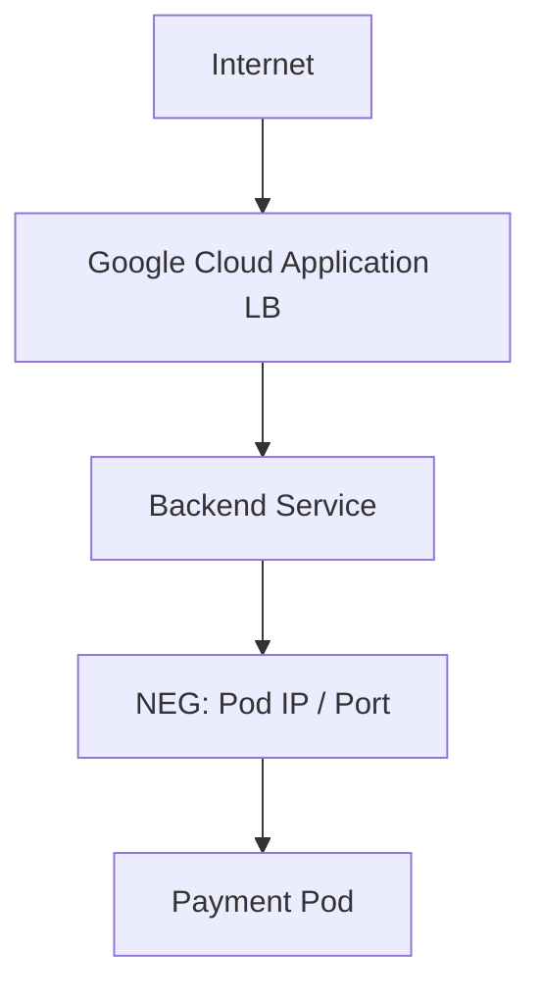
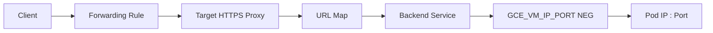
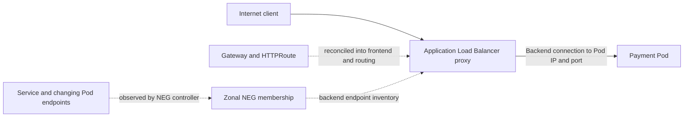

:::info Sources and editorial scope
This lesson expands on the topic and verifiable content of the conversation, but it is **not a complete verbatim transcript**. Additional material was written for this website and may require version-specific testing before use in production.
:::

## Learning objectives

Alias IP, NEG, GKE Gateway, Cloud NAT, private clusters.

## VPC-native GKE

In IPv4 VPC-native GKE, nodes use IP addresses from the primary subnet range. Pods use secondary ranges and participate in VPC routing through alias IPs. A Service ClusterIP is not the same as a Pod IP that can be routed outside the cluster.

## Container-native Load Balancing



A zonal `GCE_VM_IP_PORT` NEG contains Pod IP and port endpoints so the Cloud Load Balancer can select a backend directly instead of sending traffic to a NodePort. A NEG **is not a reverse proxy**.

## Gateway API & Controller Ownership

The GKE Gateway Controller translates Gateway and HTTPRoute configuration into Google Cloud load balancing resources. Terraform should not also manage URL maps or backend services that the Gateway Controller owns.

## Private GKE & Cloud NAT

Private nodes can still serve public HTTPS through an external load balancer. Cloud NAT provides outbound connectivity and handles return traffic; it does not provide a public inbound frontend. Private Google Access and Workload Identity/IAM address separate concerns.

## Debugging

1. DNS/TLS/frontend.
2. Gateway/HTTPRoute conditions.
3. Backend service health.
4. NEG membership.
5. VPC firewall, NetworkPolicy.
6. Application listener and response.

**Official:** [GKE VPC-native](https://docs.cloud.google.com/kubernetes-engine/docs/concepts/alias-ips) · [GKE Gateway](https://docs.cloud.google.com/kubernetes-engine/docs/concepts/gateway-api).


## From the global load balancer to the Pod through a NEG



The diagram shows logical relationships. A NEG is a set of endpoints, not a physical proxy hop. With container-native load balancing, the GKE controller updates NEG membership based on Pods and Services. Backend health checks can differ from Kubernetes readiness probes.

### IP ranges and capacity

The primary subnet range provides node IPs, the secondary Pod range provides Pod alias IPs, and the Service range provides ClusterIPs. GKE reserves Pod CIDR blocks per node, so calculate capacity in terms of blocks allocated per node, not just the number of running Pods. IP exhaustion can prevent the Cluster Autoscaler from creating nodes even when CPU quota is still available.

### Gateway reconciliation

`GatewayClass` selects the type of Google Cloud load balancer. A `Gateway` declares listeners, and an `HTTPRoute` declares hosts, paths, and backends. The GKE Gateway Controller creates and manages the cloud resources; Terraform should not modify backend services or URL maps that the controller owns.

### Private Nodes vs Private Service

Workloads on private nodes can still serve traffic through a public Application Load Balancer. Public NAT handles outbound internet flows; it does not open inbound connections. Private Google Access enables access to Google APIs but does not replace internet NAT for third-party endpoints. IAM authorization is independent of network reachability.

### Triage 502/503

Check DNS and TLS, the `Accepted`, `Programmed`, and `ResolvedRefs` conditions on Gateway API resources, Backend Service health, NEG endpoints, firewall and proxy IP ranges, NetworkPolicy, and the `/ready` HTTP response. Whether the load balancer is global or regional determines firewall and backend behavior.

**Lab:** Deploy a Deployment, ClusterIP Service, Gateway, and HTTPRoute in a GKE sandbox with Gateway enabled. Check the Google Cloud NEG and Backend Service health, then make `/ready` return a simulated 404 and apply a HealthCheckPolicy appropriate to the Gateway implementation.

## Deep dive: The GKE data plane, Pod IPs, and cloud load balancing

### VPC-native GKE and alias IP ranges

In a VPC-native cluster, nodes receive IP addresses from the primary subnet range, while Pods use a secondary range. Service ClusterIPs use the corresponding Service address range. A large supply of available node IPs does not guarantee enough Pod IP capacity; Pod addresses are allocated according to the cluster and node pool configuration. If the secondary range runs out of addresses, the autoscaler may be unable to add nodes even when Compute Engine quota remains.

### Request path from the internet to a Pod

```text
Client DNS
  ↓
Google Cloud external Application Load Balancer
  ↓ URL map / routing rules
Backend service
  ↓ NEG (Pod endpoints when container-native load balancing is enabled)
Pod IP:targetPort
  ↓
Application
```

The GKE Gateway and Ingress controllers reconcile Kubernetes Gateway, HTTPRoute, and Ingress resources into Google Cloud load balancing infrastructure. A `Gateway` reporting `Accepted` does not guarantee healthy backends. IAM, quotas, firewall rules, NEG endpoints, or health checks can still cause problems.

### Ingress vs Gateway API

Ingress is a simple L7 API that depends on an Ingress controller. Gateway API separates responsibilities across resources such as `GatewayClass`, `Gateway`, and `HTTPRoute`. This fits a model in which the platform team owns the Gateway and application teams attach Routes subject to `allowedRoutes` and reference rules. Cross-namespace references have additional constraints and require a `ReferenceGrant` where applicable.

```yaml
apiVersion: gateway.networking.k8s.io/v1
kind: HTTPRoute
metadata:
  name: payment-route
  namespace: payments
spec:
  parentRefs:
    - name: public-gateway
      namespace: gateway-system
  hostnames:
    - payments.example.com
  rules:
    - backendRefs:
        - name: payment
          port: 8080
```

This example manifest requires a Gateway, a listener, a policy that allows the route to attach, DNS, and a supported Gateway controller. The hostname shown is not a real project endpoint.

### Private GKE clusters, NAT, and API access

Running nodes without external IP addresses does not automatically create private API endpoints for every service. Cloud NAT provides internet egress for eligible private resources when routing, firewall rules, and configuration allow it; it does not provide public ingress. Design API server endpoint access and authorized networks separately. For Google APIs, use Private Google Access or Private Service Connect as requirements dictate.

### Triage 502/503

1. Does DNS point to the correct load balancer?
2. Does the Gateway or Ingress status show that the configuration was accepted and programmed?
3. Are the Backend Service health checks passing?
4. Do the NEG endpoints list the correct Pod IPs and ports?
5. Do firewall rules and network policies allow health-check traffic?
6. Is the application in the Pod listening on `0.0.0.0` and returning HTTP 200 on the health-check path?
7. If the request passes through Istio, check the VirtualService, Gateway, and AuthorizationPolicy.

Do not confuse Google Cloud Load Balancer health checks in GKE with Kubernetes readiness probes: they may check different paths or ports.

Sources: [GKE VPC-native clusters](https://cloud.google.com/kubernetes-engine/docs/concepts/alias-ips), [Container-native load balancing](https://cloud.google.com/kubernetes-engine/docs/concepts/container-native-load-balancing), [GKE Gateway](https://cloud.google.com/kubernetes-engine/docs/concepts/gateway-api).

## Walk through the public Payment API

A request to `https://api.example.com/payments` crosses three layers. Google Cloud handles the frontend, VPC routing, and backend health. Kubernetes declares the Service, route, and Pod endpoints. The application handles HTTP, TLS where configured, and its downstream connections. For a container-native backend, an external Application Load Balancer opens a backend connection to a Pod IP and port on the VPC network. The Service supplies the backend declaration, and the NEG supplies endpoint membership. Neither the Service ClusterIP nor the NEG forwards that connection as a separate hop.



| Load balancer resource | Responsibility in a global external Application Load Balancer |
|---|---|
| Forwarding rule | Associates frontend IP and port with a target proxy. |
| Target HTTPS proxy | Terminates frontend TLS using the configured certificates and references a URL map. |
| URL map | Chooses a backend service from host and path rules. |
| Backend service | References backend groups and health checks and defines balancing settings. |
| Zonal NEG | Identifies Pod IP and port endpoints registered with Compute Engine. |
| Health check | Probes endpoints independently of user requests and informs backend eligibility. |

An instance-group backend commonly receives traffic through NodePort. The node's Service dataplane then selects a Pod, which can require another node hop. A zonal `GCE_VM_IP_PORT` NEG lets the cloud load balancer select a Pod endpoint directly and check its health. These are two different backend paths. Trace the configured backend type before troubleshooting. [Application Load Balancer overview](https://docs.cloud.google.com/load-balancing/docs/application-load-balancer) · [Standalone zonal NEGs](https://docs.cloud.google.com/kubernetes-engine/docs/how-to/standalone-neg)

## Plan VPC-native IPv4 addressing

A Google Cloud VPC is global. Its subnets are regional. One production VPC might contain a Singapore subnet and a Tokyo subnet, each with independent address allocations. The GKE cluster uses a subnet in its region.

| Example allocation | Address count before applicable reservations | Use |
|---|---:|---|
| Primary subnet `10.0.0.0/20` | 4,096 | Node interface addresses and other allocations from that subnet |
| Pod secondary range `10.20.0.0/16` | 65,536 | Per-node Pod address blocks |
| Service range `10.96.0.0/20` | 4,096 | Virtual ClusterIPs |

These are user-managed IPv4 ranges. GKE also supports GKE-managed Service addressing. Allow for the four reserved primary-range addresses and for other consumers sharing that subnet. The Service ClusterIP is a virtual frontend used by the cluster dataplane. Pod alias IPs can be reached through the VPC when routes and security controls allow it.

For example, node `10.0.0.10` can hold alias block `10.20.1.0/24`, and node `10.0.0.11` can hold `10.20.2.0/24`. The VPC delivers traffic for `10.20.1.5` to the first node. Its dataplane delivers the packet to the Pod. GKE does not need a separate cloud route per Pod. Check CIDR overlap across connected clusters, peered networks, and on-premises ranges before assigning addresses. [VPC networks and subnets](https://docs.cloud.google.com/vpc/docs/vpc) · [VPC-native GKE](https://docs.cloud.google.com/kubernetes-engine/docs/concepts/alias-ips)

### Estimate how many nodes fit in the Pod range

For the documented allocation model, let `Q` be maximum Pods per node, `D` the Pod range prefix, and `M = 31 - ceil(log2(Q))` the prefix assigned to each node. Each block contains `2^(32-M)` addresses, and a single homogeneous range can fit `2^(M-D)` full blocks when `D <= M`.

| Maximum Pods per node | Block per node | Addresses per block | Blocks in a /16 |
|---:|---:|---:|---:|
| 32 | /26 | 64 | 1,024 |
| 64 | /25 | 128 | 512 |
| 110 | /24 | 256 | 256 |
| 256 | /23 | 512 | 128 |

At 110 Pods per node, 256 blocks give 28,160 theoretical Pod slots before accounting for system workloads and other limits. The block includes spare addresses beyond the configured Pod maximum. The autoscaler needs another whole block when adding a node. It can fail to add nodes even when some IPs inside existing blocks are idle and Compute Engine still has capacity. Plan for upgrade surge, pool-specific Pod density, shared subnet consumers, quotas, and the operational headroom needed to sustain scale-out. [Maximum Pods per node and CIDR calculation](https://docs.cloud.google.com/kubernetes-engine/docs/how-to/flexible-pod-cidr)

## Trace endpoint changes across Kubernetes and Google Cloud

A rollout can replace `10.20.1.5:8080` with `10.20.2.9:8080`. Kubernetes EndpointSlices represent Service backends for Kubernetes consumers. GKE reconciles the corresponding cloud endpoint membership through the Compute Engine API. The cloud load balancer also evaluates health independently of registration. During convergence, compare Kubernetes backend state, cloud membership, and backend health separately. A zonal NEG should contain endpoints in its own zone, so inspect each relevant zone.

For standalone NEGs, save this Service separately from the Gateway example below. It assumes the namespace exists and that matching Pods listen on 8080.

```yaml
apiVersion: v1
kind: Service
metadata:
  name: payment
  namespace: payments
  annotations:
    cloud.google.com/neg: '{"exposed_ports":{"80":{"name":"payment-neg"}}}'
spec:
  type: ClusterIP
  selector:
    app: payment
  ports:
    - name: http
      port: 80
      targetPort: 8080
```

This creates zonal endpoint groups through GKE. Creating a frontend, backend service, and health checks is a separate task in the standalone architecture. For example, Terraform can own those load balancer resources while GKE owns NEG membership. For a Gateway-managed Service, leave the NEG annotations under the Gateway controller's management and use the same Service spec without the standalone annotation. [Standalone zonal NEGs](https://docs.cloud.google.com/kubernetes-engine/docs/how-to/standalone-neg) · [GKE Gateway deployment restrictions](https://docs.cloud.google.com/kubernetes-engine/docs/how-to/deploying-gateways)

## Declare the GKE Gateway and its health check

| GatewayClass | Load balancer |
|---|---|
| `gke-l7-global-external-managed` | Global external Application Load Balancer |
| `gke-l7-regional-external-managed` | Regional external Application Load Balancer |
| `gke-l7-rilb` | Regional internal Application Load Balancer |
| `gke-l7-global-external-managed-mc` | Global external multi-cluster Application Load Balancer |

Choose a class based on frontend reachability, location, capabilities, and prerequisites such as proxy-only subnets for applicable regional proxy load balancers. The example assumes Gateway API is enabled and `Service/payment` exposes port 80. The frontend uses HTTP in the example. Configure a matching HTTPS listener and certificate for the public TLS flow described above. Use this Gateway and HTTPRoute pair in place of the earlier abbreviated `HTTPRoute/payment-route` example.

```yaml
apiVersion: gateway.networking.k8s.io/v1
kind: Gateway
metadata:
  name: public-gateway
  namespace: payments
spec:
  gatewayClassName: gke-l7-global-external-managed
  listeners:
    - name: http
      protocol: HTTP
      port: 80
      allowedRoutes:
        namespaces:
          from: Same
---
apiVersion: gateway.networking.k8s.io/v1
kind: HTTPRoute
metadata:
  name: payment-route
  namespace: payments
spec:
  parentRefs:
    - name: public-gateway
  rules:
    - matches:
        - path:
            type: PathPrefix
            value: /payments
      backendRefs:
        - name: payment
          port: 80
---
apiVersion: networking.gke.io/v1
kind: HealthCheckPolicy
metadata:
  name: payment-health-check
  namespace: payments
spec:
  default:
    checkIntervalSec: 5
    timeoutSec: 3
    healthyThreshold: 2
    unhealthyThreshold: 2
    config:
      type: HTTP
      httpHealthCheck:
        portSpecification: USE_FIXED_PORT
        port: 8080
        requestPath: /ready
  targetRef:
    group: ""
    kind: Service
    name: payment
```

The route references Service port 80. The fixed health-check port reaches the Pod listener on 8080. GKE Gateway does not infer the cloud health check from the Pod readiness probe. A Pod can pass kubelet's check on `/ready` while the load balancer's default check at `/` receives 404. Verify the configured path, protocol, port and, when necessary, Host header. In configurations using `cloud.google.com/load-balancer-neg-ready`, the Pod's readiness also depends on a condition set by GKE. This can help coordinate rolling updates. The condition has fallback behavior, so check actual cloud backend health and end-to-end responses. [GatewayClass capabilities](https://docs.cloud.google.com/kubernetes-engine/docs/how-to/gatewayclass-capabilities) · [HealthCheckPolicy](https://docs.cloud.google.com/kubernetes-engine/docs/how-to/configure-gateway-resources) · [NEG readiness](https://docs.cloud.google.com/kubernetes-engine/docs/how-to/standalone-neg)

Terraform can own the VPC, subnet and cluster. Argo CD can apply the Gateway, HTTPRoute, Service and policy manifests. GKE reconciles the generated URL maps, backend services, and NEG membership. Update the owning declaration to change a route or probe. Direct cloud edits to controller-owned resources can be overwritten.

## Separate public ingress, private nodes, and outbound API access

Choose Kubernetes API endpoint access, node external IP assignment, and application frontend exposure independently. Private nodes can back a public HTTPS load balancer because the proxy connects to routable private Pod endpoints. A private or restricted control-plane endpoint has its own requirements for the administrators and automation runners connecting to it.

For an outbound connection to a third-party provider, Public NAT translates an eligible private source address and port to a public address and port. For example, `10.20.1.5:45000` can appear externally as `203.0.113.10:51000`. Return packets match the existing mapping. An unsolicited internet connection does not get a NAT mapping to a Pod. Depending on IP masquerading, the cloud NAT source can be a Pod alias IP or a node IP. Select the subnet ranges NAT must cover using the actual source address. Public NAT is distributed, with Cloud Router providing configuration and control rather than serving as a forwarding VM.

The following illustrative setup creates resources in the chosen Google Cloud project and covers the region's eligible subnet ranges. Use a disposable project or a reviewed infrastructure change. These resources can incur charges. Scope production NAT to the ranges that need it.

```bash
gcloud compute routers create gke-router \
  --network=production-vpc --region=asia-southeast1
gcloud compute routers nats create gke-nat \
  --router=gke-router --region=asia-southeast1 \
  --nat-all-subnet-ip-ranges --auto-allocate-nat-external-ips
```

If external requests intermittently time out, correlate Cloud NAT allocation and dropped-packet metrics with connection counts. Review source ports per VM, connection churn, pooling, and IP capacity before changing NAT settings.

Private Google Access provides network connectivity from eligible private resources to supported Google APIs and services. Secret Manager, Cloud Storage, and Artifact Registry still require the appropriate identity and IAM permissions. A third-party API needs internet egress such as Public NAT or an egress proxy. For ESO, check reachability to Google APIs and Workload Identity authorization independently. A timeout suggests a reachability problem, while a returned HTTP 403 calls for examining IAM and applicable service controls. [Cloud NAT](https://docs.cloud.google.com/nat/docs/overview) · [GKE networking best practices](https://docs.cloud.google.com/kubernetes-engine/docs/best-practices/networking) · [Private Google Access](https://docs.cloud.google.com/vpc/docs/private-google-access)

## Check both cloud and Kubernetes security controls

| Layer | Matches | Where it takes effect |
|---|---|---|
| VPC firewall | Cloud network source and destination criteria such as IP ranges and supported VM targets | Google Cloud networking |
| Kubernetes NetworkPolicy | Pod and namespace selectors, IP blocks and ports | The cluster's policy-enforcing dataplane |

A cloud backend connection must traverse the applicable firewall and Pod ingress policy. Health checks and serving traffic can use different sources. Look up requirements for the selected load balancer, including health prober ranges and regional proxy-only subnets when applicable. Validate the source address visible to NetworkPolicy in the deployed dataplane. A public client's IP in an HTTP header is distinct from the source of the proxy's backend connection.

In Shared VPC, the host project owns shared subnets and network controls. GKE clusters and workloads can live in service projects. Confirm subnet-use permissions and the controller's required IAM permissions on the host project. For GKE Gateways in Shared VPC, arrange the required firewall rules with the host project's network team. A valid Kubernetes route can still fail to provision or serve traffic because a cross-project prerequisite is missing. [GatewayClass firewall requirements](https://docs.cloud.google.com/kubernetes-engine/docs/how-to/gatewayclass-capabilities) · [Shared VPC](https://docs.cloud.google.com/vpc/docs/shared-vpc)

## Publish Payment across clusters

For clusters in Singapore and Tokyo, ApplicationSet can deploy Payment to both clusters. Fleet groups memberships. Multi-cluster Services can export a Service for cross-cluster discovery. A multi-cluster Gateway can serve one external frontend backed by the exported service. Configure compatible Fleet memberships, network connectivity, the MCS feature, and a Gateway config cluster according to the class requirements.

```yaml
apiVersion: net.gke.io/v1
kind: ServiceExport
metadata:
  name: payment
  namespace: payments
```

Create the export in each intended exporting cluster alongside the matching Service. Look for the generated ServiceImport and the DNS name `payment.payments.svc.clusterset.local` in participating clusters. With a supported multi-cluster GatewayClass such as `gke-l7-global-external-managed-mc`, declare the Gateway in the config cluster. The HTTPRoute backend references the imported service using `group: net.gke.io` and `kind: ServiceImport`. Confirm backend health and spare capacity in both clusters before relying on failover. Distribution can depend on health, location, capacity, and the selected load balancing policy. [Multi-cluster Services](https://docs.cloud.google.com/kubernetes-engine/docs/concepts/multi-cluster-services) · [Deploy multi-cluster Gateways](https://docs.cloud.google.com/kubernetes-engine/docs/how-to/deploying-multi-cluster-gateways)

## Diagnose a 502 from the frontend through the NEG

1. Check public DNS against the assigned frontend address. Verify TLS and reproduce the exact hostname and path. Use the response timestamp and request ID to find the load balancer log entry.
2. Inspect Gateway and HTTPRoute status. Check Gateway `Programmed` and the intended route parent's `Accepted` and `ResolvedRefs` conditions.
3. Identify the backend service selected by the URL map. Check its scope and health. Inspect the configured probe before assuming an unhealthy backend has failed application readiness.
4. Compare the Service selector and target port, Kubernetes EndpointSlices, and zonal NEG membership. Confirm the Pod IP and listener port match what the cloud backend registered.
5. Verify cloud firewall rules, Pod ingress policy, and cloud reachability. Compare the load balancer probe response with a request to that same path and port from an authorized diagnostic context.
6. If only some requests fail, group by zone, endpoint, and revision. Check listener behavior, TLS to the backend if configured, connection draining, and rollout timestamps.

```bash
kubectl describe gateway public-gateway -n payments
kubectl describe httproute payment-route -n payments
kubectl get service payment -n payments -o yaml
kubectl get endpointslices -n payments -l kubernetes.io/service-name=payment
kubectl get pods -n payments -o wide
gcloud compute network-endpoint-groups list
gcloud compute network-endpoint-groups list-network-endpoints NEG_NAME --zone=asia-southeast1-a
gcloud compute backend-services get-health BACKEND_SERVICE_NAME --global
```

Look for `cloud.google.com/neg-status` on the Service when present. Replace the placeholder group and backend names with discovered values and use `--region` instead of `--global` for a regional backend service. If access through ClusterIP works while cloud health remains unhealthy, focus on the cloud probe, NEG membership, and the cloud-to-Pod path. In a lab, compare an application that returns 404 at `/` and 200 at `/ready` before and after applying the HealthCheckPolicy. Verify that the Pods stay Ready while cloud health changes and confirm the public response independently. [Troubleshoot GKE load balancing](https://docs.cloud.google.com/kubernetes-engine/docs/troubleshooting/load-balancing)

Try the [GKE Pod IP capacity calculator and quiz](./networking-exercises.mdx#calculate-gke-pod-ip-capacity), then continue with [Lesson 14 — Service Mesh and Istio](./lesson-14-istio.md) for Envoy, xDS, mTLS, and service-to-service traffic management.

## Self-check questions
1. Which controller owns the desired state and the actual state in this context?
2. What failure modes can occur even when the Kubernetes resource reports `Ready`?
3. What would you verify before deploying to production?
