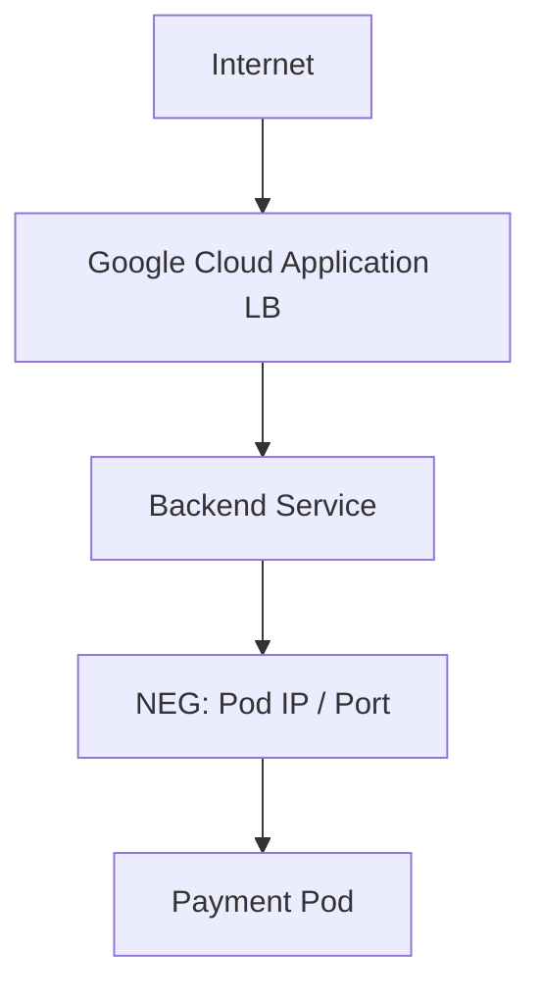
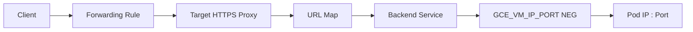
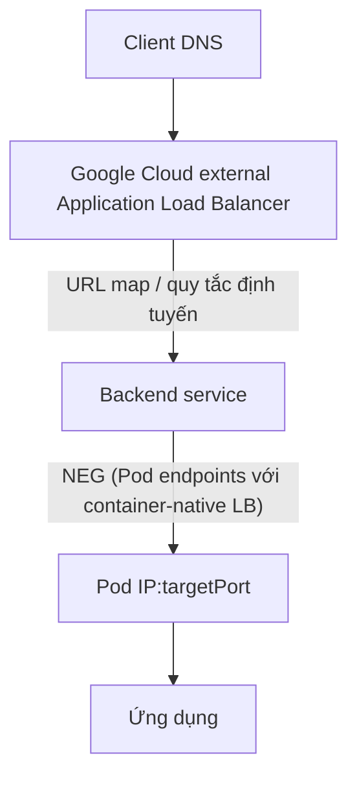
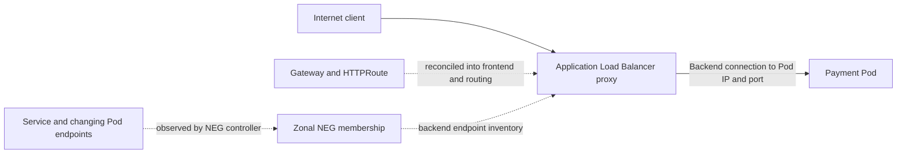

## Mục tiêu học tập

- **Hoạch định địa chỉ IPv4 VPC-native và dung lượng IP:** Phân bổ dải primary subnet cho node, secondary range Alias IP cho Pod và dải Service, đồng thời tính toán khối Pod CIDR theo từng node để tránh cạn IP khi autoscale.
- **Hiểu cơ chế container-native load balancing:** Theo dõi cách Google Cloud Application Load Balancer định tuyến thẳng tới Pod endpoint qua zonal `GCE_VM_IP_PORT` NEG mà không qua chặng NodePort dư thừa.
- **Quản trị GKE Gateway API và health check:** Đối soát `GatewayClass`, `Gateway`, `HTTPRoute` cùng `HealthCheckPolicy`, đồng thời giữ ranh giới sở hữu tài nguyên rõ ràng giữa controller, Terraform và Argo CD.
- **Thiết kế private cluster và kết nối chiều đi:** Tách bạch public HTTPS ingress, private node, Cloud NAT egress, Private Google Access và phân quyền IAM trên cả VPC đơn lẻ lẫn Shared VPC.
- **Chẩn đoán lỗi 502/503 và mở rộng đa cluster:** Khoanh vùng sự cố qua DNS, trạng thái Gateway, danh sách NEG, VPC firewall và cloud health probe, đồng thời công bố Service xuyên cluster với MCS.

## VPC-native GKE

Trong GKE VPC-native dùng IPv4, các node sử dụng địa chỉ IP từ dải subnet chính (primary subnet range). Các Pod dùng dải phụ (secondary ranges) và tham gia định tuyến trực tiếp trong VPC thông qua Alias IP. Service ClusterIP không giống với Pod IP có thể định tuyến ra ngoài cluster.

## Container-native Load Balancing



Một zonal `GCE_VM_IP_PORT` NEG chứa danh sách endpoint gồm Pod IP và port để Cloud Load Balancer có thể chọn trực tiếp backend thay vì đẩy lưu lượng qua NodePort. NEG **không phải là một reverse proxy**.

## Gateway API & Quyền sở hữu của Controller

GKE Gateway Controller chuyển đổi cấu hình `Gateway` và `HTTPRoute` thành các tài nguyên cân bằng tải trên Google Cloud. Terraform không nên cùng quản lý các URL map hoặc backend service vốn thuộc quyền sở hữu của Gateway Controller.

## Private GKE & Cloud NAT

Các private node vẫn có thể phục vụ lưu lượng HTTPS công khai thông qua external load balancer. Cloud NAT cung cấp kết nối chiều đi (outbound) và xử lý lưu lượng hồi đáp; nó không tạo ra một public inbound frontend. Private Google Access và Workload Identity/IAM giải quyết những bài toán tách biệt.

## Gỡ lỗi

1. DNS/TLS/frontend.
2. Các điều kiện trạng thái (conditions) trên Gateway/HTTPRoute.
3. Sức khỏe của Backend Service.
4. Danh sách thành viên (membership) của NEG.
5. VPC firewall, NetworkPolicy.
6. Listener và phản hồi từ ứng dụng.

**Tài liệu chính thức:** [GKE VPC-native](https://docs.cloud.google.com/kubernetes-engine/docs/concepts/alias-ips) · [GKE Gateway](https://docs.cloud.google.com/kubernetes-engine/docs/concepts/gateway-api).

## Từ global load balancer đến Pod thông qua NEG



Sơ đồ trên thể hiện mối quan hệ logic. NEG là một tập hợp các endpoint, không phải một chặng proxy vật lý. Với container-native load balancing, GKE controller cập nhật danh sách thành viên NEG dựa trên Pod và Service. Health check của Backend Service có thể khác với readiness probe của Kubernetes.

### Dải IP và dung lượng

Dải subnet chính cấp IP cho node, dải phụ Pod cấp Alias IP cho Pod và dải Service cấp ClusterIP. GKE giữ trước từng khối Pod CIDR cho mỗi node, nên cần tính dung lượng theo số khối cấp phát cho mỗi node thay vì chỉ đếm số Pod đang chạy. Cạn kiệt IP có thể khiến Cluster Autoscaler không thể tạo thêm node ngay cả khi hạn mức CPU vẫn còn.

### Đối soát Gateway (Reconciliation)

`GatewayClass` chọn loại Google Cloud load balancer. `Gateway` khai báo các listener, còn `HTTPRoute` khai báo host, path và backend. GKE Gateway Controller tạo và quản lý các tài nguyên cloud; Terraform không nên chỉnh sửa các backend service hay URL map do controller quản lý.

### Private Nodes vs Private Service

Workload chạy trên private node vẫn có thể phục vụ lưu lượng qua public Application Load Balancer. Public NAT xử lý các luồng đi ra internet; nó không mở kết nối chiều vào (inbound). Private Google Access cho phép truy cập các Google API nhưng không thay thế internet NAT cho các endpoint của bên thứ ba. Phân quyền IAM độc lập với khả năng thông mạch mạng.

### Phân loại sự cố 502/503

Kiểm tra DNS và TLS, các điều kiện `Accepted`, `Programmed`, `ResolvedRefs` trên các resource Gateway API, sức khỏe Backend Service, danh sách endpoint trong NEG, firewall và các dải IP proxy, NetworkPolicy, cùng phản hồi HTTP tại `/ready`. Việc load balancer thuộc phạm vi global hay regional sẽ quyết định hành vi của firewall và backend.

**Thực hành:** Triển khai Deployment, ClusterIP Service, Gateway và HTTPRoute trong môi trường GKE sandbox đã bật Gateway. Kiểm tra NEG trên Google Cloud và sức khỏe Backend Service, sau đó mô phỏng `/ready` trả về 404 và áp dụng một `HealthCheckPolicy` phù hợp với bản triển khai Gateway.

## Phân tích sâu: GKE data plane, Pod IP và cân bằng tải trên cloud

### VPC-native GKE và các dải Alias IP

Trong VPC-native cluster, node nhận địa chỉ IP từ dải subnet chính, còn Pod dùng dải phụ. Service ClusterIP dùng dải địa chỉ Service tương ứng. Việc còn nhiều node IP trống không đồng nghĩa với việc đủ dung lượng Pod IP; địa chỉ Pod được cấp phát theo cấu hình của cluster và node pool. Nếu dải phụ cạn địa chỉ, autoscaler có thể không thêm được node mới ngay cả khi Compute Engine vẫn còn quota.

### Đường đi request từ internet vào Pod



GKE Gateway và Ingress controller đối soát các resource `Gateway`, `HTTPRoute` và `Ingress` của Kubernetes thành hạ tầng cân bằng tải của Google Cloud. Một `Gateway` báo `Accepted` không đảm bảo các backend đều khỏe mạnh. IAM, quota, firewall rules, NEG endpoints hoặc health check vẫn có thể gây lỗi.

### Ingress vs Gateway API

Ingress là một L7 API đơn giản phụ thuộc vào Ingress controller. Gateway API phân tách trách nhiệm qua các resource như `GatewayClass`, `Gateway` và `HTTPRoute`. Mô hình này rất phù hợp khi đội platform sở hữu Gateway còn các đội ứng dụng gắn Route tuân theo `allowedRoutes` và quy tắc tham chiếu. Tham chiếu xuyên namespace có thêm ràng buộc và yêu cầu `ReferenceGrant` khi cần thiết.

```yaml
apiVersion: gateway.networking.k8s.io/v1
kind: HTTPRoute
metadata:
  name: payment-route
  namespace: payments
spec:
  parentRefs:
    - name: public-gateway
      namespace: gateway-system
  hostnames:
    - payments.example.com
  rules:
    - backendRefs:
        - name: payment
          port: 8080
```

Manifest ví dụ này yêu cầu phải có sẵn Gateway, listener, chính sách cho phép route gắn vào, DNS và một Gateway controller được hỗ trợ. Hostname trong ví dụ không phải là endpoint thật của dự án.

### Private GKE cluster, NAT và truy cập API

Chạy node không có địa chỉ IP bên ngoài không tự động tạo private API endpoint cho mọi dịch vụ. Cloud NAT cung cấp đường ra internet (egress) cho các tài nguyên private hợp lệ khi định tuyến, firewall rules và cấu hình cho phép; nó không cung cấp public ingress. Hãy thiết kế riêng quyền truy cập API server endpoint và danh sách authorized networks. Với Google APIs, dùng Private Google Access hoặc Private Service Connect tùy theo yêu cầu.

### Phân loại sự cố 502/503

1. DNS có trỏ tới đúng load balancer không?
2. Trạng thái của Gateway hoặc Ingress có cho thấy cấu hình đã được accepted và programmed không?
3. Các health check của Backend Service có đang đạt không?
4. Các NEG endpoint có liệt kê đúng Pod IP và port không?
5. Firewall rules và NetworkPolicy có cho phép lưu lượng health check không?
6. Ứng dụng trong Pod có đang lắng nghe trên `0.0.0.0` và trả về HTTP 200 tại đường dẫn health check không?
7. Nếu request đi qua Istio, hãy kiểm tra thêm `VirtualService`, `Gateway` và `AuthorizationPolicy`.

Đừng nhầm lẫn giữa health check của Google Cloud Load Balancer trong GKE với readiness probe của Kubernetes: chúng có thể kiểm tra những đường dẫn hoặc cổng khác nhau.

Nguồn tham khảo: [GKE VPC-native clusters](https://cloud.google.com/kubernetes-engine/docs/concepts/alias-ips), [Container-native load balancing](https://cloud.google.com/kubernetes-engine/docs/concepts/container-native-load-balancing), [GKE Gateway](https://cloud.google.com/kubernetes-engine/docs/concepts/gateway-api).

## Theo dõi luồng Payment API công khai

Một request tới `https://api.example.com/payments` đi qua ba lớp. Google Cloud xử lý frontend, định tuyến VPC và sức khỏe backend. Kubernetes khai báo Service, route và Pod endpoints. Ứng dụng xử lý HTTP, TLS (nếu cấu hình) và các kết nối tới dịch vụ phía sau. Với container-native backend, external Application Load Balancer mở kết nối backend trực tiếp tới Pod IP và port trên mạng VPC. Service cung cấp phần khai báo backend, còn NEG cung cấp danh sách thành viên endpoint. Cả Service ClusterIP lẫn NEG đều không chuyển tiếp kết nối đó như một chặng riêng biệt.



| Tài nguyên load balancer | Trách nhiệm trong global external Application Load Balancer |
|---|---|
| Forwarding rule | Liên kết frontend IP và port với một target proxy. |
| Target HTTPS proxy | Kết thúc (terminate) TLS ở frontend bằng chứng chỉ đã cấu hình và trỏ tới URL map. |
| URL map | Chọn backend service dựa trên quy tắc host và path. |
| Backend service | Tham chiếu các nhóm backend, health check và định nghĩa cấu hình cân bằng tải. |
| Zonal NEG | Định danh các endpoint gồm Pod IP và port đã đăng ký với Compute Engine. |
| Health check | Chủ động kiểm tra các endpoint độc lập với request người dùng để xác định khả năng phục vụ của backend. |

Backend dạng instance-group thường nhận lưu lượng qua NodePort, sau đó Service dataplane của node mới chọn Pod — điều này có thể phát sinh thêm một chặng nhảy sang node khác. Ngược lại, zonal `GCE_VM_IP_PORT` NEG cho phép cloud load balancer chọn thẳng một Pod endpoint và kiểm tra sức khỏe của nó. Đây là hai đường đi backend khác hẳn nhau; hãy xác định rõ loại backend đang cấu hình trước khi gỡ lỗi. [Application Load Balancer overview](https://docs.cloud.google.com/load-balancing/docs/application-load-balancer) · [Standalone zonal NEGs](https://docs.cloud.google.com/kubernetes-engine/docs/how-to/standalone-neg)

## Hoạch định địa chỉ IPv4 cho VPC-native

Google Cloud VPC có phạm vi toàn cầu (global), còn các subnet của nó thuộc phạm vi vùng (regional). Một VPC production có thể chứa một subnet ở Singapore và một subnet ở Tokyo, mỗi nơi có phần cấp phát địa chỉ độc lập. GKE cluster sử dụng một subnet nằm trong region của nó.

| Ví dụ cấp phát | Số địa chỉ trước khi trừ phần giữ chỗ | Mục đích sử dụng |
|---|---:|---|
| Primary subnet `10.0.0.0/20` | 4.096 | Địa chỉ giao diện mạng của node và các cấp phát khác từ subnet đó |
| Pod secondary range `10.20.0.0/16` | 65.536 | Các khối địa chỉ Pod theo từng node |
| Service range `10.96.0.0/20` | 4.096 | Các địa chỉ ảo ClusterIP |

Đây là các dải IPv4 do người dùng quản lý. GKE cũng hỗ trợ cơ chế GKE-managed Service addressing. Cần tính đến 4 địa chỉ được giữ chỗ trong primary range cũng như các thành phần khác dùng chung subnet đó. Service ClusterIP là một frontend ảo do dataplane của cluster sử dụng. Pod Alias IP có thể được truy cập trực tiếp qua VPC khi định tuyến và các kiểm soát bảo mật cho phép.

Ví dụ, node `10.0.0.10` có thể giữ khối alias `10.20.1.0/24`, và node `10.0.0.11` giữ `10.20.2.0/24`. VPC chuyển lưu lượng gửi tới `10.20.1.5` về node đầu tiên, sau đó dataplane của node giao gói tin cho Pod. GKE không cần tạo route cloud riêng cho từng Pod. Hãy kiểm tra trùng lặp CIDR giữa các cluster kết nối với nhau, các mạng peering và dải on-premises trước khi phân bổ địa chỉ. [VPC networks and subnets](https://docs.cloud.google.com/vpc/docs/vpc) · [VPC-native GKE](https://docs.cloud.google.com/kubernetes-engine/docs/concepts/alias-ips)

### Ước tính số node chứa được trong dải Pod

Theo mô hình cấp phát trong tài liệu chính thức, gọi `Q` là số Pod tối đa trên mỗi node, `D` là prefix của dải Pod và `M = 31 - ceil(log2(Q))` là prefix cấp cho từng node. Mỗi khối chứa `2^(32-M)` địa chỉ, và một dải đồng nhất có thể chứa `2^(M-D)` khối đầy đủ khi `D <= M`.

| Số Pod tối đa / node | Khối / node | Số địa chỉ / khối | Số khối trong dải /16 |
|---:|---:|---:|---:|
| 32 | /26 | 64 | 1.024 |
| 64 | /25 | 128 | 512 |
| 110 | /24 | 256 | 256 |
| 256 | /23 | 512 | 128 |

Ở mức 110 Pod/node, 256 khối cho tối đa 28.160 vị trí Pod theo lý thuyết trước khi trừ workload hệ thống và các giới hạn khác. Mỗi khối đều có địa chỉ dự phòng lớn hơn số Pod tối đa cấu hình. Khi thêm một node mới, autoscaler cần trọn vẹn một khối mới. Nó có thể thất bại khi thêm node ngay cả khi vẫn còn IP nhàn rỗi bên trong các khối hiện có và Compute Engine vẫn còn tài nguyên. Hãy tính sẵn biên độ cho surge khi nâng cấp, mật độ Pod theo từng node pool, các tài nguyên dùng chung subnet, quota và dư địa vận hành để duy trì khả năng mở rộng. [Maximum Pods per node and CIDR calculation](https://docs.cloud.google.com/kubernetes-engine/docs/how-to/flexible-pod-cidr)

## Theo dõi thay đổi endpoint giữa Kubernetes và Google Cloud

Một đợt rollout có thể thay thế `10.20.1.5:8080` bằng `10.20.2.9:8080`. Kubernetes EndpointSlices đại diện cho backend của Service đối với các client trong Kubernetes. GKE đối soát danh sách thành viên endpoint tương ứng trên cloud thông qua Compute Engine API. Cloud load balancer cũng đánh giá sức khỏe độc lập với quá trình đăng ký. Trong lúc hệ thống đang hội tụ, hãy so sánh riêng rẽ trạng thái backend Kubernetes, danh sách thành viên trên cloud và sức khỏe backend. Một zonal NEG chỉ chứa endpoint thuộc zone của nó, nên cần kiểm tra từng zone liên quan.

Với standalone NEG, lưu Service này tách biệt khỏi ví dụ Gateway bên dưới. Giả định namespace đã tồn tại và các Pod khớp selector lắng nghe trên cổng 8080.

```yaml
apiVersion: v1
kind: Service
metadata:
  name: payment
  namespace: payments
  annotations:
    cloud.google.com/neg: '{"exposed_ports":{"80":{"name":"payment-neg"}}}'
spec:
  type: ClusterIP
  selector:
    app: payment
  ports:
    - name: http
      port: 80
      targetPort: 8080
```

Cấu hình này tạo các zonal endpoint group thông qua GKE. Việc tạo frontend, backend service và health check là phần việc riêng trong kiến trúc standalone. Ví dụ, Terraform có thể sở hữu các tài nguyên load balancer đó trong khi GKE sở hữu danh sách thành viên NEG. Với Service do Gateway quản lý, hãy để Gateway controller tự quản lý annotation NEG và dùng cùng phần `spec` Service mà không gắn annotation standalone. [Standalone zonal NEGs](https://docs.cloud.google.com/kubernetes-engine/docs/how-to/standalone-neg) · [GKE Gateway deployment restrictions](https://docs.cloud.google.com/kubernetes-engine/docs/how-to/deploying-gateways)

## Khai báo GKE Gateway và chính sách health check

| GatewayClass | Loại load balancer |
|---|---|
| `gke-l7-global-external-managed` | Global external Application Load Balancer |
| `gke-l7-regional-external-managed` | Regional external Application Load Balancer |
| `gke-l7-rilb` | Regional internal Application Load Balancer |
| `gke-l7-global-external-managed-mc` | Global external multi-cluster Application Load Balancer |

Chọn class dựa trên phạm vi truy cập frontend, vị trí, tính năng và các điều kiện tiên quyết như proxy-only subnet cho các regional proxy load balancer tương ứng. Ví dụ sau giả định Gateway API đã được bật và `Service/payment` mở cổng 80. Frontend trong ví dụ dùng HTTP; cần cấu hình HTTPS listener và chứng chỉ tương ứng cho luồng TLS công khai đã mô tả ở trên. Dùng cặp Gateway và HTTPRoute này thay cho ví dụ `HTTPRoute/payment-route` rút gọn ở phần trước.

```yaml
apiVersion: gateway.networking.k8s.io/v1
kind: Gateway
metadata:
  name: public-gateway
  namespace: payments
spec:
  gatewayClassName: gke-l7-global-external-managed
  listeners:
    - name: http
      protocol: HTTP
      port: 80
      allowedRoutes:
        namespaces:
          from: Same
---
apiVersion: gateway.networking.k8s.io/v1
kind: HTTPRoute
metadata:
  name: payment-route
  namespace: payments
spec:
  parentRefs:
    - name: public-gateway
  rules:
    - matches:
        - path:
            type: PathPrefix
            value: /payments
      backendRefs:
        - name: payment
          port: 80
---
apiVersion: networking.gke.io/v1
kind: HealthCheckPolicy
metadata:
  name: payment-health-check
  namespace: payments
spec:
  default:
    checkIntervalSec: 5
    timeoutSec: 3
    healthyThreshold: 2
    unhealthyThreshold: 2
    config:
      type: HTTP
      httpHealthCheck:
        portSpecification: USE_FIXED_PORT
        port: 8080
        requestPath: /ready
  targetRef:
    group: ""
    kind: Service
    name: payment
```

Route tham chiếu Service port 80, còn cổng health check cố định gọi thẳng vào listener của Pod trên cổng 8080. GKE Gateway không tự suy ra cloud health check từ readiness probe của Pod. Một Pod có thể vượt qua kiểm tra của kubelet tại `/ready` trong khi health check mặc định của load balancer tại `/` lại nhận về 404. Hãy xác minh path, giao thức, port và header `Host` khi cần. Trong các cấu hình dùng `cloud.google.com/load-balancer-neg-ready`, trạng thái sẵn sàng của Pod còn phụ thuộc vào một condition do GKE đặt, giúp điều phối rolling update tốt hơn. Condition này có hành vi fallback, nên vẫn cần kiểm tra sức khỏe backend thực tế trên cloud và phản hồi đầu-cuối. [GatewayClass capabilities](https://docs.cloud.google.com/kubernetes-engine/docs/how-to/gatewayclass-capabilities) · [HealthCheckPolicy](https://docs.cloud.google.com/kubernetes-engine/docs/how-to/configure-gateway-resources) · [NEG readiness](https://docs.cloud.google.com/kubernetes-engine/docs/how-to/standalone-neg)

Terraform có thể sở hữu VPC, subnet và cluster. Argo CD có thể apply các manifest Gateway, HTTPRoute, Service và policy. GKE đối soát các URL map, backend service và danh sách thành viên NEG được sinh ra. Khi muốn đổi route hoặc probe, hãy cập nhật tại nơi khai báo sở hữu nó; các chỉnh sửa trực tiếp trên cloud vào tài nguyên do controller quản lý có thể bị ghi đè.

## Tách bạch public ingress, private nodes và truy cập API chiều đi

Hãy lựa chọn độc lập ba yếu tố: quyền truy cập Kubernetes API endpoint, việc gán IP bên ngoài cho node và mức độ công khai frontend của ứng dụng. Private node vẫn có thể làm backend cho một public HTTPS load balancer vì proxy kết nối tới các Pod endpoint riêng tư có thể định tuyến trong VPC. Một control-plane endpoint riêng tư hoặc bị giới hạn sẽ có yêu cầu riêng cho quản trị viên và automation runner kết nối vào nó.

Với kết nối chiều đi tới nhà cung cấp bên thứ ba, Public NAT dịch địa chỉ nguồn riêng tư và cổng hợp lệ sang địa chỉ và cổng công khai. Ví dụ, `10.20.1.5:45000` có thể xuất hiện ở bên ngoài dưới dạng `203.0.113.10:51000`. Các gói tin hồi đáp khớp với ánh xạ hiện có. Kết nối tự phát từ internet vào không có ánh xạ NAT để tới Pod. Tùy vào cấu hình IP masquerading, địa chỉ nguồn đi qua Cloud NAT có thể là Pod Alias IP hoặc Node IP. Hãy chọn các dải subnet mà NAT cần bao phủ dựa trên địa chỉ nguồn thực tế. Public NAT hoạt động phân tán; Cloud Router chỉ cung cấp cấu hình và điều khiển chứ không phải là một VM chuyển tiếp gói tin.

Thiết lập minh họa dưới đây tạo tài nguyên trong Google Cloud project đã chọn và bao phủ mọi dải subnet hợp lệ của region. Chỉ chạy trên project thử nghiệm hoặc qua thay đổi hạ tầng đã được rà soát, vì các tài nguyên này có thể phát sinh chi phí. Trong production, hãy giới hạn NAT đúng vào các dải cần thiết.

```bash
gcloud compute routers create gke-router \
  --network=production-vpc --region=asia-southeast1
gcloud compute routers nats create gke-nat \
  --router=gke-router --region=asia-southeast1 \
  --nat-all-subnet-ip-ranges --auto-allocate-nat-external-ips
```

Nếu request ra ngoài bị timeout chập chờn, hãy đối chiếu các metric cấp phát và gói tin bị rớt (dropped-packet) của Cloud NAT với số lượng kết nối. Rà soát số source port trên mỗi VM, tốc độ đóng/mở kết nối (connection churn), connection pooling và dung lượng IP trước khi đổi cấu hình NAT.

Private Google Access cung cấp kết nối mạng từ các tài nguyên private hợp lệ tới các Google API và dịch vụ được hỗ trợ. Secret Manager, Cloud Storage và Artifact Registry vẫn yêu cầu danh tính và quyền IAM phù hợp. API của bên thứ ba cần internet egress như Public NAT hoặc egress proxy. Với ESO, hãy kiểm tra độc lập khả năng kết nối tới Google API và quyền Workload Identity. Lỗi timeout gợi ý vấn đề kết nối mạng, trong khi HTTP 403 đòi hỏi kiểm tra IAM và các service control liên quan. [Cloud NAT](https://docs.cloud.google.com/nat/docs/overview) · [GKE networking best practices](https://docs.cloud.google.com/kubernetes-engine/docs/best-practices/networking) · [Private Google Access](https://docs.cloud.google.com/vpc/docs/private-google-access)

## Kiểm tra cả kiểm soát bảo mật trên cloud và trong Kubernetes

| Lớp | Tiêu chí so khớp | Nơi có hiệu lực |
|---|---|---|
| VPC firewall | Tiêu chí nguồn và đích của mạng cloud như dải IP và các target VM được hỗ trợ | Mạng Google Cloud |
| Kubernetes NetworkPolicy | Pod selector, namespace selector, IP block và cổng | Dataplane thực thi policy của cluster |

Một kết nối backend từ cloud phải đi qua cả firewall liên quan lẫn ingress policy của Pod. Lưu lượng health check và lưu lượng phục vụ người dùng có thể đến từ các nguồn khác nhau. Hãy tra cứu yêu cầu của loại load balancer đã chọn, bao gồm dải IP của health prober và proxy-only subnet của region khi áp dụng. Xác minh địa chỉ nguồn mà NetworkPolicy nhìn thấy trên dataplane thực tế. Địa chỉ IP của client công khai trong HTTP header khác với địa chỉ nguồn của kết nối backend từ proxy.

Trong Shared VPC, host project sở hữu các subnet dùng chung và các kiểm soát mạng, còn GKE cluster và workload có thể nằm trong các service project. Cần xác nhận quyền sử dụng subnet và các quyền IAM bắt buộc của controller trên host project. Với GKE Gateway trong Shared VPC, hãy phối hợp với đội mạng của host project để mở các firewall rule cần thiết. Một Kubernetes route hoàn toàn hợp lệ vẫn có thể thất bại khi cấp phát hoặc phục vụ lưu lượng chỉ vì thiếu một điều kiện tiên quyết xuyên project. [GatewayClass firewall requirements](https://docs.cloud.google.com/kubernetes-engine/docs/how-to/gatewayclass-capabilities) · [Shared VPC](https://docs.cloud.google.com/vpc/docs/shared-vpc)

## Công bố Payment xuyên nhiều cluster

Với các cluster đặt tại Singapore và Tokyo, ApplicationSet có thể triển khai Payment lên cả hai cluster. Fleet gom nhóm các cluster thành viên. Multi-cluster Services (MCS) có thể export một Service để khám phá xuyên cluster. Multi-cluster Gateway có thể phục vụ một frontend bên ngoài duy nhất trỏ về service đã export đó. Cần cấu hình các Fleet membership tương thích, kết nối mạng, tính năng MCS và một Gateway config cluster theo yêu cầu của class.

```yaml
apiVersion: net.gke.io/v1
kind: ServiceExport
metadata:
  name: payment
  namespace: payments
```

Tạo `ServiceExport` trong mỗi cluster cần export cùng với Service tương ứng. Kiểm tra `ServiceImport` được sinh ra và tên DNS `payment.payments.svc.clusterset.local` trong các cluster tham gia. Với multi-cluster GatewayClass được hỗ trợ như `gke-l7-global-external-managed-mc`, khai báo Gateway trên config cluster. Backend của `HTTPRoute` tham chiếu service được import bằng `group: net.gke.io` và `kind: ServiceImport`. Xác nhận sức khỏe backend và dung lượng dự phòng ở cả hai cluster trước khi dựa vào cơ chế failover. Cách phân phối lưu lượng có thể phụ thuộc vào sức khỏe, vị trí địa lý, dung lượng và chính sách cân bằng tải đã chọn. [Multi-cluster Services](https://docs.cloud.google.com/kubernetes-engine/docs/concepts/multi-cluster-services) · [Deploy multi-cluster Gateways](https://docs.cloud.google.com/kubernetes-engine/docs/how-to/deploying-multi-cluster-gateways)

## Chẩn đoán lỗi 502 từ frontend xuyên qua NEG

1. Kiểm tra public DNS so với địa chỉ frontend được cấp. Xác minh TLS và tái hiện với đúng hostname và path. Dùng timestamp phản hồi cùng request ID để tìm bản ghi log của load balancer.
2. Kiểm tra trạng thái của Gateway và HTTPRoute: điều kiện `Programmed` của Gateway cùng `Accepted` và `ResolvedRefs` trên parent mục tiêu của route.
3. Xác định backend service được chọn bởi URL map. Kiểm tra phạm vi và sức khỏe của nó. Kiểm tra cấu hình probe trước khi vội kết luận backend không khỏe là do ứng dụng lỗi readiness.
4. So sánh selector và targetPort của Service, Kubernetes EndpointSlices và danh sách thành viên zonal NEG. Xác nhận Pod IP và cổng lắng nghe khớp với thông tin đã đăng ký trên cloud backend.
5. Kiểm tra cloud firewall rules, Pod ingress policy và khả năng thông mạch từ cloud. So sánh phản hồi khi load balancer probe với một request gọi đúng path và cổng đó từ ngữ cảnh chẩn đoán được cấp quyền.
6. Nếu chỉ một phần request lỗi, gom nhóm theo zone, endpoint và revision. Kiểm tra hành vi listener, TLS tới backend (nếu có), quá trình drain kết nối và thời điểm rollout.

```bash
kubectl describe gateway public-gateway -n payments
kubectl describe httproute payment-route -n payments
kubectl get service payment -n payments -o yaml
kubectl get endpointslices -n payments -l kubernetes.io/service-name=payment
kubectl get pods -n payments -o wide
gcloud compute network-endpoint-groups list
gcloud compute network-endpoint-groups list-network-endpoints NEG_NAME --zone=asia-southeast1-a
gcloud compute backend-services get-health BACKEND_SERVICE_NAME --global
```

Tìm annotation `cloud.google.com/neg-status` trên Service khi có. Thay tên group và backend giữ chỗ bằng giá trị thực tế thu thập được, và dùng `--region` thay cho `--global` nếu là regional backend service. Nếu truy cập qua ClusterIP thành công trong khi sức khỏe trên cloud vẫn unhealthy, hãy tập trung kiểm tra cloud probe, danh sách thành viên NEG và đường đi từ cloud tới Pod. Trong môi trường lab, hãy so sánh một ứng dụng trả về 404 tại `/` và 200 tại `/ready` trước và sau khi áp dụng `HealthCheckPolicy`. Xác minh rằng các Pod vẫn ở trạng thái `Ready` trong khi trạng thái sức khỏe trên cloud thay đổi, và tự kiểm tra phản hồi công khai một cách độc lập. [Troubleshoot GKE load balancing](https://docs.cloud.google.com/kubernetes-engine/docs/troubleshooting/load-balancing)

Thử sức với [bộ tính dung lượng GKE Pod IP và câu hỏi trắc nghiệm](./networking-exercises.mdx#calculate-gke-pod-ip-capacity), sau đó tiếp tục với [Bài 14 — Service Mesh và Istio](./lesson-14-istio.md) để tìm hiểu về Envoy, xDS, mTLS và quản lý lưu lượng giữa các service.

## Câu hỏi tự kiểm tra
1. Controller nào sở hữu trạng thái mong muốn (desired state) và trạng thái thực tế (actual state) trong ngữ cảnh này?
2. Những dạng lỗi nào vẫn có thể xảy ra ngay cả khi resource Kubernetes báo `Ready`?
3. Bạn sẽ cần xác minh những gì trước khi triển khai lên production?
