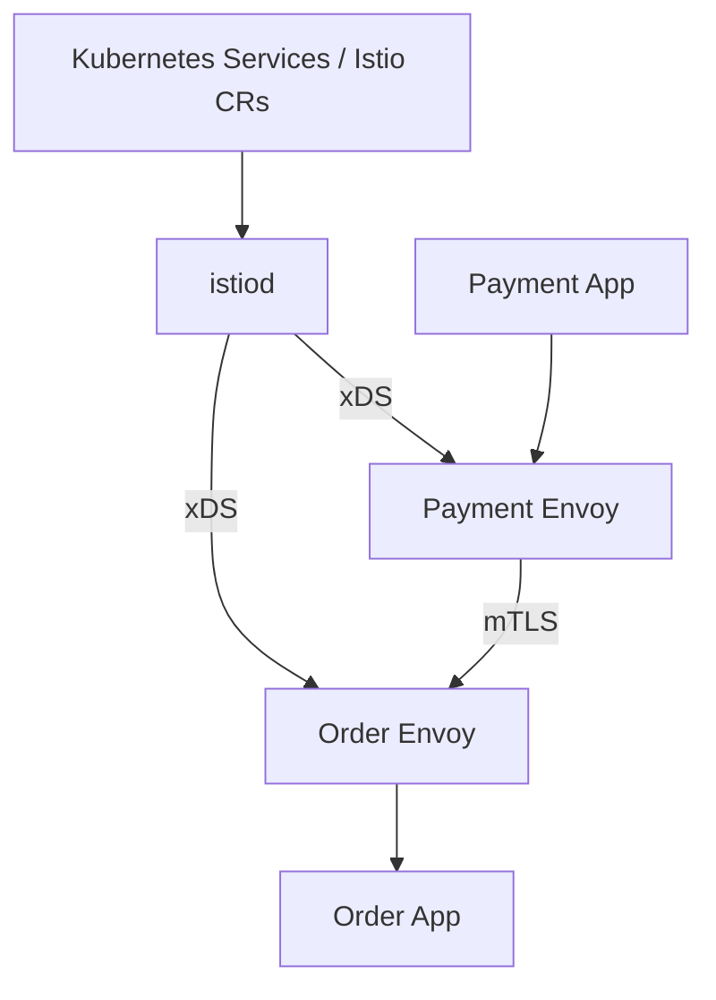
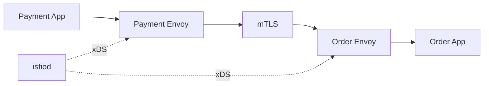

:::info Sources and editorial scope
This lesson expands on the topic and verifiable content of the conversation, but it is **not a complete verbatim transcript**. Additional material was written for this website and may require version-specific testing before use in production.
:::

## Learning objectives

Envoy, istiod, xDS, mTLS, VirtualService, Ambient Mesh.

## Istio control plane and data plane

`istiod` reads Kubernetes and Istio configuration and distributes it to proxies through xDS. Envoy sidecars or the Ambient data plane handle traffic. Individual requests **do not normally pass through istiod**.



## xDS

- **LDS:** listeners.
- **RDS:** routes.
- **CDS:** upstream clusters.
- **EDS:** backend endpoints.
- **SDS:** secrets/certificates.

## VirtualService and DestinationRule

```yaml
apiVersion: networking.istio.io/v1
kind: VirtualService
metadata:
  name: order-routing
spec:
  hosts: [order.orders.svc.cluster.local]
  http:
    - route:
        - destination: {host: order.orders.svc.cluster.local, subset: v1}
          weight: 90
        - destination: {host: order.orders.svc.cluster.local, subset: v2}
          weight: 10
```

The DestinationRule must define the corresponding `v1` and `v2` subsets, usually by Pod label. Do not route traffic to a subset without healthy endpoints.

## mTLS, workload identity, and policy

An example workload identity is `spiffe://cluster.local/ns/payments/sa/payment-app`. mTLS authenticates both peers and encrypts the connection, but **it does not grant authorization on its own**. PeerAuthentication can require `STRICT` mTLS, while AuthorizationPolicy determines who may call the workload.

```yaml
apiVersion: security.istio.io/v1
kind: AuthorizationPolicy
metadata:
  name: allow-payment
  namespace: orders
spec:
  selector:
    matchLabels: {app: order}
  action: ALLOW
  rules:
    - from:
        - source:
            principals:
              - cluster.local/ns/payments/sa/payment-app
```

## Resilience

Design timeouts, retry budgets, outlier detection, and circuit breakers together. With three attempts at each of two hops, one initial request can lead to nine downstream attempts. Non-idempotent operations need idempotency keys.

## Ambient Mesh

`ztunnel` provides a secure L4 overlay. A waypoint (Envoy) handles L7 policies such as HTTP path matching and routing. Enabling Ambient for a namespace does not automatically enable every L7 feature.

## Troubleshooting

```bash
istioctl proxy-status
istioctl proxy-config routes PAYMENT_POD -n payments
istioctl analyze -A
```

**Official:** [Istio Architecture](https://istio.io/latest/docs/ops/deployment/architecture/) · [Ambient Mesh](https://istio.io/latest/docs/ambient/overview/).


## Sidecar request path and xDS



`istiod` is the control plane, not a proxy for individual requests. Envoy handles requests using the LDS, RDS, CDS, EDS, and SDS configuration it has received. Configuration converges over time, so canary weights may not change simultaneously on all proxies.

### VirtualService vs. DestinationRule

```yaml
apiVersion: networking.istio.io/v1
kind: VirtualService
metadata:
  name: order
spec:
  hosts: [order.orders.svc.cluster.local]
  http:
    - route:
        - destination: {host: order.orders.svc.cluster.local, subset: v1}
          weight: 90
        - destination: {host: order.orders.svc.cluster.local, subset: v2}
          weight: 10
```

`VirtualService` defines when to route traffic to each subset. `DestinationRule` defines subsets using Pod labels and sets destination policies such as load balancing, connection pools, and outlier detection.

### Identity / authorization

mTLS verifies peer identities, usually expressed as SPIFFE URIs such as `spiffe://cluster.local/ns/payments/sa/payment-app`. `PeerAuthentication` sets mTLS requirements, and `AuthorizationPolicy` determines which callers are allowed. An encrypted connection is not necessarily authorized.

### Ambient vs Sidecar

In sidecar mode, each Pod enrolled in the mesh has an Envoy sidecar. Ambient uses ztunnel for L4 and a waypoint Envoy when L7 is needed. ztunnel does not enforce HTTP path-based authorization on its own. When migrating, verify waypoint enrollment, the traffic path, policy semantics, and monitoring.

### Retry amplification

If Service A and Service B each make up to three attempts, a single request can generate up to nine downstream attempts, assuming every layer retries. Combine timeout budgets, idempotency, and carefully scoped retries to avoid cascading overload.

**Lab:** Use `istioctl proxy-status`, `istioctl proxy-config routes`, and `istioctl proxy-config clusters`. Create a policy that allows only the Payment Kubernetes ServiceAccount to call Order. Inspect the mTLS logs and observe the HTTP 403 response for an unauthorized caller.

## Deep dive: The Istio request lifecycle and control boundaries

### Sidecar mode end-to-end

```text
Payment Application
    ↓ outbound interception (CNI/iptables where configured)
Payment Envoy outbound listener
    ↓ RDS/CDS/EDS route + endpoint selection
mTLS connection (workload identities)
    ↓
Order Envoy inbound listener
    ↓ authentication + AuthorizationPolicy
Order Application
```

`istiod` is the control plane: it discovers Services and EndpointSlices, watches Istio CRDs, and provides xDS configuration and certificates. It **does not** handle individual HTTP requests in the data plane. Envoy can continue using its existing configuration if istiod is temporarily unavailable, but route and policy updates and certificate rotation may be affected.

### xDS mapping

| Discovery type | Responsibility |
|---|---|
| LDS | Listeners, entry points |
| RDS | HTTP routing config |
| CDS | Upstream clusters |
| EDS | Backend endpoints |
| SDS | Secrets/certificates |

Changing VirtualService match rules or weights primarily affects routing configuration. A DestinationRule defines subsets, load balancing, connection pools, and outlier detection. If the `v2` subset has no Pods labeled `version: v2`, routing may fail even when the YAML is valid.

### Canary routing and resilience

```yaml
apiVersion: networking.istio.io/v1
kind: VirtualService
metadata:
  name: payment
  namespace: payments
spec:
  hosts: [payment]
  http:
    - route:
        - destination: {host: payment, subset: v1}
          weight: 90
        - destination: {host: payment, subset: v2}
          weight: 10
      retries:
        attempts: 2
        perTryTimeout: 1s
      timeout: 3s
```

This manifest requires matching DestinationRule subsets, Services, and versions. Avoid retrying non-idempotent operations unless they have idempotency keys or semantics that make retries safe. `attempts: 2` can increase the number of backend requests; retries at multiple layers amplify the total.

### Security identities

An example SPIFFE ID is `spiffe://cluster.local/ns/payments/sa/payment-app`. `PeerAuthentication` in `STRICT` mode requires mTLS. `AuthorizationPolicy` controls access based on principals, namespaces, methods, and paths, as appropriate for the policy model. Distinguish JWT-based `requestPrincipals` from mTLS-based `principals`: a request principal comes from a JWT subject authenticated through RequestAuthentication, not automatically from the mTLS peer certificate.

### Ambient mode

Ambient separates the secure L4 overlay at `ztunnel` from the L7 waypoint proxy. There is no per-Pod Envoy sidecar by default. Where applicable, L7 traffic policies require traffic to traverse the waypoint. Traffic paths and API support can vary by Istio version, so do not assume sidecar debugging steps apply to Ambient deployments.

### Triage

```bash
istioctl proxy-status
istioctl proxy-config listeners POD -n payments
istioctl proxy-config routes POD -n payments
istioctl proxy-config clusters POD -n payments
istioctl analyze -A
kubectl get peerauthentication,authorizationpolicy -A
```

In Ambient, use the appropriate ztunnel or waypoint tools rather than assuming the application Pod has an `istio-proxy` container. A `503` can indicate an Envoy upstream health issue or a subset mismatch rather than a Kubernetes Service with no Pods.

### Lab

Deploy two versions of the service, configure DestinationRule subsets, and change the traffic weights from 90/10 to 50/50. Simulate a backend failure and check retries and outlier detection. Then enable STRICT mTLS and apply an ALLOW policy for the intended ServiceAccount. Use logs and traces to distinguish the **policy decision** from **network reachability**.

Sources: [Istio traffic management](https://istio.io/latest/docs/concepts/traffic-management/), [Istio security](https://istio.io/latest/docs/concepts/security/), [Ambient overview](https://istio.io/latest/docs/ambient/overview/).

## Follow a Payment request through the mesh

Suppose Payment calls Order, Fraud, and Inventory. A slow Inventory dependency can amplify retries, an unintended caller can reach Fraud, and Order needs a 10% release trial. Istio can provide common workload authentication, authorization, traffic policy and telemetry on top of Kubernetes networking. CNI still connects Pods, Services still represent destinations, and the mesh adds policy and proxying on the traffic paths that are enrolled.

### How a sidecar is installed and put on the path

For an Istio installation using the default injection label, label the lab namespaces before creating workloads. A revision-based installation uses the appropriate revision label instead.

```bash
kubectl label namespace payments orders istio-injection=enabled
kubectl get pods -n payments
```

Pod creation passes through Istio's mutating admission webhook, which adds the proxy configuration and typically an `istio-proxy` container. Existing Pods require replacement before they gain a sidecar. Traffic capture is a separate responsibility. Istio CNI or an init-container setup, depending on the installation, configures redirection for selected traffic in the Pod network namespace. Check capture exclusions, protocol detection, and listener configuration when only some flows appear in telemetry. [Istio sidecar injection](https://istio.io/latest/docs/setup/additional-setup/sidecar-injection/) · [Istio CNI](https://istio.io/latest/docs/setup/additional-setup/cni/)

1. Payment opens an ordinary HTTP connection to `order.orders.svc.cluster.local`. Outbound interception directs the captured connection to its Envoy listener.
2. The outbound proxy matches the destination and, for recognized HTTP, the request route. It chooses an upstream cluster or subset and selects an eligible endpoint.
3. Where Istio mTLS applies, the outbound proxy authenticates the destination and presents its workload certificate. The receiving proxy authenticates the source. Reused upstream connections can carry multiple requests.
4. The Order proxy evaluates inbound authorization and forwards allowed requests to the application. The proxies can record status, duration, and source and destination metadata.

`istiod` watches service discovery and Istio configuration and translates them into proxy configuration. LDS supplies listeners, RDS HTTP routes, CDS upstream cluster settings, and EDS endpoint assignments. SDS delivers TLS material to Envoy, commonly through the local Istio agent for workload certificates. When Order gains a ready endpoint, Kubernetes endpoint discovery updates and then the Istio control plane distributes the corresponding changes. Proxies converge independently. During a temporary control-plane outage, running proxies can often use their already-loaded configuration, while new proxies, updates and certificate renewal can be affected. Check the caller's loaded route and endpoints before attributing a failure to Git or the Kubernetes Service. [Istio architecture](https://istio.io/latest/docs/ops/deployment/architecture/) · [Istio security architecture](https://istio.io/latest/docs/concepts/security/)

## Route to Order versions and bound retries

The following pair assumes one `Service/order` in `orders`, with a selector matching both versions and backend Pods labeled `version: v1` or `version: v2`. Expose HTTP using an appropriate Service port name or app protocol. Use the actual cluster DNS suffix if it differs from `cluster.local`. Use this pair in place of the earlier abbreviated routing examples.

```yaml
apiVersion: networking.istio.io/v1
kind: DestinationRule
metadata:
  name: order-destination
  namespace: orders
spec:
  host: order.orders.svc.cluster.local
  trafficPolicy:
    loadBalancer:
      simple: LEAST_REQUEST
    connectionPool:
      tcp:
        maxConnections: 100
      http:
        http1MaxPendingRequests: 50
        maxRequestsPerConnection: 100
    outlierDetection:
      consecutive5xxErrors: 5
      interval: 10s
      baseEjectionTime: 30s
  subsets:
    - name: v1
      labels:
        version: v1
    - name: v2
      labels:
        version: v2
---
apiVersion: networking.istio.io/v1
kind: VirtualService
metadata:
  name: order-routing
  namespace: orders
spec:
  hosts: [order.orders.svc.cluster.local]
  http:
    - name: order-reads
      match:
        - method:
            exact: GET
      timeout: 3s
      retries:
        attempts: 2
        perTryTimeout: 1s
        retryOn: connect-failure,refused-stream,unavailable
      route:
        - destination: {host: order.orders.svc.cluster.local, subset: v1}
          weight: 90
        - destination: {host: order.orders.svc.cluster.local, subset: v2}
          weight: 10
    - name: other-order-requests
      timeout: 2s
      retries:
        attempts: 0
      route:
        - destination: {host: order.orders.svc.cluster.local, subset: v1}
          weight: 100
```

VirtualService matches requests and selects destinations. DestinationRule defines the subsets and settings that apply to selected destinations. Verify each subset has healthy endpoints before sending it traffic. The configured weights express a target share for matching traffic. Short samples, request behavior, and convergence can affect observed splits.

The GET rule permits at most two retries after the original attempt, subject to the overall timeout and retry conditions. A proxy timeout can end the caller's wait while the backend continues working. For writes with side effects, use application-level idempotency before allowing automatic retries. Three attempts at each of two hops can produce nine attempts at the final dependency. At three hops the upper bound is 27. Align deadlines and retry budgets across applications and proxies, and account for cancellation and backoff.

The connection pool constrains proxy resources for an upstream cluster. `maxRequestsPerConnection` controls connection reuse over the life of a connection. These fields do not establish a shared mesh-wide quota. Outlier detection can temporarily eject an endpoint from a proxy's eligible pool, leaving the Kubernetes Pod and EndpointSlice in place. Verify the effect under partial failure and ensure remaining endpoints have enough capacity. [VirtualService reference](https://istio.io/latest/docs/reference/config/networking/virtual-service/) · [DestinationRule reference](https://istio.io/latest/docs/reference/config/networking/destination-rule/)

## Require authenticated and authorized traffic to Order

A workload certificate can contain the SPIFFE URI `spiffe://cluster.local/ns/payments/sa/payment-app`. In this trust domain, Pods using the same namespace and ServiceAccount share the corresponding identity. Use dedicated ServiceAccounts for workloads that require different access. Istio establishes workload identity, issues short-lived certificates through its configured CA path, and rotates them. GKE Workload Identity Federation handles access to Google Cloud APIs through a separate identity and authorization system.

```yaml
apiVersion: security.istio.io/v1
kind: PeerAuthentication
metadata:
  name: default
  namespace: orders
spec:
  mtls:
    mode: STRICT
---
apiVersion: security.istio.io/v1
kind: AuthorizationPolicy
metadata:
  name: allow-payment-to-order
  namespace: orders
spec:
  selector:
    matchLabels:
      app: order
  action: ALLOW
  rules:
    - from:
        - source:
            principals:
              - cluster.local/ns/payments/sa/payment-app
```

The AuthorizationPolicy uses Istio's normalized principal string, without the URI scheme used in the certificate. Set Payment's Pod template `serviceAccountName` to `payment-app` and confirm the actual trust domain. `STRICT` requires mTLS for inbound sidecar traffic in scope. The ALLOW rule grants the intended peer access to selected Order workloads. Other applicable policies still matter, including DENY policies and other ALLOW rules. An encrypted connection proves peer identity but grants access only when the authorization policy permits it. JWT request identity is evaluated separately. Kubernetes NetworkPolicy controls network reachability, and Istio policy can use authenticated identity and, on an L7 proxy, request attributes. [PeerAuthentication](https://istio.io/latest/docs/reference/config/security/peer_authentication/) · [AuthorizationPolicy](https://istio.io/latest/docs/reference/config/security/authorization-policy/)

## Compare the Ambient and sidecar paths

| Concern | Sidecar | Ambient |
|---|---|---|
| L4 and mTLS | Per-workload Envoy handles captured traffic | Node-local ztunnel provides the secure L4 overlay and L4 authorization |
| HTTP routing and policy | Envoy interprets supported L7 configuration on the path | An Envoy waypoint handles L7 operations for traffic it actually receives |
| Deployment overhead | One proxy per enrolled Pod, with workload rollout considerations | ztunnel per participating node and independently sized waypoint deployments |

In an Ambient installation, a basic cross-node path is Payment → source ztunnel → HBONE tunnel → destination ztunnel → Order. HBONE carries connections using HTTP CONNECT over mutual TLS. With a waypoint on the destination Service path, the source can send traffic through the waypoint for L7 processing before delivery. For 1,000 Pods on 20 nodes, the difference in proxy distribution is substantial. Sizing still depends on throughput, latency and the number of required waypoints.

Run the following in a separate Ambient lab after installing compatible Ambient components and Gateway API resources. Use namespaces without conflicting injection configuration.

```bash
kubectl label namespace payments orders istio.io/dataplane-mode=ambient
istioctl waypoint apply -n orders --enroll-namespace
kubectl get gateways -n orders
istioctl ztunnel-config workloads
istioctl ztunnel-config services
```

Enroll the destination because waypoint selection depends on how the destination is addressed. A Service waypoint normally covers eligible Service-addressed traffic. Direct Pod-IP calls, traffic from unenrolled sources and ingress gateway traffic can follow different paths. Verify workload and Service enrollment and waypoint access logs. Use Gateway API and waypoint-targeted policy for supported Ambient L7 flows. A workload-selector AuthorizationPolicy at ztunnel serves L4 policy, while waypoint policies attach using `targetRefs`. Verify the relevant Istio version and path before adapting the sidecar manifests. [Ambient overview](https://istio.io/latest/docs/ambient/overview/) · [Waypoint configuration](https://istio.io/latest/docs/ambient/usage/waypoint/) · [Waypoint troubleshooting](https://istio.io/latest/docs/ambient/usage/troubleshoot-waypoint/)

## Give rollout traffic weights a single owner

For a separate host-based Argo Rollouts example, use a Payment Rollout and the `payment-stable` and `payment-canary` Services in its namespace. Use a VirtualService named `payment-routing` with an HTTP route named `primary`. Its initial route targets those two Services with stable weight 100 and canary weight 0. Point test traffic at a hostname covered by that VirtualService.

```yaml
strategy:
  canary:
    stableService: payment-stable
    canaryService: payment-canary
    trafficRouting:
      istio:
        virtualService:
          name: payment-routing
          routes: [primary]
    steps:
      - setWeight: 5
      - pause: {duration: 2m}
      - setWeight: 20
      - pause: {duration: 5m}
      - setWeight: 50
      - pause: {}
      - setWeight: 100
```

Argo CD delivers the Rollout spec and routing resources. Argo Rollouts updates runtime Service selectors and route weights in the host-based configuration. Istiod distributes the updated route and Envoy implements it. Watch the route on the calling proxy as well as the Rollout status. Keep application self-heal from resetting those weights during the rollout. For example, scope Argo CD ignores to the named VirtualService and the runtime-owned weights. This JQ expression targets the two entries on the named route in the simple same-namespace setup.

```yaml
ignoreDifferences:
  - group: networking.istio.io
    kind: VirtualService
    name: payment-routing
    namespace: payments
    jqPathExpressions:
      - '.spec.http[] | select(.name == "primary") | .route[] | select(.destination.host == "payment-stable" or .destination.host == "payment-canary") | .weight'
syncPolicy:
  syncOptions:
    - RespectIgnoreDifferences=true
```

Adjust the expression if the route uses FQDNs. Handle controller-managed Service selector fields as in [Lesson 10](../03-gitops-delivery/lesson-10-progressive-delivery.md#field-ownership-at-the-argo-cd-boundary). Validate that an ordinary sync leaves live progression alone and still reports unrelated drift. [Argo Rollouts Istio integration](https://argoproj.github.io/argo-rollouts/features/traffic-management/istio/) · [Argo CD sync options](https://argo-cd.readthedocs.io/en/stable/user-guide/sync-options/)

## Decide which traffic belongs in a mesh

North-south traffic crosses a system boundary, such as an internet client reaching Payment through a public GKE Gateway. Check frontend TLS and edge routing there. East-west traffic moves between workloads, possibly across clusters. Check identity, upstream policy, and dependency telemetry there. NetworkPolicy remains useful for L3/L4 isolation, and OpenTelemetry can provide application-level traces with either deployment model. Evaluate proxy overhead, upgrade responsibility, certificate recovery, troubleshooting burden, and competing retry layers against the requirements. A small system can use edge routing, application TLS, and telemetry without deploying a service mesh.

## Diagnose and practice in an isolated cluster

| Observation | Next check |
|---|---|
| Inbound HTTP 403 from Envoy | Matched policies, authenticated source, and request attributes |
| Handshake or transport failure | Both peers' enrollment, mTLS mode, certificates, and trust domain |
| HTTP 503 with no healthy upstream | Loaded subset config, endpoint discovery and ejection state |
| Timeout under load | Per-hop deadlines, upstream latency and retry amplification |
| Unexpected canary shares | Named route, currently loaded weights, matching protocol, and sample volume |
| Missing Ambient HTTP policy | Destination address type, waypoint enrollment, path, and policy attachment |

```bash
istioctl proxy-status
istioctl proxy-config listeners PAYMENT_POD -n payments
istioctl proxy-config routes PAYMENT_POD -n payments
istioctl proxy-config clusters PAYMENT_POD -n payments
istioctl proxy-config endpoints PAYMENT_POD -n payments
istioctl proxy-config secret PAYMENT_POD -n payments
istioctl analyze -A
```

Use the actual Payment Pod name. Compare 90/10 and 50/50 against version-labeled response samples, then enable STRICT and compare an authorized meshed Payment caller, a meshed caller with another identity and a plaintext caller. The policy denial and TLS failure can surface differently. Introduce slow responses and compare application requests with upstream attempts. Test the Rollouts integration separately, then repeat Payment → Order in an Ambient lab and compare the path, loaded configuration and telemetry.

Use the [traffic and retry simulators, lab checklist, and quiz](./networking-exercises.mdx#model-istio-traffic-and-retries). Continue with [Lesson 15 — Kubernetes Scheduling](../06-compute-storage/lesson-15-scheduling.md) for scheduling, resource limits, autoscaling, and Pod placement.

## Self-check questions
1. Which controller owns the desired state and the actual state in this context?
2. What failure modes can occur even when the Kubernetes resource reports `Ready`?
3. What would you verify before deploying to production?
