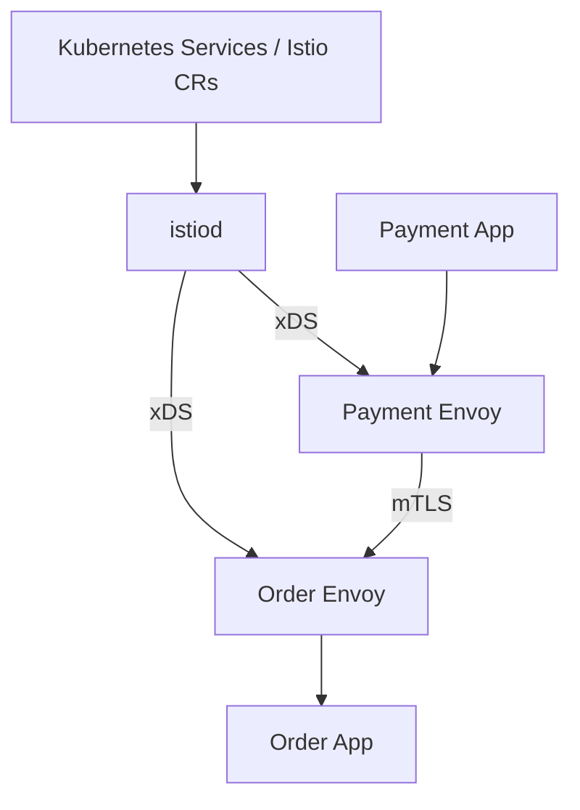
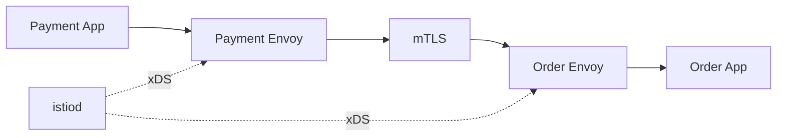

:::info Sources and editorial scope
This lesson expands on the topic and verifiable content of the conversation, but it is **not a complete verbatim transcript**. Additional material was written for this website and may require version-specific testing before use in production.
:::

## Learning objectives

Envoy, istiod, xDS, mTLS, VirtualService, Ambient Mesh.

## Istio control plane and data plane

`istiod` reads Kubernetes and Istio configuration and distributes it to proxies through xDS. Envoy sidecars or the Ambient data plane handle traffic. Individual requests **do not normally pass through istiod**.



## xDS

- **LDS:** listeners.
- **RDS:** routes.
- **CDS:** upstream clusters.
- **EDS:** backend endpoints.
- **SDS:** secrets/certificates.

## VirtualService and DestinationRule

```yaml
apiVersion: networking.istio.io/v1
kind: VirtualService
metadata:
  name: order-routing
spec:
  hosts: [order.orders.svc.cluster.local]
  http:
    - route:
        - destination: {host: order.orders.svc.cluster.local, subset: v1}
          weight: 90
        - destination: {host: order.orders.svc.cluster.local, subset: v2}
          weight: 10
```

The DestinationRule must define the corresponding `v1` and `v2` subsets, usually by Pod label. Do not route traffic to a subset without healthy endpoints.

## mTLS, workload identity, and policy

An example workload identity is `spiffe://cluster.local/ns/payments/sa/payment-app`. mTLS authenticates both peers and encrypts the connection, but **it does not grant authorization on its own**. PeerAuthentication can require `STRICT` mTLS, while AuthorizationPolicy determines who may call the workload.

```yaml
apiVersion: security.istio.io/v1
kind: AuthorizationPolicy
metadata:
  name: allow-payment
  namespace: orders
spec:
  selector:
    matchLabels: {app: order}
  action: ALLOW
  rules:
    - from:
        - source:
            principals:
              - spiffe://cluster.local/ns/payments/sa/payment-app
```

## Resilience

Design timeouts, retry budgets, outlier detection, and circuit breakers together. With three attempts at each of two hops, one initial request can lead to nine downstream attempts. Non-idempotent operations need idempotency keys.

## Ambient Mesh

`ztunnel` provides a secure L4 overlay. A waypoint (Envoy) handles L7 policies such as HTTP path matching and routing. Enabling Ambient for a namespace does not automatically enable every L7 feature.

## Troubleshooting

```bash
istioctl proxy-status
istioctl proxy-config routes PAYMENT_POD -n payments
istioctl analyze -A
```

**Official:** [Istio Architecture](https://istio.io/latest/docs/ops/deployment/architecture/) · [Ambient Mesh](https://istio.io/latest/docs/ambient/overview/).


## Sidecar request path and xDS



`istiod` is the control plane, not a proxy for individual requests. Envoy handles requests using the LDS, RDS, CDS, EDS, and SDS configuration it has received. Configuration converges over time, so canary weights may not change simultaneously on all proxies.

### VirtualService vs. DestinationRule

```yaml
apiVersion: networking.istio.io/v1
kind: VirtualService
metadata:
  name: order
spec:
  hosts: [order.orders.svc.cluster.local]
  http:
    - route:
        - destination: {host: order.orders.svc.cluster.local, subset: v1}
          weight: 90
        - destination: {host: order.orders.svc.cluster.local, subset: v2}
          weight: 10
```

`VirtualService` defines when to route traffic to each subset. `DestinationRule` defines subsets using Pod labels and sets destination policies such as load balancing, connection pools, and outlier detection.

### Identity / authorization

mTLS verifies peer identities, usually expressed as SPIFFE URIs such as `spiffe://cluster.local/ns/payments/sa/payment-app`. `PeerAuthentication` sets mTLS requirements, and `AuthorizationPolicy` determines which callers are allowed. An encrypted connection is not necessarily authorized.

### Ambient vs Sidecar

In sidecar mode, each Pod enrolled in the mesh has an Envoy sidecar. Ambient uses ztunnel for L4 and a waypoint Envoy when L7 is needed. ztunnel does not enforce HTTP path-based authorization on its own. When migrating, verify waypoint enrollment, the traffic path, policy semantics, and monitoring.

### Retry amplification

If Service A and Service B each make up to three attempts, a single request can generate up to nine downstream attempts, assuming every layer retries. Combine timeout budgets, idempotency, and carefully scoped retries to avoid cascading overload.

**Lab:** Use `istioctl proxy-status`, `istioctl proxy-config routes`, and `istioctl proxy-config clusters`. Create a policy that allows only the Payment Kubernetes ServiceAccount to call Order. Inspect the mTLS logs and observe the HTTP 403 response for an unauthorized caller.

## Deep dive: The Istio request lifecycle and control boundaries

### Sidecar mode end-to-end

```text
Payment Application
    ↓ outbound interception (CNI/iptables where configured)
Payment Envoy outbound listener
    ↓ RDS/CDS/EDS route + endpoint selection
mTLS connection (workload identities)
    ↓
Order Envoy inbound listener
    ↓ authentication + AuthorizationPolicy
Order Application
```

`istiod` is the control plane: it discovers Services and EndpointSlices, watches Istio CRDs, and provides xDS configuration and certificates. It **does not** handle individual HTTP requests in the data plane. Envoy can continue using its existing configuration if istiod is temporarily unavailable, but route and policy updates and certificate rotation may be affected.

### xDS mapping

| Discovery type | Responsibility |
|---|---|
| LDS | Listeners, entry points |
| RDS | HTTP routing config |
| CDS | Upstream clusters |
| EDS | Backend endpoints |
| SDS | Secrets/certificates |

Changing VirtualService match rules or weights primarily affects routing configuration. A DestinationRule defines subsets, load balancing, connection pools, and outlier detection. If the `v2` subset has no Pods labeled `version: v2`, routing may fail even when the YAML is valid.

### Canary routing and resilience

```yaml
apiVersion: networking.istio.io/v1
kind: VirtualService
metadata:
  name: payment
  namespace: payments
spec:
  hosts: [payment]
  http:
    - route:
        - destination: {host: payment, subset: v1}
          weight: 90
        - destination: {host: payment, subset: v2}
          weight: 10
      retries:
        attempts: 2
        perTryTimeout: 1s
      timeout: 3s
```

This manifest requires matching DestinationRule subsets, Services, and versions. Avoid retrying non-idempotent operations unless they have idempotency keys or semantics that make retries safe. `attempts: 2` can increase the number of backend requests; retries at multiple layers amplify the total.

### Security identities

An example SPIFFE ID is `spiffe://cluster.local/ns/payments/sa/payment-app`. `PeerAuthentication` in `STRICT` mode requires mTLS. `AuthorizationPolicy` controls access based on principals, namespaces, methods, and paths, as appropriate for the policy model. Distinguish JWT-based `requestPrincipals` from mTLS-based `principals`: a request principal comes from a JWT subject authenticated through RequestAuthentication, not automatically from the mTLS peer certificate.

### Ambient mode

Ambient separates the secure L4 overlay at `ztunnel` from the L7 waypoint proxy. There is no per-Pod Envoy sidecar by default. Where applicable, L7 traffic policies require traffic to traverse the waypoint. Traffic paths and API support can vary by Istio version, so do not assume sidecar debugging steps apply to Ambient deployments.

### Triage

```bash
istioctl proxy-status
istioctl proxy-config listeners POD -n payments
istioctl proxy-config routes POD -n payments
istioctl proxy-config clusters POD -n payments
istioctl analyze -A
kubectl get peerauthentication,authorizationpolicy -A
```

In Ambient, use the appropriate ztunnel or waypoint tools rather than assuming the application Pod has an `istio-proxy` container. A `503` can indicate an Envoy upstream health issue or a subset mismatch rather than a Kubernetes Service with no Pods.

### Lab

Deploy two versions of the service, configure DestinationRule subsets, and change the traffic weights from 90/10 to 50/50. Simulate a backend failure and check retries and outlier detection. Then enable STRICT mTLS and apply an ALLOW policy for the intended ServiceAccount. Use logs and traces to distinguish the **policy decision** from **network reachability**.

Sources: [Istio traffic management](https://istio.io/latest/docs/concepts/traffic-management/), [Istio security](https://istio.io/latest/docs/concepts/security/), [Ambient overview](https://istio.io/latest/docs/ambient/overview/).

## Self-check questions

1. Which controller owns the desired state and the actual state in this context?
2. What failure modes can occur even when the Kubernetes resource reports `Ready`?
3. What would you verify before deploying to production?
