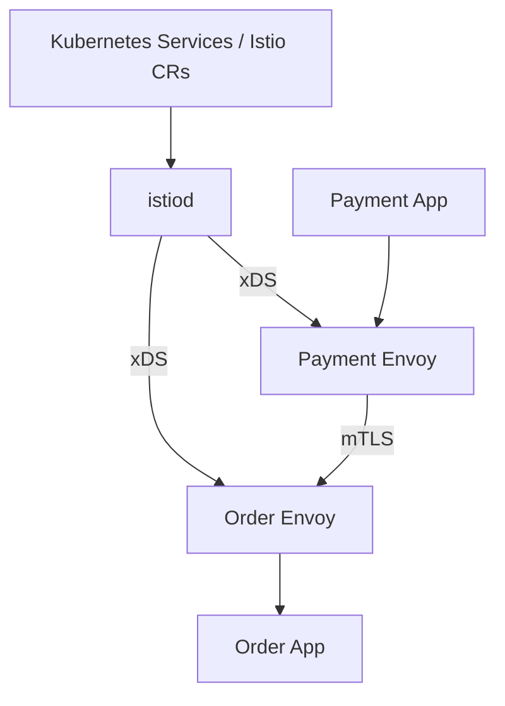
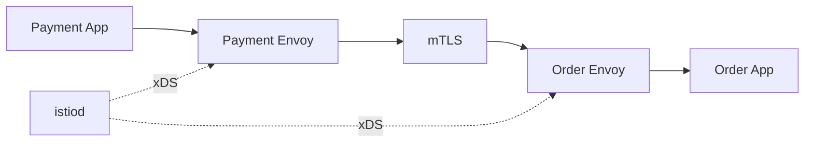
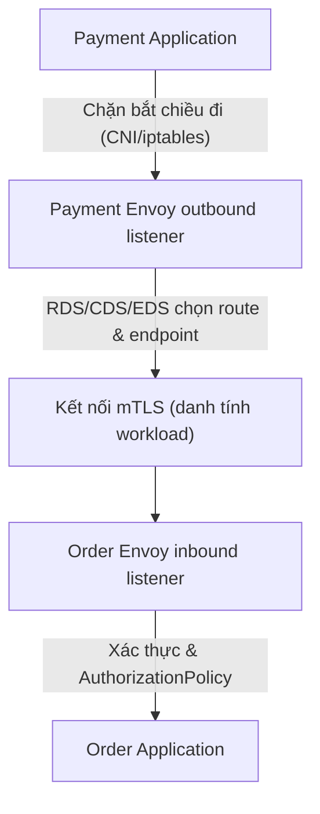

## Mục tiêu học tập

- **Phân tách vai trò control plane và data plane trong Istio:** Hiểu cách `istiod` chuyển đổi cấu hình Kubernetes và Istio CRD thành xDS (LDS, RDS, CDS, EDS, SDS) cho Envoy mà không nằm trên đường đi của từng request.
- **Điều phối lưu lượng east-west và khả năng chịu lỗi:** Kết hợp `VirtualService` và `DestinationRule` để chia tải canary, thiết lập connection pool, outlier detection và giới hạn retry nhằm tránh khuếch đại retry.
- **Thực thi danh tính workload mTLS và phân quyền:** Phối hợp `PeerAuthentication` chế độ `STRICT` (SPIFFE ID) với `AuthorizationPolicy` để tách biệt xác thực kết nối với kiểm soát truy cập L4/L7.
- **So sánh kiến trúc Sidecar và Ambient Mesh:** Đánh giá mô hình Envoy sidecar theo từng Pod so với `ztunnel` cấp node (HBONE L4 overlay) và Envoy Waypoint cho các chính sách L7.
- **Tích hợp Istio với Argo Rollouts và gỡ lỗi proxy:** Ngăn xung đột GitOps trên trọng số canary động và kiểm tra trạng thái Envoy bằng `istioctl proxy-status`, `proxy-config` và `analyze`.

## Control plane và data plane của Istio

`istiod` đọc cấu hình Kubernetes cùng các tài nguyên Istio rồi phân phối xuống proxy qua xDS. Envoy sidecar hoặc Ambient data plane đảm nhiệm xử lý lưu lượng. Từng request riêng lẻ **thông thường không đi qua istiod**.



## xDS

- **LDS:** listeners.
- **RDS:** routes.
- **CDS:** upstream clusters.
- **EDS:** backend endpoints.
- **SDS:** secrets/certificates.

## VirtualService và DestinationRule

```yaml
apiVersion: networking.istio.io/v1
kind: VirtualService
metadata:
  name: order-routing
spec:
  hosts: [order.orders.svc.cluster.local]
  http:
    - route:
        - destination: {host: order.orders.svc.cluster.local, subset: v1}
          weight: 90
        - destination: {host: order.orders.svc.cluster.local, subset: v2}
          weight: 10
```

`DestinationRule` phải định nghĩa các subset `v1` và `v2` tương ứng, thường dựa theo Pod label. Không định tuyến lưu lượng sang một subset không có endpoint khỏe mạnh.

## mTLS, danh tính workload và chính sách

Một ví dụ về danh tính workload (workload identity) là `spiffe://cluster.local/ns/payments/sa/payment-app`. mTLS xác thực cả hai đầu và mã hóa kết nối, nhưng **tự nó không cấp quyền truy cập (authorization)**. `PeerAuthentication` có thể bắt buộc mTLS ở chế độ `STRICT`, còn `AuthorizationPolicy` quyết định ai được phép gọi tới workload.

```yaml
apiVersion: security.istio.io/v1
kind: AuthorizationPolicy
metadata:
  name: allow-payment
  namespace: orders
spec:
  selector:
    matchLabels: {app: order}
  action: ALLOW
  rules:
    - from:
        - source:
            principals:
              - cluster.local/ns/payments/sa/payment-app
```

## Khả năng chịu lỗi (Resilience)

Hãy thiết kế đồng bộ timeout, retry budget, outlier detection và circuit breaker. Với 3 lần thử ở mỗi chặng trong chuỗi 2 chặng, một request ban đầu có thể biến thành 9 lượt gọi ở tầng cuối. Các thao tác không có tính lũy đẳng (non-idempotent) cần có idempotency key.

## Ambient Mesh

`ztunnel` cung cấp lớp overlay L4 bảo mật. Waypoint (Envoy) xử lý các chính sách L7 như khớp đường dẫn HTTP và định tuyến. Bật Ambient cho một namespace không tự động bật mọi tính năng L7.

## Xử lý sự cố

```bash
istioctl proxy-status
istioctl proxy-config routes PAYMENT_POD -n payments
istioctl analyze -A
```

**Tài liệu chính thức:** [Istio Architecture](https://istio.io/latest/docs/ops/deployment/architecture/) · [Ambient Mesh](https://istio.io/latest/docs/ambient/overview/).

## Đường đi request dạng Sidecar và xDS



`istiod` là control plane, không phải proxy cho từng request. Envoy xử lý request dựa trên cấu hình LDS, RDS, CDS, EDS và SDS mà nó đã nhận. Cấu hình hội tụ dần theo thời gian, vì vậy trọng số canary có thể không thay đổi đồng thời trên mọi proxy.

### VirtualService vs. DestinationRule

```yaml
apiVersion: networking.istio.io/v1
kind: VirtualService
metadata:
  name: order
spec:
  hosts: [order.orders.svc.cluster.local]
  http:
    - route:
        - destination: {host: order.orders.svc.cluster.local, subset: v1}
          weight: 90
        - destination: {host: order.orders.svc.cluster.local, subset: v2}
          weight: 10
```

`VirtualService` xác định khi nào lưu lượng được định tuyến tới từng subset. `DestinationRule` định nghĩa các subset bằng Pod label và thiết lập chính sách tại đích như thuật toán cân bằng tải, connection pool và outlier detection.

### Danh tính / Phân quyền

mTLS xác minh danh tính của hai đầu kết nối, thường biểu diễn bằng SPIFFE URI như `spiffe://cluster.local/ns/payments/sa/payment-app`. `PeerAuthentication` thiết lập yêu cầu mTLS, còn `AuthorizationPolicy` quyết định bên gọi nào được phép truy cập. Một kết nối đã mã hóa không mặc nhiên đồng nghĩa với việc đã được cấp quyền.

### Ambient vs Sidecar

Ở chế độ sidecar, mỗi Pod tham gia mesh có một Envoy sidecar đi kèm. Ambient dùng `ztunnel` cho L4 và một Waypoint Envoy khi cần xử lý L7. Tự bản thân `ztunnel` không thực thi phân quyền dựa trên đường dẫn HTTP. Khi chuyển đổi sang Ambient, cần kiểm tra việc đăng ký Waypoint, đường đi lưu lượng, ngữ nghĩa policy và hệ thống giám sát.

### Khuếch đại retry (Retry amplification)

Nếu Service A và Service B mỗi bên thực hiện tối đa 3 lần thử, một request đơn lẻ có thể tạo ra tới 9 lần thử ở dịch vụ phía sau nếu mọi tầng đều retry. Hãy kết hợp ngân sách timeout, tính lũy đẳng (idempotency) và phạm vi retry chặt chẽ để tránh quá tải dây chuyền.

**Thực hành:** Sử dụng `istioctl proxy-status`, `istioctl proxy-config routes` và `istioctl proxy-config clusters`. Tạo một policy chỉ cho phép Kubernetes ServiceAccount của Payment gọi sang Order. Kiểm tra log mTLS và quan sát phản hồi HTTP 403 đối với bên gọi không được phép.

## Phân tích sâu: Vòng đời request trong Istio và ranh giới điều khiển

### Chế độ Sidecar đầu-cuối



`istiod` là control plane: nó khám phá Service và EndpointSlice, theo dõi các Istio CRD, đồng thời cung cấp cấu hình xDS và chứng chỉ. Nó **không** xử lý từng HTTP request trong data plane. Envoy vẫn có thể tiếp tục dùng cấu hình đã nạp nếu `istiod` tạm thời gián đoạn, nhưng việc cập nhật route/policy và xoay vòng chứng chỉ có thể bị ảnh hưởng.

### Ánh xạ xDS

| Loại discovery | Trách nhiệm |
|---|---|
| LDS | Listeners, các điểm vào |
| RDS | Cấu hình định tuyến HTTP |
| CDS | Upstream clusters |
| EDS | Backend endpoints |
| SDS | Secrets/certificates |

Thay đổi quy tắc khớp hoặc trọng số trong `VirtualService` chủ yếu ảnh hưởng đến cấu hình định tuyến. `DestinationRule` định nghĩa subset, cân bằng tải, connection pool và outlier detection. Nếu subset `v2` không có Pod nào mang label `version: v2`, quá trình định tuyến có thể lỗi ngay cả khi file YAML hợp lệ.

### Định tuyến canary và khả năng chịu lỗi

```yaml
apiVersion: networking.istio.io/v1
kind: VirtualService
metadata:
  name: payment
  namespace: payments
spec:
  hosts: [payment]
  http:
    - route:
        - destination: {host: payment, subset: v1}
          weight: 90
        - destination: {host: payment, subset: v2}
          weight: 10
      retries:
        attempts: 2
        perTryTimeout: 1s
      timeout: 3s
```

Manifest này yêu cầu có sẵn các subset `DestinationRule`, Service và phiên bản khớp tương ứng. Tránh retry các thao tác không lũy đẳng trừ khi chúng có idempotency key hoặc ngữ nghĩa đảm bảo an toàn khi thử lại. `attempts: 2` có thể làm tăng số request tới backend; việc retry ở nhiều tầng sẽ khuếch đại tổng tải.

### Danh tính bảo mật

Một ví dụ SPIFFE ID là `spiffe://cluster.local/ns/payments/sa/payment-app`. `PeerAuthentication` ở chế độ `STRICT` bắt buộc sử dụng mTLS. `AuthorizationPolicy` kiểm soát truy cập dựa trên principals, namespaces, methods và paths tùy theo mô hình policy. Cần phân biệt `requestPrincipals` (dựa trên JWT) với `principals` (dựa trên mTLS): request principal đến từ chủ thể JWT được xác thực qua `RequestAuthentication`, không tự động lấy từ chứng chỉ ngang hàng mTLS.

### Chế độ Ambient

Ambient tách bạch lớp overlay L4 bảo mật tại `ztunnel` khỏi L7 Waypoint proxy. Mặc định không có Envoy sidecar đi kèm từng Pod. Khi áp dụng, các chính sách lưu lượng L7 đòi hỏi lưu lượng phải đi qua Waypoint. Đường đi lưu lượng và mức độ hỗ trợ API có thể thay đổi theo phiên bản Istio, vì vậy đừng giả định các bước debug của sidecar áp dụng nguyên xi cho Ambient.

### Phân loại sự cố

```bash
istioctl proxy-status
istioctl proxy-config listeners POD -n payments
istioctl proxy-config routes POD -n payments
istioctl proxy-config clusters POD -n payments
istioctl analyze -A
kubectl get peerauthentication,authorizationpolicy -A
```

Trong Ambient, hãy dùng các công cụ phù hợp cho `ztunnel` hoặc Waypoint thay vì mặc định Pod ứng dụng có container `istio-proxy`. Mã lỗi `503` có thể báo hiệu vấn đề sức khỏe upstream trong Envoy hoặc lệch subset thay vì Service Kubernetes không có Pod.

### Thực hành

Triển khai hai phiên bản của service, cấu hình các subset `DestinationRule` và đổi trọng số lưu lượng từ 90/10 sang 50/50. Mô phỏng lỗi backend để kiểm tra cơ chế retry và outlier detection. Sau đó bật `STRICT` mTLS và áp dụng chính sách `ALLOW` cho ServiceAccount mục tiêu. Dùng logs và traces để phân biệt **quyết định của policy** với **khả năng thông mạch mạng**.

Nguồn tham khảo: [Istio traffic management](https://istio.io/latest/docs/concepts/traffic-management/), [Istio security](https://istio.io/latest/docs/concepts/security/), [Ambient overview](https://istio.io/latest/docs/ambient/overview/).

## Theo dõi một request Payment đi qua mesh

Giả sử Payment gọi tới Order, Fraud và Inventory. Dịch vụ Inventory bị chậm có thể khuếch đại retry, một bên gọi không mong muốn có thể truy cập vào Fraud, và Order cần chạy thử nghiệm bản phát hành 10%. Istio có thể cung cấp chung các cơ chế xác thực workload, phân quyền, chính sách lưu lượng và telemetry ngay trên nền mạng Kubernetes. CNI vẫn kết nối các Pod, Service vẫn đại diện cho các đích đến, còn mesh bổ sung policy và proxy trên các đường lưu lượng đã tham gia mesh.

### Cách sidecar được cài đặt và đưa vào đường đi lưu lượng

Với bản cài đặt Istio dùng injection label mặc định, hãy gắn label cho các namespace lab trước khi tạo workload. Bản cài đặt theo revision sẽ dùng revision label tương ứng thay thế.

```bash
kubectl label namespace payments orders istio-injection=enabled
kubectl get pods -n payments
```

Quá trình tạo Pod đi qua mutating admission webhook của Istio, bổ sung cấu hình proxy và thường là một container `istio-proxy`. Các Pod đã chạy sẵn cần được tạo lại mới có sidecar. Việc chặn bắt lưu lượng (traffic capture) là một trách nhiệm tách biệt: Istio CNI hoặc init-container (tùy bản cài đặt) sẽ cấu hình chuyển hướng cho các lưu lượng được chọn trong Pod network namespace. Hãy kiểm tra các ngoại lệ chặn bắt, cơ chế nhận diện giao thức và cấu hình listener khi chỉ một số luồng xuất hiện trong telemetry. [Istio sidecar injection](https://istio.io/latest/docs/setup/additional-setup/sidecar-injection/) · [Istio CNI](https://istio.io/latest/docs/setup/additional-setup/cni/)

1. Payment mở một kết nối HTTP thông thường tới `order.orders.svc.cluster.local`. Cơ chế chặn bắt chiều đi chuyển hướng kết nối này tới outbound listener của Envoy.
2. Outbound proxy so khớp đích đến và (với giao thức HTTP nhận diện được) khớp route của request. Nó chọn một upstream cluster hoặc subset và chọn một endpoint hợp lệ.
3. Khi Istio mTLS được áp dụng, outbound proxy xác thực đích đến và xuất trình chứng chỉ workload của mình. Proxy bên nhận xác thực phía nguồn. Các kết nối upstream được tái sử dụng có thể chở nhiều request.
4. Proxy của Order đánh giá inbound authorization và chuyển tiếp các request được phép vào ứng dụng. Các proxy có thể ghi nhận mã trạng thái, thời lượng và metadata của nguồn/đích.

`istiod` theo dõi service discovery cùng cấu hình Istio rồi chuyển dịch thành cấu hình proxy. LDS cung cấp listeners, RDS cung cấp HTTP routes, CDS cung cấp thiết lập upstream cluster và EDS cung cấp danh sách endpoint. SDS phân phối tài liệu TLS cho Envoy, thường thông qua Istio agent cục bộ để cấp chứng chỉ workload. Khi Order có thêm một endpoint sẵn sàng, Kubernetes endpoint discovery cập nhật trước, sau đó Istio control plane phân phối thay đổi tương ứng. Các proxy hội tụ độc lập. Khi control plane tạm thời gián đoạn, các proxy đang chạy thường vẫn dùng được cấu hình đã nạp, nhưng proxy mới, các bản cập nhật và gia hạn chứng chỉ có thể bị ảnh hưởng. Hãy kiểm tra route và endpoint đang nạp trên proxy của bên gọi trước khi quy lỗi cho Git hay Kubernetes Service. [Istio architecture](https://istio.io/latest/docs/ops/deployment/architecture/) · [Istio security architecture](https://istio.io/latest/docs/concepts/security/)

## Định tuyến tới các phiên bản Order và giới hạn retry

Cặp cấu hình sau giả định có một `Service/order` trong `orders`, với selector khớp cả hai phiên bản và các backend Pod mang label `version: v1` hoặc `version: v2`. Cần expose HTTP bằng tên cổng Service hoặc `appProtocol` phù hợp. Dùng hậu tố DNS thực tế của cluster nếu khác `cluster.local`. Sử dụng cặp manifest này thay cho các ví dụ định tuyến rút gọn ở trên.

```yaml
apiVersion: networking.istio.io/v1
kind: DestinationRule
metadata:
  name: order-destination
  namespace: orders
spec:
  host: order.orders.svc.cluster.local
  trafficPolicy:
    loadBalancer:
      simple: LEAST_REQUEST
    connectionPool:
      tcp:
        maxConnections: 100
      http:
        http1MaxPendingRequests: 50
        maxRequestsPerConnection: 100
    outlierDetection:
      consecutive5xxErrors: 5
      interval: 10s
      baseEjectionTime: 30s
  subsets:
    - name: v1
      labels:
        version: v1
    - name: v2
      labels:
        version: v2
---
apiVersion: networking.istio.io/v1
kind: VirtualService
metadata:
  name: order-routing
  namespace: orders
spec:
  hosts: [order.orders.svc.cluster.local]
  http:
    - name: order-reads
      match:
        - method:
            exact: GET
      timeout: 3s
      retries:
        attempts: 2
        perTryTimeout: 1s
        retryOn: connect-failure,refused-stream,unavailable
      route:
        - destination: {host: order.orders.svc.cluster.local, subset: v1}
          weight: 90
        - destination: {host: order.orders.svc.cluster.local, subset: v2}
          weight: 10
    - name: other-order-requests
      timeout: 2s
      retries:
        attempts: 0
      route:
        - destination: {host: order.orders.svc.cluster.local, subset: v1}
          weight: 100
```

`VirtualService` so khớp request và chọn đích. `DestinationRule` định nghĩa các subset và thiết lập áp dụng cho đích đã chọn. Hãy xác nhận mỗi subset đều có endpoint khỏe mạnh trước khi điều hướng lưu lượng vào đó. Các trọng số cấu hình biểu thị tỷ lệ mục tiêu cho lưu lượng khớp điều kiện; mẫu ngắn, hành vi request và thời gian hội tụ có thể làm thay đổi tỷ lệ quan sát được thực tế.

Rule cho `GET` cho phép tối đa 2 lần thử lại sau lần gọi đầu tiên, chịu ràng buộc bởi tổng timeout và các điều kiện retry. Một proxy timeout có thể kết thúc thời gian chờ phía bên gọi trong khi backend vẫn tiếp tục xử lý. Với các thao tác ghi có tác dụng phụ, hãy đảm bảo tính lũy đẳng ở tầng ứng dụng trước khi bật retry tự động. 3 lần thử ở mỗi chặng trong chuỗi 2 chặng có thể sinh ra 9 lần gọi ở dịch vụ cuối cùng; ở 3 chặng, giới hạn trên lên tới 27. Hãy căn chỉnh deadline và retry budget đồng bộ giữa ứng dụng và proxy, đồng thời tính đến hủy request (cancellation) và backoff.

Connection pool giới hạn tài nguyên proxy cho một upstream cluster. `maxRequestsPerConnection` kiểm soát mức tái sử dụng trong suốt vòng đời một kết nối. Các trường này không tạo ra một hạn mức dùng chung toàn mesh. Outlier detection có thể tạm thời loại (eject) một endpoint khỏi tập hợp lệ của proxy nhưng vẫn giữ nguyên Kubernetes Pod và EndpointSlice. Hãy kiểm chứng hiệu ứng khi lỗi một phần xảy ra và đảm bảo các endpoint còn lại đủ tải. [VirtualService reference](https://istio.io/latest/docs/reference/config/networking/virtual-service/) · [DestinationRule reference](https://istio.io/latest/docs/reference/config/networking/destination-rule/)

## Yêu cầu xác thực và phân quyền cho lưu lượng tới Order

Một chứng chỉ workload có thể chứa SPIFFE URI `spiffe://cluster.local/ns/payments/sa/payment-app`. Trong trust domain này, các Pod dùng chung namespace và ServiceAccount sẽ dùng chung danh tính tương ứng. Hãy dùng ServiceAccount riêng cho các workload cần mức phân quyền khác nhau. Istio thiết lập danh tính workload, cấp phát chứng chỉ ngắn hạn qua CA path đã cấu hình và tự động xoay vòng chúng. GKE Workload Identity Federation xử lý quyền truy cập Google Cloud API thông qua một hệ thống danh tính và phân quyền riêng biệt.

```yaml
apiVersion: security.istio.io/v1
kind: PeerAuthentication
metadata:
  name: default
  namespace: orders
spec:
  mtls:
    mode: STRICT
---
apiVersion: security.istio.io/v1
kind: AuthorizationPolicy
metadata:
  name: allow-payment-to-order
  namespace: orders
spec:
  selector:
    matchLabels:
      app: order
  action: ALLOW
  rules:
    - from:
        - source:
            principals:
              - cluster.local/ns/payments/sa/payment-app
```

`AuthorizationPolicy` dùng chuỗi principal đã chuẩn hóa của Istio, không bao gồm tiền tố URI scheme như trong chứng chỉ. Đặt `serviceAccountName` trong Pod template của Payment thành `payment-app` và xác nhận trust domain thực tế. `STRICT` yêu cầu mTLS đối với lưu lượng inbound qua sidecar trong phạm vi áp dụng. Rule `ALLOW` cấp quyền cho bên gọi mục tiêu truy cập các workload Order được chọn. Các policy khác cùng áp dụng vẫn có hiệu lực, bao gồm cả DENY policy và các ALLOW rule khác. Kết nối mã hóa chỉ chứng minh danh tính đối tác, còn quyền truy cập chỉ được cấp khi chính sách phân quyền cho phép. Danh tính JWT của request được đánh giá riêng biệt. Kubernetes NetworkPolicy kiểm soát thông mạch ở tầng mạng, còn Istio policy có thể dùng danh tính đã xác thực và (trên L7 proxy) các thuộc tính của request. [PeerAuthentication](https://istio.io/latest/docs/reference/config/security/peer_authentication/) · [AuthorizationPolicy](https://istio.io/latest/docs/reference/config/security/authorization-policy/)

## So sánh đường đi Ambient và Sidecar

| Khía cạnh | Sidecar | Ambient |
|---|---|---|
| L4 và mTLS | Envoy theo từng workload xử lý lưu lượng bị chặn bắt | `ztunnel` trên từng node cung cấp lớp overlay L4 bảo mật và phân quyền L4 |
| Định tuyến và chính sách HTTP | Envoy diễn giải cấu hình L7 được hỗ trợ ngay trên đường đi | Envoy Waypoint xử lý các thao tác L7 cho những lưu lượng thực sự đi qua nó |
| Chi phí triển khai | Một proxy cho mỗi Pod tham gia mesh, đi kèm bài toán rollout workload | Một `ztunnel` cho mỗi node tham gia và các Waypoint deployment được định cỡ độc lập |

Trong môi trường Ambient, đường đi cơ bản giữa hai node là: Payment → source ztunnel → HBONE tunnel → destination ztunnel → Order. HBONE vận chuyển kết nối bằng HTTP CONNECT trên nền mTLS. Khi có Waypoint trên đường đi tới Service đích, nguồn có thể gửi lưu lượng qua Waypoint để xử lý L7 trước khi giao tới đích. Với 1.000 Pod trên 20 node, sự khác biệt về phân bố proxy là rất lớn. Tuy vậy, việc định cỡ vẫn phụ thuộc vào thông lượng, độ trễ và số lượng Waypoint cần thiết.

Chạy các lệnh sau trong một Ambient lab tách biệt sau khi đã cài các thành phần Ambient và resource Gateway API tương thích. Dùng các namespace không có cấu hình sidecar injection gây xung đột.

```bash
kubectl label namespace payments orders istio.io/dataplane-mode=ambient
istioctl waypoint apply -n orders --enroll-namespace
kubectl get gateways -n orders
istioctl ztunnel-config workloads
istioctl ztunnel-config services
```

Cần đăng ký (enroll) phía đích vì việc chọn Waypoint phụ thuộc vào cách địa chỉ hóa đích đến. Một Service Waypoint thường bao phủ lưu lượng hợp lệ gọi qua địa chỉ Service. Các cuộc gọi thẳng vào Pod IP, lưu lượng từ nguồn chưa tham gia mesh và lưu lượng từ ingress gateway có thể đi theo đường khác. Hãy xác minh trạng thái đăng ký của workload/Service cùng access log của Waypoint. Dùng Gateway API và policy nhắm tới Waypoint cho các luồng Ambient L7 được hỗ trợ. `AuthorizationPolicy` dùng workload-selector tại `ztunnel` phục vụ policy L4, còn policy cho Waypoint gắn thông qua `targetRefs`. Kiểm tra kỹ phiên bản Istio và đường đi thực tế trước khi chuyển đổi các manifest từ mô hình sidecar. [Ambient overview](https://istio.io/latest/docs/ambient/overview/) · [Waypoint configuration](https://istio.io/latest/docs/ambient/usage/waypoint/) · [Waypoint troubleshooting](https://istio.io/latest/docs/ambient/usage/troubleshoot-waypoint/)

## Giao trọng số lưu lượng rollout cho một chủ sở hữu duy nhất

Với một ví dụ Argo Rollouts dạng host-based riêng biệt, dùng Payment Rollout cùng hai Service `payment-stable` và `payment-canary` trong cùng namespace. Tạo một `VirtualService` tên `payment-routing` với một HTTP route tên `primary`. Route ban đầu trỏ tới hai Service đó với trọng số stable 100 và canary 0. Hướng lưu lượng kiểm thử tới một hostname thuộc phạm vi của `VirtualService` đó.

```yaml
strategy:
  canary:
    stableService: payment-stable
    canaryService: payment-canary
    trafficRouting:
      istio:
        virtualService:
          name: payment-routing
          routes: [primary]
    steps:
      - setWeight: 5
      - pause: {duration: 2m}
      - setWeight: 20
      - pause: {duration: 5m}
      - setWeight: 50
      - pause: {}
      - setWeight: 100
```

Argo CD triển khai Rollout spec và các tài nguyên định tuyến. Argo Rollouts cập nhật runtime Service selector và trọng số route trong cấu hình host-based. `istiod` phân phối route đã cập nhật và Envoy thực thi nó. Hãy theo dõi route ngay trên proxy của bên gọi bên cạnh trạng thái Rollout. Ngăn cơ chế self-heal của Argo CD đặt lại các trọng số đó trong quá trình rollout. Ví dụ, giới hạn phần bỏ qua (ignore) của Argo CD đúng vào `VirtualService` đó và các trường trọng số do runtime quản lý. Biểu thức JQ dưới đây nhắm đúng hai mục trên route đã đặt tên trong thiết lập đơn giản cùng namespace.

```yaml
ignoreDifferences:
  - group: networking.istio.io
    kind: VirtualService
    name: payment-routing
    namespace: payments
    jqPathExpressions:
      - '.spec.http[] | select(.name == "primary") | .route[] | select(.destination.host == "payment-stable" or .destination.host == "payment-canary") | .weight'
syncPolicy:
  syncOptions:
    - RespectIgnoreDifferences=true
```

Điều chỉnh biểu thức nếu route sử dụng FQDN. Xử lý các trường Service selector do controller quản lý tương tự như trong [Bài 10](../03-gitops-delivery/lesson-10-progressive-delivery.md#field-ownership-at-the-argo-cd-boundary). Kiểm chứng rằng một lần sync thông thường không ảnh hưởng tới tiến trình rollout đang chạy nhưng vẫn báo cáo các sai lệch (drift) không liên quan. [Argo Rollouts Istio integration](https://argoproj.github.io/argo-rollouts/features/traffic-management/istio/) · [Argo CD sync options](https://argo-cd.readthedocs.io/en/stable/user-guide/sync-options/)

## Quyết định lưu lượng nào nên đưa vào mesh

Lưu lượng north-south đi qua ranh giới hệ thống, chẳng hạn client từ internet gọi tới Payment thông qua một public GKE Gateway — hãy kiểm tra frontend TLS và edge routing tại đó. Lưu lượng east-west di chuyển giữa các workload với nhau, có thể xuyên cluster — hãy kiểm tra danh tính, upstream policy và dependency telemetry tại đó. NetworkPolicy vẫn hữu ích cho cô lập L3/L4, và OpenTelemetry vẫn có thể cung cấp trace cấp ứng dụng dù bạn chọn mô hình nào. Cần cân nhắc chi phí tài nguyên proxy, trách nhiệm nâng cấp, phục hồi chứng chỉ, gánh nặng xử lý sự cố và xung đột giữa các tầng retry so với nhu cầu thực tế. Một hệ thống nhỏ hoàn toàn có thể dùng edge routing, TLS cấp ứng dụng và telemetry mà không cần triển khai service mesh.

## Chẩn đoán và thực hành trên cluster cô lập

| Quan sát | Bước kiểm tra tiếp theo |
|---|---|
| HTTP 403 chiều vào từ Envoy | Các policy đã khớp, nguồn đã xác thực và các thuộc tính request |
| Lỗi bắt tay (handshake) hoặc tầng truyền tải | Trạng thái tham gia mesh của cả hai đầu, chế độ mTLS, chứng chỉ và trust domain |
| HTTP 503 báo no healthy upstream | Cấu hình subset đang nạp, endpoint discovery và trạng thái bị loại (ejection) |
| Timeout khi có tải | Deadline từng chặng, độ trễ upstream và hiện tượng khuếch đại retry |
| Tỷ lệ canary không như kỳ vọng | Tên route, trọng số đang nạp hiện tại, giao thức khớp và lượng mẫu |
| Thiếu chính sách HTTP trong Ambient | Kiểu địa chỉ đích, trạng thái đăng ký Waypoint, đường đi và cách gắn policy |

```bash
istioctl proxy-status
istioctl proxy-config listeners PAYMENT_POD -n payments
istioctl proxy-config routes PAYMENT_POD -n payments
istioctl proxy-config clusters PAYMENT_POD -n payments
istioctl proxy-config endpoints PAYMENT_POD -n payments
istioctl proxy-config secret PAYMENT_POD -n payments
istioctl analyze -A
```

Thay bằng tên thực tế của Payment Pod. So sánh tỷ lệ 90/10 và 50/50 với các mẫu phản hồi gắn nhãn phiên bản, sau đó bật `STRICT` và so sánh giữa một Payment caller hợp lệ trong mesh, một caller khác danh tính trong mesh và một caller dùng plaintext. Lỗi bị từ chối bởi policy và lỗi TLS có thể biểu hiện khác nhau. Tạo phản hồi chậm và đối chiếu số request phía ứng dụng với số lượt gọi upstream. Kiểm thử tích hợp Rollouts riêng biệt, rồi lặp lại bài Payment → Order trên một Ambient lab để so sánh đường đi, cấu hình đang nạp và telemetry.

Sử dụng [bộ mô phỏng lưu lượng và retry, checklist thực hành và câu hỏi trắc nghiệm](./networking-exercises.mdx#model-istio-traffic-and-retries). Tiếp tục với [Bài 15 — Lập lịch trong Kubernetes](../06-compute-storage/lesson-15-scheduling.md) để tìm hiểu về scheduling, resource limits, autoscaling và vị trí đặt Pod.

## Câu hỏi tự kiểm tra
1. Controller nào sở hữu trạng thái mong muốn (desired state) và trạng thái thực tế (actual state) trong ngữ cảnh này?
2. Những dạng lỗi nào vẫn có thể xảy ra ngay cả khi resource Kubernetes báo `Ready`?
3. Bạn sẽ cần xác minh những gì trước khi triển khai lên production?
