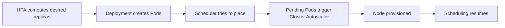
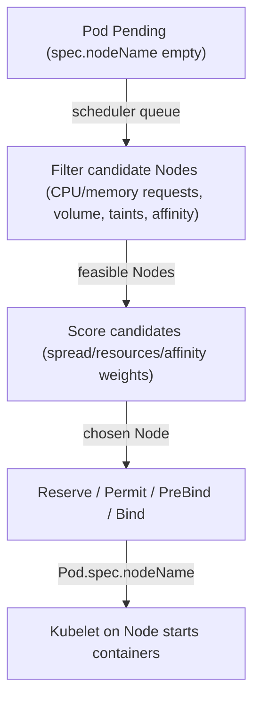
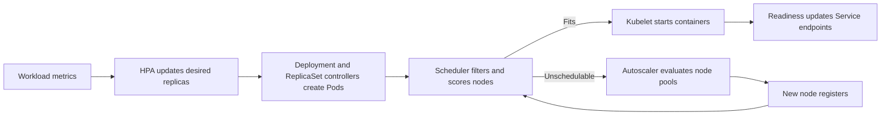

## Learning objectives

- **Trace the kube-scheduler pipeline:** Follow how `kube-scheduler` queues Pods, filters ineligible Nodes, scores feasible candidates, and binds workloads through Scheduling Framework extension points.
- **Size resource requests, limits, and QoS classes:** Distinguish scheduling based on `NodeAllocatable` and requests from runtime Linux cgroup CPU throttling, memory OOM kills, and Guaranteed/Burstable/BestEffort eviction behavior.
- **Design resilient Pod placement:** Combine `nodeSelector`, node affinity, taints and tolerations, `TopologySpreadConstraints`, and PodDisruptionBudgets without causing unintended Pending Pods during outages.
- **Coordinate HPA, VPA, and GKE Cluster Autoscaler:** Apply the HPA scaling formula using request-based utilization or custom metrics, avoid VPA/HPA CPU feedback loops, and diagnose capacity bottlenecks across quota, IP, and node-pool limits.
- **Debug scheduling and scaling failures systematically:** Separate unbound `FailedScheduling` Pods from bound startup issues and manage `spec.replicas` field ownership safely alongside Argo CD.

## Scheduler: Filter → Score → Bind

The kube-scheduler evaluates Pods that have not yet been assigned to a Node. **Filter** eliminates Nodes that cannot meet the CPU or memory requests or that violate constraints; **Score** ranks the remaining Nodes; **Bind** assigns the Pod to a Node. The scheduler does not run containers directly.

## Requests and Limits

```yaml
resources:
  requests: {cpu: 500m, memory: 512Mi}
  limits: {cpu: '2', memory: 1Gi}
```

Scheduling uses resource requests, not just observed CPU usage. CPU usage above the quota can be throttled; exceeding the memory limit can trigger an OOM kill. The QoS classes are Guaranteed, Burstable, and BestEffort.

## Placement

- Node affinity: require or prefer placement based on labels.
- Taints and tolerations: restrict placement on Nodes; a toleration **does not force** a Pod to run on that Node.
- Topology spread: distribute replicas across Nodes or zones.
- PDB: limit voluntary evictions through the Eviction API; it does not prevent Node crashes.

## Autoscaling

HPA adjusts the replica count based on metrics; VPA recommends or adjusts resource requests; the GKE Cluster Autoscaler increases Node capacity when there are unschedulable Pods. The basic HPA formula is:

`desired = ceil(currentReplicas × observedMetric / targetMetric)`

HPA CPU utilization is based on **CPU requests**, not limits. If Argo CD and HPA both manage `spec.replicas`, separate their ownership responsibilities.

## Debugging

```bash
kubectl describe pod POD_NAME -n payments
kubectl describe node NODE_NAME
kubectl describe hpa payment-hpa -n payments
kubectl get events -A --sort-by=.lastTimestamp
```

**Official:** [Kubernetes Scheduler](https://kubernetes.io/docs/concepts/scheduling-eviction/kube-scheduler/) · [HPA](https://kubernetes.io/docs/tasks/run-application/horizontal-pod-autoscale/).

## Scheduler: Filter First, Then Score

The scheduler checks whether Nodes can accommodate a Pod before ranking them. If a Node does not have enough allocatable CPU to cover the Pod's **requests**, it is ineligible even if `kubectl top nodes` reports low CPU usage. The Scheduling Framework includes extension points such as PreFilter, Filter, Score, Reserve, Permit, and Bind, along with other plugin hooks.

### Requests, Limits, and Linux Enforcement

```yaml
resources:
  requests: {cpu: 500m, memory: 512Mi}
  limits: {cpu: "2", memory: 1Gi}
```

CPU limits are typically enforced through cgroup quotas and throttling; exceeding the memory limit can result in an OOM kill. The scheduler accounts for requests rather than looking only at usage or limits. Node `Allocatable` is `Capacity` minus reservations.

### Scheduling constraints

- `nodeSelector` and required node affinity are hard placement constraints.
- A toleration lets a Pod run on a Node with a matching taint, but does not require the scheduler to select that Node.
- `TopologySpreadConstraints` can distribute replicas evenly by zone or hostname, but a hard `DoNotSchedule` constraint can leave Pods Pending during an outage.
- A PDB does not prevent Node crashes; priority and preemption do not resolve a storage zone mismatch.

### From HPA to Node Autoscaling



HPA CPU utilization is based on the ratio of usage to requests. Setting a low request increases utilization even when absolute usage is not high. The HPA metrics API, missing metrics, and stabilization windows affect actual scaling. The Cluster Autoscaler cannot fix a ResourceQuota violation or accommodate a Pod whose request exceeds the capacity of every Node template.

### VPA/HPA coordination

VPA adjusts resource requests, while HPA adjusts the replica count. When HPA uses CPU utilization and VPA adjusts CPU requests, the control loops can react to each other. Start VPA in recommendation-only mode, or use application-level metrics for HPA, and then test scaling stability.

**Lab:** Deliberately create a Pod with an excessive resource request; inspect `FailedScheduling` events and Node Allocatable. Enable HPA with metrics-server and compare its behavior after changing `requests.cpu`.

## Deep Dive: Scheduling Framework and Linux cgroups

### What Steps Does the Scheduler Actually Take?

Scheduling a new Pod typically starts in a queue. The Scheduling Framework includes `QueueSort`, `PreFilter`, `Filter`, `PostFilter` (where preemption may be attempted), `PreScore`, `Score`, `Reserve`, `Permit`, `PreBind`, `Bind`, and `PostBind`. Not every extension point always has an active plugin. Some extension points belong to the scheduling cycle and others to the binding cycle.



The scheduler determines feasibility primarily by comparing **resource requests** with `NodeAllocatable`, not by looking at the usage reported by `kubectl top node`. For example, a Node with 8 allocatable CPUs and existing requests totaling 7 CPUs can leave a new Pod requesting 2 CPUs Pending, even if the workloads currently use only 1 CPU. Remember to account for DaemonSet requests, Pod overhead, init-container resource accounting, and the maximum Pods per Node.

### QoS, cgroups, and Eviction

| QoS | Typical criteria | Implications |
|---|---|---|
| Guaranteed | CPU and memory requests equal their respective limits for each applicable container | Receives preferential treatment under resource pressure rules |
| Burstable | Has requests or limits but does not qualify as Guaranteed | Uses resources flexibly and is evaluated based on usage, requests, and priority |
| BestEffort | Has no CPU or memory requests or limits | Has no guaranteed resources |

CPU limits are typically enforced through cgroup bandwidth control, which throttles workloads that exceed their quota within a window. A memory limit can trigger an OOM kill if allocation exceeds it; memory is not throttled by the same mechanism as CPU. An `OOMKilled` status alone does not prove a memory leak. Check peak usage, buffers, concurrency, sidecars, and how the limit was sized.

### Placement: Hard and Soft Constraints

```yaml
affinity:
  nodeAffinity:
    requiredDuringSchedulingIgnoredDuringExecution:
      nodeSelectorTerms:
        - matchExpressions:
            - key: workload-tier
              operator: In
              values: [critical]
```

`required` enforces placement; `preferred` only raises the score. `tolerations` remove the barrier imposed by taints but do not *attract* Pods to tainted Nodes. Add labels and affinity rules if you need a dedicated group of Nodes.

Topology spread:

```yaml
topologySpreadConstraints:
  - maxSkew: 1
    topologyKey: topology.kubernetes.io/zone
    whenUnsatisfiable: DoNotSchedule
    labelSelector:
      matchLabels:
        app: payment
```

If zones lack enough Nodes, a hard spread constraint can leave Pods Pending; `minDomains`, eligible domains, and node affinity and taint policies affect the outcome. A PDB limits voluntary evictions but does not prevent crashes or zone outages.

### HPA: Formula and Assumptions

With 4 current replicas, average CPU utilization of 80%, and a target of 60%:

```text
desired = ceil(4 × 80 / 60) = 6 replicas
```

If each Pod requests 250m of CPU and uses 200m, utilization is 80%. Raising the request to 500m while usage stays at 200m drops utilization to 40%, changing the HPA decision. In practice, HPA also accounts for missing metrics, Pods that are not yet ready, tolerance, scaling policies, stabilization windows, and minimum and maximum replica counts. HPA does not scale directly based on CPU limits.

```yaml
apiVersion: autoscaling/v2
kind: HorizontalPodAutoscaler
metadata:
  name: payment
  namespace: payments
spec:
  scaleTargetRef:
    apiVersion: apps/v1
    kind: Deployment
    name: payment
  minReplicas: 3
  maxReplicas: 20
  metrics:
    - type: Resource
      resource:
        name: cpu
        target:
          type: Utilization
          averageUtilization: 60
  behavior:
    scaleDown:
      stabilizationWindowSeconds: 300
```

Metrics Server must provide resource metrics; without a metric, HPA may not behave as expected. In queueing systems, CPU may not reflect saturation, so consider custom or external metrics such as queue lag or in-flight requests.

### VPA and the Cluster Autoscaler

VPA right-sizes container requests and limits according to the supported mode. Running with `updateMode: Off` to collect recommendations is a safe audit step. Combining HPA's CPU utilization metric with VPA changes to CPU requests can lead to hard-to-predict interactions between the controllers. The GKE Cluster Autoscaler adds Nodes when the scheduler cannot place Pods and adding a Node would help. It cannot add usable capacity if quotas, available IPs, maximum Node pool size, taints or affinity, or resource requests make placement impossible.

### Debug playbook

```bash
kubectl get pods -A --field-selector=status.phase=Pending
kubectl describe pod POD -n payments
kubectl describe node NODE
kubectl get events -A --sort-by=.lastTimestamp
kubectl top pods -A --containers
kubectl describe hpa payment -n payments
kubectl get priorityclasses,pdb -A
```

**Production scenario:** Argo Rollouts uses `maxSurge` and needs extra Pods. An Envoy sidecar adds a 100m CPU request, and a hard topology spread constraint spans three zones, one of which is experiencing an outage. HPA wants 12 replicas, but the quota only allows 10. Scaling the Node pool alone resolves neither the quota nor the spread constraint. Check each constraint in the controller responsible for it before changing the infrastructure.

Sources: [Scheduling Framework](https://kubernetes.io/docs/concepts/scheduling-eviction/scheduling-framework/), [Manage resources](https://kubernetes.io/docs/concepts/configuration/manage-resources-containers/), [HPA](https://kubernetes.io/docs/concepts/workloads/autoscaling/horizontal-pod-autoscale/), [GKE autoscaler](https://cloud.google.com/kubernetes-engine/docs/concepts/cluster-autoscaler).

## Trace a traffic spike through the capacity controllers

At 300 requests per second, three Payment Pods keep up. At 3,000 requests per second, the HPA observes its configured metric and writes the desired count through the Deployment's scale subresource. The Deployment controller drives ReplicaSets, whose controller creates Pods. The scheduler filters and ranks nodes, then binds each Pod. If no node fits, GKE Cluster Autoscaler can add capacity if a simulated node from an eligible pool fits the Pod. Once kubelet starts the containers and readiness succeeds, Service endpoints can begin receiving traffic. Every step adds latency to the response to a spike.



### Work an actual placement decision

The scheduler sorts queued Pods, computes shared state in PreFilter, and filters candidates. PostFilter can attempt preemption when no node passes. PreScore and Score rank feasible nodes. Reserve lets plugins track assumed state before final binding. Permit can approve, delay, or reject. PreBind prepares prerequisites, Bind records the assignment, and PostBind follows a successful binding. Scheduling cycles run serially while binding cycles may overlap. Kubelet acts after assignment. [Scheduling framework](https://kubernetes.io/docs/concepts/scheduling-eviction/scheduling-framework/)

| Candidate | Uncommitted CPU requests | Uncommitted memory requests | Illustrative score |
|---|---:|---:|---:|
| A | 500m | 4 GiB | 90 |
| B | 2,000m | 2 GiB | 75 |
| C | 1,500m | 512 MiB | 95 |

For a 1,000m, 1 GiB Pod, only B passes. For a 500m, 1 GiB Pod, A and B pass and A wins in this model. Actual scores combine enabled plugins and weights. Consider architecture, taints, affinity, volume topology, and available Pod slots before treating CPU and memory as decisive.

### Capacity, runtime limits, and QoS

Node allocatable accounts for system and Kubernetes reservations. Placement uses allocatable minus committed requests. For example, a Payment container requesting 500m and 512Mi plus a regular Envoy sidecar requesting 100m and 128Mi together require 600m and 640Mi before Pod overhead. Init containers, restartable init sidecars, and supported Pod-level resource declarations have additional accounting rules.

A CPU request influences scheduling and relative CPU shares under contention. A CPU limit limits runtime CPU bandwidth. A 200m limit can throttle an application even when the node is idle. Track throttling alongside P99 latency. A 512Mi memory limit can trigger a cgroup OOM kill when breached. Check termination reason and node events because exit code 137 alone identifies SIGKILL and has other possible causes.

With conventional container-level resources, Guaranteed requires every container to have equal CPU request and limit and equal memory request and limit. A Pod with some CPU or memory resources and unequal requests and limits is typically Burstable. A Pod with neither CPU nor memory requests or limits is BestEffort. A sidecar can change the class. Under node pressure, kubelet considers resource usage above requests, Pod priority, and how far usage exceeds requests. PriorityClass separately influences queue order and scheduler preemption. Preemption attempts to minimize PDB violations on a best-effort basis. Removing lower-priority Pods cannot solve a missing label, an untolerated taint, or a disk in the wrong zone. [Resource management](https://kubernetes.io/docs/concepts/configuration/manage-resources-containers/) · [Pod QoS](https://kubernetes.io/docs/concepts/workloads/pods/pod-qos/) · [Priority and preemption](https://kubernetes.io/docs/concepts/scheduling-eviction/pod-priority-preemption/)

### Place replicas across failure domains

A nodeSelector is mandatory. Required node affinity is mandatory at scheduling time and preferred node affinity contributes a score. A matching toleration permits placement on a tainted node. Pair it with an affinity or selector to restrict placement to dedicated nodes. NoSchedule blocks new scheduling, PreferNoSchedule makes avoidance a preference, and NoExecute can also evict existing Pods without a matching toleration.

Required pod anti-affinity on `kubernetes.io/hostname` can prevent co-location at the cost of needing enough nodes for surge and replacements. Zone spreading can give six replicas a 2/2/2 distribution if three suitable zones have capacity:

```yaml
topologySpreadConstraints:
  - maxSkew: 1
    topologyKey: topology.kubernetes.io/zone
    whenUnsatisfiable: DoNotSchedule
    labelSelector:
      matchLabels:
        app: payment
```

This goes in the Pod spec. DoNotSchedule enforces skew while ScheduleAnyway favors balance as a score. Eligible domains, node affinity, taint inclusion, and optional minDomains influence outcomes. Test with a surviving subset of zones as well as with normal capacity. [Pod placement](https://kubernetes.io/docs/concepts/scheduling-eviction/assign-pod-node/) · [Topology spread](https://kubernetes.io/docs/concepts/scheduling-eviction/topology-spread-constraints/)

### Coordinate HPA, VPA, and GKE node provisioning

The basic HPA proposal rounds up current replicas multiplied by observed metric divided by target. At three replicas and 90% against 60%, the proposal is five. HPA also applies bounds, tolerance, readiness and missing-metric handling, and scaling behavior. CPU utilization is relative to requests. At 300m observed usage, requests of 300m, 500m, and 1,000m give 100%, 60%, and 30%. A sidecar's CPU request can affect a Pod-wide resource metric. Consider a container metric for the application when the cluster supports it. Resource metrics commonly come from Metrics Server. Custom and external metric adapters can supply queue lag or comparable signals for I/O-bound workloads.

Upstream Kubernetes v1.37 documents scale-to-zero as beta under HPAScaleToZero. It requires at least one Object or External metric and feature availability on the API server and controller manager. CPU or memory from a running Pod cannot wake a workload at zero. Verify your managed cluster version and support before relying on this behavior. [Horizontal Pod Autoscaling](https://kubernetes.io/docs/concepts/workloads/autoscaling/horizontal-pod-autoscale/)

```yaml
apiVersion: autoscaling.k8s.io/v1
kind: VerticalPodAutoscaler
metadata:
  name: payment-vpa
  namespace: payments
spec:
  targetRef: {apiVersion: apps/v1, kind: Deployment, name: payment}
  updatePolicy:
    updateMode: "Off"
  resourcePolicy:
    containerPolicies:
      - containerName: payment
        controlledResources: [cpu, memory]
```

This requires the VPA API and controller. Inspect lowerBound, target, upperBound and uncappedTarget with `kubectl describe vpa payment-vpa -n payments`. Recreate can apply recommendations through Pod replacement. InPlaceOrRecreate can attempt an in-place update and fall back to replacement where supported. Verify GKE version requirements. Active VPA on CPU can move the denominator used by HPA, causing replica changes under identical load. Recommendation-only VPA or an HPA on application metrics avoids that particular coupling. [GKE VPA](https://docs.cloud.google.com/kubernetes-engine/docs/concepts/verticalpodautoscaler)

The GKE Autoscaler evaluates whether adding nodes can make unschedulable Pods fit. It uses scheduling constraints and requests rather than CPU saturation alone. Additional 4-CPU nodes cannot fit one Pod requesting 16 CPU. GKE node pool auto-creation and supported ComputeClasses can supply a different node shape under configured policies. Karpenter is also a node provisioning model, with provider-specific support. Evaluate GKE-native provisioners for GKE. Scale-down likewise depends on whether workloads can move, eviction constraints, and minimum pool sizes. Inspect autoscaler visibility events for pool bounds, quota, Pod IP exhaustion, and cloud capacity. [GKE Cluster Autoscaler](https://docs.cloud.google.com/kubernetes-engine/docs/concepts/cluster-autoscaler) · [Custom ComputeClasses](https://docs.cloud.google.com/kubernetes-engine/docs/concepts/about-custom-compute-classes)

### Debug and reproduce the capacity chain

First distinguish an unbound Pending Pod with FailedScheduling from a bound Pod waiting on image pull, volume attachment, or startup. Use `kubectl describe pod`, `kubectl describe node`, and the admitted Pod spec to compare allocatable resources, committed requests, taints, topology, and PVC constraints. `kubectl top nodes` shows measured consumption. A node at 30% usage can have committed all of its requested CPU.

In a test cluster with resource metrics, use the HPA manifest above with an Nginx Deployment named payment in payments and explicit requests such as 100m CPU and 128Mi memory. Use the intended namespace for both objects. Generate controlled load from inside the test cluster and observe `kubectl get hpa -n payments --watch` and `kubectl get pods -n payments -o wide --watch` in separate terminals. Idle Nginx may never cross the target. On a fixed-size lab cluster, a separate Pod whose request exceeds the allocatable CPU of every node illustrates FailedScheduling. On an autoscaling cluster, use a request that fits a permitted node type to demonstrate scale-up and check cost, node limits and IP capacity before running the test.

When HPA owns replica count, remove the fixed count through a controlled handoff or use a narrow Argo CD replica ignore with RespectIgnoreDifferences. See [field ownership](../01-foundations/lesson-02-core-resources.md). At 10 replicas, maxSurge 25% can require three extra Pods. With a 600m sidecar-inclusive request, reserve 1.8 additional CPU for that surge alone. PDB minAvailable 8 protects applicable voluntary evictions, while rollout progress depends on its own strategy and available capacity. An HPA can add replicas without curing a 200m CPU limit that throttles each Pod. Compare desired, scheduled and ready replicas, throttling, latency and node provisioning time before changing more than one control.

Continue with [Lesson 16 — Kubernetes Storage](./lesson-16-storage.md) to see how PVC binding and topology constrain node placement.

Use this Deployment with the chapter's existing HPA in a test payments namespace. Its replica count is delegated to HPA after creation.

```yaml
apiVersion: apps/v1
kind: Deployment
metadata:
  name: payment
  namespace: payments
spec:
  selector:
    matchLabels: {app: payment}
  template:
    metadata:
      labels: {app: payment}
    spec:
      containers:
        - name: payment
          image: nginx:1.27
          resources:
            requests: {cpu: 100m, memory: 128Mi}
            limits: {memory: 256Mi}
```

Practice with the [platform operations exercises](./platform-operations-exercises.mdx).

## Self-check questions

1. Which controller owns the desired state and the actual state in this context?
2. What failure modes can occur even when the Kubernetes resource reports `Ready`?
3. What would you verify before deploying to production?
