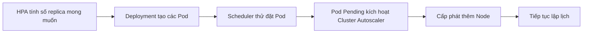
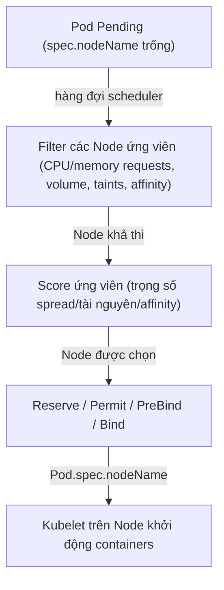
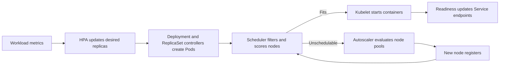

## Mục tiêu học tập

- **Theo dõi quy trình lập lịch của kube-scheduler:** Hiểu cách `kube-scheduler` đưa Pod vào hàng đợi, lọc các Node không đủ điều kiện, chấm điểm ứng viên khả thi và gán workload qua các extension point của Scheduling Framework.
- **Định cỡ requests, limits và lớp QoS:** Phân biệt việc lập lịch dựa trên `NodeAllocatable` và requests với cơ chế thực thi runtime của Linux cgroups gồm CPU throttling, memory OOM kill và hành vi eviction theo lớp Guaranteed/Burstable/BestEffort.
- **Thiết kế phân bổ vị trí Pod có khả năng chịu lỗi:** Kết hợp `nodeSelector`, node affinity, taints và tolerations, `TopologySpreadConstraints` và PodDisruptionBudget mà không gây kẹt Pod ở trạng thái Pending khi xảy ra sự cố.
- **Phối hợp HPA, VPA và GKE Cluster Autoscaler:** Áp dụng công thức scale của HPA theo utilization dựa trên requests hoặc custom metrics, tránh xung đột vòng lặp CPU giữa VPA và HPA, đồng thời chẩn đoán các nút thắt về quota, IP và node pool.
- **Gỡ lỗi lập lịch và autoscaling có hệ thống:** Phân tách rõ Pod Pending chưa được bind (`FailedScheduling`) với lỗi khởi động sau khi bind, và tách bạch quyền sở hữu trường `spec.replicas` khi dùng cùng Argo CD.

## Scheduler: Filter → Score → Bind

`kube-scheduler` đánh giá các Pod chưa được gán vào Node nào. **Filter** loại bỏ các Node không đáp ứng được CPU/memory requests hoặc vi phạm các ràng buộc; **Score** xếp hạng các Node còn lại; **Bind** gán Pod vào một Node. Scheduler không trực tiếp chạy container.

## Requests và Limits

```yaml
resources:
  requests: {cpu: 500m, memory: 512Mi}
  limits: {cpu: '2', memory: 1Gi}
```

Việc lập lịch (scheduling) dựa trên resource requests, không chỉ dựa trên mức sử dụng CPU thực tế quan sát được. Mức sử dụng CPU vượt quá quota có thể bị throttle; vượt quá memory limit có thể dẫn đến OOM kill. Các lớp QoS gồm Guaranteed, Burstable và BestEffort.

## Placement (Phân bổ vị trí chạy Pod)

- Node affinity: bắt buộc hoặc ưu tiên gán Pod dựa trên label.
- Taints và tolerations: giới hạn việc gán Pod lên Node; một toleration **không ép buộc** Pod phải chạy trên Node đó.
- Topology spread: phân tán các replica qua nhiều Node hoặc nhiều zone.
- PDB: giới hạn các lần eviction tự nguyện thông qua Eviction API; không ngăn được sự cố Node crash.

## Autoscaling

HPA điều chỉnh số lượng replica dựa trên metric; VPA khuyến nghị hoặc điều chỉnh resource requests; GKE Cluster Autoscaler tăng năng lực Node khi có các Pod ở trạng thái unschedulable. Công thức HPA cơ bản là:

`desired = ceil(currentReplicas × observedMetric / targetMetric)`

Tỷ lệ sử dụng CPU (CPU utilization) của HPA được tính dựa trên **CPU requests**, không phải limits. Nếu cả Argo CD và HPA cùng quản lý `spec.replicas`, cần tách bạch trách nhiệm sở hữu trường này.

## Gỡ lỗi (Debugging)

```bash
kubectl describe pod POD_NAME -n payments
kubectl describe node NODE_NAME
kubectl describe hpa payment-hpa -n payments
kubectl get events -A --sort-by=.lastTimestamp
```

**Tài liệu chính thức:** [Kubernetes Scheduler](https://kubernetes.io/docs/concepts/scheduling-eviction/kube-scheduler/) · [HPA](https://kubernetes.io/docs/tasks/run-application/horizontal-pod-autoscale/).

## Scheduler: Filter trước, Score sau

Scheduler kiểm tra xem các Node có đủ khả năng chứa Pod hay không trước khi xếp hạng chúng. Nếu một Node không có đủ CPU allocatable để đáp ứng **requests** của Pod, Node đó sẽ không đủ điều kiện ngay cả khi `kubectl top nodes` báo cáo mức sử dụng CPU thấp. Scheduling Framework bao gồm các extension point như PreFilter, Filter, Score, Reserve, Permit và Bind, cùng các plugin hook khác.

### Requests, Limits và cơ chế thực thi trên Linux

```yaml
resources:
  requests: {cpu: 500m, memory: 512Mi}
  limits: {cpu: "2", memory: 1Gi}
```

CPU limits thường được thực thi thông qua cgroup quota và cơ chế throttling; vượt quá memory limit có thể dẫn đến OOM kill. Scheduler tính toán dựa trên requests thay vì chỉ nhìn vào mức sử dụng thực tế hay limits. `Allocatable` của Node bằng `Capacity` trừ đi phần tài nguyên dự trữ (reservations).

### Các ràng buộc khi lập lịch (Scheduling constraints)

- `nodeSelector` và required node affinity là các ràng buộc cứng về vị trí đặt Pod.
- Toleration cho phép Pod chạy trên Node có taint tương ứng, nhưng không bắt buộc scheduler phải chọn Node đó.
- `TopologySpreadConstraints` có thể phân bổ đều các replica theo zone hoặc hostname, nhưng ràng buộc cứng `DoNotSchedule` có thể khiến Pod bị Pending khi xảy ra sự cố (outage).
- PDB không ngăn được Node crash; priority và preemption không giải quyết được lỗi lệch zone của storage.

### Từ HPA đến Node Autoscaling



CPU utilization của HPA dựa trên tỷ lệ giữa mức sử dụng thực tế và requests. Đặt request quá thấp sẽ đẩy tỷ lệ utilization lên cao ngay cả khi mức sử dụng tuyệt đối không lớn. HPA metrics API, tình trạng thiếu metric và stabilization window đều ảnh hưởng đến hành vi scale thực tế. Cluster Autoscaler không thể khắc phục lỗi vi phạm ResourceQuota hoặc đáp ứng một Pod có request vượt quá dung lượng của mọi Node template.

### Phối hợp VPA và HPA

VPA điều chỉnh resource requests, trong khi HPA điều chỉnh số lượng replica. Khi HPA sử dụng CPU utilization còn VPA điều chỉnh CPU requests, hai vòng lặp điều khiển này có thể tác động qua lại lẫn nhau. Hãy bắt đầu với VPA ở chế độ chỉ khuyến nghị (recommendation-only), hoặc dùng application-level metrics cho HPA, sau đó kiểm thử độ ổn định khi scale.

**Thực hành (Lab):** Chủ động tạo một Pod có resource request vượt mức; kiểm tra các event `FailedScheduling` và Node Allocatable. Bật HPA với metrics-server và so sánh hành vi của nó sau khi thay đổi `requests.cpu`.

## Tìm hiểu sâu: Scheduling Framework và Linux cgroups

### Scheduler thực sự thực hiện những bước nào?

Việc lập lịch một Pod mới thường bắt đầu từ hàng đợi (queue). Scheduling Framework bao gồm `QueueSort`, `PreFilter`, `Filter`, `PostFilter` (nơi preemption có thể được thử thực hiện), `PreScore`, `Score`, `Reserve`, `Permit`, `PreBind`, `Bind` và `PostBind`. Không phải mọi extension point đều luôn có plugin đang hoạt động. Một số extension point thuộc chu kỳ lập lịch (scheduling cycle) và số khác thuộc chu kỳ gán (binding cycle).



Scheduler xác định tính khả thi chủ yếu bằng cách so sánh **resource requests** với `NodeAllocatable`, chứ không dựa vào mức sử dụng hiển thị bởi `kubectl top node`. Ví dụ, một Node có 8 CPU allocatable và tổng requests hiện có là 7 CPU sẽ khiến một Pod mới request 2 CPU rơi vào trạng thái Pending, ngay cả khi các workload hiện tại chỉ đang dùng 1 CPU. Đừng quên tính đến requests của DaemonSet, Pod overhead, cách tính tài nguyên của init-container và số lượng Pod tối đa trên mỗi Node.

### QoS, cgroups và Eviction

| QoS | Tiêu chí điển hình | Hệ quả |
|---|---|---|
| Guaranteed | CPU và memory requests bằng với limits tương ứng trên mọi container áp dụng | Được ưu tiên bảo vệ hơn theo các quy tắc khi Node chịu áp lực tài nguyên |
| Burstable | Có khai báo requests hoặc limits nhưng không đạt chuẩn Guaranteed | Sử dụng tài nguyên linh hoạt và được đánh giá dựa trên mức dùng thực tế, requests và priority |
| BestEffort | Không khai báo bất kỳ CPU hay memory requests/limits nào | Không có tài nguyên được đảm bảo |

CPU limits thường được thực thi thông qua cơ chế kiểm soát băng thông cgroup (cgroup bandwidth control), thực hiện throttle các workload vượt quá quota trong một khung thời gian. Memory limit có thể kích hoạt OOM kill nếu mức cấp phát vượt ngưỡng; bộ nhớ không bị throttle theo cơ chế giống CPU. Trạng thái `OOMKilled` tự nó không chứng minh có memory leak. Hãy kiểm tra mức sử dụng đỉnh (peak usage), buffer, concurrency, sidecar và cách định cỡ limit.

### Placement: Ràng buộc cứng và ràng buộc mềm

```yaml
affinity:
  nodeAffinity:
    requiredDuringSchedulingIgnoredDuringExecution:
      nodeSelectorTerms:
        - matchExpressions:
            - key: workload-tier
              operator: In
              values: [critical]
```

`required` ép buộc vị trí đặt Pod; `preferred` chỉ làm tăng điểm số (score). `tolerations` gỡ bỏ rào cản do taint tạo ra nhưng không *hút* Pod về các Node có taint. Hãy kết hợp thêm label và affinity rule nếu bạn cần một nhóm Node chuyên dụng.

Topology spread:

```yaml
topologySpreadConstraints:
  - maxSkew: 1
    topologyKey: topology.kubernetes.io/zone
    whenUnsatisfiable: DoNotSchedule
    labelSelector:
      matchLabels:
        app: payment
```

Nếu các zone không có đủ Node, ràng buộc spread cứng có thể khiến Pod bị Pending; `minDomains`, các domain đủ điều kiện, cũng như chính sách node affinity và taint đều ảnh hưởng đến kết quả. PDB giới hạn các lần eviction tự nguyện nhưng không ngăn được crash hoặc sự cố mất zone.

### HPA: Công thức và các giả định

Với 4 replica hiện tại, mức CPU utilization trung bình là 80% và mục tiêu là 60%:

```text
desired = ceil(4 × 80 / 60) = 6 replicas
```

Nếu mỗi Pod request 250m CPU và dùng 200m, utilization là 80%. Tăng request lên 500m trong khi mức dùng giữ nguyên ở 200m sẽ kéo utilization xuống 40%, làm thay đổi quyết định của HPA. Trong thực tế, HPA còn tính đến metric bị thiếu, các Pod chưa ready, ngưỡng dung sai (tolerance), chính sách scaling, stabilization window, cũng như số replica tối thiểu và tối đa. HPA không scale trực tiếp dựa trên CPU limits.

```yaml
apiVersion: autoscaling/v2
kind: HorizontalPodAutoscaler
metadata:
  name: payment
  namespace: payments
spec:
  scaleTargetRef:
    apiVersion: apps/v1
    kind: Deployment
    name: payment
  minReplicas: 3
  maxReplicas: 20
  metrics:
    - type: Resource
      resource:
        name: cpu
        target:
          type: Utilization
          averageUtilization: 60
  behavior:
    scaleDown:
      stabilizationWindowSeconds: 300
```

Metrics Server phải cung cấp resource metrics; nếu thiếu metric, HPA có thể hoạt động không như mong đợi. Trong các hệ thống hàng đợi (queueing systems), CPU có thể không phản ánh mức độ bão hòa, vì vậy hãy cân nhắc dùng custom hoặc external metrics như queue lag hoặc số request đang xử lý (in-flight requests).

### VPA và Cluster Autoscaler

VPA điều chỉnh kích thước requests và limits của container cho phù hợp theo chế độ được hỗ trợ. Chạy với `updateMode: Off` để thu thập khuyến nghị là một bước kiểm tra (audit) an toàn. Kết hợp CPU utilization metric của HPA với việc VPA thay đổi CPU requests có thể dẫn đến các tương tác khó dự đoán giữa hai controller. GKE Cluster Autoscaler bổ sung Node khi scheduler không thể đặt Pod và việc thêm Node có thể giải quyết vấn đề. Nó không thể bổ sung năng lực khả dụng nếu quota, số IP còn lại, kích thước tối đa của Node pool, taint/affinity hoặc resource requests khiến việc đặt Pod trở nên bất khả thi.

### Playbook gỡ lỗi

```bash
kubectl get pods -A --field-selector=status.phase=Pending
kubectl describe pod POD -n payments
kubectl describe node NODE
kubectl get events -A --sort-by=.lastTimestamp
kubectl top pods -A --containers
kubectl describe hpa payment -n payments
kubectl get priorityclasses,pdb -A
```

**Tình huống production:** Argo Rollouts sử dụng `maxSurge` và cần thêm Pod. Một Envoy sidecar cộng thêm 100m CPU request, và một ràng buộc topology spread cứng trải trên ba zone, trong đó một zone đang gặp sự cố. HPA muốn 12 replica, nhưng quota chỉ cho phép 10. Chỉ mở rộng Node pool sẽ không giải quyết được cả vấn đề quota lẫn ràng buộc spread. Hãy kiểm tra từng ràng buộc tại đúng controller chịu trách nhiệm cho nó trước khi thay đổi hạ tầng.

Nguồn: [Scheduling Framework](https://kubernetes.io/docs/concepts/scheduling-eviction/scheduling-framework/), [Manage resources](https://kubernetes.io/docs/concepts/configuration/manage-resources-containers/), [HPA](https://kubernetes.io/docs/concepts/workloads/autoscaling/horizontal-pod-autoscale/), [GKE autoscaler](https://cloud.google.com/kubernetes-engine/docs/concepts/cluster-autoscaler).

## Theo dõi một đợt tăng đột biến lưu lượng qua các capacity controller

Ở mức 300 request/giây, ba Payment Pod xử lý ổn thỏa. Khi tăng lên 3.000 request/giây, HPA quan sát metric đã cấu hình và ghi số lượng mong muốn thông qua subresource `scale` của Deployment. Deployment controller điều khiển các ReplicaSet, và controller của ReplicaSet tạo ra các Pod. Scheduler lọc và chấm điểm các node, rồi bind từng Pod. Nếu không có node nào phù hợp, GKE Cluster Autoscaler có thể bổ sung năng lực nếu một node mô phỏng từ một pool đủ điều kiện có thể chứa được Pod đó. Khi kubelet khởi động container và readiness check thành công, Service endpoints mới bắt đầu nhận lưu lượng. Mỗi bước đều cộng thêm độ trễ vào phản ứng trước đợt tăng đột biến.



### Phân tích một quyết định đặt Pod thực tế

Scheduler sắp xếp các Pod trong hàng đợi, tính toán trạng thái dùng chung ở bước PreFilter và lọc các ứng viên. PostFilter có thể thử thực hiện preemption khi không có node nào vượt qua vòng lọc. PreScore và Score xếp hạng các node khả thi. Reserve cho phép các plugin theo dõi trạng thái giả định trước khi bind chính thức. Permit có thể phê duyệt, trì hoãn hoặc từ chối. PreBind chuẩn bị các điều kiện tiên quyết, Bind ghi nhận việc gán node và PostBind chạy sau khi bind thành công. Các chu kỳ lập lịch chạy tuần tự trong khi các chu kỳ binding có thể chạy chồng lấp. Kubelet bắt đầu hành động sau khi Pod được gán node. [Scheduling framework](https://kubernetes.io/docs/concepts/scheduling-eviction/scheduling-framework/)

| Ứng viên | CPU requests chưa cam kết | Memory requests chưa cam kết | Điểm minh họa |
|---|---:|---:|---:|
| A | 500m | 4 GiB | 90 |
| B | 2,000m | 2 GiB | 75 |
| C | 1,500m | 512 MiB | 95 |

Với một Pod yêu cầu 1.000m CPU, 1 GiB memory, chỉ có B vượt qua vòng lọc. Với một Pod yêu cầu 500m CPU, 1 GiB memory, cả A và B đều qua vòng lọc và A thắng trong mô hình này. Điểm số thực tế là sự kết hợp của các plugin đang bật cùng trọng số của chúng. Hãy xem xét kiến trúc CPU, taints, affinity, volume topology và số slot Pod khả dụng trước khi coi CPU và memory là yếu tố quyết định duy nhất.

### Năng lực, giới hạn runtime và QoS

Node allocatable đã trừ đi phần tài nguyên dự trữ cho hệ thống và Kubernetes. Việc đặt Pod sử dụng allocatable trừ đi tổng requests đã cam kết. Ví dụ, một container Payment request 500m CPU và 512Mi memory cộng với một Envoy sidecar thông thường request 100m và 128Mi sẽ cần tổng cộng 600m và 640Mi chưa tính Pod overhead. Init containers, restartable init sidecars và các khai báo tài nguyên ở cấp Pod được hỗ trợ có những quy tắc tính toán riêng.

CPU request ảnh hưởng đến việc lập lịch và tỷ lệ chia sẻ CPU tương đối khi xảy ra tranh chấp. CPU limit giới hạn băng thông CPU lúc chạy (runtime). Một mức limit 200m có thể throttle ứng dụng ngay cả khi node đang nhàn rỗi. Hãy theo dõi throttling song song với độ trễ P99. Mức memory limit 512Mi có thể kích hoạt cgroup OOM kill khi bị vượt quá. Cần kiểm tra lý do kết thúc (termination reason) và các event trên node vì riêng mã thoát (exit code) 137 chỉ cho biết SIGKILL và có thể xuất phát từ những nguyên nhân khác.

Với cách khai báo tài nguyên cấp container truyền thống, lớp Guaranteed yêu cầu mọi container đều có CPU request bằng limit và memory request bằng limit. Một Pod có khai báo một phần CPU hoặc memory với request và limit không bằng nhau thường thuộc lớp Burstable. Một Pod không có bất kỳ CPU hay memory request/limit nào thuộc lớp BestEffort. Một sidecar cũng có thể làm thay đổi lớp QoS của cả Pod. Khi node chịu áp lực tài nguyên, kubelet cân nhắc mức sử dụng vượt quá request, độ ưu tiên của Pod và mức độ vượt request. PriorityClass tác động riêng đến thứ tự hàng đợi và preemption của scheduler. Preemption cố gắng giảm thiểu vi phạm PDB trên cơ sở best-effort. Việc đẩy các Pod độ ưu tiên thấp ra ngoài không thể giải quyết lỗi thiếu label, taint không được tolerate hoặc ổ đĩa nằm sai zone. [Resource management](https://kubernetes.io/docs/concepts/configuration/manage-resources-containers/) · [Pod QoS](https://kubernetes.io/docs/concepts/workloads/pods/pod-qos/) · [Priority and preemption](https://kubernetes.io/docs/concepts/scheduling-eviction/pod-priority-preemption/)

### Phân bổ các replica qua nhiều failure domain

`nodeSelector` là bắt buộc. Required node affinity là bắt buộc tại thời điểm lập lịch còn preferred node affinity đóng góp vào điểm số. Một toleration khớp với taint sẽ cho phép Pod đặt lên node bị taint. Hãy kết hợp nó với affinity hoặc selector để giới hạn Pod chỉ chạy trên các node chuyên dụng. `NoSchedule` chặn lập lịch mới, `PreferNoSchedule` chỉ ưu tiên tránh, còn `NoExecute` có thể evict cả các Pod đang chạy nếu không có toleration phù hợp.

Required pod anti-affinity theo `kubernetes.io/hostname` có thể ngăn các Pod chạy chung một node, nhưng đổi lại bạn cần đủ số lượng node cho surge và thay thế Pod. Zone spreading có thể giúp sáu replica phân bổ theo tỷ lệ 2/2/2 nếu ba zone phù hợp đều có đủ năng lực:

```yaml
topologySpreadConstraints:
  - maxSkew: 1
    topologyKey: topology.kubernetes.io/zone
    whenUnsatisfiable: DoNotSchedule
    labelSelector:
      matchLabels:
        app: payment
```

Cấu hình này nằm trong Pod spec. `DoNotSchedule` thực thi nghiêm ngặt độ lệch (skew) trong khi `ScheduleAnyway` ưu tiên cân bằng thông qua điểm số. Các domain đủ điều kiện, node affinity, quy tắc tính taint và tùy chọn `minDomains` đều ảnh hưởng đến kết quả. Hãy kiểm thử cả trong kịch bản chỉ còn một số zone hoạt động lẫn khi năng lực bình thường. [Pod placement](https://kubernetes.io/docs/concepts/scheduling-eviction/assign-pod-node/) · [Topology spread](https://kubernetes.io/docs/concepts/scheduling-eviction/topology-spread-constraints/)

### Phối hợp HPA, VPA và cấp phát node trên GKE

Đề xuất cơ bản của HPA làm tròn lên giá trị số replica hiện tại nhân với metric quan sát được chia cho mục tiêu. Ở mức 3 replica và 90% so với mục tiêu 60%, số lượng đề xuất là 5. HPA cũng áp dụng các giới hạn trên/dưới, tolerance, xử lý trạng thái readiness và thiếu metric, cùng các chính sách hành vi scale. CPU utilization được tính tương đối theo requests. Với 300m mức dùng quan sát được, các mức request 300m, 500m và 1.000m sẽ cho ra utilization lần lượt là 100%, 60% và 30%. CPU request của sidecar có thể ảnh hưởng đến resource metric tính trên toàn Pod. Hãy cân nhắc dùng container metric cho riêng container ứng dụng khi cluster hỗ trợ. Resource metrics thường đến từ Metrics Server. Các custom và external metric adapter có thể cung cấp queue lag hoặc các tín hiệu tương đương cho các workload nặng về I/O.

Kubernetes upstream v1.37 ghi nhận tính năng scale-to-zero ở trạng thái beta dưới cờ `HPAScaleToZero`. Tính năng này yêu cầu ít nhất một Object hoặc External metric cùng việc bật feature trên API server và controller manager. CPU hoặc memory từ một Pod đang chạy không thể đánh thức một workload đang ở mức 0. Hãy kiểm tra phiên bản managed cluster và mức độ hỗ trợ trước khi phụ thuộc vào hành vi này. [Horizontal Pod Autoscaling](https://kubernetes.io/docs/concepts/workloads/autoscaling/horizontal-pod-autoscale/)

```yaml
apiVersion: autoscaling.k8s.io/v1
kind: VerticalPodAutoscaler
metadata:
  name: payment-vpa
  namespace: payments
spec:
  targetRef: {apiVersion: apps/v1, kind: Deployment, name: payment}
  updatePolicy:
    updateMode: "Off"
  resourcePolicy:
    containerPolicies:
      - containerName: payment
        controlledResources: [cpu, memory]
```

Cấu hình này yêu cầu VPA API và controller. Kiểm tra `lowerBound`, `target`, `upperBound` và `uncappedTarget` bằng lệnh `kubectl describe vpa payment-vpa -n payments`. Chế độ `Recreate` áp dụng khuyến nghị bằng cách thay thế Pod. `InPlaceOrRecreate` có thể thử cập nhật tại chỗ (in-place) và quay về thay thế Pod ở những nơi được hỗ trợ. Hãy kiểm tra yêu cầu phiên bản GKE. VPA hoạt động chủ động trên CPU có thể làm dịch chuyển mẫu số mà HPA sử dụng, gây thay đổi số replica dù tải không đổi. Dùng VPA ở chế độ chỉ khuyến nghị hoặc dùng HPA theo application metrics sẽ tránh được kiểu xung đột này. [GKE VPA](https://docs.cloud.google.com/kubernetes-engine/docs/concepts/verticalpodautoscaler)

GKE Autoscaler đánh giá xem việc thêm node có giúp các Pod unschedulable tìm được chỗ chạy hay không. Nó dựa vào các ràng buộc lập lịch và requests chứ không chỉ dựa vào độ bão hòa CPU. Thêm bao nhiêu node 4-CPU cũng không thể chứa một Pod request 16 CPU. GKE node pool auto-creation và các ComputeClasses được hỗ trợ có thể cung cấp hình dạng node khác theo chính sách đã cấu hình. Karpenter cũng là một mô hình cấp phát node, với mức hỗ trợ tùy theo nhà cung cấp. Hãy đánh giá các bộ cấp phát native của GKE khi chạy trên GKE. Việc scale-down tương tự cũng phụ thuộc vào việc workload có di chuyển được không, các ràng buộc eviction và kích thước pool tối thiểu. Kiểm tra các event hiển thị trạng thái autoscaler để phát hiện giới hạn pool, quota, cạn kiệt Pod IP và năng lực hạ tầng cloud. [GKE Cluster Autoscaler](https://docs.cloud.google.com/kubernetes-engine/docs/concepts/cluster-autoscaler) · [Custom ComputeClasses](https://docs.cloud.google.com/kubernetes-engine/docs/concepts/about-custom-compute-classes)

### Gỡ lỗi và tái hiện chuỗi năng lực (capacity chain)

Trước hết hãy phân biệt giữa một Pod Pending chưa được bind (gặp `FailedScheduling`) với một Pod đã được bind nhưng đang chờ pull image, gắn volume hoặc khởi động. Dùng `kubectl describe pod`, `kubectl describe node` và Pod spec sau khi được admit để so sánh tài nguyên allocatable, requests đã cam kết, taints, topology và các ràng buộc PVC. `kubectl top nodes` hiển thị mức tiêu thụ đo được. Một node có mức dùng 30% vẫn có thể đã cam kết hết 100% CPU requests.

Trong một cluster kiểm thử có resource metrics, hãy dùng manifest HPA ở trên cùng một Nginx Deployment tên `payment` trong namespace `payments` với requests tường minh như 100m CPU và 128Mi memory. Dùng đúng namespace dự định cho cả hai đối tượng. Tạo tải có kiểm soát từ bên trong cluster kiểm thử và quan sát `kubectl get hpa -n payments --watch` cùng `kubectl get pods -n payments -o wide --watch` ở hai terminal riêng biệt. Nginx ở trạng thái nhàn rỗi có thể sẽ không bao giờ vượt ngưỡng mục tiêu. Trên một lab cluster kích thước cố định, tạo một Pod riêng có request vượt quá CPU allocatable của mọi node sẽ minh họa rõ lỗi `FailedScheduling`. Trên một cluster có autoscaling, dùng một mức request vừa với loại node được phép để minh họa scale-up, đồng thời kiểm tra chi phí, giới hạn node và dung lượng IP trước khi chạy thử nghiệm.

Khi HPA sở hữu số lượng replica, hãy gỡ bỏ giá trị cố định thông qua quy trình bàn giao có kiểm soát hoặc cấu hình Argo CD bỏ qua trường replica một cách chặt chẽ cùng `RespectIgnoreDifferences`. Xem thêm [quyền sở hữu trường dữ liệu (field ownership)](../01-foundations/lesson-02-core-resources.md). Ở mức 10 replica, `maxSurge` 25% có thể cần thêm 3 Pod. Với mức request 600m đã bao gồm sidecar, cần dự trữ thêm 1,8 CPU chỉ riêng cho phần surge đó. PDB `minAvailable: 8` bảo vệ trước các eviction tự nguyện thuộc phạm vi áp dụng, trong khi tiến độ rollout phụ thuộc vào chiến lược riêng và năng lực khả dụng. HPA có thể thêm replica nhưng không thể chữa được mức CPU limit 200m đang throttle từng Pod. Hãy so sánh số replica mong muốn, đã lập lịch và đã sẵn sàng, cùng với throttling, độ trễ và thời gian cấp phát node trước khi điều chỉnh nhiều cơ chế cùng lúc.

Tiếp tục với [Bài 16 — Kubernetes Storage](./lesson-16-storage.md) để xem cách PVC binding và topology ràng buộc việc đặt Pod lên node.

Sử dụng Deployment sau cùng với HPA hiện có của chương trong namespace `payments` kiểm thử. Số lượng replica của nó được ủy quyền cho HPA sau khi khởi tạo.

```yaml
apiVersion: apps/v1
kind: Deployment
metadata:
  name: payment
  namespace: payments
spec:
  selector:
    matchLabels: {app: payment}
  template:
    metadata:
      labels: {app: payment}
    spec:
      containers:
        - name: payment
          image: nginx:1.27
          resources:
            requests: {cpu: 100m, memory: 128Mi}
            limits: {memory: 256Mi}
```

Thực hành thêm với [bài tập vận hành nền tảng](./platform-operations-exercises.mdx).

## Câu hỏi tự kiểm tra

1. Controller nào sở hữu trạng thái mong muốn (desired state) và trạng thái thực tế (actual state) trong ngữ cảnh này?
2. Những kiểu lỗi nào có thể xảy ra ngay cả khi tài nguyên Kubernetes báo cáo trạng thái `Ready`?
3. Bạn sẽ kiểm chứng những gì trước khi triển khai lên production?
