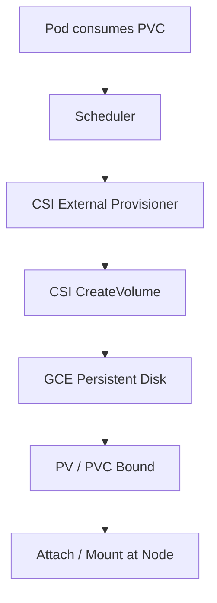
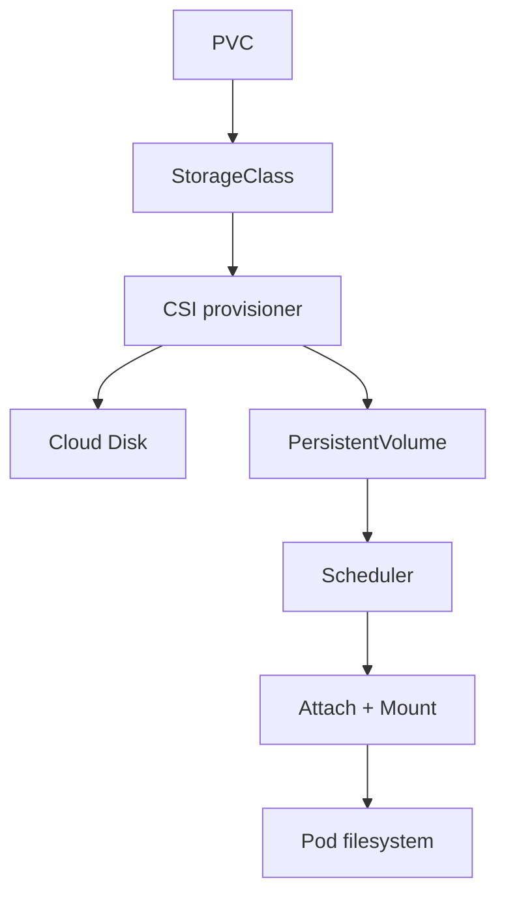
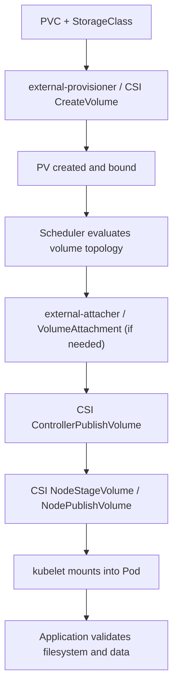
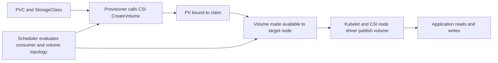

## Learning objectives

- **Distinguish PVC, PV, StorageClass, and CSI responsibilities:** Trace how dynamic provisioning, volume attachment, staging, and publishing move a volume from claim creation to a mounted Pod filesystem.
- **Coordinate storage topology with scheduling:** Use `WaitForFirstConsumer` binding mode to align zonal disk provisioning with Pod placement and avoid zone-mismatch `FailedScheduling` errors.
- **Select appropriate access modes and GKE storage backends:** Compare `ReadWriteOnce`, `ReadWriteOncePod`, and `ReadWriteMany` alongside Zonal/Regional Persistent Disk, Hyperdisk, Filestore, and Cloud Storage trade-offs.
- **Manage StatefulSet identity and data retention safely:** Control ordinal storage lifecycles via `volumeClaimTemplates`, `persistentVolumeClaimRetentionPolicy`, PV `reclaimPolicy`, and GitOps pruning safeguards.
- **Differentiate VolumeSnapshots from complete database backups:** Pair CSI snapshots with database-native backups, WAL archiving, PITR, and restore drills to meet RPO/RTO targets and triage Pending or Multi-Attach errors.

## PV, PVC, StorageClass

- **PVC:** A workload's request for storage.
- **PV:** A Kubernetes resource that represents an allocated volume.
- **StorageClass:** Defines the provisioner, storage type, binding mode, and reclaim policy.



## WaitForFirstConsumer

Zonal disks can attach only within a compatible topology. `WaitForFirstConsumer` coordinates Pod placement with volume provisioning to avoid creating a disk in a zone that does not match the Pod's placement.

```yaml
apiVersion: storage.k8s.io/v1
kind: StorageClass
metadata:
  name: postgres-ssd
provisioner: pd.csi.storage.gke.io
parameters:
  type: pd-ssd
volumeBindingMode: WaitForFirstConsumer
allowVolumeExpansion: true
reclaimPolicy: Retain
```

## CSI internals

The usual sequence is `CreateVolume` → PV/PVC binding → Node scheduling → `ControllerPublishVolume` (attach) → `NodeStageVolume` / `NodePublishVolume` (mount). CSI drivers differ in their capabilities and attachment semantics.

## Access Modes

`ReadWriteOnce` typically restricts read-write access at the **Node** level, not strictly to one Pod. Use `ReadWriteOncePod` when a single Pod must be the writer and the CSI driver supports it. `ReadWriteMany` is not a substitute for database-level consistency.

## StatefulSet

A StatefulSet provides stable identities such as `postgres-0` and `postgres-1` and uses `volumeClaimTemplates` to give each ordinal a separate PVC. It **does not provide database replication or failover by itself**.

```yaml
volumeClaimTemplates:
  - metadata: {name: data}
    spec:
      storageClassName: postgres-ssd
      accessModes: [ReadWriteOnce]
      resources:
        requests: {storage: 10Gi}
```

`persistentVolumeClaimRetentionPolicy` and a PV's `reclaimPolicy` govern deletion at different layers. `Retain` helps reduce the risk of accidental data loss but may leave disks behind for manual cleanup.

## A Snapshot Is Not a Complete Backup

A CSI VolumeSnapshot can capture a point-in-time snapshot, but application consistency, point-in-time recovery (PITR), retention, cross-region restore, and RPO/RTO must be addressed separately.

## Lab

1. Create a StatefulSet with a separate PVC for each replica.
2. Write a file to the volume for `storage-demo-0`.
3. Delete Pod 0 and watch the StatefulSet recreate it.
4. Verify that the file is still present after the volume remounts.
5. Inspect `PV.nodeAffinity` and CSI events; be careful when cleaning up volumes with `Retain`.

**Official:** [Persistent Volumes](https://kubernetes.io/docs/concepts/storage/persistent-volumes/) · [StatefulSet](https://kubernetes.io/docs/concepts/workloads/controllers/statefulset/).

## CSI Lifecycle: A PV Is More Than a Disk

A PVC requests storage; the StorageClass selects a provisioner; the CSI external-provisioner calls `CreateVolume`; attachment components may use `VolumeAttachment`; and the CSI node plugin stages and publishes the volume. A `Bound` PVC does not prove that the filesystem is mounted or that the database is healthy.



### Storage topology

A zonal Persistent Disk cannot attach arbitrarily to a Node in another zone. `WaitForFirstConsumer` lets the scheduler and provisioner coordinate zone selection. Avoid bypassing the scheduler with `spec.nodeName` when a PVC is waiting for its first consumer.

### RWO, RWX, RWOP

RWO restricts read-write mounts to one Node, not necessarily one Pod. RWOP restricts access to one Pod when the CSI driver supports it. RWX allows multiple Nodes to access the volume but does not make a database data directory safe for multiple writers.

### StatefulSet data lifecycle

```yaml
volumeClaimTemplates:
  - metadata: {name: data}
    spec:
      accessModes: [ReadWriteOnce]
      storageClassName: postgres-ssd
      resources:
        requests: {storage: 10Gi}
```

For StatefulSet `db` with ordinals 0–2, the PVCs created are `data-db-0`, `data-db-1`, and `data-db-2`. `persistentVolumeClaimRetentionPolicy` controls the PVC lifecycle during deletion and scale-down. The PV's `reclaimPolicy` determines whether the backing disk is deleted when the claim is released. Check both policies before pruning resources through GitOps.

### Snapshot vs recovery

A VolumeSnapshot can capture a crash-consistent point-in-time disk state, but it does not by itself guarantee an application-consistent PostgreSQL restore or PITR. You also need backups and WAL archiving, restore drills, IAM/KMS access, and RPO/RTO verification.

**Lab:** Create a test StatefulSet with one Pod and a volume, write a file, delete the Pod, and verify that the file survives recreation. Check `VolumeAttachment` and the PV's node affinity; only clean up the disk after reviewing the reclaim policy.

## Deep Dive: CSI Lifecycle and StatefulSet Data Durability

### How PVCs, PVs, and StorageClasses Differ

- A `PersistentVolumeClaim` (PVC) is a consumer's **request for storage resources**.
- A `PersistentVolume` (PV) is a Kubernetes object representing a dynamically provisioned or static volume.
- A `StorageClass` defines the provisioner, parameters, default reclaim policy for dynamic provisioning, and binding mode.
- The CSI driver carries out operations on the backing disk or filesystem.

A `Bound` PVC does not mean that the volume has been attached and mounted or that the database is ready. Track the entire lifecycle:



CSI calls depend on the driver's capabilities. An NFS or other network file service does not necessarily attach the same way as a block disk.

### How `WaitForFirstConsumer` Handles Topology

A Pod that must run in Zone B cannot use a zonal disk in Zone A. A StorageClass using `Immediate` can provision a volume before the Node constraints are known, causing a mismatch. `WaitForFirstConsumer` delays dynamic provisioning and binding until the scheduler considers the consuming Pod, helping select a compatible topology. In a `WaitForFirstConsumer` lab, do not bypass the scheduler with `spec.nodeName`; use node affinity or a node selector instead.

```yaml
apiVersion: storage.k8s.io/v1
kind: StorageClass
metadata:
  name: postgres-ssd
provisioner: pd.csi.storage.gke.io
parameters:
  type: pd-ssd
reclaimPolicy: Retain
allowVolumeExpansion: true
volumeBindingMode: WaitForFirstConsumer
```

The corresponding CSI driver and storage backend are required. This manifest is for a GKE configuration that supports `pd-ssd`.

### Access Modes: RWO/RWOP/RWX

| Mode | Semantics | Notes |
|---|---|---|
| RWO | Read-write access from **one Node** at a time | Not limited to one Pod; multiple Pods on the same Node can mount the volume |
| RWOP | Read-write access from **one Pod** in the cluster | Requires CSI support |
| RWX | Read-write access from multiple Nodes | Does not guarantee that multiple database writers are safe |

Do not allow two PostgreSQL processes to write to the same data directory just because the backend supports RWX. Replication occurs at the database layer; a StatefulSet or StorageClass does not set it up automatically.

### StatefulSets and Stable Identity

StatefulSet replicas `postgres-0`, `postgres-1`, and `postgres-2` have stable ordinal identities, and `volumeClaimTemplates` creates PVCs tied to each ordinal. If `postgres-1` is deleted, a new Pod with the same name can reuse its PVC. However, if the old Node is isolated by a network partition, force-deleting the Pod without fencing can leave two processes competing for the same disk or identity.

```yaml
persistentVolumeClaimRetentionPolicy:
  whenDeleted: Retain
  whenScaled: Retain
```

This policy controls the lifecycle of PVCs created from `volumeClaimTemplates`. The PV reclaim policy is a separate layer: `Delete` can remove the backing storage when the PVC is deleted, while `Retain` leaves the storage for an administrator to handle. Changing the StorageClass does not necessarily update the reclaim policy on an existing PV.

### Snapshots, Backups, and PITR

`VolumeSnapshot` creates a snapshot through CSI infrastructure; it does not by itself guarantee an application-consistent PostgreSQL backup. Before taking a snapshot, define the consistency goal and determine whether to quiesce the application or use a database-native backup process. For a low RPO, a PostgreSQL base backup with WAL archiving and PITR is often more suitable than scheduled snapshots alone. Measure restore performance and verify the restored data with data checks and transaction tests.

### Triage Pending PVCs and Multi-Attach Errors

```bash
kubectl get pvc -A
kubectl describe pvc payment-data -n payments
kubectl get pv -o wide
kubectl describe pv PV_NAME
kubectl get volumeattachments
kubectl describe pod postgres-0 -n databases
```

- PVC Pending: StorageClass, first consumer, CSI provisioner, quota.
- Pod FailedScheduling: PV nodeAffinity, zone, CPU/memory constraints.
- FailedAttachVolume: disk already attached, attach limits/permissions.
- FailedMount: CSI node plugin, filesystem, mount failure.
- Pod Running but database not ready: application recovery, WAL, schema, permissions.

**Safety:** Only delete a PVC or force-detach a volume in a test environment, and only after identifying the backing data and its owner. Managing the data lifecycle through GitOps requires separate retention and approval controls.

Sources: [Persistent Volumes](https://kubernetes.io/docs/concepts/storage/persistent-volumes/), [Storage Classes](https://kubernetes.io/docs/concepts/storage/storage-classes/), [StatefulSets](https://kubernetes.io/docs/concepts/workloads/controllers/statefulset/), [VolumeSnapshots](https://kubernetes.io/docs/concepts/storage/volume-snapshots/).

## Trace a PostgreSQL volume from claim to mounted filesystem

A container writable layer can disappear when the container is replaced. An emptyDir survives container restarts within the same Pod and lasts for that Pod's lifetime. Persistent storage is managed independently of the Pod. A namespaced PVC declares size, access mode and class. A cluster-scoped PV represents the provisioned storage, including its capacity, topology, and CSI volume handle. The StorageClass supplies the provisioner, disk parameters, expansion support, binding timing, and initial reclaim policy.



The scheduler input to provisioning applies to delayed binding. With Immediate, the external provisioner can create a disk as soon as the claim appears. A zonal disk created in A cannot satisfy a Pod constrained to B. WaitForFirstConsumer lets the scheduler evaluate the claim alongside Pod placement, select candidate topology, and coordinate provisioning before completing the bind. Setting spec.nodeName bypasses this process. Use a selector or affinity to express placement. Quota, attach limits, and compatible nodes still matter. [StorageClass binding modes](https://kubernetes.io/docs/concepts/storage/storage-classes/) · [Persistent Volumes](https://kubernetes.io/docs/concepts/storage/persistent-volumes/)

| CSI action | Evidence or responsibility |
|---|---|
| CreateVolume / DeleteVolume | Controller plugin creates or deletes backend storage, typically through a provider API. |
| ControllerPublishVolume / ControllerUnpublishVolume | Controller-side attach and detach for drivers requiring attachment. The external attacher observes cluster-scoped VolumeAttachment objects. |
| NodeStageVolume | Driver optionally prepares the device or filesystem on the node. |
| NodePublishVolume / NodeUnpublishVolume | Node plugin publishes or unpublishes the volume at the workload path. |

Some file services do not need a block-device attachment step. A successful claim bind proves a volume was selected. It does not prove that the volume attached or mounted, nor that PostgreSQL could replay WAL and accept writes. [Container Storage Interface specification](https://github.com/container-storage-interface/spec/blob/master/spec.md)

### Choose access and topology together

| Mode | Access scope |
|---|---|
| RWO | Read-write from a single node. Several Pods on that node can potentially use the claim. |
| ROX | Read-only mounting from multiple nodes when supported. |
| RWX | Read-write mounting from multiple nodes when supported. |
| RWOP | Single-Pod access with compatible CSI infrastructure. |

Choose a supported access mode for the driver and workload. RWX does not coordinate database writers. Give database replicas independent data directories and implement replication and recovery with the database or an operator.

| GKE backend | What to assess |
|---|---|
| Zonal Persistent Disk | Block storage from `pd.csi.storage.gke.io`, with disk locality and supported node attachments. |
| Regional Persistent Disk | Synchronous replication between two zones, with an application and storage failover procedure for a single writer. |
| Hyperdisk | Variant-specific IOPS and throughput configuration, machine compatibility, zone, and attachment features. |
| Filestore | Managed NFS and `filestore.csi.storage.gke.io` for supported shared file workloads. Assess latency, locking, and cost. |
| Cloud Storage | Object storage for media, artifacts and backups. Evaluate object semantics before adapting a filesystem workload. |

Replicated storage can preserve availability during a zone problem. Logical deletion can replicate as well, so retain recovery points independently. [GKE storage overview](https://docs.cloud.google.com/kubernetes-engine/docs/concepts/storage-overview) · [GKE Persistent Disk CSI](https://docs.cloud.google.com/kubernetes-engine/docs/how-to/persistent-volumes/gce-pd-csi-driver)

### Observe ordinal identity and retention in a lab

This set uses the GKE PD CSI driver. On another test cluster, use an available test StorageClass supporting provision and mount. Create the storage-lab namespace before applying the namespaced objects.

```yaml
apiVersion: storage.k8s.io/v1
kind: StorageClass
metadata:
  name: storage-demo-ssd
provisioner: pd.csi.storage.gke.io
parameters:
  type: pd-ssd
allowVolumeExpansion: true
reclaimPolicy: Retain
volumeBindingMode: WaitForFirstConsumer
---
apiVersion: v1
kind: Service
metadata:
  name: storage-demo
  namespace: storage-lab
spec:
  clusterIP: None
  selector: {app: storage-demo}
  ports: [{name: http, port: 80}]
---
apiVersion: apps/v1
kind: StatefulSet
metadata:
  name: storage-demo
  namespace: storage-lab
spec:
  serviceName: storage-demo
  replicas: 3
  selector:
    matchLabels: {app: storage-demo}
  persistentVolumeClaimRetentionPolicy:
    whenDeleted: Retain
    whenScaled: Retain
  template:
    metadata:
      labels: {app: storage-demo}
    spec:
      containers:
        - name: nginx
          image: nginx:1.27
          ports: [{name: http, containerPort: 80}]
          volumeMounts:
            - name: data
              mountPath: /usr/share/nginx/html
  volumeClaimTemplates:
    - metadata:
        name: data
      spec:
        storageClassName: storage-demo-ssd
        accessModes: [ReadWriteOnce]
        resources:
          requests:
            storage: 10Gi
```

The governing headless Service supports name resolution such as `storage-demo-0.storage-demo.storage-lab.svc.cluster.local`, subject to readiness and DNS settings. OrderedReady creates the next ordinal after earlier ones are ready. Parallel alters scaling management while rolling updates retain their own ordering. A StatefulSet enables stable identities and per-ordinal storage. Database HA still requires database replication, failover and consistency controls.

In an isolated lab, write a disposable marker into the mounted directory on storage-demo-0. Record the Pod UID, PVC and backing PV. Replace only that lab Pod, wait for the recreated ordinal, then read the marker again and compare UIDs and claims. Inspect the backing disk inventory before any cleanup. Retained PVs and disks can remain billable after the namespace is removed.

| Lifecycle action | Decision to verify |
|---|---|
| StatefulSet scale-down | whenScaled controls claims created from the templates for removed ordinals. |
| StatefulSet deletion | whenDeleted controls those template-created claims. |
| PVC deletion | The bound PV's reclaim policy controls backend retention or deletion. |
| StorageClass edit | Inspect existing PVs individually. They retain the policy copied at provisioning unless changed separately. |
| Argo CD pruning | Removing a tracked claim can trigger PVC deletion. A claim in use can be protected temporarily by a finalizer. |

A scale PR from three to one can remove two disks if whenScaled is Delete and the PVs use Delete. Use a reviewed decommission procedure and verified backups. An Argo CD `Prune=false` sync option can protect from pruning for that resource, while other deletion paths remain possible. [StatefulSet storage lifecycle](https://kubernetes.io/docs/concepts/workloads/controllers/statefulset/) · [Argo CD sync options](https://argo-cd.readthedocs.io/en/stable/user-guide/sync-options/)

### Snapshot and restore a new claim

Assume the snapshot APIs and CSI snapshot infrastructure are installed and the original claim is in storage-lab. Wait for readyToUse before creating the restore claim.

```yaml
apiVersion: snapshot.storage.k8s.io/v1
kind: VolumeSnapshotClass
metadata:
  name: storage-demo-snapshot
driver: pd.csi.storage.gke.io
deletionPolicy: Retain
---
apiVersion: snapshot.storage.k8s.io/v1
kind: VolumeSnapshot
metadata:
  name: storage-demo-copy
  namespace: storage-lab
spec:
  volumeSnapshotClassName: storage-demo-snapshot
  source:
    persistentVolumeClaimName: data-storage-demo-0
---
apiVersion: v1
kind: PersistentVolumeClaim
metadata:
  name: storage-demo-restored
  namespace: storage-lab
spec:
  storageClassName: storage-demo-ssd
  accessModes: [ReadWriteOnce]
  resources:
    requests:
      storage: 10Gi
  dataSource:
    apiGroup: snapshot.storage.k8s.io
    kind: VolumeSnapshot
    name: storage-demo-copy
```

A VolumeSnapshot is the request, VolumeSnapshotContent represents the backing snapshot, and VolumeSnapshotClass carries driver and deletion settings. Restore provisions a separate volume. With the class above a consumer is needed to trigger delayed provisioning. Use at least the snapshot restore size and inspect conditions. Retain preserves the backing snapshot and content according to snapshot lifecycle rules. A disk snapshot taken during writes may offer only crash-consistent recovery. To reach a five-minute RPO, consider database-native backups and WAL archival with tested PITR. Measure elapsed restore, validation and traffic recovery against the RTO. Account for retention, access, encryption and target-region availability. [Kubernetes VolumeSnapshots](https://kubernetes.io/docs/concepts/storage/volume-snapshots/)

For PVC Pending, inspect events for first-consumer waiting, class mismatch, quota and provisioning errors. For FailedScheduling, compare PV node affinity with eligible nodes. For FailedAttachVolume or Multi-Attach, inspect VolumeAttachment and whether the old workload has stopped. For FailedMount, inspect the CSI node driver, filesystem and permissions. If the database runs but stays unready, check replay, integrity and leadership. Preserve single-writer ownership throughout recovery. Continue with [Lesson 17 — High Availability and Disaster Recovery](../07-reliability/lesson-17-disaster-recovery.md).

Practice with the [platform operations exercises](./platform-operations-exercises.mdx).

## Self-check questions

1. Which controller owns the desired state and the actual state in this context?
2. What failure modes can occur even when the Kubernetes resource reports `Ready`?
3. What would you verify before deploying to production?
