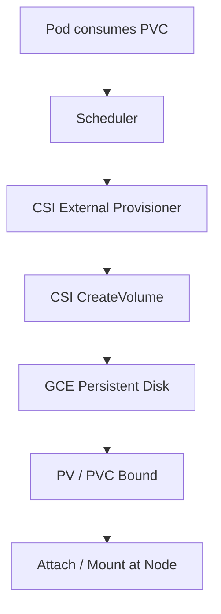
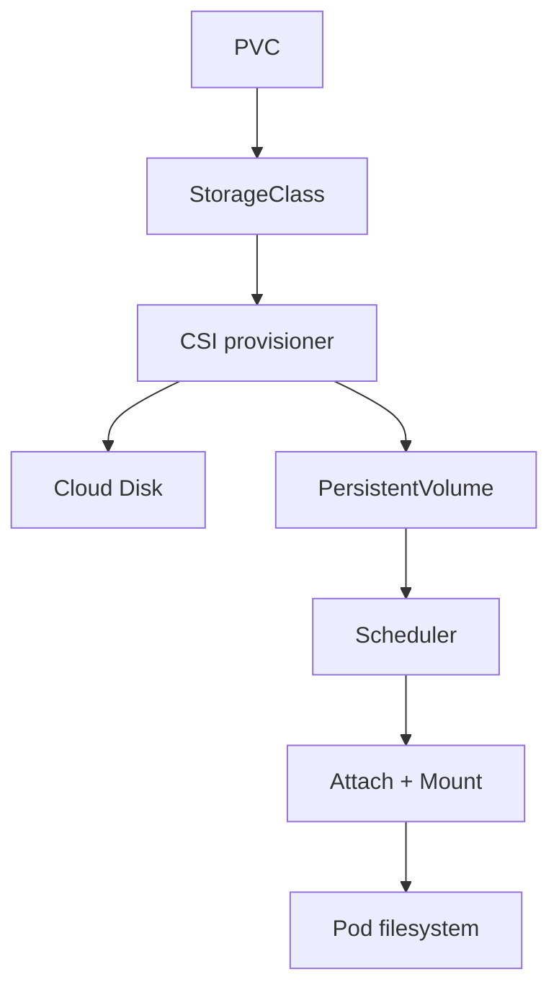

:::info Sources and editorial scope
This lesson builds on the topic and verifiable content from the conversation, but **it is not a complete verbatim transcript**. Supplemental material was written for the website and may require version-specific testing before use in production.
:::

## Learning objectives

PVC, PV, StorageClass, CSI, StatefulSet, GKE storage, snapshots.

## PV, PVC, StorageClass

- **PVC:** A workload's request for storage.
- **PV:** A Kubernetes resource that represents an allocated volume.
- **StorageClass:** Defines the provisioner, storage type, binding mode, and reclaim policy.



## WaitForFirstConsumer

Zonal disks can attach only within a compatible topology. `WaitForFirstConsumer` coordinates Pod placement with volume provisioning to avoid creating a disk in a zone that does not match the Pod's placement.

```yaml
apiVersion: storage.k8s.io/v1
kind: StorageClass
metadata:
  name: postgres-ssd
provisioner: pd.csi.storage.gke.io
parameters:
  type: pd-ssd
volumeBindingMode: WaitForFirstConsumer
allowVolumeExpansion: true
reclaimPolicy: Retain
```

## CSI internals

The usual sequence is `CreateVolume` → PV/PVC binding → Node scheduling → `ControllerPublishVolume` (attach) → `NodeStageVolume` / `NodePublishVolume` (mount). CSI drivers differ in their capabilities and attachment semantics.

## Access Modes

`ReadWriteOnce` typically restricts read-write access at the **Node** level, not strictly to one Pod. Use `ReadWriteOncePod` when a single Pod must be the writer and the CSI driver supports it. `ReadWriteMany` is not a substitute for database-level consistency.

## StatefulSet

A StatefulSet provides stable identities such as `postgres-0` and `postgres-1` and uses `volumeClaimTemplates` to give each ordinal a separate PVC. It **does not provide database replication or failover by itself**.

```yaml
volumeClaimTemplates:
  - metadata: {name: data}
    spec:
      storageClassName: postgres-ssd
      accessModes: [ReadWriteOnce]
      resources:
        requests: {storage: 10Gi}
```

`persistentVolumeClaimRetentionPolicy` and a PV's `reclaimPolicy` govern deletion at different layers. `Retain` helps reduce the risk of accidental data loss but may leave disks behind for manual cleanup.

## A Snapshot Is Not a Complete Backup

A CSI VolumeSnapshot can capture a point-in-time snapshot, but application consistency, point-in-time recovery (PITR), retention, cross-region restore, and RPO/RTO must be addressed separately.

## Lab

1. Create a StatefulSet with a separate PVC for each replica.
2. Write a file to the volume for `storage-demo-0`.
3. Delete Pod 0 and watch the StatefulSet recreate it.
4. Verify that the file is still present after the volume remounts.
5. Inspect `PV.nodeAffinity` and CSI events; be careful when cleaning up volumes with `Retain`.

**Official:** [Persistent Volumes](https://kubernetes.io/docs/concepts/storage/persistent-volumes/) · [StatefulSet](https://kubernetes.io/docs/concepts/workloads/controllers/statefulset/).


## CSI Lifecycle: A PV Is More Than a Disk

A PVC requests storage; the StorageClass selects a provisioner; the CSI external-provisioner calls `CreateVolume`; attachment components may use `VolumeAttachment`; and the CSI node plugin stages and publishes the volume. A `Bound` PVC does not prove that the filesystem is mounted or that the database is healthy.



### Storage topology

A zonal Persistent Disk cannot attach arbitrarily to a Node in another zone. `WaitForFirstConsumer` lets the scheduler and provisioner coordinate zone selection. Avoid bypassing the scheduler with `spec.nodeName` when a PVC is waiting for its first consumer.

### RWO, RWX, RWOP

RWO restricts read-write mounts to one Node, not necessarily one Pod. RWOP restricts access to one Pod when the CSI driver supports it. RWX allows multiple Nodes to access the volume but does not make a database data directory safe for multiple writers.

### StatefulSet data lifecycle

```yaml
volumeClaimTemplates:
  - metadata: {name: data}
    spec:
      accessModes: [ReadWriteOnce]
      storageClassName: postgres-ssd
      resources:
        requests: {storage: 10Gi}
```

For StatefulSet `db` with ordinals 0–2, the PVCs created are `data-db-0`, `data-db-1`, and `data-db-2`. `persistentVolumeClaimRetentionPolicy` controls the PVC lifecycle during deletion and scale-down. The PV's `reclaimPolicy` determines whether the backing disk is deleted when the claim is released. Check both policies before pruning resources through GitOps.

### Snapshot vs recovery

A VolumeSnapshot can capture a crash-consistent point-in-time disk state, but it does not by itself guarantee an application-consistent PostgreSQL restore or PITR. You also need backups and WAL archiving, restore drills, IAM/KMS access, and RPO/RTO verification.

**Lab:** Create a test StatefulSet with one Pod and a volume, write a file, delete the Pod, and verify that the file survives recreation. Check `VolumeAttachment` and the PV's node affinity; only clean up the disk after reviewing the reclaim policy.

## Deep Dive: CSI Lifecycle and StatefulSet Data Durability

### How PVCs, PVs, and StorageClasses Differ

- A `PersistentVolumeClaim` (PVC) is a consumer's **request for storage resources**.
- A `PersistentVolume` (PV) is a Kubernetes object representing a dynamically provisioned or static volume.
- A `StorageClass` defines the provisioner, parameters, default reclaim policy for dynamic provisioning, and binding mode.
- The CSI driver carries out operations on the backing disk or filesystem.

A `Bound` PVC does not mean that the volume has been attached and mounted or that the database is ready. Track the entire lifecycle:

```text
PVC + StorageClass
  → external-provisioner / CSI CreateVolume
  → PV created & bound
  → scheduler evaluates volume topology
  → external-attacher / VolumeAttachment if needed
  → CSI ControllerPublishVolume
  → CSI NodeStageVolume / NodePublishVolume
  → kubelet mounts into Pod
  → application validates filesystem and data
```

CSI calls depend on the driver's capabilities. An NFS or other network file service does not necessarily attach the same way as a block disk.

### How `WaitForFirstConsumer` Handles Topology

A Pod that must run in Zone B cannot use a zonal disk in Zone A. A StorageClass using `Immediate` can provision a volume before the Node constraints are known, causing a mismatch. `WaitForFirstConsumer` delays dynamic provisioning and binding until the scheduler considers the consuming Pod, helping select a compatible topology. In a `WaitForFirstConsumer` lab, do not bypass the scheduler with `spec.nodeName`; use node affinity or a node selector instead.

```yaml
apiVersion: storage.k8s.io/v1
kind: StorageClass
metadata:
  name: postgres-ssd
provisioner: pd.csi.storage.gke.io
parameters:
  type: pd-ssd
reclaimPolicy: Retain
allowVolumeExpansion: true
volumeBindingMode: WaitForFirstConsumer
```

The corresponding CSI driver and storage backend are required. This manifest is for a GKE configuration that supports `pd-ssd`.

### Access Modes: RWO/RWOP/RWX

| Mode | Semantics | Notes |
|---|---|---|
| RWO | Read-write access from **one Node** at a time | Not limited to one Pod; multiple Pods on the same Node can mount the volume |
| RWOP | Read-write access from **one Pod** in the cluster | Requires CSI support |
| RWX | Read-write access from multiple Nodes | Does not guarantee that multiple database writers are safe |

Do not allow two PostgreSQL processes to write to the same data directory just because the backend supports RWX. Replication occurs at the database layer; a StatefulSet or StorageClass does not set it up automatically.

### StatefulSets and Stable Identity

StatefulSet replicas `postgres-0`, `postgres-1`, and `postgres-2` have stable ordinal identities, and `volumeClaimTemplates` creates PVCs tied to each ordinal. If `postgres-1` is deleted, a new Pod with the same name can reuse its PVC. However, if the old Node is isolated by a network partition, force-deleting the Pod without fencing can leave two processes competing for the same disk or identity.

```yaml
persistentVolumeClaimRetentionPolicy:
  whenDeleted: Retain
  whenScaled: Retain
```

This policy controls the lifecycle of PVCs created from `volumeClaimTemplates`. The PV reclaim policy is a separate layer: `Delete` can remove the backing storage when the PVC is deleted, while `Retain` leaves the storage for an administrator to handle. Changing the StorageClass does not necessarily update the reclaim policy on an existing PV.

### Snapshots, Backups, and PITR

`VolumeSnapshot` creates a snapshot through CSI infrastructure; it does not by itself guarantee an application-consistent PostgreSQL backup. Before taking a snapshot, define the consistency goal and determine whether to quiesce the application or use a database-native backup process. For a low RPO, a PostgreSQL base backup with WAL archiving and PITR is often more suitable than scheduled snapshots alone. Measure restore performance and verify the restored data with data checks and transaction tests.

### Triage Pending PVCs and Multi-Attach Errors

```bash
kubectl get pvc -A
kubectl describe pvc payment-data -n payments
kubectl get pv -o wide
kubectl describe pv PV_NAME
kubectl get volumeattachments
kubectl describe pod postgres-0 -n databases
```

- PVC Pending: StorageClass, first consumer, CSI provisioner, quota.
- Pod FailedScheduling: PV nodeAffinity, zone, CPU/memory constraints.
- FailedAttachVolume: disk already attached, attach limits/permissions.
- FailedMount: CSI node plugin, filesystem, mount failure.
- Pod Running but database not ready: application recovery, WAL, schema, permissions.

**Safety:** Only delete a PVC or force-detach a volume in a test environment, and only after identifying the backing data and its owner. Managing the data lifecycle through GitOps requires separate retention and approval controls.

Sources: [Persistent Volumes](https://kubernetes.io/docs/concepts/storage/persistent-volumes/), [Storage Classes](https://kubernetes.io/docs/concepts/storage/storage-classes/), [StatefulSets](https://kubernetes.io/docs/concepts/workloads/controllers/statefulset/), [VolumeSnapshots](https://kubernetes.io/docs/concepts/storage/volume-snapshots/).

## Self-Check Questions

1. Which controller owns the desired state and the actual state in this context?
2. What failure modes can occur even when the Kubernetes resource reports `Ready`?
3. What would you verify before deploying to production?
