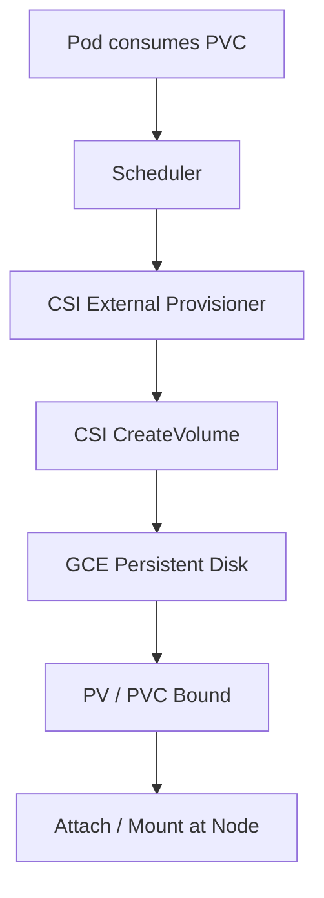
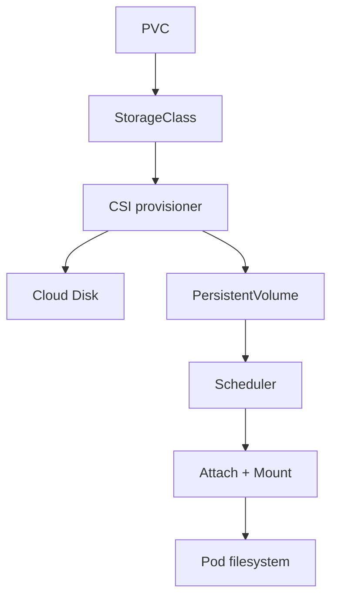
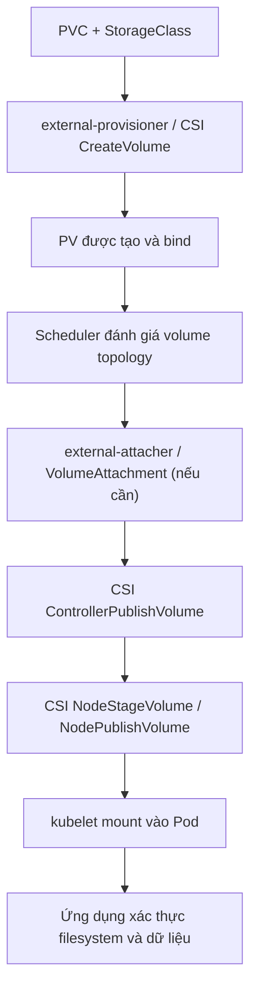
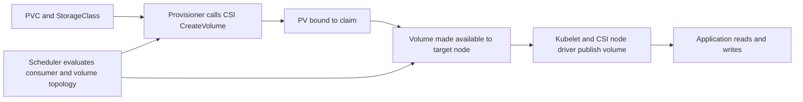

## Mục tiêu học tập

- **Phân biệt trách nhiệm của PVC, PV, StorageClass và CSI:** Theo dõi toàn bộ vòng đời từ cấp phát động, gắn đĩa (attach), stage đến publish để đưa volume từ lúc tạo claim đến khi mount vào filesystem của Pod.
- **Phối hợp storage topology với lập lịch Pod:** Sử dụng chế độ `WaitForFirstConsumer` để đồng bộ vị trí zone của zonal disk với nơi đặt Pod và tránh lỗi `FailedScheduling` do lệch zone.
- **Lựa chọn access mode và backend lưu trữ GKE phù hợp:** So sánh `ReadWriteOnce`, `ReadWriteOncePod` và `ReadWriteMany` cùng các đánh đổi giữa Zonal/Regional Persistent Disk, Hyperdisk, Filestore và Cloud Storage.
- **Quản lý định danh StatefulSet và lưu giữ dữ liệu an toàn:** Kiểm soát vòng đời lưu trữ theo ordinal qua `volumeClaimTemplates`, `persistentVolumeClaimRetentionPolicy`, `reclaimPolicy` của PV và biện pháp bảo vệ khỏi GitOps pruning.
- **Phân biệt VolumeSnapshot với sao lưu cơ sở dữ liệu hoàn chỉnh:** Kết hợp CSI snapshot với backup chuyên dụng của cơ sở dữ liệu, lưu trữ WAL, PITR và diễn tập khôi phục để đạt mục tiêu RPO/RTO cũng như xử lý lỗi Pending hay Multi-Attach.

## PV, PVC, StorageClass

- **PVC:** Yêu cầu cấp phát dung lượng lưu trữ từ một workload.
- **PV:** Tài nguyên Kubernetes đại diện cho một volume đã được cấp phát.
- **StorageClass:** Định nghĩa provisioner, loại lưu trữ, chế độ binding và reclaim policy.



## WaitForFirstConsumer

Các ổ đĩa theo zone (zonal disk) chỉ có thể gắn vào Node trong một topology tương thích. `WaitForFirstConsumer` phối hợp việc đặt Pod với việc cấp phát volume nhằm tránh tạo ổ đĩa ở một zone không khớp với vị trí đặt Pod.

```yaml
apiVersion: storage.k8s.io/v1
kind: StorageClass
metadata:
  name: postgres-ssd
provisioner: pd.csi.storage.gke.io
parameters:
  type: pd-ssd
volumeBindingMode: WaitForFirstConsumer
allowVolumeExpansion: true
reclaimPolicy: Retain
```

## Cơ chế bên trong của CSI

Trình tự thông thường là `CreateVolume` → bind PV/PVC → lập lịch Node → `ControllerPublishVolume` (attach) → `NodeStageVolume` / `NodePublishVolume` (mount). Các CSI driver khác nhau về năng lực hỗ trợ và ngữ nghĩa gắn kết (attachment semantics).

## Access Modes (Chế độ truy cập)

`ReadWriteOnce` thường giới hạn quyền đọc-ghi ở cấp độ **Node**, không nhất thiết chỉ cho một Pod duy nhất. Hãy dùng `ReadWriteOncePod` khi bắt buộc chỉ một Pod được ghi và CSI driver có hỗ trợ. `ReadWriteMany` không thể thay thế cho cơ chế đảm bảo tính nhất quán ở tầng cơ sở dữ liệu.

## StatefulSet

StatefulSet cung cấp định danh ổn định như `postgres-0` và `postgres-1`, đồng thời sử dụng `volumeClaimTemplates` để cấp cho mỗi số thứ tự (ordinal) một PVC riêng biệt. Bản thân nó **không tự cung cấp cơ chế replication hay failover cho cơ sở dữ liệu**.

```yaml
volumeClaimTemplates:
  - metadata: {name: data}
    spec:
      storageClassName: postgres-ssd
      accessModes: [ReadWriteOnce]
      resources:
        requests: {storage: 10Gi}
```

`persistentVolumeClaimRetentionPolicy` và `reclaimPolicy` của PV kiểm soát việc xóa ở hai tầng khác nhau. `Retain` giúp giảm nguy cơ mất dữ liệu ngoài ý muốn nhưng có thể để lại các ổ đĩa cần dọn dẹp thủ công.

## Snapshot không phải là bản sao lưu hoàn chỉnh

CSI `VolumeSnapshot` có thể chụp lại trạng thái tại một thời điểm, nhưng tính nhất quán ở tầng ứng dụng (application consistency), khôi phục tại thời điểm cụ thể (PITR), chính sách lưu giữ (retention), khôi phục liên vùng (cross-region restore) và RPO/RTO đều phải được giải quyết riêng.

## Thực hành (Lab)

1. Tạo một StatefulSet với một PVC riêng cho từng replica.
2. Ghi một tệp vào volume của `storage-demo-0`.
3. Xóa Pod 0 và quan sát StatefulSet tạo lại nó.
4. Xác minh tệp vẫn còn tồn tại sau khi volume được mount lại.
5. Kiểm tra `PV.nodeAffinity` và các CSI event; cẩn trọng khi dọn dẹp các volume có chính sách `Retain`.

**Tài liệu chính thức:** [Persistent Volumes](https://kubernetes.io/docs/concepts/storage/persistent-volumes/) · [StatefulSet](https://kubernetes.io/docs/concepts/workloads/controllers/statefulset/).

## Vòng đời CSI: PV không chỉ là một ổ đĩa

PVC yêu cầu lưu trữ; StorageClass chọn provisioner; CSI external-provisioner gọi `CreateVolume`; các thành phần gắn đĩa có thể sử dụng `VolumeAttachment`; và CSI node plugin thực hiện stage rồi publish volume. Một PVC ở trạng thái `Bound` không chứng minh rằng filesystem đã được mount hay cơ sở dữ liệu đang hoạt động khỏe mạnh.



### Storage topology

Một zonal Persistent Disk không thể gắn tùy ý vào một Node ở zone khác. `WaitForFirstConsumer` cho phép scheduler và provisioner phối hợp chọn zone. Tránh bỏ qua scheduler bằng cách đặt `spec.nodeName` khi một PVC đang chờ first consumer.

### RWO, RWX, RWOP

RWO giới hạn mount đọc-ghi trên một Node, không nhất thiết chỉ một Pod. RWOP giới hạn truy cập cho đúng một Pod khi CSI driver hỗ trợ. RWX cho phép nhiều Node cùng truy cập volume nhưng không làm cho thư mục dữ liệu của cơ sở dữ liệu trở nên an toàn cho nhiều tiến trình ghi đồng thời.

### Vòng đời dữ liệu của StatefulSet

```yaml
volumeClaimTemplates:
  - metadata: {name: data}
    spec:
      accessModes: [ReadWriteOnce]
      storageClassName: postgres-ssd
      resources:
        requests: {storage: 10Gi}
```

Với StatefulSet `db` có các ordinal 0–2, các PVC được tạo ra sẽ là `data-db-0`, `data-db-1` và `data-db-2`. `persistentVolumeClaimRetentionPolicy` kiểm soát vòng đời PVC khi xóa hoặc thu hẹp (scale-down). `reclaimPolicy` của PV quyết định xem ổ đĩa nền bên dưới có bị xóa khi claim được giải phóng hay không. Hãy kiểm tra cả hai chính sách này trước khi thực hiện prune tài nguyên qua GitOps.

### Snapshot so với khôi phục (Recovery)

VolumeSnapshot có thể chụp lại trạng thái đĩa ở mức crash-consistent tại một thời điểm, nhưng bản thân nó không đảm bảo khả năng khôi phục PostgreSQL nhất quán ở tầng ứng dụng hay PITR. Bạn vẫn cần sao lưu và lưu trữ WAL (WAL archiving), diễn tập khôi phục, phân quyền IAM/KMS và kiểm chứng RPO/RTO.

**Thực hành (Lab):** Tạo một StatefulSet thử nghiệm với một Pod và một volume, ghi một tệp, xóa Pod và xác minh tệp vẫn tồn tại sau khi Pod được tạo lại. Kiểm tra `VolumeAttachment` và `nodeAffinity` của PV; chỉ dọn dẹp ổ đĩa sau khi đã rà soát kỹ reclaim policy.

## Tìm hiểu sâu: Vòng đời CSI và độ bền dữ liệu của StatefulSet

### Sự khác nhau giữa PVC, PV và StorageClass

- `PersistentVolumeClaim` (PVC) là **yêu cầu tài nguyên lưu trữ** từ phía đối tượng tiêu thụ.
- `PersistentVolume` (PV) là đối tượng Kubernetes đại diện cho một volume được cấp phát động hoặc tĩnh.
- `StorageClass` định nghĩa provisioner, các tham số, reclaim policy mặc định cho cấp phát động và chế độ binding.
- CSI driver trực tiếp thực thi các thao tác trên ổ đĩa nền hoặc filesystem.

Một PVC ở trạng thái `Bound` không có nghĩa là volume đã được gắn (attach), mount, hay cơ sở dữ liệu đã sẵn sàng. Hãy theo dõi toàn bộ vòng đời:



Các lời gọi CSI phụ thuộc vào khả năng của từng driver. NFS hoặc các dịch vụ tệp qua mạng khác không nhất thiết cần bước gắn (attach) giống như ổ đĩa khối (block disk).

### Cách `WaitForFirstConsumer` xử lý Topology

Một Pod bắt buộc phải chạy ở Zone B không thể sử dụng zonal disk ở Zone A. Một StorageClass dùng chế độ `Immediate` có thể cấp phát volume trước khi biết các ràng buộc về Node, gây ra sự không tương thích. `WaitForFirstConsumer` trì hoãn việc cấp phát động và binding cho đến khi scheduler xem xét Pod tiêu thụ, giúp chọn ra topology tương thích. Trong bài lab về `WaitForFirstConsumer`, không được bỏ qua scheduler bằng `spec.nodeName`; hãy dùng node affinity hoặc node selector để thay thế.

```yaml
apiVersion: storage.k8s.io/v1
kind: StorageClass
metadata:
  name: postgres-ssd
provisioner: pd.csi.storage.gke.io
parameters:
  type: pd-ssd
reclaimPolicy: Retain
allowVolumeExpansion: true
volumeBindingMode: WaitForFirstConsumer
```

Cần có CSI driver và hệ thống lưu trữ nền tương ứng. Manifest này dành cho cấu hình GKE có hỗ trợ `pd-ssd`.

### Chế độ truy cập: RWO/RWOP/RWX

| Chế độ | Ngữ nghĩa | Lưu ý |
|---|---|---|
| RWO | Quyền đọc-ghi từ **một Node** tại một thời điểm | Không giới hạn ở một Pod; nhiều Pod trên cùng một Node có thể cùng mount volume |
| RWOP | Quyền đọc-ghi từ **một Pod** duy nhất trong cluster | Yêu cầu CSI driver hỗ trợ |
| RWX | Quyền đọc-ghi từ nhiều Node | Không đảm bảo an toàn khi nhiều tiến trình cơ sở dữ liệu cùng ghi |

Không cho phép hai tiến trình PostgreSQL cùng ghi vào chung một thư mục dữ liệu chỉ vì backend hỗ trợ RWX. Replication diễn ra ở tầng cơ sở dữ liệu; StatefulSet hay StorageClass không tự thiết lập cơ chế đó.

### StatefulSet và định danh ổn định

Các replica của StatefulSet như `postgres-0`, `postgres-1` và `postgres-2` có định danh thứ tự ổn định, và `volumeClaimTemplates` tạo ra các PVC gắn liền với từng số thứ tự. Nếu `postgres-1` bị xóa, Pod mới cùng tên có thể tái sử dụng PVC của nó. Tuy nhiên, nếu Node cũ bị cô lập do phân mảnh mạng (network partition), việc force-delete Pod mà không cô lập (fencing) có thể khiến hai tiến trình cùng tranh chấp một ổ đĩa hoặc định danh.

```yaml
persistentVolumeClaimRetentionPolicy:
  whenDeleted: Retain
  whenScaled: Retain
```

Chính sách này kiểm soát vòng đời của các PVC được tạo từ `volumeClaimTemplates`. Reclaim policy của PV là một tầng riêng biệt: `Delete` có thể xóa bộ lưu trữ nền khi PVC bị xóa, còn `Retain` giữ lại bộ lưu trữ để quản trị viên xử lý. Thay đổi StorageClass không tự động cập nhật reclaim policy trên các PV đã tồn tại từ trước.

### Snapshot, Backup và PITR

`VolumeSnapshot` tạo snapshot thông qua hạ tầng CSI; bản thân nó không đảm bảo một bản sao lưu PostgreSQL nhất quán ở tầng ứng dụng. Trước khi chụp snapshot, hãy xác định mục tiêu nhất quán và quyết định xem có cần tạm dừng ghi (quiesce) ứng dụng hay dùng quy trình backup chuyên dụng của cơ sở dữ liệu. Để đạt RPO thấp, bản base backup của PostgreSQL kết hợp lưu trữ WAL và PITR thường phù hợp hơn so với chỉ dùng snapshot định kỳ. Hãy đo hiệu năng khôi phục và xác minh dữ liệu sau khôi phục bằng các bài kiểm tra dữ liệu và giao dịch.

### Phân loại lỗi PVC Pending và Multi-Attach

```bash
kubectl get pvc -A
kubectl describe pvc payment-data -n payments
kubectl get pv -o wide
kubectl describe pv PV_NAME
kubectl get volumeattachments
kubectl describe pod postgres-0 -n databases
```

- PVC Pending: StorageClass, first consumer, CSI provisioner, quota.
- Pod FailedScheduling: `nodeAffinity` của PV, zone, ràng buộc CPU/memory.
- FailedAttachVolume: ổ đĩa đã được gắn ở nơi khác, giới hạn gắn đĩa/quyền hạn.
- FailedMount: CSI node plugin, filesystem, lỗi mount.
- Pod Running nhưng cơ sở dữ liệu chưa ready: khôi phục ứng dụng, WAL, schema, quyền truy cập.

**An toàn:** Chỉ xóa PVC hoặc force-detach volume trong môi trường kiểm thử, và chỉ sau khi đã xác định rõ dữ liệu nền cũng như chủ sở hữu của nó. Quản lý vòng đời dữ liệu qua GitOps đòi hỏi các cơ chế kiểm soát lưu giữ và phê duyệt riêng biệt.

Nguồn: [Persistent Volumes](https://kubernetes.io/docs/concepts/storage/persistent-volumes/), [Storage Classes](https://kubernetes.io/docs/concepts/storage/storage-classes/), [StatefulSets](https://kubernetes.io/docs/concepts/workloads/controllers/statefulset/), [VolumeSnapshots](https://kubernetes.io/docs/concepts/storage/volume-snapshots/).

## Theo dõi một volume PostgreSQL từ lúc claim đến khi mount filesystem

Lớp có thể ghi (writable layer) của container sẽ biến mất khi container bị thay thế. `emptyDir` tồn tại qua các lần restart container trong cùng một Pod và kéo dài theo vòng đời của Pod đó. Lưu trữ bền vững (persistent storage) được quản lý độc lập với Pod. Một PVC ở phạm vi namespace khai báo kích thước, chế độ truy cập và StorageClass. Một PV ở phạm vi cluster đại diện cho bộ lưu trữ đã cấp phát, bao gồm dung lượng, topology và CSI volume handle. StorageClass cung cấp provisioner, tham số ổ đĩa, hỗ trợ mở rộng dung lượng, thời điểm binding và reclaim policy ban đầu.



Đầu vào từ scheduler cho quá trình cấp phát áp dụng đối với cơ chế delayed binding. Với `Immediate`, external provisioner có thể tạo ổ đĩa ngay khi claim xuất hiện. Một zonal disk được tạo ở A không thể đáp ứng một Pod bị ràng buộc phải chạy ở B. `WaitForFirstConsumer` cho phép scheduler đánh giá claim song song với vị trí đặt Pod, chọn topology ứng viên và phối hợp cấp phát trước khi hoàn tất bind. Việc đặt `spec.nodeName` sẽ bỏ qua quy trình này. Hãy dùng selector hoặc affinity để khai báo vị trí đặt Pod. Quota, giới hạn gắn đĩa và các node tương thích vẫn đóng vai trò quyết định. [StorageClass binding modes](https://kubernetes.io/docs/concepts/storage/storage-classes/) · [Persistent Volumes](https://kubernetes.io/docs/concepts/storage/persistent-volumes/)

| Thao tác CSI | Bằng chứng hoặc trách nhiệm |
|---|---|
| CreateVolume / DeleteVolume | Controller plugin tạo hoặc xóa bộ lưu trữ backend, thường thông qua API của nhà cung cấp. |
| ControllerPublishVolume / ControllerUnpublishVolume | Gắn và tháo đĩa ở phía controller đối với các driver yêu cầu attachment. External attacher theo dõi các đối tượng `VolumeAttachment` ở cấp cluster. |
| NodeStageVolume | Driver tùy chọn chuẩn bị thiết bị hoặc filesystem trên node. |
| NodePublishVolume / NodeUnpublishVolume | Node plugin publish hoặc unpublish volume tại đường dẫn của workload. |

Một số dịch vụ tệp không cần bước gắn thiết bị khối (block-device attachment). Một claim được bind thành công chỉ chứng minh rằng một volume đã được chọn. Nó không chứng minh rằng volume đã được attach hay mount, cũng không chứng minh PostgreSQL có thể replay WAL và chấp nhận ghi dữ liệu. [Container Storage Interface specification](https://github.com/container-storage-interface/spec/blob/master/spec.md)

### Lựa chọn đồng thời chế độ truy cập và topology

| Chế độ | Phạm vi truy cập |
|---|---|
| RWO | Đọc-ghi từ một node duy nhất. Nhiều Pod trên cùng node đó có thể cùng sử dụng claim. |
| ROX | Mount chỉ đọc từ nhiều node khi được hỗ trợ. |
| RWX | Mount đọc-ghi từ nhiều node khi được hỗ trợ. |
| RWOP | Truy cập từ đúng một Pod với hạ tầng CSI tương thích. |

Hãy chọn chế độ truy cập được hỗ trợ bởi cả driver lẫn workload. RWX không điều phối các tiến trình ghi cơ sở dữ liệu. Hãy cấp cho các replica cơ sở dữ liệu những thư mục dữ liệu độc lập và triển khai replication cùng khôi phục ở tầng cơ sở dữ liệu hoặc thông qua operator.

| Backend trên GKE | Những điểm cần đánh giá |
|---|---|
| Zonal Persistent Disk | Block storage từ `pd.csi.storage.gke.io`, gắn với vị trí zone của ổ đĩa và các giới hạn gắn đĩa trên node. |
| Regional Persistent Disk | Đồng bộ dữ liệu (synchronous replication) giữa hai zone, đi kèm quy trình failover cho ứng dụng và lưu trữ với một writer duy nhất. |
| Hyperdisk | Cấu hình IOPS và thông lượng theo từng biến thể, khả năng tương thích loại máy, zone và tính năng attachment. |
| Filestore | Dịch vụ NFS được quản lý và `filestore.csi.storage.gke.io` cho các workload chia sẻ tệp được hỗ trợ. Cần đánh giá độ trễ, cơ chế khóa tệp (locking) và chi phí. |
| Cloud Storage | Object storage cho media, artifact và bản sao lưu. Cần đánh giá ngữ nghĩa của object trước khi chuyển đổi một workload vốn dùng filesystem. |

Lưu trữ có nhân bản (replicated storage) giúp duy trì tính sẵn sàng khi gặp sự cố zone. Tuy nhiên, thao tác xóa logic cũng sẽ được nhân bản theo, vì vậy hãy luôn lưu giữ các điểm khôi phục độc lập. [GKE storage overview](https://docs.cloud.google.com/kubernetes-engine/docs/concepts/storage-overview) · [GKE Persistent Disk CSI](https://docs.cloud.google.com/kubernetes-engine/docs/how-to/persistent-volumes/gce-pd-csi-driver)

### Quan sát định danh ordinal và chính sách lưu giữ trong lab

Bộ cấu hình này sử dụng GKE PD CSI driver. Trên một cluster kiểm thử khác, hãy dùng một StorageClass kiểm thử có sẵn hỗ trợ cấp phát và mount. Tạo namespace `storage-lab` trước khi áp dụng các đối tượng thuộc phạm vi namespace.

```yaml
apiVersion: storage.k8s.io/v1
kind: StorageClass
metadata:
  name: storage-demo-ssd
provisioner: pd.csi.storage.gke.io
parameters:
  type: pd-ssd
allowVolumeExpansion: true
reclaimPolicy: Retain
volumeBindingMode: WaitForFirstConsumer
---
apiVersion: v1
kind: Service
metadata:
  name: storage-demo
  namespace: storage-lab
spec:
  clusterIP: None
  selector: {app: storage-demo}
  ports: [{name: http, port: 80}]
---
apiVersion: apps/v1
kind: StatefulSet
metadata:
  name: storage-demo
  namespace: storage-lab
spec:
  serviceName: storage-demo
  replicas: 3
  selector:
    matchLabels: {app: storage-demo}
  persistentVolumeClaimRetentionPolicy:
    whenDeleted: Retain
    whenScaled: Retain
  template:
    metadata:
      labels: {app: storage-demo}
    spec:
      containers:
        - name: nginx
          image: nginx:1.27
          ports: [{name: http, containerPort: 80}]
          volumeMounts:
            - name: data
              mountPath: /usr/share/nginx/html
  volumeClaimTemplates:
    - metadata:
        name: data
      spec:
        storageClassName: storage-demo-ssd
        accessModes: [ReadWriteOnce]
        resources:
          requests:
            storage: 10Gi
```

Headless Service đi kèm hỗ trợ phân giải tên miền như `storage-demo-0.storage-demo.storage-lab.svc.cluster.local`, tùy thuộc vào trạng thái readiness và cấu hình DNS. `OrderedReady` tạo ordinal tiếp theo sau khi các ordinal trước đó đã ready. `Parallel` thay đổi cách quản lý khi scale trong khi rolling update vẫn giữ thứ tự riêng của nó. StatefulSet cung cấp định danh ổn định và lưu trữ riêng cho từng ordinal. Tính sẵn sàng cao (HA) cho cơ sở dữ liệu vẫn đòi hỏi cơ chế replication, failover và kiểm soát tính nhất quán ở tầng cơ sở dữ liệu.

Trong một lab cô lập, hãy ghi một dấu hiệu tạm thời vào thư mục đã mount trên `storage-demo-0`. Ghi lại Pod UID, PVC và PV nền. Chỉ thay thế duy nhất Pod lab đó, chờ ordinal được tạo lại, rồi đọc lại dấu hiệu và so sánh UID cùng các claim. Kiểm tra danh mục ổ đĩa nền trước khi dọn dẹp. Các PV và ổ đĩa có chính sách `Retain` vẫn có thể tiếp tục bị tính phí sau khi namespace đã bị xóa.

| Thao tác vòng đời | Quyết định cần kiểm chứng |
|---|---|
| Scale-down StatefulSet | `whenScaled` kiểm soát các claim được tạo từ template cho những ordinal bị gỡ bỏ. |
| Xóa StatefulSet | `whenDeleted` kiểm soát các claim được tạo từ template đó. |
| Xóa PVC | Reclaim policy của PV đã bind kiểm soát việc giữ lại hay xóa backend storage. |
| Chỉnh sửa StorageClass | Kiểm tra riêng từng PV đã tồn tại. Chúng giữ nguyên chính sách được sao chép lúc cấp phát trừ khi được sửa riêng. |
| Argo CD pruning | Gỡ bỏ một claim đang được theo dõi có thể kích hoạt xóa PVC. Một claim đang được sử dụng có thể được bảo vệ tạm thời bởi finalizer. |

Một PR thu hẹp scale từ 3 xuống 1 có thể xóa mất hai ổ đĩa nếu `whenScaled` là `Delete` và các PV dùng `Delete`. Hãy áp dụng quy trình ngừng sử dụng (decommission) đã được rà soát cùng các bản sao lưu đã kiểm chứng. Tùy chọn đồng bộ `Prune=false` của Argo CD có thể bảo vệ tài nguyên đó khỏi bị prune, nhưng các con đường xóa khác vẫn có thể xảy ra. [StatefulSet storage lifecycle](https://kubernetes.io/docs/concepts/workloads/controllers/statefulset/) · [Argo CD sync options](https://argo-cd.readthedocs.io/en/stable/user-guide/sync-options/)

### Chụp snapshot và khôi phục sang một claim mới

Giả sử các API snapshot và hạ tầng CSI snapshot đã được cài đặt và claim gốc nằm trong `storage-lab`. Chờ `readyToUse` chuyển sang true trước khi tạo claim khôi phục.

```yaml
apiVersion: snapshot.storage.k8s.io/v1
kind: VolumeSnapshotClass
metadata:
  name: storage-demo-snapshot
driver: pd.csi.storage.gke.io
deletionPolicy: Retain
---
apiVersion: snapshot.storage.k8s.io/v1
kind: VolumeSnapshot
metadata:
  name: storage-demo-copy
  namespace: storage-lab
spec:
  volumeSnapshotClassName: storage-demo-snapshot
  source:
    persistentVolumeClaimName: data-storage-demo-0
---
apiVersion: v1
kind: PersistentVolumeClaim
metadata:
  name: storage-demo-restored
  namespace: storage-lab
spec:
  storageClassName: storage-demo-ssd
  accessModes: [ReadWriteOnce]
  resources:
    requests:
      storage: 10Gi
  dataSource:
    apiGroup: snapshot.storage.k8s.io
    kind: VolumeSnapshot
    name: storage-demo-copy
```

`VolumeSnapshot` là yêu cầu chụp, `VolumeSnapshotContent` đại diện cho snapshot nền bên dưới, và `VolumeSnapshotClass` chứa thông tin driver cùng chính sách xóa. Thao tác khôi phục sẽ cấp phát một volume riêng biệt. Với StorageClass ở trên, cần có một Pod tiêu thụ để kích hoạt quá trình cấp phát trì hoãn (delayed provisioning). Hãy khai báo dung lượng tối thiểu bằng kích thước khôi phục của snapshot và kiểm tra các condition. `Retain` giữ lại snapshot nền và content theo quy tắc vòng đời của snapshot. Một disk snapshot được chụp trong lúc đang có thao tác ghi có thể chỉ mang lại khả năng khôi phục ở mức crash-consistent. Để đạt RPO 5 phút, hãy cân nhắc backup chuyên dụng của cơ sở dữ liệu kết hợp lưu trữ WAL và PITR đã được kiểm thử. Đo tổng thời gian khôi phục, xác thực và khôi phục lưu lượng so với RTO. Đồng thời tính đến thời gian lưu giữ, quyền truy cập, mã hóa và tính khả dụng ở region đích. [Kubernetes VolumeSnapshots](https://kubernetes.io/docs/concepts/storage/volume-snapshots/)

Với lỗi PVC Pending, hãy kiểm tra các event về chờ first-consumer, sai lệch StorageClass, quota và lỗi cấp phát. Với lỗi `FailedScheduling`, hãy so sánh `nodeAffinity` của PV với các node đủ điều kiện. Với `FailedAttachVolume` hoặc Multi-Attach, hãy kiểm tra `VolumeAttachment` và xem workload cũ đã dừng hẳn chưa. Với `FailedMount`, hãy kiểm tra CSI node driver, filesystem và quyền truy cập. Nếu cơ sở dữ liệu đã chạy nhưng vẫn chưa ready, hãy kiểm tra quá trình replay, tính toàn vẹn dữ liệu và quyền lãnh đạo (leadership). Luôn bảo toàn quyền sở hữu một writer duy nhất xuyên suốt quá trình khôi phục. Tiếp tục với [Bài 17 — High Availability và Disaster Recovery](../07-reliability/lesson-17-disaster-recovery.md).

Thực hành thêm với [bài tập vận hành nền tảng](./platform-operations-exercises.mdx).

## Câu hỏi tự kiểm tra

1. Controller nào sở hữu trạng thái mong muốn (desired state) và trạng thái thực tế (actual state) trong ngữ cảnh này?
2. Những kiểu lỗi nào có thể xảy ra ngay cả khi tài nguyên Kubernetes báo cáo trạng thái `Ready`?
3. Bạn sẽ kiểm chứng những gì trước khi triển khai lên production?
