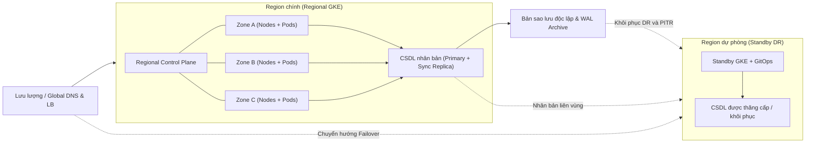
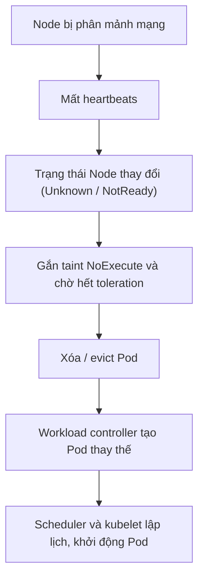

## Mục tiêu học tập

- **Phân tách High Availability và Disaster Recovery theo failure domain:** Thiết kế chiến lược chịu lỗi riêng cho từng cấp độ sự cố Pod, Node, zone, control plane và region thay vì chỉ trông chờ vào self-healing.
- **Ngăn chặn split-brain khi xảy ra phân mảnh mạng:** Hiểu cơ chế Node Leases, taint `NoExecute` và độ trễ toleration trước eviction, đồng thời luôn thực hiện fencing trước khi thay thế workload stateful dạng single-writer.
- **Kiến trúc hóa Regional GKE và khả năng chịu lỗi cơ sở dữ liệu:** Tính toán năng lực dự phòng trên các zone còn sống, hiểu giới hạn failover của Regional Persistent Disk và hành vi của data plane khi API server gián đoạn.
- **Kết hợp các lớp khôi phục với quyền sở hữu rõ ràng:** Phối hợp Terraform, GitOps, Backup for GKE và sao lưu chuyên dụng của cơ sở dữ liệu kèm WAL archiving thay vì phụ thuộc vào etcd snapshot do GKE quản lý.
- **Kiểm chứng ngân sách RPO và RTO thông qua Game Day:** Thực thi quy trình phát hiện, khoanh vùng, khôi phục, xác thực và failback có cấu trúc đồng thời đo đạc thời gian khôi phục và mức mất dữ liệu thực tế.

## High Availability so với Disaster Recovery

High availability (HA) giữ cho dịch vụ tiếp tục vận hành vượt qua các lỗi thành phần trong giới hạn thiết kế. Disaster recovery (DR) khôi phục dịch vụ sau một sự cố ở quy mô lớn hơn. Bản thiết kế phải chỉ rõ **failure domain**: Pod, Node, zone, region, cloud project hoặc các phụ thuộc bên ngoài.

## Sự cố Node (Node failure)

Khi kubelet ngừng gửi heartbeat, Node có thể chuyển sang trạng thái `Unknown` hoặc `NotReady`. Taint `NoExecute` và Pod tolerations ảnh hưởng đến tốc độ Pod bị evict và thay thế. Một sự cố phân mảnh mạng (network partition) không chứng minh rằng tiến trình trên Node đã dừng: việc force-delete một stateful Pod có thể gây ra split-brain.

## Regional GKE không tự cung cấp HA cho cơ sở dữ liệu

Regional control plane được nhân bản qua nhiều zone, nhưng các workload vẫn cần topology spread và đủ năng lực dự phòng ở các zone còn sống. Zonal disk bị ràng buộc vào zone của nó. Regional Persistent Disk có thể nhân bản dữ liệu qua hai zone, nhưng **bản thân nó không tự cung cấp failover hay backup cho cơ sở dữ liệu**.



## RPO / RTO

- **RPO:** mục tiêu về lượng dữ liệu mất mát tối đa có thể chấp nhận được.
- **RTO:** mục tiêu về khoảng thời gian tối đa để khôi phục chức năng của dịch vụ.

Quá trình khôi phục bao gồm phát hiện, khoanh vùng, khôi phục hạ tầng, khôi phục dữ liệu hoặc failover, kiểm chứng và chuyển lưu lượng (traffic cutover). Tổng thời gian trôi qua phải đáp ứng được RTO.

## Managed GKE etcd

Không thiết kế DR xoay quanh việc tự tải xuống và khôi phục các snapshot của etcd do GKE quản lý. Hãy kết hợp Terraform, GitOps, Backup for GKE, bản sao lưu ở tầng ứng dụng và quy trình khôi phục tài nguyên cloud.

## DR Runbook tối thiểu

1. Xác nhận phạm vi sự cố: Node, zone hoặc region.
2. Tạm dừng các thay đổi có thể làm tăng rủi ro.
3. Cô lập (fence) primary database cũ nếu cần thiết.
4. Bổ sung năng lực hạ tầng và khôi phục dữ liệu.
5. Kiểm tra các giao dịch nghiệp vụ, SLO và error budget.
6. Chuyển hướng lưu lượng, sau đó đo RPO và RTO thực tế.
7. Tổ chức Game Day và kiểm thử khôi phục định kỳ.

**Tài liệu chính thức:** [GKE Regional Clusters](https://docs.cloud.google.com/kubernetes-engine/docs/concepts/regional-clusters) · [Backup for GKE](https://docs.cloud.google.com/kubernetes-engine/docs/add-on/backup-for-gke/concepts/backup-for-gke).

## Sự cố Node so với phân mảnh mạng (Network partition)

Một Node ngừng gửi heartbeat vẫn có thể đang chạy các tiến trình bên trong. Các taint `not-ready` và `unreachable` cùng tolerations tương ứng có thể làm trễ quá trình eviction. Trước khi thay thế một Pod cơ sở dữ liệu dạng single-writer, hãy cô lập (fence) instance cũ để ngăn split-brain. Không bao giờ force-delete một StatefulSet Pod đang giữ volume dữ liệu chính cho đến khi bạn chắc chắn instance cũ đã ngừng ghi.

### Regional HA

Một regional GKE cluster cải thiện tính sẵn sàng của control plane qua nhiều zone, nhưng không tự làm cho ứng dụng hay cơ sở dữ liệu đạt HA. Worker Nodes, topology spread, storage và năng lực còn lại vẫn phải đủ để gánh tải khi một zone ngừng hoạt động. Regional Persistent Disk nhân bản dữ liệu qua các zone; điều đó không biến cơ sở dữ liệu thành hệ thống multi-writer.

### Khi API Server không khả dụng

Các container hiện có và data plane thường vẫn tiếp tục chạy với cấu hình hiện tại. Tuy nhiên, việc tạo và xóa tài nguyên, lập lịch, đồng bộ GitOps, HPA và cập nhật endpoint (endpoint reconciliation) có thể bị gián đoạn. Control plane HA giúp duy trì khả năng thực hiện các thao tác quản trị; nó không đảm bảo tính sẵn sàng đầu cuối (end-to-end) của dịch vụ.

### Coi RTO là một ngân sách thời gian

```
RTO = detect + decide + prepare + restore + validate + switch traffic
```

Nếu RTO là 30 phút nhưng việc khôi phục cơ sở dữ liệu mất 25 phút và cấp phát hạ tầng mất 20 phút, thiết kế bắt buộc phải thay đổi. Các phương án bao gồm duy trì năng lực dự phòng (standby capacity), cấp phát sẵn hạ tầng hoặc sử dụng replication cho cơ sở dữ liệu. RPO phụ thuộc vào tính nhất quán của bản sao lưu hoặc replication, chứ không phụ thuộc vào việc các Pod có đang ở trạng thái `Ready` hay không.

### DR Runbook

1. Phát hiện phạm vi sự cố: Pod/Node/Zone/Region/Dữ liệu.
2. Khoanh vùng: đóng băng các thay đổi rủi ro, fence primary cũ nếu cần.
3. Khôi phục năng lực tính toán và mạng.
4. Khôi phục dữ liệu theo RPO bằng snapshot hoặc PITR chuyên dụng của cơ sở dữ liệu.
5. Xác thực các giao dịch ứng dụng và đường dẫn cân bằng tải.
6. Chỉ chuyển lưu lượng production sau khi đã đáp ứng các tiêu chí sức khỏe (health criteria).
7. Đo RTO/RPO thực tế và viết báo cáo postmortem.

**Thực hành (Lab):** Làm lỗi một stateless Pod, đo thời gian hội tụ của EndpointSlice và tỷ lệ lỗi HTTP. Trên môi trường staging, mô phỏng mất zone bằng phương pháp được nhà cung cấp cloud hỗ trợ, không tự ý xóa VM production.

## Tìm hiểu sâu: Mô phỏng sự cố theo từng Failure Domain

### Sự cố Node không chỉ là khởi động lại Pod

Kubelet gửi heartbeat và gia hạn Node Leases. Nếu mất liên lạc, Node controller có thể đánh dấu Node là `Unknown` hoặc `NotReady` và gắn các taint `NoExecute` tương ứng. Pod tolerations mặc định cho `not-ready` và `unreachable` thường cho phép khoảng 300 giây trước khi eviction diễn ra theo chính sách áp dụng. Thời gian khôi phục thực tế còn cộng thêm thời gian phát hiện, xóa, lập lịch, cấp phát và khởi động. Đừng coi 300 giây là mức RTO được đảm bảo.



**Split-brain:** Node cũ vẫn có thể đang chạy cơ sở dữ liệu ngay cả khi nó không kết nối được với API server. Không force-delete primary StatefulSet Pod trước khi fence instance cũ. Tùy vào kiến trúc, fencing có thể bao gồm đảm bảo VM đã tắt nguồn, tháo ổ đĩa hoặc thu hồi vai trò cơ sở dữ liệu.

### Sự cố mất Zone trong Regional GKE

Một regional GKE cluster cung cấp tính sẵn sàng cho control plane qua nhiều zone. Để trụ vững trước sự cố mất zone, ứng dụng còn cần:

- Các replica được phân tán bằng topology spread.
- Đủ năng lực Node ở các zone còn lại cho lưu lượng quan trọng.
- Storage topology tương thích với StatefulSet.
- Tính sẵn sàng liên tục của các thành phần phụ thuộc như Cloud SQL, Secret Manager, DNS và load balancer.
- Đủ quota, địa chỉ IP và dung lượng Node pool cho HPA và Cluster Autoscaler.

Ví dụ, với 6 Pod phân bổ đều trên 3 zone, khi 1 zone gặp sự cố sẽ còn lại 4 Pod. Nếu workload cần 6 Pod để gánh lưu lượng cao điểm, chỉ phân bổ đều thôi là chưa đủ để đảm bảo SLO. Năng lực dự phòng (spare capacity) là một phần của ngân sách HA.

### Sự cố Control Plane và Data Plane

Nếu Kubernetes API server không khả dụng nhưng các Node vẫn đang chạy, các container vẫn có thể tiếp tục xử lý lưu lượng hiện tại dựa trên trạng thái hiện có của data plane. Tuy nhiên, quá trình đồng bộ Argo CD, điều phối HPA, gán Pod của scheduler, cập nhật EndpointSlice và admission tài nguyên sẽ bị ảnh hưởng. Tính sẵn sàng của control plane không đồng nghĩa với tính sẵn sàng của ứng dụng hay khả năng tự phục hồi khi Pod gặp lỗi.

### RPO và RTO

- RPO: mức mất mát dữ liệu tối đa chấp nhận được trong một kịch bản sự cố xác định.
- RTO: thời gian tối đa chấp nhận được để khôi phục chức năng nghiệp vụ sau sự cố.

Một ngân sách thời gian có thể gồm: phát hiện (3 phút) + tuyên bố failover (2 phút) + cấp phát hạ tầng (10 phút) + khôi phục cơ sở dữ liệu (10 phút) + xác thực và điều hướng lưu lượng (5 phút) = 30 phút. Đây là ví dụ minh họa. Hãy đo thời gian khôi phục thực tế trong các buổi Game Day và ghi nhận mốc bắt đầu, kết thúc dựa trên các tiêu chí rõ ràng.

### Backup for GKE so với sao lưu chuyên dụng của cơ sở dữ liệu

Backup for GKE hỗ trợ sao lưu và khôi phục tài nguyên Kubernetes cùng dữ liệu volume được hỗ trợ. Nó không tự động sao lưu toàn bộ tài nguyên Google Cloud IAM, VPC hay Cloud SQL, và cũng không đảm bảo PITR cho cơ sở dữ liệu. Các nhóm ứng dụng không nên dựa vào bản sao lưu etcd của GKE do nhà cung cấp quản lý như một nguồn khôi phục có thể tự sử dụng trực tiếp. Hãy kết hợp:

```text
Terraform (infrastructure) + GitOps (Kubernetes desired config)
+ Backup for GKE (eligible resources/volume data)
+ DB backup/WAL (transactional data & PITR)
```

### Runbook mẫu

| Giai đoạn | Điểm kiểm tra | Điều cần tránh |
|---|---|---|
| Phát hiện | Failure domain ở mức Node/Zone/Region/DB | Chỉ dựa vào trạng thái của một Pod đơn lẻ |
| Khoanh vùng | Đóng băng thay đổi, fence writer cũ | Force-delete một data Pod mà không kiểm tra kỹ |
| Năng lực | Các Node ở zone sống sót đã ready, endpoint khỏe mạnh | Scale replica vượt quá quota mà không kiểm tra |
| Dữ liệu | Độ trễ khôi phục/replication, tính toàn vẹn cơ sở dữ liệu | Cho rằng cơ sở dữ liệu đã sẵn sàng chỉ vì PV đang `Bound` |
| Lưu lượng | LB/NEG/Gateway khỏe mạnh, giao dịch giả lập (synthetic transactions) | Chuyển toàn bộ lưu lượng trước khi xác thực |
| Rà soát | RPO/RTO thực tế, error budget, bằng chứng | Tuyên bố hoàn tất DR chỉ vì đã có snapshot |

### Tổ chức Game Day an toàn

Trên môi trường staging, hãy xóa một stateless Pod và đo độ hội tụ của EndpointSlice cùng tỷ lệ lỗi. Mô phỏng mất một zone bằng phương pháp của nhà cung cấp cloud. Khôi phục một bản sao lưu vào một cluster cô lập và xác minh các bản ghi giao dịch. Ghi chép lại dòng thời gian khôi phục. Không mô phỏng sự cố bằng cách phá hủy ổ đĩa production hoặc force-delete Pod cơ sở dữ liệu khi chưa có cơ chế kiểm soát phù hợp.

Nguồn: [GKE regional clusters](https://cloud.google.com/kubernetes-engine/docs/concepts/regional-clusters), [GKE simulated zone failure](https://cloud.google.com/kubernetes-engine/docs/tutorials/simulate-zone-failure), [Backup for GKE](https://cloud.google.com/kubernetes-engine/docs/add-on/backup-for-gke/concepts/backup-for-gke).

## Thiết kế riêng cho từng cấp độ sự cố node, zone và region

Self-healing thay thế một thành phần bị lỗi. HA duy trì dịch vụ khả dụng vượt qua các lỗi trong phạm vi thiết kế. Fault tolerance mô tả việc dịch vụ tiếp tục hoạt động chính xác bất chấp lỗi thành phần. DR khôi phục dịch vụ trọng yếu khi hệ thống còn lại không còn đáp ứng được mục tiêu. Sáu replica trên cùng một node chia sẻ chung một failure domain. Sáu replica trải đều trên ba zone có thể vượt qua sự cố mất một zone chỉ khi năng lực phục vụ còn lại và các phụ thuộc đủ sức gánh tải.

Kubelet báo cáo tình trạng node thông qua Node status và Leases. Mất heartbeat có thể là dấu hiệu của sự cố crash, phân mảnh mạng hoặc lỗi giao tiếp với control plane. Kubernetes có thể đánh dấu node là unreachable và gắn các taint `NoExecute`. Các Pod thông thường thường nhận toleration 300 giây cho `not-ready` và `unreachable` trừ khi được cấu hình khác đi. Quá trình phát hiện, eviction, thay thế, lập lịch, gắn lưu trữ và readiness đều cộng thêm các khoảng trễ độc lập. Trong lúc phân mảnh mạng, các tiến trình cũ vẫn có thể đang chạy sau khi control plane kết luận chúng không thể liên lạc được. [Kubernetes node status](https://kubernetes.io/docs/reference/node/node-status/) · [Taints and tolerations](https://kubernetes.io/docs/concepts/scheduling-eviction/taint-and-toleration/)

Việc thay thế Pod của StatefulSet phải bảo toàn định danh thứ tự và an toàn cho mô hình một writer duy nhất. Hãy thiết lập fencing trước khi thăng cấp (promote) hoặc khởi động lại một writer trên node khác. Xác minh tiến trình cũ đã dừng hoặc không thể ghi nữa, kiểm tra trạng thái attachment và volume topology, đồng thời tuân theo quy trình CSI hoặc database operator đã kiểm thử. Việc ép xóa đối tượng chỉ dựa trên trạng thái node cũ có thể phá vỡ giả định định danh duy nhất. Khi đã an toàn, scheduler đặt Pod thay thế, CSI attach và mount lưu trữ, còn PostgreSQL replay WAL theo yêu cầu. Readiness và một giao dịch đầu cuối (end-to-end) sẽ xác nhận thời điểm dịch vụ có thể hoạt động trở lại. [Force-delete StatefulSet Pod considerations](https://kubernetes.io/docs/tasks/run-application/force-delete-stateful-set-pod/)

| Sự cố | Thường vẫn duy trì | Ràng buộc khi khôi phục |
|---|---|---|
| Mất Node | Các node khác và các replica hiện có | Thời gian phát hiện và thay thế, năng lực khả dụng và vị trí ổ đĩa |
| Mất Zone | Regional control plane và các zone khỏe mạnh, khi được thiết kế cho lỗi này | Vị trí worker, năng lực còn sống, các topology domain đủ điều kiện và failover dữ liệu |
| Sự cố Kubernetes API | Các container hiện có và một số đường dẫn Service, LB và mesh đã được lập trình sẵn | Lập lịch, HPA, thay đổi EndpointSlice và đồng bộ Argo CD có thể bị đình trệ. Routing và thông tin xác thực được cache có thể hết hạn. |
| Mất Region | Chỉ các dịch vụ và dữ liệu lưu trữ độc lập còn có thể truy cập | Standby cluster, bản sao lưu hoặc replication dùng được, phân quyền và chuyển hướng lưu lượng |

Regional GKE nhân bản control plane qua các zone trong cùng một region. Một deployment trên ba zone với 2 Pod mỗi zone sẽ còn 4 Pod sống sót sau khi một zone gặp sự cố. Nếu mỗi Pod phục vụ ổn định 600 request/giây, năng lực còn lại là 2.400 request/giây trước khi có bất kỳ Pod thay thế nào. Ở mức tải 3.000 request/giây, hệ thống vẫn có thể bị quá tải. Hãy kiểm thử các ràng buộc topology-spread cứng, các zone đủ điều kiện và `minDomains` trong kịch bản bị mất năng lực. PDB có thể giới hạn các eviction tự nguyện như drain node. Nó không thể ngăn sự cố hay bổ sung thêm năng lực. [Regional GKE clusters](https://docs.cloud.google.com/kubernetes-engine/docs/concepts/regional-clusters)

Zonal disk gắn chặt workload vào zone của nó. Regional Persistent Disk nhân bản đồng bộ một ổ đĩa logic giữa hai zone. Nó có thể hỗ trợ khôi phục lưu trữ sau khi một zone gặp sự cố, tùy thuộc vào chế độ gắn đĩa và quy trình failover được hỗ trợ. Nó không bầu chọn database primary cũng không cung cấp các database replica độc lập. Một thao tác xóa logic vẫn là một lệnh ghi và có thể bị nhân bản theo. Hãy giữ các bản sao lịch sử có thể khôi phục và kiểm thử cả fencing lẫn failback. [Regional Persistent Disk](https://docs.cloud.google.com/compute/docs/disks/about-regional-persistent-disk)

## Khôi phục cấu hình và dữ liệu với quyền sở hữu rõ ràng

Trên Kubernetes tự quản lý (self-managed), một etcd snapshot có thể khôi phục trạng thái API. Hãy bảo vệ snapshot cùng khóa mã hóa và diễn tập khôi phục với các thành phần control-plane tương thích. Trên managed GKE, các bản sao lưu etcd vận hành do Google quản lý và không phải là giao diện khôi phục dành cho workload. GitOps, Backup for GKE và sao lưu cơ sở dữ liệu cung cấp các lộ trình khôi phục riêng biệt.

| Đầu vào khôi phục | Phạm vi |
|---|---|
| Terraform và state được bảo vệ | VPC thay thế, subnets, GKE, quyền truy cập mạng và IAM |
| GitOps và các artifact bootstrap đã ghim phiên bản | CRDs, operators, policies và cấu hình mong muốn của ứng dụng stateless |
| BackupPlan | Định nghĩa cluster nguồn, phạm vi tài nguyên, lịch trình, thời gian lưu giữ và tùy chọn bao gồm Secrets hoặc dữ liệu volume được hỗ trợ |
| RestorePlan | Định nghĩa cluster đích, phạm vi khôi phục, hành vi xử lý xung đột tài nguyên và xử lý volume |
| Sao lưu cơ sở dữ liệu và WAL | Xác thực tính nhất quán ở tầng ứng dụng và khôi phục về một thời điểm xác định |
| Cấu hình bên ngoài | Khôi phục thông tin xác thực và quyền truy cập tới Secret Manager, registry, KMS, global frontends và các dịch vụ dữ liệu được quản lý |

Cấp phát hoặc kích hoạt cluster khôi phục, xác minh các cơ chế kiểm soát và CRD cần thiết, sau đó xác định cấu hình nào đến từ Git và cấu hình nào đến từ bản sao lưu. Tạm giữ các workload có khả năng ghi dữ liệu cho đến khi khôi phục dữ liệu thành công. Xác nhận tính tương thích của CSI cũng như các thiết lập IAM bên ngoài, định danh, DNS, thông tin xác thực và các thành phần phụ thuộc. Một đối tượng `ExternalSecret` vẫn cần operator hoạt động và quyền truy cập vào provider. Một infrastructure CR được khôi phục có thể kích hoạt một thao tác bên ngoài thông qua controller của nó. Chỉ bật lại đồng bộ GitOps sau khi các nguồn đầu vào chính thức và chính sách xử lý xung đột khi khôi phục đã thống nhất. Kiểm thử dịch vụ đã khôi phục trước khi chuyển lưu lượng. [Backup for GKE](https://docs.cloud.google.com/kubernetes-engine/docs/add-on/backup-for-gke/concepts/backup-for-gke)

Khôi phục Active-passive thăng cấp một standby sau khi đã fence writer cũ, kiểm tra độ trễ nhân bản (lag) và xác thực hệ thống đích. Hệ thống phục vụ HTTP kiểu Active-active vẫn có thể phụ thuộc vào một database writer duy nhất. Đối với dữ liệu multi-writer thực sự, cần thiết kế cơ chế giải quyết xung đột, thứ tự ghi và hành vi khi phân mảnh mạng. Quá trình failback đòi hỏi thiết lập lại replication đúng chiều, xác minh trạng thái đồng bộ, fence writer đang hoạt động tại thời điểm thống nhất và đưa ra quyết định chuyển lưu lượng riêng biệt. [Disaster recovery architecture](https://docs.cloud.google.com/architecture/disaster-recovery)

## Chạy Game Day mô phỏng mất zone cho dịch vụ Payment

Sử dụng một topology cô lập mô phỏng sát production. Đặt mục tiêu đo lường được là RTO 30 phút và RPO 5 phút cho kịch bản. Một kế hoạch tuần tự mẫu dành 3 phút để phát hiện vấn đề, 2 phút tuyên bố failover, 10 phút kích hoạt hạ tầng, 10 phút khôi phục trạng thái và 5 phút xác thực cùng chuyển lưu lượng. Hãy đo đường găng (critical path) thực tế thay vì ước đoán thời gian của cloud. So sánh giao dịch đã commit gần nhất có thể khôi phục với dòng thời gian sự cố để đo lượng dữ liệu mất mát thực tế.

1. **Phát hiện (Detect).** Kiểm tra các tín hiệu RED hướng khách hàng, tình trạng backend của Load Balancer, Service Health, cũng như Kubernetes nodes, Pods, events và EndpointSlices nếu API còn truy cập được. Phân biệt sự cố mất zone với sự cố node đơn lẻ hoặc mất kết nối control plane.
2. **Khoanh vùng (Contain).** Tạm dừng các đợt phát hành rủi ro. Quan sát năng lực còn lại và ngăn chặn các thao tác ghi cơ sở dữ liệu xung đột. Lưu giữ các mốc thời gian và bằng chứng sự cố.
3. **Khôi phục năng lực (Recover capacity).** Kiểm tra quyết định của scheduler và autoscaler ở các zone khỏe mạnh. Kiểm tra affinity, vị trí volume và dung lượng pool trước khi tăng số replica mong muốn.
4. **Khôi phục dữ liệu (Recover data).** Kiểm tra trạng thái primary, độ trễ replication và trạng thái gắn đĩa, sau đó thực hiện quy trình failover cơ sở dữ liệu hoặc lưu trữ đã kiểm chứng kèm theo fencing. Xác nhận tính toàn vẹn và điểm khôi phục.
5. **Xác thực dịch vụ (Validate service).** Kiểm tra tình trạng rollout, public probes, queue lag, tỷ lệ lỗi, P95/P99 và một giao dịch giả lập an toàn. Đo RTO tính đến khi nghiệp vụ khôi phục hoàn toàn.
6. **Rà soát và failback (Review and fail back).** Ghi lại thời gian thực tế, điểm khôi phục thực tế, phần ngân sách SLO đã tiêu thụ và các hành động khắc phục. Lập kế hoạch failback riêng và diễn tập trước.

Hãy bắt đầu các buổi Game Day từ việc thay thế một stateless Pod, tiếp đến là sự cố trên một node thử nghiệm, rồi mới tới mô phỏng mất zone trong regional cluster theo hướng dẫn của nhà cung cấp. Ghi nhận thời gian readiness, hội tụ endpoint, cấp phát node và tác động lên người dùng. Thực hiện riêng một bài diễn tập khôi phục với dữ liệu mẫu (fixture records), kiểm tra schema và replay WAL nếu có sử dụng. Xác nhận dữ liệu ở hệ thống đích trước khi diễn tập chuyển hướng lưu lượng. [GKE zone failure simulation](https://docs.cloud.google.com/kubernetes-engine/docs/tutorials/simulate-zone-failure)

Tiếp tục với [Bài 18 — Kubernetes Security & Supply Chain](../08-security-governance/lesson-18-security.md).

Thực hành thêm với [bài tập vận hành nền tảng](../06-compute-storage/platform-operations-exercises.mdx).

## Câu hỏi tự kiểm tra

1. Controller nào sở hữu trạng thái mong muốn (desired state) và trạng thái thực tế (actual state) trong ngữ cảnh này?
2. Những kiểu lỗi nào có thể xảy ra ngay cả khi tài nguyên Kubernetes báo cáo trạng thái `Ready`?
3. Bạn sẽ kiểm chứng những gì trước khi triển khai lên production?
