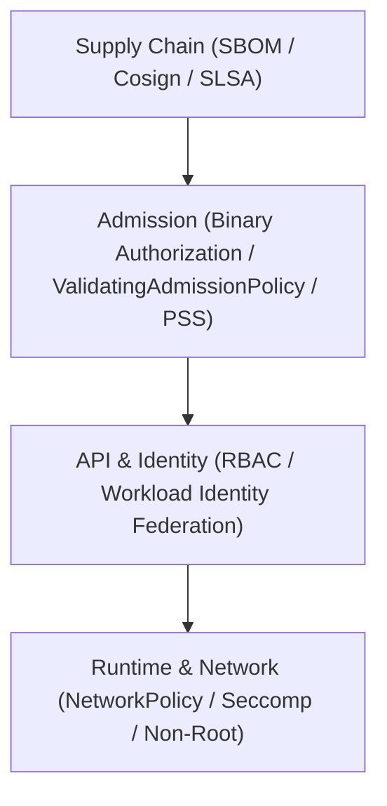
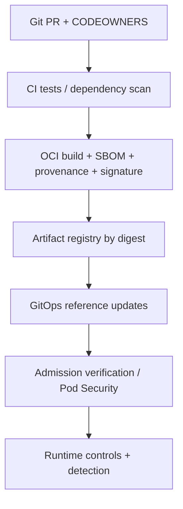

## Learning objectives

- **Apply defense in depth for compromised workloads:** Model the blast radius of remote code execution inside a Pod and layer controls across CI, admission, identity, runtime, and networking.
- **Enforce Pod Security Standards and runtime hardening:** Configure `Restricted` Pod Security Admission, non-root execution, `seccompProfile`, dropped capabilities, and read-only root filesystems safely.
- **Prevent direct and indirect privilege escalation:** Audit Kubernetes RBAC, ServiceAccount token projection, Workload Identity Federation for GKE, and External Secrets Operator boundaries.
- **Secure the software supply chain end to end:** Combine immutable image digests, SBOMs, build provenance, keyless Cosign signatures, and SLSA assurance with Binary Authorization or `ValidatingAdmissionPolicy` gates.
- **Govern GitOps delivery and execute incident response:** Restrict deployment authority with `CODEOWNERS` and Argo CD AppProjects, and follow a forensic-first containment, rotation, and trusted-rebuild runbook.

## Threat model and defense in depth

A compromised Pod can use the tokens, IAM permissions, Secrets, and network access available to its workload. Apply protection at multiple layers: CI, image provenance, admission, runtime, RBAC, IAM, and the network.



## Pod Security

Pod Security Admission (PSA) supports the `Privileged`, `Baseline`, and `Restricted` profiles in `enforce`, `warn`, and `audit` modes. Do not apply `Restricted` indiscriminately to system DaemonSets that need host access.

```yaml
securityContext:
  runAsNonRoot: true
  runAsUser: 10001
  seccompProfile:
    type: RuntimeDefault
```

At the container level, drop unnecessary Linux capabilities and set `allowPrivilegeEscalation: false` and `readOnlyRootFilesystem: true` when the application supports them.

## RBAC and ServiceAccounts

Permission to create Pods or Deployments can indirectly grant access to ServiceAccounts or Secrets in the namespace. Review `escalate`, `bind`, `impersonate`, `pods/exec`, `serviceaccounts/token`, and `secrets` permissions especially carefully.

## Software supply chain

- **Digest:** identifies a specific artifact.
- **SBOM:** lists software components.
- **Provenance:** build origin, builder, source revision.
- **Cosign/Sigstore:** signing/verification.
- **SLSA:** a framework for improving build assurance.

A signature alone does not guarantee that an image is free of vulnerabilities. Admission can check for a trusted registry, an approved builder identity, valid signatures and attestations, and compliance with policy requirements.

## GitOps governance

Git write access can amount to deployment authority if Argo CD has broad permissions. Use `CODEOWNERS` and AppProjects to limit that authority, and do not let application repositories modify the platform's security boundaries.

**Official:** [Pod Security Standards](https://kubernetes.io/docs/concepts/security/pod-security-standards/) · [SLSA](https://slsa.dev/) · [Sigstore](https://docs.sigstore.dev/).

## Threat model: assumed compromised workload

If an attacker gains remote code execution in a Payment Pod, they can use the Secrets, cloud IAM permissions, Kubernetes API token, and network paths available to that Pod. No single control is sufficient: use a least-privilege Kubernetes ServiceAccount (KSA), tightly scoped IAM, Pod Security, runtime controls, network policies, and auditing.

### Example Restricted SecurityContext

```yaml
securityContext:
  runAsNonRoot: true
  runAsUser: 10001
  seccompProfile: {type: RuntimeDefault}
containers:
  - name: payment
    image: registry.example.com/payment@sha256:REPLACE_DIGEST
    securityContext:
      allowPrivilegeEscalation: false
      readOnlyRootFilesystem: true
      capabilities: {drop: [ALL]}
```

This is a fragment. With `readOnlyRootFilesystem`, the application must write temporary files to appropriate writable mounts. A non-root Pod can still read Secrets or make network requests if IAM, RBAC, or NetworkPolicy rules are too permissive.

### Indirect privilege escalation through RBAC

Without additional controls, `create pods` can allow workloads to run as a highly privileged ServiceAccount in the namespace. Do not let application teams modify privileged RoleBindings or ServiceAccounts. Check access with `kubectl auth can-i`, paying particular attention to `get/list/watch secrets`, `impersonate`, `escalate`, `bind`, and `serviceaccounts/token`.

### Software Supply Chain

- A digest identifies artifact content; it does **not** prove that the artifact is safe or trusted.
- An SBOM lists dependencies.
- Provenance links an image to its source revision and builder.
- A signature establishes signer identity and artifact integrity within the scope of the trust checks.
- SLSA defines build assurance levels and their requirements.

On GKE, admission can use Binary Authorization or an equivalent policy engine to block unapproved artifacts. GitOps does not bypass admission. In production, signer allowlists must verify the identity and build workflow rather than accepting any signature.

### Runtime detection and incident response

Detection alerts for unexpected processes, abnormal egress, or unusual Kubernetes API activity need a runbook covering triage, credential rotation, forensic evidence preservation, network containment, and redeployment of trusted artifacts. Restarting a Pod alone does not stop an attacker from using credentials they have already stolen.

**Lab:** Enable Restricted PSA in a namespace and confirm it rejects a privileged Pod. Verify that the KSA cannot read Secrets, pin the image digest, and start with `warn` or `audit` before switching to `enforce`.

## Deep dive: from a compromised Pod to a supply-chain gate

### Threat model: assume a Pod has been compromised

An attacker with remote code execution in a Payment Pod may try to read mounted credentials, call the Kubernetes API using its ServiceAccount token, access cloud APIs through Workload Identity, connect to databases, and spread across the network. **Defense in depth** requires a boundary at each layer: Kubernetes RBAC, Google Cloud IAM, Pod Security, NetworkPolicy, and egress controls.

### Restricted Pod Security is a baseline, not a complete sandbox

```yaml
securityContext:
  runAsNonRoot: true
  runAsUser: 10001
  seccompProfile:
    type: RuntimeDefault
containers:
  - name: app
    image: registry.example.com/payment@sha256:REPLACE_WITH_VALID_DIGEST
    securityContext:
      allowPrivilegeEscalation: false
      readOnlyRootFilesystem: true
      capabilities:
        drop: [ALL]
```

This security snippet is not a complete, valid Pod specification. If the application writes to `/tmp`, provide a writable volume at that path. `automountServiceAccountToken: false` prevents Kubernetes from automatically mounting an API token when the workload does not need one; it does not by itself prove that the workload cannot obtain cloud credentials. Manage IAM permissions for GKE Workload Identity separately.

### Indirect privilege escalation through RBAC

A developer without `get secrets` permission can still exercise the permissions of a powerful ServiceAccount indirectly if they can create Pods that use it. Creating or modifying workloads is therefore a privileged action in a tenant namespace. Give special scrutiny to `escalate`, `bind`, `impersonate`, `serviceaccounts/token`, `pods/exec`, and Secret read access.

### Secrets management

Base64 in a Kubernetes Secret is encoding, not encryption. External Secrets Operator (ESO) syncs data from Secret Manager, reducing the need to put plaintext in Git, but it does not prevent access to Secrets from a running Pod. Always consider encryption at rest, namespace RBAC, the operator's identity, rotation, and how the workload consumes the Secret.

### Supply chain integrity

| Concept | Question it answers |
|---|---|
| Image digest | What exact content does the artifact contain? |
| SBOM | What dependencies does it contain? |
| Provenance | Which source, runner, and workflow produced the build? |
| Signature | Which person or identity signed the artifact? |
| Attestation | What predicate about the artifact does a party attest to? |
| SLSA | What assurance levels does the build process meet? |

Signing an image does **not** prove that it is free of known vulnerabilities or malicious logic. The verifier must check the approved identity and issuer and the provenance predicate, not just the presence of a signature.

### Policy chain before deployment



On GKE, Binary Authorization can enforce image attestation rules. For Kubernetes-agnostic policy, Kyverno and other solutions provide image verification, depending on the version. `ValidatingAdmissionPolicy` can check fields with CEL, but it does not verify OCI signatures in a registry by default.

### Incident response when compromise is suspected

1. Identify the workload, image digest, nodes, namespace, and runtime evidence.
2. Contain traffic and isolate the affected identity according to the runbook. Do not destroy evidence before forensic capture.
3. Rotate tokens and Secret data, and revoke affected IAM permissions.
4. Verify artifact provenance and signing identity, and determine the scope of any CI compromise.
5. Rebuild from a trusted source and redeploy through a controlled process.
6. Audit cross-namespace and cloud access, and tune detection rules and policies.

### Lab

- Create a namespace with the `restricted` Pod Security profile in `enforce` mode.
- Try to deploy a privileged Pod and record the admission denial.
- Test a non-root Pod with seccomp using a compatible image.
- Check the Pod's ServiceAccount permissions with `kubectl auth can-i`.
- Use a digest rather than a tag, and check OCI metadata and Cosign verification for a lab image signed by an approved identity.

Sources: [Pod Security Standards](https://kubernetes.io/docs/concepts/security/pod-security-standards/), [RBAC good practices](https://kubernetes.io/docs/concepts/security/rbac-good-practices/), [Sigstore](https://docs.sigstore.dev/), [Binary Authorization](https://cloud.google.com/binary-authorization/docs/overview).

## Follow the security controls from source to runtime

Assume that Payment is processing requests normally after a workload compromise. Running, Available and Synced describe operational state. Security evidence comes from API audit logs, workload identity, image verification, runtime telemetry and network records. Establish what the compromised process can access and contain its reach at each boundary.

| Boundary | Control and evidence |
|---|---|
| Source and dependencies | Protected reviews, dependency inventory, and vulnerability review |
| Build | Isolated CI, trusted builder, source revision, and verifiable provenance |
| Registry | Digest-pinned artifacts, publishing IAM, scanning, and signature or attestation evidence |
| GitOps and admission | Reviewed promotion, scoped repositories and destinations, API and artifact policy |
| Runtime | Least privilege, restricted Pod configuration, workload identity, network segmentation and detection |
| Recovery | Evidence retention, credential rotation, trusted redeployment and recovery validation |

### Apply Pod Security and runtime restrictions

The Pod Security Standards define Privileged, Baseline and Restricted. Pod Security Admission can enforce one level while warning and auditing against another. A staged migration can enforce Baseline, set Warn and Audit to Restricted, verify sidecars and init containers, then enforce Restricted in application namespaces. Administrators should own the labels and pin versions where predictable behavior across upgrades matters. Keep platform agents that require exceptional host privileges in separately governed namespaces.

```yaml
apiVersion: v1
kind: Pod
metadata:
  name: payment-security-check
  namespace: security-lab
spec:
  serviceAccountName: default
  automountServiceAccountToken: false
  securityContext:
    runAsNonRoot: true
    runAsUser: 10001
    runAsGroup: 10001
    seccompProfile:
      type: RuntimeDefault
  containers:
    - name: payment
      image: registry.example.com/payment@sha256:REPLACE_WITH_DIGEST
      securityContext:
        privileged: false
        allowPrivilegeEscalation: false
        readOnlyRootFilesystem: true
        capabilities:
          drop: [ALL]
      resources:
        requests: {cpu: 250m, memory: 256Mi}
        limits: {memory: 512Mi}
      volumeMounts:
        - name: scratch
          mountPath: /tmp
  volumes:
    - name: scratch
      emptyDir: {}
```

Use a real digest and an image tested as UID 10001. The read-only root filesystem is an additional control and temporary writes go to the mounted volume. Verify volume permissions with the actual runtime user. Seccomp constrains system calls and dropping capabilities removes unnecessary kernel privileges. Sandbox runtimes or dedicated infrastructure can further narrow exposure for workloads with stronger isolation requirements. [Pod Security Standards](https://kubernetes.io/docs/concepts/security/pod-security-standards/) · [Pod Security Admission](https://kubernetes.io/docs/concepts/security/pod-security-admission/)

### Review effective identity and resource access

For Payment with no Kubernetes API requirement, keep token automount disabled and avoid creating an application RoleBinding. For a distinct consumer that needs to read one named ConfigMap, grant only get with resourceNames matching that ConfigMap. Review effective permissions from workload creation, mounts, and ServiceAccount assignment in addition to direct RBAC. Keep privileged ServiceAccounts away from namespaces with broadly delegated workload writes. Restrict binding, role escalation, impersonation, token issuance, and exec permissions to their intended administrative identities. Validate both allowed and denied requests from an authorized audit identity. [RBAC good practices](https://kubernetes.io/docs/concepts/security/rbac-good-practices/)

Short-lived projected Kubernetes credentials have an audience and lifetime and can rotate through kubelet. An explicit projection can serve a required audience even when automount is disabled. Workload Identity Federation for GKE uses its own metadata and IAM flow, while Istio uses workload certificates and mesh policies. Confirm which identity is used on each path. Limit Google IAM to the specific required resource. Keep Secret Manager and ESO identities narrowly scoped. Base64 encodes Kubernetes Secret data, so protect access with RBAC, encryption and KMS controls where applicable. Include backups, logs, Git history, rotation, and what the authorized application process can read in the review. [GKE cluster hardening](https://docs.cloud.google.com/kubernetes-engine/docs/how-to/hardening-your-cluster) · [Workload Identity Federation for GKE](https://docs.cloud.google.com/kubernetes-engine/docs/concepts/workload-identity)

### Verify what was built and what may run

- **Digest** identifies a specific artifact. A tag can move.
- **SBOM** inventories components and can help assess the impact of newly disclosed vulnerabilities.
- **Provenance** associates the artifact with source, revision, builder, and build inputs.
- **Signature** verifies integrity and a signing key or identity against a trust policy.
- **Attestation** conveys a signed claim about the artifact, such as approved testing or build provenance.

For keyless Cosign verification, require the expected certificate identity and OIDC issuer as well as the signature on the deployed digest. A valid signature alone says little about vulnerabilities or whether the signer is trusted. Evaluate approved repository and workflow, attestation subject, build requirements, and scanner findings separately. SLSA levels apply to defined tracks with specific requirements. A signature or SBOM does not by itself establish a level. [Cosign](https://docs.sigstore.dev/cosign/overview/) · [SLSA specification](https://slsa.dev/spec/v1.2/)

Use a cluster-scoped CEL policy bound to selected namespaces to validate deterministic properties such as digest syntax. This example audits and warns initially. It includes regular and init containers as well as ephemeral containers on their write subresource. Rehearse enforcement in an isolated namespace before changing validationActions.

```yaml
apiVersion: admissionregistration.k8s.io/v1
kind: ValidatingAdmissionPolicy
metadata:
  name: application-image-digests
spec:
  failurePolicy: Fail
  matchConstraints:
    resourceRules:
      - apiGroups: [""]
        apiVersions: [v1]
        operations: [CREATE, UPDATE]
        resources: [pods, pods/ephemeralcontainers]
  validations:
    - expression: >-
        object.spec.containers.all(c, c.image.matches('^.+@sha256:[0-9a-f]{64}$')) &&
        (!has(object.spec.initContainers) || object.spec.initContainers.all(c, c.image.matches('^.+@sha256:[0-9a-f]{64}$'))) &&
        (!has(object.spec.ephemeralContainers) || object.spec.ephemeralContainers.all(c, c.image.matches('^.+@sha256:[0-9a-f]{64}$')))
      message: Use SHA-256 digest references for all Pod images.
---
apiVersion: admissionregistration.k8s.io/v1
kind: ValidatingAdmissionPolicyBinding
metadata:
  name: application-image-digests
spec:
  policyName: application-image-digests
  validationActions: [Warn, Audit]
  matchResources:
    namespaceSelector:
      matchLabels:
        image-policy: managed
```

The policy checks references when Pods are admitted. Use a separate verifier, such as configured Kyverno image verification or GKE Binary Authorization, for evidence external to the manifest. Binary Authorization can enforce attestor requirements on an image digest. A Deployment object may sync while its ReplicaSet reports denied Pod creations. Inspect events, health and the admission decision independently. [ValidatingAdmissionPolicy](https://kubernetes.io/docs/reference/access-authn-authz/validating-admission-policy/) · [Binary Authorization](https://docs.cloud.google.com/binary-authorization/docs/overview)

### Test the boundaries independently

Protect production Git paths with required checks and reviews. Keep AppProject definitions and deployment credentials under platform administration. Scope source repositories, resource kinds, destinations, and Argo CD RBAC, then verify API credentials independently. A project that can deploy into the Argo CD control-plane namespace warrants administrative trust.

In a lab, enable Restricted for a test namespace and verify the hardened Pod passes a server dry-run. Use a benign fixture that omits required security settings to confirm denial without starting a workload. Verify intended ConfigMap access and denied Secret listing, digest policy warnings, and approved network flows. At runtime, investigate unexpected processes, API calls, outbound traffic, and privilege-related events. Preserve evidence, identify affected identities, isolate through approved controls, rotate exposed credentials, redeploy trusted digests, and confirm recovery through audit and service telemetry.

Continue with [Lesson 19 — Multi-Tenancy](./lesson-19-multi-tenancy.md).

Practice with the [platform operations exercises](../06-compute-storage/platform-operations-exercises.mdx).

## Self-check questions
1. Which controller owns the desired state and the actual state in this lesson?
2. What failure modes can occur even when the Kubernetes resource reports `Ready`?
3. What would you verify before deploying to production?
