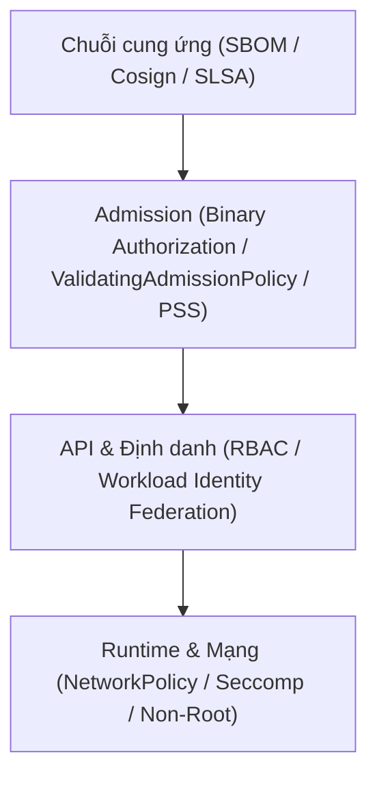
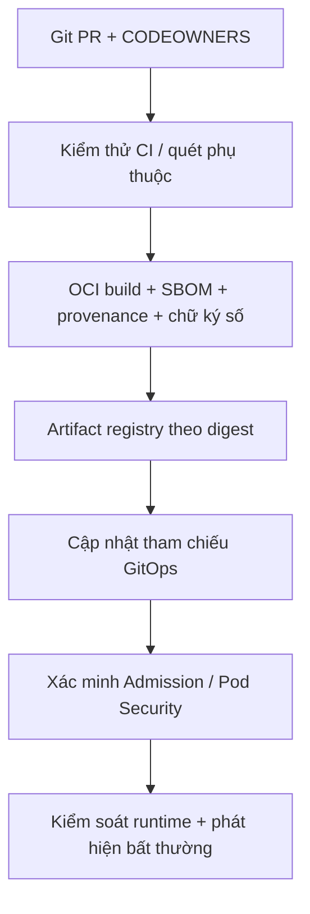

## Mục tiêu học tập

- **Áp dụng phòng thủ theo chiều sâu cho workload bị xâm nhập:** Mô hình hóa bán kính ảnh hưởng khi kẻ tấn công thực thi mã từ xa trong Pod và xếp lớp kiểm soát từ CI, admission, định danh, runtime đến mạng.
- **Thực thi Pod Security Standards và gia cố runtime:** Cấu hình `Restricted` Pod Security Admission, chạy non-root, `seccompProfile`, gỡ bỏ Linux capabilities và sử dụng read-only root filesystem an toàn.
- **Ngăn chặn leo thang đặc quyền trực tiếp và gián tiếp:** Kiểm toán Kubernetes RBAC, cơ chế cấp phát ServiceAccount token, Workload Identity Federation cho GKE và ranh giới của External Secrets Operator.
- **Bảo vệ chuỗi cung ứng phần mềm đầu cuối:** Kết hợp image digest bất biến, SBOM, build provenance, chữ ký Cosign keyless và chuẩn SLSA với cổng kiểm soát Binary Authorization hoặc `ValidatingAdmissionPolicy`.
- **Quản trị GitOps và ứng phó sự cố bảo mật:** Giới hạn quyền triển khai bằng `CODEOWNERS` và Argo CD AppProject, đồng thời thực thi runbook bảo toàn bằng chứng, cô lập, xoay vòng khóa và triển khai lại từ nguồn tin cậy.

## Mô hình mối đe dọa và phòng thủ theo chiều sâu

Một Pod bị xâm nhập có thể tận dụng token, quyền IAM, Secrets và quyền truy cập mạng sẵn có của workload đó. Hãy áp dụng bảo vệ ở nhiều lớp: CI, nguồn gốc image (image provenance), admission, runtime, RBAC, IAM và mạng.



## Pod Security

Pod Security Admission (PSA) hỗ trợ các profile `Privileged`, `Baseline` và `Restricted` ở các chế độ `enforce`, `warn` và `audit`. Không áp dụng `Restricted` một cách tràn lan lên các system DaemonSet cần quyền truy cập host.

```yaml
securityContext:
  runAsNonRoot: true
  runAsUser: 10001
  seccompProfile:
    type: RuntimeDefault
```

Ở cấp container, hãy gỡ bỏ các Linux capabilities không cần thiết và đặt `allowPrivilegeEscalation: false` cùng `readOnlyRootFilesystem: true` khi ứng dụng hỗ trợ.

## RBAC và ServiceAccounts

Quyền tạo Pod hoặc Deployment có thể gián tiếp cấp quyền truy cập vào các ServiceAccount hoặc Secret trong cùng namespace. Hãy rà soát đặc biệt kỹ các quyền `escalate`, `bind`, `impersonate`, `pods/exec`, `serviceaccounts/token` và `secrets`.

## Chuỗi cung ứng phần mềm (Software supply chain)

- **Digest:** định danh chính xác một artifact cụ thể.
- **SBOM:** liệt kê các thành phần phần mềm bên trong.
- **Provenance:** nguồn gốc bản build, builder và source revision.
- **Cosign/Sigstore:** ký và xác minh chữ ký số.
- **SLSA:** khung tiêu chuẩn giúp nâng cao mức độ đảm bảo cho quy trình build.

Riêng một chữ ký số không đảm bảo image không có lỗ hổng bảo mật. Tầng admission có thể kiểm tra registry đáng tin cậy, định danh builder được phê duyệt, chữ ký và attestation hợp lệ, cũng như mức độ tuân thủ chính sách.

## Quản trị GitOps

Quyền ghi vào Git có thể tương đương với quyền triển khai (deployment authority) nếu Argo CD có quyền hạn rộng. Hãy dùng `CODEOWNERS` và AppProjects để giới hạn quyền hạn đó, và không cho phép các repository ứng dụng tự ý sửa đổi ranh giới bảo mật của nền tảng.

**Tài liệu chính thức:** [Pod Security Standards](https://kubernetes.io/docs/concepts/security/pod-security-standards/) · [SLSA](https://slsa.dev/) · [Sigstore](https://docs.sigstore.dev/).

## Mô hình mối đe dọa: giả định workload đã bị xâm nhập

Nếu kẻ tấn công thực thi được mã từ xa (remote code execution) trong một Payment Pod, chúng có thể sử dụng Secrets, quyền cloud IAM, Kubernetes API token và các đường dẫn mạng sẵn có của Pod đó. Không có cơ chế kiểm soát đơn lẻ nào là đủ: hãy kết hợp Kubernetes ServiceAccount (KSA) theo nguyên tắc tối thiểu đặc quyền, IAM giới hạn chặt chẽ, Pod Security, kiểm soát runtime, NetworkPolicy và auditing.

### Ví dụ Restricted SecurityContext

```yaml
securityContext:
  runAsNonRoot: true
  runAsUser: 10001
  seccompProfile: {type: RuntimeDefault}
containers:
  - name: payment
    image: registry.example.com/payment@sha256:REPLACE_DIGEST
    securityContext:
      allowPrivilegeEscalation: false
      readOnlyRootFilesystem: true
      capabilities: {drop: [ALL]}
```

Đây chỉ là một đoạn cấu hình mẫu. Với `readOnlyRootFilesystem`, ứng dụng phải ghi các tệp tạm vào các mount có quyền ghi phù hợp. Một Pod chạy non-root vẫn có thể đọc Secrets hoặc gửi yêu cầu ra mạng nếu các quy tắc IAM, RBAC hoặc NetworkPolicy quá lỏng lẻo.

### Leo thang đặc quyền gián tiếp qua RBAC

Nếu không có biện pháp kiểm soát bổ sung, quyền `create pods` có thể cho phép workload chạy dưới một ServiceAccount có đặc quyền cao trong namespace. Không cho phép các nhóm ứng dụng chỉnh sửa các RoleBinding hoặc ServiceAccount có đặc quyền. Hãy kiểm tra quyền truy cập bằng `kubectl auth can-i`, đặc biệt lưu ý đến `get/list/watch secrets`, `impersonate`, `escalate`, `bind` và `serviceaccounts/token`.

### Chuỗi cung ứng phần mềm (Software Supply Chain)

- Digest định danh nội dung của artifact; nó **không** chứng minh artifact đó an toàn hay đáng tin cậy.
- SBOM liệt kê các thư viện phụ thuộc.
- Provenance liên kết một image với source revision và builder đã tạo ra nó.
- Chữ ký số xác lập danh tính người ký và tính toàn vẹn của artifact trong phạm vi kiểm tra tin cậy.
- SLSA định nghĩa các cấp độ đảm bảo build và các yêu cầu tương ứng.

Trên GKE, tầng admission có thể dùng Binary Authorization hoặc một policy engine tương đương để chặn các artifact chưa được phê duyệt. GitOps không bỏ qua admission. Trong production, danh sách cho phép người ký (signer allowlist) phải xác minh danh tính và quy trình build thay vì chấp nhận bất kỳ chữ ký nào.

### Phát hiện ở runtime và ứng phó sự cố

Các cảnh báo phát hiện tiến trình bất thường, lưu lượng egress bất thường hoặc hoạt động bất thường trên Kubernetes API cần đi kèm một runbook bao gồm phân loại sự cố (triage), xoay vòng thông tin xác thực (credential rotation), bảo toàn bằng chứng điều tra (forensic evidence), cô lập mạng và triển khai lại các artifact đáng tin cậy. Chỉ khởi động lại Pod không ngăn được kẻ tấn công tiếp tục sử dụng các thông tin xác thực mà chúng đã đánh cắp.

**Thực hành (Lab):** Bật Restricted PSA trong một namespace và xác nhận nó từ chối một privileged Pod. Xác minh KSA không thể đọc Secrets, ghim image digest, và bắt đầu với chế độ `warn` hoặc `audit` trước khi chuyển sang `enforce`.

## Tìm hiểu sâu: Từ một Pod bị xâm nhập đến cổng kiểm soát chuỗi cung ứng

### Mô hình mối đe dọa: giả định một Pod đã bị xâm nhập

Kẻ tấn công có quyền thực thi mã từ xa trong một Payment Pod có thể cố đọc các thông tin xác thực được mount, gọi Kubernetes API bằng ServiceAccount token, truy cập cloud API thông qua Workload Identity, kết nối vào cơ sở dữ liệu và di chuyển ngang qua mạng. **Phòng thủ theo chiều sâu (Defense in depth)** đòi hỏi một ranh giới ở mỗi lớp: Kubernetes RBAC, Google Cloud IAM, Pod Security, NetworkPolicy và kiểm soát egress.

### Restricted Pod Security là mức nền, không phải sandbox hoàn chỉnh

```yaml
securityContext:
  runAsNonRoot: true
  runAsUser: 10001
  seccompProfile:
    type: RuntimeDefault
containers:
  - name: app
    image: registry.example.com/payment@sha256:REPLACE_WITH_VALID_DIGEST
    securityContext:
      allowPrivilegeEscalation: false
      readOnlyRootFilesystem: true
      capabilities:
        drop: [ALL]
```

Đoạn cấu hình bảo mật này chưa phải là một Pod specification đầy đủ và hợp lệ. Nếu ứng dụng ghi vào `/tmp`, hãy cung cấp một volume có quyền ghi tại đường dẫn đó. `automountServiceAccountToken: false` ngăn Kubernetes tự động mount API token khi workload không cần dùng; bản thân nó không chứng minh workload không thể lấy được cloud credentials. Hãy quản lý riêng quyền IAM cho GKE Workload Identity.

### Leo thang đặc quyền gián tiếp qua RBAC

Một lập trình viên không có quyền `get secrets` vẫn có thể gián tiếp thực thi quyền hạn của một ServiceAccount mạnh nếu họ có quyền tạo Pod sử dụng ServiceAccount đó. Do đó, việc tạo hoặc chỉnh sửa workload là một hành động có đặc quyền trong một tenant namespace. Cần rà soát đặc biệt kỹ `escalate`, `bind`, `impersonate`, `serviceaccounts/token`, `pods/exec` và quyền đọc Secret.

### Quản lý Secrets

Base64 trong Kubernetes Secret chỉ là mã hóa biểu diễn (encoding), không phải mã hóa bảo mật (encryption). External Secrets Operator (ESO) đồng bộ dữ liệu từ Secret Manager, giảm nhu cầu đưa plaintext vào Git, nhưng không ngăn được việc truy cập Secret từ bên trong một Pod đang chạy. Luôn cân nhắc mã hóa dữ liệu tĩnh (encryption at rest), RBAC theo namespace, định danh của operator, xoay vòng khóa/mật khẩu và cách workload tiêu thụ Secret.

### Tính toàn vẹn của chuỗi cung ứng

| Khái niệm | Câu hỏi mà nó trả lời |
|---|---|
| Image digest | Artifact chứa chính xác nội dung gì? |
| SBOM | Nó bao gồm những thành phần phụ thuộc nào? |
| Provenance | Mã nguồn, runner và workflow nào đã tạo ra bản build này? |
| Signature | Cá nhân hoặc định danh nào đã ký artifact? |
| Attestation | Một bên xác nhận điều gì (predicate) về artifact? |
| SLSA | Quy trình build đáp ứng cấp độ đảm bảo nào? |

Việc ký một image **không** chứng minh nó không có lỗ hổng đã biết hay mã độc. Bộ xác minh (verifier) phải kiểm tra định danh và issuer đã được phê duyệt cùng provenance predicate, chứ không chỉ kiểm tra sự tồn tại của một chữ ký.

### Chuỗi chính sách trước khi triển khai



Trên GKE, Binary Authorization có thể thực thi các quy tắc chứng thực (attestation) image. Đối với chính sách độc lập với nền tảng Kubernetes, Kyverno và các giải pháp khác cung cấp khả năng xác minh image tùy theo phiên bản. `ValidatingAdmissionPolicy` có thể kiểm tra các trường dữ liệu bằng CEL, nhưng mặc định không xác minh chữ ký OCI trên registry.

### Ứng phó sự cố khi nghi ngờ bị xâm nhập

1. Xác định workload, image digest, các node, namespace và bằng chứng runtime.
2. Cô lập lưu lượng và định danh bị ảnh hưởng theo runbook. Không phá hủy bằng chứng trước khi thu thập điều tra (forensic capture).
3. Xoay vòng token và dữ liệu Secret, đồng thời thu hồi các quyền IAM bị ảnh hưởng.
4. Xác minh provenance và định danh ký của artifact, xác định phạm vi nếu CI bị xâm nhập.
5. Build lại từ mã nguồn đáng tin cậy và triển khai lại theo quy trình có kiểm soát.
6. Kiểm toán quyền truy cập liên namespace và truy cập cloud, đồng thời tinh chỉnh các quy tắc phát hiện và chính sách.

### Thực hành (Lab)

- Tạo một namespace với profile Pod Security `restricted` ở chế độ `enforce`.
- Thử triển khai một privileged Pod và ghi lại thông báo từ chối ở bước admission.
- Kiểm thử một non-root Pod có seccomp bằng một image tương thích.
- Kiểm tra quyền của Pod ServiceAccount bằng `kubectl auth can-i`.
- Sử dụng digest thay vì tag, và kiểm tra metadata OCI cùng xác minh Cosign cho một lab image được ký bởi một định danh đã phê duyệt.

Nguồn: [Pod Security Standards](https://kubernetes.io/docs/concepts/security/pod-security-standards/), [RBAC good practices](https://kubernetes.io/docs/concepts/security/rbac-good-practices/), [Sigstore](https://docs.sigstore.dev/), [Binary Authorization](https://cloud.google.com/binary-authorization/docs/overview).

## Theo dõi các lớp kiểm soát bảo mật từ mã nguồn đến runtime

Giả sử Payment vẫn đang xử lý request bình thường sau khi một workload bị xâm nhập. Các trạng thái Running, Available và Synced chỉ mô tả trạng thái vận hành. Bằng chứng bảo mật đến từ API audit logs, workload identity, xác minh image, dữ liệu giám sát runtime và nhật ký mạng. Hãy xác định tiến trình bị xâm nhập có thể chạm tới những gì và giới hạn phạm vi ảnh hưởng của nó ở từng ranh giới.

| Ranh giới | Kiểm soát và bằng chứng |
|---|---|
| Mã nguồn và phụ thuộc | Quy trình review được bảo vệ, danh mục phụ thuộc và rà soát lỗ hổng |
| Build | CI cô lập, builder đáng tin cậy, source revision và provenance có thể kiểm chứng |
| Registry | Artifact được ghim theo digest, quyền IAM khi publish, quét lỗ hổng và bằng chứng chữ ký hoặc attestation |
| GitOps và admission | Quy trình nâng cấp (promotion) được review, giới hạn repository và đích triển khai, chính sách API và artifact |
| Runtime | Đặc quyền tối thiểu, cấu hình Pod bị hạn chế, workload identity, phân đoạn mạng và cơ chế phát hiện |
| Khôi phục | Lưu giữ bằng chứng, xoay vòng thông tin xác thực, triển khai lại bản dựng đáng tin cậy và xác thực khôi phục |

### Áp dụng Pod Security và các giới hạn runtime

Pod Security Standards định nghĩa ba mức: Privileged, Baseline và Restricted. Pod Security Admission có thể enforce một mức trong khi vẫn warn và audit theo một mức khác. Một lộ trình chuyển đổi theo từng giai đoạn có thể enforce Baseline, đặt Warn và Audit ở mức Restricted, kiểm tra các sidecar và init container, sau đó mới chuyển sang enforce Restricted ở các namespace ứng dụng. Quản trị viên nên nắm quyền sở hữu các label và ghim phiên bản khi cần hành vi nhất quán qua các đợt nâng cấp. Giữ các platform agent cần đặc quyền host ngoại lệ trong các namespace được quản trị riêng biệt.

```yaml
apiVersion: v1
kind: Pod
metadata:
  name: payment-security-check
  namespace: security-lab
spec:
  serviceAccountName: default
  automountServiceAccountToken: false
  securityContext:
    runAsNonRoot: true
    runAsUser: 10001
    runAsGroup: 10001
    seccompProfile:
      type: RuntimeDefault
  containers:
    - name: payment
      image: registry.example.com/payment@sha256:REPLACE_WITH_DIGEST
      securityContext:
        privileged: false
        allowPrivilegeEscalation: false
        readOnlyRootFilesystem: true
        capabilities:
          drop: [ALL]
      resources:
        requests: {cpu: 250m, memory: 256Mi}
        limits: {memory: 512Mi}
      volumeMounts:
        - name: scratch
          mountPath: /tmp
  volumes:
    - name: scratch
      emptyDir: {}
```

Hãy dùng một digest thật và một image đã kiểm thử chạy được với UID 10001. Root filesystem chỉ đọc là một lớp kiểm soát bổ sung, còn các tệp ghi tạm đi vào volume được mount. Xác minh quyền trên volume với đúng user thực tế khi chạy. Seccomp giới hạn các lời gọi hệ thống (system calls) và việc drop capabilities loại bỏ các đặc quyền kernel không cần thiết. Các sandbox runtime hoặc hạ tầng chuyên dụng có thể thu hẹp hơn nữa bề mặt phơi nhiễm cho các workload đòi hỏi cô lập mạnh hơn. [Pod Security Standards](https://kubernetes.io/docs/concepts/security/pod-security-standards/) · [Pod Security Admission](https://kubernetes.io/docs/concepts/security/pod-security-admission/)

### Rà soát quyền hạn hiệu lực và quyền truy cập tài nguyên

Đối với dịch vụ Payment không cần gọi Kubernetes API, hãy giữ tắt automount token và tránh tạo RoleBinding cho ứng dụng. Đối với một consumer khác chỉ cần đọc một ConfigMap cụ thể, chỉ cấp duy nhất quyền `get` kèm `resourceNames` khớp với ConfigMap đó. Rà soát quyền hiệu lực (effective permissions) từ việc tạo workload, mount volume và gán ServiceAccount bên cạnh RBAC trực tiếp. Giữ các ServiceAccount có đặc quyền tách biệt khỏi các namespace nơi quyền ghi workload được ủy quyền rộng rãi. Giới hạn các quyền bind, leo thang vai trò, giả danh (impersonation), cấp phát token và exec cho đúng các định danh quản trị dự kiến. Kiểm chứng cả yêu cầu được phép lẫn yêu cầu bị từ chối từ một định danh kiểm toán được ủy quyền. [RBAC good practices](https://kubernetes.io/docs/concepts/security/rbac-good-practices/)

Các thông tin xác thực Kubernetes dạng projected ngắn hạn có audience và thời hạn sống riêng, đồng thời có thể xoay vòng thông qua kubelet. Một cấu hình projection tường minh vẫn có thể phục vụ một audience cần thiết ngay cả khi automount bị tắt. Workload Identity Federation for GKE sử dụng luồng metadata và IAM riêng, trong khi Istio dùng chứng chỉ workload và chính sách mesh. Hãy xác nhận định danh nào được dùng trên từng đường dẫn. Giới hạn Google IAM vào đúng tài nguyên cụ thể cần thiết. Giữ phạm vi định danh của Secret Manager và ESO thật hẹp. Base64 chỉ mã hóa biểu diễn dữ liệu Kubernetes Secret, vì vậy hãy bảo vệ quyền truy cập bằng RBAC, mã hóa và cơ chế kiểm soát KMS khi áp dụng. Đưa cả bản sao lưu, logs, lịch sử Git, quy trình xoay vòng và những gì tiến trình ứng dụng được cấp phép có thể đọc vào phạm vi rà soát. [GKE cluster hardening](https://docs.cloud.google.com/kubernetes-engine/docs/how-to/hardening-your-cluster) · [Workload Identity Federation for GKE](https://docs.cloud.google.com/kubernetes-engine/docs/concepts/workload-identity)

### Xác minh những gì đã được build và những gì được phép chạy

- **Digest** định danh một artifact cụ thể. Tag có thể bị trỏ lại sang bản khác.
- **SBOM** kiểm kê các thành phần và hỗ trợ đánh giá tác động khi có lỗ hổng mới công bố.
- **Provenance** liên kết artifact với mã nguồn, revision, builder và các đầu vào của quá trình build.
- **Signature** xác minh tính toàn vẹn cùng khóa hoặc định danh ký dựa trên chính sách tin cậy.
- **Attestation** truyền đạt một tuyên bố đã ký về artifact, chẳng hạn như kết quả kiểm thử đã phê duyệt hoặc build provenance.

Với xác minh Cosign không dùng khóa cố định (keyless), hãy yêu cầu đúng certificate identity và OIDC issuer kỳ vọng cùng với chữ ký trên digest được triển khai. Một chữ ký hợp lệ tự nó không nói lên nhiều điều về lỗ hổng hay việc người ký có đáng tin hay không. Hãy đánh giá riêng repository và workflow được phê duyệt, đối tượng attestation, yêu cầu build và kết quả quét lỗ hổng. Các cấp độ SLSA áp dụng cho từng track cụ thể với các yêu cầu riêng. Riêng một chữ ký hoặc SBOM không tự động xác lập một cấp độ SLSA. [Cosign](https://docs.sigstore.dev/cosign/overview/) · [SLSA specification](https://slsa.dev/spec/v1.2/)

Sử dụng một chính sách CEL ở cấp cluster gắn vào các namespace được chọn để xác thực các thuộc tính mang tính tất định như cú pháp digest. Ví dụ sau bắt đầu ở chế độ audit và warn. Nó bao phủ cả regular container, init container lẫn ephemeral container trên subresource ghi tương ứng. Hãy diễn tập chế độ enforce trong một namespace cô lập trước khi thay đổi `validationActions`.

```yaml
apiVersion: admissionregistration.k8s.io/v1
kind: ValidatingAdmissionPolicy
metadata:
  name: application-image-digests
spec:
  failurePolicy: Fail
  matchConstraints:
    resourceRules:
      - apiGroups: [""]
        apiVersions: [v1]
        operations: [CREATE, UPDATE]
        resources: [pods, pods/ephemeralcontainers]
  validations:
    - expression: >-
        object.spec.containers.all(c, c.image.matches('^.+@sha256:[0-9a-f]{64}$')) &&
        (!has(object.spec.initContainers) || object.spec.initContainers.all(c, c.image.matches('^.+@sha256:[0-9a-f]{64}$'))) &&
        (!has(object.spec.ephemeralContainers) || object.spec.ephemeralContainers.all(c, c.image.matches('^.+@sha256:[0-9a-f]{64}$')))
      message: Use SHA-256 digest references for all Pod images.
---
apiVersion: admissionregistration.k8s.io/v1
kind: ValidatingAdmissionPolicyBinding
metadata:
  name: application-image-digests
spec:
  policyName: application-image-digests
  validationActions: [Warn, Audit]
  matchResources:
    namespaceSelector:
      matchLabels:
        image-policy: managed
```

Chính sách này kiểm tra các tham chiếu khi Pod đi qua bước admission. Hãy sử dụng một bộ xác minh riêng, chẳng hạn như Kyverno image verification đã cấu hình hoặc GKE Binary Authorization, cho các bằng chứng nằm ngoài manifest. Binary Authorization có thể thực thi yêu cầu về attestor trên một image digest. Một đối tượng Deployment có thể báo trạng thái sync thành công trong khi ReplicaSet của nó báo lỗi tạo Pod bị từ chối. Hãy kiểm tra độc lập events, health và quyết định admission. [ValidatingAdmissionPolicy](https://kubernetes.io/docs/reference/access-authn-authz/validating-admission-policy/) · [Binary Authorization](https://docs.cloud.google.com/binary-authorization/docs/overview)

### Kiểm thử độc lập từng ranh giới

Bảo vệ các đường dẫn Git production bằng các bước kiểm tra và review bắt buộc. Giữ các định nghĩa AppProject và thông tin xác thực triển khai dưới sự quản trị của nhóm nền tảng. Giới hạn phạm vi source repositories, resource kinds, destinations và Argo CD RBAC, sau đó kiểm chứng riêng thông tin xác thực API. Một project có thể triển khai vào namespace control-plane của Argo CD đòi hỏi mức tin cậy ngang cấp quản trị viên.

Trong phòng lab, hãy bật chế độ Restricted cho một namespace kiểm thử và xác minh Pod đã hardened vượt qua bước server dry-run. Sử dụng một mẫu thử vô hại cố tình bỏ qua các thiết lập bảo mật bắt buộc để xác nhận việc từ chối mà không cần khởi chạy workload. Kiểm chứng quyền truy cập ConfigMap dự kiến và việc từ chối liệt kê Secret, các cảnh báo chính sách digest và các luồng mạng được phê duyệt. Ở runtime, điều tra các tiến trình bất thường, lời gọi API, lưu lượng đi ra ngoài và các sự kiện liên quan đến đặc quyền. Bảo toàn bằng chứng, xác định các định danh bị ảnh hưởng, cô lập qua các cơ chế được phê duyệt, xoay vòng thông tin xác thực bị lộ, triển khai lại các digest đáng tin cậy và xác nhận khôi phục qua dữ liệu audit và telemetry dịch vụ.

Tiếp tục với [Bài 19 — Multi-Tenancy](./lesson-19-multi-tenancy.md).

Thực hành thêm với [bài tập vận hành nền tảng](../06-compute-storage/platform-operations-exercises.mdx).

## Câu hỏi tự kiểm tra
1. Controller nào sở hữu trạng thái mong muốn (desired state) và trạng thái thực tế (actual state) trong bài học này?
2. Những kiểu lỗi nào có thể xảy ra ngay cả khi tài nguyên Kubernetes báo cáo trạng thái `Ready`?
3. Bạn sẽ kiểm chứng những gì trước khi triển khai lên production?
