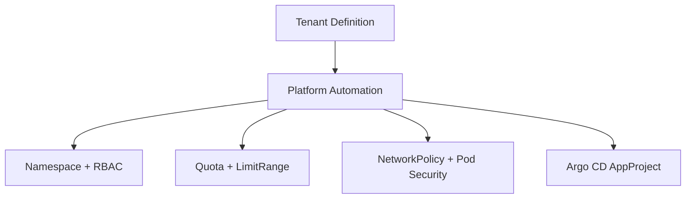

:::info Source and editorial scope
This lesson was expanded using topics and discussion that can be verified against the conversation, but **it is not a complete verbatim transcript**. The added sections were written for the website and may require version-specific testing before use in production.
:::

## Learning objectives

RBAC, quotas, NetworkPolicy, AppProject, self-service tenants.

## Soft and hard multi-tenancy

Namespaces suit internal teams that can share infrastructure at an appropriate level of trust, but they are not an absolute security boundary: tenants share the kernel, control plane, and some platform services. Hard isolation may require separate clusters or cloud projects.

## What does a tenant boundary need?



## ResourceQuota and LimitRange

ResourceQuota controls **aggregate** requests, limits, object counts, and storage in a namespace. LimitRange sets minimums, maximums, and defaults for individual containers, Pods, or PVCs, depending on the configured type. Cluster Autoscaler cannot resolve a quota violation.

```yaml
apiVersion: v1
kind: ResourceQuota
metadata:
  name: payment-quota
  namespace: payments
spec:
  hard:
    requests.cpu: '8'
    requests.memory: 16Gi
    pods: '30'
    persistentvolumeclaims: '5'
```

## Network isolation

A separate namespace does not block Pod-to-Pod traffic. Start with default-deny policies and explicitly allow required flows, including DNS and monitoring as needed. Restrict who can change namespace and Pod labels used in security selectors.

## AppProject and GitOps

An AppProject restricts source repositories, destination clusters and namespaces, and the resource kinds Argo CD can deploy. It does not replace Kubernetes RBAC. Manage highly privileged AppProjects and ApplicationSets as platform code.

## Self-Service Platform

Define a `Tenant` API (a custom CRD or declarative configuration) to provision namespaces, RBAC, quotas, policies, and AppProjects automatically. Make reconciliation idempotent, protect finalizers from unintended removal, and protect stateful resources from accidental deletion.

## When do you need a separate cluster?

If you need an independent control plane, a compliance boundary, kernel isolation, or a different Kubernetes version, evaluate cluster-based tenancy instead of placing every tenant in a namespace.

**Official:** [Kubernetes Multi-Tenancy](https://kubernetes.io/docs/concepts/security/multi-tenancy/) · [Argo CD Projects](https://argo-cd.readthedocs.io/en/stable/user-guide/projects/).


## Model the tenant boundary explicitly

A namespace scopes names for namespaced resources. It does **not** block network traffic by itself or separate the kernel or control plane. Namespaces can provide soft isolation for multiple teams; untrusted tenants with compliance or strong isolation requirements may need separate clusters or projects.

### RBAC and access to ServiceAccounts

A team whose permissions are limited to Deployments in its namespace can still use ServiceAccounts and Secrets through workloads. Denying `get secrets` is therefore not enough if the team can create Pods that run as an identity with access to Secrets. The platform must manage privileged ServiceAccounts, admission, and GitOps destinations.

### ResourceQuota and HPA

```yaml
apiVersion: v1
kind: ResourceQuota
metadata:
  name: payments
  namespace: payments
spec:
  hard:
    requests.cpu: '8'
    requests.memory: 16Gi
    pods: '30'
```

If each Pod requests 500m CPU and the quota is 8 cores, the CPU budget allows up to 16 Pods, assuming no other workloads consume it. The HPA can set the desired replica count to 20, but the API server rejects Pods that exceed the quota. Cluster Autoscaler cannot change quota admission policy.

### How LimitRange differs from ResourceQuota

LimitRange provides defaults, minimums, and maximums for Pods, containers, and PVCs, depending on its configuration. ResourceQuota caps the aggregate. Do not set the default CPU limit too low: it can cause throttling and increase p99 latency.

### NetworkPolicy default deny

```yaml
apiVersion: networking.k8s.io/v1
kind: NetworkPolicy
metadata:
  name: default-deny
  namespace: payments
spec:
  podSelector: {}
  policyTypes: [Ingress, Egress]
```

When explicitly allowing traffic, account for both egress from the caller and ingress to the recipient. Configure DNS access as well. Labels used by namespace and Pod selectors affect the security boundary, so tenants must not be free to change them arbitrarily.

### GitOps AppProject governance

An AppProject restricts sources, destinations, and resource kinds for deployments through Argo CD. It does not replace Kubernetes RBAC. The platform team should own AppProjects and ApplicationSets with cluster-wide permissions. Letting a developer edit the ApplicationSet template for a privileged project can grant more deployment authority than intended.

### Developer Self-Service

A `Tenant` API can reconcile namespaces, ResourceQuota, LimitRange, RBAC, NetworkPolicy, AppProjects, and IAM workflows. Reconciliation must be idempotent, and finalizers and deletion rules must protect stateful resources. Deleting a Tenant custom resource must not automatically delete production databases.

**Lab:** Create `payments` and `orders`, apply RBAC, quotas, and default-deny policies, then use impersonation and Pod network tests to check cross-namespace access. Record the onboarding checklist and team cost labels.

## Deep dive: designing a tenant boundary you can verify

### Soft and hard tenancy

For internal teams that generally trust one another, a single cluster can use namespaces, RBAC, quotas, and policies to divide responsibilities. If customers do not trust one another or need strong isolation or compliance controls, namespaces alone are not a sufficient security boundary. Consider separate clusters or projects, dedicated nodes, or additional runtime isolation.

A namespace does not block traffic between Pods, isolate the kernel, or assign separate cloud IAM permissions. A tenant boundary requires several controls:

| Boundary | Control | Who owns it? |
|---|---|---|
| Kubernetes API permissions | Role/RoleBinding, restricted service accounts | Platform team |
| Runtime privileges | Pod Security Admission Restricted | Platform team |
| Compute budgets | ResourceQuota + LimitRange | Platform team |
| Network flows | default-deny + explicit allow policies | Platform team / reviewed app additions |
| Cloud API | Scoped Workload Identity / IAM | Platform team |
| GitOps delivery | AppProject + Application RBAC | Platform team |
| Cost | Namespace labels + cost allocation | FinOps / Platform team |

### ResourceQuota versus LimitRange

`ResourceQuota` caps aggregate resource requests and counts in a namespace, such as `requests.cpu: 8` and `pods: 30`. `LimitRange` sets defaults, minimums, and maximums for individual containers, Pods, or PVCs. If a Pod omits resource requests, a LimitRange can supply defaults so quota accounting includes them. API admission rejects requests that violate the quota; **adding nodes does not resolve a quota violation**.

For example, if each Payment Pod requests 500m and the `requests.cpu` quota is 8 cores, the CPU request budget alone allows up to 16 Pods if no other workloads consume it. An HPA request for 20 replicas can be blocked by quota even when the cluster has capacity available.

### NetworkPolicy: use selectors carefully

```yaml
apiVersion: networking.k8s.io/v1
kind: NetworkPolicy
metadata:
  name: default-deny
  namespace: payments
spec:
  podSelector: {}
  policyTypes: [Ingress, Egress]
```

After applying default-deny, explicitly allow DNS and every required traffic flow. Without DNS access, an application cannot resolve Service names. When `namespaceSelector` and `podSelector` are in the same peer object, both conditions must match (AND). If they are in separate peer entries, the entries generally match either condition (OR). Letting tenants edit namespace labels used as security selectors undermines the trust model because those labels determine which traffic the policy permits.

### Argo CD AppProject and Kubernetes RBAC

An AppProject restricts source repositories, destinations, and resource kinds for Argo CD Applications. Kubernetes RBAC still controls API access via `kubectl` or other clients. Do not allow tenants to modify AppProjects or privileged ApplicationSet templates that define the deployment boundary. The Argo CD `default` project can be too permissive unless it is hardened.

### Multi-tenant governance on GKE

GKE Fleet team scopes can support tenancy at the organization or fleet-membership level across multiple clusters. Terraform, Config Sync, Argo CD, and Fleet should not share ownership of a security-critical field without clear boundaries. Cost allocation must also account for system workloads, networking, storage, and shared overhead. CPU utilization alone does not tell you what the cloud provider bills.

### Self-service with a platform API

Design a `Tenant` CRD or a YAML configuration file that represents a team:

```yaml
apiVersion: platform.example.com/v1alpha1
kind: Tenant
metadata:
  name: payment
spec:
  owner: payment-team
  resourceProfile: standard
  securityProfile: restricted
```

This is a hypothetical API: you must implement the CRD and controller yourself. The tenant reconciler must create the namespace, quota, RBAC, policies, AppProject, and cloud IAM configuration according to a clear contract. It needs status conditions, ownership tracking, idempotent reconciliation, and safe deletion rules. Deleting a Tenant custom resource should **not** automatically delete PVCs or databases.

### Lab with two tenants

1. Create the `payments` and `orders` namespaces with platform-owned labels.
2. Apply separate Roles and RoleBindings, then check permissions with `kubectl auth can-i`.
3. Apply ResourceQuota and LimitRange, then try deploying a workload that exceeds the quota.
4. Apply default-deny ingress and egress, then explicitly allow Payment traffic to Order on port 8080 and allow DNS egress.
5. Create an AppProject restricted to `payments`, and verify that it rejects an attempt to deploy to `orders`.
6. Review metrics and cost allocation by namespace, and document the limitations when attributing shared costs.

Sources: [Kubernetes multi-tenancy](https://kubernetes.io/docs/concepts/security/multi-tenancy/), [ResourceQuota](https://kubernetes.io/docs/concepts/policy/resource-quotas/), [NetworkPolicy](https://kubernetes.io/docs/concepts/services-networking/network-policies/), [Argo CD projects](https://argo-cd.readthedocs.io/en/stable/user-guide/projects/).

## Self-check questions

1. Which controller owns the desired state and the actual state in this lesson?
2. What failure modes can occur even when the Kubernetes resource reports `Ready`?
3. What would you verify before deploying to production?
