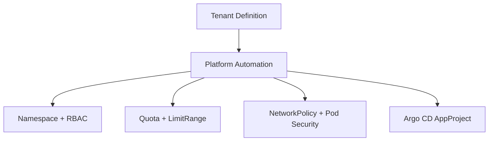

:::info Source and editorial scope
This lesson was expanded using topics and discussion that can be verified against the conversation, but **it is not a complete verbatim transcript**. The added sections were written for the website and may require version-specific testing before use in production.
:::

## Learning objectives

RBAC, quotas, NetworkPolicy, AppProject, self-service tenants.

## Soft and hard multi-tenancy

Namespaces suit internal teams that can share infrastructure at an appropriate level of trust, but they are not an absolute security boundary: tenants share the kernel, control plane, and some platform services. Hard isolation may require separate clusters or cloud projects.

## What does a tenant boundary need?



## ResourceQuota and LimitRange

ResourceQuota controls **aggregate** requests, limits, object counts, and storage in a namespace. LimitRange sets minimums, maximums, and defaults for individual containers, Pods, or PVCs, depending on the configured type. Cluster Autoscaler cannot resolve a quota violation.

```yaml
apiVersion: v1
kind: ResourceQuota
metadata:
  name: payment-quota
  namespace: payments
spec:
  hard:
    requests.cpu: '8'
    requests.memory: 16Gi
    pods: '30'
    persistentvolumeclaims: '5'
```

## Network isolation

A separate namespace does not block Pod-to-Pod traffic. Start with default-deny policies and explicitly allow required flows, including DNS and monitoring as needed. Restrict who can change namespace and Pod labels used in security selectors.

## AppProject and GitOps

An AppProject restricts source repositories, destination clusters and namespaces, and the resource kinds Argo CD can deploy. It does not replace Kubernetes RBAC. Manage highly privileged AppProjects and ApplicationSets as platform code.

## Self-Service Platform

Define a `Tenant` API (a custom CRD or declarative configuration) to provision namespaces, RBAC, quotas, policies, and AppProjects automatically. Make reconciliation idempotent, protect finalizers from unintended removal, and protect stateful resources from accidental deletion.

## When do you need a separate cluster?

If you need an independent control plane, a compliance boundary, kernel isolation, or a different Kubernetes version, evaluate cluster-based tenancy instead of placing every tenant in a namespace.

**Official:** [Kubernetes Multi-Tenancy](https://kubernetes.io/docs/concepts/security/multi-tenancy/) · [Argo CD Projects](https://argo-cd.readthedocs.io/en/stable/user-guide/projects/).


## Model the tenant boundary explicitly

A namespace scopes names for namespaced resources. It does **not** block network traffic by itself or separate the kernel or control plane. Namespaces can provide soft isolation for multiple teams; untrusted tenants with compliance or strong isolation requirements may need separate clusters or projects.

### RBAC and access to ServiceAccounts

A team whose permissions are limited to Deployments in its namespace can still use ServiceAccounts and Secrets through workloads. Denying `get secrets` is therefore not enough if the team can create Pods that run as an identity with access to Secrets. The platform must manage privileged ServiceAccounts, admission, and GitOps destinations.

### ResourceQuota and HPA

```yaml
apiVersion: v1
kind: ResourceQuota
metadata:
  name: payments
  namespace: payments
spec:
  hard:
    requests.cpu: '8'
    requests.memory: 16Gi
    pods: '30'
```

If each Pod requests 500m CPU and the quota is 8 cores, the CPU budget allows up to 16 Pods, assuming no other workloads consume it. The HPA can set the desired replica count to 20, but the API server rejects Pods that exceed the quota. Cluster Autoscaler cannot change quota admission policy.

### How LimitRange differs from ResourceQuota

LimitRange provides defaults, minimums, and maximums for Pods, containers, and PVCs, depending on its configuration. ResourceQuota caps the aggregate. Do not set the default CPU limit too low: it can cause throttling and increase p99 latency.

### NetworkPolicy default deny

```yaml
apiVersion: networking.k8s.io/v1
kind: NetworkPolicy
metadata:
  name: default-deny
  namespace: payments
spec:
  podSelector: {}
  policyTypes: [Ingress, Egress]
```

When explicitly allowing traffic, account for both egress from the caller and ingress to the recipient. Configure DNS access as well. Labels used by namespace and Pod selectors affect the security boundary, so tenants must not be free to change them arbitrarily.

### GitOps AppProject governance

An AppProject restricts sources, destinations, and resource kinds for deployments through Argo CD. It does not replace Kubernetes RBAC. The platform team should own AppProjects and ApplicationSets with cluster-wide permissions. Letting a developer edit the ApplicationSet template for a privileged project can grant more deployment authority than intended.

### Developer Self-Service

A `Tenant` API can reconcile namespaces, ResourceQuota, LimitRange, RBAC, NetworkPolicy, AppProjects, and IAM workflows. Reconciliation must be idempotent, and finalizers and deletion rules must protect stateful resources. Deleting a Tenant custom resource must not automatically delete production databases.

**Lab:** Create `payments` and `orders`, apply RBAC, quotas, and default-deny policies, then use impersonation and Pod network tests to check cross-namespace access. Record the onboarding checklist and team cost labels.

## Deep dive: designing a tenant boundary you can verify

### Soft and hard tenancy

For internal teams that generally trust one another, a single cluster can use namespaces, RBAC, quotas, and policies to divide responsibilities. If customers do not trust one another or need strong isolation or compliance controls, namespaces alone are not a sufficient security boundary. Consider separate clusters or projects, dedicated nodes, or additional runtime isolation.

A namespace does not block traffic between Pods, isolate the kernel, or assign separate cloud IAM permissions. A tenant boundary requires several controls:

| Boundary | Control | Who owns it? |
|---|---|---|
| Kubernetes API permissions | Role/RoleBinding, restricted service accounts | Platform team |
| Runtime privileges | Pod Security Admission Restricted | Platform team |
| Compute budgets | ResourceQuota + LimitRange | Platform team |
| Network flows | default-deny + explicit allow policies | Platform team / reviewed app additions |
| Cloud API | Scoped Workload Identity / IAM | Platform team |
| GitOps delivery | AppProject + Application RBAC | Platform team |
| Cost | Namespace labels + cost allocation | FinOps / Platform team |

### ResourceQuota versus LimitRange

`ResourceQuota` caps aggregate resource requests and counts in a namespace, such as `requests.cpu: 8` and `pods: 30`. `LimitRange` sets defaults, minimums, and maximums for individual containers, Pods, or PVCs. If a Pod omits resource requests, a LimitRange can supply defaults so quota accounting includes them. API admission rejects requests that violate the quota; **adding nodes does not resolve a quota violation**.

For example, if each Payment Pod requests 500m and the `requests.cpu` quota is 8 cores, the CPU request budget alone allows up to 16 Pods if no other workloads consume it. An HPA request for 20 replicas can be blocked by quota even when the cluster has capacity available.

### NetworkPolicy: use selectors carefully

```yaml
apiVersion: networking.k8s.io/v1
kind: NetworkPolicy
metadata:
  name: default-deny
  namespace: payments
spec:
  podSelector: {}
  policyTypes: [Ingress, Egress]
```

After applying default-deny, explicitly allow DNS and every required traffic flow. Without DNS access, an application cannot resolve Service names. When `namespaceSelector` and `podSelector` are in the same peer object, both conditions must match (AND). If they are in separate peer entries, the entries generally match either condition (OR). Letting tenants edit namespace labels used as security selectors undermines the trust model because those labels determine which traffic the policy permits.

### Argo CD AppProject and Kubernetes RBAC

An AppProject restricts source repositories, destinations, and resource kinds for Argo CD Applications. Kubernetes RBAC still controls API access via `kubectl` or other clients. Do not allow tenants to modify AppProjects or privileged ApplicationSet templates that define the deployment boundary. The Argo CD `default` project can be too permissive unless it is hardened.

### Multi-tenant governance on GKE

GKE Fleet team scopes can support tenancy at the organization or fleet-membership level across multiple clusters. Terraform, Config Sync, Argo CD, and Fleet should not share ownership of a security-critical field without clear boundaries. Cost allocation must also account for system workloads, networking, storage, and shared overhead. CPU utilization alone does not tell you what the cloud provider bills.

### Self-service with a platform API

Design a `Tenant` CRD or a YAML configuration file that represents a team:

```yaml
apiVersion: platform.example.com/v1alpha1
kind: Tenant
metadata:
  name: payment
spec:
  owner: payment-team
  resourceProfile: standard
  securityProfile: restricted
```

This is a hypothetical API: you must implement the CRD and controller yourself. The tenant reconciler must create the namespace, quota, RBAC, policies, AppProject, and cloud IAM configuration according to a clear contract. It needs status conditions, ownership tracking, idempotent reconciliation, and safe deletion rules. Deleting a Tenant custom resource should **not** automatically delete PVCs or databases.

### Lab with two tenants

1. Create the `payments` and `orders` namespaces with platform-owned labels.
2. Apply separate Roles and RoleBindings, then check permissions with `kubectl auth can-i`.
3. Apply ResourceQuota and LimitRange, then try deploying a workload that exceeds the quota.
4. Apply default-deny ingress and egress, then explicitly allow Payment traffic to Order on port 8080 and allow DNS egress.
5. Create an AppProject restricted to `payments`, and verify that it rejects an attempt to deploy to `orders`.
6. Review metrics and cost allocation by namespace, and document the limitations when attributing shared costs.

Sources: [Kubernetes multi-tenancy](https://kubernetes.io/docs/concepts/security/multi-tenancy/), [ResourceQuota](https://kubernetes.io/docs/concepts/policy/resource-quotas/), [NetworkPolicy](https://kubernetes.io/docs/concepts/services-networking/network-policies/), [Argo CD projects](https://argo-cd.readthedocs.io/en/stable/user-guide/projects/).

## Choose a tenancy model from the trust boundaries

A namespace scopes names and permissions. Internal teams can share an API server and nodes with layered controls when the trust model permits it. Tenants running untrusted code or requiring independent compliance, versions, operators, kernels or failure domains can require separate clusters, projects or sandbox runtimes. Separate clusters still share any infrastructure explicitly connected to both. Inventory the dependencies and administrative identities that span the intended boundary.

| Control | Enforced boundary |
|---|---|
| RBAC | Kubernetes API permissions for named identities |
| ResourceQuota and LimitRange | Aggregate declarations and per-object defaults or bounds |
| Pod Security and admission | Accepted configurations and approved exemptions |
| NetworkPolicy and mesh authorization | Connectivity and, where configured, authenticated service access |
| AppProject | GitOps repositories, destinations and resource kinds |
| Cloud IAM | External resource permissions for the actual workload identity |

### Establish Payment and Order namespaces

Platform administrators own namespace labels, quotas, limits and network policy. Tenant workload writers can affect identity selection and consumed data in their namespace. Review effective permissions as in [Lesson 18](./lesson-18-security.md). Keep cluster-scoped objects such as CRDs, StorageClasses and ClusterRoleBindings under platform governance. A role for development can allow create, get, update and patch on selected deployments or services. Production teams can instead deliver through a scoped Git workflow.

```yaml
apiVersion: v1
kind: Namespace
metadata:
  name: payments
  labels:
    tenant: payment
    governance: standard
    pod-security.kubernetes.io/enforce: restricted
---
apiVersion: v1
kind: ResourceQuota
metadata:
  name: payment-quota
  namespace: payments
spec:
  hard:
    requests.cpu: "8"
    requests.memory: 16Gi
    limits.cpu: "16"
    limits.memory: 32Gi
    pods: "30"
    services: "10"
    persistentvolumeclaims: "5"
    requests.storage: 500Gi
---
apiVersion: v1
kind: LimitRange
metadata:
  name: payment-limits
  namespace: payments
spec:
  limits:
    - type: Container
      defaultRequest: {cpu: 100m, memory: 128Mi}
      default: {cpu: "1", memory: 1Gi}
      min: {cpu: 50m, memory: 64Mi}
      max: {cpu: "2", memory: 2Gi}
```

Create an equivalent Order namespace with its own labels and limits. Pod admission can fill in missing requests and limits through LimitRange and charge them to ResourceQuota. A default limit can be incompatible with an explicit request or cause application throttling. Test representative admitted specs. An 8-core request quota and 500m per Pod allow 16 identical Pods by CPU alone. If HPA asks for 20, the ReplicaSet may report Pod creation denied. A rejected Pod never reaches the scheduler, so adding nodes cannot clear the quota. Account for existing workloads, memory, any injected sidecars and rollout surge. Quota limits declarations and object counts, while cgroups and node placement govern runtime usage. [ResourceQuota](https://kubernetes.io/docs/concepts/policy/resource-quotas/) · [LimitRange](https://kubernetes.io/docs/concepts/policy/limit-range/)

### Admit only the intended network paths

Start with baseline default-deny for ingress and egress in each isolated tenant namespace, on a dataplane that enforces NetworkPolicy. Permit intended paths such as Payment → Order on 8080 and Order → PostgreSQL on 5432. For Payment to Order, add source egress and destination ingress, selecting both the peer namespace and Pod labels in a single peer item. Match DNS egress to the actual resolver, and include approved metrics, ingress and external dependencies. The [NetworkPolicy examples in Lesson 12](../05-networking/lesson-12-kubernetes-networking.md#allow-only-the-selected-payment-pods-to-reach-postgresql) show the two-sided construction.

Policies are additive. Take particular care when a tenant can write policy objects or labels used by other teams' policies. Workload labels express selection, while mesh identities provide an independently authenticated attribute. Verify expected flows from the relevant Pod context.

### Connect app delivery to platform governance

```yaml
apiVersion: argoproj.io/v1alpha1
kind: AppProject
metadata:
  name: payment-team
  namespace: argocd
spec:
  sourceRepos:
    - https://github.com/example/payment-gitops.git
  destinations:
    - server: https://kubernetes.default.svc
      namespace: payments
  clusterResourceWhitelist: []
  namespaceResourceWhitelist:
    - {group: apps, kind: Deployment}
    - {group: "", kind: Service}
    - {group: "", kind: ConfigMap}
    - {group: autoscaling, kind: HorizontalPodAutoscaler}
```

This project permits only the listed namespaced kinds and destination. Review HTTPRoute, Rollout or ExternalSecret when needed. Protect projects, Argo CD RBAC and Kubernetes credentials, and audit direct Kubernetes access separately. In particular, keep tenant projects and generator inputs away from administrative destinations. Use a platform-owned ApplicationSet to generate bootstrap Applications from reviewed tenant catalog entries. Pin a known administrative project and validate namespaces and paths before generating Applications. After onboarding, use the lower-privilege team project for workload delivery. [Argo CD projects](https://argo-cd.readthedocs.io/en/stable/user-guide/projects/) · [ApplicationSet](https://argo-cd.readthedocs.io/en/stable/operator-manual/applicationset/)

A CEL policy bound to namespaces labeled governance=standard can enforce a Deployment replica maximum. Targets matching deployments alone do not cover deployments/scale. Define the intended boundary explicitly. For HPA objects validate maxReplicas, for scale subresources scope a policy to the appropriate request shape, and for a namespace-wide Pod ceiling apply a quota. Protect the labels and policy parameters that select thresholds. Record business justification, owner, scope and expiration for exceptions. [ValidatingAdmissionPolicy](https://kubernetes.io/docs/reference/access-authn-authz/validating-admission-policy/)

### Extend the boundary across clusters and account for shared cost

GKE Fleet groups memberships. Team scopes and fleet namespaces can organize team access across selected clusters. Config Sync can apply platform baseline using fleet tenancy metadata where supported. Argo CD delivers team applications and Terraform owns cloud infrastructure. Assign a single owner per desired configuration field. Define cloud IAM and network boundaries independently, particularly with Shared VPC or shared fleets. [GKE fleet concepts](https://docs.cloud.google.com/kubernetes-engine/fleet-management/docs/fleet-concepts) · [Kubernetes multi-tenancy](https://kubernetes.io/docs/concepts/security/multi-tenancy/)

Quotas do not bound every noisy-neighbor path. Monitor API requests and object growth, ephemeral storage, DNS load, registry pulls, NAT ports, CSI provisioning and shared Gateway traffic. Evaluate API Priority and Fairness, object quotas, rate limits and isolated capacity according to the resource involved. Showback reports costs and chargeback allocates actual costs to teams. Use stable cost-center labels, billing exports and GKE cost allocation where supported. Define how to assign system Pods, monitoring, ingress, egress and idle headroom instead of treating CPU usage as total cost. [GKE cost allocation](https://docs.cloud.google.com/kubernetes-engine/docs/how-to/cost-allocations)

### Provide a self-service contract and verify it

A platform can accept a team-owned request with a validated owner, environment list, resource profile and security profile through a reviewed PR. A custom Tenant API requires a CRD and a reconciler, or another automation layer that renders the platform resources. Reconcile namespace ownership, RBAC, default policies, quotas and AppProject idempotently. Coordinate external IAM and report conditions with observedGeneration. Keep durable data and cloud resources behind an explicit decommission decision when removing the tenant. Recover from partial onboarding without crossing boundaries.

In the two-namespace lab, verify Payment's effective permissions against both namespaces, enforced quota and LimitRange bounds, Restricted admission, default-deny behavior and explicit Payment → Order connectivity. Exercise the AppProject allowlist with an out-of-scope destination in the lab, verify platform labels cannot be altered by a tenant, and check cost attribution. Use admission or existing audit evidence rather than treating a successfully stored NetworkPolicy as proof of connectivity. For the next step, design an internal developer platform API that can render these reviewed profiles, expose progress and support safe offboarding.

### Render reviewed tenant entries into Applications

This example runs in a platform-managed AppProject that permits the source, destinations, and bootstrap kinds. Create each tenant namespace through the platform bootstrap workflow before syncing namespaced resources. Keep the source paths and generator data in a repository controlled by the platform team.

```yaml
apiVersion: argoproj.io/v1alpha1
kind: ApplicationSet
metadata:
  name: tenant-baselines
  namespace: argocd
spec:
  goTemplate: true
  goTemplateOptions: [missingkey=error]
  generators:
    - list:
        elements:
          - {name: payment, namespace: payments}
          - {name: order, namespace: orders}
  template:
    metadata:
      name: '{{.name}}-baseline'
    spec:
      project: platform-admin
      source:
        repoURL: https://github.com/example/platform-gitops.git
        targetRevision: main
        path: 'tenants/{{.name}}'
      destination:
        server: https://kubernetes.default.svc
        namespace: '{{.namespace}}'
      syncPolicy:
        automated:
          prune: false
          selfHeal: true
```

Keep tenant registration changes reviewable independently of application releases. Removing a generator entry can delete the corresponding Application under its modification policy. Review finalizers, deletion settings, and retention before offboarding. Inspect each generated application's effective project and destination as part of onboarding verification.

### Audit a scoped tenant capacity policy

This example checks regular Deployment writes in namespaces with a platform-managed governance label. Start in Warn and Audit, then move to Deny after confirming the intended callers and reviewing exceptions.

```yaml
apiVersion: admissionregistration.k8s.io/v1
kind: ValidatingAdmissionPolicy
metadata:
  name: standard-deployment-replica-cap
spec:
  failurePolicy: Fail
  matchConstraints:
    resourceRules:
      - apiGroups: [apps]
        apiVersions: [v1]
        operations: [CREATE, UPDATE]
        resources: [deployments]
  validations:
    - expression: '!has(object.spec.replicas) || object.spec.replicas <= 10'
      message: Standard deployments may request up to ten replicas.
---
apiVersion: admissionregistration.k8s.io/v1
kind: ValidatingAdmissionPolicyBinding
metadata:
  name: standard-deployment-replica-cap
spec:
  policyName: standard-deployment-replica-cap
  validationActions: [Warn, Audit]
  matchResources:
    namespaceSelector:
      matchLabels:
        governance: standard
```

A parameterized policy can reuse one expression with an approved threshold referenced through paramKind and paramRef. Decide separately whether to enforce the scale subresource, HPA configuration, or total namespace Pod count. During the tenant lab, test the permitted and denied deployment destination, check admitted resource defaults, and confirm data and network isolation for both tenants.

Practice with the [platform operations exercises](../06-compute-storage/platform-operations-exercises.mdx).

## Self-check questions
1. Which controller owns the desired state and the actual state in this lesson?
2. What failure modes can occur even when the Kubernetes resource reports `Ready`?
3. What would you verify before deploying to production?
