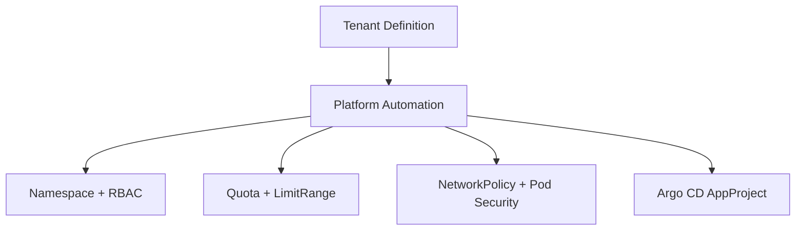

## Mục tiêu học tập

- **Lựa chọn giữa mô hình soft và hard multi-tenancy:** Đánh giá khi nào namespace dùng chung kèm các lớp kiểm soát là đủ và khi nào yêu cầu về tin cậy, tuân thủ hoặc cô lập kernel đòi hỏi cluster hay project riêng.
- **Thực thi ranh giới tài nguyên và admission theo namespace:** Kết hợp `ResourceQuota`, `LimitRange`, `ValidatingAdmissionPolicy` và Pod Security Admission để giới hạn tổng tài nguyên và từng container mà không làm gián đoạn HPA hay rollout.
- **Cô lập lưu lượng giữa các tenant bằng NetworkPolicy tường minh:** Áp dụng chính sách nền default-deny cho cả ingress và egress, xây dựng quy tắc cho phép hai chiều với namespace/Pod selector và bảo vệ các label do nền tảng sở hữu.
- **Quản trị phát hành GitOps và multi-cluster tenancy:** Giới hạn phạm vi Argo CD `AppProject` và `ApplicationSet` độc lập với Kubernetes RBAC, đồng thời đồng bộ GKE Fleet team scopes với quyền sở hữu trường dữ liệu và phân bổ chi phí rõ ràng.
- **Thiết kế Tenant API tự phục vụ an toàn:** Reconcile namespace, RBAC, quota, chính sách và IAM một cách idempotent đồng thời bảo vệ workload stateful và PVC khỏi bị xóa nhầm khi offboarding.

## Soft và hard multi-tenancy

Namespace phù hợp cho các nhóm nội bộ có thể dùng chung hạ tầng ở một mức độ tin cậy phù hợp, nhưng chúng không phải là một ranh giới bảo mật tuyệt đối: các tenant vẫn dùng chung kernel, control plane và một số dịch vụ nền tảng. Cô lập cứng (hard isolation) có thể đòi hỏi các cluster hoặc cloud project riêng biệt.

## Một ranh giới tenant cần những gì?



## ResourceQuota và LimitRange

ResourceQuota kiểm soát **tổng** requests, limits, số lượng đối tượng và dung lượng lưu trữ trong một namespace. LimitRange thiết lập giá trị tối thiểu, tối đa và mặc định cho từng container, Pod hoặc PVC, tùy theo loại được cấu hình. Cluster Autoscaler không thể giải quyết lỗi vi phạm quota.

```yaml
apiVersion: v1
kind: ResourceQuota
metadata:
  name: payment-quota
  namespace: payments
spec:
  hard:
    requests.cpu: '8'
    requests.memory: 16Gi
    pods: '30'
    persistentvolumeclaims: '5'
```

## Cô lập mạng (Network isolation)

Một namespace riêng không tự động chặn lưu lượng Pod-to-Pod. Hãy bắt đầu với các chính sách mặc định từ chối (default-deny) rồi mở tường minh các luồng cần thiết, bao gồm DNS và giám sát khi cần. Giới hạn ai được phép thay đổi các label của namespace và Pod vốn được dùng trong các security selector.

## AppProject và GitOps

AppProject giới hạn source repositories, cluster và namespace đích, cũng như các loại tài nguyên mà Argo CD được phép triển khai. Nó không thay thế cho Kubernetes RBAC. Hãy quản lý các AppProject và ApplicationSet có đặc quyền cao như một phần của mã nguồn nền tảng (platform code).

## Nền tảng tự phục vụ (Self-Service Platform)

Định nghĩa một `Tenant` API (dưới dạng custom CRD hoặc cấu hình khai báo) để tự động cấp phát namespace, RBAC, quota, chính sách và AppProject. Đảm bảo quá trình reconcile có tính idempotent, bảo vệ finalizer khỏi việc bị gỡ bỏ ngoài ý muốn và bảo vệ các tài nguyên stateful khỏi bị xóa nhầm.

## Khi nào bạn cần một cluster riêng?

Nếu bạn cần một control plane độc lập, một ranh giới tuân thủ (compliance boundary), cô lập kernel hoặc một phiên bản Kubernetes khác biệt, hãy đánh giá mô hình cluster-based tenancy thay vì đặt mọi tenant vào các namespace dùng chung.

**Tài liệu chính thức:** [Kubernetes Multi-Tenancy](https://kubernetes.io/docs/concepts/security/multi-tenancy/) · [Argo CD Projects](https://argo-cd.readthedocs.io/en/stable/user-guide/projects/).

## Mô hình hóa ranh giới tenant một cách tường minh

Namespace khoanh vùng tên cho các tài nguyên thuộc phạm vi namespace. Bản thân nó **không** chặn lưu lượng mạng cũng không tách biệt kernel hay control plane. Namespace có thể mang lại khả năng cô lập mềm (soft isolation) cho nhiều nhóm; các tenant không tin cậy lẫn nhau với yêu cầu tuân thủ hoặc cô lập mạnh có thể cần cluster hoặc project riêng.

### RBAC và quyền truy cập ServiceAccounts

Một nhóm có quyền hạn giới hạn ở Deployment trong namespace của mình vẫn có thể sử dụng ServiceAccounts và Secrets thông qua các workload. Vì vậy, việc từ chối `get secrets` là chưa đủ nếu nhóm đó có thể tạo Pod chạy dưới một định danh có quyền đọc Secrets. Nền tảng phải quản lý các ServiceAccount có đặc quyền, tầng admission và các đích triển khai GitOps.

### ResourceQuota và HPA

```yaml
apiVersion: v1
kind: ResourceQuota
metadata:
  name: payments
  namespace: payments
spec:
  hard:
    requests.cpu: '8'
    requests.memory: 16Gi
    pods: '30'
```

Nếu mỗi Pod request 500m CPU và quota là 8 core, ngân sách CPU chỉ cho phép tối đa 16 Pod, giả sử không có workload nào khác sử dụng. HPA có thể đặt số replica mong muốn lên 20, nhưng API server sẽ từ chối các Pod vượt quá quota. Cluster Autoscaler không thể thay đổi chính sách kiểm duyệt quota.

### LimitRange khác ResourceQuota như thế nào?

LimitRange cung cấp các giá trị mặc định, tối thiểu và tối đa cho từng Pod, container và PVC, tùy vào cấu hình. ResourceQuota giới hạn tổng mức tài nguyên. Không đặt CPU limit mặc định quá thấp: điều này có thể gây throttling và làm tăng độ trễ p99.

### NetworkPolicy default deny

```yaml
apiVersion: networking.k8s.io/v1
kind: NetworkPolicy
metadata:
  name: default-deny
  namespace: payments
spec:
  podSelector: {}
  policyTypes: [Ingress, Egress]
```

Khi mở lưu lượng một cách tường minh, cần tính đến cả chiều egress từ bên gọi lẫn chiều ingress tới bên nhận. Đồng thời cấu hình quyền truy cập DNS. Các label được dùng bởi namespace selector và pod selector ảnh hưởng trực tiếp đến ranh giới bảo mật, nên tenant không được phép tự ý chỉnh sửa chúng.

### Quản trị GitOps AppProject

AppProject giới hạn nguồn, đích và loại tài nguyên cho các đợt triển khai qua Argo CD. Nó không thay thế Kubernetes RBAC. Nhóm nền tảng nên sở hữu các AppProject và ApplicationSet có quyền trên toàn cluster. Cho phép lập trình viên chỉnh sửa template của ApplicationSet thuộc một project có đặc quyền có thể cấp quyền triển khai rộng hơn dự kiến.

### Tự phục vụ cho lập trình viên (Developer Self-Service)

Một `Tenant` API có thể reconcile namespace, ResourceQuota, LimitRange, RBAC, NetworkPolicy, AppProjects và các luồng IAM. Quá trình reconcile phải có tính idempotent, đồng thời các finalizer và quy tắc xóa phải bảo vệ được tài nguyên stateful. Xóa một custom resource Tenant không được phép tự động xóa các cơ sở dữ liệu production.

**Thực hành (Lab):** Tạo `payments` và `orders`, áp dụng RBAC, quota và chính sách default-deny, sau đó dùng impersonation và các bài kiểm thử mạng giữa các Pod để kiểm tra quyền truy cập liên namespace. Ghi lại checklist onboarding và các nhãn phân bổ chi phí theo nhóm.

## Tìm hiểu sâu: Thiết kế một ranh giới tenant có thể kiểm chứng

### Soft và hard tenancy

Đối với các nhóm nội bộ nhìn chung tin cậy lẫn nhau, một cluster duy nhất có thể dùng namespace, RBAC, quota và các chính sách để phân tách trách nhiệm. Nếu các khách hàng không tin cậy lẫn nhau hoặc cần kiểm soát tuân thủ, cô lập mạnh, chỉ riêng namespace là không đủ làm ranh giới bảo mật. Hãy cân nhắc cluster hoặc project riêng, node chuyên dụng hoặc lớp cô lập runtime bổ sung.

Namespace không chặn lưu lượng giữa các Pod, không cô lập kernel hay gán quyền cloud IAM riêng biệt. Một ranh giới tenant đòi hỏi nhiều lớp kiểm soát:

| Ranh giới | Kiểm soát | Ai sở hữu? |
|---|---|---|
| Quyền Kubernetes API | Role/RoleBinding, các service account bị hạn chế | Nhóm nền tảng |
| Đặc quyền runtime | Pod Security Admission Restricted | Nhóm nền tảng |
| Ngân sách tính toán | ResourceQuota + LimitRange | Nhóm nền tảng |
| Luồng mạng | default-deny + các chính sách cho phép tường minh | Nhóm nền tảng / bổ sung từ ứng dụng đã được review |
| Cloud API | Workload Identity / IAM giới hạn phạm vi | Nhóm nền tảng |
| Triển khai GitOps | AppProject + Application RBAC | Nhóm nền tảng |
| Chi phí | Namespace labels + phân bổ chi phí | FinOps / Nhóm nền tảng |

### ResourceQuota so với LimitRange

`ResourceQuota` giới hạn tổng resource requests và số lượng đối tượng trong một namespace, chẳng hạn `requests.cpu: 8` và `pods: 30`. `LimitRange` đặt giá trị mặc định, tối thiểu và tối đa cho từng container, Pod hoặc PVC. Nếu một Pod không khai báo resource requests, LimitRange có thể tự điền giá trị mặc định để hệ thống tính quota bao gồm chúng. Bước API admission sẽ từ chối các yêu cầu vi phạm quota; **thêm node không giải quyết được lỗi vi phạm quota**.

Ví dụ, nếu mỗi Payment Pod request 500m và quota `requests.cpu` là 8 core, riêng ngân sách CPU request chỉ cho phép tối đa 16 Pod nếu không có workload nào khác dùng chung. Yêu cầu mở rộng lên 20 replica của HPA có thể bị chặn bởi quota ngay cả khi cluster vẫn còn dư năng lực.

### NetworkPolicy: sử dụng selector cẩn thận

```yaml
apiVersion: networking.k8s.io/v1
kind: NetworkPolicy
metadata:
  name: default-deny
  namespace: payments
spec:
  podSelector: {}
  policyTypes: [Ingress, Egress]
```

Sau khi áp dụng default-deny, hãy mở tường minh DNS và mọi luồng lưu lượng cần thiết. Không có quyền truy cập DNS, ứng dụng không thể phân giải tên Service. Khi `namespaceSelector` và `podSelector` nằm trong cùng một đối tượng peer, cả hai điều kiện đều phải khớp (AND). Nếu chúng nằm ở hai mục peer riêng biệt, các mục đó thường khớp theo một trong hai điều kiện (OR). Cho phép tenant chỉnh sửa các namespace label dùng làm security selector sẽ phá vỡ mô hình tin cậy vì những label đó quyết định lưu lượng nào được chính sách cho phép.

### Argo CD AppProject và Kubernetes RBAC

AppProject giới hạn source repositories, đích triển khai và loại tài nguyên cho các Argo CD Application. Kubernetes RBAC vẫn là lớp kiểm soát quyền truy cập API qua `kubectl` hoặc các client khác. Không cho phép tenant chỉnh sửa các AppProject hoặc template ApplicationSet có đặc quyền vốn định nghĩa ranh giới triển khai. Project `default` của Argo CD có thể quá rộng rãi trừ khi được thắt chặt (hardened).

### Quản trị multi-tenant trên GKE

GKE Fleet team scopes có thể hỗ trợ tenancy ở cấp độ tổ chức hoặc fleet-membership trên nhiều cluster. Terraform, Config Sync, Argo CD và Fleet không nên cùng sở hữu một trường cấu hình trọng yếu về bảo mật mà không có ranh giới rõ ràng. Phân bổ chi phí cũng phải tính đến các workload hệ thống, mạng, lưu trữ và phần chi phí dùng chung (shared overhead). Chỉ nhìn vào mức sử dụng CPU sẽ không cho bạn biết chính xác nhà cung cấp cloud tính phí những gì.

### Tự phục vụ bằng Platform API

Thiết kế một `Tenant` CRD hoặc tệp cấu hình YAML đại diện cho một nhóm:

```yaml
apiVersion: platform.example.com/v1alpha1
kind: Tenant
metadata:
  name: payment
spec:
  owner: payment-team
  resourceProfile: standard
  securityProfile: restricted
```

Đây là một API giả định: bạn cần tự triển khai CRD và controller. Bộ reconciler cho tenant phải tạo namespace, quota, RBAC, các chính sách, AppProject và cấu hình cloud IAM theo một hợp đồng rõ ràng. Nó cần có status conditions, theo dõi quyền sở hữu, khả năng reconcile idempotent và quy tắc xóa an toàn. Xóa một custom resource Tenant **không** nên tự động xóa các PVC hay cơ sở dữ liệu.

### Thực hành với hai tenant

1. Tạo hai namespace `payments` và `orders` với các label thuộc quyền sở hữu của nền tảng.
2. Áp dụng các Role và RoleBinding riêng biệt, sau đó kiểm tra quyền bằng `kubectl auth can-i`.
3. Áp dụng ResourceQuota và LimitRange, rồi thử triển khai một workload vượt quá quota.
4. Áp dụng default-deny cho cả ingress và egress, sau đó mở tường minh lưu lượng từ Payment tới Order trên cổng 8080 và mở DNS egress.
5. Tạo một AppProject giới hạn chỉ cho `payments`, và xác minh nó từ chối nỗ lực triển khai sang `orders`.
6. Rà soát các metric và phân bổ chi phí theo namespace, đồng thời ghi chú các giới hạn khi phân bổ chi phí dùng chung.

Nguồn: [Kubernetes multi-tenancy](https://kubernetes.io/docs/concepts/security/multi-tenancy/), [ResourceQuota](https://kubernetes.io/docs/concepts/policy/resource-quotas/), [NetworkPolicy](https://kubernetes.io/docs/concepts/services-networking/network-policies/), [Argo CD projects](https://argo-cd.readthedocs.io/en/stable/user-guide/projects/).

## Chọn mô hình tenancy từ các ranh giới tin cậy

Namespace khoanh vùng tên và quyền hạn. Các nhóm nội bộ có thể dùng chung một API server và các node với nhiều lớp kiểm soát khi mô hình tin cậy cho phép. Các tenant chạy mã nguồn không đáng tin cậy hoặc yêu cầu tuân thủ, phiên bản, operator, kernel hay failure domain độc lập có thể cần các cluster, project hoặc sandbox runtime riêng biệt. Các cluster tách biệt vẫn dùng chung bất kỳ hạ tầng nào được kết nối tường minh tới cả hai. Hãy kiểm kê các phụ thuộc và định danh quản trị trải ngang qua ranh giới dự kiến.

| Kiểm soát | Ranh giới được thực thi |
|---|---|
| RBAC | Quyền Kubernetes API cho các định danh cụ thể |
| ResourceQuota và LimitRange | Khai báo tổng mức tài nguyên và giá trị mặc định/giới hạn cho từng đối tượng |
| Pod Security và admission | Các cấu hình được chấp nhận và ngoại lệ được phê duyệt |
| NetworkPolicy và mesh authorization | Khả năng kết nối và, khi được cấu hình, quyền truy cập dịch vụ đã xác thực |
| AppProject | Các repository GitOps, đích triển khai và loại tài nguyên |
| Cloud IAM | Quyền truy cập tài nguyên bên ngoài cho định danh workload thực tế |

### Thiết lập hai namespace Payment và Order

Quản trị viên nền tảng nắm quyền sở hữu namespace labels, quotas, limits và network policy. Người có quyền ghi workload của tenant có thể ảnh hưởng đến việc chọn định danh và dữ liệu tiêu thụ trong namespace của họ. Rà soát quyền hiệu lực như trong [Bài 18](./lesson-18-security.md). Giữ các đối tượng cấp cluster như CRD, StorageClass và ClusterRoleBinding dưới sự quản trị của nền tảng. Một role cho môi trường phát triển có thể cho phép create, get, update và patch trên một số deployment hoặc service chọn lọc. Ngược lại, các nhóm production có thể triển khai thông qua một luồng Git có phạm vi kiểm soát chặt chẽ.

```yaml
apiVersion: v1
kind: Namespace
metadata:
  name: payments
  labels:
    tenant: payment
    governance: standard
    pod-security.kubernetes.io/enforce: restricted
---
apiVersion: v1
kind: ResourceQuota
metadata:
  name: payment-quota
  namespace: payments
spec:
  hard:
    requests.cpu: "8"
    requests.memory: 16Gi
    limits.cpu: "16"
    limits.memory: 32Gi
    pods: "30"
    services: "10"
    persistentvolumeclaims: "5"
    requests.storage: 500Gi
---
apiVersion: v1
kind: LimitRange
metadata:
  name: payment-limits
  namespace: payments
spec:
  limits:
    - type: Container
      defaultRequest: {cpu: 100m, memory: 128Mi}
      default: {cpu: "1", memory: 1Gi}
      min: {cpu: 50m, memory: 64Mi}
      max: {cpu: "2", memory: 2Gi}
```

Tạo một namespace Order tương đương với các label và giới hạn riêng. Bước Pod admission có thể tự điền các requests và limits bị thiếu thông qua LimitRange rồi tính chúng vào ResourceQuota. Một mức limit mặc định có thể không tương thích với một request khai báo tường minh hoặc gây throttling cho ứng dụng. Hãy kiểm thử với các spec tiêu biểu sau khi được admit. Quota request 8 core và 500m mỗi Pod chỉ cho phép 16 Pod giống nhau nếu chỉ xét riêng CPU. Nếu HPA yêu cầu 20, ReplicaSet có thể báo lỗi từ chối tạo Pod. Một Pod bị từ chối sẽ không bao giờ tới được scheduler, nên việc thêm node không thể gỡ bỏ nút thắt quota. Hãy tính đến các workload hiện có, memory, bất kỳ sidecar nào được tiêm vào và phần surge khi rollout. Quota giới hạn các khai báo và số lượng đối tượng, trong khi cgroups và vị trí đặt node quản lý mức sử dụng thực tế ở runtime. [ResourceQuota](https://kubernetes.io/docs/concepts/policy/resource-quotas/) · [LimitRange](https://kubernetes.io/docs/concepts/policy/limit-range/)

### Chỉ cho phép các đường dẫn mạng dự kiến

Bắt đầu với chính sách nền default-deny cho cả ingress và egress trong mỗi tenant namespace cô lập, trên một dataplane có thực thi NetworkPolicy. Cho phép các đường dẫn dự kiến như Payment → Order trên cổng 8080 và Order → PostgreSQL trên cổng 5432. Đối với Payment tới Order, cần thêm cả egress ở nguồn lẫn ingress ở đích, chọn đồng thời cả label của namespace đích và label của Pod trong cùng một mục peer. Khớp DNS egress với đúng resolver thực tế, và bao gồm cả các đường dẫn metrics, ingress và phụ thuộc bên ngoài đã phê duyệt. Các [ví dụ NetworkPolicy trong Bài 12](../05-networking/lesson-12-kubernetes-networking.md#allow-only-the-selected-payment-pods-to-reach-postgresql) minh họa cách xây dựng hai chiều này.

Các chính sách mạng mang tính cộng dồn (additive). Đặc biệt cẩn trọng khi một tenant có thể ghi các đối tượng policy hoặc các label vốn được dùng bởi policy của nhóm khác. Workload labels chỉ thể hiện điều kiện chọn lọc, trong khi mesh identities cung cấp một thuộc tính được xác thực độc lập. Hãy xác minh các luồng mạng kỳ vọng từ đúng ngữ cảnh Pod liên quan.

### Kết nối việc phát hành ứng dụng với quản trị nền tảng

```yaml
apiVersion: argoproj.io/v1alpha1
kind: AppProject
metadata:
  name: payment-team
  namespace: argocd
spec:
  sourceRepos:
    - https://github.com/example/payment-gitops.git
  destinations:
    - server: https://kubernetes.default.svc
      namespace: payments
  clusterResourceWhitelist: []
  namespaceResourceWhitelist:
    - {group: apps, kind: Deployment}
    - {group: "", kind: Service}
    - {group: "", kind: ConfigMap}
    - {group: autoscaling, kind: HorizontalPodAutoscaler}
```

Project này chỉ cho phép các loại tài nguyên cấp namespace và đích triển khai được liệt kê. Hãy rà soát `HTTPRoute`, `Rollout` hoặc `ExternalSecret` khi cần thiết. Bảo vệ các project, Argo CD RBAC và thông tin xác thực Kubernetes, đồng thời kiểm toán riêng quyền truy cập trực tiếp vào Kubernetes. Cụ thể, cần giữ các tenant project và dữ liệu đầu vào của generator tránh xa các đích triển khai mang tính quản trị. Sử dụng một ApplicationSet do nền tảng sở hữu để sinh ra các Application bootstrap từ danh mục tenant đã được review. Ghim một project quản trị xác định và kiểm tra hợp lệ các namespace cùng đường dẫn trước khi sinh Application. Sau khi onboarding, hãy dùng team project có đặc quyền thấp hơn cho việc phát hành workload. [Argo CD projects](https://argo-cd.readthedocs.io/en/stable/user-guide/projects/) · [ApplicationSet](https://argo-cd.readthedocs.io/en/stable/operator-manual/applicationset/)

Một chính sách CEL gắn vào các namespace có nhãn `governance=standard` có thể thực thi mức trần replica cho Deployment. Phạm vi chỉ khớp với `deployments` sẽ không bao phủ `deployments/scale`. Hãy định nghĩa ranh giới dự kiến một cách tường minh. Đối với đối tượng HPA, cần kiểm tra `maxReplicas`; đối với subresource `scale`, cần khoanh vùng chính sách theo đúng cấu trúc request tương ứng; và để đặt trần tổng số Pod trên toàn namespace, hãy áp dụng quota. Bảo vệ các label và tham số chính sách dùng để chọn ngưỡng. Ghi lại lý do nghiệp vụ, người chịu trách nhiệm, phạm vi và thời hạn cho mọi ngoại lệ. [ValidatingAdmissionPolicy](https://kubernetes.io/docs/reference/access-authn-authz/validating-admission-policy/)

### Mở rộng ranh giới qua nhiều cluster và hạch toán chi phí dùng chung

GKE Fleet gom nhóm các cluster thành viên. Team scopes và fleet namespaces giúp tổ chức quyền truy cập của nhóm qua các cluster được chọn. Config Sync có thể áp dụng cấu hình nền của platform dựa trên metadata fleet tenancy ở những nơi được hỗ trợ. Argo CD triển khai ứng dụng của các nhóm còn Terraform sở hữu hạ tầng cloud. Chỉ định duy nhất một chủ sở hữu cho mỗi trường cấu hình mong muốn. Định nghĩa độc lập các ranh giới cloud IAM và mạng, đặc biệt khi dùng Shared VPC hoặc shared fleets. [GKE fleet concepts](https://docs.cloud.google.com/kubernetes-engine/fleet-management/docs/fleet-concepts) · [Kubernetes multi-tenancy](https://kubernetes.io/docs/concepts/security/multi-tenancy/)

Quota không chặn được mọi kịch bản ảnh hưởng láng giềng (noisy-neighbor). Hãy giám sát lượng request tới API và mức tăng trưởng số lượng đối tượng, ephemeral storage, tải DNS, lượt pull từ registry, cổng NAT, quá trình cấp phát CSI và lưu lượng đi qua Gateway dùng chung. Đánh giá API Priority and Fairness, object quotas, rate limits và năng lực cô lập tùy theo loại tài nguyên liên quan. Showback báo cáo chi phí còn chargeback phân bổ chi phí thực tế cho từng nhóm. Sử dụng các nhãn cost-center ổn định, billing exports và GKE cost allocation khi được hỗ trợ. Xác định rõ cách phân bổ chi phí cho system Pods, monitoring, ingress, egress và phần năng lực dự phòng nhàn rỗi thay vì coi mức dùng CPU là toàn bộ chi phí. [GKE cost allocation](https://docs.cloud.google.com/kubernetes-engine/docs/how-to/cost-allocations)

### Cung cấp hợp đồng tự phục vụ và kiểm chứng

Một nền tảng có thể tiếp nhận yêu cầu từ nhóm ứng dụng kèm chủ sở hữu đã xác thực, danh sách môi trường, resource profile và security profile thông qua một PR được review. Một custom `Tenant` API đòi hỏi CRD và reconciler, hoặc một lớp tự động hóa khác để sinh ra các tài nguyên nền tảng. Thực hiện reconcile quyền sở hữu namespace, RBAC, các chính sách mặc định, quota và AppProject một cách idempotent. Phối hợp IAM bên ngoài và báo cáo các condition kèm `observedGeneration`. Giữ dữ liệu bền vững và tài nguyên cloud phía sau một quyết định ngừng sử dụng (decommission) tường minh khi gỡ bỏ tenant. Đảm bảo khả năng phục hồi từ trạng thái onboarding dang dở mà không vi phạm ranh giới.

Trong bài lab hai namespace, hãy xác minh quyền hạn hiệu lực của Payment trên cả hai namespace, các giới hạn quota và LimitRange đang thực thi, chế độ admission Restricted, hành vi default-deny và kết nối tường minh Payment → Order. Kiểm thử danh sách cho phép của AppProject bằng một đích triển khai nằm ngoài phạm vi trong lab, xác minh tenant không thể sửa các label của nền tảng và kiểm tra việc phân bổ chi phí. Dựa vào bằng chứng admission hoặc audit thực tế thay vì coi một NetworkPolicy lưu thành công là bằng chứng về khả năng kết nối. Ở bước tiếp theo, hãy thiết kế một internal developer platform API có khả năng render các profile đã được review này, hiển thị tiến độ và hỗ trợ quy trình offboarding an toàn.

### Render danh mục tenant đã được review thành các Application

Ví dụ này chạy trong một AppProject do nền tảng quản lý, cho phép nguồn, đích và các loại tài nguyên bootstrap. Tạo từng tenant namespace thông qua quy trình bootstrap của nền tảng trước khi đồng bộ các tài nguyên thuộc phạm vi namespace. Giữ các đường dẫn nguồn và dữ liệu generator trong một repository do nhóm nền tảng kiểm soát.

```yaml
apiVersion: argoproj.io/v1alpha1
kind: ApplicationSet
metadata:
  name: tenant-baselines
  namespace: argocd
spec:
  goTemplate: true
  goTemplateOptions: [missingkey=error]
  generators:
    - list:
        elements:
          - {name: payment, namespace: payments}
          - {name: order, namespace: orders}
  template:
    metadata:
      name: '{{.name}}-baseline'
    spec:
      project: platform-admin
      source:
        repoURL: https://github.com/example/platform-gitops.git
        targetRevision: main
        path: 'tenants/{{.name}}'
      destination:
        server: https://kubernetes.default.svc
        namespace: '{{.namespace}}'
      syncPolicy:
        automated:
          prune: false
          selfHeal: true
```

Giữ các thay đổi đăng ký tenant có thể review độc lập với các đợt phát hành ứng dụng. Gỡ bỏ một mục trong generator có thể xóa Application tương ứng tùy theo chính sách sửa đổi của nó. Rà soát finalizers, thiết lập xóa và chính sách lưu giữ trước khi offboarding. Kiểm tra project hiệu lực và đích triển khai của từng application được sinh ra như một phần của bước xác minh onboarding.

### Kiểm toán một chính sách giới hạn năng lực theo phạm vi tenant

Ví dụ này kiểm tra các thao tác ghi Deployment thông thường trong các namespace có label quản trị do nền tảng quản lý. Bắt đầu ở chế độ Warn và Audit, sau đó mới chuyển sang Deny sau khi xác nhận đúng các đối tượng gọi dự kiến và rà soát xong các ngoại lệ.

```yaml
apiVersion: admissionregistration.k8s.io/v1
kind: ValidatingAdmissionPolicy
metadata:
  name: standard-deployment-replica-cap
spec:
  failurePolicy: Fail
  matchConstraints:
    resourceRules:
      - apiGroups: [apps]
        apiVersions: [v1]
        operations: [CREATE, UPDATE]
        resources: [deployments]
  validations:
    - expression: '!has(object.spec.replicas) || object.spec.replicas <= 10'
      message: Standard deployments may request up to ten replicas.
---
apiVersion: admissionregistration.k8s.io/v1
kind: ValidatingAdmissionPolicyBinding
metadata:
  name: standard-deployment-replica-cap
spec:
  policyName: standard-deployment-replica-cap
  validationActions: [Warn, Audit]
  matchResources:
    namespaceSelector:
      matchLabels:
        governance: standard
```

Một chính sách tham số hóa (parameterized policy) có thể tái sử dụng cùng một biểu thức với ngưỡng đã phê duyệt được tham chiếu qua `paramKind` và `paramRef`. Quyết định riêng xem có cần thực thi trên subresource `scale`, cấu hình HPA hay tổng số Pod trong namespace hay không. Trong bài lab tenant, hãy kiểm thử đích triển khai được phép và bị từ chối, kiểm tra các giá trị mặc định về tài nguyên sau admission và xác nhận sự cô lập dữ liệu cùng mạng cho cả hai tenant.

Thực hành thêm với [bài tập vận hành nền tảng](../06-compute-storage/platform-operations-exercises.mdx).

## Câu hỏi tự kiểm tra
1. Controller nào sở hữu trạng thái mong muốn (desired state) và trạng thái thực tế (actual state) trong bài học này?
2. Những kiểu lỗi nào có thể xảy ra ngay cả khi tài nguyên Kubernetes báo cáo trạng thái `Ready`?
3. Bạn sẽ kiểm chứng những gì trước khi triển khai lên production?
